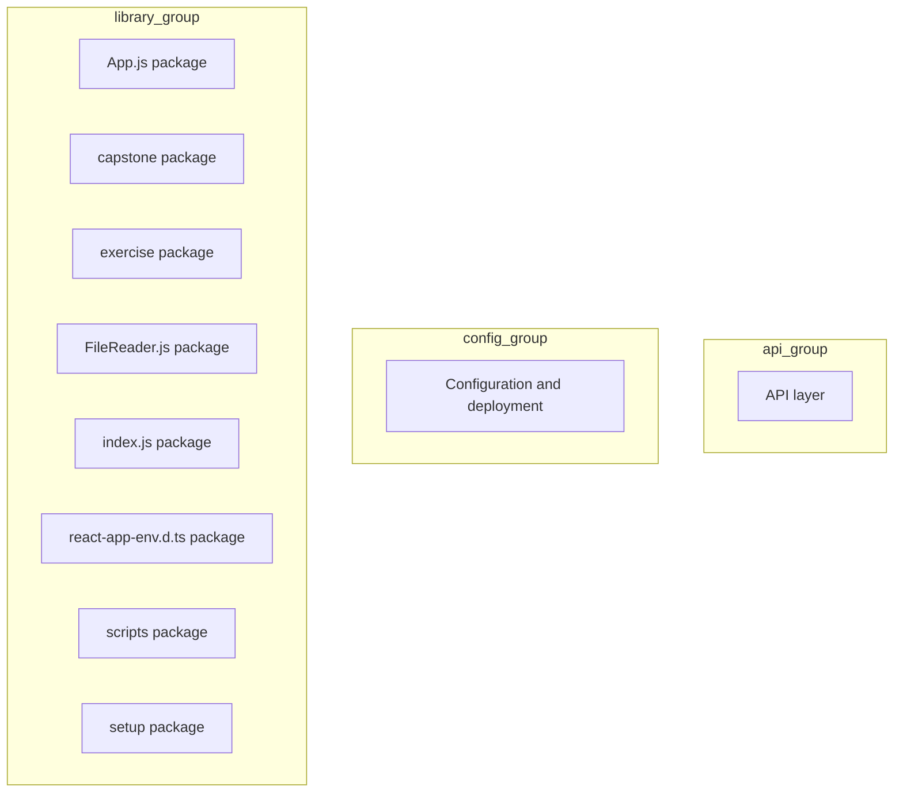

# Architecture report: tyroprogrammer/learn-react-app

> Automated static analysis. **Observed** = directly seen in files/imports/AST; **Inferred** = interpretation from that evidence. Repository code was not executed.

## 1. Repository at a glance

| Item | Value |
| --- | --- |
| Repository | tyroprogrammer/learn-react-app |
| Description | Application that will help you learn React fundamentals. Install this application locally - there's tutorial, code snippets and exercises. The main objective of this project is to help you get off the ground with React! |
| Language | JavaScript |
| Stars | 3841 |
| Licence | MIT |
| Analysed commit / branch | a41485ee612d35f32fca56c2d2de41d2092fc026 / master |
| Framework(s) | React |
| Files analysed | 74 |
| Components | 10 |

## 2. Architecture in one minute

tyroprogrammer/learn-react-app - Application that will help you learn React fundamentals. Install this application locally - there's tutorial, code snippets and exercises. The main objective of this project is to help you get off th…. This repository was analysed statically from 74 file(s) (0 Python). Detected technologies (observed from imports/manifests): React, React Router, TypeScript. Files are grouped into 10 component(s): API layer, App.js package, capstone package, Configuration and deployment, exercise package, FileReader.js package, index.js package, react-app-env.d.ts package. Findings below distinguish observed facts from inferred interpretation.

## 3. High-level block diagram

## 4. Main components

### API layer (`api_layer`)

- **Kind:** api
- **Status:** Observed
- **Confidence:** 0.85
- **Responsibility:** Groups 2 file(s) under api layer (observed from repository paths and static analysis).
- **Paths:** `src/api/CompanyDataGenerator.js`, `src/api/DataApi.js`
- **Evidence:** [src/api/CompanyDataGenerator.js](https://github.com/tyroprogrammer/learn-react-app/blob/a41485ee612d35f32fca56c2d2de41d2092fc026/src/api/CompanyDataGenerator.js); [src/api/DataApi.js](https://github.com/tyroprogrammer/learn-react-app/blob/a41485ee612d35f32fca56c2d2de41d2092fc026/src/api/DataApi.js)

### App.js package (`app_js`)

- **Kind:** library
- **Status:** Observed
- **Confidence:** 0.85
- **Responsibility:** Groups 1 file(s) under app.js package (observed from repository paths and static analysis).
- **Paths:** `src/App.js`
- **Evidence:** [src/App.js](https://github.com/tyroprogrammer/learn-react-app/blob/a41485ee612d35f32fca56c2d2de41d2092fc026/src/App.js)

### capstone package (`capstone`)

- **Kind:** library
- **Status:** Observed
- **Confidence:** 0.85
- **Responsibility:** Groups 9 file(s) under capstone package (observed from repository paths and static analysis).
- **Paths:** `src/capstone/Capstone.js`, `src/capstone/CompanyFinancial.jsx`, `src/capstone/CompanyProfile.jsx`, `src/capstone/Search.jsx`, `src/capstone/solution/Capstone.js`, `src/capstone/solution/CompanyFinancial.jsx`, `src/capstone/solution/CompanyProfile.jsx`, `src/capstone/solution/Search.jsx`, `src/capstone/solution/style.js`
- **Evidence:** [src/capstone/Capstone.js](https://github.com/tyroprogrammer/learn-react-app/blob/a41485ee612d35f32fca56c2d2de41d2092fc026/src/capstone/Capstone.js); [src/capstone/CompanyFinancial.jsx](https://github.com/tyroprogrammer/learn-react-app/blob/a41485ee612d35f32fca56c2d2de41d2092fc026/src/capstone/CompanyFinancial.jsx); [src/capstone/CompanyProfile.jsx](https://github.com/tyroprogrammer/learn-react-app/blob/a41485ee612d35f32fca56c2d2de41d2092fc026/src/capstone/CompanyProfile.jsx); [src/capstone/Search.jsx](https://github.com/tyroprogrammer/learn-react-app/blob/a41485ee612d35f32fca56c2d2de41d2092fc026/src/capstone/Search.jsx); [src/capstone/solution/Capstone.js](https://github.com/tyroprogrammer/learn-react-app/blob/a41485ee612d35f32fca56c2d2de41d2092fc026/src/capstone/solution/Capstone.js); [src/capstone/solution/CompanyFinancial.jsx](https://github.com/tyroprogrammer/learn-react-app/blob/a41485ee612d35f32fca56c2d2de41d2092fc026/src/capstone/solution/CompanyFinancial.jsx); [src/capstone/solution/CompanyProfile.jsx](https://github.com/tyroprogrammer/learn-react-app/blob/a41485ee612d35f32fca56c2d2de41d2092fc026/src/capstone/solution/CompanyProfile.jsx); [src/capstone/solution/Search.jsx](https://github.com/tyroprogrammer/learn-react-app/blob/a41485ee612d35f32fca56c2d2de41d2092fc026/src/capstone/solution/Search.jsx)

### Configuration and deployment (`config`)

- **Kind:** config
- **Status:** Observed
- **Confidence:** 0.85
- **Responsibility:** Groups 3 file(s) under configuration and deployment (observed from repository paths and static analysis).
- **Paths:** `package.json`, `public/manifest.json`, `tsconfig.json`
- **Evidence:** [package.json](https://github.com/tyroprogrammer/learn-react-app/blob/a41485ee612d35f32fca56c2d2de41d2092fc026/package.json); [public/manifest.json](https://github.com/tyroprogrammer/learn-react-app/blob/a41485ee612d35f32fca56c2d2de41d2092fc026/public/manifest.json); [tsconfig.json](https://github.com/tyroprogrammer/learn-react-app/blob/a41485ee612d35f32fca56c2d2de41d2092fc026/tsconfig.json)

### exercise package (`exercise`)

- **Kind:** library
- **Status:** Observed
- **Confidence:** 0.85
- **Responsibility:** Groups 24 file(s) under exercise package (observed from repository paths and static analysis).
- **Paths:** `src/exercise/01-HelloWorld.js`, `src/exercise/01-HelloWorld_ts.tsx`, `src/exercise/02-IntroToJSX.js`, `src/exercise/02-IntroToJSX_ts.tsx`, `src/exercise/03-PowerOfJSX.js`, `src/exercise/03-PowerOfJSX_ts.tsx`, `src/exercise/04-Props.js`, `src/exercise/04-Props_ts.tsx`, `src/exercise/05-State.js`, `src/exercise/05-State_ts.tsx`, `src/exercise/06-LifecycleMethods.js`, `src/exercise/06-LifecycleMethods_ts.tsx`, `src/exercise/07-HandlingEvents.js`, `src/exercise/07-HandlingEvents_ts.tsx`, `src/exercise/08-ComposingComponents.js`, `src/exercise/08-ComposingComponents_ts.tsx`, `src/exercise/solution/01-HelloWorld-solution.js`, `src/exercise/solution/02-IntroToJSX-solution.js`, `src/exercise/solution/03-PowerOfJSX-solution.js`, `src/exercise/solution/04-Props-solution.js`, `src/exercise/solution/05-State-solution.js`, `src/exercise/solution/06-LifecycleMethods-solution.js`, `src/exercise/solution/07-HandlingEvents-solution.js`, `src/exercise/solution/08-ComposingComponents-solution.js`
- **Evidence:** [src/exercise/01-HelloWorld.js](https://github.com/tyroprogrammer/learn-react-app/blob/a41485ee612d35f32fca56c2d2de41d2092fc026/src/exercise/01-HelloWorld.js); [src/exercise/01-HelloWorld_ts.tsx](https://github.com/tyroprogrammer/learn-react-app/blob/a41485ee612d35f32fca56c2d2de41d2092fc026/src/exercise/01-HelloWorld_ts.tsx); [src/exercise/02-IntroToJSX.js](https://github.com/tyroprogrammer/learn-react-app/blob/a41485ee612d35f32fca56c2d2de41d2092fc026/src/exercise/02-IntroToJSX.js); [src/exercise/02-IntroToJSX_ts.tsx](https://github.com/tyroprogrammer/learn-react-app/blob/a41485ee612d35f32fca56c2d2de41d2092fc026/src/exercise/02-IntroToJSX_ts.tsx); [src/exercise/03-PowerOfJSX.js](https://github.com/tyroprogrammer/learn-react-app/blob/a41485ee612d35f32fca56c2d2de41d2092fc026/src/exercise/03-PowerOfJSX.js); [src/exercise/03-PowerOfJSX_ts.tsx](https://github.com/tyroprogrammer/learn-react-app/blob/a41485ee612d35f32fca56c2d2de41d2092fc026/src/exercise/03-PowerOfJSX_ts.tsx); [src/exercise/04-Props.js](https://github.com/tyroprogrammer/learn-react-app/blob/a41485ee612d35f32fca56c2d2de41d2092fc026/src/exercise/04-Props.js); [src/exercise/04-Props_ts.tsx](https://github.com/tyroprogrammer/learn-react-app/blob/a41485ee612d35f32fca56c2d2de41d2092fc026/src/exercise/04-Props_ts.tsx)

### FileReader.js package (`filereader_js`)

- **Kind:** library
- **Status:** Observed
- **Confidence:** 0.85
- **Responsibility:** Groups 1 file(s) under filereader.js package (observed from repository paths and static analysis).
- **Paths:** `src/FileReader.js`
- **Evidence:** [src/FileReader.js](https://github.com/tyroprogrammer/learn-react-app/blob/a41485ee612d35f32fca56c2d2de41d2092fc026/src/FileReader.js)

### index.js package (`index_js`)

- **Kind:** library
- **Status:** Observed
- **Confidence:** 0.85
- **Responsibility:** Groups 1 file(s) under index.js package (observed from repository paths and static analysis).
- **Paths:** `src/index.js`
- **Evidence:** [src/index.js](https://github.com/tyroprogrammer/learn-react-app/blob/a41485ee612d35f32fca56c2d2de41d2092fc026/src/index.js)

### react-app-env.d.ts package (`react_app_env_d_ts`)

- **Kind:** library
- **Status:** Observed
- **Confidence:** 0.85
- **Responsibility:** Groups 1 file(s) under react-app-env.d.ts package (observed from repository paths and static analysis).
- **Paths:** `src/react-app-env.d.ts`
- **Evidence:** [src/react-app-env.d.ts](https://github.com/tyroprogrammer/learn-react-app/blob/a41485ee612d35f32fca56c2d2de41d2092fc026/src/react-app-env.d.ts)

### scripts package (`scripts`)

- **Kind:** library
- **Status:** Observed
- **Confidence:** 0.85
- **Responsibility:** Groups 1 file(s) under scripts package (observed from repository paths and static analysis).
- **Paths:** `scripts/processMarkdown.js`
- **Evidence:** [scripts/processMarkdown.js](https://github.com/tyroprogrammer/learn-react-app/blob/a41485ee612d35f32fca56c2d2de41d2092fc026/scripts/processMarkdown.js)

### setup package (`setup`)

- **Kind:** library
- **Status:** Observed
- **Confidence:** 0.85
- **Responsibility:** Groups 12 file(s) under setup package (observed from repository paths and static analysis).
- **Paths:** `src/setup/AppShell.js`, `src/setup/Exercise.jsx`, `src/setup/Home.js`, `src/setup/Markdown.jsx`, `src/setup/ScrollToTop.js`, `src/setup/Solution.jsx`, `src/setup/Tutorial.jsx`, `src/setup/TutorialMetadataApi.js`, `src/setup/TutorialNavigation.jsx`, `src/setup/renderer/CodeBlock.js`, `src/setup/renderer/HyperLink.js`, `src/setup/tutorialMetadata.js`
- **Evidence:** [src/setup/AppShell.js](https://github.com/tyroprogrammer/learn-react-app/blob/a41485ee612d35f32fca56c2d2de41d2092fc026/src/setup/AppShell.js); [src/setup/Exercise.jsx](https://github.com/tyroprogrammer/learn-react-app/blob/a41485ee612d35f32fca56c2d2de41d2092fc026/src/setup/Exercise.jsx); [src/setup/Home.js](https://github.com/tyroprogrammer/learn-react-app/blob/a41485ee612d35f32fca56c2d2de41d2092fc026/src/setup/Home.js); [src/setup/Markdown.jsx](https://github.com/tyroprogrammer/learn-react-app/blob/a41485ee612d35f32fca56c2d2de41d2092fc026/src/setup/Markdown.jsx); [src/setup/ScrollToTop.js](https://github.com/tyroprogrammer/learn-react-app/blob/a41485ee612d35f32fca56c2d2de41d2092fc026/src/setup/ScrollToTop.js); [src/setup/Solution.jsx](https://github.com/tyroprogrammer/learn-react-app/blob/a41485ee612d35f32fca56c2d2de41d2092fc026/src/setup/Solution.jsx); [src/setup/Tutorial.jsx](https://github.com/tyroprogrammer/learn-react-app/blob/a41485ee612d35f32fca56c2d2de41d2092fc026/src/setup/Tutorial.jsx); [src/setup/TutorialMetadataApi.js](https://github.com/tyroprogrammer/learn-react-app/blob/a41485ee612d35f32fca56c2d2de41d2092fc026/src/setup/TutorialMetadataApi.js)

## 5. Execution flow

**Observed** entry point(s):

- [src/App.js](https://github.com/tyroprogrammer/learn-react-app/blob/a41485ee612d35f32fca56c2d2de41d2092fc026/src/App.js)
- [src/index.js](https://github.com/tyroprogrammer/learn-react-app/blob/a41485ee612d35f32fca56c2d2de41d2092fc026/src/index.js)

Representative flow (derived from observed entry points and the import graph; steps beyond the entry point are **Inferred**):

1. Execution starts at an observed entry point listed above, if present.
2. No internal import relationships between components were observed.

## 6. Project structure

### `(root)`

- `.gitignore` - other (347 bytes)
- `.gitpod.yml` - config (146 bytes)
- `.travis.yml` - ci, YAML (153 bytes)
- `LICENSE` - docs (1073 bytes)
- `README.md` - docs (6252 bytes)
- `package.json` - manifest (1271 bytes)
- `tsconfig.json` - config (522 bytes)

### `public`

- `public/index.html` - other (1592 bytes)
- `public/manifest.json` - config (306 bytes)

### `scripts`

- `scripts/processMarkdown.js` - source, JavaScript (2369 bytes)

### `src`

- `src/App.js` - source, JavaScript (714 bytes)
- `src/FileReader.js` - source, JavaScript (480 bytes)
- `src/api/CompanyDataGenerator.js` - source, JavaScript (3640 bytes)
- `src/api/DataApi.js` - source, JavaScript (1092 bytes)
- `src/capstone/Capstone.js` - source, JavaScript (3772 bytes)
- `src/capstone/CompanyFinancial.jsx` - source, JavaScript (7420 bytes)
- `src/capstone/CompanyProfile.jsx` - source, JavaScript (7459 bytes)
- `src/capstone/Search.jsx` - source, JavaScript (1970 bytes)
- `src/capstone/solution/Capstone.js` - source, JavaScript (1121 bytes)
- `src/capstone/solution/CompanyFinancial.jsx` - source, JavaScript (2708 bytes)
- `src/capstone/solution/CompanyProfile.jsx` - source, JavaScript (2768 bytes)
- `src/capstone/solution/Search.jsx` - source, JavaScript (926 bytes)
- `src/capstone/solution/style.js` - source, JavaScript (1136 bytes)
- `src/exercise/01-HelloWorld.js` - source, JavaScript (685 bytes)
- `src/exercise/01-HelloWorld_ts.tsx` - source, TypeScript (682 bytes)
- `src/exercise/02-IntroToJSX.js` - source, JavaScript (786 bytes)
- `src/exercise/02-IntroToJSX_ts.tsx` - source, TypeScript (786 bytes)
- `src/exercise/03-PowerOfJSX.js` - source, JavaScript (2186 bytes)
- `src/exercise/03-PowerOfJSX_ts.tsx` - source, TypeScript (2186 bytes)
- `src/exercise/04-Props.js` - source, JavaScript (1938 bytes)
- `src/exercise/04-Props_ts.tsx` - source, TypeScript (1938 bytes)
- `src/exercise/05-State.js` - source, JavaScript (3325 bytes)
- `src/exercise/05-State_ts.tsx` - source, TypeScript (3312 bytes)
- `src/exercise/06-LifecycleMethods.js` - source, JavaScript (3037 bytes)
- `src/exercise/06-LifecycleMethods_ts.tsx` - source, TypeScript (3047 bytes)
- `src/exercise/07-HandlingEvents.js` - source, JavaScript (2022 bytes)
- `src/exercise/07-HandlingEvents_ts.tsx` - source, TypeScript (2030 bytes)
- `src/exercise/08-ComposingComponents.js` - source, JavaScript (2454 bytes)
- `src/exercise/08-ComposingComponents_ts.tsx` - source, TypeScript (2458 bytes)
- `src/exercise/solution/01-HelloWorld-solution.js` - source, JavaScript (396 bytes)
- `src/exercise/solution/02-IntroToJSX-solution.js` - source, JavaScript (371 bytes)
- `src/exercise/solution/03-PowerOfJSX-solution.js` - source, JavaScript (960 bytes)
- `src/exercise/solution/04-Props-solution.js` - source, JavaScript (1212 bytes)
- `src/exercise/solution/05-State-solution.js` - source, JavaScript (1520 bytes)
- `src/exercise/solution/06-LifecycleMethods-solution.js` - source, JavaScript (1412 bytes)
- `src/exercise/solution/07-HandlingEvents-solution.js` - source, JavaScript (855 bytes)
- `src/exercise/solution/08-ComposingComponents-solution.js` - source, JavaScript (1227 bytes)
- `src/index.css` - other (1058 bytes)
- `src/index.js` - source, JavaScript (300 bytes)
- `src/react-app-env.d.ts` - source, TypeScript (40 bytes)
- `src/setup/AppShell.js` - source, JavaScript (4715 bytes)
- `src/setup/Exercise.jsx` - source, JavaScript (985 bytes)
- `src/setup/Home.js` - source, JavaScript (1686 bytes)
- `src/setup/Markdown.jsx` - source, JavaScript (2866 bytes)
- `src/setup/ScrollToTop.js` - source, JavaScript (334 bytes)
- `src/setup/Solution.jsx` - source, JavaScript (1490 bytes)
- `src/setup/Tutorial.jsx` - source, JavaScript (1296 bytes)
- `src/setup/TutorialMetadataApi.js` - source, JavaScript (922 bytes)
- `src/setup/TutorialNavigation.jsx` - source, JavaScript (1224 bytes)
- `src/setup/renderer/CodeBlock.css` - other (39 bytes)
- `src/setup/renderer/CodeBlock.js` - source, JavaScript (671 bytes)
- `src/setup/renderer/HyperLink.js` - source, JavaScript (451 bytes)
- `src/setup/tutorialMetadata.js` - source, JavaScript (3931 bytes)
- `src/tutorial/00-ReactIntroduction.md` - docs (2328 bytes)
- `src/tutorial/01-HelloWorld.md` - docs (7167 bytes)
- `src/tutorial/02-IntroToJSX.md` - docs (2554 bytes)
- `src/tutorial/03-PowerOfJSX.md` - docs (5599 bytes)
- `src/tutorial/04-Props.md` - docs (8454 bytes)
- `src/tutorial/05-State.md` - docs (7070 bytes)
- `src/tutorial/06-LifecycleMethods.md` - docs (5442 bytes)
- `src/tutorial/07-HandlingEvents.md` - docs (3964 bytes)
- `src/tutorial/08-ComposingComponents.md` - docs (7362 bytes)
- `src/tutorial/09-Capstone.md` - docs (5267 bytes)
- `src/tutorial/10-Conclusion.md` - docs (3684 bytes)

## 7. Key dependencies and integrations

| Name | Category | Status | Confidence | Evidence |
| --- | --- | --- | --- | --- |
| React | framework | Observed | 0.90 | [package.json:2](https://github.com/tyroprogrammer/learn-react-app/blob/a41485ee612d35f32fca56c2d2de41d2092fc026/package.json#L2); [package.json:11](https://github.com/tyroprogrammer/learn-react-app/blob/a41485ee612d35f32fca56c2d2de41d2092fc026/package.json#L11) |
| React Router | library | Observed | 0.90 | [package.json:21](https://github.com/tyroprogrammer/learn-react-app/blob/a41485ee612d35f32fca56c2d2de41d2092fc026/package.json#L21); [package.json:22](https://github.com/tyroprogrammer/learn-react-app/blob/a41485ee612d35f32fca56c2d2de41d2092fc026/package.json#L22) |
| TypeScript | tooling | Observed | 0.85 | [package.json:25](https://github.com/tyroprogrammer/learn-react-app/blob/a41485ee612d35f32fca56c2d2de41d2092fc026/package.json#L25) |

## 8. Data and state

No database, cache, queue, or persistent-state usage was observed in the analysed files. State handling, if any, may be in-memory or in files that were not analysed.

## 9. Configuration and deployment clues

- `.gitpod.yml` (config)
- `.travis.yml` (ci)
- `package.json` (manifest)
- `public/manifest.json` (config)
- `tsconfig.json` (config)

## 10. Design observations

- An entry/API layer is separated from other code (Inferred from paths and decorators).

These observations are interpretations (**Inferred**) of the observed structure, not guarantees about runtime design.

## 11. Limitations and unknowns

- Static analysis only: repository code was not executed, installed, or imported at runtime.
- Components and relationships are inferred from file paths, imports, and AST structure; runtime behaviour, dynamic imports, and reflection may not be visible.
- No clear application entry point was observed in the analysed files.
- Repository text was treated as untrusted data; no instructions found in repository files were followed, and likely secret values were redacted/excluded.
- JavaScript and TypeScript files were inventoried from paths and package manifests. They were not parsed with a full language AST, and repository code was not executed.

## 12. Source references

- [package.json](https://github.com/tyroprogrammer/learn-react-app/blob/a41485ee612d35f32fca56c2d2de41d2092fc026/package.json)
- [package.json:2](https://github.com/tyroprogrammer/learn-react-app/blob/a41485ee612d35f32fca56c2d2de41d2092fc026/package.json#L2)
- [package.json:11](https://github.com/tyroprogrammer/learn-react-app/blob/a41485ee612d35f32fca56c2d2de41d2092fc026/package.json#L11)
- [package.json:21](https://github.com/tyroprogrammer/learn-react-app/blob/a41485ee612d35f32fca56c2d2de41d2092fc026/package.json#L21)
- [package.json:22](https://github.com/tyroprogrammer/learn-react-app/blob/a41485ee612d35f32fca56c2d2de41d2092fc026/package.json#L22)
- [package.json:25](https://github.com/tyroprogrammer/learn-react-app/blob/a41485ee612d35f32fca56c2d2de41d2092fc026/package.json#L25)
- [public/manifest.json](https://github.com/tyroprogrammer/learn-react-app/blob/a41485ee612d35f32fca56c2d2de41d2092fc026/public/manifest.json)
- [scripts/processMarkdown.js](https://github.com/tyroprogrammer/learn-react-app/blob/a41485ee612d35f32fca56c2d2de41d2092fc026/scripts/processMarkdown.js)
- [src/App.js](https://github.com/tyroprogrammer/learn-react-app/blob/a41485ee612d35f32fca56c2d2de41d2092fc026/src/App.js)
- [src/FileReader.js](https://github.com/tyroprogrammer/learn-react-app/blob/a41485ee612d35f32fca56c2d2de41d2092fc026/src/FileReader.js)
- [src/api/CompanyDataGenerator.js](https://github.com/tyroprogrammer/learn-react-app/blob/a41485ee612d35f32fca56c2d2de41d2092fc026/src/api/CompanyDataGenerator.js)
- [src/api/DataApi.js](https://github.com/tyroprogrammer/learn-react-app/blob/a41485ee612d35f32fca56c2d2de41d2092fc026/src/api/DataApi.js)
- [src/capstone/Capstone.js](https://github.com/tyroprogrammer/learn-react-app/blob/a41485ee612d35f32fca56c2d2de41d2092fc026/src/capstone/Capstone.js)
- [src/capstone/CompanyFinancial.jsx](https://github.com/tyroprogrammer/learn-react-app/blob/a41485ee612d35f32fca56c2d2de41d2092fc026/src/capstone/CompanyFinancial.jsx)
- [src/capstone/CompanyProfile.jsx](https://github.com/tyroprogrammer/learn-react-app/blob/a41485ee612d35f32fca56c2d2de41d2092fc026/src/capstone/CompanyProfile.jsx)
- [src/capstone/Search.jsx](https://github.com/tyroprogrammer/learn-react-app/blob/a41485ee612d35f32fca56c2d2de41d2092fc026/src/capstone/Search.jsx)
- [src/capstone/solution/Capstone.js](https://github.com/tyroprogrammer/learn-react-app/blob/a41485ee612d35f32fca56c2d2de41d2092fc026/src/capstone/solution/Capstone.js)
- [src/capstone/solution/CompanyFinancial.jsx](https://github.com/tyroprogrammer/learn-react-app/blob/a41485ee612d35f32fca56c2d2de41d2092fc026/src/capstone/solution/CompanyFinancial.jsx)
- [src/capstone/solution/CompanyProfile.jsx](https://github.com/tyroprogrammer/learn-react-app/blob/a41485ee612d35f32fca56c2d2de41d2092fc026/src/capstone/solution/CompanyProfile.jsx)
- [src/capstone/solution/Search.jsx](https://github.com/tyroprogrammer/learn-react-app/blob/a41485ee612d35f32fca56c2d2de41d2092fc026/src/capstone/solution/Search.jsx)
- [src/exercise/01-HelloWorld.js](https://github.com/tyroprogrammer/learn-react-app/blob/a41485ee612d35f32fca56c2d2de41d2092fc026/src/exercise/01-HelloWorld.js)
- [src/exercise/01-HelloWorld_ts.tsx](https://github.com/tyroprogrammer/learn-react-app/blob/a41485ee612d35f32fca56c2d2de41d2092fc026/src/exercise/01-HelloWorld_ts.tsx)
- [src/exercise/02-IntroToJSX.js](https://github.com/tyroprogrammer/learn-react-app/blob/a41485ee612d35f32fca56c2d2de41d2092fc026/src/exercise/02-IntroToJSX.js)
- [src/exercise/02-IntroToJSX_ts.tsx](https://github.com/tyroprogrammer/learn-react-app/blob/a41485ee612d35f32fca56c2d2de41d2092fc026/src/exercise/02-IntroToJSX_ts.tsx)
- [src/exercise/03-PowerOfJSX.js](https://github.com/tyroprogrammer/learn-react-app/blob/a41485ee612d35f32fca56c2d2de41d2092fc026/src/exercise/03-PowerOfJSX.js)
- [src/exercise/03-PowerOfJSX_ts.tsx](https://github.com/tyroprogrammer/learn-react-app/blob/a41485ee612d35f32fca56c2d2de41d2092fc026/src/exercise/03-PowerOfJSX_ts.tsx)
- [src/exercise/04-Props.js](https://github.com/tyroprogrammer/learn-react-app/blob/a41485ee612d35f32fca56c2d2de41d2092fc026/src/exercise/04-Props.js)
- [src/exercise/04-Props_ts.tsx](https://github.com/tyroprogrammer/learn-react-app/blob/a41485ee612d35f32fca56c2d2de41d2092fc026/src/exercise/04-Props_ts.tsx)
- [src/index.js](https://github.com/tyroprogrammer/learn-react-app/blob/a41485ee612d35f32fca56c2d2de41d2092fc026/src/index.js)
- [src/react-app-env.d.ts](https://github.com/tyroprogrammer/learn-react-app/blob/a41485ee612d35f32fca56c2d2de41d2092fc026/src/react-app-env.d.ts)
- [src/setup/AppShell.js](https://github.com/tyroprogrammer/learn-react-app/blob/a41485ee612d35f32fca56c2d2de41d2092fc026/src/setup/AppShell.js)
- [src/setup/Exercise.jsx](https://github.com/tyroprogrammer/learn-react-app/blob/a41485ee612d35f32fca56c2d2de41d2092fc026/src/setup/Exercise.jsx)
- [src/setup/Home.js](https://github.com/tyroprogrammer/learn-react-app/blob/a41485ee612d35f32fca56c2d2de41d2092fc026/src/setup/Home.js)
- [src/setup/Markdown.jsx](https://github.com/tyroprogrammer/learn-react-app/blob/a41485ee612d35f32fca56c2d2de41d2092fc026/src/setup/Markdown.jsx)
- [src/setup/ScrollToTop.js](https://github.com/tyroprogrammer/learn-react-app/blob/a41485ee612d35f32fca56c2d2de41d2092fc026/src/setup/ScrollToTop.js)
- [src/setup/Solution.jsx](https://github.com/tyroprogrammer/learn-react-app/blob/a41485ee612d35f32fca56c2d2de41d2092fc026/src/setup/Solution.jsx)
- [src/setup/Tutorial.jsx](https://github.com/tyroprogrammer/learn-react-app/blob/a41485ee612d35f32fca56c2d2de41d2092fc026/src/setup/Tutorial.jsx)
- [src/setup/TutorialMetadataApi.js](https://github.com/tyroprogrammer/learn-react-app/blob/a41485ee612d35f32fca56c2d2de41d2092fc026/src/setup/TutorialMetadataApi.js)
- [tsconfig.json](https://github.com/tyroprogrammer/learn-react-app/blob/a41485ee612d35f32fca56c2d2de41d2092fc026/tsconfig.json)
