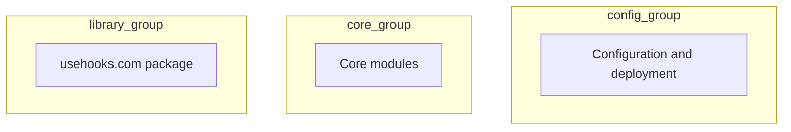

# Architecture report: uidotdev/usehooks

> Automated static analysis. **Observed** = directly seen in files/imports/AST; **Inferred** = interpretation from that evidence. Repository code was not executed.

## 1. Repository at a glance

| Item | Value |
| --- | --- |
| Repository | uidotdev/usehooks |
| Description | A collection of modern, server-safe React hooks – from the ui.dev team |
| Language | MDX |
| Stars | 11499 |
| Licence | MIT |
| Analysed commit / branch | 945436df0037bc21133379a5e13f1bd73f1ffc36 / main |
| Framework(s) | React |
| Files analysed | 115 |
| Components | 3 |

## 2. Architecture in one minute

uidotdev/usehooks - A collection of modern, server-safe React hooks – from the ui.dev team. This repository was analysed statically from 115 file(s) (0 Python). Detected technologies (observed from imports/manifests): React, Tailwind CSS, TypeScript. Files are grouped into 3 component(s): Configuration and deployment, Core modules, usehooks.com package. Findings below distinguish observed facts from inferred interpretation.

## 3. High-level block diagram

## 4. Main components

### Configuration and deployment (`config`)

- **Kind:** config
- **Status:** Observed
- **Confidence:** 0.85
- **Responsibility:** Groups 7 file(s) under configuration and deployment (observed from repository paths and static analysis).
- **Paths:** `package.json`, `tsconfig.json`, `usehooks.com/.eslintrc.json`, `usehooks.com/package.json`, `usehooks.com/theme.json`, `usehooks.com/tsconfig.json`, `usehooks.com/vercel.json`
- **Evidence:** [package.json](https://github.com/uidotdev/usehooks/blob/945436df0037bc21133379a5e13f1bd73f1ffc36/package.json); [tsconfig.json](https://github.com/uidotdev/usehooks/blob/945436df0037bc21133379a5e13f1bd73f1ffc36/tsconfig.json); [usehooks.com/.eslintrc.json](https://github.com/uidotdev/usehooks/blob/945436df0037bc21133379a5e13f1bd73f1ffc36/usehooks.com/.eslintrc.json); [usehooks.com/package.json](https://github.com/uidotdev/usehooks/blob/945436df0037bc21133379a5e13f1bd73f1ffc36/usehooks.com/package.json); [usehooks.com/theme.json](https://github.com/uidotdev/usehooks/blob/945436df0037bc21133379a5e13f1bd73f1ffc36/usehooks.com/theme.json); [usehooks.com/tsconfig.json](https://github.com/uidotdev/usehooks/blob/945436df0037bc21133379a5e13f1bd73f1ffc36/usehooks.com/tsconfig.json); [usehooks.com/vercel.json](https://github.com/uidotdev/usehooks/blob/945436df0037bc21133379a5e13f1bd73f1ffc36/usehooks.com/vercel.json)

### Core modules (`core`)

- **Kind:** core
- **Status:** Observed
- **Confidence:** 0.85
- **Responsibility:** Groups 2 file(s) under core modules (observed from repository paths and static analysis).
- **Paths:** `index.d.ts`, `index.js`
- **Evidence:** [index.d.ts](https://github.com/uidotdev/usehooks/blob/945436df0037bc21133379a5e13f1bd73f1ffc36/index.d.ts); [index.js](https://github.com/uidotdev/usehooks/blob/945436df0037bc21133379a5e13f1bd73f1ffc36/index.js)

### usehooks.com package (`usehooks_com`)

- **Kind:** library
- **Status:** Observed
- **Confidence:** 0.85
- **Responsibility:** Groups 15 file(s) under usehooks.com package (observed from repository paths and static analysis).
- **Paths:** `usehooks.com/.astro/types.d.ts`, `usehooks.com/astro.config.mjs`, `usehooks.com/generate-og-images.mjs`, `usehooks.com/src/components/CountdownTimer.tsx`, `usehooks.com/src/components/codepreview/CodePreview.tsx`, `usehooks.com/src/components/codepreview/CodeWrapper.tsx`, `usehooks.com/src/components/codepreview/utils.ts`, `usehooks.com/src/components/search/Callout.tsx`, `usehooks.com/src/components/search/HookCard.tsx`, `usehooks.com/src/components/search/HookSearch.tsx`, `usehooks.com/src/components/search/HookSort.tsx`, `usehooks.com/src/components/search/HooksList.tsx`, `usehooks.com/src/content/config.ts`, `usehooks.com/src/env.d.ts`, `usehooks.com/tailwind.config.cjs`
- **Evidence:** [usehooks.com/.astro/types.d.ts](https://github.com/uidotdev/usehooks/blob/945436df0037bc21133379a5e13f1bd73f1ffc36/usehooks.com/.astro/types.d.ts); [usehooks.com/astro.config.mjs](https://github.com/uidotdev/usehooks/blob/945436df0037bc21133379a5e13f1bd73f1ffc36/usehooks.com/astro.config.mjs); [usehooks.com/generate-og-images.mjs](https://github.com/uidotdev/usehooks/blob/945436df0037bc21133379a5e13f1bd73f1ffc36/usehooks.com/generate-og-images.mjs); [usehooks.com/src/components/CountdownTimer.tsx](https://github.com/uidotdev/usehooks/blob/945436df0037bc21133379a5e13f1bd73f1ffc36/usehooks.com/src/components/CountdownTimer.tsx); [usehooks.com/src/components/codepreview/CodePreview.tsx](https://github.com/uidotdev/usehooks/blob/945436df0037bc21133379a5e13f1bd73f1ffc36/usehooks.com/src/components/codepreview/CodePreview.tsx); [usehooks.com/src/components/codepreview/CodeWrapper.tsx](https://github.com/uidotdev/usehooks/blob/945436df0037bc21133379a5e13f1bd73f1ffc36/usehooks.com/src/components/codepreview/CodeWrapper.tsx); [usehooks.com/src/components/codepreview/utils.ts](https://github.com/uidotdev/usehooks/blob/945436df0037bc21133379a5e13f1bd73f1ffc36/usehooks.com/src/components/codepreview/utils.ts); [usehooks.com/src/components/search/Callout.tsx](https://github.com/uidotdev/usehooks/blob/945436df0037bc21133379a5e13f1bd73f1ffc36/usehooks.com/src/components/search/Callout.tsx)

## 5. Execution flow

**Observed** entry point(s):

- [index.js](https://github.com/uidotdev/usehooks/blob/945436df0037bc21133379a5e13f1bd73f1ffc36/index.js)

Representative flow (derived from observed entry points and the import graph; steps beyond the entry point are **Inferred**):

1. Execution starts at an observed entry point listed above, if present.
2. No internal import relationships between components were observed.

## 6. Project structure

### `(root)`

- `.gitignore` - other (839 bytes)
- `LICENSE` - docs (1063 bytes)
- `README.md` - docs (3027 bytes)
- `index.d.ts` - source, TypeScript (5991 bytes)
- `index.js` - source, JavaScript (32242 bytes)
- `package.json` - manifest (652 bytes)
- `tsconfig.json` - config (284 bytes)

### `usehooks.com`

- `usehooks.com/.astro/types.d.ts` - source, TypeScript (15176 bytes)
- `usehooks.com/.eslintrc.json` - config (40 bytes)
- `usehooks.com/.gitignore` - other (101 bytes)
- `usehooks.com/.prettierrc` - other (2 bytes)
- `usehooks.com/README.md` - docs (1568 bytes)
- `usehooks.com/astro.config.mjs` - source, JavaScript (998 bytes)
- `usehooks.com/generate-og-images.mjs` - source, JavaScript (3615 bytes)
- `usehooks.com/package.json` - manifest (856 bytes)
- `usehooks.com/public/img/d20.svg` - other (6331 bytes)
- `usehooks.com/public/img/hot-sauce.svg` - other (7839 bytes)
- `usehooks.com/public/img/icon-copy.svg` - other (321 bytes)
- `usehooks.com/public/img/icon-github.svg` - other (765 bytes)
- `usehooks.com/public/img/icon-search.svg` - other (328 bytes)
- `usehooks.com/public/img/logo-useHooks.svg` - other (3354 bytes)
- `usehooks.com/public/img/money.svg` - other (26717 bytes)
- `usehooks.com/public/img/react-gg-logo-sticker.svg` - other (7402 bytes)
- `usehooks.com/public/img/react-gg-logo.svg` - other (3784 bytes)
- `usehooks.com/public/img/spinner.svg` - other (11229 bytes)
- `usehooks.com/public/img/ui-logo.svg` - other (536 bytes)
- `usehooks.com/src/components/Button.astro` - other (1362 bytes)
- `usehooks.com/src/components/CodePreview.astro` - other (367 bytes)
- `usehooks.com/src/components/CountdownTimer.tsx` - source, TypeScript (2546 bytes)
- `usehooks.com/src/components/HookDescription.astro` - other (1691 bytes)
- `usehooks.com/src/components/Install.astro` - other (2052 bytes)
- `usehooks.com/src/components/Logo.astro` - other (405 bytes)
- `usehooks.com/src/components/LogoGithub.astro` - other (492 bytes)
- `usehooks.com/src/components/QueryGGBanner.astro` - other (3054 bytes)
- `usehooks.com/src/components/RelatedHook.astro` - other (261 bytes)
- `usehooks.com/src/components/StaticCodeContainer.astro` - other (230 bytes)
- `usehooks.com/src/components/Svg.astro` - other (196 bytes)
- `usehooks.com/src/components/codepreview/CodePreview.tsx` - source, TypeScript (1150 bytes)
- `usehooks.com/src/components/codepreview/CodeWrapper.tsx` - source, TypeScript (1730 bytes)
- `usehooks.com/src/components/codepreview/utils.ts` - source, TypeScript (1076 bytes)
- `usehooks.com/src/components/search/Callout.module.css` - other (743 bytes)
- `usehooks.com/src/components/search/Callout.tsx` - source, TypeScript (758 bytes)
- `usehooks.com/src/components/search/HookCard.module.css` - other (731 bytes)
- `usehooks.com/src/components/search/HookCard.tsx` - source, TypeScript (769 bytes)
- `usehooks.com/src/components/search/HookSearch.module.css` - other (852 bytes)
- `usehooks.com/src/components/search/HookSearch.tsx` - source, TypeScript (601 bytes)
- `usehooks.com/src/components/search/HookSort.module.css` - other (392 bytes)
- `usehooks.com/src/components/search/HookSort.tsx` - source, TypeScript (671 bytes)
- `usehooks.com/src/components/search/HooksList.module.css` - other (297 bytes)
- `usehooks.com/src/components/search/HooksList.tsx` - source, TypeScript (3055 bytes)
- `usehooks.com/src/content/config.ts` - source, TypeScript (530 bytes)
- `usehooks.com/src/content/hooks/useBattery.mdx` - other (2726 bytes)
- `usehooks.com/src/content/hooks/useClickAway.mdx` - other (2843 bytes)
- `usehooks.com/src/content/hooks/useContinuousRetry.mdx` - other (3119 bytes)
- `usehooks.com/src/content/hooks/useCopyToClipboard.mdx` - other (2621 bytes)
- `usehooks.com/src/content/hooks/useCountdown.mdx` - other (3738 bytes)
- `usehooks.com/src/content/hooks/useCounter.mdx` - other (3241 bytes)
- `usehooks.com/src/content/hooks/useDebounce.mdx` - other (3341 bytes)
- `usehooks.com/src/content/hooks/useDefault.mdx` - other (2522 bytes)
- `usehooks.com/src/content/hooks/useDocumentTitle.mdx` - other (1844 bytes)
- `usehooks.com/src/content/hooks/useEventListener.mdx` - other (3513 bytes)
- `usehooks.com/src/content/hooks/useFavicon.mdx` - other (2280 bytes)
- `usehooks.com/src/content/hooks/useFetch.mdx` - other (3119 bytes)
- `usehooks.com/src/content/hooks/useGeolocation.mdx` - other (3179 bytes)
- `usehooks.com/src/content/hooks/useHistoryState.mdx` - other (3554 bytes)
- `usehooks.com/src/content/hooks/useHover.mdx` - other (2049 bytes)
- `usehooks.com/src/content/hooks/useIdle.mdx` - other (2018 bytes)
- `usehooks.com/src/content/hooks/useIntersectionObserver.mdx` - other (4556 bytes)
- `usehooks.com/src/content/hooks/useInterval.mdx` - other (2682 bytes)
- `usehooks.com/src/content/hooks/useIntervalWhen.mdx` - other (3310 bytes)
- `usehooks.com/src/content/hooks/useIsClient.mdx` - other (1727 bytes)
- `usehooks.com/src/content/hooks/useIsFirstRender.mdx` - other (1844 bytes)
- `usehooks.com/src/content/hooks/useKeyPress.mdx` - other (3470 bytes)
- `usehooks.com/src/content/hooks/useList.mdx` - other (3504 bytes)
- `usehooks.com/src/content/hooks/useLocalStorage.mdx` - other (2828 bytes)
- `usehooks.com/src/content/hooks/useLockBodyScroll.mdx` - other (2306 bytes)
- `usehooks.com/src/content/hooks/useLogger.mdx` - other (2359 bytes)
- `usehooks.com/src/content/hooks/useLongPress.mdx` - other (3392 bytes)
- `usehooks.com/src/content/hooks/useMap.mdx` - other (2640 bytes)
- `usehooks.com/src/content/hooks/useMeasure.mdx` - other (2423 bytes)
- `usehooks.com/src/content/hooks/useMediaQuery.mdx` - other (3007 bytes)
- `usehooks.com/src/content/hooks/useMouse.mdx` - other (3494 bytes)
- `usehooks.com/src/content/hooks/useNetworkState.mdx` - other (3955 bytes)
- `usehooks.com/src/content/hooks/useObjectState.mdx` - other (3069 bytes)
- `usehooks.com/src/content/hooks/useOrientation.mdx` - other (2841 bytes)
- `usehooks.com/src/content/hooks/usePageLeave.mdx` - other (1940 bytes)
- `usehooks.com/src/content/hooks/usePreferredLanguage.mdx` - other (1849 bytes)
- `usehooks.com/src/content/hooks/usePrevious.mdx` - other (2623 bytes)
- `usehooks.com/src/content/hooks/useQueue.mdx` - other (3614 bytes)
- `usehooks.com/src/content/hooks/useRandomInterval.mdx` - other (2812 bytes)
- `usehooks.com/src/content/hooks/useRenderCount.mdx` - other (1982 bytes)
- `usehooks.com/src/content/hooks/useRenderInfo.mdx` - other (2634 bytes)
- `usehooks.com/src/content/hooks/useScript.mdx` - other (2847 bytes)
- `usehooks.com/src/content/hooks/useSessionStorage.mdx` - other (4003 bytes)
- `usehooks.com/src/content/hooks/useSet.mdx` - other (3357 bytes)
- `usehooks.com/src/content/hooks/useThrottle.mdx` - other (2333 bytes)
- `usehooks.com/src/content/hooks/useTimeout.mdx` - other (3292 bytes)
- `usehooks.com/src/content/hooks/useToggle.mdx` - other (2684 bytes)
- `usehooks.com/src/content/hooks/useVisibilityChange.mdx` - other (2012 bytes)
- `usehooks.com/src/content/hooks/useWindowScroll.mdx` - other (2872 bytes)
- `usehooks.com/src/content/hooks/useWindowSize.mdx` - other (2304 bytes)
- `usehooks.com/src/env.d.ts` - source, TypeScript (85 bytes)
- `usehooks.com/src/layouts/Layout.astro` - other (3144 bytes)
- `usehooks.com/src/pages/404.astro` - other (787 bytes)
- `usehooks.com/src/pages/[hook].astro` - other (5290 bytes)
- `usehooks.com/src/pages/index.astro` - other (592 bytes)
- `usehooks.com/src/sections/Footer.astro` - other (1292 bytes)
- `usehooks.com/src/sections/HomeHero.astro` - other (2716 bytes)
- `usehooks.com/src/sections/NavInternal.astro` - other (731 bytes)
- `usehooks.com/src/sections/NavMain.astro` - other (304 bytes)
- `usehooks.com/src/styles/globals.css` - other (5041 bytes)
- `usehooks.com/tailwind.config.cjs` - source, JavaScript (678 bytes)
- `usehooks.com/theme.json` - config (10509 bytes)
- `usehooks.com/tsconfig.json` - config (201 bytes)
- `usehooks.com/vercel.json` - config (2469 bytes)

## 7. Key dependencies and integrations

| Name | Category | Status | Confidence | Evidence |
| --- | --- | --- | --- | --- |
| React | framework | Observed | 0.90 | [package.json:4](https://github.com/uidotdev/usehooks/blob/945436df0037bc21133379a5e13f1bd73f1ffc36/package.json#L4); [package.json:10](https://github.com/uidotdev/usehooks/blob/945436df0037bc21133379a5e13f1bd73f1ffc36/package.json#L10); [usehooks.com/package.json:2](https://github.com/uidotdev/usehooks/blob/945436df0037bc21133379a5e13f1bd73f1ffc36/usehooks.com/package.json#L2); [usehooks.com/package.json:21](https://github.com/uidotdev/usehooks/blob/945436df0037bc21133379a5e13f1bd73f1ffc36/usehooks.com/package.json#L21) |
| Tailwind CSS | library | Observed | 0.85 | [usehooks.com/package.json:27](https://github.com/uidotdev/usehooks/blob/945436df0037bc21133379a5e13f1bd73f1ffc36/usehooks.com/package.json#L27) |
| TypeScript | tooling | Observed | 0.85 | [package.json:11](https://github.com/uidotdev/usehooks/blob/945436df0037bc21133379a5e13f1bd73f1ffc36/package.json#L11) |

## 8. Data and state

No database, cache, queue, or persistent-state usage was observed in the analysed files. State handling, if any, may be in-memory or in files that were not analysed.

## 9. Configuration and deployment clues

- `package.json` (manifest)
- `tsconfig.json` (config)
- `usehooks.com/.eslintrc.json` (config)
- `usehooks.com/package.json` (manifest)
- `usehooks.com/theme.json` (config)
- `usehooks.com/tsconfig.json` (config)
- `usehooks.com/vercel.json` (config)

## 10. Design observations

- No strong design patterns could be established from the available evidence.

These observations are interpretations (**Inferred**) of the observed structure, not guarantees about runtime design.

## 11. Limitations and unknowns

- Static analysis only: repository code was not executed, installed, or imported at runtime.
- Components and relationships are inferred from file paths, imports, and AST structure; runtime behaviour, dynamic imports, and reflection may not be visible.
- 1 file(s) were skipped during inventory (1 x lockfile excluded).
- No clear application entry point was observed in the analysed files.
- Repository text was treated as untrusted data; no instructions found in repository files were followed, and likely secret values were redacted/excluded.
- JavaScript and TypeScript files were inventoried from paths and package manifests. They were not parsed with a full language AST, and repository code was not executed.

## 12. Source references

- [index.d.ts](https://github.com/uidotdev/usehooks/blob/945436df0037bc21133379a5e13f1bd73f1ffc36/index.d.ts)
- [index.js](https://github.com/uidotdev/usehooks/blob/945436df0037bc21133379a5e13f1bd73f1ffc36/index.js)
- [package.json](https://github.com/uidotdev/usehooks/blob/945436df0037bc21133379a5e13f1bd73f1ffc36/package.json)
- [package.json:4](https://github.com/uidotdev/usehooks/blob/945436df0037bc21133379a5e13f1bd73f1ffc36/package.json#L4)
- [package.json:10](https://github.com/uidotdev/usehooks/blob/945436df0037bc21133379a5e13f1bd73f1ffc36/package.json#L10)
- [package.json:11](https://github.com/uidotdev/usehooks/blob/945436df0037bc21133379a5e13f1bd73f1ffc36/package.json#L11)
- [tsconfig.json](https://github.com/uidotdev/usehooks/blob/945436df0037bc21133379a5e13f1bd73f1ffc36/tsconfig.json)
- [usehooks.com/.astro/types.d.ts](https://github.com/uidotdev/usehooks/blob/945436df0037bc21133379a5e13f1bd73f1ffc36/usehooks.com/.astro/types.d.ts)
- [usehooks.com/.eslintrc.json](https://github.com/uidotdev/usehooks/blob/945436df0037bc21133379a5e13f1bd73f1ffc36/usehooks.com/.eslintrc.json)
- [usehooks.com/astro.config.mjs](https://github.com/uidotdev/usehooks/blob/945436df0037bc21133379a5e13f1bd73f1ffc36/usehooks.com/astro.config.mjs)
- [usehooks.com/generate-og-images.mjs](https://github.com/uidotdev/usehooks/blob/945436df0037bc21133379a5e13f1bd73f1ffc36/usehooks.com/generate-og-images.mjs)
- [usehooks.com/package.json](https://github.com/uidotdev/usehooks/blob/945436df0037bc21133379a5e13f1bd73f1ffc36/usehooks.com/package.json)
- [usehooks.com/package.json:2](https://github.com/uidotdev/usehooks/blob/945436df0037bc21133379a5e13f1bd73f1ffc36/usehooks.com/package.json#L2)
- [usehooks.com/package.json:21](https://github.com/uidotdev/usehooks/blob/945436df0037bc21133379a5e13f1bd73f1ffc36/usehooks.com/package.json#L21)
- [usehooks.com/package.json:27](https://github.com/uidotdev/usehooks/blob/945436df0037bc21133379a5e13f1bd73f1ffc36/usehooks.com/package.json#L27)
- [usehooks.com/src/components/CountdownTimer.tsx](https://github.com/uidotdev/usehooks/blob/945436df0037bc21133379a5e13f1bd73f1ffc36/usehooks.com/src/components/CountdownTimer.tsx)
- [usehooks.com/src/components/codepreview/CodePreview.tsx](https://github.com/uidotdev/usehooks/blob/945436df0037bc21133379a5e13f1bd73f1ffc36/usehooks.com/src/components/codepreview/CodePreview.tsx)
- [usehooks.com/src/components/codepreview/CodeWrapper.tsx](https://github.com/uidotdev/usehooks/blob/945436df0037bc21133379a5e13f1bd73f1ffc36/usehooks.com/src/components/codepreview/CodeWrapper.tsx)
- [usehooks.com/src/components/codepreview/utils.ts](https://github.com/uidotdev/usehooks/blob/945436df0037bc21133379a5e13f1bd73f1ffc36/usehooks.com/src/components/codepreview/utils.ts)
- [usehooks.com/src/components/search/Callout.tsx](https://github.com/uidotdev/usehooks/blob/945436df0037bc21133379a5e13f1bd73f1ffc36/usehooks.com/src/components/search/Callout.tsx)
- [usehooks.com/theme.json](https://github.com/uidotdev/usehooks/blob/945436df0037bc21133379a5e13f1bd73f1ffc36/usehooks.com/theme.json)
- [usehooks.com/tsconfig.json](https://github.com/uidotdev/usehooks/blob/945436df0037bc21133379a5e13f1bd73f1ffc36/usehooks.com/tsconfig.json)
- [usehooks.com/vercel.json](https://github.com/uidotdev/usehooks/blob/945436df0037bc21133379a5e13f1bd73f1ffc36/usehooks.com/vercel.json)
