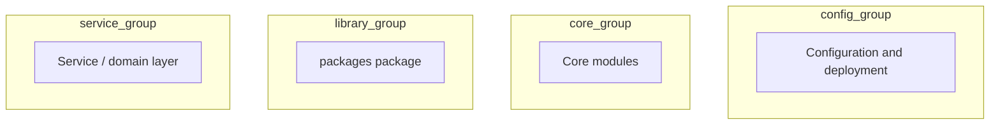

# Architecture report: unform/unform

> Automated static analysis. **Observed** = directly seen in files/imports/AST; **Inferred** = interpretation from that evidence. Repository code was not executed.

## 1. Repository at a glance

| Item | Value |
| --- | --- |
| Repository | unform/unform |
| Description | Performance-focused API for React forms 🚀 |
| Language | TypeScript |
| Stars | 4399 |
| Licence | MIT |
| Analysed commit / branch | db496d9369f1a776865d48d78f1b95c8e08a5139 / develop |
| Framework(s) | React |
| Files analysed | 115 |
| Components | 4 |

## 2. Architecture in one minute

unform/unform - Performance-focused API for React forms 🚀. This repository was analysed statically from 115 file(s) (0 Python). Detected technologies (observed from imports/manifests): GitHub Actions, React, Jest, TypeScript. Files are grouped into 4 component(s): Configuration and deployment, Core modules, packages package, Service / domain layer. Findings below distinguish observed facts from inferred interpretation.

## 3. High-level block diagram

## 4. Main components

### Configuration and deployment (`config`)

- **Kind:** config
- **Status:** Observed
- **Confidence:** 0.85
- **Responsibility:** Groups 7 file(s) under configuration and deployment (observed from repository paths and static analysis).
- **Paths:** `lerna.json`, `package.json`, `packages/core/package.json`, `packages/mobile/package.json`, `packages/web/package.json`, `renovate.json`, `tsconfig.json`
- **Evidence:** [lerna.json](https://github.com/unform/unform/blob/db496d9369f1a776865d48d78f1b95c8e08a5139/lerna.json); [package.json](https://github.com/unform/unform/blob/db496d9369f1a776865d48d78f1b95c8e08a5139/package.json); [packages/core/package.json](https://github.com/unform/unform/blob/db496d9369f1a776865d48d78f1b95c8e08a5139/packages/core/package.json); [packages/mobile/package.json](https://github.com/unform/unform/blob/db496d9369f1a776865d48d78f1b95c8e08a5139/packages/mobile/package.json); [packages/web/package.json](https://github.com/unform/unform/blob/db496d9369f1a776865d48d78f1b95c8e08a5139/packages/web/package.json); [renovate.json](https://github.com/unform/unform/blob/db496d9369f1a776865d48d78f1b95c8e08a5139/renovate.json); [tsconfig.json](https://github.com/unform/unform/blob/db496d9369f1a776865d48d78f1b95c8e08a5139/tsconfig.json)

### Core modules (`core`)

- **Kind:** core
- **Status:** Observed
- **Confidence:** 0.85
- **Responsibility:** Groups 5 file(s) under core modules (observed from repository paths and static analysis).
- **Paths:** `babel.config.js`, `commitlint.config.js`, `jest.config.js`, `prettier.config.js`, `rollup.config.js`
- **Evidence:** [babel.config.js](https://github.com/unform/unform/blob/db496d9369f1a776865d48d78f1b95c8e08a5139/babel.config.js); [commitlint.config.js](https://github.com/unform/unform/blob/db496d9369f1a776865d48d78f1b95c8e08a5139/commitlint.config.js); [jest.config.js](https://github.com/unform/unform/blob/db496d9369f1a776865d48d78f1b95c8e08a5139/jest.config.js); [prettier.config.js](https://github.com/unform/unform/blob/db496d9369f1a776865d48d78f1b95c8e08a5139/prettier.config.js); [rollup.config.js](https://github.com/unform/unform/blob/db496d9369f1a776865d48d78f1b95c8e08a5139/rollup.config.js)

### packages package (`packages`)

- **Kind:** library
- **Status:** Observed
- **Confidence:** 0.85
- **Responsibility:** Groups 8 file(s) under packages package (observed from repository paths and static analysis).
- **Paths:** `packages/mobile/__tests__/Form.spec.tsx`, `packages/mobile/__tests__/components/Input.tsx`, `packages/mobile/jest.config.js`, `packages/mobile/lib/Form.tsx`, `packages/mobile/lib/index.ts`, `packages/web/jest.config.js`, `packages/web/lib/Form.tsx`, `packages/web/lib/index.ts`
- **Evidence:** [packages/mobile/__tests__/Form.spec.tsx](https://github.com/unform/unform/blob/db496d9369f1a776865d48d78f1b95c8e08a5139/packages/mobile/__tests__/Form.spec.tsx); [packages/mobile/__tests__/components/Input.tsx](https://github.com/unform/unform/blob/db496d9369f1a776865d48d78f1b95c8e08a5139/packages/mobile/__tests__/components/Input.tsx); [packages/mobile/jest.config.js](https://github.com/unform/unform/blob/db496d9369f1a776865d48d78f1b95c8e08a5139/packages/mobile/jest.config.js); [packages/mobile/lib/Form.tsx](https://github.com/unform/unform/blob/db496d9369f1a776865d48d78f1b95c8e08a5139/packages/mobile/lib/Form.tsx); [packages/mobile/lib/index.ts](https://github.com/unform/unform/blob/db496d9369f1a776865d48d78f1b95c8e08a5139/packages/mobile/lib/index.ts); [packages/web/jest.config.js](https://github.com/unform/unform/blob/db496d9369f1a776865d48d78f1b95c8e08a5139/packages/web/jest.config.js); [packages/web/lib/Form.tsx](https://github.com/unform/unform/blob/db496d9369f1a776865d48d78f1b95c8e08a5139/packages/web/lib/Form.tsx); [packages/web/lib/index.ts](https://github.com/unform/unform/blob/db496d9369f1a776865d48d78f1b95c8e08a5139/packages/web/lib/index.ts)

### Service / domain layer (`service_layer`)

- **Kind:** service
- **Status:** Observed
- **Confidence:** 0.85
- **Responsibility:** Groups 14 file(s) under service / domain layer (observed from repository paths and static analysis).
- **Paths:** `packages/core/__tests__/Form.spec.tsx`, `packages/core/__tests__/Scope.spec.tsx`, `packages/core/__tests__/components/Input.tsx`, `packages/core/__tests__/components/ObjectInput.tsx`, `packages/core/__tests__/utils/CustomInputClear.tsx`, `packages/core/__tests__/utils/CustomInputParse.tsx`, `packages/core/__tests__/utils/RenderTest.tsx`, `packages/core/jest.config.js`, `packages/core/lib/Context.tsx`, `packages/core/lib/FormProvider.tsx`, `packages/core/lib/Scope.tsx`, `packages/core/lib/index.ts`, `packages/core/lib/types.ts`, `packages/core/lib/useField.ts`
- **Evidence:** [packages/core/__tests__/Form.spec.tsx](https://github.com/unform/unform/blob/db496d9369f1a776865d48d78f1b95c8e08a5139/packages/core/__tests__/Form.spec.tsx); [packages/core/__tests__/Scope.spec.tsx](https://github.com/unform/unform/blob/db496d9369f1a776865d48d78f1b95c8e08a5139/packages/core/__tests__/Scope.spec.tsx); [packages/core/__tests__/components/Input.tsx](https://github.com/unform/unform/blob/db496d9369f1a776865d48d78f1b95c8e08a5139/packages/core/__tests__/components/Input.tsx); [packages/core/__tests__/components/ObjectInput.tsx](https://github.com/unform/unform/blob/db496d9369f1a776865d48d78f1b95c8e08a5139/packages/core/__tests__/components/ObjectInput.tsx); [packages/core/__tests__/utils/CustomInputClear.tsx](https://github.com/unform/unform/blob/db496d9369f1a776865d48d78f1b95c8e08a5139/packages/core/__tests__/utils/CustomInputClear.tsx); [packages/core/__tests__/utils/CustomInputParse.tsx](https://github.com/unform/unform/blob/db496d9369f1a776865d48d78f1b95c8e08a5139/packages/core/__tests__/utils/CustomInputParse.tsx); [packages/core/__tests__/utils/RenderTest.tsx](https://github.com/unform/unform/blob/db496d9369f1a776865d48d78f1b95c8e08a5139/packages/core/__tests__/utils/RenderTest.tsx); [packages/core/jest.config.js](https://github.com/unform/unform/blob/db496d9369f1a776865d48d78f1b95c8e08a5139/packages/core/jest.config.js)

## 5. Execution flow

**Observed** entry point(s):

- [packages/core/lib/index.ts](https://github.com/unform/unform/blob/db496d9369f1a776865d48d78f1b95c8e08a5139/packages/core/lib/index.ts)
- [packages/mobile/lib/index.ts](https://github.com/unform/unform/blob/db496d9369f1a776865d48d78f1b95c8e08a5139/packages/mobile/lib/index.ts)
- [packages/web/lib/index.ts](https://github.com/unform/unform/blob/db496d9369f1a776865d48d78f1b95c8e08a5139/packages/web/lib/index.ts)

Representative flow (derived from observed entry points and the import graph; steps beyond the entry point are **Inferred**):

1. Execution starts at an observed entry point listed above, if present.
2. No internal import relationships between components were observed.

## 6. Project structure

### `(root)`

- `.editorconfig` - config (130 bytes)
- `.eslintrc.json` - config (1055 bytes)
- `.gitignore` - other (1003 bytes)
- `.lintstagedrc.json` - config (71 bytes)
- `.npmignore` - other (59 bytes)
- `.prettierignore` - other (55 bytes)
- `LICENSE` - docs (1067 bytes)
- `babel.config.js` - source, JavaScript (111 bytes)
- `commitlint.config.js` - source, JavaScript (67 bytes)
- `jest.config.js` - source, JavaScript (484 bytes)
- `lerna.json` - config (502 bytes)
- `package.json` - manifest (2582 bytes)
- `prettier.config.js` - source, JavaScript (81 bytes)
- `renovate.json` - config (670 bytes)
- `rollup.config.js` - source, JavaScript (1713 bytes)
- `tsconfig.json` - config (764 bytes)

### `.github`

- `.github/CODEOWNERS` - other (181 bytes)
- `.github/CODE_OF_CONDUCT.md` - docs (4238 bytes)
- `.github/CONTRIBUTING.md` - docs (9637 bytes)
- `.github/ISSUE_TEMPLATE/bug_report.md` - docs (1212 bytes)
- `.github/ISSUE_TEMPLATE/config.yml` - config (28 bytes)
- `.github/ISSUE_TEMPLATE/documentation-report.md` - docs (491 bytes)
- `.github/ISSUE_TEMPLATE/enhancement-request.md` - docs (785 bytes)
- `.github/PULL_REQUEST_TEMPLATE` - other (718 bytes)
- `.github/labeler.json` - config (192 bytes)
- `.github/lock.yml` - config (144 bytes)
- `.github/workflows/commit.yml` - ci, YAML (447 bytes)
- `.github/workflows/lint.yml` - ci, YAML (436 bytes)
- `.github/workflows/test.yml` - ci, YAML (655 bytes)
- `.github/workflows/tsc.yml` - ci, YAML (457 bytes)

### `.husky`

- `.husky/.gitignore` - other (1 bytes)
- `.husky/commit-msg` - other (98 bytes)
- `.husky/common.sh` - source, Shell (169 bytes)
- `.husky/pre-commit` - other (89 bytes)

### `docs`

- `docs/LICENSE` - docs (1067 bytes)
- `docs/config/sidebar.yml` - config (2612 bytes)
- `docs/gatsby-config.js` - docs (1330 bytes)
- `docs/package.json` - manifest (1091 bytes)
- `docs/src/@rocketseat/gatsby-theme-docs/components/Code/LiveCodeScope.js` - docs (288 bytes)
- `docs/src/@rocketseat/gatsby-theme-docs/components/Logo.js` - docs (2889 bytes)
- `docs/src/@rocketseat/gatsby-theme-docs/text/index.mdx` - docs (1166 bytes)
- `docs/src/docs/api/scope.mdx` - docs (391 bytes)
- `docs/src/docs/api/use-field.mdx` - docs (2725 bytes)
- `docs/src/docs/examples/file-input.mdx` - docs (1650 bytes)
- `docs/src/docs/examples/more-examples.mdx` - docs (170 bytes)
- `docs/src/docs/examples/react-datepicker.mdx` - docs (1332 bytes)
- `docs/src/docs/examples/react-dropzone.mdx` - docs (2352 bytes)
- `docs/src/docs/examples/react-input-mask.mdx` - docs (1187 bytes)
- `docs/src/docs/examples/react-native-input-mask.mdx` - docs (3187 bytes)
- `docs/src/docs/examples/react-native-picker-select.mdx` - docs (2622 bytes)
- `docs/src/docs/examples/react-number-format.mdx` - docs (1800 bytes)
- `docs/src/docs/examples/react-select.mdx` - docs (4179 bytes)
- `docs/src/docs/examples/react-simple-code-editor.mdx` - docs (1956 bytes)
- `docs/src/docs/guides/basic-form.mdx` - docs (2840 bytes)
- `docs/src/docs/guides/complex-structures.mdx` - docs (1816 bytes)
- `docs/src/docs/guides/get-set-field-error.mdx` - docs (1139 bytes)
- `docs/src/docs/guides/get-set-field-value.mdx` - docs (1092 bytes)
- `docs/src/docs/guides/initial-data.mdx` - docs (1085 bytes)
- `docs/src/docs/guides/manual-form-submit.mdx` - docs (569 bytes)
- `docs/src/docs/guides/react-native.mdx` - docs (3053 bytes)
- `docs/src/docs/guides/reset-form.mdx` - docs (1039 bytes)
- `docs/src/docs/guides/validation.mdx` - docs (2681 bytes)
- `docs/src/docs/installation.mdx` - docs (483 bytes)
- `docs/src/docs/migration-guide.mdx` - docs (1177 bytes)
- `docs/src/docs/quick-start.mdx` - docs (4221 bytes)
- `docs/src/docs/recipes/accessing-field-ref.mdx` - docs (501 bytes)
- `docs/src/docs/recipes/accessing-form-event.mdx` - docs (363 bytes)
- `docs/src/docs/recipes/accessing-form-ref.mdx` - docs (1677 bytes)
- `docs/src/docs/recipes/clear-input-error-on-focus.mdx` - docs (746 bytes)
- `docs/src/docs/recipes/simple-input.mdx` - docs (1143 bytes)
- `docs/src/docs/recipes/styled-components.mdx` - docs (876 bytes)
- `docs/src/docs/recipes/typescript.mdx` - docs (4472 bytes)
- `docs/src/docs/roadmap.mdx` - docs (467 bytes)
- `docs/src/pages/404.js` - docs (533 bytes)
- `docs/vercel.json` - config (350 bytes)

### `examples`

- `examples/README.md` - docs (1356 bytes)
- `examples/checkbox.js` - source, JavaScript (1933 bytes)
- `examples/input.js` - source, JavaScript (3334 bytes)
- `examples/radio.js` - source, JavaScript (2178 bytes)
- `examples/select.js` - source, JavaScript (1771 bytes)
- `examples/textarea.js` - source, JavaScript (1770 bytes)
- `examples/typescript/checkbox.tsx` - source, TypeScript (2160 bytes)
- `examples/typescript/input.tsx` - source, TypeScript (3884 bytes)
- `examples/typescript/radio.tsx` - source, TypeScript (2549 bytes)
- `examples/typescript/select.tsx` - source, TypeScript (2033 bytes)
- `examples/typescript/textarea.tsx` - source, TypeScript (1902 bytes)

### `packages`

- `packages/core/README.md` - docs (2765 bytes)
- `packages/core/__tests__/Form.spec.tsx` - source, TypeScript (10800 bytes)
- `packages/core/__tests__/Scope.spec.tsx` - source, TypeScript (715 bytes)
- `packages/core/__tests__/components/Input.tsx` - source, TypeScript (893 bytes)
- `packages/core/__tests__/components/ObjectInput.tsx` - source, TypeScript (924 bytes)
- `packages/core/__tests__/utils/CustomInputClear.tsx` - source, TypeScript (982 bytes)
- `packages/core/__tests__/utils/CustomInputParse.tsx` - source, TypeScript (956 bytes)
- `packages/core/__tests__/utils/RenderTest.tsx` - source, TypeScript (370 bytes)
- `packages/core/jest.config.js` - source, JavaScript (276 bytes)
- `packages/core/lib/Context.tsx` - source, TypeScript (185 bytes)
- `packages/core/lib/FormProvider.tsx` - source, TypeScript (4665 bytes)
- `packages/core/lib/Scope.tsx` - source, TypeScript (475 bytes)
- `packages/core/lib/index.ts` - source, TypeScript (215 bytes)
- `packages/core/lib/types.ts` - source, TypeScript (1962 bytes)
- `packages/core/lib/useField.ts` - source, TypeScript (1079 bytes)
- `packages/core/package.json` - manifest (820 bytes)
- `packages/mobile/README.md` - docs (1553 bytes)
- `packages/mobile/__tests__/Form.spec.tsx` - source, TypeScript (1658 bytes)
- `packages/mobile/__tests__/components/Input.tsx` - source, TypeScript (1437 bytes)
- `packages/mobile/jest.config.js` - source, JavaScript (435 bytes)
- `packages/mobile/lib/Form.tsx` - source, TypeScript (674 bytes)
- `packages/mobile/lib/index.ts` - source, TypeScript (23 bytes)
- `packages/mobile/package.json` - manifest (971 bytes)
- `packages/web/README.md` - docs (1491 bytes)
- `packages/web/__tests__/.gitkeep` - other (0 bytes)
- `packages/web/jest.config.js` - source, JavaScript (276 bytes)
- `packages/web/lib/Form.tsx` - source, TypeScript (623 bytes)
- `packages/web/lib/index.ts` - source, TypeScript (41 bytes)
- `packages/web/package.json` - manifest (831 bytes)

## 7. Key dependencies and integrations

| Name | Category | Status | Confidence | Evidence |
| --- | --- | --- | --- | --- |
| GitHub Actions | ci | Observed | 0.90 | [.github/workflows/commit.yml](https://github.com/unform/unform/blob/db496d9369f1a776865d48d78f1b95c8e08a5139/.github/workflows/commit.yml); [.github/workflows/lint.yml](https://github.com/unform/unform/blob/db496d9369f1a776865d48d78f1b95c8e08a5139/.github/workflows/lint.yml); [.github/workflows/test.yml](https://github.com/unform/unform/blob/db496d9369f1a776865d48d78f1b95c8e08a5139/.github/workflows/test.yml); [.github/workflows/tsc.yml](https://github.com/unform/unform/blob/db496d9369f1a776865d48d78f1b95c8e08a5139/.github/workflows/tsc.yml) |
| React | framework | Observed | 0.90 | [docs/package.json:21](https://github.com/unform/unform/blob/db496d9369f1a776865d48d78f1b95c8e08a5139/docs/package.json#L21); [docs/package.json:22](https://github.com/unform/unform/blob/db496d9369f1a776865d48d78f1b95c8e08a5139/docs/package.json#L22); [package.json:38](https://github.com/unform/unform/blob/db496d9369f1a776865d48d78f1b95c8e08a5139/package.json#L38); [package.json:42](https://github.com/unform/unform/blob/db496d9369f1a776865d48d78f1b95c8e08a5139/package.json#L42) |
| Jest | tooling | Observed | 0.85 | [package.json:21](https://github.com/unform/unform/blob/db496d9369f1a776865d48d78f1b95c8e08a5139/package.json#L21) |
| TypeScript | tooling | Observed | 0.85 | [package.json:45](https://github.com/unform/unform/blob/db496d9369f1a776865d48d78f1b95c8e08a5139/package.json#L45) |

## 8. Data and state

No database, cache, queue, or persistent-state usage was observed in the analysed files. State handling, if any, may be in-memory or in files that were not analysed.

## 9. Configuration and deployment clues

- `.editorconfig` (config)
- `.eslintrc.json` (config)
- `.github/ISSUE_TEMPLATE/config.yml` (config)
- `.github/labeler.json` (config)
- `.github/lock.yml` (config)
- `.github/workflows/commit.yml` (ci)
- `.github/workflows/lint.yml` (ci)
- `.github/workflows/test.yml` (ci)
- `.github/workflows/tsc.yml` (ci)
- `.lintstagedrc.json` (config)
- `docs/config/sidebar.yml` (config)
- `docs/package.json` (manifest)
- `docs/vercel.json` (config)
- `lerna.json` (config)
- `package.json` (manifest)
- `packages/core/package.json` (manifest)
- `packages/mobile/package.json` (manifest)
- `packages/web/package.json` (manifest)
- `renovate.json` (config)
- `tsconfig.json` (config)

## 10. Design observations

- Service/domain code is distinct from entry and data code, suggesting layered separation (Inferred).

These observations are interpretations (**Inferred**) of the observed structure, not guarantees about runtime design.

## 11. Limitations and unknowns

- Static analysis only: repository code was not executed, installed, or imported at runtime.
- Components and relationships are inferred from file paths, imports, and AST structure; runtime behaviour, dynamic imports, and reflection may not be visible.
- No clear application entry point was observed in the analysed files.
- Repository text was treated as untrusted data; no instructions found in repository files were followed, and likely secret values were redacted/excluded.
- JavaScript and TypeScript files were inventoried from paths and package manifests. They were not parsed with a full language AST, and repository code was not executed.
- The GitHub repository was marked archived at selection time.

## 12. Source references

- [.github/workflows/commit.yml](https://github.com/unform/unform/blob/db496d9369f1a776865d48d78f1b95c8e08a5139/.github/workflows/commit.yml)
- [.github/workflows/lint.yml](https://github.com/unform/unform/blob/db496d9369f1a776865d48d78f1b95c8e08a5139/.github/workflows/lint.yml)
- [.github/workflows/test.yml](https://github.com/unform/unform/blob/db496d9369f1a776865d48d78f1b95c8e08a5139/.github/workflows/test.yml)
- [.github/workflows/tsc.yml](https://github.com/unform/unform/blob/db496d9369f1a776865d48d78f1b95c8e08a5139/.github/workflows/tsc.yml)
- [babel.config.js](https://github.com/unform/unform/blob/db496d9369f1a776865d48d78f1b95c8e08a5139/babel.config.js)
- [commitlint.config.js](https://github.com/unform/unform/blob/db496d9369f1a776865d48d78f1b95c8e08a5139/commitlint.config.js)
- [docs/package.json:21](https://github.com/unform/unform/blob/db496d9369f1a776865d48d78f1b95c8e08a5139/docs/package.json#L21)
- [docs/package.json:22](https://github.com/unform/unform/blob/db496d9369f1a776865d48d78f1b95c8e08a5139/docs/package.json#L22)
- [jest.config.js](https://github.com/unform/unform/blob/db496d9369f1a776865d48d78f1b95c8e08a5139/jest.config.js)
- [lerna.json](https://github.com/unform/unform/blob/db496d9369f1a776865d48d78f1b95c8e08a5139/lerna.json)
- [package.json](https://github.com/unform/unform/blob/db496d9369f1a776865d48d78f1b95c8e08a5139/package.json)
- [package.json:21](https://github.com/unform/unform/blob/db496d9369f1a776865d48d78f1b95c8e08a5139/package.json#L21)
- [package.json:38](https://github.com/unform/unform/blob/db496d9369f1a776865d48d78f1b95c8e08a5139/package.json#L38)
- [package.json:42](https://github.com/unform/unform/blob/db496d9369f1a776865d48d78f1b95c8e08a5139/package.json#L42)
- [package.json:45](https://github.com/unform/unform/blob/db496d9369f1a776865d48d78f1b95c8e08a5139/package.json#L45)
- [packages/core/__tests__/Form.spec.tsx](https://github.com/unform/unform/blob/db496d9369f1a776865d48d78f1b95c8e08a5139/packages/core/__tests__/Form.spec.tsx)
- [packages/core/__tests__/Scope.spec.tsx](https://github.com/unform/unform/blob/db496d9369f1a776865d48d78f1b95c8e08a5139/packages/core/__tests__/Scope.spec.tsx)
- [packages/core/__tests__/components/Input.tsx](https://github.com/unform/unform/blob/db496d9369f1a776865d48d78f1b95c8e08a5139/packages/core/__tests__/components/Input.tsx)
- [packages/core/__tests__/components/ObjectInput.tsx](https://github.com/unform/unform/blob/db496d9369f1a776865d48d78f1b95c8e08a5139/packages/core/__tests__/components/ObjectInput.tsx)
- [packages/core/__tests__/utils/CustomInputClear.tsx](https://github.com/unform/unform/blob/db496d9369f1a776865d48d78f1b95c8e08a5139/packages/core/__tests__/utils/CustomInputClear.tsx)
- [packages/core/__tests__/utils/CustomInputParse.tsx](https://github.com/unform/unform/blob/db496d9369f1a776865d48d78f1b95c8e08a5139/packages/core/__tests__/utils/CustomInputParse.tsx)
- [packages/core/__tests__/utils/RenderTest.tsx](https://github.com/unform/unform/blob/db496d9369f1a776865d48d78f1b95c8e08a5139/packages/core/__tests__/utils/RenderTest.tsx)
- [packages/core/jest.config.js](https://github.com/unform/unform/blob/db496d9369f1a776865d48d78f1b95c8e08a5139/packages/core/jest.config.js)
- [packages/core/lib/index.ts](https://github.com/unform/unform/blob/db496d9369f1a776865d48d78f1b95c8e08a5139/packages/core/lib/index.ts)
- [packages/core/package.json](https://github.com/unform/unform/blob/db496d9369f1a776865d48d78f1b95c8e08a5139/packages/core/package.json)
- [packages/core/package.json:34](https://github.com/unform/unform/blob/db496d9369f1a776865d48d78f1b95c8e08a5139/packages/core/package.json#L34)
- [packages/mobile/__tests__/Form.spec.tsx](https://github.com/unform/unform/blob/db496d9369f1a776865d48d78f1b95c8e08a5139/packages/mobile/__tests__/Form.spec.tsx)
- [packages/mobile/__tests__/components/Input.tsx](https://github.com/unform/unform/blob/db496d9369f1a776865d48d78f1b95c8e08a5139/packages/mobile/__tests__/components/Input.tsx)
- [packages/mobile/jest.config.js](https://github.com/unform/unform/blob/db496d9369f1a776865d48d78f1b95c8e08a5139/packages/mobile/jest.config.js)
- [packages/mobile/lib/Form.tsx](https://github.com/unform/unform/blob/db496d9369f1a776865d48d78f1b95c8e08a5139/packages/mobile/lib/Form.tsx)
- [packages/mobile/lib/index.ts](https://github.com/unform/unform/blob/db496d9369f1a776865d48d78f1b95c8e08a5139/packages/mobile/lib/index.ts)
- [packages/mobile/package.json](https://github.com/unform/unform/blob/db496d9369f1a776865d48d78f1b95c8e08a5139/packages/mobile/package.json)
- [packages/mobile/package.json:4](https://github.com/unform/unform/blob/db496d9369f1a776865d48d78f1b95c8e08a5139/packages/mobile/package.json#L4)
- [packages/web/jest.config.js](https://github.com/unform/unform/blob/db496d9369f1a776865d48d78f1b95c8e08a5139/packages/web/jest.config.js)
- [packages/web/lib/Form.tsx](https://github.com/unform/unform/blob/db496d9369f1a776865d48d78f1b95c8e08a5139/packages/web/lib/Form.tsx)
- [packages/web/lib/index.ts](https://github.com/unform/unform/blob/db496d9369f1a776865d48d78f1b95c8e08a5139/packages/web/lib/index.ts)
- [packages/web/package.json](https://github.com/unform/unform/blob/db496d9369f1a776865d48d78f1b95c8e08a5139/packages/web/package.json)
- [packages/web/package.json:33](https://github.com/unform/unform/blob/db496d9369f1a776865d48d78f1b95c8e08a5139/packages/web/package.json#L33)
- [packages/web/package.json:34](https://github.com/unform/unform/blob/db496d9369f1a776865d48d78f1b95c8e08a5139/packages/web/package.json#L34)
- [prettier.config.js](https://github.com/unform/unform/blob/db496d9369f1a776865d48d78f1b95c8e08a5139/prettier.config.js)
- [renovate.json](https://github.com/unform/unform/blob/db496d9369f1a776865d48d78f1b95c8e08a5139/renovate.json)
- [rollup.config.js](https://github.com/unform/unform/blob/db496d9369f1a776865d48d78f1b95c8e08a5139/rollup.config.js)
- [tsconfig.json](https://github.com/unform/unform/blob/db496d9369f1a776865d48d78f1b95c8e08a5139/tsconfig.json)
