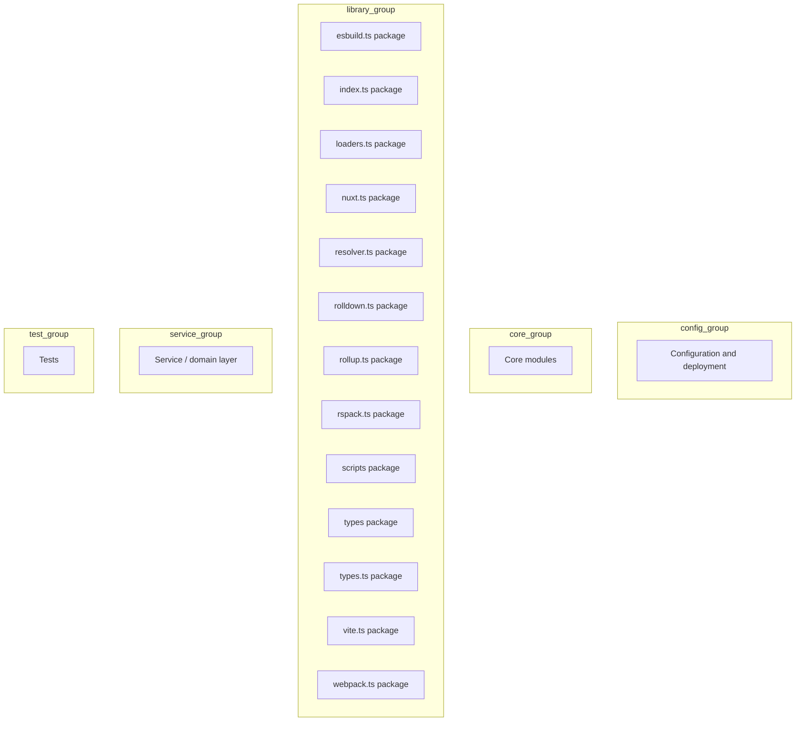

# Architecture report: unplugin/unplugin-icons

> Automated static analysis. **Observed** = directly seen in files/imports/AST; **Inferred** = interpretation from that evidence. Repository code was not executed.

## 1. Repository at a glance

| Item | Value |
| --- | --- |
| Repository | unplugin/unplugin-icons |
| Description | 🤹 Access thousands of icons as components on-demand universally. |
| Language | TypeScript |
| Stars | 4962 |
| Licence | MIT |
| Analysed commit / branch | 9a0ca853f0c68a43fe6f1aae4c6fa156ab0eea4b / main |
| Framework(s) | Next.js, React, Svelte, Vue |
| Files analysed | 243 |
| Components | 17 |

## 2. Architecture in one minute

unplugin/unplugin-icons - 🤹 Access thousands of icons as components on-demand universally.. This repository was analysed statically from 243 file(s) (0 Python). Detected technologies (observed from imports/manifests): GitHub Actions, Next.js, React, Svelte, Vue, TypeScript. Files are grouped into 17 component(s): Configuration and deployment, Core modules, esbuild.ts package, index.ts package, loaders.ts package, nuxt.ts package, resolver.ts package, rolldown.ts package. Findings below distinguish observed facts from inferred interpretation.

## 3. High-level block diagram

## 4. Main components

### Configuration and deployment (`config`)

- **Kind:** config
- **Status:** Observed
- **Confidence:** 0.85
- **Responsibility:** Groups 4 file(s) under configuration and deployment (observed from repository paths and static analysis).
- **Paths:** `package.json`, `pnpm-workspace.yaml`, `src/core/icon-sets.json`, `tsconfig.json`
- **Evidence:** [package.json](https://github.com/unplugin/unplugin-icons/blob/9a0ca853f0c68a43fe6f1aae4c6fa156ab0eea4b/package.json); [pnpm-workspace.yaml](https://github.com/unplugin/unplugin-icons/blob/9a0ca853f0c68a43fe6f1aae4c6fa156ab0eea4b/pnpm-workspace.yaml); [src/core/icon-sets.json](https://github.com/unplugin/unplugin-icons/blob/9a0ca853f0c68a43fe6f1aae4c6fa156ab0eea4b/src/core/icon-sets.json); [tsconfig.json](https://github.com/unplugin/unplugin-icons/blob/9a0ca853f0c68a43fe6f1aae4c6fa156ab0eea4b/tsconfig.json)

### Core modules (`core`)

- **Kind:** core
- **Status:** Observed
- **Confidence:** 0.85
- **Responsibility:** Groups 2 file(s) under core modules (observed from repository paths and static analysis).
- **Paths:** `eslint.config.js`, `tsdown.config.ts`
- **Evidence:** [eslint.config.js](https://github.com/unplugin/unplugin-icons/blob/9a0ca853f0c68a43fe6f1aae4c6fa156ab0eea4b/eslint.config.js); [tsdown.config.ts](https://github.com/unplugin/unplugin-icons/blob/9a0ca853f0c68a43fe6f1aae4c6fa156ab0eea4b/tsdown.config.ts)

### esbuild.ts package (`esbuild_ts`)

- **Kind:** library
- **Status:** Observed
- **Confidence:** 0.85
- **Responsibility:** Groups 1 file(s) under esbuild.ts package (observed from repository paths and static analysis).
- **Paths:** `src/esbuild.ts`
- **Evidence:** [src/esbuild.ts](https://github.com/unplugin/unplugin-icons/blob/9a0ca853f0c68a43fe6f1aae4c6fa156ab0eea4b/src/esbuild.ts)

### index.ts package (`index_ts`)

- **Kind:** library
- **Status:** Observed
- **Confidence:** 0.85
- **Responsibility:** Groups 1 file(s) under index.ts package (observed from repository paths and static analysis).
- **Paths:** `src/index.ts`
- **Evidence:** [src/index.ts](https://github.com/unplugin/unplugin-icons/blob/9a0ca853f0c68a43fe6f1aae4c6fa156ab0eea4b/src/index.ts)

### loaders.ts package (`loaders_ts`)

- **Kind:** library
- **Status:** Observed
- **Confidence:** 0.85
- **Responsibility:** Groups 1 file(s) under loaders.ts package (observed from repository paths and static analysis).
- **Paths:** `src/loaders.ts`
- **Evidence:** [src/loaders.ts](https://github.com/unplugin/unplugin-icons/blob/9a0ca853f0c68a43fe6f1aae4c6fa156ab0eea4b/src/loaders.ts)

### nuxt.ts package (`nuxt_ts`)

- **Kind:** library
- **Status:** Observed
- **Confidence:** 0.85
- **Responsibility:** Groups 1 file(s) under nuxt.ts package (observed from repository paths and static analysis).
- **Paths:** `src/nuxt.ts`
- **Evidence:** [src/nuxt.ts](https://github.com/unplugin/unplugin-icons/blob/9a0ca853f0c68a43fe6f1aae4c6fa156ab0eea4b/src/nuxt.ts)

### resolver.ts package (`resolver_ts`)

- **Kind:** library
- **Status:** Observed
- **Confidence:** 0.85
- **Responsibility:** Groups 1 file(s) under resolver.ts package (observed from repository paths and static analysis).
- **Paths:** `src/resolver.ts`
- **Evidence:** [src/resolver.ts](https://github.com/unplugin/unplugin-icons/blob/9a0ca853f0c68a43fe6f1aae4c6fa156ab0eea4b/src/resolver.ts)

### rolldown.ts package (`rolldown_ts`)

- **Kind:** library
- **Status:** Observed
- **Confidence:** 0.85
- **Responsibility:** Groups 1 file(s) under rolldown.ts package (observed from repository paths and static analysis).
- **Paths:** `src/rolldown.ts`
- **Evidence:** [src/rolldown.ts](https://github.com/unplugin/unplugin-icons/blob/9a0ca853f0c68a43fe6f1aae4c6fa156ab0eea4b/src/rolldown.ts)

### rollup.ts package (`rollup_ts`)

- **Kind:** library
- **Status:** Observed
- **Confidence:** 0.85
- **Responsibility:** Groups 1 file(s) under rollup.ts package (observed from repository paths and static analysis).
- **Paths:** `src/rollup.ts`
- **Evidence:** [src/rollup.ts](https://github.com/unplugin/unplugin-icons/blob/9a0ca853f0c68a43fe6f1aae4c6fa156ab0eea4b/src/rollup.ts)

### rspack.ts package (`rspack_ts`)

- **Kind:** library
- **Status:** Observed
- **Confidence:** 0.85
- **Responsibility:** Groups 1 file(s) under rspack.ts package (observed from repository paths and static analysis).
- **Paths:** `src/rspack.ts`
- **Evidence:** [src/rspack.ts](https://github.com/unplugin/unplugin-icons/blob/9a0ca853f0c68a43fe6f1aae4c6fa156ab0eea4b/src/rspack.ts)

### scripts package (`scripts`)

- **Kind:** library
- **Status:** Observed
- **Confidence:** 0.85
- **Responsibility:** Groups 1 file(s) under scripts package (observed from repository paths and static analysis).
- **Paths:** `scripts/prebuild.ts`
- **Evidence:** [scripts/prebuild.ts](https://github.com/unplugin/unplugin-icons/blob/9a0ca853f0c68a43fe6f1aae4c6fa156ab0eea4b/scripts/prebuild.ts)

### Service / domain layer (`service_layer`)

- **Kind:** service
- **Status:** Observed
- **Confidence:** 0.85
- **Responsibility:** Groups 18 file(s) under service / domain layer (observed from repository paths and static analysis).
- **Paths:** `src/core/collections.ts`, `src/core/compilers/astro.ts`, `src/core/compilers/ember.ts`, `src/core/compilers/index.ts`, `src/core/compilers/jsx.ts`, `src/core/compilers/marko.ts`, `src/core/compilers/none.ts`, `src/core/compilers/qwik.ts`, `src/core/compilers/raw.ts`, `src/core/compilers/solid.ts`, `src/core/compilers/svelte.ts`, `src/core/compilers/types.ts`, `src/core/compilers/vue-vapor.ts`, `src/core/compilers/vue3.ts`, `src/core/compilers/web-components.ts`, `src/core/loader.ts`, `src/core/options.ts`, `src/core/svgId.ts`
- **Evidence:** [src/core/collections.ts](https://github.com/unplugin/unplugin-icons/blob/9a0ca853f0c68a43fe6f1aae4c6fa156ab0eea4b/src/core/collections.ts); [src/core/compilers/astro.ts](https://github.com/unplugin/unplugin-icons/blob/9a0ca853f0c68a43fe6f1aae4c6fa156ab0eea4b/src/core/compilers/astro.ts); [src/core/compilers/ember.ts](https://github.com/unplugin/unplugin-icons/blob/9a0ca853f0c68a43fe6f1aae4c6fa156ab0eea4b/src/core/compilers/ember.ts); [src/core/compilers/index.ts](https://github.com/unplugin/unplugin-icons/blob/9a0ca853f0c68a43fe6f1aae4c6fa156ab0eea4b/src/core/compilers/index.ts); [src/core/compilers/jsx.ts](https://github.com/unplugin/unplugin-icons/blob/9a0ca853f0c68a43fe6f1aae4c6fa156ab0eea4b/src/core/compilers/jsx.ts); [src/core/compilers/marko.ts](https://github.com/unplugin/unplugin-icons/blob/9a0ca853f0c68a43fe6f1aae4c6fa156ab0eea4b/src/core/compilers/marko.ts); [src/core/compilers/none.ts](https://github.com/unplugin/unplugin-icons/blob/9a0ca853f0c68a43fe6f1aae4c6fa156ab0eea4b/src/core/compilers/none.ts); [src/core/compilers/qwik.ts](https://github.com/unplugin/unplugin-icons/blob/9a0ca853f0c68a43fe6f1aae4c6fa156ab0eea4b/src/core/compilers/qwik.ts)

### Tests (`tests`)

- **Kind:** test
- **Status:** Observed
- **Confidence:** 0.85
- **Responsibility:** Groups 3 file(s) under tests (observed from repository paths and static analysis).
- **Paths:** `test/__snapshots__/idSvg.test.ts.snap`, `test/idSvg.test.ts`, `test/vueVapor.test.ts`
- **Evidence:** [test/__snapshots__/idSvg.test.ts.snap](https://github.com/unplugin/unplugin-icons/blob/9a0ca853f0c68a43fe6f1aae4c6fa156ab0eea4b/test/__snapshots__/idSvg.test.ts.snap); [test/idSvg.test.ts](https://github.com/unplugin/unplugin-icons/blob/9a0ca853f0c68a43fe6f1aae4c6fa156ab0eea4b/test/idSvg.test.ts); [test/vueVapor.test.ts](https://github.com/unplugin/unplugin-icons/blob/9a0ca853f0c68a43fe6f1aae4c6fa156ab0eea4b/test/vueVapor.test.ts)

### types package (`types`)

- **Kind:** library
- **Status:** Observed
- **Confidence:** 0.85
- **Responsibility:** Groups 15 file(s) under types package (observed from repository paths and static analysis).
- **Paths:** `types/astro.d.ts`, `types/ember.d.ts`, `types/index.d.ts`, `types/preact.d.ts`, `types/qwik.d.ts`, `types/raw.d.ts`, `types/react.d.ts`, `types/solid.d.ts`, `types/svelte.d.ts`, `types/svelte3.d.ts`, `types/svelte4.d.ts`, `types/svelte5.d.ts`, `types/vue.d.ts`, `types/vue3.d.ts`, `types/web-components.d.ts`
- **Evidence:** [types/astro.d.ts](https://github.com/unplugin/unplugin-icons/blob/9a0ca853f0c68a43fe6f1aae4c6fa156ab0eea4b/types/astro.d.ts); [types/ember.d.ts](https://github.com/unplugin/unplugin-icons/blob/9a0ca853f0c68a43fe6f1aae4c6fa156ab0eea4b/types/ember.d.ts); [types/index.d.ts](https://github.com/unplugin/unplugin-icons/blob/9a0ca853f0c68a43fe6f1aae4c6fa156ab0eea4b/types/index.d.ts); [types/preact.d.ts](https://github.com/unplugin/unplugin-icons/blob/9a0ca853f0c68a43fe6f1aae4c6fa156ab0eea4b/types/preact.d.ts); [types/qwik.d.ts](https://github.com/unplugin/unplugin-icons/blob/9a0ca853f0c68a43fe6f1aae4c6fa156ab0eea4b/types/qwik.d.ts); [types/raw.d.ts](https://github.com/unplugin/unplugin-icons/blob/9a0ca853f0c68a43fe6f1aae4c6fa156ab0eea4b/types/raw.d.ts); [types/react.d.ts](https://github.com/unplugin/unplugin-icons/blob/9a0ca853f0c68a43fe6f1aae4c6fa156ab0eea4b/types/react.d.ts); [types/solid.d.ts](https://github.com/unplugin/unplugin-icons/blob/9a0ca853f0c68a43fe6f1aae4c6fa156ab0eea4b/types/solid.d.ts)

### types.ts package (`types_ts`)

- **Kind:** library
- **Status:** Observed
- **Confidence:** 0.85
- **Responsibility:** Groups 1 file(s) under types.ts package (observed from repository paths and static analysis).
- **Paths:** `src/types.ts`
- **Evidence:** [src/types.ts](https://github.com/unplugin/unplugin-icons/blob/9a0ca853f0c68a43fe6f1aae4c6fa156ab0eea4b/src/types.ts)

### vite.ts package (`vite_ts`)

- **Kind:** library
- **Status:** Observed
- **Confidence:** 0.85
- **Responsibility:** Groups 1 file(s) under vite.ts package (observed from repository paths and static analysis).
- **Paths:** `src/vite.ts`
- **Evidence:** [src/vite.ts](https://github.com/unplugin/unplugin-icons/blob/9a0ca853f0c68a43fe6f1aae4c6fa156ab0eea4b/src/vite.ts)

### webpack.ts package (`webpack_ts`)

- **Kind:** library
- **Status:** Observed
- **Confidence:** 0.85
- **Responsibility:** Groups 1 file(s) under webpack.ts package (observed from repository paths and static analysis).
- **Paths:** `src/webpack.ts`
- **Evidence:** [src/webpack.ts](https://github.com/unplugin/unplugin-icons/blob/9a0ca853f0c68a43fe6f1aae4c6fa156ab0eea4b/src/webpack.ts)

## 5. Execution flow

**Observed** entry point(s):

- [examples/vite-vue3/@test-scope/test-color-icons/index.js](https://github.com/unplugin/unplugin-icons/blob/9a0ca853f0c68a43fe6f1aae4c6fa156ab0eea4b/examples/vite-vue3/%40test-scope/test-color-icons/index.js)
- [examples/vite-vue3/plain-color-icons/index.js](https://github.com/unplugin/unplugin-icons/blob/9a0ca853f0c68a43fe6f1aae4c6fa156ab0eea4b/examples/vite-vue3/plain-color-icons/index.js)
- [src/core/compilers/index.ts](https://github.com/unplugin/unplugin-icons/blob/9a0ca853f0c68a43fe6f1aae4c6fa156ab0eea4b/src/core/compilers/index.ts)
- [src/index.ts](https://github.com/unplugin/unplugin-icons/blob/9a0ca853f0c68a43fe6f1aae4c6fa156ab0eea4b/src/index.ts)

Representative flow (derived from observed entry points and the import graph; steps beyond the entry point are **Inferred**):

1. Execution starts at an observed entry point listed above, if present.
2. No internal import relationships between components were observed.

## 6. Project structure

### `(root)`

- `.gitattributes` - other (19 bytes)
- `.gitignore` - other (121 bytes)
- `CONTRIBUTING.md` - docs (52 bytes)
- `LICENSE` - docs (1101 bytes)
- `README.md` - docs (30698 bytes)
- `eslint.config.js` - source, JavaScript (737 bytes)
- `package.json` - manifest (3925 bytes)
- `pnpm-workspace.yaml` - config (4231 bytes)
- `tsconfig.json` - config (402 bytes)
- `tsdown.config.ts` - source, TypeScript (998 bytes)

### `.github`

- `.github/FUNDING.yml` - config (39 bytes)
- `.github/workflows/release.yml` - ci, YAML (217 bytes)
- `.github/workflows/relese-commit.yml` - ci, YAML (253 bytes)

### `.vscode`

- `.vscode/settings.json` - config (1090 bytes)

### `examples`

- `examples/README.md` - docs (3974 bytes)
- `examples/astro-vue/.stackblitz.js` - source, JavaScript (393 bytes)
- `examples/astro-vue/astro.config.mjs` - source, JavaScript (465 bytes)
- `examples/astro-vue/custom-a/car-a.svg` - other (321 bytes)
- `examples/astro-vue/package.json` - manifest (635 bytes)
- `examples/astro-vue/public/favicon.svg` - other (916 bytes)
- `examples/astro-vue/src/components/HomeLink.vue` - source, Vue (271 bytes)
- `examples/astro-vue/src/env.d.ts` - source, TypeScript (39 bytes)
- `examples/astro-vue/src/layouts/Layout.astro` - other (546 bytes)
- `examples/astro-vue/src/pages/index.astro` - other (358 bytes)
- `examples/astro-vue/tsconfig.json` - config (112 bytes)
- `examples/astro/.stackblitz.js` - source, JavaScript (393 bytes)
- `examples/astro/astro.config.mjs` - source, JavaScript (401 bytes)
- `examples/astro/custom-a/car-a.svg` - other (321 bytes)
- `examples/astro/package.json` - manifest (572 bytes)
- `examples/astro/public/favicon.svg` - other (916 bytes)
- `examples/astro/src/env.d.ts` - source, TypeScript (39 bytes)
- `examples/astro/src/layouts/Layout.astro` - other (546 bytes)
- `examples/astro/src/pages/index.astro` - other (814 bytes)
- `examples/astro/tsconfig.json` - config (114 bytes)
- `examples/next/.gitignore` - other (386 bytes)
- `examples/next/.stackblitz.js` - source, JavaScript (380 bytes)
- `examples/next/custom-a/car-a.svg` - other (321 bytes)
- `examples/next/next-env.d.ts` - source, TypeScript (201 bytes)
- `examples/next/next.config.js` - source, JavaScript (474 bytes)
- `examples/next/package.json` - manifest (710 bytes)
- `examples/next/pages/_app.tsx` - source, TypeScript (188 bytes)
- `examples/next/pages/index.tsx` - source, TypeScript (2560 bytes)
- `examples/next/styles/Home.module.css` - other (1698 bytes)
- `examples/next/styles/globals.css` - other (275 bytes)
- `examples/next/tsconfig.json` - config (554 bytes)
- `examples/nuxt4/.gitignore` - other (58 bytes)
- `examples/nuxt4/.stackblitz.js` - source, JavaScript (392 bytes)
- `examples/nuxt4/README.md` - docs (822 bytes)
- `examples/nuxt4/app/app.vue` - source, Vue (580 bytes)
- `examples/nuxt4/app/components.d.ts` - source, TypeScript (376 bytes)
- `examples/nuxt4/app/components/Circle.vue` - source, Vue (56 bytes)
- `examples/nuxt4/app/components/LayoutHeader.vue` - source, Vue (50 bytes)
- `examples/nuxt4/app/custom-a/car-a.svg` - other (321 bytes)
- `examples/nuxt4/nuxt.config.ts` - source, TypeScript (676 bytes)
- `examples/nuxt4/package.json` - manifest (643 bytes)
- `examples/nuxt4/pnpm-workspace.yaml` - config (139 bytes)
- `examples/nuxt4/tsconfig.json` - config (320 bytes)
- `examples/rspack-vue3/.gitignore` - other (108 bytes)
- `examples/rspack-vue3/.stackblitz.js` - source, JavaScript (393 bytes)
- `examples/rspack-vue3/README.md` - docs (201 bytes)
- `examples/rspack-vue3/custom-a/car-a.svg` - other (321 bytes)
- `examples/rspack-vue3/index.html` - other (211 bytes)
- `examples/rspack-vue3/package.json` - manifest (571 bytes)
- `examples/rspack-vue3/rspack.config.mjs` - source, JavaScript (1840 bytes)
- `examples/rspack-vue3/src/App.vue` - source, Vue (843 bytes)
- `examples/rspack-vue3/src/assets/rspack.svg` - other (107528 bytes)
- `examples/rspack-vue3/src/assets/vue.svg` - other (496 bytes)
- `examples/rspack-vue3/src/components/HelloWorld.vue` - source, Vue (646 bytes)
- `examples/rspack-vue3/src/main.js` - source, JavaScript (111 bytes)
- `examples/rspack-vue3/src/style.css` - other (1422 bytes)
- `examples/sveltekit/.stackblitz.js` - source, JavaScript (393 bytes)
- `examples/sveltekit/custom-a/car-a.svg` - other (321 bytes)
- `examples/sveltekit/package.json` - manifest (946 bytes)
- `examples/sveltekit/src/app.d.ts` - source, TypeScript (201 bytes)
- `examples/sveltekit/src/app.html` - other (161 bytes)
- `examples/sveltekit/src/routes/+page.svelte` - source, Svelte (747 bytes)
- `examples/sveltekit/svelte.config.js` - source, JavaScript (288 bytes)
- `examples/sveltekit/tsconfig.json` - config (47 bytes)
- `examples/sveltekit/vite.config.ts` - source, TypeScript (397 bytes)
- `examples/vite-ember/app/app.ts` - source, TypeScript (401 bytes)
- `examples/vite-ember/app/templates/application.gts` - other (351 bytes)
- `examples/vite-ember/app/templates/application.module.css` - other (42 bytes)
- `examples/vite-ember/babel.config.cjs` - source, JavaScript (1069 bytes)
- `examples/vite-ember/custom-a/car-a.svg` - other (321 bytes)
- `examples/vite-ember/index.html` - other (361 bytes)
- `examples/vite-ember/package.json` - manifest (1401 bytes)
- `examples/vite-ember/tsconfig.json` - config (367 bytes)
- `examples/vite-ember/vite.config.mjs` - source, JavaScript (537 bytes)
- `examples/vite-preact/.gitignore` - other (45 bytes)
- `examples/vite-preact/.stackblitz.js` - source, JavaScript (393 bytes)
- `examples/vite-preact/index.html` - other (294 bytes)
- `examples/vite-preact/package.json` - manifest (773 bytes)
- `examples/vite-preact/src/app.tsx` - source, TypeScript (491 bytes)
- `examples/vite-preact/src/index.css` - other (455 bytes)
- `examples/vite-preact/src/main.tsx` - source, TypeScript (131 bytes)
- `examples/vite-preact/src/preact.d.ts` - source, TypeScript (24 bytes)
- `examples/vite-preact/src/vite-env.d.ts` - source, TypeScript (38 bytes)
- `examples/vite-preact/tsconfig.json` - config (587 bytes)
- `examples/vite-preact/vite.config.ts` - source, TypeScript (334 bytes)
- `examples/vite-qwik/.gitignore` - other (59 bytes)
- `examples/vite-qwik/.stackblitz.js` - source, JavaScript (870 bytes)
- `examples/vite-qwik/package.json` - manifest (1274 bytes)
- `examples/vite-qwik/src/app.tsx` - source, TypeScript (306 bytes)
- `examples/vite-qwik/src/entry.dev.tsx` - source, TypeScript (235 bytes)
- `examples/vite-qwik/src/entry.ssr.tsx` - source, TypeScript (744 bytes)
- `examples/vite-qwik/src/root.tsx` - source, TypeScript (190 bytes)
- `examples/vite-qwik/tsconfig.json` - config (672 bytes)
- `examples/vite-qwik/vite.config.ts` - source, TypeScript (469 bytes)
- `examples/vite-react/.stackblitz.js` - source, JavaScript (393 bytes)
- `examples/vite-react/index.html` - other (295 bytes)
- `examples/vite-react/package.json` - manifest (882 bytes)
- `examples/vite-react/src/App.css` - other (609 bytes)
- `examples/vite-react/src/App.tsx` - source, TypeScript (1342 bytes)
- `examples/vite-react/src/index.css` - other (366 bytes)
- `examples/vite-react/src/main.tsx` - source, TypeScript (215 bytes)
- `examples/vite-react/src/vite-env.d.ts` - source, TypeScript (91 bytes)
- `examples/vite-react/tsconfig.json` - config (523 bytes)
- `examples/vite-react/vite.config.ts` - source, TypeScript (340 bytes)
- `examples/vite-solid/.gitignore` - other (17 bytes)
- `examples/vite-solid/.stackblitz.js` - source, JavaScript (393 bytes)
- `examples/vite-solid/index.html` - other (417 bytes)
- `examples/vite-solid/package.json` - manifest (702 bytes)
- `examples/vite-solid/src/App.module.css` - other (362 bytes)
- `examples/vite-solid/src/App.tsx` - source, TypeScript (646 bytes)
- `examples/vite-solid/src/index.css` - other (366 bytes)
- `examples/vite-solid/src/index.tsx` - source, TypeScript (140 bytes)
- `examples/vite-solid/src/logo.svg` - other (1598 bytes)
- `examples/vite-solid/tsconfig.json` - config (299 bytes)
- `examples/vite-solid/vite.config.ts` - source, TypeScript (327 bytes)
- `examples/vite-svelte/.stackblitz.js` - source, JavaScript (393 bytes)
- `examples/vite-svelte/index.html` - other (198 bytes)
- `examples/vite-svelte/package.json` - manifest (1168 bytes)
- `examples/vite-svelte/src/App.svelte` - source, Svelte (685 bytes)
- `examples/vite-svelte/src/CustomSvg.svelte` - source, Svelte (99 bytes)
- `examples/vite-svelte/src/main.ts` - source, TypeScript (154 bytes)
- `examples/vite-svelte/src/vite-env.d.ts` - source, TypeScript (125 bytes)
- `examples/vite-svelte/svelte.config.js` - source, JavaScript (208 bytes)
- `examples/vite-svelte/tsconfig.json` - config (538 bytes)
- `examples/vite-svelte/vite.config.js` - source, JavaScript (1075 bytes)
- `examples/vite-vanilla/.stackblitz.js` - source, JavaScript (393 bytes)
- `examples/vite-vanilla/index.html` - other (387 bytes)
- `examples/vite-vanilla/main.ts` - source, TypeScript (0 bytes)
- `examples/vite-vanilla/package.json` - manifest (468 bytes)
- `examples/vite-vanilla/vite.config.ts` - source, TypeScript (195 bytes)
- `examples/vite-vue3-legacy/.stackblitz.js` - source, JavaScript (393 bytes)
- `examples/vite-vue3-legacy/App.vue` - source, Vue (1196 bytes)
- `examples/vite-vue3-legacy/assets/custom-a/SteeringWheel.svg` - other (247 bytes)
- `examples/vite-vue3-legacy/assets/custom-a/car-a.svg` - other (321 bytes)
- `examples/vite-vue3-legacy/assets/giftbox.svg` - other (4468 bytes)
- `examples/vite-vue3-legacy/components.d.ts` - source, TypeScript (1642 bytes)
- `examples/vite-vue3-legacy/index.html` - other (242 bytes)
- `examples/vite-vue3-legacy/main.ts` - source, TypeScript (90 bytes)
- `examples/vite-vue3-legacy/package.json` - manifest (640 bytes)
- `examples/vite-vue3-legacy/vite.config.ts` - source, TypeScript (2705 bytes)
- `examples/vite-vue3/.stackblitz.js` - source, JavaScript (393 bytes)
- `examples/vite-vue3/@test-scope/test-color-icons/index.d.ts` - source, TypeScript (339 bytes)
- `examples/vite-vue3/@test-scope/test-color-icons/index.js` - source, JavaScript (626 bytes)
- `examples/vite-vue3/@test-scope/test-color-icons/index.mjs` - source, JavaScript (659 bytes)
- `examples/vite-vue3/@test-scope/test-color-icons/package.json` - manifest (233 bytes)
- `examples/vite-vue3/App.vue` - source, Vue (3438 bytes)
- `examples/vite-vue3/assets/custom-a/SteeringWheel.svg` - other (285 bytes)
- `examples/vite-vue3/assets/custom-a/car-a.svg` - other (321 bytes)
- `examples/vite-vue3/assets/giftbox.svg` - other (4506 bytes)
- `examples/vite-vue3/components.d.ts` - source, TypeScript (2038 bytes)
- `examples/vite-vue3/getConfig.ts` - source, TypeScript (237 bytes)
- `examples/vite-vue3/index.html` - other (242 bytes)
- `examples/vite-vue3/main.ts` - source, TypeScript (90 bytes)
- `examples/vite-vue3/package.json` - manifest (1217 bytes)
- `examples/vite-vue3/plain-color-icons/index.d.ts` - source, TypeScript (339 bytes)
- `examples/vite-vue3/plain-color-icons/index.js` - source, JavaScript (626 bytes)
- `examples/vite-vue3/plain-color-icons/index.mjs` - source, JavaScript (626 bytes)
- `examples/vite-vue3/plain-color-icons/package.json` - manifest (222 bytes)
- `examples/vite-vue3/vite.config.ts` - source, TypeScript (3715 bytes)
- `examples/vite-web-components/.stackblitz.js` - source, JavaScript (393 bytes)
- `examples/vite-web-components/index.html` - other (469 bytes)
- `examples/vite-web-components/package.json` - manifest (524 bytes)
- `examples/vite-web-components/vite.config.ts` - source, TypeScript (264 bytes)
- `examples/webpack-ember/.ember-cli` - other (696 bytes)
- `examples/webpack-ember/app/app.js` - source, JavaScript (289 bytes)
- `examples/webpack-ember/app/custom-a/car-a.svg` - other (313 bytes)
- `examples/webpack-ember/app/index.html` - other (649 bytes)
- `examples/webpack-ember/app/router.js` - source, JavaScript (237 bytes)
- `examples/webpack-ember/app/styles/app.css` - other (116 bytes)
- `examples/webpack-ember/app/templates/application.gjs` - other (206 bytes)
- `examples/webpack-ember/config/ember-cli-update.json` - config (486 bytes)
- `examples/webpack-ember/config/environment.js` - source, JavaScript (1163 bytes)
- `examples/webpack-ember/config/optional-features.json` - config (189 bytes)
- `examples/webpack-ember/config/targets.js` - source, JavaScript (154 bytes)
- `examples/webpack-ember/ember-cli-build.js` - source, JavaScript (1249 bytes)
- `examples/webpack-ember/package.json` - manifest (1342 bytes)
- `examples/webpack/custom-a/car-a.svg` - other (321 bytes)
- `examples/webpack/package.json` - manifest (298 bytes)
- `examples/webpack/src/main.js` - source, JavaScript (291 bytes)
- `examples/webpack/webpack.config.js` - source, JavaScript (1299 bytes)

### `scripts`

- `scripts/prebuild.ts` - source, TypeScript (335 bytes)

### `src`

- `src/core/collections.ts` - source, TypeScript (67 bytes)
- `src/core/compilers/astro.ts` - source, TypeScript (289 bytes)
- `src/core/compilers/ember.ts` - source, TypeScript (311 bytes)
- `src/core/compilers/index.ts` - source, TypeScript (1025 bytes)
- `src/core/compilers/jsx.ts` - source, TypeScript (1003 bytes)
- `src/core/compilers/marko.ts` - source, TypeScript (737 bytes)
- `src/core/compilers/none.ts` - source, TypeScript (117 bytes)
- `src/core/compilers/qwik.ts` - source, TypeScript (727 bytes)
- `src/core/compilers/raw.ts` - source, TypeScript (152 bytes)
- `src/core/compilers/solid.ts` - source, TypeScript (358 bytes)
- `src/core/compilers/svelte.ts` - source, TypeScript (1253 bytes)
- `src/core/compilers/types.ts` - source, TypeScript (324 bytes)
- `src/core/compilers/vue-vapor.ts` - source, TypeScript (1621 bytes)
- `src/core/compilers/vue3.ts` - source, TypeScript (860 bytes)
- `src/core/compilers/web-components.ts` - source, TypeScript (855 bytes)
- `src/core/icon-sets.json` - config (3240 bytes)
- `src/core/loader.ts` - source, TypeScript (3971 bytes)
- `src/core/options.ts` - source, TypeScript (2956 bytes)
- `src/core/svgId.ts` - source, TypeScript (809 bytes)
- `src/esbuild.ts` - source, TypeScript (127 bytes)
- `src/index.ts` - source, TypeScript (2917 bytes)
- `src/loaders.ts` - source, TypeScript (1367 bytes)
- `src/nuxt.ts` - source, TypeScript (1050 bytes)
- `src/resolver.ts` - source, TypeScript (3322 bytes)
- `src/rolldown.ts` - source, TypeScript (131 bytes)
- `src/rollup.ts` - source, TypeScript (123 bytes)
- `src/rspack.ts` - source, TypeScript (123 bytes)
- `src/types.ts` - source, TypeScript (2915 bytes)
- `src/vite.ts` - source, TypeScript (115 bytes)
- `src/webpack.ts` - source, TypeScript (127 bytes)

### `test`

- `test/__snapshots__/idSvg.test.ts.snap` - test (1838 bytes)
- `test/idSvg.test.ts` - test, TypeScript (1659 bytes)
- `test/vueVapor.test.ts` - test, TypeScript (1734 bytes)

### `types`

- `types/astro.d.ts` - source, TypeScript (326 bytes)
- `types/ember.d.ts` - source, TypeScript (373 bytes)
- `types/index.d.ts` - source, TypeScript (40 bytes)
- `types/preact.d.ts` - source, TypeScript (347 bytes)
- `types/qwik.d.ts` - source, TypeScript (423 bytes)
- `types/raw.d.ts` - source, TypeScript (170 bytes)
- `types/react.d.ts` - source, TypeScript (439 bytes)
- `types/solid.d.ts` - source, TypeScript (361 bytes)
- `types/svelte.d.ts` - source, TypeScript (24 bytes)
- `types/svelte3.d.ts` - source, TypeScript (275 bytes)
- `types/svelte4.d.ts` - source, TypeScript (430 bytes)
- `types/svelte5.d.ts` - source, TypeScript (442 bytes)
- `types/vue.d.ts` - source, TypeScript (21 bytes)
- `types/vue3.d.ts` - source, TypeScript (359 bytes)
- `types/web-components.d.ts` - source, TypeScript (183 bytes)

## 7. Key dependencies and integrations

| Name | Category | Status | Confidence | Evidence |
| --- | --- | --- | --- | --- |
| GitHub Actions | ci | Observed | 0.90 | [.github/workflows/release.yml](https://github.com/unplugin/unplugin-icons/blob/9a0ca853f0c68a43fe6f1aae4c6fa156ab0eea4b/.github/workflows/release.yml); [.github/workflows/relese-commit.yml](https://github.com/unplugin/unplugin-icons/blob/9a0ca853f0c68a43fe6f1aae4c6fa156ab0eea4b/.github/workflows/relese-commit.yml) |
| Next.js | framework | Observed | 0.85 | [examples/next/package.json:2](https://github.com/unplugin/unplugin-icons/blob/9a0ca853f0c68a43fe6f1aae4c6fa156ab0eea4b/examples/next/package.json#L2) |
| React | framework | Observed | 0.90 | [examples/next/package.json:12](https://github.com/unplugin/unplugin-icons/blob/9a0ca853f0c68a43fe6f1aae4c6fa156ab0eea4b/examples/next/package.json#L12); [examples/next/package.json:13](https://github.com/unplugin/unplugin-icons/blob/9a0ca853f0c68a43fe6f1aae4c6fa156ab0eea4b/examples/next/package.json#L13); [examples/vite-react/package.json:2](https://github.com/unplugin/unplugin-icons/blob/9a0ca853f0c68a43fe6f1aae4c6fa156ab0eea4b/examples/vite-react/package.json#L2); [examples/vite-react/package.json:14](https://github.com/unplugin/unplugin-icons/blob/9a0ca853f0c68a43fe6f1aae4c6fa156ab0eea4b/examples/vite-react/package.json#L14) |
| Svelte | framework | Observed | 0.90 | [examples/sveltekit/package.json:2](https://github.com/unplugin/unplugin-icons/blob/9a0ca853f0c68a43fe6f1aae4c6fa156ab0eea4b/examples/sveltekit/package.json#L2); [examples/vite-svelte/package.json:2](https://github.com/unplugin/unplugin-icons/blob/9a0ca853f0c68a43fe6f1aae4c6fa156ab0eea4b/examples/vite-svelte/package.json#L2); [package.json:50](https://github.com/unplugin/unplugin-icons/blob/9a0ca853f0c68a43fe6f1aae4c6fa156ab0eea4b/package.json#L50) |
| Vue | framework | Observed | 0.90 | [examples/astro-vue/package.json:15](https://github.com/unplugin/unplugin-icons/blob/9a0ca853f0c68a43fe6f1aae4c6fa156ab0eea4b/examples/astro-vue/package.json#L15); [examples/rspack-vue3/package.json:10](https://github.com/unplugin/unplugin-icons/blob/9a0ca853f0c68a43fe6f1aae4c6fa156ab0eea4b/examples/rspack-vue3/package.json#L10); [examples/vite-vue3-legacy/package.json:2](https://github.com/unplugin/unplugin-icons/blob/9a0ca853f0c68a43fe6f1aae4c6fa156ab0eea4b/examples/vite-vue3-legacy/package.json#L2); [examples/vite-vue3/package.json:2](https://github.com/unplugin/unplugin-icons/blob/9a0ca853f0c68a43fe6f1aae4c6fa156ab0eea4b/examples/vite-vue3/package.json#L2) |
| TypeScript | tooling | Observed | 0.90 | [examples/next/package.json:21](https://github.com/unplugin/unplugin-icons/blob/9a0ca853f0c68a43fe6f1aae4c6fa156ab0eea4b/examples/next/package.json#L21); [examples/sveltekit/package.json:22](https://github.com/unplugin/unplugin-icons/blob/9a0ca853f0c68a43fe6f1aae4c6fa156ab0eea4b/examples/sveltekit/package.json#L22); [examples/vite-ember/package.json:19](https://github.com/unplugin/unplugin-icons/blob/9a0ca853f0c68a43fe6f1aae4c6fa156ab0eea4b/examples/vite-ember/package.json#L19); [examples/vite-preact/package.json:20](https://github.com/unplugin/unplugin-icons/blob/9a0ca853f0c68a43fe6f1aae4c6fa156ab0eea4b/examples/vite-preact/package.json#L20) |
| Vite | tooling | Observed | 0.90 | [examples/vite-ember/package.json:2](https://github.com/unplugin/unplugin-icons/blob/9a0ca853f0c68a43fe6f1aae4c6fa156ab0eea4b/examples/vite-ember/package.json#L2); [examples/vite-preact/package.json:2](https://github.com/unplugin/unplugin-icons/blob/9a0ca853f0c68a43fe6f1aae4c6fa156ab0eea4b/examples/vite-preact/package.json#L2); [examples/vite-qwik/package.json:2](https://github.com/unplugin/unplugin-icons/blob/9a0ca853f0c68a43fe6f1aae4c6fa156ab0eea4b/examples/vite-qwik/package.json#L2); [examples/vite-react/package.json:2](https://github.com/unplugin/unplugin-icons/blob/9a0ca853f0c68a43fe6f1aae4c6fa156ab0eea4b/examples/vite-react/package.json#L2) |
| Vitest | tooling | Observed | 0.85 | [package.json:93](https://github.com/unplugin/unplugin-icons/blob/9a0ca853f0c68a43fe6f1aae4c6fa156ab0eea4b/package.json#L93) |
| webpack | tooling | Observed | 0.90 | [examples/webpack-ember/package.json:21](https://github.com/unplugin/unplugin-icons/blob/9a0ca853f0c68a43fe6f1aae4c6fa156ab0eea4b/examples/webpack-ember/package.json#L21); [examples/webpack/package.json:2](https://github.com/unplugin/unplugin-icons/blob/9a0ca853f0c68a43fe6f1aae4c6fa156ab0eea4b/examples/webpack/package.json#L2) |

## 8. Data and state

No database, cache, queue, or persistent-state usage was observed in the analysed files. State handling, if any, may be in-memory or in files that were not analysed.

## 9. Configuration and deployment clues

- `.github/FUNDING.yml` (config)
- `.github/workflows/release.yml` (ci)
- `.github/workflows/relese-commit.yml` (ci)
- `.vscode/settings.json` (config)
- `examples/astro-vue/package.json` (manifest)
- `examples/astro-vue/tsconfig.json` (config)
- `examples/astro/package.json` (manifest)
- `examples/astro/tsconfig.json` (config)
- `examples/next/package.json` (manifest)
- `examples/next/tsconfig.json` (config)
- `examples/nuxt4/package.json` (manifest)
- `examples/nuxt4/pnpm-workspace.yaml` (config)
- `examples/nuxt4/tsconfig.json` (config)
- `examples/rspack-vue3/package.json` (manifest)
- `examples/sveltekit/package.json` (manifest)
- `examples/sveltekit/tsconfig.json` (config)
- `examples/vite-ember/package.json` (manifest)
- `examples/vite-ember/tsconfig.json` (config)
- `examples/vite-preact/package.json` (manifest)
- `examples/vite-preact/tsconfig.json` (config)
- `examples/vite-qwik/package.json` (manifest)
- `examples/vite-qwik/tsconfig.json` (config)
- `examples/vite-react/package.json` (manifest)
- `examples/vite-react/tsconfig.json` (config)
- `examples/vite-solid/package.json` (manifest)
- `examples/vite-solid/tsconfig.json` (config)
- `examples/vite-svelte/package.json` (manifest)
- `examples/vite-svelte/tsconfig.json` (config)
- `examples/vite-vanilla/package.json` (manifest)
- `examples/vite-vue3-legacy/package.json` (manifest)
- `examples/vite-vue3/@test-scope/test-color-icons/package.json` (manifest)
- `examples/vite-vue3/package.json` (manifest)
- `examples/vite-vue3/plain-color-icons/package.json` (manifest)
- `examples/vite-web-components/package.json` (manifest)
- `examples/webpack-ember/config/ember-cli-update.json` (config)
- `examples/webpack-ember/config/optional-features.json` (config)
- `examples/webpack-ember/package.json` (manifest)
- `examples/webpack/package.json` (manifest)
- `package.json` (manifest)
- `pnpm-workspace.yaml` (config)
- `src/core/icon-sets.json` (config)
- `tsconfig.json` (config)

## 10. Design observations

- Service/domain code is distinct from entry and data code, suggesting layered separation (Inferred).
- Tests are present alongside source code (Observed from test file paths).

These observations are interpretations (**Inferred**) of the observed structure, not guarantees about runtime design.

## 11. Limitations and unknowns

- Static analysis only: repository code was not executed, installed, or imported at runtime.
- Components and relationships are inferred from file paths, imports, and AST structure; runtime behaviour, dynamic imports, and reflection may not be visible.
- 1 file(s) were skipped during inventory (1 x likely secret file excluded).
- No clear application entry point was observed in the analysed files.
- Repository text was treated as untrusted data; no instructions found in repository files were followed, and likely secret values were redacted/excluded.
- JavaScript and TypeScript files were inventoried from paths and package manifests. They were not parsed with a full language AST, and repository code was not executed.

## 12. Source references

- [.github/workflows/release.yml](https://github.com/unplugin/unplugin-icons/blob/9a0ca853f0c68a43fe6f1aae4c6fa156ab0eea4b/.github/workflows/release.yml)
- [.github/workflows/relese-commit.yml](https://github.com/unplugin/unplugin-icons/blob/9a0ca853f0c68a43fe6f1aae4c6fa156ab0eea4b/.github/workflows/relese-commit.yml)
- [eslint.config.js](https://github.com/unplugin/unplugin-icons/blob/9a0ca853f0c68a43fe6f1aae4c6fa156ab0eea4b/eslint.config.js)
- [examples/astro-vue/package.json:15](https://github.com/unplugin/unplugin-icons/blob/9a0ca853f0c68a43fe6f1aae4c6fa156ab0eea4b/examples/astro-vue/package.json#L15)
- [examples/next/package.json:2](https://github.com/unplugin/unplugin-icons/blob/9a0ca853f0c68a43fe6f1aae4c6fa156ab0eea4b/examples/next/package.json#L2)
- [examples/next/package.json:12](https://github.com/unplugin/unplugin-icons/blob/9a0ca853f0c68a43fe6f1aae4c6fa156ab0eea4b/examples/next/package.json#L12)
- [examples/next/package.json:13](https://github.com/unplugin/unplugin-icons/blob/9a0ca853f0c68a43fe6f1aae4c6fa156ab0eea4b/examples/next/package.json#L13)
- [examples/next/package.json:21](https://github.com/unplugin/unplugin-icons/blob/9a0ca853f0c68a43fe6f1aae4c6fa156ab0eea4b/examples/next/package.json#L21)
- [examples/rspack-vue3/package.json:10](https://github.com/unplugin/unplugin-icons/blob/9a0ca853f0c68a43fe6f1aae4c6fa156ab0eea4b/examples/rspack-vue3/package.json#L10)
- [examples/sveltekit/package.json:2](https://github.com/unplugin/unplugin-icons/blob/9a0ca853f0c68a43fe6f1aae4c6fa156ab0eea4b/examples/sveltekit/package.json#L2)
- [examples/sveltekit/package.json:22](https://github.com/unplugin/unplugin-icons/blob/9a0ca853f0c68a43fe6f1aae4c6fa156ab0eea4b/examples/sveltekit/package.json#L22)
- [examples/vite-ember/package.json:2](https://github.com/unplugin/unplugin-icons/blob/9a0ca853f0c68a43fe6f1aae4c6fa156ab0eea4b/examples/vite-ember/package.json#L2)
- [examples/vite-ember/package.json:19](https://github.com/unplugin/unplugin-icons/blob/9a0ca853f0c68a43fe6f1aae4c6fa156ab0eea4b/examples/vite-ember/package.json#L19)
- [examples/vite-preact/package.json:2](https://github.com/unplugin/unplugin-icons/blob/9a0ca853f0c68a43fe6f1aae4c6fa156ab0eea4b/examples/vite-preact/package.json#L2)
- [examples/vite-preact/package.json:20](https://github.com/unplugin/unplugin-icons/blob/9a0ca853f0c68a43fe6f1aae4c6fa156ab0eea4b/examples/vite-preact/package.json#L20)
- [examples/vite-qwik/package.json:2](https://github.com/unplugin/unplugin-icons/blob/9a0ca853f0c68a43fe6f1aae4c6fa156ab0eea4b/examples/vite-qwik/package.json#L2)
- [examples/vite-qwik/package.json:24](https://github.com/unplugin/unplugin-icons/blob/9a0ca853f0c68a43fe6f1aae4c6fa156ab0eea4b/examples/vite-qwik/package.json#L24)
- [examples/vite-react/package.json:2](https://github.com/unplugin/unplugin-icons/blob/9a0ca853f0c68a43fe6f1aae4c6fa156ab0eea4b/examples/vite-react/package.json#L2)
- [examples/vite-react/package.json:14](https://github.com/unplugin/unplugin-icons/blob/9a0ca853f0c68a43fe6f1aae4c6fa156ab0eea4b/examples/vite-react/package.json#L14)
- [examples/vite-react/package.json:23](https://github.com/unplugin/unplugin-icons/blob/9a0ca853f0c68a43fe6f1aae4c6fa156ab0eea4b/examples/vite-react/package.json#L23)
- [examples/vite-solid/package.json:2](https://github.com/unplugin/unplugin-icons/blob/9a0ca853f0c68a43fe6f1aae4c6fa156ab0eea4b/examples/vite-solid/package.json#L2)
- [examples/vite-svelte/package.json:2](https://github.com/unplugin/unplugin-icons/blob/9a0ca853f0c68a43fe6f1aae4c6fa156ab0eea4b/examples/vite-svelte/package.json#L2)
- [examples/vite-svelte/package.json:23](https://github.com/unplugin/unplugin-icons/blob/9a0ca853f0c68a43fe6f1aae4c6fa156ab0eea4b/examples/vite-svelte/package.json#L23)
- [examples/vite-vanilla/package.json:2](https://github.com/unplugin/unplugin-icons/blob/9a0ca853f0c68a43fe6f1aae4c6fa156ab0eea4b/examples/vite-vanilla/package.json#L2)
- [examples/vite-vue3-legacy/package.json:2](https://github.com/unplugin/unplugin-icons/blob/9a0ca853f0c68a43fe6f1aae4c6fa156ab0eea4b/examples/vite-vue3-legacy/package.json#L2)
- [examples/vite-vue3-legacy/package.json:15](https://github.com/unplugin/unplugin-icons/blob/9a0ca853f0c68a43fe6f1aae4c6fa156ab0eea4b/examples/vite-vue3-legacy/package.json#L15)
- [examples/vite-vue3/@test-scope/test-color-icons/index.js](https://github.com/unplugin/unplugin-icons/blob/9a0ca853f0c68a43fe6f1aae4c6fa156ab0eea4b/examples/vite-vue3/%40test-scope/test-color-icons/index.js)
- [examples/vite-vue3/package.json:2](https://github.com/unplugin/unplugin-icons/blob/9a0ca853f0c68a43fe6f1aae4c6fa156ab0eea4b/examples/vite-vue3/package.json#L2)
- [examples/vite-vue3/plain-color-icons/index.js](https://github.com/unplugin/unplugin-icons/blob/9a0ca853f0c68a43fe6f1aae4c6fa156ab0eea4b/examples/vite-vue3/plain-color-icons/index.js)
- [examples/webpack-ember/package.json:21](https://github.com/unplugin/unplugin-icons/blob/9a0ca853f0c68a43fe6f1aae4c6fa156ab0eea4b/examples/webpack-ember/package.json#L21)
- [examples/webpack/package.json:2](https://github.com/unplugin/unplugin-icons/blob/9a0ca853f0c68a43fe6f1aae4c6fa156ab0eea4b/examples/webpack/package.json#L2)
- [package.json](https://github.com/unplugin/unplugin-icons/blob/9a0ca853f0c68a43fe6f1aae4c6fa156ab0eea4b/package.json)
- [package.json:50](https://github.com/unplugin/unplugin-icons/blob/9a0ca853f0c68a43fe6f1aae4c6fa156ab0eea4b/package.json#L50)
- [package.json:93](https://github.com/unplugin/unplugin-icons/blob/9a0ca853f0c68a43fe6f1aae4c6fa156ab0eea4b/package.json#L93)
- [pnpm-workspace.yaml](https://github.com/unplugin/unplugin-icons/blob/9a0ca853f0c68a43fe6f1aae4c6fa156ab0eea4b/pnpm-workspace.yaml)
- [scripts/prebuild.ts](https://github.com/unplugin/unplugin-icons/blob/9a0ca853f0c68a43fe6f1aae4c6fa156ab0eea4b/scripts/prebuild.ts)
- [src/core/collections.ts](https://github.com/unplugin/unplugin-icons/blob/9a0ca853f0c68a43fe6f1aae4c6fa156ab0eea4b/src/core/collections.ts)
- [src/core/compilers/astro.ts](https://github.com/unplugin/unplugin-icons/blob/9a0ca853f0c68a43fe6f1aae4c6fa156ab0eea4b/src/core/compilers/astro.ts)
- [src/core/compilers/ember.ts](https://github.com/unplugin/unplugin-icons/blob/9a0ca853f0c68a43fe6f1aae4c6fa156ab0eea4b/src/core/compilers/ember.ts)
- [src/core/compilers/index.ts](https://github.com/unplugin/unplugin-icons/blob/9a0ca853f0c68a43fe6f1aae4c6fa156ab0eea4b/src/core/compilers/index.ts)
- [src/core/compilers/jsx.ts](https://github.com/unplugin/unplugin-icons/blob/9a0ca853f0c68a43fe6f1aae4c6fa156ab0eea4b/src/core/compilers/jsx.ts)
- [src/core/compilers/marko.ts](https://github.com/unplugin/unplugin-icons/blob/9a0ca853f0c68a43fe6f1aae4c6fa156ab0eea4b/src/core/compilers/marko.ts)
- [src/core/compilers/none.ts](https://github.com/unplugin/unplugin-icons/blob/9a0ca853f0c68a43fe6f1aae4c6fa156ab0eea4b/src/core/compilers/none.ts)
- [src/core/compilers/qwik.ts](https://github.com/unplugin/unplugin-icons/blob/9a0ca853f0c68a43fe6f1aae4c6fa156ab0eea4b/src/core/compilers/qwik.ts)
- [src/core/icon-sets.json](https://github.com/unplugin/unplugin-icons/blob/9a0ca853f0c68a43fe6f1aae4c6fa156ab0eea4b/src/core/icon-sets.json)
- [src/esbuild.ts](https://github.com/unplugin/unplugin-icons/blob/9a0ca853f0c68a43fe6f1aae4c6fa156ab0eea4b/src/esbuild.ts)
- [src/index.ts](https://github.com/unplugin/unplugin-icons/blob/9a0ca853f0c68a43fe6f1aae4c6fa156ab0eea4b/src/index.ts)
- [src/loaders.ts](https://github.com/unplugin/unplugin-icons/blob/9a0ca853f0c68a43fe6f1aae4c6fa156ab0eea4b/src/loaders.ts)
- [src/nuxt.ts](https://github.com/unplugin/unplugin-icons/blob/9a0ca853f0c68a43fe6f1aae4c6fa156ab0eea4b/src/nuxt.ts)
- [src/resolver.ts](https://github.com/unplugin/unplugin-icons/blob/9a0ca853f0c68a43fe6f1aae4c6fa156ab0eea4b/src/resolver.ts)
- [src/rolldown.ts](https://github.com/unplugin/unplugin-icons/blob/9a0ca853f0c68a43fe6f1aae4c6fa156ab0eea4b/src/rolldown.ts)
- [src/rollup.ts](https://github.com/unplugin/unplugin-icons/blob/9a0ca853f0c68a43fe6f1aae4c6fa156ab0eea4b/src/rollup.ts)
- [src/rspack.ts](https://github.com/unplugin/unplugin-icons/blob/9a0ca853f0c68a43fe6f1aae4c6fa156ab0eea4b/src/rspack.ts)
- [src/types.ts](https://github.com/unplugin/unplugin-icons/blob/9a0ca853f0c68a43fe6f1aae4c6fa156ab0eea4b/src/types.ts)
- [src/vite.ts](https://github.com/unplugin/unplugin-icons/blob/9a0ca853f0c68a43fe6f1aae4c6fa156ab0eea4b/src/vite.ts)
- [src/webpack.ts](https://github.com/unplugin/unplugin-icons/blob/9a0ca853f0c68a43fe6f1aae4c6fa156ab0eea4b/src/webpack.ts)
- [test/__snapshots__/idSvg.test.ts.snap](https://github.com/unplugin/unplugin-icons/blob/9a0ca853f0c68a43fe6f1aae4c6fa156ab0eea4b/test/__snapshots__/idSvg.test.ts.snap)
- [test/idSvg.test.ts](https://github.com/unplugin/unplugin-icons/blob/9a0ca853f0c68a43fe6f1aae4c6fa156ab0eea4b/test/idSvg.test.ts)
- [test/vueVapor.test.ts](https://github.com/unplugin/unplugin-icons/blob/9a0ca853f0c68a43fe6f1aae4c6fa156ab0eea4b/test/vueVapor.test.ts)
- [tsconfig.json](https://github.com/unplugin/unplugin-icons/blob/9a0ca853f0c68a43fe6f1aae4c6fa156ab0eea4b/tsconfig.json)
- [tsdown.config.ts](https://github.com/unplugin/unplugin-icons/blob/9a0ca853f0c68a43fe6f1aae4c6fa156ab0eea4b/tsdown.config.ts)
- [types/astro.d.ts](https://github.com/unplugin/unplugin-icons/blob/9a0ca853f0c68a43fe6f1aae4c6fa156ab0eea4b/types/astro.d.ts)
- [types/ember.d.ts](https://github.com/unplugin/unplugin-icons/blob/9a0ca853f0c68a43fe6f1aae4c6fa156ab0eea4b/types/ember.d.ts)
- [types/index.d.ts](https://github.com/unplugin/unplugin-icons/blob/9a0ca853f0c68a43fe6f1aae4c6fa156ab0eea4b/types/index.d.ts)
- [types/preact.d.ts](https://github.com/unplugin/unplugin-icons/blob/9a0ca853f0c68a43fe6f1aae4c6fa156ab0eea4b/types/preact.d.ts)
- [types/qwik.d.ts](https://github.com/unplugin/unplugin-icons/blob/9a0ca853f0c68a43fe6f1aae4c6fa156ab0eea4b/types/qwik.d.ts)
- [types/raw.d.ts](https://github.com/unplugin/unplugin-icons/blob/9a0ca853f0c68a43fe6f1aae4c6fa156ab0eea4b/types/raw.d.ts)
- [types/react.d.ts](https://github.com/unplugin/unplugin-icons/blob/9a0ca853f0c68a43fe6f1aae4c6fa156ab0eea4b/types/react.d.ts)
- [types/solid.d.ts](https://github.com/unplugin/unplugin-icons/blob/9a0ca853f0c68a43fe6f1aae4c6fa156ab0eea4b/types/solid.d.ts)
