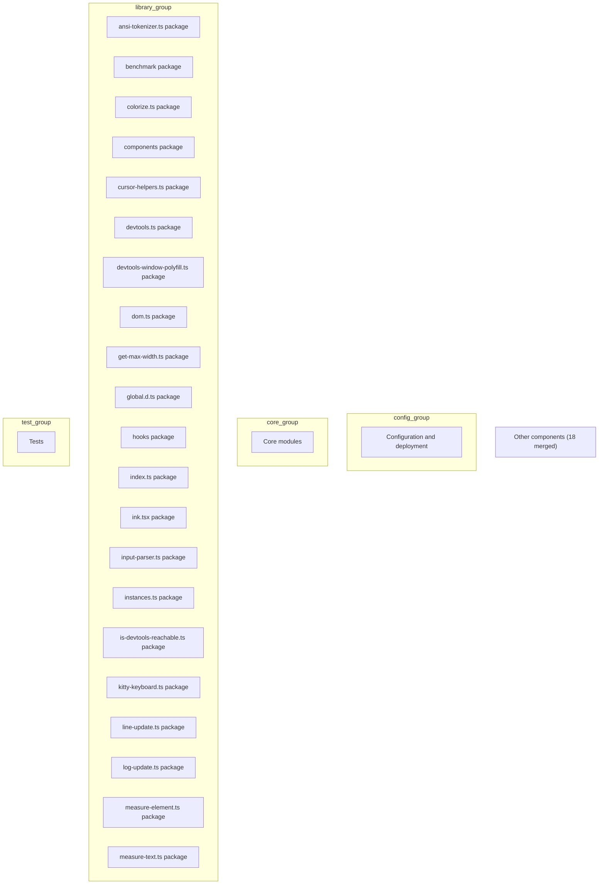

# Architecture report: vadimdemedes/ink

> Automated static analysis. **Observed** = directly seen in files/imports/AST; **Inferred** = interpretation from that evidence. Repository code was not executed.

## 1. Repository at a glance

| Item | Value |
| --- | --- |
| Repository | vadimdemedes/ink |
| Description | 🌈 React for interactive command-line apps |
| Language | TypeScript |
| Stars | 40270 |
| Licence | MIT |
| Analysed commit / branch | e93d12ec7658deefe3f3c2e1e7e52dd123297b0b / master |
| Framework(s) | React |
| Files analysed | 331 |
| Components | 42 |

## 2. Architecture in one minute

vadimdemedes/ink - 🌈 React for interactive command-line apps. This repository was analysed statically from 331 file(s) (0 Python). Detected technologies (observed from imports/manifests): GitHub Actions, React, React Router, TypeScript. Files are grouped into 42 component(s): ansi-tokenizer.ts package, benchmark package, colorize.ts package, components package, Configuration and deployment, Core modules, cursor-helpers.ts package, devtools.ts package. Findings below distinguish observed facts from inferred interpretation.

## 3. High-level block diagram

## 4. Main components

### ansi-tokenizer.ts package (`ansi_tokenizer_ts`)

- **Kind:** library
- **Status:** Observed
- **Confidence:** 0.85
- **Responsibility:** Groups 1 file(s) under ansi-tokenizer.ts package (observed from repository paths and static analysis).
- **Paths:** `src/ansi-tokenizer.ts`
- **Evidence:** [src/ansi-tokenizer.ts](https://github.com/vadimdemedes/ink/blob/e93d12ec7658deefe3f3c2e1e7e52dd123297b0b/src/ansi-tokenizer.ts)

### benchmark package (`benchmark`)

- **Kind:** library
- **Status:** Observed
- **Confidence:** 0.85
- **Responsibility:** Groups 6 file(s) under benchmark package (observed from repository paths and static analysis).
- **Paths:** `benchmark/layout/layout.tsx`, `benchmark/output/output.ts`, `benchmark/simple/index.ts`, `benchmark/simple/simple.tsx`, `benchmark/static/index.ts`, `benchmark/static/static.tsx`
- **Evidence:** [benchmark/layout/layout.tsx](https://github.com/vadimdemedes/ink/blob/e93d12ec7658deefe3f3c2e1e7e52dd123297b0b/benchmark/layout/layout.tsx); [benchmark/output/output.ts](https://github.com/vadimdemedes/ink/blob/e93d12ec7658deefe3f3c2e1e7e52dd123297b0b/benchmark/output/output.ts); [benchmark/simple/index.ts](https://github.com/vadimdemedes/ink/blob/e93d12ec7658deefe3f3c2e1e7e52dd123297b0b/benchmark/simple/index.ts); [benchmark/simple/simple.tsx](https://github.com/vadimdemedes/ink/blob/e93d12ec7658deefe3f3c2e1e7e52dd123297b0b/benchmark/simple/simple.tsx); [benchmark/static/index.ts](https://github.com/vadimdemedes/ink/blob/e93d12ec7658deefe3f3c2e1e7e52dd123297b0b/benchmark/static/index.ts); [benchmark/static/static.tsx](https://github.com/vadimdemedes/ink/blob/e93d12ec7658deefe3f3c2e1e7e52dd123297b0b/benchmark/static/static.tsx)

### colorize.ts package (`colorize_ts`)

- **Kind:** library
- **Status:** Observed
- **Confidence:** 0.85
- **Responsibility:** Groups 1 file(s) under colorize.ts package (observed from repository paths and static analysis).
- **Paths:** `src/colorize.ts`
- **Evidence:** [src/colorize.ts](https://github.com/vadimdemedes/ink/blob/e93d12ec7658deefe3f3c2e1e7e52dd123297b0b/src/colorize.ts)

### components package (`components`)

- **Kind:** library
- **Status:** Observed
- **Confidence:** 0.85
- **Responsibility:** Groups 19 file(s) under components package (observed from repository paths and static analysis).
- **Paths:** `src/components/AccessibilityContext.ts`, `src/components/AnimationContext.ts`, `src/components/App.tsx`, `src/components/AppContext.ts`, `src/components/BackgroundContext.ts`, `src/components/Box.tsx`, `src/components/CursorContext.ts`, `src/components/ErrorBoundary.tsx`, `src/components/ErrorOverview.tsx`, `src/components/FocusContext.ts`, `src/components/Newline.tsx`, `src/components/RootNodeContext.ts`, `src/components/Spacer.tsx`, `src/components/Static.tsx`, `src/components/StderrContext.ts`, `src/components/StdinContext.ts`, `src/components/StdoutContext.ts`, `src/components/Text.tsx`, `src/components/Transform.tsx`
- **Evidence:** [src/components/AccessibilityContext.ts](https://github.com/vadimdemedes/ink/blob/e93d12ec7658deefe3f3c2e1e7e52dd123297b0b/src/components/AccessibilityContext.ts); [src/components/AnimationContext.ts](https://github.com/vadimdemedes/ink/blob/e93d12ec7658deefe3f3c2e1e7e52dd123297b0b/src/components/AnimationContext.ts); [src/components/App.tsx](https://github.com/vadimdemedes/ink/blob/e93d12ec7658deefe3f3c2e1e7e52dd123297b0b/src/components/App.tsx); [src/components/AppContext.ts](https://github.com/vadimdemedes/ink/blob/e93d12ec7658deefe3f3c2e1e7e52dd123297b0b/src/components/AppContext.ts); [src/components/BackgroundContext.ts](https://github.com/vadimdemedes/ink/blob/e93d12ec7658deefe3f3c2e1e7e52dd123297b0b/src/components/BackgroundContext.ts); [src/components/Box.tsx](https://github.com/vadimdemedes/ink/blob/e93d12ec7658deefe3f3c2e1e7e52dd123297b0b/src/components/Box.tsx); [src/components/CursorContext.ts](https://github.com/vadimdemedes/ink/blob/e93d12ec7658deefe3f3c2e1e7e52dd123297b0b/src/components/CursorContext.ts); [src/components/ErrorBoundary.tsx](https://github.com/vadimdemedes/ink/blob/e93d12ec7658deefe3f3c2e1e7e52dd123297b0b/src/components/ErrorBoundary.tsx)

### Configuration and deployment (`config`)

- **Kind:** config
- **Status:** Observed
- **Confidence:** 0.85
- **Responsibility:** Groups 2 file(s) under configuration and deployment (observed from repository paths and static analysis).
- **Paths:** `package.json`, `tsconfig.json`
- **Evidence:** [package.json](https://github.com/vadimdemedes/ink/blob/e93d12ec7658deefe3f3c2e1e7e52dd123297b0b/package.json); [tsconfig.json](https://github.com/vadimdemedes/ink/blob/e93d12ec7658deefe3f3c2e1e7e52dd123297b0b/tsconfig.json)

### Core modules (`core`)

- **Kind:** core
- **Status:** Observed
- **Confidence:** 0.85
- **Responsibility:** Groups 1 file(s) under core modules (observed from repository paths and static analysis).
- **Paths:** `xo.config.ts`
- **Evidence:** [xo.config.ts](https://github.com/vadimdemedes/ink/blob/e93d12ec7658deefe3f3c2e1e7e52dd123297b0b/xo.config.ts)

### cursor-helpers.ts package (`cursor_helpers_ts`)

- **Kind:** library
- **Status:** Observed
- **Confidence:** 0.85
- **Responsibility:** Groups 1 file(s) under cursor-helpers.ts package (observed from repository paths and static analysis).
- **Paths:** `src/cursor-helpers.ts`
- **Evidence:** [src/cursor-helpers.ts](https://github.com/vadimdemedes/ink/blob/e93d12ec7658deefe3f3c2e1e7e52dd123297b0b/src/cursor-helpers.ts)

### devtools.ts package (`devtools_ts`)

- **Kind:** library
- **Status:** Observed
- **Confidence:** 0.85
- **Responsibility:** Groups 1 file(s) under devtools.ts package (observed from repository paths and static analysis).
- **Paths:** `src/devtools.ts`
- **Evidence:** [src/devtools.ts](https://github.com/vadimdemedes/ink/blob/e93d12ec7658deefe3f3c2e1e7e52dd123297b0b/src/devtools.ts)

### devtools-window-polyfill.ts package (`devtools_window_polyfill_ts`)

- **Kind:** library
- **Status:** Observed
- **Confidence:** 0.85
- **Responsibility:** Groups 1 file(s) under devtools-window-polyfill.ts package (observed from repository paths and static analysis).
- **Paths:** `src/devtools-window-polyfill.ts`
- **Evidence:** [src/devtools-window-polyfill.ts](https://github.com/vadimdemedes/ink/blob/e93d12ec7658deefe3f3c2e1e7e52dd123297b0b/src/devtools-window-polyfill.ts)

### dom.ts package (`dom_ts`)

- **Kind:** library
- **Status:** Observed
- **Confidence:** 0.85
- **Responsibility:** Groups 1 file(s) under dom.ts package (observed from repository paths and static analysis).
- **Paths:** `src/dom.ts`
- **Evidence:** [src/dom.ts](https://github.com/vadimdemedes/ink/blob/e93d12ec7658deefe3f3c2e1e7e52dd123297b0b/src/dom.ts)

### get-max-width.ts package (`get_max_width_ts`)

- **Kind:** library
- **Status:** Observed
- **Confidence:** 0.85
- **Responsibility:** Groups 1 file(s) under get-max-width.ts package (observed from repository paths and static analysis).
- **Paths:** `src/get-max-width.ts`
- **Evidence:** [src/get-max-width.ts](https://github.com/vadimdemedes/ink/blob/e93d12ec7658deefe3f3c2e1e7e52dd123297b0b/src/get-max-width.ts)

### global.d.ts package (`global_d_ts`)

- **Kind:** library
- **Status:** Observed
- **Confidence:** 0.85
- **Responsibility:** Groups 1 file(s) under global.d.ts package (observed from repository paths and static analysis).
- **Paths:** `src/global.d.ts`
- **Evidence:** [src/global.d.ts](https://github.com/vadimdemedes/ink/blob/e93d12ec7658deefe3f3c2e1e7e52dd123297b0b/src/global.d.ts)

### hooks package (`hooks`)

- **Kind:** library
- **Status:** Observed
- **Confidence:** 0.85
- **Responsibility:** Groups 13 file(s) under hooks package (observed from repository paths and static analysis).
- **Paths:** `src/hooks/use-animation.ts`, `src/hooks/use-app.ts`, `src/hooks/use-box-metrics.ts`, `src/hooks/use-cursor.ts`, `src/hooks/use-focus-manager.ts`, `src/hooks/use-focus.ts`, `src/hooks/use-input.ts`, `src/hooks/use-is-screen-reader-enabled.ts`, `src/hooks/use-paste.ts`, `src/hooks/use-stderr.ts`, `src/hooks/use-stdin.ts`, `src/hooks/use-stdout.ts`, `src/hooks/use-window-size.ts`
- **Evidence:** [src/hooks/use-animation.ts](https://github.com/vadimdemedes/ink/blob/e93d12ec7658deefe3f3c2e1e7e52dd123297b0b/src/hooks/use-animation.ts); [src/hooks/use-app.ts](https://github.com/vadimdemedes/ink/blob/e93d12ec7658deefe3f3c2e1e7e52dd123297b0b/src/hooks/use-app.ts); [src/hooks/use-box-metrics.ts](https://github.com/vadimdemedes/ink/blob/e93d12ec7658deefe3f3c2e1e7e52dd123297b0b/src/hooks/use-box-metrics.ts); [src/hooks/use-cursor.ts](https://github.com/vadimdemedes/ink/blob/e93d12ec7658deefe3f3c2e1e7e52dd123297b0b/src/hooks/use-cursor.ts); [src/hooks/use-focus-manager.ts](https://github.com/vadimdemedes/ink/blob/e93d12ec7658deefe3f3c2e1e7e52dd123297b0b/src/hooks/use-focus-manager.ts); [src/hooks/use-focus.ts](https://github.com/vadimdemedes/ink/blob/e93d12ec7658deefe3f3c2e1e7e52dd123297b0b/src/hooks/use-focus.ts); [src/hooks/use-input.ts](https://github.com/vadimdemedes/ink/blob/e93d12ec7658deefe3f3c2e1e7e52dd123297b0b/src/hooks/use-input.ts); [src/hooks/use-is-screen-reader-enabled.ts](https://github.com/vadimdemedes/ink/blob/e93d12ec7658deefe3f3c2e1e7e52dd123297b0b/src/hooks/use-is-screen-reader-enabled.ts)

### index.ts package (`index_ts`)

- **Kind:** library
- **Status:** Observed
- **Confidence:** 0.85
- **Responsibility:** Groups 1 file(s) under index.ts package (observed from repository paths and static analysis).
- **Paths:** `src/index.ts`
- **Evidence:** [src/index.ts](https://github.com/vadimdemedes/ink/blob/e93d12ec7658deefe3f3c2e1e7e52dd123297b0b/src/index.ts)

### ink.tsx package (`ink_tsx`)

- **Kind:** library
- **Status:** Observed
- **Confidence:** 0.85
- **Responsibility:** Groups 1 file(s) under ink.tsx package (observed from repository paths and static analysis).
- **Paths:** `src/ink.tsx`
- **Evidence:** [src/ink.tsx](https://github.com/vadimdemedes/ink/blob/e93d12ec7658deefe3f3c2e1e7e52dd123297b0b/src/ink.tsx)

### input-parser.ts package (`input_parser_ts`)

- **Kind:** library
- **Status:** Observed
- **Confidence:** 0.85
- **Responsibility:** Groups 1 file(s) under input-parser.ts package (observed from repository paths and static analysis).
- **Paths:** `src/input-parser.ts`
- **Evidence:** [src/input-parser.ts](https://github.com/vadimdemedes/ink/blob/e93d12ec7658deefe3f3c2e1e7e52dd123297b0b/src/input-parser.ts)

### instances.ts package (`instances_ts`)

- **Kind:** library
- **Status:** Observed
- **Confidence:** 0.85
- **Responsibility:** Groups 1 file(s) under instances.ts package (observed from repository paths and static analysis).
- **Paths:** `src/instances.ts`
- **Evidence:** [src/instances.ts](https://github.com/vadimdemedes/ink/blob/e93d12ec7658deefe3f3c2e1e7e52dd123297b0b/src/instances.ts)

### is-devtools-reachable.ts package (`is_devtools_reachable_ts`)

- **Kind:** library
- **Status:** Observed
- **Confidence:** 0.85
- **Responsibility:** Groups 1 file(s) under is-devtools-reachable.ts package (observed from repository paths and static analysis).
- **Paths:** `src/is-devtools-reachable.ts`
- **Evidence:** [src/is-devtools-reachable.ts](https://github.com/vadimdemedes/ink/blob/e93d12ec7658deefe3f3c2e1e7e52dd123297b0b/src/is-devtools-reachable.ts)

### kitty-keyboard.ts package (`kitty_keyboard_ts`)

- **Kind:** library
- **Status:** Observed
- **Confidence:** 0.85
- **Responsibility:** Groups 1 file(s) under kitty-keyboard.ts package (observed from repository paths and static analysis).
- **Paths:** `src/kitty-keyboard.ts`
- **Evidence:** [src/kitty-keyboard.ts](https://github.com/vadimdemedes/ink/blob/e93d12ec7658deefe3f3c2e1e7e52dd123297b0b/src/kitty-keyboard.ts)

### line-update.ts package (`line_update_ts`)

- **Kind:** library
- **Status:** Observed
- **Confidence:** 0.85
- **Responsibility:** Groups 1 file(s) under line-update.ts package (observed from repository paths and static analysis).
- **Paths:** `src/line-update.ts`
- **Evidence:** [src/line-update.ts](https://github.com/vadimdemedes/ink/blob/e93d12ec7658deefe3f3c2e1e7e52dd123297b0b/src/line-update.ts)

### log-update.ts package (`log_update_ts`)

- **Kind:** library
- **Status:** Observed
- **Confidence:** 0.85
- **Responsibility:** Groups 1 file(s) under log-update.ts package (observed from repository paths and static analysis).
- **Paths:** `src/log-update.ts`
- **Evidence:** [src/log-update.ts](https://github.com/vadimdemedes/ink/blob/e93d12ec7658deefe3f3c2e1e7e52dd123297b0b/src/log-update.ts)

### measure-element.ts package (`measure_element_ts`)

- **Kind:** library
- **Status:** Observed
- **Confidence:** 0.85
- **Responsibility:** Groups 1 file(s) under measure-element.ts package (observed from repository paths and static analysis).
- **Paths:** `src/measure-element.ts`
- **Evidence:** [src/measure-element.ts](https://github.com/vadimdemedes/ink/blob/e93d12ec7658deefe3f3c2e1e7e52dd123297b0b/src/measure-element.ts)

### measure-text.ts package (`measure_text_ts`)

- **Kind:** library
- **Status:** Observed
- **Confidence:** 0.85
- **Responsibility:** Groups 1 file(s) under measure-text.ts package (observed from repository paths and static analysis).
- **Paths:** `src/measure-text.ts`
- **Evidence:** [src/measure-text.ts](https://github.com/vadimdemedes/ink/blob/e93d12ec7658deefe3f3c2e1e7e52dd123297b0b/src/measure-text.ts)

### media package (`media`)

- **Kind:** library
- **Status:** Observed
- **Confidence:** 0.85
- **Responsibility:** Groups 1 file(s) under media package (observed from repository paths and static analysis).
- **Paths:** `media/demo.tsx`
- **Evidence:** [media/demo.tsx](https://github.com/vadimdemedes/ink/blob/e93d12ec7658deefe3f3c2e1e7e52dd123297b0b/media/demo.tsx)

### output.ts package (`output_ts`)

- **Kind:** library
- **Status:** Observed
- **Confidence:** 0.85
- **Responsibility:** Groups 1 file(s) under output.ts package (observed from repository paths and static analysis).
- **Paths:** `src/output.ts`
- **Evidence:** [src/output.ts](https://github.com/vadimdemedes/ink/blob/e93d12ec7658deefe3f3c2e1e7e52dd123297b0b/src/output.ts)

### parse-keypress.ts package (`parse_keypress_ts`)

- **Kind:** library
- **Status:** Observed
- **Confidence:** 0.85
- **Responsibility:** Groups 1 file(s) under parse-keypress.ts package (observed from repository paths and static analysis).
- **Paths:** `src/parse-keypress.ts`
- **Evidence:** [src/parse-keypress.ts](https://github.com/vadimdemedes/ink/blob/e93d12ec7658deefe3f3c2e1e7e52dd123297b0b/src/parse-keypress.ts)

### reconciler.ts package (`reconciler_ts`)

- **Kind:** library
- **Status:** Observed
- **Confidence:** 0.85
- **Responsibility:** Groups 1 file(s) under reconciler.ts package (observed from repository paths and static analysis).
- **Paths:** `src/reconciler.ts`
- **Evidence:** [src/reconciler.ts](https://github.com/vadimdemedes/ink/blob/e93d12ec7658deefe3f3c2e1e7e52dd123297b0b/src/reconciler.ts)

### render-background.ts package (`render_background_ts`)

- **Kind:** library
- **Status:** Observed
- **Confidence:** 0.85
- **Responsibility:** Groups 1 file(s) under render-background.ts package (observed from repository paths and static analysis).
- **Paths:** `src/render-background.ts`
- **Evidence:** [src/render-background.ts](https://github.com/vadimdemedes/ink/blob/e93d12ec7658deefe3f3c2e1e7e52dd123297b0b/src/render-background.ts)

### render-border.ts package (`render_border_ts`)

- **Kind:** library
- **Status:** Observed
- **Confidence:** 0.85
- **Responsibility:** Groups 1 file(s) under render-border.ts package (observed from repository paths and static analysis).
- **Paths:** `src/render-border.ts`
- **Evidence:** [src/render-border.ts](https://github.com/vadimdemedes/ink/blob/e93d12ec7658deefe3f3c2e1e7e52dd123297b0b/src/render-border.ts)

### render-node-to-output.ts package (`render_node_to_output_ts`)

- **Kind:** library
- **Status:** Observed
- **Confidence:** 0.85
- **Responsibility:** Groups 1 file(s) under render-node-to-output.ts package (observed from repository paths and static analysis).
- **Paths:** `src/render-node-to-output.ts`
- **Evidence:** [src/render-node-to-output.ts](https://github.com/vadimdemedes/ink/blob/e93d12ec7658deefe3f3c2e1e7e52dd123297b0b/src/render-node-to-output.ts)

### render-to-string.ts package (`render_to_string_ts`)

- **Kind:** library
- **Status:** Observed
- **Confidence:** 0.85
- **Responsibility:** Groups 1 file(s) under render-to-string.ts package (observed from repository paths and static analysis).
- **Paths:** `src/render-to-string.ts`
- **Evidence:** [src/render-to-string.ts](https://github.com/vadimdemedes/ink/blob/e93d12ec7658deefe3f3c2e1e7e52dd123297b0b/src/render-to-string.ts)

### render.ts package (`render_ts`)

- **Kind:** library
- **Status:** Observed
- **Confidence:** 0.85
- **Responsibility:** Groups 1 file(s) under render.ts package (observed from repository paths and static analysis).
- **Paths:** `src/render.ts`
- **Evidence:** [src/render.ts](https://github.com/vadimdemedes/ink/blob/e93d12ec7658deefe3f3c2e1e7e52dd123297b0b/src/render.ts)

### renderer.ts package (`renderer_ts`)

- **Kind:** library
- **Status:** Observed
- **Confidence:** 0.85
- **Responsibility:** Groups 1 file(s) under renderer.ts package (observed from repository paths and static analysis).
- **Paths:** `src/renderer.ts`
- **Evidence:** [src/renderer.ts](https://github.com/vadimdemedes/ink/blob/e93d12ec7658deefe3f3c2e1e7e52dd123297b0b/src/renderer.ts)

### sanitize-ansi.ts package (`sanitize_ansi_ts`)

- **Kind:** library
- **Status:** Observed
- **Confidence:** 0.85
- **Responsibility:** Groups 1 file(s) under sanitize-ansi.ts package (observed from repository paths and static analysis).
- **Paths:** `src/sanitize-ansi.ts`
- **Evidence:** [src/sanitize-ansi.ts](https://github.com/vadimdemedes/ink/blob/e93d12ec7658deefe3f3c2e1e7e52dd123297b0b/src/sanitize-ansi.ts)

### sized-cache.ts package (`sized_cache_ts`)

- **Kind:** library
- **Status:** Observed
- **Confidence:** 0.85
- **Responsibility:** Groups 1 file(s) under sized-cache.ts package (observed from repository paths and static analysis).
- **Paths:** `src/sized-cache.ts`
- **Evidence:** [src/sized-cache.ts](https://github.com/vadimdemedes/ink/blob/e93d12ec7658deefe3f3c2e1e7e52dd123297b0b/src/sized-cache.ts)

### squash-text-nodes.ts package (`squash_text_nodes_ts`)

- **Kind:** library
- **Status:** Observed
- **Confidence:** 0.85
- **Responsibility:** Groups 1 file(s) under squash-text-nodes.ts package (observed from repository paths and static analysis).
- **Paths:** `src/squash-text-nodes.ts`
- **Evidence:** [src/squash-text-nodes.ts](https://github.com/vadimdemedes/ink/blob/e93d12ec7658deefe3f3c2e1e7e52dd123297b0b/src/squash-text-nodes.ts)

### stream.ts package (`stream_ts`)

- **Kind:** library
- **Status:** Observed
- **Confidence:** 0.85
- **Responsibility:** Groups 1 file(s) under stream.ts package (observed from repository paths and static analysis).
- **Paths:** `src/stream.ts`
- **Evidence:** [src/stream.ts](https://github.com/vadimdemedes/ink/blob/e93d12ec7658deefe3f3c2e1e7e52dd123297b0b/src/stream.ts)

### styles.ts package (`styles_ts`)

- **Kind:** library
- **Status:** Observed
- **Confidence:** 0.85
- **Responsibility:** Groups 1 file(s) under styles.ts package (observed from repository paths and static analysis).
- **Paths:** `src/styles.ts`
- **Evidence:** [src/styles.ts](https://github.com/vadimdemedes/ink/blob/e93d12ec7658deefe3f3c2e1e7e52dd123297b0b/src/styles.ts)

### Tests (`tests`)

- **Kind:** test
- **Status:** Observed
- **Confidence:** 0.85
- **Responsibility:** Groups 186 file(s) under tests (observed from repository paths and static analysis).
- **Paths:** `test/absolute-truncation.tsx`, `test/alternate-screen-example.tsx`, `test/ansi-newlines.tsx`, `test/ansi-tokenizer.ts`, `test/background.tsx`, `test/border-backgrounds.tsx`, `test/borders.tsx`, `test/build-output.ts`, `test/c1-rendering.tsx`, `test/clear-rerender.tsx`, `test/clip-wide-background.tsx`, `test/colon-colors.tsx`, `test/colorize.ts`, `test/component-regressions.tsx`, `test/components.tsx`, `test/content-offset.tsx`, `test/cursor-exit-position.tsx`, `test/cursor-helpers.tsx`, `test/cursor.tsx`, `test/devtools.tsx`, `test/display.tsx`, `test/docs.ts`, `test/error-overview.tsx`, `test/errors.tsx`, `test/exit-keyboard.tsx`, `test/exit-signals.tsx`, `test/exit.tsx`, `test/fixtures/alternate-screen-example.tsx`, `test/fixtures/alternate-screen-full-board-win.tsx`, `test/fixtures/aria-example.tsx`, `test/fixtures/box-width-types.tsx`, `test/fixtures/ci-debug-after-exit.tsx`, `test/fixtures/ci-debug.tsx`, `test/fixtures/ci.tsx`, `test/fixtures/clear.tsx`, `test/fixtures/console.tsx`, `test/fixtures/devtools-exit-on-unmount.tsx`, `test/fixtures/erase-with-state-change.tsx`, `test/fixtures/erase-with-static.tsx`, `test/fixtures/erase.tsx`, `test/fixtures/error source.txt`, `test/fixtures/error-long-line.txt`, `test/fixtures/exit-after-signal-exit-v4-user.tsx`, `test/fixtures/exit-double-raw-mode.tsx`, `test/fixtures/exit-normally-render-on-before-exit.tsx`, `test/fixtures/exit-normally-two-instances.tsx`, `test/fixtures/exit-normally.tsx`, `test/fixtures/exit-on-exit-with-error-value-property.tsx`, `test/fixtures/exit-on-exit-with-error.tsx`, `test/fixtures/exit-on-exit-with-result.tsx`, `test/fixtures/exit-on-exit-with-value-object.tsx`, `test/fixtures/exit-on-exit.tsx`, `test/fixtures/exit-on-finish.tsx`, `test/fixtures/exit-on-signal.tsx`, `test/fixtures/exit-on-unmount.tsx`, `test/fixtures/exit-raw-on-exit-with-error.tsx`, `test/fixtures/exit-raw-on-exit.tsx`, `test/fixtures/exit-raw-on-unmount.tsx`, `test/fixtures/exit-two-instances-after-signal-exit-v4-user.tsx`, `test/fixtures/exit-with-static.tsx`, `test/fixtures/exit-with-thrown-error.tsx`, `test/fixtures/full-clear-static-accounting.tsx`, `test/fixtures/fullscreen-no-extra-newline.tsx`, `test/fixtures/issue-442-full-height.tsx`, `test/fixtures/issue-450-fixture-helpers.tsx`, `test/fixtures/issue-450-full-height-rerender-with-marker.tsx`, `test/fixtures/issue-450-full-height-rerender.tsx`, `test/fixtures/issue-450-full-height-with-static-rerender.tsx`, `test/fixtures/issue-450-grow-to-fullscreen-rerender.tsx`, `test/fixtures/issue-450-grow-to-overflow-rerender.tsx`, `test/fixtures/issue-450-height-minus-one-rerender.tsx`, `test/fixtures/issue-450-initial-fullscreen.tsx`, `test/fixtures/issue-450-initial-overflow.tsx`, `test/fixtures/issue-450-shrink-from-fullscreen-rerender.tsx`, `test/fixtures/issue-450-shrink-from-overflow-rerender.tsx`, `test/fixtures/issue-450-static-shrink-from-fullscreen-rerender.tsx`, `test/fixtures/issue-725-child-process.tsx`, `test/fixtures/issue-935-overflow-rerender.tsx`, `test/fixtures/issue-969-windows-full-height-rerender.tsx`, `test/fixtures/issue-973-static-commit.tsx`, `test/fixtures/subprocess-output-example.tsx`, `test/fixtures/suspend-terminal-static.tsx`, `test/fixtures/suspend-terminal.tsx`, `test/fixtures/undefined-render-streams.tsx`, `test/fixtures/use-animation-interactive-false-exit.tsx`, `test/fixtures/use-animation-non-interactive-exit.tsx`, `test/fixtures/use-input-ctrl-c.tsx`, `test/fixtures/use-input-discrete-priority.tsx`, `test/fixtures/use-input-kitty.tsx`, `test/fixtures/use-input-many.tsx`, `test/fixtures/use-input-multiple.tsx`, `test/fixtures/use-input.tsx`, `test/fixtures/use-paste.tsx`, `test/fixtures/use-stderr.tsx`, `test/fixtures/use-stdout.tsx`, `test/flex-align-content.tsx`, `test/flex-align-items.tsx`, `test/flex-align-self.tsx`, `test/flex-direction.tsx`, `test/flex-justify-content.tsx`, `test/flex-wrap.tsx`, `test/flex.tsx`, `test/focus-empty-id-regression.tsx`, `test/focus-order.tsx`, `test/focus-strict-mode.tsx`, `test/focus.tsx`, `test/gap.tsx`, `test/helpers/act.ts`, `test/helpers/create-stdin.ts`, `test/helpers/create-stdout.ts`, `test/helpers/force-colors.ts`, `test/helpers/mock-timer-calls.ts`, `test/helpers/reconstruct-terminal.ts`, `test/helpers/render-to-string.ts`, `test/helpers/run.ts`, `test/helpers/term.ts`, `test/helpers/test-renderer.ts`, `test/hooks-use-input-kitty.tsx`, `test/hooks-use-input-navigation.tsx`, `test/hooks-use-input.tsx`, `test/hooks-use-paste.tsx`, `test/hooks.tsx`, `test/input-buffered-ctrl-c.tsx`, `test/input-keypad-enter.tsx`, `test/input-parser.ts`, `test/is-devtools-reachable.tsx`, `test/issue-973-static-commit.tsx`, `test/kitty-keyboard.tsx`, `test/kitty-negotiation.tsx`, `test/line-update.ts`, `test/log-update-blank-growth.ts`, `test/log-update-columns.tsx`, `test/log-update-sparse.ts`, `test/log-update.tsx`, `test/margin.tsx`, `test/measure-element.tsx`, `test/measure-text.tsx`, `test/output-caches.tsx`, `test/output.ts`, `test/overflow.tsx`, `test/overlap-wide-background.tsx`, `test/padding.tsx`, `test/parse-keypress.ts`, `test/position.tsx`, `test/reconciler.tsx`, `test/render-callback.tsx`, `test/render-to-string.tsx`, `test/render.tsx`, `test/rendering-regressions.tsx`, `test/rerender-input.tsx`, `test/sanitize-ansi.ts`, `test/screen-reader.tsx`, `test/sized-cache.ts`, `test/squash-text-nodes.tsx`, `test/static-abandoned-render.tsx`, `test/static-blank-lines.tsx`, `test/static-exit.tsx`, `test/static-runtime-blank-lines.tsx`, `test/static-string-replacement.tsx`, `test/static-trailing-layout.tsx`, `test/style-types.ts`, `test/style-update-consistency.tsx`, `test/styled-combining-marks.tsx`, `test/styles.ts`, `test/suspend-terminal.tsx`, `test/suspension-exit.tsx`, `test/suspension-handle.tsx`, `test/suspension-input-disable.tsx`, `test/suspension-output.tsx`, `test/suspension-resize.tsx`, `test/suspension-static.tsx`, `test/terminal-resize.tsx`, `test/test.env`, `test/text-controls.tsx`, `test/text-width.tsx`, `test/text.tsx`, `test/transform-escapes.tsx`, `test/truncate-width.tsx`, `test/tsconfig.json`, `test/use-animation.tsx`, `test/use-box-metrics.tsx`, `test/view-transition.tsx`, `test/width-height.tsx`, `test/wrap-text.tsx`, `test/write-synchronized.tsx`, `test/yoga-nodes.tsx`
- **Evidence:** [test/absolute-truncation.tsx](https://github.com/vadimdemedes/ink/blob/e93d12ec7658deefe3f3c2e1e7e52dd123297b0b/test/absolute-truncation.tsx); [test/alternate-screen-example.tsx](https://github.com/vadimdemedes/ink/blob/e93d12ec7658deefe3f3c2e1e7e52dd123297b0b/test/alternate-screen-example.tsx); [test/ansi-newlines.tsx](https://github.com/vadimdemedes/ink/blob/e93d12ec7658deefe3f3c2e1e7e52dd123297b0b/test/ansi-newlines.tsx); [test/ansi-tokenizer.ts](https://github.com/vadimdemedes/ink/blob/e93d12ec7658deefe3f3c2e1e7e52dd123297b0b/test/ansi-tokenizer.ts); [test/background.tsx](https://github.com/vadimdemedes/ink/blob/e93d12ec7658deefe3f3c2e1e7e52dd123297b0b/test/background.tsx); [test/border-backgrounds.tsx](https://github.com/vadimdemedes/ink/blob/e93d12ec7658deefe3f3c2e1e7e52dd123297b0b/test/border-backgrounds.tsx); [test/borders.tsx](https://github.com/vadimdemedes/ink/blob/e93d12ec7658deefe3f3c2e1e7e52dd123297b0b/test/borders.tsx); [test/build-output.ts](https://github.com/vadimdemedes/ink/blob/e93d12ec7658deefe3f3c2e1e7e52dd123297b0b/test/build-output.ts)

### utils.ts package (`utils_ts`)

- **Kind:** library
- **Status:** Observed
- **Confidence:** 0.85
- **Responsibility:** Groups 1 file(s) under utils.ts package (observed from repository paths and static analysis).
- **Paths:** `src/utils.ts`
- **Evidence:** [src/utils.ts](https://github.com/vadimdemedes/ink/blob/e93d12ec7658deefe3f3c2e1e7e52dd123297b0b/src/utils.ts)

### wrap-text.ts package (`wrap_text_ts`)

- **Kind:** library
- **Status:** Observed
- **Confidence:** 0.85
- **Responsibility:** Groups 1 file(s) under wrap-text.ts package (observed from repository paths and static analysis).
- **Paths:** `src/wrap-text.ts`
- **Evidence:** [src/wrap-text.ts](https://github.com/vadimdemedes/ink/blob/e93d12ec7658deefe3f3c2e1e7e52dd123297b0b/src/wrap-text.ts)

### write-synchronized.ts package (`write_synchronized_ts`)

- **Kind:** library
- **Status:** Observed
- **Confidence:** 0.85
- **Responsibility:** Groups 1 file(s) under write-synchronized.ts package (observed from repository paths and static analysis).
- **Paths:** `src/write-synchronized.ts`
- **Evidence:** [src/write-synchronized.ts](https://github.com/vadimdemedes/ink/blob/e93d12ec7658deefe3f3c2e1e7e52dd123297b0b/src/write-synchronized.ts)

## 5. Execution flow

**Observed** entry point(s):

- [benchmark/simple/index.ts](https://github.com/vadimdemedes/ink/blob/e93d12ec7658deefe3f3c2e1e7e52dd123297b0b/benchmark/simple/index.ts)
- [benchmark/static/index.ts](https://github.com/vadimdemedes/ink/blob/e93d12ec7658deefe3f3c2e1e7e52dd123297b0b/benchmark/static/index.ts)
- [src/components/App.tsx](https://github.com/vadimdemedes/ink/blob/e93d12ec7658deefe3f3c2e1e7e52dd123297b0b/src/components/App.tsx)
- [src/index.ts](https://github.com/vadimdemedes/ink/blob/e93d12ec7658deefe3f3c2e1e7e52dd123297b0b/src/index.ts)

Representative flow (derived from observed entry points and the import graph; steps beyond the entry point are **Inferred**):

1. Execution starts at an observed entry point listed above, if present.
2. No internal import relationships between components were observed.

## 6. Project structure

### `(root)`

- `.editorconfig` - config (175 bytes)
- `.gitattributes` - other (19 bytes)
- `.gitignore` - other (20 bytes)
- `license` - docs (1202 bytes)
- `package.json` - manifest (2894 bytes)
- `readme.md` - docs (87550 bytes)
- `tsconfig.json` - config (218 bytes)
- `xo.config.ts` - source, TypeScript (3504 bytes)

### `.github`

- `.github/workflows/test.yml` - ci, YAML (489 bytes)
- `.github/workflows/windows.yml` - ci, YAML (325 bytes)

### `benchmark`

- `benchmark/layout/layout.tsx` - source, TypeScript (4008 bytes)
- `benchmark/output/output.ts` - source, TypeScript (1100 bytes)
- `benchmark/simple/index.ts` - source, TypeScript (22 bytes)
- `benchmark/simple/simple.tsx` - source, TypeScript (1000 bytes)
- `benchmark/static/index.ts` - source, TypeScript (22 bytes)
- `benchmark/static/static.tsx` - source, TypeScript (1728 bytes)

### `examples`

- `examples/alternate-screen/alternate-screen.tsx` - source, TypeScript (5902 bytes)
- `examples/alternate-screen/index.ts` - source, TypeScript (95 bytes)
- `examples/aria/aria.tsx` - source, TypeScript (737 bytes)
- `examples/aria/index.ts` - source, TypeScript (20 bytes)
- `examples/border-backgrounds/border-backgrounds.tsx` - source, TypeScript (1345 bytes)
- `examples/border-backgrounds/index.ts` - source, TypeScript (34 bytes)
- `examples/borders/borders.tsx` - source, TypeScript (820 bytes)
- `examples/borders/index.ts` - source, TypeScript (23 bytes)
- `examples/box-backgrounds/box-backgrounds.tsx` - source, TypeScript (2394 bytes)
- `examples/box-backgrounds/index.ts` - source, TypeScript (187 bytes)
- `examples/chat/chat.tsx` - source, TypeScript (1408 bytes)
- `examples/chat/index.ts` - source, TypeScript (20 bytes)
- `examples/concurrent-suspense/concurrent-suspense.tsx` - source, TypeScript (2735 bytes)
- `examples/concurrent-suspense/index.ts` - source, TypeScript (35 bytes)
- `examples/counter/counter.tsx` - source, TypeScript (417 bytes)
- `examples/counter/index.ts` - source, TypeScript (23 bytes)
- `examples/cursor-ime/cursor-ime.tsx` - source, TypeScript (1396 bytes)
- `examples/cursor-ime/index.ts` - source, TypeScript (26 bytes)
- `examples/incremental-rendering/incremental-rendering.tsx` - source, TypeScript (9333 bytes)
- `examples/incremental-rendering/index.ts` - source, TypeScript (37 bytes)
- `examples/jest/index.ts` - source, TypeScript (20 bytes)
- `examples/jest/jest.tsx` - source, TypeScript (2027 bytes)
- `examples/jest/summary.tsx` - source, TypeScript (901 bytes)
- `examples/jest/test.tsx` - source, TypeScript (782 bytes)
- `examples/justify-content/index.ts` - source, TypeScript (31 bytes)
- `examples/justify-content/justify-content.tsx` - source, TypeScript (1271 bytes)
- `examples/render-throttle/index.tsx` - source, TypeScript (672 bytes)
- `examples/router/index.ts` - source, TypeScript (22 bytes)
- `examples/router/router.tsx` - source, TypeScript (1107 bytes)
- `examples/scroll/index.ts` - source, TypeScript (22 bytes)
- `examples/scroll/scroll.tsx` - source, TypeScript (2885 bytes)
- `examples/select-input/index.ts` - source, TypeScript (28 bytes)
- `examples/select-input/select-input.tsx` - source, TypeScript (1413 bytes)
- `examples/static/index.ts` - source, TypeScript (22 bytes)
- `examples/static/static.tsx` - source, TypeScript (925 bytes)
- `examples/subprocess-output/index.ts` - source, TypeScript (33 bytes)
- `examples/subprocess-output/subprocess-output.tsx` - source, TypeScript (869 bytes)
- `examples/suspend-terminal/index.ts` - source, TypeScript (32 bytes)
- `examples/suspend-terminal/suspend-terminal.tsx` - source, TypeScript (2308 bytes)
- `examples/suspense/index.ts` - source, TypeScript (24 bytes)
- `examples/suspense/suspense.tsx` - source, TypeScript (794 bytes)
- `examples/table/index.ts` - source, TypeScript (21 bytes)
- `examples/table/table.tsx` - source, TypeScript (837 bytes)
- `examples/terminal-resize/index.ts` - source, TypeScript (31 bytes)
- `examples/terminal-resize/terminal-resize.tsx` - source, TypeScript (691 bytes)
- `examples/use-animation/index.ts` - source, TypeScript (29 bytes)
- `examples/use-animation/use-animation.tsx` - source, TypeScript (3798 bytes)
- `examples/use-focus-with-id/index.ts` - source, TypeScript (33 bytes)
- `examples/use-focus-with-id/use-focus-with-id.tsx` - source, TypeScript (915 bytes)
- `examples/use-focus/index.ts` - source, TypeScript (25 bytes)
- `examples/use-focus/use-focus.tsx` - source, TypeScript (626 bytes)
- `examples/use-input/index.ts` - source, TypeScript (25 bytes)
- `examples/use-input/use-input.tsx` - source, TypeScript (822 bytes)
- `examples/use-stderr/index.ts` - source, TypeScript (26 bytes)
- `examples/use-stderr/use-stderr.tsx` - source, TypeScript (374 bytes)
- `examples/use-stdout/index.ts` - source, TypeScript (26 bytes)
- `examples/use-stdout/use-stdout.tsx` - source, TypeScript (720 bytes)
- `examples/use-transition/index.ts` - source, TypeScript (30 bytes)
- `examples/use-transition/use-transition.tsx` - source, TypeScript (2876 bytes)

### `media`

- `media/demo.svg` - other (15416 bytes)
- `media/demo.tsx` - source, TypeScript (734 bytes)

### `recipes`

- `recipes/routing.md` - docs (1539 bytes)

### `src`

- `src/ansi-tokenizer.ts` - source, TypeScript (11966 bytes)
- `src/colorize.ts` - source, TypeScript (1839 bytes)
- `src/components/AccessibilityContext.ts` - source, TypeScript (235 bytes)
- `src/components/AnimationContext.ts` - source, TypeScript (640 bytes)
- `src/components/App.tsx` - source, TypeScript (24000 bytes)
- `src/components/AppContext.ts` - source, TypeScript (2817 bytes)
- `src/components/BackgroundContext.ts` - source, TypeScript (413 bytes)
- `src/components/Box.tsx` - source, TypeScript (2969 bytes)
- `src/components/CursorContext.ts` - source, TypeScript (520 bytes)
- `src/components/ErrorBoundary.tsx` - source, TypeScript (1068 bytes)
- `src/components/ErrorOverview.tsx` - source, TypeScript (4478 bytes)
- `src/components/FocusContext.ts` - source, TypeScript (833 bytes)
- `src/components/Newline.tsx` - source, TypeScript (332 bytes)
- `src/components/RootNodeContext.ts` - source, TypeScript (298 bytes)
- `src/components/Spacer.tsx` - source, TypeScript (288 bytes)
- `src/components/Static.tsx` - source, TypeScript (2523 bytes)
- `src/components/StderrContext.ts` - source, TypeScript (883 bytes)
- `src/components/StdinContext.ts` - source, TypeScript (1854 bytes)
- `src/components/StdoutContext.ts` - source, TypeScript (910 bytes)
- `src/components/Text.tsx` - source, TypeScript (3566 bytes)
- `src/components/Transform.tsx` - source, TypeScript (1617 bytes)
- `src/cursor-helpers.ts` - source, TypeScript (4762 bytes)
- `src/devtools-window-polyfill.ts` - source, TypeScript (1715 bytes)
- `src/devtools.ts` - source, TypeScript (2799 bytes)
- `src/dom.ts` - source, TypeScript (10785 bytes)
- `src/get-max-width.ts` - source, TypeScript (349 bytes)
- `src/global.d.ts` - source, TypeScript (904 bytes)
- `src/hooks/use-animation.ts` - source, TypeScript (4651 bytes)
- `src/hooks/use-app.ts` - source, TypeScript (243 bytes)
- `src/hooks/use-box-metrics.ts` - source, TypeScript (4309 bytes)
- `src/hooks/use-cursor.ts` - source, TypeScript (1319 bytes)
- `src/hooks/use-focus-manager.ts` - source, TypeScript (1998 bytes)
- `src/hooks/use-focus.ts` - source, TypeScript (2134 bytes)
- `src/hooks/use-input.ts` - source, TypeScript (6103 bytes)
- `src/hooks/use-is-screen-reader-enabled.ts` - source, TypeScript (435 bytes)
- `src/hooks/use-paste.ts` - source, TypeScript (2304 bytes)
- `src/hooks/use-stderr.ts` - source, TypeScript (208 bytes)
- `src/hooks/use-stdin.ts` - source, TypeScript (347 bytes)
- `src/hooks/use-stdout.ts` - source, TypeScript (235 bytes)
- `src/hooks/use-window-size.ts` - source, TypeScript (905 bytes)
- `src/index.ts` - source, TypeScript (2736 bytes)
- `src/ink.tsx` - source, TypeScript (51959 bytes)
- `src/input-parser.ts` - source, TypeScript (9320 bytes)
- `src/instances.ts` - source, TypeScript (420 bytes)
- `src/is-devtools-reachable.ts` - source, TypeScript (642 bytes)
- `src/kitty-keyboard.ts` - source, TypeScript (3170 bytes)
- `src/line-update.ts` - source, TypeScript (3446 bytes)
- `src/log-update.ts` - source, TypeScript (11726 bytes)
- `src/measure-element.ts` - source, TypeScript (3363 bytes)
- `src/measure-text.ts` - source, TypeScript (662 bytes)
- `src/output.ts` - source, TypeScript (13919 bytes)
- `src/parse-keypress.ts` - source, TypeScript (13477 bytes)
- `src/reconciler.ts` - source, TypeScript (15398 bytes)
- `src/render-background.ts` - source, TypeScript (1552 bytes)
- `src/render-border.ts` - source, TypeScript (4276 bytes)
- `src/render-node-to-output.ts` - source, TypeScript (6082 bytes)
- `src/render-to-string.ts` - source, TypeScript (7067 bytes)
- `src/render.ts` - source, TypeScript (9098 bytes)
- `src/renderer.ts` - source, TypeScript (2467 bytes)
- `src/sanitize-ansi.ts` - source, TypeScript (4441 bytes)
- `src/sized-cache.ts` - source, TypeScript (1962 bytes)
- `src/squash-text-nodes.ts` - source, TypeScript (1815 bytes)
- `src/stream.ts` - source, TypeScript (731 bytes)
- `src/styles.ts` - source, TypeScript (21692 bytes)
- `src/utils.ts` - source, TypeScript (1620 bytes)
- `src/wrap-text.ts` - source, TypeScript (3089 bytes)
- `src/write-synchronized.ts` - source, TypeScript (343 bytes)

### `test`

- `test/absolute-truncation.tsx` - test, TypeScript (535 bytes)
- `test/alternate-screen-example.tsx` - test, TypeScript (2468 bytes)
- `test/ansi-newlines.tsx` - test, TypeScript (1226 bytes)
- `test/ansi-tokenizer.ts` - test, TypeScript (9761 bytes)
- `test/background.tsx` - test, TypeScript (15535 bytes)
- `test/border-backgrounds.tsx` - test, TypeScript (4056 bytes)
- `test/borders.tsx` - test, TypeScript (25333 bytes)
- `test/build-output.ts` - test, TypeScript (1933 bytes)
- `test/c1-rendering.tsx` - test, TypeScript (873 bytes)
- `test/clear-rerender.tsx` - test, TypeScript (3048 bytes)
- `test/clip-wide-background.tsx` - test, TypeScript (1924 bytes)
- `test/colon-colors.tsx` - test, TypeScript (3243 bytes)
- `test/colorize.ts` - test, TypeScript (1097 bytes)
- `test/component-regressions.tsx` - test, TypeScript (1892 bytes)
- `test/components.tsx` - test, TypeScript (61645 bytes)
- `test/content-offset.tsx` - test, TypeScript (12858 bytes)
- `test/cursor-exit-position.tsx` - test, TypeScript (3082 bytes)
- `test/cursor-helpers.tsx` - test, TypeScript (4410 bytes)
- `test/cursor.tsx` - test, TypeScript (25252 bytes)
- `test/devtools.tsx` - test, TypeScript (2233 bytes)
- `test/display.tsx` - test, TypeScript (1902 bytes)
- `test/docs.ts` - test, TypeScript (3818 bytes)
- `test/error-overview.tsx` - test, TypeScript (5834 bytes)
- `test/errors.tsx` - test, TypeScript (6028 bytes)
- `test/exit-keyboard.tsx` - test, TypeScript (1898 bytes)
- `test/exit-signals.tsx` - test, TypeScript (2048 bytes)
- `test/exit.tsx` - test, TypeScript (7561 bytes)
- `test/fixtures/alternate-screen-example.tsx` - test, TypeScript (125 bytes)
- `test/fixtures/alternate-screen-full-board-win.tsx` - test, TypeScript (796 bytes)
- `test/fixtures/aria-example.tsx` - test, TypeScript (516 bytes)
- `test/fixtures/box-width-types.tsx` - test, TypeScript (720 bytes)
- `test/fixtures/ci-debug-after-exit.tsx` - test, TypeScript (241 bytes)
- `test/fixtures/ci-debug.tsx` - test, TypeScript (120 bytes)
- `test/fixtures/ci.tsx` - test, TypeScript (879 bytes)
- `test/fixtures/clear.tsx` - test, TypeScript (256 bytes)
- `test/fixtures/console.tsx` - test, TypeScript (491 bytes)
- `test/fixtures/devtools-exit-on-unmount.tsx` - test, TypeScript (219 bytes)
- `test/fixtures/erase-with-state-change.tsx` - test, TypeScript (565 bytes)
- `test/fixtures/erase-with-static.tsx` - test, TypeScript (453 bytes)
- `test/fixtures/erase.tsx` - test, TypeScript (314 bytes)
- `test/fixtures/error source.txt` - test (42 bytes)
- `test/fixtures/error-long-line.txt` - test (169 bytes)
- `test/fixtures/exit-after-signal-exit-v4-user.tsx` - test, TypeScript (610 bytes)
- `test/fixtures/exit-double-raw-mode.tsx` - test, TypeScript (657 bytes)
- `test/fixtures/exit-normally-render-on-before-exit.tsx` - test, TypeScript (814 bytes)
- `test/fixtures/exit-normally-two-instances.tsx` - test, TypeScript (563 bytes)
- `test/fixtures/exit-normally.tsx` - test, TypeScript (182 bytes)
- `test/fixtures/exit-on-exit-with-error-value-property.tsx` - test, TypeScript (557 bytes)
- `test/fixtures/exit-on-exit-with-error.tsx` - test, TypeScript (652 bytes)
- `test/fixtures/exit-on-exit-with-result.tsx` - test, TypeScript (434 bytes)
- `test/fixtures/exit-on-exit-with-value-object.tsx` - test, TypeScript (475 bytes)
- `test/fixtures/exit-on-exit.tsx` - test, TypeScript (563 bytes)
- `test/fixtures/exit-on-finish.tsx` - test, TypeScript (649 bytes)
- `test/fixtures/exit-on-signal.tsx` - test, TypeScript (428 bytes)
- `test/fixtures/exit-on-unmount.tsx` - test, TypeScript (498 bytes)
- `test/fixtures/exit-raw-on-exit-with-error.tsx` - test, TypeScript (546 bytes)
- `test/fixtures/exit-raw-on-exit.tsx` - test, TypeScript (456 bytes)
- `test/fixtures/exit-raw-on-unmount.tsx` - test, TypeScript (375 bytes)
- `test/fixtures/exit-two-instances-after-signal-exit-v4-user.tsx` - test, TypeScript (788 bytes)
- `test/fixtures/exit-with-static.tsx` - test, TypeScript (494 bytes)
- `test/fixtures/exit-with-thrown-error.tsx` - test, TypeScript (257 bytes)
- `test/fixtures/full-clear-static-accounting.tsx` - test, TypeScript (3453 bytes)
- `test/fixtures/fullscreen-no-extra-newline.tsx` - test, TypeScript (829 bytes)
- `test/fixtures/issue-442-full-height.tsx` - test, TypeScript (781 bytes)
- `test/fixtures/issue-450-fixture-helpers.tsx` - test, TypeScript (3862 bytes)
- `test/fixtures/issue-450-full-height-rerender-with-marker.tsx` - test, TypeScript (197 bytes)
- `test/fixtures/issue-450-full-height-rerender.tsx` - test, TypeScript (140 bytes)
- `test/fixtures/issue-450-full-height-with-static-rerender.tsx` - test, TypeScript (166 bytes)
- `test/fixtures/issue-450-grow-to-fullscreen-rerender.tsx` - test, TypeScript (248 bytes)
- `test/fixtures/issue-450-grow-to-overflow-rerender.tsx` - test, TypeScript (224 bytes)
- `test/fixtures/issue-450-height-minus-one-rerender.tsx` - test, TypeScript (144 bytes)
- `test/fixtures/issue-450-initial-fullscreen.tsx` - test, TypeScript (220 bytes)
- `test/fixtures/issue-450-initial-overflow.tsx` - test, TypeScript (216 bytes)
- `test/fixtures/issue-450-shrink-from-fullscreen-rerender.tsx` - test, TypeScript (184 bytes)
- `test/fixtures/issue-450-shrink-from-overflow-rerender.tsx` - test, TypeScript (190 bytes)
- `test/fixtures/issue-450-static-shrink-from-fullscreen-rerender.tsx` - test, TypeScript (210 bytes)
- `test/fixtures/issue-725-child-process.tsx` - test, TypeScript (315 bytes)
- `test/fixtures/issue-935-overflow-rerender.tsx` - test, TypeScript (955 bytes)
- `test/fixtures/issue-969-windows-full-height-rerender.tsx` - test, TypeScript (374 bytes)
- `test/fixtures/issue-973-static-commit.tsx` - test, TypeScript (1768 bytes)
- `test/fixtures/subprocess-output-example.tsx` - test, TypeScript (1369 bytes)
- `test/fixtures/suspend-terminal-static.tsx` - test, TypeScript (1109 bytes)
- `test/fixtures/suspend-terminal.tsx` - test, TypeScript (976 bytes)
- `test/fixtures/undefined-render-streams.tsx` - test, TypeScript (648 bytes)
- `test/fixtures/use-animation-interactive-false-exit.tsx` - test, TypeScript (429 bytes)
- `test/fixtures/use-animation-non-interactive-exit.tsx` - test, TypeScript (407 bytes)
- `test/fixtures/use-input-ctrl-c.tsx` - test, TypeScript (496 bytes)
- `test/fixtures/use-input-discrete-priority.tsx` - test, TypeScript (1478 bytes)
- `test/fixtures/use-input-kitty.tsx` - test, TypeScript (3331 bytes)
- `test/fixtures/use-input-many.tsx` - test, TypeScript (902 bytes)
- `test/fixtures/use-input-multiple.tsx` - test, TypeScript (750 bytes)
- `test/fixtures/use-input.tsx` - test, TypeScript (4955 bytes)
- `test/fixtures/use-paste.tsx` - test, TypeScript (1376 bytes)
- `test/fixtures/use-stderr.tsx` - test, TypeScript (382 bytes)
- `test/fixtures/use-stdout.tsx` - test, TypeScript (359 bytes)
- `test/flex-align-content.tsx` - test, TypeScript (4133 bytes)
- `test/flex-align-items.tsx` - test, TypeScript (2409 bytes)
- `test/flex-align-self.tsx` - test, TypeScript (2596 bytes)
- `test/flex-direction.tsx` - test, TypeScript (2934 bytes)
- `test/flex-justify-content.tsx` - test, TypeScript (4063 bytes)
- `test/flex-wrap.tsx` - test, TypeScript (2442 bytes)
- `test/flex.tsx` - test, TypeScript (2437 bytes)
- `test/focus-empty-id-regression.tsx` - test, TypeScript (2219 bytes)
- `test/focus-order.tsx` - test, TypeScript (3580 bytes)
- `test/focus-strict-mode.tsx` - test, TypeScript (3364 bytes)
- `test/focus.tsx` - test, TypeScript (22757 bytes)
- `test/gap.tsx` - test, TypeScript (2634 bytes)
- `test/helpers/act.ts` - test, TypeScript (1028 bytes)
- `test/helpers/create-stdin.ts` - test, TypeScript (842 bytes)
- `test/helpers/create-stdout.ts` - test, TypeScript (839 bytes)
- `test/helpers/force-colors.ts` - test, TypeScript (398 bytes)
- `test/helpers/mock-timer-calls.ts` - test, TypeScript (1026 bytes)
- `test/helpers/reconstruct-terminal.ts` - test, TypeScript (5260 bytes)
- `test/helpers/render-to-string.ts` - test, TypeScript (1108 bytes)
- `test/helpers/run.ts` - test, TypeScript (1425 bytes)
- `test/helpers/term.ts` - test, TypeScript (1672 bytes)
- `test/helpers/test-renderer.ts` - test, TypeScript (2117 bytes)
- `test/hooks-use-input-kitty.tsx` - test, TypeScript (6621 bytes)
- `test/hooks-use-input-navigation.tsx` - test, TypeScript (3985 bytes)
- `test/hooks-use-input.tsx` - test, TypeScript (13237 bytes)
- `test/hooks-use-paste.tsx` - test, TypeScript (3416 bytes)
- `test/hooks.tsx` - test, TypeScript (2688 bytes)
- `test/input-buffered-ctrl-c.tsx` - test, TypeScript (2857 bytes)
- `test/input-keypad-enter.tsx` - test, TypeScript (1225 bytes)
- `test/input-parser.ts` - test, TypeScript (19688 bytes)
- `test/is-devtools-reachable.tsx` - test, TypeScript (1502 bytes)
- `test/issue-973-static-commit.tsx` - test, TypeScript (1643 bytes)
- `test/kitty-keyboard.tsx` - test, TypeScript (26743 bytes)
- `test/kitty-negotiation.tsx` - test, TypeScript (15652 bytes)
- `test/line-update.ts` - test, TypeScript (4722 bytes)
- `test/log-update-blank-growth.ts` - test, TypeScript (1877 bytes)
- `test/log-update-columns.tsx` - test, TypeScript (4170 bytes)
- `test/log-update-sparse.ts` - test, TypeScript (4884 bytes)
- `test/log-update.tsx` - test, TypeScript (30503 bytes)
- `test/margin.tsx` - test, TypeScript (3863 bytes)
- `test/measure-element.tsx` - test, TypeScript (11934 bytes)
- `test/measure-text.tsx` - test, TypeScript (2775 bytes)
- `test/output-caches.tsx` - test, TypeScript (2809 bytes)
- `test/output.ts` - test, TypeScript (6731 bytes)
- `test/overflow.tsx` - test, TypeScript (16890 bytes)
- `test/overlap-wide-background.tsx` - test, TypeScript (2296 bytes)
- `test/padding.tsx` - test, TypeScript (4739 bytes)
- `test/parse-keypress.ts` - test, TypeScript (13801 bytes)
- `test/position.tsx` - test, TypeScript (5290 bytes)
- `test/reconciler.tsx` - test, TypeScript (12548 bytes)
- `test/render-callback.tsx` - test, TypeScript (978 bytes)
- `test/render-to-string.tsx` - test, TypeScript (12414 bytes)
- `test/render.tsx` - test, TypeScript (93436 bytes)
- `test/rendering-regressions.tsx` - test, TypeScript (923 bytes)
- `test/rerender-input.tsx` - test, TypeScript (4003 bytes)
- `test/sanitize-ansi.ts` - test, TypeScript (13751 bytes)
- `test/screen-reader.tsx` - test, TypeScript (20333 bytes)
- `test/sized-cache.ts` - test, TypeScript (2528 bytes)
- `test/squash-text-nodes.tsx` - test, TypeScript (865 bytes)
- `test/static-abandoned-render.tsx` - test, TypeScript (1770 bytes)
- `test/static-blank-lines.tsx` - test, TypeScript (1454 bytes)
- `test/static-exit.tsx` - test, TypeScript (2778 bytes)
- `test/static-runtime-blank-lines.tsx` - test, TypeScript (2729 bytes)
- `test/static-string-replacement.tsx` - test, TypeScript (1793 bytes)
- `test/static-trailing-layout.tsx` - test, TypeScript (1356 bytes)
- `test/style-types.ts` - test, TypeScript (579 bytes)
- `test/style-update-consistency.tsx` - test, TypeScript (1863 bytes)
- `test/styled-combining-marks.tsx` - test, TypeScript (2655 bytes)
- `test/styles.ts` - test, TypeScript (2208 bytes)
- `test/suspend-terminal.tsx` - test, TypeScript (16491 bytes)
- `test/suspension-exit.tsx` - test, TypeScript (1512 bytes)
- `test/suspension-handle.tsx` - test, TypeScript (1508 bytes)
- `test/suspension-input-disable.tsx` - test, TypeScript (7662 bytes)
- `test/suspension-output.tsx` - test, TypeScript (2233 bytes)
- `test/suspension-resize.tsx` - test, TypeScript (1326 bytes)
- `test/suspension-static.tsx` - test, TypeScript (11841 bytes)
- `test/terminal-resize.tsx` - test, TypeScript (31350 bytes)
- `test/test.env` - test (17 bytes)
- `test/text-controls.tsx` - test, TypeScript (5735 bytes)
- `test/text-width.tsx` - test, TypeScript (7423 bytes)
- `test/text.tsx` - test, TypeScript (17786 bytes)
- `test/transform-escapes.tsx` - test, TypeScript (3615 bytes)
- `test/truncate-width.tsx` - test, TypeScript (1073 bytes)
- `test/tsconfig.json` - test (54 bytes)
- `test/use-animation.tsx` - test, TypeScript (40535 bytes)
- `test/use-box-metrics.tsx` - test, TypeScript (17810 bytes)
- `test/view-transition.tsx` - test, TypeScript (2652 bytes)
- `test/width-height.tsx` - test, TypeScript (10449 bytes)
- `test/wrap-text.tsx` - test, TypeScript (5889 bytes)
- `test/write-synchronized.tsx` - test, TypeScript (1886 bytes)
- `test/yoga-nodes.tsx` - test, TypeScript (4402 bytes)

## 7. Key dependencies and integrations

| Name | Category | Status | Confidence | Evidence |
| --- | --- | --- | --- | --- |
| GitHub Actions | ci | Observed | 0.90 | [.github/workflows/test.yml](https://github.com/vadimdemedes/ink/blob/e93d12ec7658deefe3f3c2e1e7e52dd123297b0b/.github/workflows/test.yml); [.github/workflows/windows.yml](https://github.com/vadimdemedes/ink/blob/e93d12ec7658deefe3f3c2e1e7e52dd123297b0b/.github/workflows/windows.yml) |
| React | framework | Observed | 0.90 | [package.json:4](https://github.com/vadimdemedes/ink/blob/e93d12ec7658deefe3f3c2e1e7e52dd123297b0b/package.json#L4) |
| React Router | library | Observed | 0.85 | [package.json:95](https://github.com/vadimdemedes/ink/blob/e93d12ec7658deefe3f3c2e1e7e52dd123297b0b/package.json#L95) |
| TypeScript | tooling | Observed | 0.85 | [package.json:100](https://github.com/vadimdemedes/ink/blob/e93d12ec7658deefe3f3c2e1e7e52dd123297b0b/package.json#L100) |

## 8. Data and state

No database, cache, queue, or persistent-state usage was observed in the analysed files. State handling, if any, may be in-memory or in files that were not analysed.

## 9. Configuration and deployment clues

- `.editorconfig` (config)
- `.github/workflows/test.yml` (ci)
- `.github/workflows/windows.yml` (ci)
- `package.json` (manifest)
- `tsconfig.json` (config)

## 10. Design observations

- Tests are present alongside source code (Observed from test file paths).

These observations are interpretations (**Inferred**) of the observed structure, not guarantees about runtime design.

## 11. Limitations and unknowns

- Static analysis only: repository code was not executed, installed, or imported at runtime.
- Components and relationships are inferred from file paths, imports, and AST structure; runtime behaviour, dynamic imports, and reflection may not be visible.
- 1 file(s) were skipped during inventory (1 x likely secret file excluded).
- No clear application entry point was observed in the analysed files.
- Repository text was treated as untrusted data; no instructions found in repository files were followed, and likely secret values were redacted/excluded.
- JavaScript and TypeScript files were inventoried from paths and package manifests. They were not parsed with a full language AST, and repository code was not executed.

## 12. Source references

- [.github/workflows/test.yml](https://github.com/vadimdemedes/ink/blob/e93d12ec7658deefe3f3c2e1e7e52dd123297b0b/.github/workflows/test.yml)
- [.github/workflows/windows.yml](https://github.com/vadimdemedes/ink/blob/e93d12ec7658deefe3f3c2e1e7e52dd123297b0b/.github/workflows/windows.yml)
- [benchmark/layout/layout.tsx](https://github.com/vadimdemedes/ink/blob/e93d12ec7658deefe3f3c2e1e7e52dd123297b0b/benchmark/layout/layout.tsx)
- [benchmark/output/output.ts](https://github.com/vadimdemedes/ink/blob/e93d12ec7658deefe3f3c2e1e7e52dd123297b0b/benchmark/output/output.ts)
- [benchmark/simple/index.ts](https://github.com/vadimdemedes/ink/blob/e93d12ec7658deefe3f3c2e1e7e52dd123297b0b/benchmark/simple/index.ts)
- [benchmark/simple/simple.tsx](https://github.com/vadimdemedes/ink/blob/e93d12ec7658deefe3f3c2e1e7e52dd123297b0b/benchmark/simple/simple.tsx)
- [benchmark/static/index.ts](https://github.com/vadimdemedes/ink/blob/e93d12ec7658deefe3f3c2e1e7e52dd123297b0b/benchmark/static/index.ts)
- [benchmark/static/static.tsx](https://github.com/vadimdemedes/ink/blob/e93d12ec7658deefe3f3c2e1e7e52dd123297b0b/benchmark/static/static.tsx)
- [media/demo.tsx](https://github.com/vadimdemedes/ink/blob/e93d12ec7658deefe3f3c2e1e7e52dd123297b0b/media/demo.tsx)
- [package.json](https://github.com/vadimdemedes/ink/blob/e93d12ec7658deefe3f3c2e1e7e52dd123297b0b/package.json)
- [package.json:4](https://github.com/vadimdemedes/ink/blob/e93d12ec7658deefe3f3c2e1e7e52dd123297b0b/package.json#L4)
- [package.json:95](https://github.com/vadimdemedes/ink/blob/e93d12ec7658deefe3f3c2e1e7e52dd123297b0b/package.json#L95)
- [package.json:100](https://github.com/vadimdemedes/ink/blob/e93d12ec7658deefe3f3c2e1e7e52dd123297b0b/package.json#L100)
- [src/ansi-tokenizer.ts](https://github.com/vadimdemedes/ink/blob/e93d12ec7658deefe3f3c2e1e7e52dd123297b0b/src/ansi-tokenizer.ts)
- [src/colorize.ts](https://github.com/vadimdemedes/ink/blob/e93d12ec7658deefe3f3c2e1e7e52dd123297b0b/src/colorize.ts)
- [src/components/AccessibilityContext.ts](https://github.com/vadimdemedes/ink/blob/e93d12ec7658deefe3f3c2e1e7e52dd123297b0b/src/components/AccessibilityContext.ts)
- [src/components/AnimationContext.ts](https://github.com/vadimdemedes/ink/blob/e93d12ec7658deefe3f3c2e1e7e52dd123297b0b/src/components/AnimationContext.ts)
- [src/components/App.tsx](https://github.com/vadimdemedes/ink/blob/e93d12ec7658deefe3f3c2e1e7e52dd123297b0b/src/components/App.tsx)
- [src/components/AppContext.ts](https://github.com/vadimdemedes/ink/blob/e93d12ec7658deefe3f3c2e1e7e52dd123297b0b/src/components/AppContext.ts)
- [src/components/BackgroundContext.ts](https://github.com/vadimdemedes/ink/blob/e93d12ec7658deefe3f3c2e1e7e52dd123297b0b/src/components/BackgroundContext.ts)
- [src/components/Box.tsx](https://github.com/vadimdemedes/ink/blob/e93d12ec7658deefe3f3c2e1e7e52dd123297b0b/src/components/Box.tsx)
- [src/components/CursorContext.ts](https://github.com/vadimdemedes/ink/blob/e93d12ec7658deefe3f3c2e1e7e52dd123297b0b/src/components/CursorContext.ts)
- [src/components/ErrorBoundary.tsx](https://github.com/vadimdemedes/ink/blob/e93d12ec7658deefe3f3c2e1e7e52dd123297b0b/src/components/ErrorBoundary.tsx)
- [src/cursor-helpers.ts](https://github.com/vadimdemedes/ink/blob/e93d12ec7658deefe3f3c2e1e7e52dd123297b0b/src/cursor-helpers.ts)
- [src/devtools-window-polyfill.ts](https://github.com/vadimdemedes/ink/blob/e93d12ec7658deefe3f3c2e1e7e52dd123297b0b/src/devtools-window-polyfill.ts)
- [src/devtools.ts](https://github.com/vadimdemedes/ink/blob/e93d12ec7658deefe3f3c2e1e7e52dd123297b0b/src/devtools.ts)
- [src/dom.ts](https://github.com/vadimdemedes/ink/blob/e93d12ec7658deefe3f3c2e1e7e52dd123297b0b/src/dom.ts)
- [src/get-max-width.ts](https://github.com/vadimdemedes/ink/blob/e93d12ec7658deefe3f3c2e1e7e52dd123297b0b/src/get-max-width.ts)
- [src/global.d.ts](https://github.com/vadimdemedes/ink/blob/e93d12ec7658deefe3f3c2e1e7e52dd123297b0b/src/global.d.ts)
- [src/hooks/use-animation.ts](https://github.com/vadimdemedes/ink/blob/e93d12ec7658deefe3f3c2e1e7e52dd123297b0b/src/hooks/use-animation.ts)
- [src/hooks/use-app.ts](https://github.com/vadimdemedes/ink/blob/e93d12ec7658deefe3f3c2e1e7e52dd123297b0b/src/hooks/use-app.ts)
- [src/hooks/use-box-metrics.ts](https://github.com/vadimdemedes/ink/blob/e93d12ec7658deefe3f3c2e1e7e52dd123297b0b/src/hooks/use-box-metrics.ts)
- [src/hooks/use-cursor.ts](https://github.com/vadimdemedes/ink/blob/e93d12ec7658deefe3f3c2e1e7e52dd123297b0b/src/hooks/use-cursor.ts)
- [src/hooks/use-focus-manager.ts](https://github.com/vadimdemedes/ink/blob/e93d12ec7658deefe3f3c2e1e7e52dd123297b0b/src/hooks/use-focus-manager.ts)
- [src/hooks/use-focus.ts](https://github.com/vadimdemedes/ink/blob/e93d12ec7658deefe3f3c2e1e7e52dd123297b0b/src/hooks/use-focus.ts)
- [src/hooks/use-input.ts](https://github.com/vadimdemedes/ink/blob/e93d12ec7658deefe3f3c2e1e7e52dd123297b0b/src/hooks/use-input.ts)
- [src/hooks/use-is-screen-reader-enabled.ts](https://github.com/vadimdemedes/ink/blob/e93d12ec7658deefe3f3c2e1e7e52dd123297b0b/src/hooks/use-is-screen-reader-enabled.ts)
- [src/index.ts](https://github.com/vadimdemedes/ink/blob/e93d12ec7658deefe3f3c2e1e7e52dd123297b0b/src/index.ts)
- [src/ink.tsx](https://github.com/vadimdemedes/ink/blob/e93d12ec7658deefe3f3c2e1e7e52dd123297b0b/src/ink.tsx)
- [src/input-parser.ts](https://github.com/vadimdemedes/ink/blob/e93d12ec7658deefe3f3c2e1e7e52dd123297b0b/src/input-parser.ts)
- [src/instances.ts](https://github.com/vadimdemedes/ink/blob/e93d12ec7658deefe3f3c2e1e7e52dd123297b0b/src/instances.ts)
- [src/is-devtools-reachable.ts](https://github.com/vadimdemedes/ink/blob/e93d12ec7658deefe3f3c2e1e7e52dd123297b0b/src/is-devtools-reachable.ts)
- [src/kitty-keyboard.ts](https://github.com/vadimdemedes/ink/blob/e93d12ec7658deefe3f3c2e1e7e52dd123297b0b/src/kitty-keyboard.ts)
- [src/line-update.ts](https://github.com/vadimdemedes/ink/blob/e93d12ec7658deefe3f3c2e1e7e52dd123297b0b/src/line-update.ts)
- [src/log-update.ts](https://github.com/vadimdemedes/ink/blob/e93d12ec7658deefe3f3c2e1e7e52dd123297b0b/src/log-update.ts)
- [src/measure-element.ts](https://github.com/vadimdemedes/ink/blob/e93d12ec7658deefe3f3c2e1e7e52dd123297b0b/src/measure-element.ts)
- [src/measure-text.ts](https://github.com/vadimdemedes/ink/blob/e93d12ec7658deefe3f3c2e1e7e52dd123297b0b/src/measure-text.ts)
- [src/output.ts](https://github.com/vadimdemedes/ink/blob/e93d12ec7658deefe3f3c2e1e7e52dd123297b0b/src/output.ts)
- [src/parse-keypress.ts](https://github.com/vadimdemedes/ink/blob/e93d12ec7658deefe3f3c2e1e7e52dd123297b0b/src/parse-keypress.ts)
- [src/reconciler.ts](https://github.com/vadimdemedes/ink/blob/e93d12ec7658deefe3f3c2e1e7e52dd123297b0b/src/reconciler.ts)
- [src/render-background.ts](https://github.com/vadimdemedes/ink/blob/e93d12ec7658deefe3f3c2e1e7e52dd123297b0b/src/render-background.ts)
- [src/render-border.ts](https://github.com/vadimdemedes/ink/blob/e93d12ec7658deefe3f3c2e1e7e52dd123297b0b/src/render-border.ts)
- [src/render-node-to-output.ts](https://github.com/vadimdemedes/ink/blob/e93d12ec7658deefe3f3c2e1e7e52dd123297b0b/src/render-node-to-output.ts)
- [src/render-to-string.ts](https://github.com/vadimdemedes/ink/blob/e93d12ec7658deefe3f3c2e1e7e52dd123297b0b/src/render-to-string.ts)
- [src/render.ts](https://github.com/vadimdemedes/ink/blob/e93d12ec7658deefe3f3c2e1e7e52dd123297b0b/src/render.ts)
- [src/renderer.ts](https://github.com/vadimdemedes/ink/blob/e93d12ec7658deefe3f3c2e1e7e52dd123297b0b/src/renderer.ts)
- [src/sanitize-ansi.ts](https://github.com/vadimdemedes/ink/blob/e93d12ec7658deefe3f3c2e1e7e52dd123297b0b/src/sanitize-ansi.ts)
- [src/sized-cache.ts](https://github.com/vadimdemedes/ink/blob/e93d12ec7658deefe3f3c2e1e7e52dd123297b0b/src/sized-cache.ts)
- [src/squash-text-nodes.ts](https://github.com/vadimdemedes/ink/blob/e93d12ec7658deefe3f3c2e1e7e52dd123297b0b/src/squash-text-nodes.ts)
- [src/stream.ts](https://github.com/vadimdemedes/ink/blob/e93d12ec7658deefe3f3c2e1e7e52dd123297b0b/src/stream.ts)
- [src/styles.ts](https://github.com/vadimdemedes/ink/blob/e93d12ec7658deefe3f3c2e1e7e52dd123297b0b/src/styles.ts)
- [src/utils.ts](https://github.com/vadimdemedes/ink/blob/e93d12ec7658deefe3f3c2e1e7e52dd123297b0b/src/utils.ts)
- [src/wrap-text.ts](https://github.com/vadimdemedes/ink/blob/e93d12ec7658deefe3f3c2e1e7e52dd123297b0b/src/wrap-text.ts)
- [src/write-synchronized.ts](https://github.com/vadimdemedes/ink/blob/e93d12ec7658deefe3f3c2e1e7e52dd123297b0b/src/write-synchronized.ts)
- [test/absolute-truncation.tsx](https://github.com/vadimdemedes/ink/blob/e93d12ec7658deefe3f3c2e1e7e52dd123297b0b/test/absolute-truncation.tsx)
- [test/alternate-screen-example.tsx](https://github.com/vadimdemedes/ink/blob/e93d12ec7658deefe3f3c2e1e7e52dd123297b0b/test/alternate-screen-example.tsx)
- [test/ansi-newlines.tsx](https://github.com/vadimdemedes/ink/blob/e93d12ec7658deefe3f3c2e1e7e52dd123297b0b/test/ansi-newlines.tsx)
- [test/ansi-tokenizer.ts](https://github.com/vadimdemedes/ink/blob/e93d12ec7658deefe3f3c2e1e7e52dd123297b0b/test/ansi-tokenizer.ts)
- [test/background.tsx](https://github.com/vadimdemedes/ink/blob/e93d12ec7658deefe3f3c2e1e7e52dd123297b0b/test/background.tsx)
- [test/border-backgrounds.tsx](https://github.com/vadimdemedes/ink/blob/e93d12ec7658deefe3f3c2e1e7e52dd123297b0b/test/border-backgrounds.tsx)
- [test/borders.tsx](https://github.com/vadimdemedes/ink/blob/e93d12ec7658deefe3f3c2e1e7e52dd123297b0b/test/borders.tsx)
- [test/build-output.ts](https://github.com/vadimdemedes/ink/blob/e93d12ec7658deefe3f3c2e1e7e52dd123297b0b/test/build-output.ts)
- [tsconfig.json](https://github.com/vadimdemedes/ink/blob/e93d12ec7658deefe3f3c2e1e7e52dd123297b0b/tsconfig.json)
- [xo.config.ts](https://github.com/vadimdemedes/ink/blob/e93d12ec7658deefe3f3c2e1e7e52dd123297b0b/xo.config.ts)
