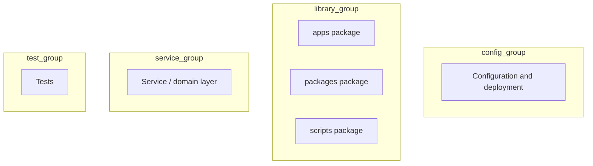

# Architecture report: vantezzen/autoform

> Automated static analysis. **Observed** = directly seen in files/imports/AST; **Inferred** = interpretation from that evidence. Repository code was not executed.

## 1. Repository at a glance

| Item | Value |
| --- | --- |
| Repository | vantezzen/autoform |
| Description | 🌟 Automatically render forms for your existing data schema |
| Language | TypeScript |
| Stars | 3494 |
| Licence | MIT |
| Analysed commit / branch | 96bd1b7408465345ee715ad1491214d4ba1570e5 / main |
| Framework(s) | Next.js, React |
| Files analysed | 585 |
| Components | 6 |

## 2. Architecture in one minute

vantezzen/autoform - 🌟 Automatically render forms for your existing data schema. This repository was analysed statically from 585 file(s) (0 Python). Detected technologies (observed from imports/manifests): GitHub Actions, Next.js, React, Tailwind CSS, TypeScript. Files are grouped into 6 component(s): apps package, Configuration and deployment, packages package, scripts package, Service / domain layer, Tests. Findings below distinguish observed facts from inferred interpretation.

## 3. High-level block diagram

## 4. Main components

### apps package (`apps`)

- **Kind:** library
- **Status:** Observed
- **Confidence:** 0.85
- **Responsibility:** Groups 102 file(s) under apps package (observed from repository paths and static analysis).
- **Paths:** `apps/web/.eslintrc.js`, `apps/web/app/layout.tsx`, `apps/web/app/page.tsx`, `apps/web/components/Ant.tsx`, `apps/web/components/Array.tsx`, `apps/web/components/Basics.tsx`, `apps/web/components/Chakra.tsx`, `apps/web/components/Hook-TestForm.tsx`, `apps/web/components/Hook-test.tsx`, `apps/web/components/Mantine.tsx`, `apps/web/components/Mui.tsx`, `apps/web/components/utils.tsx`, `apps/web/cypress.config.ts`, `apps/web/cypress/component/autoform/ant-joi/basics.cy.tsx`, `apps/web/cypress/component/autoform/ant-joi/validation.cy.tsx`, `apps/web/cypress/component/autoform/ant-zod/advanced-features.cy.tsx`, `apps/web/cypress/component/autoform/ant-zod/arrays.cy.tsx`, `apps/web/cypress/component/autoform/ant-zod/basic.cy.tsx`, `apps/web/cypress/component/autoform/ant-zod/controlled-form.cy.tsx`, `apps/web/cypress/component/autoform/ant-zod/custom-fields.cy.tsx`, `apps/web/cypress/component/autoform/ant-zod/form-control.cy.tsx`, `apps/web/cypress/component/autoform/ant-zod/form-props.cy.tsx`, `apps/web/cypress/component/autoform/ant-zod/subobjects.cy.tsx`, `apps/web/cypress/component/autoform/ant-zod/tanstack-form-properties.cy.tsx`, `apps/web/cypress/component/autoform/ant-zod/ui-customization.cy.tsx`, `apps/web/cypress/component/autoform/ant-zod/useForm-properties.cy.tsx`, `apps/web/cypress/component/autoform/ant-zod/utils.tsx`, `apps/web/cypress/component/autoform/ant-zod/validation.cy.tsx`, `apps/web/cypress/component/autoform/ant-zod4-mini/basics.cy.tsx`, `apps/web/cypress/component/autoform/ant-zod4-mini/validation.cy.tsx`, `apps/web/cypress/component/autoform/chakra-zod/advanced-features.cy.tsx`, `apps/web/cypress/component/autoform/chakra-zod/arrays.cy.tsx`, `apps/web/cypress/component/autoform/chakra-zod/basic.cy.tsx`, `apps/web/cypress/component/autoform/chakra-zod/controlled-form.cy.tsx`, `apps/web/cypress/component/autoform/chakra-zod/custom-fields.cy.tsx`, `apps/web/cypress/component/autoform/chakra-zod/form-control.cy.tsx`, `apps/web/cypress/component/autoform/chakra-zod/form-props.cy.tsx`, `apps/web/cypress/component/autoform/chakra-zod/subobjects.cy.tsx`, `apps/web/cypress/component/autoform/chakra-zod/tanstack-form-properties.cy.tsx`, `apps/web/cypress/component/autoform/chakra-zod/ui-customization.cy.tsx`, `apps/web/cypress/component/autoform/chakra-zod/useForm-properties.cy.tsx`, `apps/web/cypress/component/autoform/chakra-zod/utils.tsx`, `apps/web/cypress/component/autoform/chakra-zod/validation.cy.tsx`, `apps/web/cypress/component/autoform/mantine-zod/advanced-features.cy.tsx`, `apps/web/cypress/component/autoform/mantine-zod/arrays.cy.tsx`, `apps/web/cypress/component/autoform/mantine-zod/basic.cy.tsx`, `apps/web/cypress/component/autoform/mantine-zod/controlled-form.cy.tsx`, `apps/web/cypress/component/autoform/mantine-zod/custom-fields.cy.tsx`, `apps/web/cypress/component/autoform/mantine-zod/form-control.cy.tsx`, `apps/web/cypress/component/autoform/mantine-zod/form-props.cy.tsx`, `apps/web/cypress/component/autoform/mantine-zod/subobjects.cy.tsx`, `apps/web/cypress/component/autoform/mantine-zod/tanstack-form-properties.cy.tsx`, `apps/web/cypress/component/autoform/mantine-zod/ui-customization.cy.tsx`, `apps/web/cypress/component/autoform/mantine-zod/useForm-properties.cy.tsx`, `apps/web/cypress/component/autoform/mantine-zod/utils.tsx`, `apps/web/cypress/component/autoform/mantine-zod/validation.cy.tsx`, `apps/web/cypress/component/autoform/mui-yup/basics.cy.tsx`, `apps/web/cypress/component/autoform/mui-yup/validation.cy.tsx`, `apps/web/cypress/component/autoform/mui-zod/advanced-features.cy.tsx`, `apps/web/cypress/component/autoform/mui-zod/arrays.cy.tsx`, `apps/web/cypress/component/autoform/mui-zod/basic.cy.tsx`, `apps/web/cypress/component/autoform/mui-zod/controlled-form.cy.tsx`, `apps/web/cypress/component/autoform/mui-zod/custom-fields.cy.tsx`, `apps/web/cypress/component/autoform/mui-zod/form-control.cy.tsx`, `apps/web/cypress/component/autoform/mui-zod/form-props.cy.tsx`, `apps/web/cypress/component/autoform/mui-zod/subobjects.cy.tsx`, `apps/web/cypress/component/autoform/mui-zod/tanstack-form-properties.cy.tsx`, `apps/web/cypress/component/autoform/mui-zod/ui-customization.cy.tsx`, `apps/web/cypress/component/autoform/mui-zod/useForm-properties.cy.tsx`, `apps/web/cypress/component/autoform/mui-zod/utils.tsx`, `apps/web/cypress/component/autoform/mui-zod/validation.cy.tsx`, `apps/web/cypress/component/autoform/shadcn-zod/advanced-features.cy.tsx`, `apps/web/cypress/component/autoform/shadcn-zod/arrays.cy.tsx`, `apps/web/cypress/component/autoform/shadcn-zod/basic.cy.tsx`, `apps/web/cypress/component/autoform/shadcn-zod/controlled-form.cy.tsx`, `apps/web/cypress/component/autoform/shadcn-zod/custom-fields.cy.tsx`, `apps/web/cypress/component/autoform/shadcn-zod/enums.cy.tsx`, `apps/web/cypress/component/autoform/shadcn-zod/form-control.cy.tsx`, `apps/web/cypress/component/autoform/shadcn-zod/form-props.cy.tsx`, `apps/web/cypress/component/autoform/shadcn-zod/subobjects.cy.tsx`, `apps/web/cypress/component/autoform/shadcn-zod/tanstack-form-properties.cy.tsx`, `apps/web/cypress/component/autoform/shadcn-zod/ui-customization.cy.tsx`, `apps/web/cypress/component/autoform/shadcn-zod/useForm-properties.cy.tsx`, `apps/web/cypress/component/autoform/shadcn-zod/utils.tsx`, `apps/web/cypress/component/autoform/shadcn-zod/validation.cy.tsx`, `apps/web/cypress/component/autoform/shadcn-zod4/advanced-features.cy.tsx`, `apps/web/cypress/component/autoform/shadcn-zod4/arrays.cy.tsx`, `apps/web/cypress/component/autoform/shadcn-zod4/basic.cy.tsx`, `apps/web/cypress/component/autoform/shadcn-zod4/controlled-form.cy.tsx`, `apps/web/cypress/component/autoform/shadcn-zod4/custom-fields.cy.tsx`, `apps/web/cypress/component/autoform/shadcn-zod4/enums.cy.tsx`, `apps/web/cypress/component/autoform/shadcn-zod4/form-props.cy.tsx`, `apps/web/cypress/component/autoform/shadcn-zod4/subobjects.cy.tsx`, `apps/web/cypress/component/autoform/shadcn-zod4/ui-customization.cy.tsx`, `apps/web/cypress/component/autoform/shadcn-zod4/utils.tsx`, `apps/web/cypress/component/autoform/shadcn-zod4/validation.cy.tsx`, `apps/web/cypress/component/autoform/shared/adapter-contracts.tsx`, `apps/web/cypress/support/commands.ts`, `apps/web/cypress/support/component.ts`, `apps/web/next.config.mjs`, `apps/web/postcss.config.cjs`, `apps/web/tailwind.config.ts`
- **Evidence:** [apps/web/.eslintrc.js](https://github.com/vantezzen/autoform/blob/96bd1b7408465345ee715ad1491214d4ba1570e5/apps/web/.eslintrc.js); [apps/web/app/layout.tsx](https://github.com/vantezzen/autoform/blob/96bd1b7408465345ee715ad1491214d4ba1570e5/apps/web/app/layout.tsx); [apps/web/app/page.tsx](https://github.com/vantezzen/autoform/blob/96bd1b7408465345ee715ad1491214d4ba1570e5/apps/web/app/page.tsx); [apps/web/components/Ant.tsx](https://github.com/vantezzen/autoform/blob/96bd1b7408465345ee715ad1491214d4ba1570e5/apps/web/components/Ant.tsx); [apps/web/components/Array.tsx](https://github.com/vantezzen/autoform/blob/96bd1b7408465345ee715ad1491214d4ba1570e5/apps/web/components/Array.tsx); [apps/web/components/Basics.tsx](https://github.com/vantezzen/autoform/blob/96bd1b7408465345ee715ad1491214d4ba1570e5/apps/web/components/Basics.tsx); [apps/web/components/Chakra.tsx](https://github.com/vantezzen/autoform/blob/96bd1b7408465345ee715ad1491214d4ba1570e5/apps/web/components/Chakra.tsx); [apps/web/components/Hook-TestForm.tsx](https://github.com/vantezzen/autoform/blob/96bd1b7408465345ee715ad1491214d4ba1570e5/apps/web/components/Hook-TestForm.tsx)

### Configuration and deployment (`config`)

- **Kind:** config
- **Status:** Observed
- **Confidence:** 0.85
- **Responsibility:** Groups 73 file(s) under configuration and deployment (observed from repository paths and static analysis).
- **Paths:** `apps/docs/cli.json`, `apps/docs/content/docs/meta.json`, `apps/docs/content/docs/react/meta.json`, `apps/docs/content/docs/schema-providers/meta.json`, `apps/docs/content/docs/tanstack/meta.json`, `apps/docs/content/docs/technical/meta.json`, `apps/docs/package.json`, `apps/docs/tsconfig.json`, `apps/web/cypress/fixtures/example.json`, `apps/web/package.json`, `apps/web/tsconfig.json`, `package.json`, `packages/ant/package.json`, `packages/ant/tsconfig.json`, `packages/ant/tsconfig.lint.json`, `packages/chakra/package.json`, `packages/chakra/tsconfig.json`, `packages/chakra/tsconfig.lint.json`, `packages/chakra/tsconfig.node.json`, `packages/core/package.json`, `packages/core/tsconfig.json`, `packages/core/tsconfig.lint.json`, `packages/eslint-config/package.json`, `packages/joi/package.json`, `packages/joi/tsconfig.json`, `packages/joi/tsconfig.lint.json`, `packages/mantine/package.json`, `packages/mantine/tsconfig.json`, `packages/mantine/tsconfig.lint.json`, `packages/mui/package.json`, `packages/mui/tsconfig.json`, `packages/mui/tsconfig.lint.json`, `packages/react/package.json`, `packages/react/tsconfig.json`, `packages/react/tsconfig.lint.json`, `packages/shadcn/components.json`, `packages/shadcn/package.json`, `packages/shadcn/registry/autoform-react-source-rhf.json`, `packages/shadcn/registry/autoform-react-source-tanstack.json`, `packages/shadcn/registry/autoform-rhf.json`, `packages/shadcn/registry/autoform-tanstack.json`, `packages/shadcn/registry/custom-fields-demo.json`, `packages/shadcn/registry/dialog-submit-demo.json`, `packages/shadcn/registry/ecommerce-checkout-demo.json`, `packages/shadcn/registry/interactive-schema-demo.json`, `packages/shadcn/registry/multistep-form-demo.json`, `packages/shadcn/registry/nested-autoform-demo.json`, `packages/shadcn/registry/realtime-validation-demo.json`, `packages/shadcn/registry/registry.json`, `packages/shadcn/registry/tanstack-custom-fields-demo.json`, `packages/shadcn/registry/tanstack-dialog-submit-demo.json`, `packages/shadcn/registry/tanstack-ecommerce-checkout-demo.json`, `packages/shadcn/registry/tanstack-interactive-schema-demo.json`, `packages/shadcn/registry/tanstack-multistep-form-demo.json`, `packages/shadcn/registry/tanstack-nested-autoform-demo.json`, `packages/shadcn/registry/tanstack-realtime-validation-demo.json`, `packages/shadcn/tsconfig.json`, `packages/shadcn/tsconfig.lint.json`, `packages/shadcn/tsconfig.node.json`, `packages/shadcn/turbo.json`, `packages/typescript-config/base.json`, `packages/typescript-config/nextjs.json`, `packages/typescript-config/package.json`, `packages/typescript-config/react-library.json`, `packages/yup/package.json`, `packages/yup/tsconfig.json`, `packages/yup/tsconfig.lint.json`, `packages/zod/package.json`, `packages/zod/tsconfig.json`, `packages/zod/tsconfig.lint.json`, `pnpm-workspace.yaml`, `registry.json`, `turbo.json`
- **Evidence:** [apps/docs/cli.json](https://github.com/vantezzen/autoform/blob/96bd1b7408465345ee715ad1491214d4ba1570e5/apps/docs/cli.json); [apps/docs/content/docs/meta.json](https://github.com/vantezzen/autoform/blob/96bd1b7408465345ee715ad1491214d4ba1570e5/apps/docs/content/docs/meta.json); [apps/docs/content/docs/react/meta.json](https://github.com/vantezzen/autoform/blob/96bd1b7408465345ee715ad1491214d4ba1570e5/apps/docs/content/docs/react/meta.json); [apps/docs/content/docs/schema-providers/meta.json](https://github.com/vantezzen/autoform/blob/96bd1b7408465345ee715ad1491214d4ba1570e5/apps/docs/content/docs/schema-providers/meta.json); [apps/docs/content/docs/tanstack/meta.json](https://github.com/vantezzen/autoform/blob/96bd1b7408465345ee715ad1491214d4ba1570e5/apps/docs/content/docs/tanstack/meta.json); [apps/docs/content/docs/technical/meta.json](https://github.com/vantezzen/autoform/blob/96bd1b7408465345ee715ad1491214d4ba1570e5/apps/docs/content/docs/technical/meta.json); [apps/docs/package.json](https://github.com/vantezzen/autoform/blob/96bd1b7408465345ee715ad1491214d4ba1570e5/apps/docs/package.json); [apps/docs/tsconfig.json](https://github.com/vantezzen/autoform/blob/96bd1b7408465345ee715ad1491214d4ba1570e5/apps/docs/tsconfig.json)

### packages package (`packages`)

- **Kind:** library
- **Status:** Observed
- **Confidence:** 0.85
- **Responsibility:** Groups 191 file(s) under packages package (observed from repository paths and static analysis).
- **Paths:** `packages/ant/.eslintrc.cjs`, `packages/ant/src/AutoForm.tsx`, `packages/ant/src/components/ArrayElementWrapper.tsx`, `packages/ant/src/components/ArrayWrapper.tsx`, `packages/ant/src/components/BooleanField.tsx`, `packages/ant/src/components/DateField.tsx`, `packages/ant/src/components/ErrorMessage.tsx`, `packages/ant/src/components/FieldWrapper.tsx`, `packages/ant/src/components/Form.tsx`, `packages/ant/src/components/NumberField.tsx`, `packages/ant/src/components/ObjectWrapper.tsx`, `packages/ant/src/components/SelectField.tsx`, `packages/ant/src/components/StringField.tsx`, `packages/ant/src/components/SubmitButton.tsx`, `packages/ant/src/field-context.ts`, `packages/ant/src/react-hook-form.tsx`, `packages/ant/src/tanstack-form.tsx`, `packages/ant/src/types.tsx`, `packages/ant/tsdown.config.ts`, `packages/chakra/.eslintrc.cjs`, `packages/chakra/src/AutoForm.tsx`, `packages/chakra/src/components/autoform/ArrayElementWrapper.tsx`, `packages/chakra/src/components/autoform/ArrayWrapper.tsx`, `packages/chakra/src/components/autoform/BooleanField.tsx`, `packages/chakra/src/components/autoform/DateField.tsx`, `packages/chakra/src/components/autoform/ErrorMessage.tsx`, `packages/chakra/src/components/autoform/FieldWrapper.tsx`, `packages/chakra/src/components/autoform/Form.tsx`, `packages/chakra/src/components/autoform/NumberField.tsx`, `packages/chakra/src/components/autoform/ObjectWrapper.tsx`, `packages/chakra/src/components/autoform/SelectField.tsx`, `packages/chakra/src/components/autoform/StringField.tsx`, `packages/chakra/src/components/autoform/SubmitButton.tsx`, `packages/chakra/src/components/ui/checkbox.tsx`, `packages/chakra/src/components/ui/close-button.tsx`, `packages/chakra/src/components/ui/color-mode.tsx`, `packages/chakra/src/components/ui/field.tsx`, `packages/chakra/src/components/ui/input-group.tsx`, `packages/chakra/src/components/ui/number-input.tsx`, `packages/chakra/src/components/ui/popover.tsx`, `packages/chakra/src/components/ui/provider.tsx`, `packages/chakra/src/components/ui/radio.tsx`, `packages/chakra/src/components/ui/select.tsx`, `packages/chakra/src/components/ui/slider.tsx`, `packages/chakra/src/field-context.ts`, `packages/chakra/src/react-hook-form.tsx`, `packages/chakra/src/tanstack-form.tsx`, `packages/chakra/src/types.tsx`, `packages/chakra/tsdown.config.ts`, `packages/eslint-config/library.js`, `packages/eslint-config/next.js`, `packages/eslint-config/react-internal.js`, `packages/joi/.eslintrc.cjs`, `packages/joi/src/default-values.ts`, `packages/joi/src/field-config.ts`, `packages/joi/src/field-type-inference.ts`, `packages/joi/src/index.ts`, `packages/joi/src/provider.ts`, `packages/joi/src/schema-parser.ts`, `packages/joi/src/types.ts`, `packages/joi/src/validator.ts`, `packages/joi/tsdown.config.ts`, `packages/mantine/.eslintrc.cjs`, `packages/mantine/src/AutoForm.tsx`, `packages/mantine/src/components/ArrayElementWrapper.tsx`, `packages/mantine/src/components/ArrayWrapper.tsx`, `packages/mantine/src/components/BooleanField.tsx`, `packages/mantine/src/components/DateField.tsx`, `packages/mantine/src/components/ErrorMessage.tsx`, `packages/mantine/src/components/FieldWrapper.tsx`, `packages/mantine/src/components/Form.tsx`, `packages/mantine/src/components/NumberField.tsx`, `packages/mantine/src/components/ObjectWrapper.tsx`, `packages/mantine/src/components/SelectField.tsx`, `packages/mantine/src/components/StringField.tsx`, `packages/mantine/src/components/SubmitButton.tsx`, `packages/mantine/src/field-context.ts`, `packages/mantine/src/react-hook-form.tsx`, `packages/mantine/src/tanstack-form.tsx`, `packages/mantine/src/types.ts`, `packages/mantine/tsdown.config.ts`, `packages/mui/.eslintrc.cjs`, `packages/mui/src/AutoForm.tsx`, `packages/mui/src/components/ArrayElementWrapper.tsx`, `packages/mui/src/components/ArrayWrapper.tsx`, `packages/mui/src/components/BooleanField.tsx`, `packages/mui/src/components/DateField.tsx`, `packages/mui/src/components/ErrorMessage.tsx`, `packages/mui/src/components/FieldWrapper.tsx`, `packages/mui/src/components/Form.tsx`, `packages/mui/src/components/NumberField.tsx`, `packages/mui/src/components/ObjectWrapper.tsx`, `packages/mui/src/components/SelectField.tsx`, `packages/mui/src/components/StringField.tsx`, `packages/mui/src/components/SubmitButton.tsx`, `packages/mui/src/field-context.ts`, `packages/mui/src/react-hook-form.tsx`, `packages/mui/src/tanstack-form.tsx`, `packages/mui/src/types.ts`, `packages/mui/tsdown.config.ts`, `packages/react/.eslintrc.cjs`, `packages/react/src/context.ts`, `packages/react/src/index.tsx`, `packages/react/src/react-hook-form/ArrayField.tsx`, `packages/react/src/react-hook-form/AutoForm.tsx`, `packages/react/src/react-hook-form/AutoFormField.tsx`, `packages/react/src/react-hook-form/ObjectField.tsx`, `packages/react/src/react-hook-form/hooks.ts`, `packages/react/src/react-hook-form/index.ts`, `packages/react/src/react-hook-form/utils.ts`, `packages/react/src/tanstack-form/ArrayField.tsx`, `packages/react/src/tanstack-form/AutoForm.tsx`, `packages/react/src/tanstack-form/AutoFormField.tsx`, `packages/react/src/tanstack-form/ObjectField.tsx`, `packages/react/src/tanstack-form/hooks.ts`, `packages/react/src/tanstack-form/index.ts`, `packages/react/src/tanstack-form/utils.ts`, `packages/react/src/types.ts`, `packages/react/src/utils.ts`, `packages/react/tsdown.config.ts`, `packages/shadcn/.eslintrc.cjs`, `packages/shadcn/postcss.config.mjs`, `packages/shadcn/src/components/ui/alert.tsx`, `packages/shadcn/src/components/ui/autoform/components/ArrayElementWrapper.tsx`, `packages/shadcn/src/components/ui/autoform/components/ArrayWrapper.tsx`, `packages/shadcn/src/components/ui/autoform/components/ErrorMessage.tsx`, `packages/shadcn/src/components/ui/autoform/components/FieldWrapper.tsx`, `packages/shadcn/src/components/ui/autoform/components/Form.tsx`, `packages/shadcn/src/components/ui/autoform/components/ObjectWrapper.tsx`, `packages/shadcn/src/components/ui/autoform/components/SubmitButton.tsx`, `packages/shadcn/src/components/ui/autoform/components/rhf/BooleanField.tsx`, `packages/shadcn/src/components/ui/autoform/components/rhf/DateField.tsx`, `packages/shadcn/src/components/ui/autoform/components/rhf/NumberField.tsx`, `packages/shadcn/src/components/ui/autoform/components/rhf/SelectField.tsx`, `packages/shadcn/src/components/ui/autoform/components/rhf/StringField.tsx`, `packages/shadcn/src/components/ui/autoform/components/tanstack/BooleanField.tsx`, `packages/shadcn/src/components/ui/autoform/components/tanstack/DateField.tsx`, `packages/shadcn/src/components/ui/autoform/components/tanstack/NumberField.tsx`, `packages/shadcn/src/components/ui/autoform/components/tanstack/SelectField.tsx`, `packages/shadcn/src/components/ui/autoform/components/tanstack/StringField.tsx`, `packages/shadcn/src/components/ui/autoform/react-hook-form.tsx`, `packages/shadcn/src/components/ui/autoform/tanstack-form.tsx`, `packages/shadcn/src/components/ui/button.tsx`, `packages/shadcn/src/components/ui/calendar.tsx`, `packages/shadcn/src/components/ui/checkbox.tsx`, `packages/shadcn/src/components/ui/form.tsx`, `packages/shadcn/src/components/ui/input.tsx`, `packages/shadcn/src/components/ui/label.tsx`, `packages/shadcn/src/components/ui/popover.tsx`, `packages/shadcn/src/components/ui/select.tsx`, `packages/shadcn/src/lib/utils.ts`, `packages/shadcn/src/scripts/build-react-source-registry.ts`, `packages/shadcn/src/scripts/build.ts`, `packages/shadcn/src/scripts/schema.ts`, `packages/shadcn/tailwind.config.ts`, `packages/yup/.eslintrc.cjs`, `packages/yup/src/default-values.ts`, `packages/yup/src/field-config.ts`, `packages/yup/src/field-type-inference.ts`, `packages/yup/src/index.ts`, `packages/yup/src/provider.ts`, `packages/yup/src/schema-parser.ts`, `packages/yup/src/types.ts`, `packages/yup/src/validator.ts`, `packages/yup/tsdown.config.ts`, `packages/zod/.eslintrc.cjs`, `packages/zod/src/index.ts`, `packages/zod/src/merge/default-values.ts`, `packages/zod/src/merge/field-config.ts`, `packages/zod/src/merge/field-type-inference.ts`, `packages/zod/src/merge/index.ts`, `packages/zod/src/merge/provider.ts`, `packages/zod/src/merge/schema-parser.ts`, `packages/zod/src/merge/validator.ts`, `packages/zod/src/utils.ts`, `packages/zod/src/v3/default-values.ts`, `packages/zod/src/v3/field-config.ts`, `packages/zod/src/v3/field-type-inference.ts`, `packages/zod/src/v3/index.ts`, `packages/zod/src/v3/provider.ts`, `packages/zod/src/v3/schema-parser.ts`, `packages/zod/src/v3/types.ts`, `packages/zod/src/v3/validator.ts`, `packages/zod/src/v4/default-values.ts`, `packages/zod/src/v4/field-config.ts`, `packages/zod/src/v4/field-type-inference.ts`, `packages/zod/src/v4/index.ts`, `packages/zod/src/v4/provider.ts`, `packages/zod/src/v4/schema-parser.ts`, `packages/zod/src/v4/validator.ts`, `packages/zod/tsdown.config.ts`
- **Evidence:** [packages/ant/.eslintrc.cjs](https://github.com/vantezzen/autoform/blob/96bd1b7408465345ee715ad1491214d4ba1570e5/packages/ant/.eslintrc.cjs); [packages/ant/src/AutoForm.tsx](https://github.com/vantezzen/autoform/blob/96bd1b7408465345ee715ad1491214d4ba1570e5/packages/ant/src/AutoForm.tsx); [packages/ant/src/components/ArrayElementWrapper.tsx](https://github.com/vantezzen/autoform/blob/96bd1b7408465345ee715ad1491214d4ba1570e5/packages/ant/src/components/ArrayElementWrapper.tsx); [packages/ant/src/components/ArrayWrapper.tsx](https://github.com/vantezzen/autoform/blob/96bd1b7408465345ee715ad1491214d4ba1570e5/packages/ant/src/components/ArrayWrapper.tsx); [packages/ant/src/components/BooleanField.tsx](https://github.com/vantezzen/autoform/blob/96bd1b7408465345ee715ad1491214d4ba1570e5/packages/ant/src/components/BooleanField.tsx); [packages/ant/src/components/DateField.tsx](https://github.com/vantezzen/autoform/blob/96bd1b7408465345ee715ad1491214d4ba1570e5/packages/ant/src/components/DateField.tsx); [packages/ant/src/components/ErrorMessage.tsx](https://github.com/vantezzen/autoform/blob/96bd1b7408465345ee715ad1491214d4ba1570e5/packages/ant/src/components/ErrorMessage.tsx); [packages/ant/src/components/FieldWrapper.tsx](https://github.com/vantezzen/autoform/blob/96bd1b7408465345ee715ad1491214d4ba1570e5/packages/ant/src/components/FieldWrapper.tsx)

### scripts package (`scripts`)

- **Kind:** library
- **Status:** Observed
- **Confidence:** 0.85
- **Responsibility:** Groups 1 file(s) under scripts package (observed from repository paths and static analysis).
- **Paths:** `scripts/check-package-boundaries.mjs`
- **Evidence:** [scripts/check-package-boundaries.mjs](https://github.com/vantezzen/autoform/blob/96bd1b7408465345ee715ad1491214d4ba1570e5/scripts/check-package-boundaries.mjs)

### Service / domain layer (`service_layer`)

- **Kind:** service
- **Status:** Observed
- **Confidence:** 0.85
- **Responsibility:** Groups 7 file(s) under service / domain layer (observed from repository paths and static analysis).
- **Paths:** `packages/core/.eslintrc.cjs`, `packages/core/src/index.ts`, `packages/core/src/label.ts`, `packages/core/src/logic.ts`, `packages/core/src/schema-provider.ts`, `packages/core/src/types.ts`, `packages/core/tsdown.config.ts`
- **Evidence:** [packages/core/.eslintrc.cjs](https://github.com/vantezzen/autoform/blob/96bd1b7408465345ee715ad1491214d4ba1570e5/packages/core/.eslintrc.cjs); [packages/core/src/index.ts](https://github.com/vantezzen/autoform/blob/96bd1b7408465345ee715ad1491214d4ba1570e5/packages/core/src/index.ts); [packages/core/src/label.ts](https://github.com/vantezzen/autoform/blob/96bd1b7408465345ee715ad1491214d4ba1570e5/packages/core/src/label.ts); [packages/core/src/logic.ts](https://github.com/vantezzen/autoform/blob/96bd1b7408465345ee715ad1491214d4ba1570e5/packages/core/src/logic.ts); [packages/core/src/schema-provider.ts](https://github.com/vantezzen/autoform/blob/96bd1b7408465345ee715ad1491214d4ba1570e5/packages/core/src/schema-provider.ts); [packages/core/src/types.ts](https://github.com/vantezzen/autoform/blob/96bd1b7408465345ee715ad1491214d4ba1570e5/packages/core/src/types.ts); [packages/core/tsdown.config.ts](https://github.com/vantezzen/autoform/blob/96bd1b7408465345ee715ad1491214d4ba1570e5/packages/core/tsdown.config.ts)

### Tests (`tests`)

- **Kind:** test
- **Status:** Observed
- **Confidence:** 0.85
- **Responsibility:** Groups 12 file(s) under tests (observed from repository paths and static analysis).
- **Paths:** `apps/web/app/test/rhf/ant/page.tsx`, `apps/web/app/test/rhf/chakra/page.tsx`, `apps/web/app/test/rhf/mantine/page.tsx`, `apps/web/app/test/rhf/mui/page.tsx`, `apps/web/app/test/rhf/page.tsx`, `apps/web/app/test/rhf/shadcn/page.tsx`, `apps/web/app/test/tanstack/ant/page.tsx`, `apps/web/app/test/tanstack/chakra/page.tsx`, `apps/web/app/test/tanstack/mantine/page.tsx`, `apps/web/app/test/tanstack/mui/page.tsx`, `apps/web/app/test/tanstack/page.tsx`, `apps/web/app/test/tanstack/shadcn/page.tsx`
- **Evidence:** [apps/web/app/test/rhf/ant/page.tsx](https://github.com/vantezzen/autoform/blob/96bd1b7408465345ee715ad1491214d4ba1570e5/apps/web/app/test/rhf/ant/page.tsx); [apps/web/app/test/rhf/chakra/page.tsx](https://github.com/vantezzen/autoform/blob/96bd1b7408465345ee715ad1491214d4ba1570e5/apps/web/app/test/rhf/chakra/page.tsx); [apps/web/app/test/rhf/mantine/page.tsx](https://github.com/vantezzen/autoform/blob/96bd1b7408465345ee715ad1491214d4ba1570e5/apps/web/app/test/rhf/mantine/page.tsx); [apps/web/app/test/rhf/mui/page.tsx](https://github.com/vantezzen/autoform/blob/96bd1b7408465345ee715ad1491214d4ba1570e5/apps/web/app/test/rhf/mui/page.tsx); [apps/web/app/test/rhf/page.tsx](https://github.com/vantezzen/autoform/blob/96bd1b7408465345ee715ad1491214d4ba1570e5/apps/web/app/test/rhf/page.tsx); [apps/web/app/test/rhf/shadcn/page.tsx](https://github.com/vantezzen/autoform/blob/96bd1b7408465345ee715ad1491214d4ba1570e5/apps/web/app/test/rhf/shadcn/page.tsx); [apps/web/app/test/tanstack/ant/page.tsx](https://github.com/vantezzen/autoform/blob/96bd1b7408465345ee715ad1491214d4ba1570e5/apps/web/app/test/tanstack/ant/page.tsx); [apps/web/app/test/tanstack/chakra/page.tsx](https://github.com/vantezzen/autoform/blob/96bd1b7408465345ee715ad1491214d4ba1570e5/apps/web/app/test/tanstack/chakra/page.tsx)

## 5. Execution flow

**Observed** entry point(s):

- [apps/web/app/page.tsx](https://github.com/vantezzen/autoform/blob/96bd1b7408465345ee715ad1491214d4ba1570e5/apps/web/app/page.tsx)
- [packages/core/src/index.ts](https://github.com/vantezzen/autoform/blob/96bd1b7408465345ee715ad1491214d4ba1570e5/packages/core/src/index.ts)
- [packages/joi/src/index.ts](https://github.com/vantezzen/autoform/blob/96bd1b7408465345ee715ad1491214d4ba1570e5/packages/joi/src/index.ts)
- [packages/react/src/index.tsx](https://github.com/vantezzen/autoform/blob/96bd1b7408465345ee715ad1491214d4ba1570e5/packages/react/src/index.tsx)
- [packages/yup/src/index.ts](https://github.com/vantezzen/autoform/blob/96bd1b7408465345ee715ad1491214d4ba1570e5/packages/yup/src/index.ts)
- [packages/zod/src/index.ts](https://github.com/vantezzen/autoform/blob/96bd1b7408465345ee715ad1491214d4ba1570e5/packages/zod/src/index.ts)

Representative flow (derived from observed entry points and the import graph; steps beyond the entry point are **Inferred**):

1. Execution starts at an observed entry point listed above, if present.
2. No internal import relationships between components were observed.

## 6. Project structure

### `(root)`

- `.gitattributes` - other (108 bytes)
- `.gitignore` - other (412 bytes)
- `.nvmrc` - other (3 bytes)
- `LICENSE` - docs (1074 bytes)
- `README.md` - docs (3977 bytes)
- `package.json` - manifest (964 bytes)
- `pnpm-workspace.yaml` - config (580 bytes)
- `registry.json` - config (18932 bytes)
- `turbo.json` - config (511 bytes)

### `.changeset`

- `.changeset/README.md` - docs (510 bytes)
- `.changeset/config.json` - config (271 bytes)
- `.changeset/form-control-resolver.md` - docs (178 bytes)

### `.github`

- `.github/workflows/cypress.yml` - ci, YAML (814 bytes)

### `apps`

- `apps/docs/.gitignore` - docs (293 bytes)
- `apps/docs/CHANGELOG.md` - docs (1417 bytes)
- `apps/docs/LICENSE` - docs (1066 bytes)
- `apps/docs/README.md` - docs (1524 bytes)
- `apps/docs/app/(home)/page.tsx` - docs (546 bytes)
- `apps/docs/app/.well-known/agent-skills/index.json/route.ts` - docs (611 bytes)
- `apps/docs/app/api/search/route.ts` - docs (153 bytes)
- `apps/docs/app/docs.mdx/[[...slug]]/route.ts` - docs (589 bytes)
- `apps/docs/app/docs/[[...slug]]/page.tsx` - docs (1368 bytes)
- `apps/docs/app/docs/layout.tsx` - docs (368 bytes)
- `apps/docs/app/global.css` - docs (3189 bytes)
- `apps/docs/app/layout.config.tsx` - docs (727 bytes)
- `apps/docs/app/layout.tsx` - docs (695 bytes)
- `apps/docs/app/llms.txt/route.ts` - docs (275 bytes)
- `apps/docs/app/robots.ts` - docs (455 bytes)
- `apps/docs/app/sitemap.ts` - docs (374 bytes)
- `apps/docs/cli.json` - config (314 bytes)
- `apps/docs/components/accordion.tsx` - docs (2926 bytes)
- `apps/docs/components/auto-type-tables.tsx` - docs (8232 bytes)
- `apps/docs/components/examples/faq/code-from-file.tsx` - docs (714 bytes)
- `apps/docs/components/examples/faq/custom-field-components.tsx` - docs (8964 bytes)
- `apps/docs/components/examples/faq/custom-fields-demo.tsx` - docs (3007 bytes)
- `apps/docs/components/examples/faq/ecommerce-checkout-demo.tsx` - docs (3778 bytes)
- `apps/docs/components/examples/faq/ecommerce-checkout-fields.tsx` - docs (6907 bytes)
- `apps/docs/components/examples/faq/external-dialog-form-control-demo.tsx` - docs (2893 bytes)
- `apps/docs/components/examples/faq/external-dialog-submit-demo.tsx` - docs (3209 bytes)
- `apps/docs/components/examples/faq/install-instructions.tsx` - docs (2081 bytes)
- `apps/docs/components/examples/faq/interactive-schema-demo-content.tsx` - docs (2972 bytes)
- `apps/docs/components/examples/faq/interactive-schema-demo.tsx` - docs (370 bytes)
- `apps/docs/components/examples/faq/method-tabs.tsx` - docs (2060 bytes)
- `apps/docs/components/examples/faq/multistep-form-usage-demo.tsx` - docs (2098 bytes)
- `apps/docs/components/examples/faq/multistep-form.tsx` - docs (3736 bytes)
- `apps/docs/components/examples/faq/nested-autoform-demo.tsx` - docs (3161 bytes)
- `apps/docs/components/examples/faq/realtime-validation-demo.tsx` - docs (1481 bytes)
- `apps/docs/components/examples/faq/tanstack-custom-field-components.tsx` - docs (7843 bytes)
- `apps/docs/components/examples/faq/tanstack-custom-fields-demo.tsx` - docs (3022 bytes)
- `apps/docs/components/examples/faq/tanstack-dialog-form-control-demo.tsx` - docs (2914 bytes)
- `apps/docs/components/examples/faq/tanstack-dialog-submit-demo.tsx` - docs (2486 bytes)
- `apps/docs/components/examples/faq/tanstack-ecommerce-checkout-demo.tsx` - docs (3766 bytes)
- `apps/docs/components/examples/faq/tanstack-ecommerce-checkout-fields.tsx` - docs (5980 bytes)
- `apps/docs/components/examples/faq/tanstack-interactive-schema-demo-content.tsx` - docs (2971 bytes)
- `apps/docs/components/examples/faq/tanstack-multistep-form-usage-demo.tsx` - docs (1782 bytes)
- `apps/docs/components/examples/faq/tanstack-multistep-form.tsx` - docs (2640 bytes)
- `apps/docs/components/examples/faq/tanstack-nested-autoform-demo.tsx` - docs (3220 bytes)
- `apps/docs/components/examples/faq/tanstack-realtime-validation-demo.tsx` - docs (1412 bytes)
- `apps/docs/components/extended-type-table.tsx` - docs (5512 bytes)
- `apps/docs/components/form-control-reference-table.tsx` - docs (9162 bytes)
- `apps/docs/components/icons/discord-icon.tsx` - docs (1277 bytes)
- `apps/docs/components/icons/github-icon.tsx` - docs (1170 bytes)
- `apps/docs/components/icons/linkedin-icon.tsx` - docs (906 bytes)
- `apps/docs/components/icons/x-icon.tsx` - docs (491 bytes)
- `apps/docs/components/image-zoom.tsx` - docs (1151 bytes)
- `apps/docs/components/landing/code-reveal.tsx` - docs (1923 bytes)
- `apps/docs/components/landing/interactive-demo-content.tsx` - docs (6465 bytes)
- `apps/docs/components/landing/interactive-demo.tsx` - docs (181 bytes)
- `apps/docs/components/landing/navbar.tsx` - docs (1216 bytes)
- `apps/docs/components/landing/sections/alert-banner.tsx` - docs (1284 bytes)
- `apps/docs/components/landing/sections/benefits.tsx` - docs (2866 bytes)
- `apps/docs/components/landing/sections/community.tsx` - docs (1611 bytes)
- `apps/docs/components/landing/sections/faq.tsx` - docs (2056 bytes)
- `apps/docs/components/landing/sections/features.tsx` - docs (2923 bytes)
- `apps/docs/components/landing/sections/footer.tsx` - docs (3608 bytes)
- `apps/docs/components/landing/sections/hero.tsx` - docs (7289 bytes)
- `apps/docs/components/landing/sections/pricing.tsx` - docs (3608 bytes)
- `apps/docs/components/landing/sections/services.tsx` - docs (2208 bytes)
- `apps/docs/components/landing/sections/team.tsx` - docs (7800 bytes)
- `apps/docs/components/landing/sections/testimonial.tsx` - docs (4872 bytes)
- `apps/docs/components/landing/tabs/code-block.tsx` - docs (561 bytes)
- `apps/docs/components/landing/tabs/mode-tabs.tsx` - docs (1293 bytes)
- `apps/docs/components/ui-components-table.tsx` - docs (4063 bytes)
- `apps/docs/components/ui/accordion.tsx` - docs (2019 bytes)
- `apps/docs/components/ui/alert.tsx` - docs (1596 bytes)
- `apps/docs/components/ui/autoform.tsx` - docs (372 bytes)
- `apps/docs/components/ui/autoform/react-hook-form.tsx` - docs (439 bytes)
- `apps/docs/components/ui/autoform/tanstack-form.tsx` - docs (437 bytes)
- `apps/docs/components/ui/avatar.tsx` - docs (1546 bytes)
- `apps/docs/components/ui/badge.tsx` - docs (1139 bytes)
- `apps/docs/components/ui/button.tsx` - docs (1890 bytes)
- `apps/docs/components/ui/calendar.tsx` - docs (7621 bytes)
- `apps/docs/components/ui/card.tsx` - docs (1907 bytes)
- `apps/docs/components/ui/carousel.tsx` - docs (6982 bytes)
- `apps/docs/components/ui/checkbox.tsx` - docs (1079 bytes)
- `apps/docs/components/ui/collapsible.tsx` - docs (320 bytes)
- `apps/docs/components/ui/dialog.tsx` - docs (3921 bytes)
- `apps/docs/components/ui/icon.tsx` - docs (329 bytes)
- `apps/docs/components/ui/input-group.tsx` - docs (4443 bytes)
- `apps/docs/components/ui/input.tsx` - docs (813 bytes)
- `apps/docs/components/ui/label.tsx` - docs (734 bytes)
- `apps/docs/components/ui/navigation-menu.tsx` - docs (5073 bytes)
- `apps/docs/components/ui/popover.tsx` - docs (1403 bytes)
- `apps/docs/components/ui/radio-group.tsx` - docs (1365 bytes)
- `apps/docs/components/ui/scroll-area.tsx` - docs (1651 bytes)
- `apps/docs/components/ui/select.tsx` - docs (5643 bytes)
- `apps/docs/components/ui/separator.tsx` - docs (765 bytes)
- `apps/docs/components/ui/sheet.tsx` - docs (4298 bytes)
- `apps/docs/components/ui/skeleton.tsx` - docs (264 bytes)
- `apps/docs/components/ui/textarea.tsx` - docs (778 bytes)
- `apps/docs/content/docs/index.mdx` - docs (2610 bytes)
- `apps/docs/content/docs/meta.json` - config (103 bytes)
- `apps/docs/content/docs/react/api.mdx` - docs (4099 bytes)
- `apps/docs/content/docs/react/custom-integration.mdx` - docs (11251 bytes)
- `apps/docs/content/docs/react/customization.mdx` - docs (15346 bytes)
- `apps/docs/content/docs/react/faq-examples.mdx` - docs (11486 bytes)
- `apps/docs/content/docs/react/form-control.mdx` - docs (4601 bytes)
- `apps/docs/content/docs/react/getting-started.mdx` - docs (6471 bytes)
- `apps/docs/content/docs/react/meta.json` - config (277 bytes)
- `apps/docs/content/docs/react/migration.mdx` - docs (5358 bytes)
- `apps/docs/content/docs/schema-providers/joi.mdx` - docs (6619 bytes)
- `apps/docs/content/docs/schema-providers/meta.json` - config (79 bytes)
- `apps/docs/content/docs/schema-providers/yup.mdx` - docs (6274 bytes)
- `apps/docs/content/docs/schema-providers/zod.mdx` - docs (8323 bytes)
- `apps/docs/content/docs/tanstack/api.mdx` - docs (4992 bytes)
- `apps/docs/content/docs/tanstack/custom-integration.mdx` - docs (4968 bytes)
- `apps/docs/content/docs/tanstack/customization.mdx` - docs (13419 bytes)
- `apps/docs/content/docs/tanstack/faq-examples.mdx` - docs (11317 bytes)
- `apps/docs/content/docs/tanstack/form-control.mdx` - docs (7187 bytes)
- `apps/docs/content/docs/tanstack/getting-started.mdx` - docs (6379 bytes)
- `apps/docs/content/docs/tanstack/meta.json` - config (234 bytes)
- `apps/docs/content/docs/technical/meta.json` - config (76 bytes)
- `apps/docs/content/docs/technical/structure.mdx` - docs (6143 bytes)
- `apps/docs/lib/cn.ts` - docs (48 bytes)
- `apps/docs/lib/discovery.ts` - docs (187 bytes)
- `apps/docs/lib/get-md-text.ts` - docs (233 bytes)
- `apps/docs/lib/merge-refs.ts` - docs (319 bytes)
- `apps/docs/lib/source.ts` - docs (11715 bytes)
- `apps/docs/lib/utils.ts` - docs (169 bytes)
- `apps/docs/mdx-components.tsx` - docs (851 bytes)
- `apps/docs/next-env.d.ts` - docs (247 bytes)
- `apps/docs/next.config.mjs` - docs (727 bytes)
- `apps/docs/package.json` - manifest (1938 bytes)
- `apps/docs/postcss.config.mjs` - docs (70 bytes)
- `apps/docs/proxy.ts` - docs (561 bytes)
- `apps/docs/source.config.ts` - docs (504 bytes)
- `apps/docs/styles/image-zoom.css` - docs (1272 bytes)
- `apps/docs/tsconfig.json` - config (1491 bytes)
- `apps/web/.eslintrc.js` - source, JavaScript (212 bytes)
- `apps/web/.gitignore` - other (416 bytes)
- `apps/web/CHANGELOG.md` - docs (1828 bytes)
- `apps/web/README.md` - docs (1411 bytes)
- `apps/web/app/globals.css` - other (542 bytes)
- `apps/web/app/layout.tsx` - source, TypeScript (433 bytes)
- `apps/web/app/page.tsx` - source, TypeScript (982 bytes)
- `apps/web/app/test/rhf/ant/page.tsx` - test, TypeScript (232 bytes)
- `apps/web/app/test/rhf/chakra/page.tsx` - test, TypeScript (320 bytes)
- `apps/web/app/test/rhf/mantine/page.tsx` - test, TypeScript (241 bytes)
- `apps/web/app/test/rhf/mui/page.tsx` - test, TypeScript (225 bytes)
- `apps/web/app/test/rhf/page.tsx` - test, TypeScript (1008 bytes)
- `apps/web/app/test/rhf/shadcn/page.tsx` - test, TypeScript (237 bytes)
- `apps/web/app/test/tanstack/ant/page.tsx` - test, TypeScript (233 bytes)
- `apps/web/app/test/tanstack/chakra/page.tsx` - test, TypeScript (325 bytes)
- `apps/web/app/test/tanstack/mantine/page.tsx` - test, TypeScript (249 bytes)
- `apps/web/app/test/tanstack/mui/page.tsx` - test, TypeScript (233 bytes)
- `apps/web/app/test/tanstack/page.tsx` - test, TypeScript (1024 bytes)
- `apps/web/app/test/tanstack/shadcn/page.tsx` - test, TypeScript (245 bytes)
- `apps/web/components/Ant.tsx` - source, TypeScript (1024 bytes)
- `apps/web/components/Array.tsx` - source, TypeScript (612 bytes)
- `apps/web/components/Basics.tsx` - source, TypeScript (1181 bytes)
- `apps/web/components/Chakra.tsx` - source, TypeScript (796 bytes)
- `apps/web/components/Hook-TestForm.tsx` - source, TypeScript (1227 bytes)
- `apps/web/components/Hook-test.tsx` - source, TypeScript (5668 bytes)
- `apps/web/components/Mantine.tsx` - source, TypeScript (989 bytes)
- `apps/web/components/Mui.tsx` - source, TypeScript (648 bytes)
- `apps/web/components/utils.tsx` - source, TypeScript (13512 bytes)
- `apps/web/cypress.config.ts` - source, TypeScript (203 bytes)
- `apps/web/cypress/component/autoform/ant-joi/basics.cy.tsx` - source, TypeScript (2730 bytes)
- `apps/web/cypress/component/autoform/ant-joi/validation.cy.tsx` - source, TypeScript (2131 bytes)
- `apps/web/cypress/component/autoform/ant-zod/advanced-features.cy.tsx` - source, TypeScript (5260 bytes)
- `apps/web/cypress/component/autoform/ant-zod/arrays.cy.tsx` - source, TypeScript (2004 bytes)
- `apps/web/cypress/component/autoform/ant-zod/basic.cy.tsx` - source, TypeScript (2558 bytes)
- `apps/web/cypress/component/autoform/ant-zod/controlled-form.cy.tsx` - source, TypeScript (1403 bytes)
- `apps/web/cypress/component/autoform/ant-zod/custom-fields.cy.tsx` - source, TypeScript (2373 bytes)
- `apps/web/cypress/component/autoform/ant-zod/form-control.cy.tsx` - source, TypeScript (320 bytes)
- `apps/web/cypress/component/autoform/ant-zod/form-props.cy.tsx` - source, TypeScript (1407 bytes)
- `apps/web/cypress/component/autoform/ant-zod/subobjects.cy.tsx` - source, TypeScript (2818 bytes)
- `apps/web/cypress/component/autoform/ant-zod/tanstack-form-properties.cy.tsx` - source, TypeScript (210 bytes)
- `apps/web/cypress/component/autoform/ant-zod/ui-customization.cy.tsx` - source, TypeScript (2156 bytes)
- `apps/web/cypress/component/autoform/ant-zod/useForm-properties.cy.tsx` - source, TypeScript (3719 bytes)
- `apps/web/cypress/component/autoform/ant-zod/utils.tsx` - source, TypeScript (340 bytes)
- `apps/web/cypress/component/autoform/ant-zod/validation.cy.tsx` - source, TypeScript (4468 bytes)
- `apps/web/cypress/component/autoform/ant-zod4-mini/basics.cy.tsx` - source, TypeScript (2649 bytes)
- `apps/web/cypress/component/autoform/ant-zod4-mini/validation.cy.tsx` - source, TypeScript (1984 bytes)
- `apps/web/cypress/component/autoform/chakra-zod/advanced-features.cy.tsx` - source, TypeScript (5595 bytes)
- `apps/web/cypress/component/autoform/chakra-zod/arrays.cy.tsx` - source, TypeScript (2002 bytes)
- `apps/web/cypress/component/autoform/chakra-zod/basic.cy.tsx` - source, TypeScript (2696 bytes)
- `apps/web/cypress/component/autoform/chakra-zod/controlled-form.cy.tsx` - source, TypeScript (1406 bytes)
- `apps/web/cypress/component/autoform/chakra-zod/custom-fields.cy.tsx` - source, TypeScript (2376 bytes)
- `apps/web/cypress/component/autoform/chakra-zod/form-control.cy.tsx` - source, TypeScript (329 bytes)
- `apps/web/cypress/component/autoform/chakra-zod/form-props.cy.tsx` - source, TypeScript (1410 bytes)
- `apps/web/cypress/component/autoform/chakra-zod/subobjects.cy.tsx` - source, TypeScript (2821 bytes)
- `apps/web/cypress/component/autoform/chakra-zod/tanstack-form-properties.cy.tsx` - source, TypeScript (216 bytes)
- `apps/web/cypress/component/autoform/chakra-zod/ui-customization.cy.tsx` - source, TypeScript (2159 bytes)
- `apps/web/cypress/component/autoform/chakra-zod/useForm-properties.cy.tsx` - source, TypeScript (3767 bytes)
- `apps/web/cypress/component/autoform/chakra-zod/utils.tsx` - source, TypeScript (346 bytes)
- `apps/web/cypress/component/autoform/chakra-zod/validation.cy.tsx` - source, TypeScript (4429 bytes)
- `apps/web/cypress/component/autoform/mantine-zod/advanced-features.cy.tsx` - source, TypeScript (5719 bytes)
- `apps/web/cypress/component/autoform/mantine-zod/arrays.cy.tsx` - source, TypeScript (2122 bytes)
- `apps/web/cypress/component/autoform/mantine-zod/basic.cy.tsx` - source, TypeScript (2677 bytes)
- `apps/web/cypress/component/autoform/mantine-zod/controlled-form.cy.tsx` - source, TypeScript (1467 bytes)
- `apps/web/cypress/component/autoform/mantine-zod/custom-fields.cy.tsx` - source, TypeScript (2504 bytes)
- `apps/web/cypress/component/autoform/mantine-zod/form-control.cy.tsx` - source, TypeScript (395 bytes)
- `apps/web/cypress/component/autoform/mantine-zod/form-props.cy.tsx` - source, TypeScript (1546 bytes)
- `apps/web/cypress/component/autoform/mantine-zod/subobjects.cy.tsx` - source, TypeScript (2988 bytes)
- `apps/web/cypress/component/autoform/mantine-zod/tanstack-form-properties.cy.tsx` - source, TypeScript (281 bytes)
- `apps/web/cypress/component/autoform/mantine-zod/ui-customization.cy.tsx` - source, TypeScript (2360 bytes)
- `apps/web/cypress/component/autoform/mantine-zod/useForm-properties.cy.tsx` - source, TypeScript (3775 bytes)
- `apps/web/cypress/component/autoform/mantine-zod/utils.tsx` - source, TypeScript (621 bytes)
- `apps/web/cypress/component/autoform/mantine-zod/validation.cy.tsx` - source, TypeScript (4740 bytes)
- `apps/web/cypress/component/autoform/mui-yup/basics.cy.tsx` - source, TypeScript (2497 bytes)
- `apps/web/cypress/component/autoform/mui-yup/validation.cy.tsx` - source, TypeScript (1934 bytes)
- `apps/web/cypress/component/autoform/mui-zod/advanced-features.cy.tsx` - source, TypeScript (5183 bytes)
- `apps/web/cypress/component/autoform/mui-zod/arrays.cy.tsx` - source, TypeScript (1966 bytes)
- `apps/web/cypress/component/autoform/mui-zod/basic.cy.tsx` - source, TypeScript (2529 bytes)
- `apps/web/cypress/component/autoform/mui-zod/controlled-form.cy.tsx` - source, TypeScript (1403 bytes)
- `apps/web/cypress/component/autoform/mui-zod/custom-fields.cy.tsx` - source, TypeScript (2373 bytes)
- `apps/web/cypress/component/autoform/mui-zod/form-control.cy.tsx` - source, TypeScript (320 bytes)
- `apps/web/cypress/component/autoform/mui-zod/form-props.cy.tsx` - source, TypeScript (1407 bytes)
- `apps/web/cypress/component/autoform/mui-zod/subobjects.cy.tsx` - source, TypeScript (2818 bytes)
- `apps/web/cypress/component/autoform/mui-zod/tanstack-form-properties.cy.tsx` - source, TypeScript (210 bytes)
- `apps/web/cypress/component/autoform/mui-zod/ui-customization.cy.tsx` - source, TypeScript (2156 bytes)
- `apps/web/cypress/component/autoform/mui-zod/useForm-properties.cy.tsx` - source, TypeScript (3443 bytes)
- `apps/web/cypress/component/autoform/mui-zod/utils.tsx` - source, TypeScript (340 bytes)
- `apps/web/cypress/component/autoform/mui-zod/validation.cy.tsx` - source, TypeScript (4391 bytes)
- `apps/web/cypress/component/autoform/shadcn-zod/advanced-features.cy.tsx` - source, TypeScript (5195 bytes)
- `apps/web/cypress/component/autoform/shadcn-zod/arrays.cy.tsx` - source, TypeScript (5834 bytes)
- `apps/web/cypress/component/autoform/shadcn-zod/basic.cy.tsx` - source, TypeScript (2660 bytes)
- `apps/web/cypress/component/autoform/shadcn-zod/controlled-form.cy.tsx` - source, TypeScript (1471 bytes)
- `apps/web/cypress/component/autoform/shadcn-zod/custom-fields.cy.tsx` - source, TypeScript (2503 bytes)
- `apps/web/cypress/component/autoform/shadcn-zod/enums.cy.tsx` - source, TypeScript (2019 bytes)
- `apps/web/cypress/component/autoform/shadcn-zod/form-control.cy.tsx` - source, TypeScript (438 bytes)
- `apps/web/cypress/component/autoform/shadcn-zod/form-props.cy.tsx` - source, TypeScript (1545 bytes)
- `apps/web/cypress/component/autoform/shadcn-zod/subobjects.cy.tsx` - source, TypeScript (2987 bytes)
- `apps/web/cypress/component/autoform/shadcn-zod/tanstack-form-properties.cy.tsx` - source, TypeScript (302 bytes)
- `apps/web/cypress/component/autoform/shadcn-zod/ui-customization.cy.tsx` - source, TypeScript (5420 bytes)
- `apps/web/cypress/component/autoform/shadcn-zod/useForm-properties.cy.tsx` - source, TypeScript (3822 bytes)
- `apps/web/cypress/component/autoform/shadcn-zod/utils.tsx` - source, TypeScript (531 bytes)
- `apps/web/cypress/component/autoform/shadcn-zod/validation.cy.tsx` - source, TypeScript (6603 bytes)
- `apps/web/cypress/component/autoform/shadcn-zod4/advanced-features.cy.tsx` - source, TypeScript (3273 bytes)
- `apps/web/cypress/component/autoform/shadcn-zod4/arrays.cy.tsx` - source, TypeScript (1995 bytes)
- `apps/web/cypress/component/autoform/shadcn-zod4/basic.cy.tsx` - source, TypeScript (2713 bytes)
- `apps/web/cypress/component/autoform/shadcn-zod4/controlled-form.cy.tsx` - source, TypeScript (3213 bytes)
- `apps/web/cypress/component/autoform/shadcn-zod4/custom-fields.cy.tsx` - source, TypeScript (2343 bytes)
- `apps/web/cypress/component/autoform/shadcn-zod4/enums.cy.tsx` - source, TypeScript (2022 bytes)
- `apps/web/cypress/component/autoform/shadcn-zod4/form-props.cy.tsx` - source, TypeScript (1548 bytes)
- `apps/web/cypress/component/autoform/shadcn-zod4/subobjects.cy.tsx` - source, TypeScript (2990 bytes)
- `apps/web/cypress/component/autoform/shadcn-zod4/ui-customization.cy.tsx` - source, TypeScript (2356 bytes)
- `apps/web/cypress/component/autoform/shadcn-zod4/utils.tsx` - source, TypeScript (139 bytes)
- `apps/web/cypress/component/autoform/shadcn-zod4/validation.cy.tsx` - source, TypeScript (2099 bytes)
- `apps/web/cypress/component/autoform/shared/adapter-contracts.tsx` - source, TypeScript (17502 bytes)
- `apps/web/cypress/fixtures/example.json` - config (155 bytes)
- `apps/web/cypress/support/commands.ts` - source, TypeScript (1315 bytes)
- `apps/web/cypress/support/component-index.html` - other (380 bytes)
- `apps/web/cypress/support/component.ts` - source, TypeScript (1129 bytes)
- `apps/web/next.config.mjs` - source, JavaScript (175 bytes)
- `apps/web/package.json` - manifest (1473 bytes)
- `apps/web/postcss.config.cjs` - source, JavaScript (375 bytes)
- `apps/web/public/file-text.svg` - other (645 bytes)
- `apps/web/public/globe.svg` - other (2878 bytes)
- `apps/web/public/next.svg` - other (1375 bytes)
- `apps/web/public/vercel.svg` - other (367 bytes)
- `apps/web/public/window.svg` - other (750 bytes)
- `apps/web/tailwind.config.ts` - source, TypeScript (50 bytes)
- `apps/web/tsconfig.json` - config (393 bytes)

### `packages`

- `packages/ant/.eslintrc.cjs` - source, JavaScript (272 bytes)
- `packages/ant/CHANGELOG.md` - docs (1311 bytes)
- `packages/ant/LICENSE` - docs (1074 bytes)
- `packages/ant/README.md` - docs (440 bytes)
- `packages/ant/package.json` - manifest (1498 bytes)
- `packages/ant/src/AutoForm.tsx` - source, TypeScript (2608 bytes)
- `packages/ant/src/components/ArrayElementWrapper.tsx` - source, TypeScript (655 bytes)
- `packages/ant/src/components/ArrayWrapper.tsx` - source, TypeScript (1793 bytes)
- `packages/ant/src/components/BooleanField.tsx` - source, TypeScript (1657 bytes)
- `packages/ant/src/components/DateField.tsx` - source, TypeScript (754 bytes)
- `packages/ant/src/components/ErrorMessage.tsx` - source, TypeScript (462 bytes)
- `packages/ant/src/components/FieldWrapper.tsx` - source, TypeScript (1435 bytes)
- `packages/ant/src/components/Form.tsx` - source, TypeScript (862 bytes)
- `packages/ant/src/components/NumberField.tsx` - source, TypeScript (474 bytes)
- `packages/ant/src/components/ObjectWrapper.tsx` - source, TypeScript (822 bytes)
- `packages/ant/src/components/SelectField.tsx` - source, TypeScript (674 bytes)
- `packages/ant/src/components/StringField.tsx` - source, TypeScript (494 bytes)
- `packages/ant/src/components/SubmitButton.tsx` - source, TypeScript (315 bytes)
- `packages/ant/src/field-context.ts` - source, TypeScript (474 bytes)
- `packages/ant/src/react-hook-form.tsx` - source, TypeScript (316 bytes)
- `packages/ant/src/tanstack-form.tsx` - source, TypeScript (314 bytes)
- `packages/ant/src/types.tsx` - source, TypeScript (322 bytes)
- `packages/ant/tsconfig.json` - config (200 bytes)
- `packages/ant/tsconfig.lint.json` - config (205 bytes)
- `packages/ant/tsdown.config.ts` - source, TypeScript (466 bytes)
- `packages/chakra/.eslintrc.cjs` - source, JavaScript (386 bytes)
- `packages/chakra/.npmignore` - other (11 bytes)
- `packages/chakra/CHANGELOG.md` - docs (636 bytes)
- `packages/chakra/LICENSE` - docs (1074 bytes)
- `packages/chakra/README.md` - docs (446 bytes)
- `packages/chakra/package.json` - manifest (1545 bytes)
- `packages/chakra/src/AutoForm.tsx` - source, TypeScript (2608 bytes)
- `packages/chakra/src/components/autoform/ArrayElementWrapper.tsx` - source, TypeScript (725 bytes)
- `packages/chakra/src/components/autoform/ArrayWrapper.tsx` - source, TypeScript (1775 bytes)
- `packages/chakra/src/components/autoform/BooleanField.tsx` - source, TypeScript (1023 bytes)
- `packages/chakra/src/components/autoform/DateField.tsx` - source, TypeScript (707 bytes)
- `packages/chakra/src/components/autoform/ErrorMessage.tsx` - source, TypeScript (342 bytes)
- `packages/chakra/src/components/autoform/FieldWrapper.tsx` - source, TypeScript (999 bytes)
- `packages/chakra/src/components/autoform/Form.tsx` - source, TypeScript (234 bytes)
- `packages/chakra/src/components/autoform/NumberField.tsx` - source, TypeScript (642 bytes)
- `packages/chakra/src/components/autoform/ObjectWrapper.tsx` - source, TypeScript (587 bytes)
- `packages/chakra/src/components/autoform/SelectField.tsx` - source, TypeScript (1413 bytes)
- `packages/chakra/src/components/autoform/StringField.tsx` - source, TypeScript (447 bytes)
- `packages/chakra/src/components/autoform/SubmitButton.tsx` - source, TypeScript (227 bytes)
- `packages/chakra/src/components/ui/checkbox.tsx` - source, TypeScript (867 bytes)
- `packages/chakra/src/components/ui/close-button.tsx` - source, TypeScript (515 bytes)
- `packages/chakra/src/components/ui/color-mode.tsx` - source, TypeScript (2027 bytes)
- `packages/chakra/src/components/ui/field.tsx` - source, TypeScript (1015 bytes)
- `packages/chakra/src/components/ui/input-group.tsx` - source, TypeScript (1565 bytes)
- `packages/chakra/src/components/ui/number-input.tsx` - source, TypeScript (813 bytes)
- `packages/chakra/src/components/ui/popover.tsx` - source, TypeScript (1684 bytes)
- `packages/chakra/src/components/ui/provider.tsx` - source, TypeScript (341 bytes)
- `packages/chakra/src/components/ui/radio.tsx` - source, TypeScript (816 bytes)
- `packages/chakra/src/components/ui/select.tsx` - source, TypeScript (3944 bytes)
- `packages/chakra/src/components/ui/slider.tsx` - source, TypeScript (2514 bytes)
- `packages/chakra/src/field-context.ts` - source, TypeScript (474 bytes)
- `packages/chakra/src/react-hook-form.tsx` - source, TypeScript (316 bytes)
- `packages/chakra/src/tanstack-form.tsx` - source, TypeScript (314 bytes)
- `packages/chakra/src/types.tsx` - source, TypeScript (309 bytes)
- `packages/chakra/tsconfig.json` - config (629 bytes)
- `packages/chakra/tsconfig.lint.json` - config (274 bytes)
- `packages/chakra/tsconfig.node.json` - config (213 bytes)
- `packages/chakra/tsdown.config.ts` - source, TypeScript (500 bytes)
- `packages/core/.eslintrc.cjs` - source, JavaScript (265 bytes)
- `packages/core/.npmignore` - other (11 bytes)
- `packages/core/CHANGELOG.md` - docs (682 bytes)
- `packages/core/LICENSE` - docs (1074 bytes)
- `packages/core/README.md` - docs (581 bytes)
- `packages/core/package.json` - manifest (942 bytes)
- `packages/core/src/index.ts` - source, TypeScript (110 bytes)
- `packages/core/src/label.ts` - source, TypeScript (856 bytes)
- `packages/core/src/logic.ts` - source, TypeScript (4168 bytes)
- `packages/core/src/schema-provider.ts` - source, TypeScript (1147 bytes)
- `packages/core/src/types.ts` - source, TypeScript (2820 bytes)
- `packages/core/tsconfig.json` - config (200 bytes)
- `packages/core/tsconfig.lint.json` - config (205 bytes)
- `packages/core/tsdown.config.ts` - source, TypeScript (355 bytes)
- `packages/eslint-config/CHANGELOG.md` - docs (157 bytes)
- `packages/eslint-config/README.md` - docs (72 bytes)
- `packages/eslint-config/library.js` - source, JavaScript (972 bytes)
- `packages/eslint-config/next.js` - source, JavaScript (654 bytes)
- `packages/eslint-config/package.json` - manifest (480 bytes)
- `packages/eslint-config/react-internal.js` - source, JavaScript (1140 bytes)
- `packages/joi/.eslintrc.cjs` - source, JavaScript (272 bytes)
- `packages/joi/.npmignore` - other (11 bytes)
- `packages/joi/CHANGELOG.md` - docs (435 bytes)
- `packages/joi/LICENSE` - docs (1074 bytes)
- `packages/joi/README.md` - docs (286 bytes)
- `packages/joi/package.json` - manifest (1081 bytes)
- `packages/joi/src/default-values.ts` - source, TypeScript (642 bytes)
- `packages/joi/src/field-config.ts` - source, TypeScript (1020 bytes)
- `packages/joi/src/field-type-inference.ts` - source, TypeScript (618 bytes)
- `packages/joi/src/index.ts` - source, TypeScript (221 bytes)
- `packages/joi/src/provider.ts` - source, TypeScript (968 bytes)
- `packages/joi/src/schema-parser.ts` - source, TypeScript (1855 bytes)
- `packages/joi/src/types.ts` - source, TypeScript (287 bytes)
- `packages/joi/src/validator.ts` - source, TypeScript (438 bytes)
- `packages/joi/tsconfig.json` - config (200 bytes)
- `packages/joi/tsconfig.lint.json` - config (205 bytes)
- `packages/joi/tsdown.config.ts` - source, TypeScript (427 bytes)
- `packages/mantine/.eslintrc.cjs` - source, JavaScript (272 bytes)
- `packages/mantine/.npmignore` - other (11 bytes)
- `packages/mantine/CHANGELOG.md` - docs (2295 bytes)
- `packages/mantine/LICENSE` - docs (1074 bytes)
- `packages/mantine/README.md` - docs (445 bytes)
- `packages/mantine/package.json` - manifest (1513 bytes)
- `packages/mantine/src/AutoForm.tsx` - source, TypeScript (2244 bytes)
- `packages/mantine/src/components/ArrayElementWrapper.tsx` - source, TypeScript (723 bytes)
- `packages/mantine/src/components/ArrayWrapper.tsx` - source, TypeScript (1356 bytes)
- `packages/mantine/src/components/BooleanField.tsx` - source, TypeScript (787 bytes)
- `packages/mantine/src/components/DateField.tsx` - source, TypeScript (714 bytes)
- `packages/mantine/src/components/ErrorMessage.tsx` - source, TypeScript (192 bytes)
- `packages/mantine/src/components/FieldWrapper.tsx` - source, TypeScript (230 bytes)
- `packages/mantine/src/components/Form.tsx` - source, TypeScript (444 bytes)
- `packages/mantine/src/components/NumberField.tsx` - source, TypeScript (627 bytes)
- `packages/mantine/src/components/ObjectWrapper.tsx` - source, TypeScript (559 bytes)
- `packages/mantine/src/components/SelectField.tsx` - source, TypeScript (683 bytes)
- `packages/mantine/src/components/StringField.tsx` - source, TypeScript (621 bytes)
- `packages/mantine/src/components/SubmitButton.tsx` - source, TypeScript (223 bytes)
- `packages/mantine/src/field-context.ts` - source, TypeScript (474 bytes)
- `packages/mantine/src/react-hook-form.tsx` - source, TypeScript (316 bytes)
- `packages/mantine/src/tanstack-form.tsx` - source, TypeScript (314 bytes)
- `packages/mantine/src/types.ts` - source, TypeScript (300 bytes)
- `packages/mantine/tsconfig.json` - config (200 bytes)
- `packages/mantine/tsconfig.lint.json` - config (205 bytes)
- `packages/mantine/tsdown.config.ts` - source, TypeScript (466 bytes)
- `packages/mui/.eslintrc.cjs` - source, JavaScript (272 bytes)
- `packages/mui/.npmignore` - other (11 bytes)
- `packages/mui/CHANGELOG.md` - docs (1917 bytes)
- `packages/mui/LICENSE` - docs (1074 bytes)
- `packages/mui/README.md` - docs (425 bytes)
- `packages/mui/package.json` - manifest (1524 bytes)
- `packages/mui/src/AutoForm.tsx` - source, TypeScript (2205 bytes)
- `packages/mui/src/components/ArrayElementWrapper.tsx` - source, TypeScript (950 bytes)
- `packages/mui/src/components/ArrayWrapper.tsx` - source, TypeScript (1763 bytes)
- `packages/mui/src/components/BooleanField.tsx` - source, TypeScript (762 bytes)
- `packages/mui/src/components/DateField.tsx` - source, TypeScript (901 bytes)
- `packages/mui/src/components/ErrorMessage.tsx` - source, TypeScript (249 bytes)
- `packages/mui/src/components/FieldWrapper.tsx` - source, TypeScript (1099 bytes)
- `packages/mui/src/components/Form.tsx` - source, TypeScript (316 bytes)
- `packages/mui/src/components/NumberField.tsx` - source, TypeScript (499 bytes)
- `packages/mui/src/components/ObjectWrapper.tsx` - source, TypeScript (558 bytes)
- `packages/mui/src/components/SelectField.tsx` - source, TypeScript (840 bytes)
- `packages/mui/src/components/StringField.tsx` - source, TypeScript (493 bytes)
- `packages/mui/src/components/SubmitButton.tsx` - source, TypeScript (269 bytes)
- `packages/mui/src/field-context.ts` - source, TypeScript (474 bytes)
- `packages/mui/src/react-hook-form.tsx` - source, TypeScript (316 bytes)
- `packages/mui/src/tanstack-form.tsx` - source, TypeScript (314 bytes)
- `packages/mui/src/types.ts` - source, TypeScript (302 bytes)
- `packages/mui/tsconfig.json` - config (200 bytes)
- `packages/mui/tsconfig.lint.json` - config (205 bytes)
- `packages/mui/tsdown.config.ts` - source, TypeScript (489 bytes)
- `packages/react/.eslintrc.cjs` - source, JavaScript (272 bytes)
- `packages/react/.npmignore` - other (11 bytes)
- `packages/react/CHANGELOG.md` - docs (1800 bytes)
- `packages/react/LICENSE` - docs (1074 bytes)
- `packages/react/README.md` - docs (919 bytes)
- `packages/react/package.json` - manifest (2110 bytes)
- `packages/react/src/context.ts` - source, TypeScript (434 bytes)
- `packages/react/src/index.tsx` - source, TypeScript (263 bytes)
- `packages/react/src/react-hook-form/ArrayField.tsx` - source, TypeScript (1643 bytes)
- `packages/react/src/react-hook-form/AutoForm.tsx` - source, TypeScript (2386 bytes)
- `packages/react/src/react-hook-form/AutoFormField.tsx` - source, TypeScript (1870 bytes)
- `packages/react/src/react-hook-form/ObjectField.tsx` - source, TypeScript (828 bytes)
- `packages/react/src/react-hook-form/hooks.ts` - source, TypeScript (2206 bytes)
- `packages/react/src/react-hook-form/index.ts` - source, TypeScript (381 bytes)
- `packages/react/src/react-hook-form/utils.ts` - source, TypeScript (2473 bytes)
- `packages/react/src/tanstack-form/ArrayField.tsx` - source, TypeScript (1777 bytes)
- `packages/react/src/tanstack-form/AutoForm.tsx` - source, TypeScript (2791 bytes)
- `packages/react/src/tanstack-form/AutoFormField.tsx` - source, TypeScript (2361 bytes)
- `packages/react/src/tanstack-form/ObjectField.tsx` - source, TypeScript (804 bytes)
- `packages/react/src/tanstack-form/hooks.ts` - source, TypeScript (1854 bytes)
- `packages/react/src/tanstack-form/index.ts` - source, TypeScript (485 bytes)
- `packages/react/src/tanstack-form/utils.ts` - source, TypeScript (2048 bytes)
- `packages/react/src/types.ts` - source, TypeScript (4924 bytes)
- `packages/react/src/utils.ts` - source, TypeScript (1562 bytes)
- `packages/react/tsconfig.json` - config (200 bytes)
- `packages/react/tsconfig.lint.json` - config (205 bytes)
- `packages/react/tsdown.config.ts` - source, TypeScript (511 bytes)
- `packages/shadcn/.eslintrc.cjs` - source, JavaScript (386 bytes)
- `packages/shadcn/.npmignore` - other (11 bytes)
- `packages/shadcn/CHANGELOG.md` - docs (1688 bytes)
- `packages/shadcn/components.json` - config (489 bytes)
- `packages/shadcn/package.json` - manifest (1901 bytes)
- `packages/shadcn/postcss.config.mjs` - source, JavaScript (146 bytes)
- `packages/shadcn/registry/autoform-react-source-rhf.json` - config (22250 bytes)
- `packages/shadcn/registry/autoform-react-source-tanstack.json` - config (22569 bytes)
- `packages/shadcn/registry/autoform-rhf.json` - config (18705 bytes)
- `packages/shadcn/registry/autoform-tanstack.json` - config (19081 bytes)
- `packages/shadcn/registry/custom-fields-demo.json` - config (13673 bytes)
- `packages/shadcn/registry/dialog-submit-demo.json` - config (7512 bytes)
- `packages/shadcn/registry/ecommerce-checkout-demo.json` - config (12338 bytes)
- `packages/shadcn/registry/interactive-schema-demo.json` - config (3998 bytes)
- `packages/shadcn/registry/multistep-form-demo.json` - config (7115 bytes)
- `packages/shadcn/registry/nested-autoform-demo.json` - config (4107 bytes)
- `packages/shadcn/registry/realtime-validation-demo.json` - config (2344 bytes)
- `packages/shadcn/registry/registry.json` - config (18932 bytes)
- `packages/shadcn/registry/tanstack-custom-fields-demo.json` - config (12616 bytes)
- `packages/shadcn/registry/tanstack-dialog-submit-demo.json` - config (6835 bytes)
- `packages/shadcn/registry/tanstack-ecommerce-checkout-demo.json` - config (11387 bytes)
- `packages/shadcn/registry/tanstack-interactive-schema-demo.json` - config (4032 bytes)
- `packages/shadcn/registry/tanstack-multistep-form-demo.json` - config (5719 bytes)
- `packages/shadcn/registry/tanstack-nested-autoform-demo.json` - config (4196 bytes)
- `packages/shadcn/registry/tanstack-realtime-validation-demo.json` - config (2323 bytes)
- `packages/shadcn/src/components/ui/alert.tsx` - source, TypeScript (1611 bytes)
- `packages/shadcn/src/components/ui/autoform/components/ArrayElementWrapper.tsx` - source, TypeScript (609 bytes)
- `packages/shadcn/src/components/ui/autoform/components/ArrayWrapper.tsx` - source, TypeScript (1728 bytes)
- `packages/shadcn/src/components/ui/autoform/components/ErrorMessage.tsx` - source, TypeScript (356 bytes)
- `packages/shadcn/src/components/ui/autoform/components/FieldWrapper.tsx` - source, TypeScript (1070 bytes)
- `packages/shadcn/src/components/ui/autoform/components/Form.tsx` - source, TypeScript (266 bytes)
- `packages/shadcn/src/components/ui/autoform/components/ObjectWrapper.tsx` - source, TypeScript (541 bytes)
- `packages/shadcn/src/components/ui/autoform/components/SubmitButton.tsx` - source, TypeScript (210 bytes)
- `packages/shadcn/src/components/ui/autoform/components/rhf/BooleanField.tsx` - source, TypeScript (1027 bytes)
- `packages/shadcn/src/components/ui/autoform/components/rhf/DateField.tsx` - source, TypeScript (4876 bytes)
- `packages/shadcn/src/components/ui/autoform/components/rhf/NumberField.tsx` - source, TypeScript (491 bytes)
- `packages/shadcn/src/components/ui/autoform/components/rhf/SelectField.tsx` - source, TypeScript (1232 bytes)
- `packages/shadcn/src/components/ui/autoform/components/rhf/StringField.tsx` - source, TypeScript (533 bytes)
- `packages/shadcn/src/components/ui/autoform/components/tanstack/BooleanField.tsx` - source, TypeScript (1113 bytes)
- `packages/shadcn/src/components/ui/autoform/components/tanstack/DateField.tsx` - source, TypeScript (4862 bytes)
- `packages/shadcn/src/components/ui/autoform/components/tanstack/NumberField.tsx` - source, TypeScript (646 bytes)
- `packages/shadcn/src/components/ui/autoform/components/tanstack/SelectField.tsx` - source, TypeScript (1243 bytes)
- `packages/shadcn/src/components/ui/autoform/components/tanstack/StringField.tsx` - source, TypeScript (618 bytes)
- `packages/shadcn/src/components/ui/autoform/react-hook-form.tsx` - source, TypeScript (1790 bytes)
- `packages/shadcn/src/components/ui/autoform/tanstack-form.tsx` - source, TypeScript (1813 bytes)
- `packages/shadcn/src/components/ui/button.tsx` - source, TypeScript (1905 bytes)
- `packages/shadcn/src/components/ui/calendar.tsx` - source, TypeScript (7656 bytes)
- `packages/shadcn/src/components/ui/checkbox.tsx` - source, TypeScript (1094 bytes)
- `packages/shadcn/src/components/ui/form.tsx` - source, TypeScript (4184 bytes)
- `packages/shadcn/src/components/ui/input.tsx` - source, TypeScript (814 bytes)
- `packages/shadcn/src/components/ui/label.tsx` - source, TypeScript (749 bytes)
- `packages/shadcn/src/components/ui/popover.tsx` - source, TypeScript (1319 bytes)
- `packages/shadcn/src/components/ui/select.tsx` - source, TypeScript (5655 bytes)
- `packages/shadcn/src/globals.css` - other (1633 bytes)
- `packages/shadcn/src/lib/utils.ts` - source, TypeScript (169 bytes)
- `packages/shadcn/src/scripts/build-react-source-registry.ts` - source, TypeScript (2451 bytes)
- `packages/shadcn/src/scripts/build.ts` - source, TypeScript (3207 bytes)
- `packages/shadcn/src/scripts/schema.ts` - source, TypeScript (2361 bytes)
- `packages/shadcn/tailwind.config.ts` - source, TypeScript (2250 bytes)
- `packages/shadcn/tsconfig.json` - config (675 bytes)
- `packages/shadcn/tsconfig.lint.json` - config (254 bytes)
- `packages/shadcn/tsconfig.node.json` - config (213 bytes)
- `packages/shadcn/turbo.json` - config (353 bytes)
- `packages/typescript-config/CHANGELOG.md` - docs (161 bytes)
- `packages/typescript-config/base.json` - config (500 bytes)
- `packages/typescript-config/nextjs.json` - config (272 bytes)
- `packages/typescript-config/package.json` - manifest (154 bytes)
- `packages/typescript-config/react-library.json` - config (195 bytes)
- `packages/yup/.eslintrc.cjs` - source, JavaScript (272 bytes)
- `packages/yup/.npmignore` - other (11 bytes)
- `packages/yup/CHANGELOG.md` - docs (1168 bytes)
- `packages/yup/LICENSE` - docs (1074 bytes)
- `packages/yup/README.md` - docs (286 bytes)
- `packages/yup/package.json` - manifest (1048 bytes)
- `packages/yup/src/default-values.ts` - source, TypeScript (546 bytes)
- `packages/yup/src/field-config.ts` - source, TypeScript (1037 bytes)
- `packages/yup/src/field-type-inference.ts` - source, TypeScript (644 bytes)
- `packages/yup/src/index.ts` - source, TypeScript (221 bytes)
- `packages/yup/src/provider.ts` - source, TypeScript (930 bytes)
- `packages/yup/src/schema-parser.ts` - source, TypeScript (1825 bytes)
- `packages/yup/src/types.ts` - source, TypeScript (186 bytes)
- `packages/yup/src/validator.ts` - source, TypeScript (569 bytes)
- `packages/yup/tsconfig.json` - config (200 bytes)
- `packages/yup/tsconfig.lint.json` - config (205 bytes)
- `packages/yup/tsdown.config.ts` - source, TypeScript (427 bytes)
- `packages/zod/.eslintrc.cjs` - source, JavaScript (272 bytes)
- `packages/zod/.npmignore` - other (11 bytes)
- `packages/zod/CHANGELOG.md` - docs (1962 bytes)
- `packages/zod/LICENSE` - docs (1074 bytes)
- `packages/zod/README.md` - docs (286 bytes)
- `packages/zod/package.json` - manifest (1060 bytes)
- `packages/zod/src/index.ts` - source, TypeScript (50 bytes)
- `packages/zod/src/merge/default-values.ts` - source, TypeScript (701 bytes)
- `packages/zod/src/merge/field-config.ts` - source, TypeScript (1058 bytes)
- `packages/zod/src/merge/field-type-inference.ts` - source, TypeScript (534 bytes)
- `packages/zod/src/merge/index.ts` - source, TypeScript (222 bytes)
- `packages/zod/src/merge/provider.ts` - source, TypeScript (1235 bytes)
- `packages/zod/src/merge/schema-parser.ts` - source, TypeScript (446 bytes)
- `packages/zod/src/merge/validator.ts` - source, TypeScript (422 bytes)
- `packages/zod/src/utils.ts` - source, TypeScript (463 bytes)
- `packages/zod/src/v3/default-values.ts` - source, TypeScript (1154 bytes)
- `packages/zod/src/v3/field-config.ts` - source, TypeScript (1700 bytes)
- `packages/zod/src/v3/field-type-inference.ts` - source, TypeScript (739 bytes)
- `packages/zod/src/v3/index.ts` - source, TypeScript (221 bytes)
- `packages/zod/src/v3/provider.ts` - source, TypeScript (1313 bytes)
- `packages/zod/src/v3/schema-parser.ts` - source, TypeScript (2170 bytes)
- `packages/zod/src/v3/types.ts` - source, TypeScript (129 bytes)
- `packages/zod/src/v3/validator.ts` - source, TypeScript (375 bytes)
- `packages/zod/src/v4/default-values.ts` - source, TypeScript (831 bytes)
- `packages/zod/src/v4/field-config.ts` - source, TypeScript (1181 bytes)
- `packages/zod/src/v4/field-type-inference.ts` - source, TypeScript (692 bytes)
- `packages/zod/src/v4/index.ts` - source, TypeScript (196 bytes)
- `packages/zod/src/v4/provider.ts` - source, TypeScript (1277 bytes)
- `packages/zod/src/v4/schema-parser.ts` - source, TypeScript (2614 bytes)
- `packages/zod/src/v4/validator.ts` - source, TypeScript (328 bytes)
- `packages/zod/tsconfig.json` - config (200 bytes)
- `packages/zod/tsconfig.lint.json` - config (205 bytes)
- `packages/zod/tsdown.config.ts` - source, TypeScript (427 bytes)

### `scripts`

- `scripts/check-package-boundaries.mjs` - source, JavaScript (4400 bytes)

### `skills`

- `skills/autoform/README.md` - docs (1204 bytes)
- `skills/autoform/SKILL.md` - docs (15139 bytes)
- `skills/autoform/references/customization.md` - docs (8609 bytes)
- `skills/autoform/references/installation.md` - docs (4076 bytes)
- `skills/autoform/references/react-hook-form.md` - docs (5137 bytes)
- `skills/autoform/references/schema.md` - docs (6755 bytes)
- `skills/autoform/references/tanstack-form.md` - docs (6670 bytes)
- `skills/autoform/references/utils/custom-ui-package-integration.md` - docs (7657 bytes)
- `skills/autoform/references/utils/customizing-react-package.md` - docs (627 bytes)
- `skills/autoform/references/utils/examples-react-hook-form.md` - docs (5666 bytes)
- `skills/autoform/references/utils/examples-tanstack-form.md` - docs (5820 bytes)
- `skills/autoform/references/utils/shadcn-tailwind-installation.md` - docs (7179 bytes)

## 7. Key dependencies and integrations

| Name | Category | Status | Confidence | Evidence |
| --- | --- | --- | --- | --- |
| GitHub Actions | ci | Observed | 0.85 | [.github/workflows/cypress.yml](https://github.com/vantezzen/autoform/blob/96bd1b7408465345ee715ad1491214d4ba1570e5/.github/workflows/cypress.yml) |
| Next.js | framework | Observed | 0.90 | [apps/docs/package.json:7](https://github.com/vantezzen/autoform/blob/96bd1b7408465345ee715ad1491214d4ba1570e5/apps/docs/package.json#L7); [apps/web/package.json:6](https://github.com/vantezzen/autoform/blob/96bd1b7408465345ee715ad1491214d4ba1570e5/apps/web/package.json#L6) |
| React | framework | Observed | 0.90 | [apps/docs/package.json:21](https://github.com/vantezzen/autoform/blob/96bd1b7408465345ee715ad1491214d4ba1570e5/apps/docs/package.json#L21); [apps/docs/package.json:52](https://github.com/vantezzen/autoform/blob/96bd1b7408465345ee715ad1491214d4ba1570e5/apps/docs/package.json#L52); [apps/web/package.json:19](https://github.com/vantezzen/autoform/blob/96bd1b7408465345ee715ad1491214d4ba1570e5/apps/web/package.json#L19); [apps/web/package.json:35](https://github.com/vantezzen/autoform/blob/96bd1b7408465345ee715ad1491214d4ba1570e5/apps/web/package.json#L35) |
| Tailwind CSS | library | Observed | 0.90 | [apps/docs/package.json:58](https://github.com/vantezzen/autoform/blob/96bd1b7408465345ee715ad1491214d4ba1570e5/apps/docs/package.json#L58); [apps/web/package.json:43](https://github.com/vantezzen/autoform/blob/96bd1b7408465345ee715ad1491214d4ba1570e5/apps/web/package.json#L43); [packages/shadcn/package.json:29](https://github.com/vantezzen/autoform/blob/96bd1b7408465345ee715ad1491214d4ba1570e5/packages/shadcn/package.json#L29) |
| TypeScript | tooling | Observed | 0.90 | [package.json:23](https://github.com/vantezzen/autoform/blob/96bd1b7408465345ee715ad1491214d4ba1570e5/package.json#L23); [packages/eslint-config/package.json:12](https://github.com/vantezzen/autoform/blob/96bd1b7408465345ee715ad1491214d4ba1570e5/packages/eslint-config/package.json#L12) |

## 8. Data and state

No database, cache, queue, or persistent-state usage was observed in the analysed files. State handling, if any, may be in-memory or in files that were not analysed.

## 9. Configuration and deployment clues

- `.changeset/config.json` (config)
- `.github/workflows/cypress.yml` (ci)
- `apps/docs/cli.json` (config)
- `apps/docs/content/docs/meta.json` (config)
- `apps/docs/content/docs/react/meta.json` (config)
- `apps/docs/content/docs/schema-providers/meta.json` (config)
- `apps/docs/content/docs/tanstack/meta.json` (config)
- `apps/docs/content/docs/technical/meta.json` (config)
- `apps/docs/package.json` (manifest)
- `apps/docs/tsconfig.json` (config)
- `apps/web/cypress/fixtures/example.json` (config)
- `apps/web/package.json` (manifest)
- `apps/web/tsconfig.json` (config)
- `package.json` (manifest)
- `packages/ant/package.json` (manifest)
- `packages/ant/tsconfig.json` (config)
- `packages/ant/tsconfig.lint.json` (config)
- `packages/chakra/package.json` (manifest)
- `packages/chakra/tsconfig.json` (config)
- `packages/chakra/tsconfig.lint.json` (config)
- `packages/chakra/tsconfig.node.json` (config)
- `packages/core/package.json` (manifest)
- `packages/core/tsconfig.json` (config)
- `packages/core/tsconfig.lint.json` (config)
- `packages/eslint-config/package.json` (manifest)
- `packages/joi/package.json` (manifest)
- `packages/joi/tsconfig.json` (config)
- `packages/joi/tsconfig.lint.json` (config)
- `packages/mantine/package.json` (manifest)
- `packages/mantine/tsconfig.json` (config)
- `packages/mantine/tsconfig.lint.json` (config)
- `packages/mui/package.json` (manifest)
- `packages/mui/tsconfig.json` (config)
- `packages/mui/tsconfig.lint.json` (config)
- `packages/react/package.json` (manifest)
- `packages/react/tsconfig.json` (config)
- `packages/react/tsconfig.lint.json` (config)
- `packages/shadcn/components.json` (config)
- `packages/shadcn/package.json` (manifest)
- `packages/shadcn/registry/autoform-react-source-rhf.json` (config)
- `packages/shadcn/registry/autoform-react-source-tanstack.json` (config)
- `packages/shadcn/registry/autoform-rhf.json` (config)
- `packages/shadcn/registry/autoform-tanstack.json` (config)
- `packages/shadcn/registry/custom-fields-demo.json` (config)
- `packages/shadcn/registry/dialog-submit-demo.json` (config)
- `packages/shadcn/registry/ecommerce-checkout-demo.json` (config)
- `packages/shadcn/registry/interactive-schema-demo.json` (config)
- `packages/shadcn/registry/multistep-form-demo.json` (config)
- `packages/shadcn/registry/nested-autoform-demo.json` (config)
- `packages/shadcn/registry/realtime-validation-demo.json` (config)
- `packages/shadcn/registry/registry.json` (config)
- `packages/shadcn/registry/tanstack-custom-fields-demo.json` (config)
- `packages/shadcn/registry/tanstack-dialog-submit-demo.json` (config)
- `packages/shadcn/registry/tanstack-ecommerce-checkout-demo.json` (config)
- `packages/shadcn/registry/tanstack-interactive-schema-demo.json` (config)
- `packages/shadcn/registry/tanstack-multistep-form-demo.json` (config)
- `packages/shadcn/registry/tanstack-nested-autoform-demo.json` (config)
- `packages/shadcn/registry/tanstack-realtime-validation-demo.json` (config)
- `packages/shadcn/tsconfig.json` (config)
- `packages/shadcn/tsconfig.lint.json` (config)
- `packages/shadcn/tsconfig.node.json` (config)
- `packages/shadcn/turbo.json` (config)
- `packages/typescript-config/base.json` (config)
- `packages/typescript-config/nextjs.json` (config)
- `packages/typescript-config/package.json` (manifest)
- `packages/typescript-config/react-library.json` (config)
- `packages/yup/package.json` (manifest)
- `packages/yup/tsconfig.json` (config)
- `packages/yup/tsconfig.lint.json` (config)
- `packages/zod/package.json` (manifest)
- `packages/zod/tsconfig.json` (config)
- `packages/zod/tsconfig.lint.json` (config)
- `pnpm-workspace.yaml` (config)
- `registry.json` (config)
- `turbo.json` (config)

## 10. Design observations

- Service/domain code is distinct from entry and data code, suggesting layered separation (Inferred).
- Tests are present alongside source code (Observed from test file paths).

These observations are interpretations (**Inferred**) of the observed structure, not guarantees about runtime design.

## 11. Limitations and unknowns

- Static analysis only: repository code was not executed, installed, or imported at runtime.
- Components and relationships are inferred from file paths, imports, and AST structure; runtime behaviour, dynamic imports, and reflection may not be visible.
- 1 file(s) were skipped during inventory (1 x likely secret file excluded).
- No clear application entry point was observed in the analysed files.
- Repository text was treated as untrusted data; no instructions found in repository files were followed, and likely secret values were redacted/excluded.
- JavaScript and TypeScript files were inventoried from paths and package manifests. They were not parsed with a full language AST, and repository code was not executed.

## 12. Source references

- [.github/workflows/cypress.yml](https://github.com/vantezzen/autoform/blob/96bd1b7408465345ee715ad1491214d4ba1570e5/.github/workflows/cypress.yml)
- [apps/docs/cli.json](https://github.com/vantezzen/autoform/blob/96bd1b7408465345ee715ad1491214d4ba1570e5/apps/docs/cli.json)
- [apps/docs/content/docs/meta.json](https://github.com/vantezzen/autoform/blob/96bd1b7408465345ee715ad1491214d4ba1570e5/apps/docs/content/docs/meta.json)
- [apps/docs/content/docs/react/meta.json](https://github.com/vantezzen/autoform/blob/96bd1b7408465345ee715ad1491214d4ba1570e5/apps/docs/content/docs/react/meta.json)
- [apps/docs/content/docs/schema-providers/meta.json](https://github.com/vantezzen/autoform/blob/96bd1b7408465345ee715ad1491214d4ba1570e5/apps/docs/content/docs/schema-providers/meta.json)
- [apps/docs/content/docs/tanstack/meta.json](https://github.com/vantezzen/autoform/blob/96bd1b7408465345ee715ad1491214d4ba1570e5/apps/docs/content/docs/tanstack/meta.json)
- [apps/docs/content/docs/technical/meta.json](https://github.com/vantezzen/autoform/blob/96bd1b7408465345ee715ad1491214d4ba1570e5/apps/docs/content/docs/technical/meta.json)
- [apps/docs/package.json](https://github.com/vantezzen/autoform/blob/96bd1b7408465345ee715ad1491214d4ba1570e5/apps/docs/package.json)
- [apps/docs/package.json:7](https://github.com/vantezzen/autoform/blob/96bd1b7408465345ee715ad1491214d4ba1570e5/apps/docs/package.json#L7)
- [apps/docs/package.json:21](https://github.com/vantezzen/autoform/blob/96bd1b7408465345ee715ad1491214d4ba1570e5/apps/docs/package.json#L21)
- [apps/docs/package.json:52](https://github.com/vantezzen/autoform/blob/96bd1b7408465345ee715ad1491214d4ba1570e5/apps/docs/package.json#L52)
- [apps/docs/package.json:58](https://github.com/vantezzen/autoform/blob/96bd1b7408465345ee715ad1491214d4ba1570e5/apps/docs/package.json#L58)
- [apps/docs/tsconfig.json](https://github.com/vantezzen/autoform/blob/96bd1b7408465345ee715ad1491214d4ba1570e5/apps/docs/tsconfig.json)
- [apps/web/.eslintrc.js](https://github.com/vantezzen/autoform/blob/96bd1b7408465345ee715ad1491214d4ba1570e5/apps/web/.eslintrc.js)
- [apps/web/app/layout.tsx](https://github.com/vantezzen/autoform/blob/96bd1b7408465345ee715ad1491214d4ba1570e5/apps/web/app/layout.tsx)
- [apps/web/app/page.tsx](https://github.com/vantezzen/autoform/blob/96bd1b7408465345ee715ad1491214d4ba1570e5/apps/web/app/page.tsx)
- [apps/web/app/test/rhf/ant/page.tsx](https://github.com/vantezzen/autoform/blob/96bd1b7408465345ee715ad1491214d4ba1570e5/apps/web/app/test/rhf/ant/page.tsx)
- [apps/web/app/test/rhf/chakra/page.tsx](https://github.com/vantezzen/autoform/blob/96bd1b7408465345ee715ad1491214d4ba1570e5/apps/web/app/test/rhf/chakra/page.tsx)
- [apps/web/app/test/rhf/mantine/page.tsx](https://github.com/vantezzen/autoform/blob/96bd1b7408465345ee715ad1491214d4ba1570e5/apps/web/app/test/rhf/mantine/page.tsx)
- [apps/web/app/test/rhf/mui/page.tsx](https://github.com/vantezzen/autoform/blob/96bd1b7408465345ee715ad1491214d4ba1570e5/apps/web/app/test/rhf/mui/page.tsx)
- [apps/web/app/test/rhf/page.tsx](https://github.com/vantezzen/autoform/blob/96bd1b7408465345ee715ad1491214d4ba1570e5/apps/web/app/test/rhf/page.tsx)
- [apps/web/app/test/rhf/shadcn/page.tsx](https://github.com/vantezzen/autoform/blob/96bd1b7408465345ee715ad1491214d4ba1570e5/apps/web/app/test/rhf/shadcn/page.tsx)
- [apps/web/app/test/tanstack/ant/page.tsx](https://github.com/vantezzen/autoform/blob/96bd1b7408465345ee715ad1491214d4ba1570e5/apps/web/app/test/tanstack/ant/page.tsx)
- [apps/web/app/test/tanstack/chakra/page.tsx](https://github.com/vantezzen/autoform/blob/96bd1b7408465345ee715ad1491214d4ba1570e5/apps/web/app/test/tanstack/chakra/page.tsx)
- [apps/web/components/Ant.tsx](https://github.com/vantezzen/autoform/blob/96bd1b7408465345ee715ad1491214d4ba1570e5/apps/web/components/Ant.tsx)
- [apps/web/components/Array.tsx](https://github.com/vantezzen/autoform/blob/96bd1b7408465345ee715ad1491214d4ba1570e5/apps/web/components/Array.tsx)
- [apps/web/components/Basics.tsx](https://github.com/vantezzen/autoform/blob/96bd1b7408465345ee715ad1491214d4ba1570e5/apps/web/components/Basics.tsx)
- [apps/web/components/Chakra.tsx](https://github.com/vantezzen/autoform/blob/96bd1b7408465345ee715ad1491214d4ba1570e5/apps/web/components/Chakra.tsx)
- [apps/web/components/Hook-TestForm.tsx](https://github.com/vantezzen/autoform/blob/96bd1b7408465345ee715ad1491214d4ba1570e5/apps/web/components/Hook-TestForm.tsx)
- [apps/web/package.json:6](https://github.com/vantezzen/autoform/blob/96bd1b7408465345ee715ad1491214d4ba1570e5/apps/web/package.json#L6)
- [apps/web/package.json:19](https://github.com/vantezzen/autoform/blob/96bd1b7408465345ee715ad1491214d4ba1570e5/apps/web/package.json#L19)
- [apps/web/package.json:35](https://github.com/vantezzen/autoform/blob/96bd1b7408465345ee715ad1491214d4ba1570e5/apps/web/package.json#L35)
- [apps/web/package.json:43](https://github.com/vantezzen/autoform/blob/96bd1b7408465345ee715ad1491214d4ba1570e5/apps/web/package.json#L43)
- [package.json:23](https://github.com/vantezzen/autoform/blob/96bd1b7408465345ee715ad1491214d4ba1570e5/package.json#L23)
- [packages/ant/.eslintrc.cjs](https://github.com/vantezzen/autoform/blob/96bd1b7408465345ee715ad1491214d4ba1570e5/packages/ant/.eslintrc.cjs)
- [packages/ant/package.json:7](https://github.com/vantezzen/autoform/blob/96bd1b7408465345ee715ad1491214d4ba1570e5/packages/ant/package.json#L7)
- [packages/ant/src/AutoForm.tsx](https://github.com/vantezzen/autoform/blob/96bd1b7408465345ee715ad1491214d4ba1570e5/packages/ant/src/AutoForm.tsx)
- [packages/ant/src/components/ArrayElementWrapper.tsx](https://github.com/vantezzen/autoform/blob/96bd1b7408465345ee715ad1491214d4ba1570e5/packages/ant/src/components/ArrayElementWrapper.tsx)
- [packages/ant/src/components/ArrayWrapper.tsx](https://github.com/vantezzen/autoform/blob/96bd1b7408465345ee715ad1491214d4ba1570e5/packages/ant/src/components/ArrayWrapper.tsx)
- [packages/ant/src/components/BooleanField.tsx](https://github.com/vantezzen/autoform/blob/96bd1b7408465345ee715ad1491214d4ba1570e5/packages/ant/src/components/BooleanField.tsx)
- [packages/ant/src/components/DateField.tsx](https://github.com/vantezzen/autoform/blob/96bd1b7408465345ee715ad1491214d4ba1570e5/packages/ant/src/components/DateField.tsx)
- [packages/ant/src/components/ErrorMessage.tsx](https://github.com/vantezzen/autoform/blob/96bd1b7408465345ee715ad1491214d4ba1570e5/packages/ant/src/components/ErrorMessage.tsx)
- [packages/ant/src/components/FieldWrapper.tsx](https://github.com/vantezzen/autoform/blob/96bd1b7408465345ee715ad1491214d4ba1570e5/packages/ant/src/components/FieldWrapper.tsx)
- [packages/chakra/package.json:7](https://github.com/vantezzen/autoform/blob/96bd1b7408465345ee715ad1491214d4ba1570e5/packages/chakra/package.json#L7)
- [packages/core/.eslintrc.cjs](https://github.com/vantezzen/autoform/blob/96bd1b7408465345ee715ad1491214d4ba1570e5/packages/core/.eslintrc.cjs)
- [packages/core/src/index.ts](https://github.com/vantezzen/autoform/blob/96bd1b7408465345ee715ad1491214d4ba1570e5/packages/core/src/index.ts)
- [packages/core/src/label.ts](https://github.com/vantezzen/autoform/blob/96bd1b7408465345ee715ad1491214d4ba1570e5/packages/core/src/label.ts)
- [packages/core/src/logic.ts](https://github.com/vantezzen/autoform/blob/96bd1b7408465345ee715ad1491214d4ba1570e5/packages/core/src/logic.ts)
- [packages/core/src/schema-provider.ts](https://github.com/vantezzen/autoform/blob/96bd1b7408465345ee715ad1491214d4ba1570e5/packages/core/src/schema-provider.ts)
- [packages/core/src/types.ts](https://github.com/vantezzen/autoform/blob/96bd1b7408465345ee715ad1491214d4ba1570e5/packages/core/src/types.ts)
- [packages/core/tsdown.config.ts](https://github.com/vantezzen/autoform/blob/96bd1b7408465345ee715ad1491214d4ba1570e5/packages/core/tsdown.config.ts)
- [packages/eslint-config/package.json:12](https://github.com/vantezzen/autoform/blob/96bd1b7408465345ee715ad1491214d4ba1570e5/packages/eslint-config/package.json#L12)
- [packages/joi/src/index.ts](https://github.com/vantezzen/autoform/blob/96bd1b7408465345ee715ad1491214d4ba1570e5/packages/joi/src/index.ts)
- [packages/mantine/package.json:7](https://github.com/vantezzen/autoform/blob/96bd1b7408465345ee715ad1491214d4ba1570e5/packages/mantine/package.json#L7)
- [packages/mui/package.json:7](https://github.com/vantezzen/autoform/blob/96bd1b7408465345ee715ad1491214d4ba1570e5/packages/mui/package.json#L7)
- [packages/react/src/index.tsx](https://github.com/vantezzen/autoform/blob/96bd1b7408465345ee715ad1491214d4ba1570e5/packages/react/src/index.tsx)
- [packages/shadcn/package.json:29](https://github.com/vantezzen/autoform/blob/96bd1b7408465345ee715ad1491214d4ba1570e5/packages/shadcn/package.json#L29)
- [packages/yup/src/index.ts](https://github.com/vantezzen/autoform/blob/96bd1b7408465345ee715ad1491214d4ba1570e5/packages/yup/src/index.ts)
- [packages/zod/src/index.ts](https://github.com/vantezzen/autoform/blob/96bd1b7408465345ee715ad1491214d4ba1570e5/packages/zod/src/index.ts)
- [scripts/check-package-boundaries.mjs](https://github.com/vantezzen/autoform/blob/96bd1b7408465345ee715ad1491214d4ba1570e5/scripts/check-package-boundaries.mjs)
