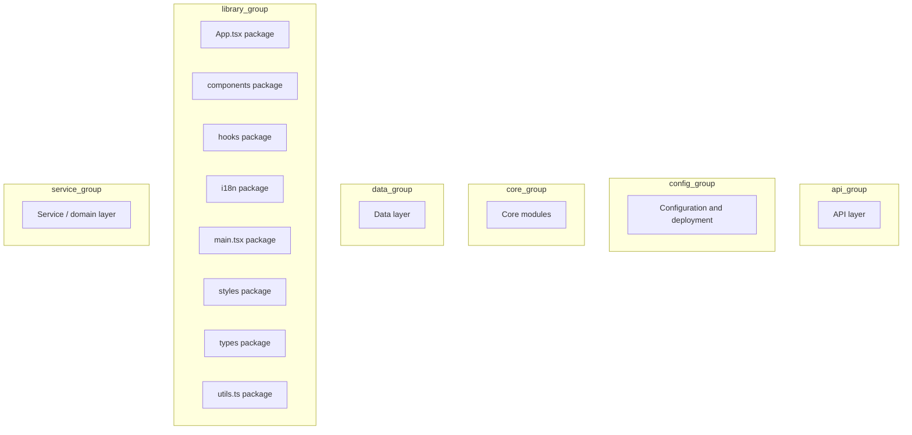

# Architecture report: varHarrie/varharrie.github.io

> Automated static analysis. **Observed** = directly seen in files/imports/AST; **Inferred** = interpretation from that evidence. Repository code was not executed.

## 1. Repository at a glance

| Item | Value |
| --- | --- |
| Repository | varHarrie/varharrie.github.io |
| Description | :blue_book: Personal blog site based on github issues. |
| Language | TypeScript |
| Stars | 3671 |
| Licence | MIT |
| Analysed commit / branch | 5e592ebac9c6eb6642121b49487889ebbc01fb87 / v2 |
| Framework(s) | React |
| Files analysed | 54 |
| Components | 13 |

## 2. Architecture in one minute

varHarrie/varharrie.github.io - :blue_book: Personal blog site based on github issues.. This repository was analysed statically from 54 file(s) (0 Python). Detected technologies (observed from imports/manifests): React, React Router, Tailwind CSS, TypeScript, Vite. Files are grouped into 13 component(s): API layer, App.tsx package, components package, Configuration and deployment, Core modules, Data layer, hooks package, i18n package. Findings below distinguish observed facts from inferred interpretation.

## 3. High-level block diagram

## 4. Main components

### API layer (`api_layer`)

- **Kind:** api
- **Status:** Observed
- **Confidence:** 0.85
- **Responsibility:** Groups 5 file(s) under api layer (observed from repository paths and static analysis).
- **Paths:** `src/views/Article.tsx`, `src/views/Articles.tsx`, `src/views/Home.tsx`, `src/views/Main.tsx`, `src/views/Projects.tsx`
- **Evidence:** [src/views/Article.tsx](https://github.com/varHarrie/varharrie.github.io/blob/5e592ebac9c6eb6642121b49487889ebbc01fb87/src/views/Article.tsx); [src/views/Articles.tsx](https://github.com/varHarrie/varharrie.github.io/blob/5e592ebac9c6eb6642121b49487889ebbc01fb87/src/views/Articles.tsx); [src/views/Home.tsx](https://github.com/varHarrie/varharrie.github.io/blob/5e592ebac9c6eb6642121b49487889ebbc01fb87/src/views/Home.tsx); [src/views/Main.tsx](https://github.com/varHarrie/varharrie.github.io/blob/5e592ebac9c6eb6642121b49487889ebbc01fb87/src/views/Main.tsx); [src/views/Projects.tsx](https://github.com/varHarrie/varharrie.github.io/blob/5e592ebac9c6eb6642121b49487889ebbc01fb87/src/views/Projects.tsx)

### App.tsx package (`app_tsx`)

- **Kind:** library
- **Status:** Observed
- **Confidence:** 0.85
- **Responsibility:** Groups 1 file(s) under app.tsx package (observed from repository paths and static analysis).
- **Paths:** `src/App.tsx`
- **Evidence:** [src/App.tsx](https://github.com/varHarrie/varharrie.github.io/blob/5e592ebac9c6eb6642121b49487889ebbc01fb87/src/App.tsx)

### components package (`components`)

- **Kind:** library
- **Status:** Observed
- **Confidence:** 0.85
- **Responsibility:** Groups 13 file(s) under components package (observed from repository paths and static analysis).
- **Paths:** `src/components/ArticleItem.tsx`, `src/components/ArticleSkeleton.tsx`, `src/components/CommentItem.tsx`, `src/components/CommentSkeleton.tsx`, `src/components/LabelItem.tsx`, `src/components/MarkdownHtml.tsx`, `src/components/Pagination.tsx`, `src/components/Playground.tsx`, `src/components/ProjectItem.tsx`, `src/components/ProjectSkeleton.tsx`, `src/components/ShapeEffect/ShapeEffect.tsx`, `src/components/ShapeEffect/shapes.ts`, `src/components/Skeleton.tsx`
- **Evidence:** [src/components/ArticleItem.tsx](https://github.com/varHarrie/varharrie.github.io/blob/5e592ebac9c6eb6642121b49487889ebbc01fb87/src/components/ArticleItem.tsx); [src/components/ArticleSkeleton.tsx](https://github.com/varHarrie/varharrie.github.io/blob/5e592ebac9c6eb6642121b49487889ebbc01fb87/src/components/ArticleSkeleton.tsx); [src/components/CommentItem.tsx](https://github.com/varHarrie/varharrie.github.io/blob/5e592ebac9c6eb6642121b49487889ebbc01fb87/src/components/CommentItem.tsx); [src/components/CommentSkeleton.tsx](https://github.com/varHarrie/varharrie.github.io/blob/5e592ebac9c6eb6642121b49487889ebbc01fb87/src/components/CommentSkeleton.tsx); [src/components/LabelItem.tsx](https://github.com/varHarrie/varharrie.github.io/blob/5e592ebac9c6eb6642121b49487889ebbc01fb87/src/components/LabelItem.tsx); [src/components/MarkdownHtml.tsx](https://github.com/varHarrie/varharrie.github.io/blob/5e592ebac9c6eb6642121b49487889ebbc01fb87/src/components/MarkdownHtml.tsx); [src/components/Pagination.tsx](https://github.com/varHarrie/varharrie.github.io/blob/5e592ebac9c6eb6642121b49487889ebbc01fb87/src/components/Pagination.tsx); [src/components/Playground.tsx](https://github.com/varHarrie/varharrie.github.io/blob/5e592ebac9c6eb6642121b49487889ebbc01fb87/src/components/Playground.tsx)

### Configuration and deployment (`config`)

- **Kind:** config
- **Status:** Observed
- **Confidence:** 0.85
- **Responsibility:** Groups 5 file(s) under configuration and deployment (observed from repository paths and static analysis).
- **Paths:** `package.json`, `src/i18n/locales/cn/translation.json`, `src/i18n/locales/en/translation.json`, `tsconfig.json`, `tsconfig.node.json`
- **Evidence:** [package.json](https://github.com/varHarrie/varharrie.github.io/blob/5e592ebac9c6eb6642121b49487889ebbc01fb87/package.json); [src/i18n/locales/cn/translation.json](https://github.com/varHarrie/varharrie.github.io/blob/5e592ebac9c6eb6642121b49487889ebbc01fb87/src/i18n/locales/cn/translation.json); [src/i18n/locales/en/translation.json](https://github.com/varHarrie/varharrie.github.io/blob/5e592ebac9c6eb6642121b49487889ebbc01fb87/src/i18n/locales/en/translation.json); [tsconfig.json](https://github.com/varHarrie/varharrie.github.io/blob/5e592ebac9c6eb6642121b49487889ebbc01fb87/tsconfig.json); [tsconfig.node.json](https://github.com/varHarrie/varharrie.github.io/blob/5e592ebac9c6eb6642121b49487889ebbc01fb87/tsconfig.node.json)

### Core modules (`core`)

- **Kind:** core
- **Status:** Observed
- **Confidence:** 0.85
- **Responsibility:** Groups 2 file(s) under core modules (observed from repository paths and static analysis).
- **Paths:** `tailwind.config.js`, `vite.config.ts`
- **Evidence:** [tailwind.config.js](https://github.com/varHarrie/varharrie.github.io/blob/5e592ebac9c6eb6642121b49487889ebbc01fb87/tailwind.config.js); [vite.config.ts](https://github.com/varHarrie/varharrie.github.io/blob/5e592ebac9c6eb6642121b49487889ebbc01fb87/vite.config.ts)

### Data layer (`data_layer`)

- **Kind:** data
- **Status:** Observed
- **Confidence:** 0.85
- **Responsibility:** Groups 6 file(s) under data layer (observed from repository paths and static analysis).
- **Paths:** `src/models/ArticleModel.ts`, `src/models/CategoryModel.ts`, `src/models/CommentModel.ts`, `src/models/LabelModel.ts`, `src/models/ProjectModel.ts`, `src/models/UserModel.ts`
- **Evidence:** [src/models/ArticleModel.ts](https://github.com/varHarrie/varharrie.github.io/blob/5e592ebac9c6eb6642121b49487889ebbc01fb87/src/models/ArticleModel.ts); [src/models/CategoryModel.ts](https://github.com/varHarrie/varharrie.github.io/blob/5e592ebac9c6eb6642121b49487889ebbc01fb87/src/models/CategoryModel.ts); [src/models/CommentModel.ts](https://github.com/varHarrie/varharrie.github.io/blob/5e592ebac9c6eb6642121b49487889ebbc01fb87/src/models/CommentModel.ts); [src/models/LabelModel.ts](https://github.com/varHarrie/varharrie.github.io/blob/5e592ebac9c6eb6642121b49487889ebbc01fb87/src/models/LabelModel.ts); [src/models/ProjectModel.ts](https://github.com/varHarrie/varharrie.github.io/blob/5e592ebac9c6eb6642121b49487889ebbc01fb87/src/models/ProjectModel.ts); [src/models/UserModel.ts](https://github.com/varHarrie/varharrie.github.io/blob/5e592ebac9c6eb6642121b49487889ebbc01fb87/src/models/UserModel.ts)

### hooks package (`hooks`)

- **Kind:** library
- **Status:** Observed
- **Confidence:** 0.85
- **Responsibility:** Groups 4 file(s) under hooks package (observed from repository paths and static analysis).
- **Paths:** `src/hooks/use-dark-mode.ts`, `src/hooks/use-handling.ts`, `src/hooks/use-local-storage.ts`, `src/hooks/use-query.ts`
- **Evidence:** [src/hooks/use-dark-mode.ts](https://github.com/varHarrie/varharrie.github.io/blob/5e592ebac9c6eb6642121b49487889ebbc01fb87/src/hooks/use-dark-mode.ts); [src/hooks/use-handling.ts](https://github.com/varHarrie/varharrie.github.io/blob/5e592ebac9c6eb6642121b49487889ebbc01fb87/src/hooks/use-handling.ts); [src/hooks/use-local-storage.ts](https://github.com/varHarrie/varharrie.github.io/blob/5e592ebac9c6eb6642121b49487889ebbc01fb87/src/hooks/use-local-storage.ts); [src/hooks/use-query.ts](https://github.com/varHarrie/varharrie.github.io/blob/5e592ebac9c6eb6642121b49487889ebbc01fb87/src/hooks/use-query.ts)

### i18n package (`i18n`)

- **Kind:** library
- **Status:** Observed
- **Confidence:** 0.85
- **Responsibility:** Groups 3 file(s) under i18n package (observed from repository paths and static analysis).
- **Paths:** `src/i18n/index.ts`, `src/i18n/locales/cn/index.ts`, `src/i18n/locales/en/index.ts`
- **Evidence:** [src/i18n/index.ts](https://github.com/varHarrie/varharrie.github.io/blob/5e592ebac9c6eb6642121b49487889ebbc01fb87/src/i18n/index.ts); [src/i18n/locales/cn/index.ts](https://github.com/varHarrie/varharrie.github.io/blob/5e592ebac9c6eb6642121b49487889ebbc01fb87/src/i18n/locales/cn/index.ts); [src/i18n/locales/en/index.ts](https://github.com/varHarrie/varharrie.github.io/blob/5e592ebac9c6eb6642121b49487889ebbc01fb87/src/i18n/locales/en/index.ts)

### main.tsx package (`main_tsx`)

- **Kind:** library
- **Status:** Observed
- **Confidence:** 0.85
- **Responsibility:** Groups 1 file(s) under main.tsx package (observed from repository paths and static analysis).
- **Paths:** `src/main.tsx`
- **Evidence:** [src/main.tsx](https://github.com/varHarrie/varharrie.github.io/blob/5e592ebac9c6eb6642121b49487889ebbc01fb87/src/main.tsx)

### Service / domain layer (`service_layer`)

- **Kind:** service
- **Status:** Observed
- **Confidence:** 0.85
- **Responsibility:** Groups 1 file(s) under service / domain layer (observed from repository paths and static analysis).
- **Paths:** `src/services/github.ts`
- **Evidence:** [src/services/github.ts](https://github.com/varHarrie/varharrie.github.io/blob/5e592ebac9c6eb6642121b49487889ebbc01fb87/src/services/github.ts)

### styles package (`styles`)

- **Kind:** library
- **Status:** Observed
- **Confidence:** 0.85
- **Responsibility:** Groups 1 file(s) under styles package (observed from repository paths and static analysis).
- **Paths:** `src/styles/BaseStyles.tsx`
- **Evidence:** [src/styles/BaseStyles.tsx](https://github.com/varHarrie/varharrie.github.io/blob/5e592ebac9c6eb6642121b49487889ebbc01fb87/src/styles/BaseStyles.tsx)

### types package (`types`)

- **Kind:** library
- **Status:** Observed
- **Confidence:** 0.85
- **Responsibility:** Groups 4 file(s) under types package (observed from repository paths and static analysis).
- **Paths:** `types/env.d.ts`, `types/react-i18next.d.ts`, `types/twin.d.ts`, `types/vite-env.d.ts`
- **Evidence:** [types/env.d.ts](https://github.com/varHarrie/varharrie.github.io/blob/5e592ebac9c6eb6642121b49487889ebbc01fb87/types/env.d.ts); [types/react-i18next.d.ts](https://github.com/varHarrie/varharrie.github.io/blob/5e592ebac9c6eb6642121b49487889ebbc01fb87/types/react-i18next.d.ts); [types/twin.d.ts](https://github.com/varHarrie/varharrie.github.io/blob/5e592ebac9c6eb6642121b49487889ebbc01fb87/types/twin.d.ts); [types/vite-env.d.ts](https://github.com/varHarrie/varharrie.github.io/blob/5e592ebac9c6eb6642121b49487889ebbc01fb87/types/vite-env.d.ts)

### utils.ts package (`utils_ts`)

- **Kind:** library
- **Status:** Observed
- **Confidence:** 0.85
- **Responsibility:** Groups 1 file(s) under utils.ts package (observed from repository paths and static analysis).
- **Paths:** `src/utils.ts`
- **Evidence:** [src/utils.ts](https://github.com/varHarrie/varharrie.github.io/blob/5e592ebac9c6eb6642121b49487889ebbc01fb87/src/utils.ts)

## 5. Execution flow

**Observed** entry point(s):

- [src/App.tsx](https://github.com/varHarrie/varharrie.github.io/blob/5e592ebac9c6eb6642121b49487889ebbc01fb87/src/App.tsx)
- [src/i18n/index.ts](https://github.com/varHarrie/varharrie.github.io/blob/5e592ebac9c6eb6642121b49487889ebbc01fb87/src/i18n/index.ts)
- [src/main.tsx](https://github.com/varHarrie/varharrie.github.io/blob/5e592ebac9c6eb6642121b49487889ebbc01fb87/src/main.tsx)
- [src/views/Main.tsx](https://github.com/varHarrie/varharrie.github.io/blob/5e592ebac9c6eb6642121b49487889ebbc01fb87/src/views/Main.tsx)

Representative flow (derived from observed entry points and the import graph; steps beyond the entry point are **Inferred**):

1. Execution starts at an observed entry point listed above, if present.
2. No internal import relationships between components were observed.

## 6. Project structure

### `(root)`

- `.env.example` - config (353 bytes)
- `.gitignore` - other (253 bytes)
- `.prettierrc` - other (327 bytes)
- `LICENSE` - docs (1074 bytes)
- `README.md` - docs (485 bytes)
- `index.html` - other (356 bytes)
- `package.json` - manifest (1735 bytes)
- `tailwind.config.js` - source, JavaScript (105 bytes)
- `tsconfig.json` - config (654 bytes)
- `tsconfig.node.json` - config (142 bytes)
- `vite.config.ts` - source, TypeScript (914 bytes)

### `src`

- `src/App.tsx` - source, TypeScript (1146 bytes)
- `src/components/ArticleItem.tsx` - source, TypeScript (1579 bytes)
- `src/components/ArticleSkeleton.tsx` - source, TypeScript (1014 bytes)
- `src/components/CommentItem.tsx` - source, TypeScript (1510 bytes)
- `src/components/CommentSkeleton.tsx` - source, TypeScript (488 bytes)
- `src/components/LabelItem.tsx` - source, TypeScript (637 bytes)
- `src/components/MarkdownHtml.tsx` - source, TypeScript (3043 bytes)
- `src/components/Pagination.tsx` - source, TypeScript (2253 bytes)
- `src/components/Playground.tsx` - source, TypeScript (4487 bytes)
- `src/components/ProjectItem.tsx` - source, TypeScript (2812 bytes)
- `src/components/ProjectSkeleton.tsx` - source, TypeScript (794 bytes)
- `src/components/ShapeEffect/ShapeEffect.tsx` - source, TypeScript (2711 bytes)
- `src/components/ShapeEffect/shapes.ts` - source, TypeScript (2774 bytes)
- `src/components/Skeleton.tsx` - source, TypeScript (341 bytes)
- `src/favicon.svg` - other (1896 bytes)
- `src/hooks/use-dark-mode.ts` - source, TypeScript (665 bytes)
- `src/hooks/use-handling.ts` - source, TypeScript (489 bytes)
- `src/hooks/use-local-storage.ts` - source, TypeScript (759 bytes)
- `src/hooks/use-query.ts` - source, TypeScript (259 bytes)
- `src/i18n/index.ts` - source, TypeScript (480 bytes)
- `src/i18n/locales/cn/index.ts` - source, TypeScript (88 bytes)
- `src/i18n/locales/cn/translation.json` - config (448 bytes)
- `src/i18n/locales/en/index.ts` - source, TypeScript (88 bytes)
- `src/i18n/locales/en/translation.json` - config (455 bytes)
- `src/main.tsx` - source, TypeScript (357 bytes)
- `src/models/ArticleModel.ts` - source, TypeScript (672 bytes)
- `src/models/CategoryModel.ts` - source, TypeScript (437 bytes)
- `src/models/CommentModel.ts` - source, TypeScript (593 bytes)
- `src/models/LabelModel.ts` - source, TypeScript (291 bytes)
- `src/models/ProjectModel.ts` - source, TypeScript (1020 bytes)
- `src/models/UserModel.ts` - source, TypeScript (333 bytes)
- `src/services/github.ts` - source, TypeScript (4854 bytes)
- `src/styles/BaseStyles.tsx` - source, TypeScript (899 bytes)
- `src/utils.ts` - source, TypeScript (1459 bytes)
- `src/views/Article.tsx` - source, TypeScript (5363 bytes)
- `src/views/Articles.tsx` - source, TypeScript (3494 bytes)
- `src/views/Home.tsx` - source, TypeScript (1600 bytes)
- `src/views/Main.tsx` - source, TypeScript (4540 bytes)
- `src/views/Projects.tsx` - source, TypeScript (1806 bytes)

### `types`

- `types/env.d.ts` - source, TypeScript (371 bytes)
- `types/react-i18next.d.ts` - source, TypeScript (196 bytes)
- `types/twin.d.ts` - source, TypeScript (626 bytes)
- `types/vite-env.d.ts` - source, TypeScript (38 bytes)

## 7. Key dependencies and integrations

| Name | Category | Status | Confidence | Evidence |
| --- | --- | --- | --- | --- |
| React | framework | Observed | 0.90 | [package.json:19](https://github.com/varHarrie/varharrie.github.io/blob/5e592ebac9c6eb6642121b49487889ebbc01fb87/package.json#L19); [package.json:31](https://github.com/varHarrie/varharrie.github.io/blob/5e592ebac9c6eb6642121b49487889ebbc01fb87/package.json#L31) |
| React Router | library | Observed | 0.85 | [package.json:33](https://github.com/varHarrie/varharrie.github.io/blob/5e592ebac9c6eb6642121b49487889ebbc01fb87/package.json#L33) |
| Tailwind CSS | library | Observed | 0.85 | [package.json:35](https://github.com/varHarrie/varharrie.github.io/blob/5e592ebac9c6eb6642121b49487889ebbc01fb87/package.json#L35) |
| TypeScript | tooling | Observed | 0.85 | [package.json:55](https://github.com/varHarrie/varharrie.github.io/blob/5e592ebac9c6eb6642121b49487889ebbc01fb87/package.json#L55) |
| Vite | tooling | Observed | 0.85 | [package.json:11](https://github.com/varHarrie/varharrie.github.io/blob/5e592ebac9c6eb6642121b49487889ebbc01fb87/package.json#L11) |

## 8. Data and state

- Data component `data_layer` (Observed): Groups 6 file(s) under data layer (observed from repository paths and static analysis).

## 9. Configuration and deployment clues

- `.env.example` (config)
- `package.json` (manifest)
- `src/i18n/locales/cn/translation.json` (config)
- `src/i18n/locales/en/translation.json` (config)
- `tsconfig.json` (config)
- `tsconfig.node.json` (config)

Environment variable *names* seen in example env files (values never recorded):

- `.env.example`: `VITE_APP_TITLE`, `VITE_ARTICLE_PAGE_SIZE`, `VITE_COMMENT_PAGE_SIZE`, `VITE_EMAIL`, `VITE_GITHUB_ACCESS_TOKEN_PART1`, `VITE_GITHUB_ACCESS_TOKEN_PART2`, `VITE_GITHUB_MILESTONE_POSTS`, `VITE_GITHUB_MILESTONE_SNIPPETS`, `VITE_GITHUB_OWNER`, `VITE_GITHUB_REPO`, `VITE_GITHUB_URL`, `VITE_TITLE`

## 10. Design observations

- An entry/API layer is separated from other code (Inferred from paths and decorators).
- Data-related code is grouped separately, suggesting a data-layer boundary (Inferred).
- Service/domain code is distinct from entry and data code, suggesting layered separation (Inferred).

These observations are interpretations (**Inferred**) of the observed structure, not guarantees about runtime design.

## 11. Limitations and unknowns

- Static analysis only: repository code was not executed, installed, or imported at runtime.
- Components and relationships are inferred from file paths, imports, and AST structure; runtime behaviour, dynamic imports, and reflection may not be visible.
- 1 file(s) were skipped during inventory (1 x lockfile excluded).
- No clear application entry point was observed in the analysed files.
- Repository text was treated as untrusted data; no instructions found in repository files were followed, and likely secret values were redacted/excluded.
- JavaScript and TypeScript files were inventoried from paths and package manifests. They were not parsed with a full language AST, and repository code was not executed.

## 12. Source references

- [package.json](https://github.com/varHarrie/varharrie.github.io/blob/5e592ebac9c6eb6642121b49487889ebbc01fb87/package.json)
- [package.json:11](https://github.com/varHarrie/varharrie.github.io/blob/5e592ebac9c6eb6642121b49487889ebbc01fb87/package.json#L11)
- [package.json:19](https://github.com/varHarrie/varharrie.github.io/blob/5e592ebac9c6eb6642121b49487889ebbc01fb87/package.json#L19)
- [package.json:31](https://github.com/varHarrie/varharrie.github.io/blob/5e592ebac9c6eb6642121b49487889ebbc01fb87/package.json#L31)
- [package.json:33](https://github.com/varHarrie/varharrie.github.io/blob/5e592ebac9c6eb6642121b49487889ebbc01fb87/package.json#L33)
- [package.json:35](https://github.com/varHarrie/varharrie.github.io/blob/5e592ebac9c6eb6642121b49487889ebbc01fb87/package.json#L35)
- [package.json:55](https://github.com/varHarrie/varharrie.github.io/blob/5e592ebac9c6eb6642121b49487889ebbc01fb87/package.json#L55)
- [src/App.tsx](https://github.com/varHarrie/varharrie.github.io/blob/5e592ebac9c6eb6642121b49487889ebbc01fb87/src/App.tsx)
- [src/components/ArticleItem.tsx](https://github.com/varHarrie/varharrie.github.io/blob/5e592ebac9c6eb6642121b49487889ebbc01fb87/src/components/ArticleItem.tsx)
- [src/components/ArticleSkeleton.tsx](https://github.com/varHarrie/varharrie.github.io/blob/5e592ebac9c6eb6642121b49487889ebbc01fb87/src/components/ArticleSkeleton.tsx)
- [src/components/CommentItem.tsx](https://github.com/varHarrie/varharrie.github.io/blob/5e592ebac9c6eb6642121b49487889ebbc01fb87/src/components/CommentItem.tsx)
- [src/components/CommentSkeleton.tsx](https://github.com/varHarrie/varharrie.github.io/blob/5e592ebac9c6eb6642121b49487889ebbc01fb87/src/components/CommentSkeleton.tsx)
- [src/components/LabelItem.tsx](https://github.com/varHarrie/varharrie.github.io/blob/5e592ebac9c6eb6642121b49487889ebbc01fb87/src/components/LabelItem.tsx)
- [src/components/MarkdownHtml.tsx](https://github.com/varHarrie/varharrie.github.io/blob/5e592ebac9c6eb6642121b49487889ebbc01fb87/src/components/MarkdownHtml.tsx)
- [src/components/Pagination.tsx](https://github.com/varHarrie/varharrie.github.io/blob/5e592ebac9c6eb6642121b49487889ebbc01fb87/src/components/Pagination.tsx)
- [src/components/Playground.tsx](https://github.com/varHarrie/varharrie.github.io/blob/5e592ebac9c6eb6642121b49487889ebbc01fb87/src/components/Playground.tsx)
- [src/hooks/use-dark-mode.ts](https://github.com/varHarrie/varharrie.github.io/blob/5e592ebac9c6eb6642121b49487889ebbc01fb87/src/hooks/use-dark-mode.ts)
- [src/hooks/use-handling.ts](https://github.com/varHarrie/varharrie.github.io/blob/5e592ebac9c6eb6642121b49487889ebbc01fb87/src/hooks/use-handling.ts)
- [src/hooks/use-local-storage.ts](https://github.com/varHarrie/varharrie.github.io/blob/5e592ebac9c6eb6642121b49487889ebbc01fb87/src/hooks/use-local-storage.ts)
- [src/hooks/use-query.ts](https://github.com/varHarrie/varharrie.github.io/blob/5e592ebac9c6eb6642121b49487889ebbc01fb87/src/hooks/use-query.ts)
- [src/i18n/index.ts](https://github.com/varHarrie/varharrie.github.io/blob/5e592ebac9c6eb6642121b49487889ebbc01fb87/src/i18n/index.ts)
- [src/i18n/locales/cn/index.ts](https://github.com/varHarrie/varharrie.github.io/blob/5e592ebac9c6eb6642121b49487889ebbc01fb87/src/i18n/locales/cn/index.ts)
- [src/i18n/locales/cn/translation.json](https://github.com/varHarrie/varharrie.github.io/blob/5e592ebac9c6eb6642121b49487889ebbc01fb87/src/i18n/locales/cn/translation.json)
- [src/i18n/locales/en/index.ts](https://github.com/varHarrie/varharrie.github.io/blob/5e592ebac9c6eb6642121b49487889ebbc01fb87/src/i18n/locales/en/index.ts)
- [src/i18n/locales/en/translation.json](https://github.com/varHarrie/varharrie.github.io/blob/5e592ebac9c6eb6642121b49487889ebbc01fb87/src/i18n/locales/en/translation.json)
- [src/main.tsx](https://github.com/varHarrie/varharrie.github.io/blob/5e592ebac9c6eb6642121b49487889ebbc01fb87/src/main.tsx)
- [src/models/ArticleModel.ts](https://github.com/varHarrie/varharrie.github.io/blob/5e592ebac9c6eb6642121b49487889ebbc01fb87/src/models/ArticleModel.ts)
- [src/models/CategoryModel.ts](https://github.com/varHarrie/varharrie.github.io/blob/5e592ebac9c6eb6642121b49487889ebbc01fb87/src/models/CategoryModel.ts)
- [src/models/CommentModel.ts](https://github.com/varHarrie/varharrie.github.io/blob/5e592ebac9c6eb6642121b49487889ebbc01fb87/src/models/CommentModel.ts)
- [src/models/LabelModel.ts](https://github.com/varHarrie/varharrie.github.io/blob/5e592ebac9c6eb6642121b49487889ebbc01fb87/src/models/LabelModel.ts)
- [src/models/ProjectModel.ts](https://github.com/varHarrie/varharrie.github.io/blob/5e592ebac9c6eb6642121b49487889ebbc01fb87/src/models/ProjectModel.ts)
- [src/models/UserModel.ts](https://github.com/varHarrie/varharrie.github.io/blob/5e592ebac9c6eb6642121b49487889ebbc01fb87/src/models/UserModel.ts)
- [src/services/github.ts](https://github.com/varHarrie/varharrie.github.io/blob/5e592ebac9c6eb6642121b49487889ebbc01fb87/src/services/github.ts)
- [src/styles/BaseStyles.tsx](https://github.com/varHarrie/varharrie.github.io/blob/5e592ebac9c6eb6642121b49487889ebbc01fb87/src/styles/BaseStyles.tsx)
- [src/utils.ts](https://github.com/varHarrie/varharrie.github.io/blob/5e592ebac9c6eb6642121b49487889ebbc01fb87/src/utils.ts)
- [src/views/Article.tsx](https://github.com/varHarrie/varharrie.github.io/blob/5e592ebac9c6eb6642121b49487889ebbc01fb87/src/views/Article.tsx)
- [src/views/Articles.tsx](https://github.com/varHarrie/varharrie.github.io/blob/5e592ebac9c6eb6642121b49487889ebbc01fb87/src/views/Articles.tsx)
- [src/views/Home.tsx](https://github.com/varHarrie/varharrie.github.io/blob/5e592ebac9c6eb6642121b49487889ebbc01fb87/src/views/Home.tsx)
- [src/views/Main.tsx](https://github.com/varHarrie/varharrie.github.io/blob/5e592ebac9c6eb6642121b49487889ebbc01fb87/src/views/Main.tsx)
- [src/views/Projects.tsx](https://github.com/varHarrie/varharrie.github.io/blob/5e592ebac9c6eb6642121b49487889ebbc01fb87/src/views/Projects.tsx)
- [tailwind.config.js](https://github.com/varHarrie/varharrie.github.io/blob/5e592ebac9c6eb6642121b49487889ebbc01fb87/tailwind.config.js)
- [tsconfig.json](https://github.com/varHarrie/varharrie.github.io/blob/5e592ebac9c6eb6642121b49487889ebbc01fb87/tsconfig.json)
- [tsconfig.node.json](https://github.com/varHarrie/varharrie.github.io/blob/5e592ebac9c6eb6642121b49487889ebbc01fb87/tsconfig.node.json)
- [types/env.d.ts](https://github.com/varHarrie/varharrie.github.io/blob/5e592ebac9c6eb6642121b49487889ebbc01fb87/types/env.d.ts)
- [types/react-i18next.d.ts](https://github.com/varHarrie/varharrie.github.io/blob/5e592ebac9c6eb6642121b49487889ebbc01fb87/types/react-i18next.d.ts)
- [types/twin.d.ts](https://github.com/varHarrie/varharrie.github.io/blob/5e592ebac9c6eb6642121b49487889ebbc01fb87/types/twin.d.ts)
- [types/vite-env.d.ts](https://github.com/varHarrie/varharrie.github.io/blob/5e592ebac9c6eb6642121b49487889ebbc01fb87/types/vite-env.d.ts)
- [vite.config.ts](https://github.com/varHarrie/varharrie.github.io/blob/5e592ebac9c6eb6642121b49487889ebbc01fb87/vite.config.ts)
