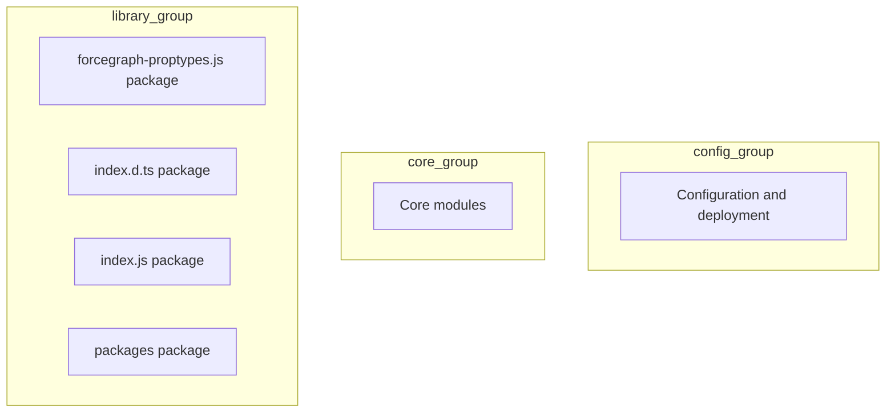

# Architecture report: vasturiano/react-force-graph

> Automated static analysis. **Observed** = directly seen in files/imports/AST; **Inferred** = interpretation from that evidence. Repository code was not executed.

## 1. Repository at a glance

| Item | Value |
| --- | --- |
| Repository | vasturiano/react-force-graph |
| Description | React component for 2D, 3D, VR and AR force directed graphs |
| Language | HTML |
| Stars | 3364 |
| Licence | MIT |
| Analysed commit / branch | 8c301c7a05b22c489b5724301bec52911b51d966 / master |
| Framework(s) | React |
| Files analysed | 66 |
| Components | 6 |

## 2. Architecture in one minute

vasturiano/react-force-graph - React component for 2D, 3D, VR and AR force directed graphs. This repository was analysed statically from 66 file(s) (0 Python). Detected technologies (observed from imports/manifests): React, TypeScript. Files are grouped into 6 component(s): Configuration and deployment, Core modules, forcegraph-proptypes.js package, index.d.ts package, index.js package, packages package. Findings below distinguish observed facts from inferred interpretation.

## 3. High-level block diagram

## 4. Main components

### Configuration and deployment (`config`)

- **Kind:** config
- **Status:** Observed
- **Confidence:** 0.85
- **Responsibility:** Groups 6 file(s) under configuration and deployment (observed from repository paths and static analysis).
- **Paths:** `_config.yml`, `package.json`, `src/packages/react-force-graph-2d/package.json`, `src/packages/react-force-graph-3d/package.json`, `src/packages/react-force-graph-ar/package.json`, `src/packages/react-force-graph-vr/package.json`
- **Evidence:** [_config.yml](https://github.com/vasturiano/react-force-graph/blob/8c301c7a05b22c489b5724301bec52911b51d966/_config.yml); [package.json](https://github.com/vasturiano/react-force-graph/blob/8c301c7a05b22c489b5724301bec52911b51d966/package.json); [src/packages/react-force-graph-2d/package.json](https://github.com/vasturiano/react-force-graph/blob/8c301c7a05b22c489b5724301bec52911b51d966/src/packages/react-force-graph-2d/package.json); [src/packages/react-force-graph-3d/package.json](https://github.com/vasturiano/react-force-graph/blob/8c301c7a05b22c489b5724301bec52911b51d966/src/packages/react-force-graph-3d/package.json); [src/packages/react-force-graph-ar/package.json](https://github.com/vasturiano/react-force-graph/blob/8c301c7a05b22c489b5724301bec52911b51d966/src/packages/react-force-graph-ar/package.json); [src/packages/react-force-graph-vr/package.json](https://github.com/vasturiano/react-force-graph/blob/8c301c7a05b22c489b5724301bec52911b51d966/src/packages/react-force-graph-vr/package.json)

### Core modules (`core`)

- **Kind:** core
- **Status:** Observed
- **Confidence:** 0.85
- **Responsibility:** Groups 2 file(s) under core modules (observed from repository paths and static analysis).
- **Paths:** `rollup.config.dev.js`, `rollup.config.js`
- **Evidence:** [rollup.config.dev.js](https://github.com/vasturiano/react-force-graph/blob/8c301c7a05b22c489b5724301bec52911b51d966/rollup.config.dev.js); [rollup.config.js](https://github.com/vasturiano/react-force-graph/blob/8c301c7a05b22c489b5724301bec52911b51d966/rollup.config.js)

### forcegraph-proptypes.js package (`forcegraph_proptypes_js`)

- **Kind:** library
- **Status:** Observed
- **Confidence:** 0.85
- **Responsibility:** Groups 1 file(s) under forcegraph-proptypes.js package (observed from repository paths and static analysis).
- **Paths:** `src/forcegraph-proptypes.js`
- **Evidence:** [src/forcegraph-proptypes.js](https://github.com/vasturiano/react-force-graph/blob/8c301c7a05b22c489b5724301bec52911b51d966/src/forcegraph-proptypes.js)

### index.d.ts package (`index_d_ts`)

- **Kind:** library
- **Status:** Observed
- **Confidence:** 0.85
- **Responsibility:** Groups 1 file(s) under index.d.ts package (observed from repository paths and static analysis).
- **Paths:** `src/index.d.ts`
- **Evidence:** [src/index.d.ts](https://github.com/vasturiano/react-force-graph/blob/8c301c7a05b22c489b5724301bec52911b51d966/src/index.d.ts)

### index.js package (`index_js`)

- **Kind:** library
- **Status:** Observed
- **Confidence:** 0.85
- **Responsibility:** Groups 1 file(s) under index.js package (observed from repository paths and static analysis).
- **Paths:** `src/index.js`
- **Evidence:** [src/index.js](https://github.com/vasturiano/react-force-graph/blob/8c301c7a05b22c489b5724301bec52911b51d966/src/index.js)

### packages package (`packages`)

- **Kind:** library
- **Status:** Observed
- **Confidence:** 0.85
- **Responsibility:** Groups 16 file(s) under packages package (observed from repository paths and static analysis).
- **Paths:** `src/packages/react-force-graph-2d/index.d.ts`, `src/packages/react-force-graph-2d/index.js`, `src/packages/react-force-graph-2d/rollup.config.dev.js`, `src/packages/react-force-graph-2d/rollup.config.js`, `src/packages/react-force-graph-3d/index.d.ts`, `src/packages/react-force-graph-3d/index.js`, `src/packages/react-force-graph-3d/rollup.config.dev.js`, `src/packages/react-force-graph-3d/rollup.config.js`, `src/packages/react-force-graph-ar/index.d.ts`, `src/packages/react-force-graph-ar/index.js`, `src/packages/react-force-graph-ar/rollup.config.dev.js`, `src/packages/react-force-graph-ar/rollup.config.js`, `src/packages/react-force-graph-vr/index.d.ts`, `src/packages/react-force-graph-vr/index.js`, `src/packages/react-force-graph-vr/rollup.config.dev.js`, `src/packages/react-force-graph-vr/rollup.config.js`
- **Evidence:** [src/packages/react-force-graph-2d/index.d.ts](https://github.com/vasturiano/react-force-graph/blob/8c301c7a05b22c489b5724301bec52911b51d966/src/packages/react-force-graph-2d/index.d.ts); [src/packages/react-force-graph-2d/index.js](https://github.com/vasturiano/react-force-graph/blob/8c301c7a05b22c489b5724301bec52911b51d966/src/packages/react-force-graph-2d/index.js); [src/packages/react-force-graph-2d/rollup.config.dev.js](https://github.com/vasturiano/react-force-graph/blob/8c301c7a05b22c489b5724301bec52911b51d966/src/packages/react-force-graph-2d/rollup.config.dev.js); [src/packages/react-force-graph-2d/rollup.config.js](https://github.com/vasturiano/react-force-graph/blob/8c301c7a05b22c489b5724301bec52911b51d966/src/packages/react-force-graph-2d/rollup.config.js); [src/packages/react-force-graph-3d/index.d.ts](https://github.com/vasturiano/react-force-graph/blob/8c301c7a05b22c489b5724301bec52911b51d966/src/packages/react-force-graph-3d/index.d.ts); [src/packages/react-force-graph-3d/index.js](https://github.com/vasturiano/react-force-graph/blob/8c301c7a05b22c489b5724301bec52911b51d966/src/packages/react-force-graph-3d/index.js); [src/packages/react-force-graph-3d/rollup.config.dev.js](https://github.com/vasturiano/react-force-graph/blob/8c301c7a05b22c489b5724301bec52911b51d966/src/packages/react-force-graph-3d/rollup.config.dev.js); [src/packages/react-force-graph-3d/rollup.config.js](https://github.com/vasturiano/react-force-graph/blob/8c301c7a05b22c489b5724301bec52911b51d966/src/packages/react-force-graph-3d/rollup.config.js)

## 5. Execution flow

**Observed** entry point(s):

- [src/index.js](https://github.com/vasturiano/react-force-graph/blob/8c301c7a05b22c489b5724301bec52911b51d966/src/index.js)
- [src/packages/react-force-graph-2d/index.js](https://github.com/vasturiano/react-force-graph/blob/8c301c7a05b22c489b5724301bec52911b51d966/src/packages/react-force-graph-2d/index.js)
- [src/packages/react-force-graph-3d/index.js](https://github.com/vasturiano/react-force-graph/blob/8c301c7a05b22c489b5724301bec52911b51d966/src/packages/react-force-graph-3d/index.js)
- [src/packages/react-force-graph-ar/index.js](https://github.com/vasturiano/react-force-graph/blob/8c301c7a05b22c489b5724301bec52911b51d966/src/packages/react-force-graph-ar/index.js)
- [src/packages/react-force-graph-vr/index.js](https://github.com/vasturiano/react-force-graph/blob/8c301c7a05b22c489b5724301bec52911b51d966/src/packages/react-force-graph-vr/index.js)

Representative flow (derived from observed entry points and the import graph; steps beyond the entry point are **Inferred**):

1. Execution starts at an observed entry point listed above, if present.
2. No internal import relationships between components were observed.

## 6. Project structure

### `(root)`

- `.babelrc` - other (97 bytes)
- `.gitignore` - other (30 bytes)
- `.npmignore` - other (26 bytes)
- `LICENSE` - docs (1072 bytes)
- `README.md` - docs (50703 bytes)
- `_config.yml` - config (26 bytes)
- `package.json` - manifest (2078 bytes)
- `rollup.config.dev.js` - source, JavaScript (262 bytes)
- `rollup.config.js` - source, JavaScript (1532 bytes)

### `.github`

- `.github/ISSUE_TEMPLATE/bug_report.md` - docs (834 bytes)
- `.github/ISSUE_TEMPLATE/feature_request.md` - docs (595 bytes)

### `example`

- `example/all-modes/index.html` - other (1047 bytes)
- `example/ar-graph/index.html` - other (1295 bytes)
- `example/auto-colored/index.html` - other (1097 bytes)
- `example/basic/index.html` - other (905 bytes)
- `example/bloom-effect/index.html` - other (1553 bytes)
- `example/camera-auto-orbit/index.html` - other (1570 bytes)
- `example/click-to-focus/index.html` - other (1647 bytes)
- `example/collision-detection/index.html` - other (2174 bytes)
- `example/curved-links/index.html` - other (3469 bytes)
- `example/custom-node-shape/index-canvas.html` - other (1778 bytes)
- `example/custom-node-shape/index-three.html` - other (1851 bytes)
- `example/datasets/d3-dependencies.csv` - data (13906 bytes)
- `example/datasets/forcegraph-dependencies.json` - config (2174 bytes)
- `example/datasets/miserables.json` - config (18844 bytes)
- `example/datasets/random-data.js` - source, JavaScript (329 bytes)
- `example/directional-links-arrows/index.html` - other (1031 bytes)
- `example/directional-links-particles/index.html` - other (1107 bytes)
- `example/dynamic/index.html` - other (1990 bytes)
- `example/emit-particles/index.html` - other (1219 bytes)
- `example/expandable-nodes/index.html` - other (2435 bytes)
- `example/fit-to-canvas/index.html` - other (1105 bytes)
- `example/fix-dragged-nodes/index.html` - other (1140 bytes)
- `example/forcegraph-dependencies/index.html` - other (1683 bytes)
- `example/highlight/index.html` - other (3374 bytes)
- `example/html-nodes/index.html` - other (1689 bytes)
- `example/img-nodes/index.html` - other (1738 bytes)
- `example/large-graph/index.html` - other (1091 bytes)
- `example/multi-selection/index.html` - other (2729 bytes)
- `example/text-links/index-3d.html` - other (1707 bytes)
- `example/text-nodes/index-2d.html` - other (2056 bytes)
- `example/text-nodes/index-3d.html` - other (1337 bytes)
- `example/tree/index.html` - other (2975 bytes)

### `src`

- `src/forcegraph-proptypes.js` - source, JavaScript (6252 bytes)
- `src/index.d.ts` - source, TypeScript (299 bytes)
- `src/index.js` - source, JavaScript (381 bytes)
- `src/packages/react-force-graph-2d/index.d.ts` - source, TypeScript (7351 bytes)
- `src/packages/react-force-graph-2d/index.js` - source, JavaScript (655 bytes)
- `src/packages/react-force-graph-2d/package.json` - manifest (1463 bytes)
- `src/packages/react-force-graph-2d/rollup.config.dev.js` - source, JavaScript (262 bytes)
- `src/packages/react-force-graph-2d/rollup.config.js` - source, JavaScript (1519 bytes)
- `src/packages/react-force-graph-3d/index.d.ts` - source, TypeScript (7586 bytes)
- `src/packages/react-force-graph-3d/index.js` - source, JavaScript (854 bytes)
- `src/packages/react-force-graph-3d/package.json` - manifest (1478 bytes)
- `src/packages/react-force-graph-3d/rollup.config.dev.js` - source, JavaScript (262 bytes)
- `src/packages/react-force-graph-3d/rollup.config.js` - source, JavaScript (1519 bytes)
- `src/packages/react-force-graph-ar/index.d.ts` - source, TypeScript (5679 bytes)
- `src/packages/react-force-graph-ar/index.js` - source, JavaScript (535 bytes)
- `src/packages/react-force-graph-ar/package.json` - manifest (1495 bytes)
- `src/packages/react-force-graph-ar/rollup.config.dev.js` - source, JavaScript (262 bytes)
- `src/packages/react-force-graph-ar/rollup.config.js` - source, JavaScript (1519 bytes)
- `src/packages/react-force-graph-vr/index.d.ts` - source, TypeScript (5868 bytes)
- `src/packages/react-force-graph-vr/index.js` - source, JavaScript (499 bytes)
- `src/packages/react-force-graph-vr/package.json` - manifest (1503 bytes)
- `src/packages/react-force-graph-vr/rollup.config.dev.js` - source, JavaScript (262 bytes)
- `src/packages/react-force-graph-vr/rollup.config.js` - source, JavaScript (1519 bytes)

## 7. Key dependencies and integrations

| Name | Category | Status | Confidence | Evidence |
| --- | --- | --- | --- | --- |
| React | framework | Observed | 0.90 | [package.json:2](https://github.com/vasturiano/react-force-graph/blob/8c301c7a05b22c489b5724301bec52911b51d966/package.json#L2); [src/packages/react-force-graph-2d/package.json:2](https://github.com/vasturiano/react-force-graph/blob/8c301c7a05b22c489b5724301bec52911b51d966/src/packages/react-force-graph-2d/package.json#L2); [src/packages/react-force-graph-3d/package.json:2](https://github.com/vasturiano/react-force-graph/blob/8c301c7a05b22c489b5724301bec52911b51d966/src/packages/react-force-graph-3d/package.json#L2); [src/packages/react-force-graph-ar/package.json:2](https://github.com/vasturiano/react-force-graph/blob/8c301c7a05b22c489b5724301bec52911b51d966/src/packages/react-force-graph-ar/package.json#L2) |
| TypeScript | tooling | Observed | 0.85 | [package.json:72](https://github.com/vasturiano/react-force-graph/blob/8c301c7a05b22c489b5724301bec52911b51d966/package.json#L72) |

## 8. Data and state

No database, cache, queue, or persistent-state usage was observed in the analysed files. State handling, if any, may be in-memory or in files that were not analysed.

## 9. Configuration and deployment clues

- `_config.yml` (config)
- `example/datasets/forcegraph-dependencies.json` (config)
- `example/datasets/miserables.json` (config)
- `package.json` (manifest)
- `src/packages/react-force-graph-2d/package.json` (manifest)
- `src/packages/react-force-graph-3d/package.json` (manifest)
- `src/packages/react-force-graph-ar/package.json` (manifest)
- `src/packages/react-force-graph-vr/package.json` (manifest)

## 10. Design observations

- No strong design patterns could be established from the available evidence.

These observations are interpretations (**Inferred**) of the observed structure, not guarantees about runtime design.

## 11. Limitations and unknowns

- Static analysis only: repository code was not executed, installed, or imported at runtime.
- Components and relationships are inferred from file paths, imports, and AST structure; runtime behaviour, dynamic imports, and reflection may not be visible.
- No clear application entry point was observed in the analysed files.
- Repository text was treated as untrusted data; no instructions found in repository files were followed, and likely secret values were redacted/excluded.
- JavaScript and TypeScript files were inventoried from paths and package manifests. They were not parsed with a full language AST, and repository code was not executed.

## 12. Source references

- [_config.yml](https://github.com/vasturiano/react-force-graph/blob/8c301c7a05b22c489b5724301bec52911b51d966/_config.yml)
- [package.json](https://github.com/vasturiano/react-force-graph/blob/8c301c7a05b22c489b5724301bec52911b51d966/package.json)
- [package.json:2](https://github.com/vasturiano/react-force-graph/blob/8c301c7a05b22c489b5724301bec52911b51d966/package.json#L2)
- [package.json:72](https://github.com/vasturiano/react-force-graph/blob/8c301c7a05b22c489b5724301bec52911b51d966/package.json#L72)
- [rollup.config.dev.js](https://github.com/vasturiano/react-force-graph/blob/8c301c7a05b22c489b5724301bec52911b51d966/rollup.config.dev.js)
- [rollup.config.js](https://github.com/vasturiano/react-force-graph/blob/8c301c7a05b22c489b5724301bec52911b51d966/rollup.config.js)
- [src/forcegraph-proptypes.js](https://github.com/vasturiano/react-force-graph/blob/8c301c7a05b22c489b5724301bec52911b51d966/src/forcegraph-proptypes.js)
- [src/index.d.ts](https://github.com/vasturiano/react-force-graph/blob/8c301c7a05b22c489b5724301bec52911b51d966/src/index.d.ts)
- [src/index.js](https://github.com/vasturiano/react-force-graph/blob/8c301c7a05b22c489b5724301bec52911b51d966/src/index.js)
- [src/packages/react-force-graph-2d/index.d.ts](https://github.com/vasturiano/react-force-graph/blob/8c301c7a05b22c489b5724301bec52911b51d966/src/packages/react-force-graph-2d/index.d.ts)
- [src/packages/react-force-graph-2d/index.js](https://github.com/vasturiano/react-force-graph/blob/8c301c7a05b22c489b5724301bec52911b51d966/src/packages/react-force-graph-2d/index.js)
- [src/packages/react-force-graph-2d/package.json](https://github.com/vasturiano/react-force-graph/blob/8c301c7a05b22c489b5724301bec52911b51d966/src/packages/react-force-graph-2d/package.json)
- [src/packages/react-force-graph-2d/package.json:2](https://github.com/vasturiano/react-force-graph/blob/8c301c7a05b22c489b5724301bec52911b51d966/src/packages/react-force-graph-2d/package.json#L2)
- [src/packages/react-force-graph-2d/rollup.config.dev.js](https://github.com/vasturiano/react-force-graph/blob/8c301c7a05b22c489b5724301bec52911b51d966/src/packages/react-force-graph-2d/rollup.config.dev.js)
- [src/packages/react-force-graph-2d/rollup.config.js](https://github.com/vasturiano/react-force-graph/blob/8c301c7a05b22c489b5724301bec52911b51d966/src/packages/react-force-graph-2d/rollup.config.js)
- [src/packages/react-force-graph-3d/index.d.ts](https://github.com/vasturiano/react-force-graph/blob/8c301c7a05b22c489b5724301bec52911b51d966/src/packages/react-force-graph-3d/index.d.ts)
- [src/packages/react-force-graph-3d/index.js](https://github.com/vasturiano/react-force-graph/blob/8c301c7a05b22c489b5724301bec52911b51d966/src/packages/react-force-graph-3d/index.js)
- [src/packages/react-force-graph-3d/package.json](https://github.com/vasturiano/react-force-graph/blob/8c301c7a05b22c489b5724301bec52911b51d966/src/packages/react-force-graph-3d/package.json)
- [src/packages/react-force-graph-3d/package.json:2](https://github.com/vasturiano/react-force-graph/blob/8c301c7a05b22c489b5724301bec52911b51d966/src/packages/react-force-graph-3d/package.json#L2)
- [src/packages/react-force-graph-3d/rollup.config.dev.js](https://github.com/vasturiano/react-force-graph/blob/8c301c7a05b22c489b5724301bec52911b51d966/src/packages/react-force-graph-3d/rollup.config.dev.js)
- [src/packages/react-force-graph-3d/rollup.config.js](https://github.com/vasturiano/react-force-graph/blob/8c301c7a05b22c489b5724301bec52911b51d966/src/packages/react-force-graph-3d/rollup.config.js)
- [src/packages/react-force-graph-ar/index.js](https://github.com/vasturiano/react-force-graph/blob/8c301c7a05b22c489b5724301bec52911b51d966/src/packages/react-force-graph-ar/index.js)
- [src/packages/react-force-graph-ar/package.json](https://github.com/vasturiano/react-force-graph/blob/8c301c7a05b22c489b5724301bec52911b51d966/src/packages/react-force-graph-ar/package.json)
- [src/packages/react-force-graph-ar/package.json:2](https://github.com/vasturiano/react-force-graph/blob/8c301c7a05b22c489b5724301bec52911b51d966/src/packages/react-force-graph-ar/package.json#L2)
- [src/packages/react-force-graph-vr/index.js](https://github.com/vasturiano/react-force-graph/blob/8c301c7a05b22c489b5724301bec52911b51d966/src/packages/react-force-graph-vr/index.js)
- [src/packages/react-force-graph-vr/package.json](https://github.com/vasturiano/react-force-graph/blob/8c301c7a05b22c489b5724301bec52911b51d966/src/packages/react-force-graph-vr/package.json)
- [src/packages/react-force-graph-vr/package.json:2](https://github.com/vasturiano/react-force-graph/blob/8c301c7a05b22c489b5724301bec52911b51d966/src/packages/react-force-graph-vr/package.json#L2)
