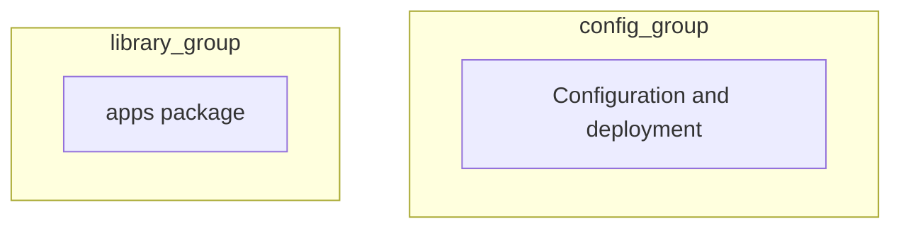

# Architecture report: vercel-labs/ui

> Automated static analysis. **Observed** = directly seen in files/imports/AST; **Inferred** = interpretation from that evidence. Repository code was not executed.

## 1. Repository at a glance

| Item | Value |
| --- | --- |
| Repository | vercel-labs/ui |
| Description | A library of behaviors for agents to build the next generation of user interfaces. |
| Language | TypeScript |
| Stars | 4452 |
| Licence | Apache-2.0 |
| Analysed commit / branch | 220c1a0d7278872286a620a8e4ee4210ca46f9bd / main |
| Framework(s) | Next.js, React, Svelte, Vue |
| Files analysed | 799 |
| Components | 2 |

## 2. Architecture in one minute

vercel-labs/ui - A library of behaviors for agents to build the next generation of user interfaces.. This repository was analysed statically from 799 file(s) (0 Python). Detected technologies (observed from imports/manifests): GitHub Actions, Next.js, React, Svelte, Vue, Tailwind CSS. Files are grouped into 2 component(s): apps package, Configuration and deployment. Findings below distinguish observed facts from inferred interpretation.

## 3. High-level block diagram

## 4. Main components

### apps package (`apps`)

- **Kind:** library
- **Status:** Observed
- **Confidence:** 0.85
- **Responsibility:** Groups 159 file(s) under apps package (observed from repository paths and static analysis).
- **Paths:** `apps/playground/solid-ssr.ts`, `apps/playground/src/fixtures/accordion-kitchen-sink/classes.ts`, `apps/playground/src/fixtures/accordion-kitchen-sink/react.tsx`, `apps/playground/src/fixtures/accordion-kitchen-sink/shell.ts`, `apps/playground/src/fixtures/accordion-kitchen-sink/variants.ts`, `apps/playground/src/fixtures/accordion-kitchen-sink/vue.ts`, `apps/playground/src/fixtures/accordion-kitchen-sink/web.ts`, `apps/playground/src/fixtures/accordion-render/Fixture.svelte`, `apps/playground/src/fixtures/accordion-render/Fixture.vue`, `apps/playground/src/fixtures/accordion-render/react.tsx`, `apps/playground/src/fixtures/accordion-render/solid.tsx`, `apps/playground/src/fixtures/accordion-render/svelte.ts`, `apps/playground/src/fixtures/accordion-render/vue.ts`, `apps/playground/src/fixtures/accordion-render/web.ts`, `apps/playground/src/fixtures/accordion/AccordionFixture.svelte`, `apps/playground/src/fixtures/accordion/AccordionFixture.vue`, `apps/playground/src/fixtures/accordion/react-ssr.tsx`, `apps/playground/src/fixtures/accordion/react.tsx`, `apps/playground/src/fixtures/accordion/solid-ssr.tsx`, `apps/playground/src/fixtures/accordion/solid.tsx`, `apps/playground/src/fixtures/accordion/svelte-ssr.ts`, `apps/playground/src/fixtures/accordion/svelte.ts`, `apps/playground/src/fixtures/accordion/vue-ssr.ts`, `apps/playground/src/fixtures/accordion/vue.ts`, `apps/playground/src/fixtures/accordion/web.ts`, `apps/playground/src/fixtures/accordions-perf/Fixture.svelte`, `apps/playground/src/fixtures/accordions-perf/Fixture.vue`, `apps/playground/src/fixtures/accordions-perf/react.tsx`, `apps/playground/src/fixtures/accordions-perf/solid.tsx`, `apps/playground/src/fixtures/accordions-perf/svelte.ts`, `apps/playground/src/fixtures/accordions-perf/vue.ts`, `apps/playground/src/fixtures/accordions-perf/web.ts`, `apps/playground/src/fixtures/alignment/AlignmentFixture.svelte`, `apps/playground/src/fixtures/alignment/AlignmentFixture.vue`, `apps/playground/src/fixtures/alignment/react.tsx`, `apps/playground/src/fixtures/alignment/solid.tsx`, `apps/playground/src/fixtures/alignment/svelte.ts`, `apps/playground/src/fixtures/alignment/vue.ts`, `apps/playground/src/fixtures/alignment/web.ts`, `apps/playground/src/fixtures/autocomplete-kitchen-sink/classes.ts`, `apps/playground/src/fixtures/autocomplete-kitchen-sink/react.tsx`, `apps/playground/src/fixtures/autocomplete-kitchen-sink/shell.ts`, `apps/playground/src/fixtures/autocomplete-kitchen-sink/variants.ts`, `apps/playground/src/fixtures/autocomplete-kitchen-sink/vue.ts`, `apps/playground/src/fixtures/autocomplete-kitchen-sink/web.ts`, `apps/playground/src/fixtures/autocomplete-render/AutocompleteRenderFixture.svelte`, `apps/playground/src/fixtures/autocomplete-render/AutocompleteRenderFixture.vue`, `apps/playground/src/fixtures/autocomplete-render/react.tsx`, `apps/playground/src/fixtures/autocomplete-render/solid.tsx`, `apps/playground/src/fixtures/autocomplete-render/svelte.ts`, `apps/playground/src/fixtures/autocomplete-render/vue.ts`, `apps/playground/src/fixtures/autocomplete-render/web.ts`, `apps/playground/src/fixtures/autocomplete/AutocompleteFixture.svelte`, `apps/playground/src/fixtures/autocomplete/AutocompleteFixture.vue`, `apps/playground/src/fixtures/autocomplete/react-data.tsx`, `apps/playground/src/fixtures/autocomplete/react-ssr.tsx`, `apps/playground/src/fixtures/autocomplete/react.tsx`, `apps/playground/src/fixtures/autocomplete/solid-data.tsx`, `apps/playground/src/fixtures/autocomplete/solid-ssr.tsx`, `apps/playground/src/fixtures/autocomplete/solid.tsx`, `apps/playground/src/fixtures/autocomplete/svelte-data.ts`, `apps/playground/src/fixtures/autocomplete/svelte-ssr.ts`, `apps/playground/src/fixtures/autocomplete/svelte.ts`, `apps/playground/src/fixtures/autocomplete/vue-data.ts`, `apps/playground/src/fixtures/autocomplete/vue-ssr.ts`, `apps/playground/src/fixtures/autocomplete/vue.ts`, `apps/playground/src/fixtures/autocomplete/web-data.ts`, `apps/playground/src/fixtures/autocomplete/web.ts`, `apps/playground/src/fixtures/avatar-kitchen-sink/classes.ts`, `apps/playground/src/fixtures/avatar-kitchen-sink/react.tsx`, `apps/playground/src/fixtures/avatar-kitchen-sink/shell.ts`, `apps/playground/src/fixtures/avatar-kitchen-sink/variants.ts`, `apps/playground/src/fixtures/avatar-kitchen-sink/vue.ts`, `apps/playground/src/fixtures/avatar-kitchen-sink/web.ts`, `apps/playground/src/fixtures/avatar/AvatarFixture.svelte`, `apps/playground/src/fixtures/avatar/AvatarFixture.vue`, `apps/playground/src/fixtures/avatar/react-ssr.tsx`, `apps/playground/src/fixtures/avatar/react.tsx`, `apps/playground/src/fixtures/avatar/solid-ssr.tsx`, `apps/playground/src/fixtures/avatar/solid.tsx`, `apps/playground/src/fixtures/avatar/svelte-ssr.ts`, `apps/playground/src/fixtures/avatar/svelte.ts`, `apps/playground/src/fixtures/avatar/vue-ssr.ts`, `apps/playground/src/fixtures/avatar/vue.ts`, `apps/playground/src/fixtures/avatar/web.ts`, `apps/playground/src/fixtures/cached-page/Fixture.vue`, `apps/playground/src/fixtures/cached-page/ProfilePage.vue`, `apps/playground/src/fixtures/cached-page/react.tsx`, `apps/playground/src/fixtures/cached-page/vue.ts`, `apps/playground/src/fixtures/calendar/CalendarFixture.svelte`, `apps/playground/src/fixtures/calendar/CalendarFixture.vue`, `apps/playground/src/fixtures/calendar/react-ssr.tsx`, `apps/playground/src/fixtures/calendar/react.tsx`, `apps/playground/src/fixtures/calendar/solid-ssr.tsx`, `apps/playground/src/fixtures/calendar/solid.tsx`, `apps/playground/src/fixtures/calendar/svelte-ssr.ts`, `apps/playground/src/fixtures/calendar/svelte.ts`, `apps/playground/src/fixtures/calendar/vue-ssr.ts`, `apps/playground/src/fixtures/calendar/vue.ts`, `apps/playground/src/fixtures/calendar/web.ts`, `apps/playground/src/fixtures/carousel-kitchen-sink/classes.ts`, `apps/playground/src/fixtures/carousel-kitchen-sink/react.tsx`, `apps/playground/src/fixtures/carousel-kitchen-sink/shell.ts`, `apps/playground/src/fixtures/carousel-kitchen-sink/variants.ts`, `apps/playground/src/fixtures/carousel-kitchen-sink/vue.ts`, `apps/playground/src/fixtures/carousel-kitchen-sink/web.ts`, `apps/playground/src/fixtures/carousel-render/Fixture.svelte`, `apps/playground/src/fixtures/carousel-render/Fixture.vue`, `apps/playground/src/fixtures/carousel-render/react.tsx`, `apps/playground/src/fixtures/carousel-render/solid.tsx`, `apps/playground/src/fixtures/carousel-render/svelte.ts`, `apps/playground/src/fixtures/carousel-render/vue.ts`, `apps/playground/src/fixtures/carousel-render/web.ts`, `apps/playground/src/fixtures/carousel/CarouselFixture.svelte`, `apps/playground/src/fixtures/carousel/CarouselFixture.vue`, `apps/playground/src/fixtures/carousel/react-ssr.tsx`, `apps/playground/src/fixtures/carousel/react.tsx`, `apps/playground/src/fixtures/carousel/solid-ssr.tsx`, `apps/playground/src/fixtures/carousel/solid.tsx`, `apps/playground/src/fixtures/carousel/svelte-ssr.ts`, `apps/playground/src/fixtures/carousel/svelte.ts`, `apps/playground/src/fixtures/carousel/vue-ssr.ts`, `apps/playground/src/fixtures/carousel/vue.ts`, `apps/playground/src/fixtures/carousel/web.ts`, `apps/playground/src/fixtures/collapsible-kitchen-sink/classes.ts`, `apps/playground/src/fixtures/collapsible-kitchen-sink/react.tsx`, `apps/playground/src/fixtures/collapsible-kitchen-sink/shell.ts`, `apps/playground/src/fixtures/collapsible-kitchen-sink/variants.ts`, `apps/playground/src/fixtures/collapsible-kitchen-sink/vue.ts`, `apps/playground/src/fixtures/collapsible-kitchen-sink/web.ts`, `apps/playground/src/fixtures/collapsible-render/Fixture.svelte`, `apps/playground/src/fixtures/collapsible-render/Fixture.vue`, `apps/playground/src/fixtures/collapsible-render/react.tsx`, `apps/playground/src/fixtures/collapsible-render/solid.tsx`, `apps/playground/src/fixtures/collapsible-render/svelte.ts`, `apps/playground/src/fixtures/collapsible-render/vue.ts`, `apps/playground/src/fixtures/collapsible-render/web.ts`, `apps/playground/src/fixtures/collapsible/CollapsibleFixture.svelte`, `apps/playground/src/fixtures/collapsible/CollapsibleFixture.vue`, `apps/playground/src/fixtures/collapsible/react-ssr.tsx`, `apps/playground/src/fixtures/collapsible/react.tsx`, `apps/playground/src/fixtures/collapsible/solid-ssr.tsx`, `apps/playground/src/fixtures/collapsible/solid.tsx`, `apps/playground/src/fixtures/collapsible/svelte-ssr.ts`, `apps/playground/src/fixtures/collapsible/svelte.ts`, `apps/playground/src/fixtures/collapsible/vue-ssr.ts`, `apps/playground/src/fixtures/collapsible/vue.ts`, `apps/playground/src/fixtures/collapsible/web.ts`, `apps/playground/src/fixtures/collapsibles-perf/Fixture.vue`, `apps/playground/src/fixtures/collapsibles-perf/react.tsx`, `apps/playground/src/fixtures/collapsibles-perf/vue.ts`, `apps/playground/src/fixtures/collapsibles-perf/web.ts`, `apps/playground/src/fixtures/color-picker/ColorPickerFixture.svelte`, `apps/playground/src/fixtures/color-picker/ColorPickerFixture.vue`, `apps/playground/src/fixtures/color-picker/react-ssr.tsx`, `apps/playground/src/fixtures/color-picker/react.tsx`, `apps/playground/src/fixtures/color-picker/solid-ssr.tsx`, `apps/playground/src/fixtures/color-picker/solid.tsx`, `apps/playground/src/fixtures/color-picker/svelte-ssr.ts`
- **Evidence:** [apps/playground/solid-ssr.ts](https://github.com/vercel-labs/ui/blob/220c1a0d7278872286a620a8e4ee4210ca46f9bd/apps/playground/solid-ssr.ts); [apps/playground/src/fixtures/accordion-kitchen-sink/classes.ts](https://github.com/vercel-labs/ui/blob/220c1a0d7278872286a620a8e4ee4210ca46f9bd/apps/playground/src/fixtures/accordion-kitchen-sink/classes.ts); [apps/playground/src/fixtures/accordion-kitchen-sink/react.tsx](https://github.com/vercel-labs/ui/blob/220c1a0d7278872286a620a8e4ee4210ca46f9bd/apps/playground/src/fixtures/accordion-kitchen-sink/react.tsx); [apps/playground/src/fixtures/accordion-kitchen-sink/shell.ts](https://github.com/vercel-labs/ui/blob/220c1a0d7278872286a620a8e4ee4210ca46f9bd/apps/playground/src/fixtures/accordion-kitchen-sink/shell.ts); [apps/playground/src/fixtures/accordion-kitchen-sink/variants.ts](https://github.com/vercel-labs/ui/blob/220c1a0d7278872286a620a8e4ee4210ca46f9bd/apps/playground/src/fixtures/accordion-kitchen-sink/variants.ts); [apps/playground/src/fixtures/accordion-kitchen-sink/vue.ts](https://github.com/vercel-labs/ui/blob/220c1a0d7278872286a620a8e4ee4210ca46f9bd/apps/playground/src/fixtures/accordion-kitchen-sink/vue.ts); [apps/playground/src/fixtures/accordion-kitchen-sink/web.ts](https://github.com/vercel-labs/ui/blob/220c1a0d7278872286a620a8e4ee4210ca46f9bd/apps/playground/src/fixtures/accordion-kitchen-sink/web.ts); [apps/playground/src/fixtures/accordion-render/Fixture.svelte](https://github.com/vercel-labs/ui/blob/220c1a0d7278872286a620a8e4ee4210ca46f9bd/apps/playground/src/fixtures/accordion-render/Fixture.svelte)

### Configuration and deployment (`config`)

- **Kind:** config
- **Status:** Observed
- **Confidence:** 0.85
- **Responsibility:** Groups 20 file(s) under configuration and deployment (observed from repository paths and static analysis).
- **Paths:** `apps/docs/content/docs/agents/connect-an-agent/meta.json`, `apps/docs/content/docs/agents/meta.json`, `apps/docs/content/docs/core/behaviors/meta.json`, `apps/docs/content/docs/core/meta.json`, `apps/docs/content/docs/guides/meta.json`, `apps/docs/content/docs/meta.json`, `apps/docs/content/docs/react/hooks/meta.json`, `apps/docs/content/docs/react/meta.json`, `apps/docs/content/docs/solid/meta.json`, `apps/docs/content/docs/solid/utilities/meta.json`, `apps/docs/content/docs/svelte/meta.json`, `apps/docs/content/docs/svelte/utilities/meta.json`, `apps/docs/content/docs/vue/meta.json`, `apps/docs/content/docs/vue/utilities/meta.json`, `apps/docs/content/docs/web-components/meta.json`, `apps/docs/content/docs/web-components/utilities/meta.json`, `apps/docs/package.json`, `apps/docs/tsconfig.json`, `apps/docs/vercel.json`, `apps/playground/package.json`
- **Evidence:** [apps/docs/content/docs/agents/connect-an-agent/meta.json](https://github.com/vercel-labs/ui/blob/220c1a0d7278872286a620a8e4ee4210ca46f9bd/apps/docs/content/docs/agents/connect-an-agent/meta.json); [apps/docs/content/docs/agents/meta.json](https://github.com/vercel-labs/ui/blob/220c1a0d7278872286a620a8e4ee4210ca46f9bd/apps/docs/content/docs/agents/meta.json); [apps/docs/content/docs/core/behaviors/meta.json](https://github.com/vercel-labs/ui/blob/220c1a0d7278872286a620a8e4ee4210ca46f9bd/apps/docs/content/docs/core/behaviors/meta.json); [apps/docs/content/docs/core/meta.json](https://github.com/vercel-labs/ui/blob/220c1a0d7278872286a620a8e4ee4210ca46f9bd/apps/docs/content/docs/core/meta.json); [apps/docs/content/docs/guides/meta.json](https://github.com/vercel-labs/ui/blob/220c1a0d7278872286a620a8e4ee4210ca46f9bd/apps/docs/content/docs/guides/meta.json); [apps/docs/content/docs/meta.json](https://github.com/vercel-labs/ui/blob/220c1a0d7278872286a620a8e4ee4210ca46f9bd/apps/docs/content/docs/meta.json); [apps/docs/content/docs/react/hooks/meta.json](https://github.com/vercel-labs/ui/blob/220c1a0d7278872286a620a8e4ee4210ca46f9bd/apps/docs/content/docs/react/hooks/meta.json); [apps/docs/content/docs/react/meta.json](https://github.com/vercel-labs/ui/blob/220c1a0d7278872286a620a8e4ee4210ca46f9bd/apps/docs/content/docs/react/meta.json)

## 5. Execution flow

No entry point was observed; the startup flow below is therefore limited.

Representative flow (derived from observed entry points and the import graph; steps beyond the entry point are **Inferred**):

1. Execution starts at an observed entry point listed above, if present.
2. No internal import relationships between components were observed.

## 6. Project structure

### `(root)`

- `.gitignore` - other (1028 bytes)
- `.nvmrc` - other (3 bytes)
- `.prettierignore` - other (125 bytes)
- `.prettierrc` - other (169 bytes)
- `AGENTS.md` - docs (4990 bytes)
- `CLAUDE.md` - docs (11 bytes)
- `CODE_OF_CONDUCT.md` - docs (5240 bytes)
- `CONTRIBUTING.md` - docs (504 bytes)
- `LICENSE` - docs (11343 bytes)
- `README.md` - docs (5329 bytes)
- `SECURITY.md` - docs (384 bytes)

### `.agents`

- `.agents/experts/react/decisions.md` - docs (9970 bytes)
- `.agents/experts/react/expert.md` - docs (2145 bytes)
- `.agents/experts/react/knowledge.md` - docs (15504 bytes)
- `.agents/experts/solid/decisions.md` - docs (8984 bytes)
- `.agents/experts/solid/expert.md` - docs (2060 bytes)
- `.agents/experts/solid/knowledge.md` - docs (13758 bytes)
- `.agents/experts/svelte/decisions.md` - docs (7414 bytes)
- `.agents/experts/svelte/expert.md` - docs (2036 bytes)
- `.agents/experts/svelte/knowledge.md` - docs (12914 bytes)
- `.agents/experts/vue/decisions.md` - docs (8603 bytes)
- `.agents/experts/vue/expert.md` - docs (2042 bytes)
- `.agents/experts/vue/knowledge.md` - docs (15601 bytes)
- `.agents/experts/web/decisions.md` - docs (11407 bytes)
- `.agents/experts/web/expert.md` - docs (2163 bytes)
- `.agents/experts/web/knowledge.md` - docs (14761 bytes)
- `.agents/skills/README.md` - docs (3729 bytes)
- `.agents/skills/ui-sdk-expert-review/SKILL.md` - docs (2716 bytes)
- `.agents/skills/ui-sdk-unslop/SKILL.md` - docs (4402 bytes)
- `.agents/skills/ui-sdk-write-code/SKILL.md` - docs (6010 bytes)
- `.agents/skills/ui-sdk-write-docs/SKILL.md` - docs (3660 bytes)

### `.changeset`

- `.changeset/README.md` - docs (345 bytes)
- `.changeset/config.json` - config (341 bytes)
- `.changeset/listbox-restore-guard.md` - docs (185 bytes)
- `.changeset/pre.json` - config (37 bytes)
- `.changeset/pre/button-router-link.md` - docs (134 bytes)
- `.changeset/pre/confirm-inside-dialog.md` - docs (263 bytes)
- `.changeset/pre/cookie-duplicate-name.md` - docs (197 bytes)
- `.changeset/pre/nuxt-dev-one-core.md` - docs (214 bytes)
- `.changeset/pre/select-trigger-field-server.md` - docs (307 bytes)
- `.changeset/webmcp-improvements.md` - docs (245 bytes)

### `.claude`

- `.claude/agents/react-expert.md` - docs (442 bytes)
- `.claude/agents/solid-expert.md` - docs (421 bytes)
- `.claude/agents/svelte-expert.md` - docs (431 bytes)
- `.claude/agents/vue-expert.md` - docs (425 bytes)
- `.claude/agents/web-expert.md` - docs (455 bytes)
- `.claude/launch.json` - config (391 bytes)

### `.github`

- `.github/actions/setup/action.yml` - config (2989 bytes)
- `.github/dependabot.yml` - config (473 bytes)
- `.github/workflows/ci.yml` - ci, YAML (15457 bytes)
- `.github/workflows/nightly.yml` - ci, YAML (2297 bytes)
- `.github/workflows/release.yml` - ci, YAML (5035 bytes)
- `.github/workflows/scheduled-issue.yml` - ci, YAML (1314 bytes)
- `.github/workflows/weekly.yml` - ci, YAML (1013 bytes)

### `apps`

- `apps/docs/AGENTS.md` - docs (679 bytes)
- `apps/docs/app/api/search/[framework]/route.ts` - docs (1172 bytes)
- `apps/docs/app/docs/[section]/[[...slug]]/page.tsx` - docs (1089 bytes)
- `apps/docs/app/docs/[section]/layout.tsx` - docs (387 bytes)
- `apps/docs/app/docs/[section]/llms.txt/route.ts` - docs (1098 bytes)
- `apps/docs/app/docs/agents.md/route.ts` - docs (297 bytes)
- `apps/docs/app/docs/core.md/route.ts` - docs (381 bytes)
- `apps/docs/app/for/[framework]/docs/[section]/[[...slug]]/page.tsx` - docs (1389 bytes)
- `apps/docs/app/for/[framework]/docs/[section]/layout.tsx` - docs (403 bytes)
- `apps/docs/app/for/[framework]/docs/page.tsx` - docs (1506 bytes)
- `apps/docs/app/global.css` - docs (13007 bytes)
- `apps/docs/app/layout.tsx` - docs (1901 bytes)
- `apps/docs/app/llms.txt/route.ts` - docs (1778 bytes)
- `apps/docs/app/md/[...slug]/route.ts` - docs (997 bytes)
- `apps/docs/app/og/docs/[...slug]/route.tsx` - docs (738 bytes)
- `apps/docs/app/opengraph-image.tsx` - docs (343 bytes)
- `apps/docs/app/page.tsx` - docs (12984 bytes)
- `apps/docs/app/sink/bento/bento.css` - docs (16101 bytes)
- `apps/docs/app/sink/bento/filter.tsx` - docs (5011 bytes)
- `apps/docs/app/sink/bento/registry.ts` - docs (2370 bytes)
- `apps/docs/app/sink/bento/tile.tsx` - docs (1614 bytes)
- `apps/docs/app/sink/bento/types.ts` - docs (916 bytes)
- `apps/docs/app/sink/bento/uses.generated.ts` - docs (9564 bytes)
- `apps/docs/app/sink/page.tsx` - docs (849 bytes)
- `apps/docs/app/sink/sink.tsx` - docs (3114 bytes)
- `apps/docs/app/sink/tiles/collections.css` - docs (37803 bytes)
- `apps/docs/app/sink/tiles/collections.tsx` - docs (72182 bytes)
- `apps/docs/app/sink/tiles/drag.css` - docs (37893 bytes)
- `apps/docs/app/sink/tiles/drag.tsx` - docs (59215 bytes)
- `apps/docs/app/sink/tiles/forms.css` - docs (40425 bytes)
- `apps/docs/app/sink/tiles/forms.tsx` - docs (54940 bytes)
- `apps/docs/app/sink/tiles/language.css` - docs (36118 bytes)
- `apps/docs/app/sink/tiles/language.tsx` - docs (73500 bytes)
- `apps/docs/app/sink/tiles/motion.css` - docs (39179 bytes)
- `apps/docs/app/sink/tiles/motion.tsx` - docs (86258 bytes)
- `apps/docs/app/sink/tiles/overlays.css` - docs (46963 bytes)
- `apps/docs/app/sink/tiles/overlays.tsx` - docs (74498 bytes)
- `apps/docs/app/sink/tiles/reference.css` - docs (4213 bytes)
- `apps/docs/app/sink/tiles/reference.tsx` - docs (5378 bytes)
- `apps/docs/app/sink/tiles/studio.css` - docs (30624 bytes)
- `apps/docs/app/sink/tiles/studio.tsx` - docs (71585 bytes)
- `apps/docs/app/web.md/route.ts` - docs (543 bytes)
- `apps/docs/components/beta-card.tsx` - docs (900 bytes)
- `apps/docs/components/changelog-posts.tsx` - docs (1190 bytes)
- `apps/docs/components/code-tabs.tsx` - docs (6428 bytes)
- `apps/docs/components/code.tsx` - docs (5193 bytes)
- `apps/docs/components/collapsible.tsx` - docs (1473 bytes)
- `apps/docs/components/component-example.tsx` - docs (5683 bytes)
- `apps/docs/components/component-grid.tsx` - docs (2143 bytes)
- `apps/docs/components/copy-button.tsx` - docs (2226 bytes)
- `apps/docs/components/copy-prompt.tsx` - docs (11817 bytes)
- `apps/docs/components/core-reference.tsx` - docs (3222 bytes)
- `apps/docs/components/data-attributes.tsx` - docs (4200 bytes)
- `apps/docs/components/deferred-pre.tsx` - docs (2239 bytes)
- `apps/docs/components/docs-article.tsx` - docs (4014 bytes)
- `apps/docs/components/docs-layout.tsx` - docs (3043 bytes)
- `apps/docs/components/docs-page.tsx` - docs (3023 bytes)
- `apps/docs/components/example-preview.tsx` - docs (8723 bytes)
- `apps/docs/components/frame.tsx` - docs (490 bytes)
- `apps/docs/components/github-link.tsx` - docs (1290 bytes)
- `apps/docs/components/header-menu.tsx` - docs (3783 bytes)
- `apps/docs/components/home-agents.tsx` - docs (29983 bytes)
- `apps/docs/components/home-ask.tsx` - docs (23498 bytes)
- `apps/docs/components/home-behaviors.tsx` - docs (2319 bytes)
- `apps/docs/components/home-builds.tsx` - docs (29925 bytes)
- `apps/docs/components/home-cards.tsx` - docs (12466 bytes)
- `apps/docs/components/home-components.tsx` - docs (40975 bytes)
- `apps/docs/components/home-demos.ts` - docs (532 bytes)
- `apps/docs/components/home-islands.tsx` - docs (3468 bytes)
- `apps/docs/components/home-more.tsx` - docs (7706 bytes)
- `apps/docs/components/home-operate.tsx` - docs (17842 bytes)
- `apps/docs/components/home-patterns.ts` - docs (505 bytes)
- `apps/docs/components/home-posters.tsx` - docs (8208 bytes)
- `apps/docs/components/home-select.tsx` - docs (11147 bytes)
- `apps/docs/components/home-sheet.tsx` - docs (15803 bytes)
- `apps/docs/components/home-tiles.tsx` - docs (1852 bytes)
- `apps/docs/components/home-user-picker.tsx` - docs (3568 bytes)
- `apps/docs/components/home-week.tsx` - docs (12967 bytes)
- `apps/docs/components/icon-tooltip.tsx` - docs (611 bytes)
- `apps/docs/components/logo.tsx` - docs (2284 bytes)
- `apps/docs/components/mdx.tsx` - docs (9660 bytes)
- `apps/docs/components/mobile-nav.tsx` - docs (12700 bytes)
- `apps/docs/components/page-toc.tsx` - docs (2898 bytes)
- `apps/docs/components/reset-button.tsx` - docs (897 bytes)
- `apps/docs/components/search.tsx` - docs (7543 bytes)
- `apps/docs/components/section-nav.tsx` - docs (3323 bytes)
- `apps/docs/components/sidebar.tsx` - docs (6686 bytes)
- `apps/docs/components/site-footer.tsx` - docs (1342 bytes)
- `apps/docs/components/site-header.tsx` - docs (2233 bytes)
- `apps/docs/components/site-preferences.tsx` - docs (3844 bytes)
- `apps/docs/components/spec-list.tsx` - docs (1732 bytes)
- `apps/docs/components/stack-logos.tsx` - docs (11861 bytes)
- `apps/docs/components/styling-note.tsx` - docs (2372 bytes)
- `apps/docs/components/theme-toggle.tsx` - docs (1561 bytes)
- `apps/docs/components/type-tables.tsx` - docs (4817 bytes)
- `apps/docs/components/ui/command.tsx` - docs (2575 bytes)
- `apps/docs/components/ui/dialog.tsx` - docs (1531 bytes)
- `apps/docs/components/ui/select.tsx` - docs (3833 bytes)
- `apps/docs/components/ui/tabs.tsx` - docs (1715 bytes)
- `apps/docs/components/ui/toggle-group.tsx` - docs (1100 bytes)
- `apps/docs/components/ui/tooltip.tsx` - docs (892 bytes)
- `apps/docs/content/docs/agents/build-with-an-agent.mdx` - docs (6155 bytes)
- `apps/docs/content/docs/agents/connect-an-agent/guide.mdx` - docs (8609 bytes)
- `apps/docs/content/docs/agents/connect-an-agent/history-and-undo.mdx` - docs (7391 bytes)
- `apps/docs/content/docs/agents/connect-an-agent/index.mdx` - docs (5976 bytes)
- `apps/docs/content/docs/agents/connect-an-agent/meta.json` - config (197 bytes)
- `apps/docs/content/docs/agents/connect-an-agent/observe-changes.mdx` - docs (2794 bytes)
- `apps/docs/content/docs/agents/connect-an-agent/permissions.mdx` - docs (6471 bytes)
- `apps/docs/content/docs/agents/connect-an-agent/reference.mdx` - docs (22458 bytes)
- `apps/docs/content/docs/agents/connect-an-agent/webmcp.mdx` - docs (2235 bytes)
- `apps/docs/content/docs/agents/connect-an-agent/your-components.mdx` - docs (5890 bytes)
- `apps/docs/content/docs/agents/index.mdx` - docs (4035 bytes)
- `apps/docs/content/docs/agents/meta.json` - config (90 bytes)
- `apps/docs/content/docs/agents/skills.mdx` - docs (1231 bytes)
- `apps/docs/content/docs/core/behaviors/canvas.mdx` - docs (11139 bytes)
- `apps/docs/content/docs/core/behaviors/direct-manipulation.mdx` - docs (30558 bytes)
- `apps/docs/content/docs/core/behaviors/drag-and-drop.mdx` - docs (19108 bytes)
- `apps/docs/content/docs/core/behaviors/focus.mdx` - docs (18097 bytes)
- `apps/docs/content/docs/core/behaviors/index.mdx` - docs (26624 bytes)
- `apps/docs/content/docs/core/behaviors/lists.mdx` - docs (23546 bytes)
- `apps/docs/content/docs/core/behaviors/meta.json` - config (222 bytes)
- `apps/docs/content/docs/core/behaviors/motion.mdx` - docs (9071 bytes)
- `apps/docs/content/docs/core/behaviors/popups.mdx` - docs (17625 bytes)
- `apps/docs/content/docs/core/behaviors/preferences.mdx` - docs (23313 bytes)
- `apps/docs/content/docs/core/behaviors/selection.mdx` - docs (12773 bytes)
- `apps/docs/content/docs/core/behaviors/trees.mdx` - docs (7428 bytes)
- `apps/docs/content/docs/core/build-a-component.mdx` - docs (10197 bytes)
- `apps/docs/content/docs/core/changelog/index.mdx` - docs (80 bytes)
- `apps/docs/content/docs/core/changelog/introducing-ui-sdk.mdx` - docs (10222 bytes)
- `apps/docs/content/docs/core/color.mdx` - docs (7379 bytes)
- `apps/docs/content/docs/core/compose-behaviors.mdx` - docs (13969 bytes)
- `apps/docs/content/docs/core/date.mdx` - docs (10876 bytes)
- `apps/docs/content/docs/core/image.mdx` - docs (3006 bytes)
- `apps/docs/content/docs/core/index.mdx` - docs (4726 bytes)
- `apps/docs/content/docs/core/kernel/define-a-primitive.mdx` - docs (16472 bytes)
- `apps/docs/content/docs/core/kernel/handle-changes.mdx` - docs (19833 bytes)
- `apps/docs/content/docs/core/kernel/render-a-primitive.mdx` - docs (5715 bytes)
- `apps/docs/content/docs/core/kernel/style-a-component.mdx` - docs (3837 bytes)
- `apps/docs/content/docs/core/meta.json` - config (472 bytes)
- `apps/docs/content/docs/core/mobile.mdx` - docs (8655 bytes)
- `apps/docs/content/docs/core/number.mdx` - docs (11301 bytes)
- `apps/docs/content/docs/core/observe.mdx` - docs (5161 bytes)
- `apps/docs/content/docs/core/platform.mdx` - docs (5066 bytes)
- `apps/docs/content/docs/core/reference.mdx` - docs (3367 bytes)
- `apps/docs/content/docs/core/start.mdx` - docs (2245 bytes)
- `apps/docs/content/docs/core/storage.mdx` - docs (6729 bytes)
- `apps/docs/content/docs/core/testing.mdx` - docs (8751 bytes)
- `apps/docs/content/docs/core/text.mdx` - docs (13343 bytes)
- `apps/docs/content/docs/guides/build-a-component.mdx` - docs (17274 bytes)
- `apps/docs/content/docs/guides/dark-mode.mdx` - docs (22433 bytes)
- `apps/docs/content/docs/guides/index.mdx` - docs (485 bytes)
- `apps/docs/content/docs/guides/meta.json` - config (71 bytes)
- `apps/docs/content/docs/meta.json` - config (133 bytes)
- `apps/docs/content/docs/react/components/accordion.mdx` - docs (14697 bytes)
- `apps/docs/content/docs/react/components/alert-dialog.mdx` - docs (12814 bytes)
- `apps/docs/content/docs/react/components/autocomplete.mdx` - docs (22202 bytes)
- `apps/docs/content/docs/react/components/avatar.mdx` - docs (6821 bytes)
- `apps/docs/content/docs/react/components/button.mdx` - docs (9922 bytes)
- `apps/docs/content/docs/react/components/calendar.mdx` - docs (19059 bytes)
- `apps/docs/content/docs/react/components/carousel.mdx` - docs (16801 bytes)
- `apps/docs/content/docs/react/components/checkbox.mdx` - docs (11752 bytes)
- `apps/docs/content/docs/react/components/collapsible.mdx` - docs (8603 bytes)
- `apps/docs/content/docs/react/components/color-picker.mdx` - docs (16134 bytes)
- `apps/docs/content/docs/react/components/combobox.mdx` - docs (32467 bytes)
- `apps/docs/content/docs/react/components/command.mdx` - docs (17373 bytes)
- `apps/docs/content/docs/react/components/date-input.mdx` - docs (11163 bytes)
- `apps/docs/content/docs/react/components/date-picker.mdx` - docs (16412 bytes)
- `apps/docs/content/docs/react/components/dialog.mdx` - docs (16104 bytes)
- `apps/docs/content/docs/react/components/drawer.mdx` - docs (19773 bytes)
- `apps/docs/content/docs/react/components/field.mdx` - docs (11899 bytes)
- `apps/docs/content/docs/react/components/file-input.mdx` - docs (13909 bytes)
- `apps/docs/content/docs/react/components/hover-card.mdx` - docs (10689 bytes)
- `apps/docs/content/docs/react/components/image-cropper.mdx` - docs (12023 bytes)
- `apps/docs/content/docs/react/components/index.mdx` - docs (235 bytes)
- `apps/docs/content/docs/react/components/input.mdx` - docs (6997 bytes)
- `apps/docs/content/docs/react/components/label.mdx` - docs (3894 bytes)
- `apps/docs/content/docs/react/components/listbox.mdx` - docs (13254 bytes)
- `apps/docs/content/docs/react/components/menu.mdx` - docs (20404 bytes)
- `apps/docs/content/docs/react/components/menubar.mdx` - docs (7766 bytes)
- `apps/docs/content/docs/react/components/meter.mdx` - docs (5825 bytes)
- `apps/docs/content/docs/react/components/navigation-menu.mdx` - docs (21470 bytes)
- `apps/docs/content/docs/react/components/number-input.mdx` - docs (14938 bytes)
- `apps/docs/content/docs/react/components/otp-input.mdx` - docs (9541 bytes)
- `apps/docs/content/docs/react/components/pagination.mdx` - docs (12119 bytes)
- `apps/docs/content/docs/react/components/password-input.mdx` - docs (10693 bytes)
- `apps/docs/content/docs/react/components/popover.mdx` - docs (14575 bytes)
- `apps/docs/content/docs/react/components/preferences.mdx` - docs (4857 bytes)
- `apps/docs/content/docs/react/components/progress.mdx` - docs (7311 bytes)
- `apps/docs/content/docs/react/components/radio.mdx` - docs (9929 bytes)
- `apps/docs/content/docs/react/components/rating.mdx` - docs (8207 bytes)
- `apps/docs/content/docs/react/components/resizable.mdx` - docs (13960 bytes)
- `apps/docs/content/docs/react/components/scroll-area.mdx` - docs (11377 bytes)
- `apps/docs/content/docs/react/components/segmented-control.mdx` - docs (8859 bytes)
- `apps/docs/content/docs/react/components/select.mdx` - docs (22936 bytes)
- `apps/docs/content/docs/react/components/separator.mdx` - docs (4370 bytes)
- `apps/docs/content/docs/react/components/slider.mdx` - docs (14179 bytes)
- `apps/docs/content/docs/react/components/switch.mdx` - docs (7455 bytes)
- `apps/docs/content/docs/react/components/tabs.mdx` - docs (14307 bytes)
- `apps/docs/content/docs/react/components/textarea.mdx` - docs (6070 bytes)
- `apps/docs/content/docs/react/components/time-input.mdx` - docs (4078 bytes)
- `apps/docs/content/docs/react/components/timeline.mdx` - docs (9009 bytes)
- `apps/docs/content/docs/react/components/toast.mdx` - docs (13882 bytes)
- `apps/docs/content/docs/react/components/toggle.mdx` - docs (12466 bytes)
- `apps/docs/content/docs/react/components/token-input.mdx` - docs (10392 bytes)
- `apps/docs/content/docs/react/components/toolbar.mdx` - docs (9357 bytes)
- `apps/docs/content/docs/react/components/tooltip.mdx` - docs (15127 bytes)
- `apps/docs/content/docs/react/components/tree.mdx` - docs (15223 bytes)
- `apps/docs/content/docs/react/components/trigger-menu.mdx` - docs (17513 bytes)
- `apps/docs/content/docs/react/components/waterfall.mdx` - docs (12522 bytes)
- `apps/docs/content/docs/react/controllers.mdx` - docs (2666 bytes)
- `apps/docs/content/docs/react/custom-parts.mdx` - docs (4481 bytes)
- `apps/docs/content/docs/react/first-component.mdx` - docs (2609 bytes)
- `apps/docs/content/docs/react/forms.mdx` - docs (4624 bytes)
- `apps/docs/content/docs/react/hooks/async-options.mdx` - docs (4060 bytes)
- `apps/docs/content/docs/react/hooks/meta.json` - config (66 bytes)
- `apps/docs/content/docs/react/hooks/shortcuts.mdx` - docs (4900 bytes)
- `apps/docs/content/docs/react/index.mdx` - docs (1332 bytes)
- `apps/docs/content/docs/react/installation.mdx` - docs (2030 bytes)
- `apps/docs/content/docs/react/lists-and-menus.mdx` - docs (5384 bytes)
- `apps/docs/content/docs/react/meta.json` - config (422 bytes)
- `apps/docs/content/docs/react/parts-and-composition.mdx` - docs (3227 bytes)
- `apps/docs/content/docs/react/popups.mdx` - docs (6446 bytes)
- `apps/docs/content/docs/react/rendering.mdx` - docs (3809 bytes)
- `apps/docs/content/docs/react/server-rendering.mdx` - docs (9856 bytes)
- `apps/docs/content/docs/react/state-and-events.mdx` - docs (3552 bytes)
- `apps/docs/content/docs/react/styling-and-animation.mdx` - docs (5735 bytes)
- `apps/docs/content/docs/solid/components/accordion.mdx` - docs (14621 bytes)
- `apps/docs/content/docs/solid/components/alert-dialog.mdx` - docs (12826 bytes)
- `apps/docs/content/docs/solid/components/autocomplete.mdx` - docs (22188 bytes)
- `apps/docs/content/docs/solid/components/avatar.mdx` - docs (6986 bytes)
- `apps/docs/content/docs/solid/components/button.mdx` - docs (9852 bytes)
- `apps/docs/content/docs/solid/components/calendar.mdx` - docs (19059 bytes)
- `apps/docs/content/docs/solid/components/carousel.mdx` - docs (16737 bytes)
- `apps/docs/content/docs/solid/components/checkbox.mdx` - docs (11715 bytes)
- `apps/docs/content/docs/solid/components/collapsible.mdx` - docs (8642 bytes)
- `apps/docs/content/docs/solid/components/color-picker.mdx` - docs (16141 bytes)
- `apps/docs/content/docs/solid/components/combobox.mdx` - docs (32289 bytes)
- `apps/docs/content/docs/solid/components/command.mdx` - docs (17363 bytes)
- `apps/docs/content/docs/solid/components/date-input.mdx` - docs (11026 bytes)
- `apps/docs/content/docs/solid/components/date-picker.mdx` - docs (16412 bytes)
- `apps/docs/content/docs/solid/components/dialog.mdx` - docs (16099 bytes)
- `apps/docs/content/docs/solid/components/drawer.mdx` - docs (19931 bytes)
- `apps/docs/content/docs/solid/components/field.mdx` - docs (12184 bytes)
- `apps/docs/content/docs/solid/components/file-input.mdx` - docs (13949 bytes)
- `apps/docs/content/docs/solid/components/hover-card.mdx` - docs (10669 bytes)
- `apps/docs/content/docs/solid/components/image-cropper.mdx` - docs (11942 bytes)
- `apps/docs/content/docs/solid/components/index.mdx` - docs (235 bytes)
- `apps/docs/content/docs/solid/components/input.mdx` - docs (7001 bytes)
- `apps/docs/content/docs/solid/components/label.mdx` - docs (3882 bytes)
- `apps/docs/content/docs/solid/components/listbox.mdx` - docs (13276 bytes)
- `apps/docs/content/docs/solid/components/menu.mdx` - docs (20449 bytes)
- `apps/docs/content/docs/solid/components/menubar.mdx` - docs (7788 bytes)
- `apps/docs/content/docs/solid/components/meter.mdx` - docs (6005 bytes)
- `apps/docs/content/docs/solid/components/navigation-menu.mdx` - docs (21339 bytes)
- `apps/docs/content/docs/solid/components/number-input.mdx` - docs (14938 bytes)
- `apps/docs/content/docs/solid/components/otp-input.mdx` - docs (9517 bytes)
- `apps/docs/content/docs/solid/components/pagination.mdx` - docs (12271 bytes)
- `apps/docs/content/docs/solid/components/password-input.mdx` - docs (10665 bytes)
- `apps/docs/content/docs/solid/components/popover.mdx` - docs (14611 bytes)
- `apps/docs/content/docs/solid/components/preferences.mdx` - docs (4933 bytes)
- `apps/docs/content/docs/solid/components/progress.mdx` - docs (7297 bytes)
- `apps/docs/content/docs/solid/components/radio.mdx` - docs (9897 bytes)
- `apps/docs/content/docs/solid/components/rating.mdx` - docs (9178 bytes)
- `apps/docs/content/docs/solid/components/resizable.mdx` - docs (14041 bytes)
- `apps/docs/content/docs/solid/components/scroll-area.mdx` - docs (11344 bytes)
- `apps/docs/content/docs/solid/components/segmented-control.mdx` - docs (8851 bytes)
- `apps/docs/content/docs/solid/components/select.mdx` - docs (23000 bytes)
- `apps/docs/content/docs/solid/components/separator.mdx` - docs (4378 bytes)
- `apps/docs/content/docs/solid/components/slider.mdx` - docs (14205 bytes)
- `apps/docs/content/docs/solid/components/switch.mdx` - docs (7444 bytes)
- `apps/docs/content/docs/solid/components/tabs.mdx` - docs (14325 bytes)
- `apps/docs/content/docs/solid/components/textarea.mdx` - docs (6089 bytes)
- `apps/docs/content/docs/solid/components/time-input.mdx` - docs (4132 bytes)
- `apps/docs/content/docs/solid/components/timeline.mdx` - docs (9035 bytes)
- `apps/docs/content/docs/solid/components/toast.mdx` - docs (13882 bytes)
- `apps/docs/content/docs/solid/components/toggle.mdx` - docs (12375 bytes)
- `apps/docs/content/docs/solid/components/token-input.mdx` - docs (10392 bytes)
- `apps/docs/content/docs/solid/components/toolbar.mdx` - docs (9476 bytes)
- `apps/docs/content/docs/solid/components/tooltip.mdx` - docs (15109 bytes)
- `apps/docs/content/docs/solid/components/tree.mdx` - docs (15341 bytes)
- `apps/docs/content/docs/solid/components/trigger-menu.mdx` - docs (17559 bytes)
- `apps/docs/content/docs/solid/components/waterfall.mdx` - docs (12572 bytes)
- `apps/docs/content/docs/solid/controllers.mdx` - docs (2438 bytes)
- `apps/docs/content/docs/solid/custom-parts.mdx` - docs (3001 bytes)
- `apps/docs/content/docs/solid/first-component.mdx` - docs (2601 bytes)
- `apps/docs/content/docs/solid/forms.mdx` - docs (4072 bytes)
- `apps/docs/content/docs/solid/index.mdx` - docs (1332 bytes)
- `apps/docs/content/docs/solid/installation.mdx` - docs (1971 bytes)
- `apps/docs/content/docs/solid/lists-and-menus.mdx` - docs (5136 bytes)
- `apps/docs/content/docs/solid/meta.json` - config (426 bytes)
- `apps/docs/content/docs/solid/parts-and-composition.mdx` - docs (2945 bytes)
- `apps/docs/content/docs/solid/popups.mdx` - docs (6120 bytes)
- `apps/docs/content/docs/solid/rendering.mdx` - docs (2398 bytes)
- `apps/docs/content/docs/solid/server-rendering.mdx` - docs (7309 bytes)
- `apps/docs/content/docs/solid/state-and-events.mdx` - docs (3545 bytes)
- `apps/docs/content/docs/solid/styling-and-animation.mdx` - docs (5356 bytes)
- `apps/docs/content/docs/solid/utilities/async-options.mdx` - docs (4019 bytes)
- `apps/docs/content/docs/solid/utilities/meta.json` - config (70 bytes)
- `apps/docs/content/docs/solid/utilities/shortcuts.mdx` - docs (3738 bytes)
- `apps/docs/content/docs/svelte/components/accordion.mdx` - docs (14792 bytes)
- `apps/docs/content/docs/svelte/components/alert-dialog.mdx` - docs (12918 bytes)
- `apps/docs/content/docs/svelte/components/autocomplete.mdx` - docs (22676 bytes)
- `apps/docs/content/docs/svelte/components/avatar.mdx` - docs (7094 bytes)
- `apps/docs/content/docs/svelte/components/button.mdx` - docs (9881 bytes)
- `apps/docs/content/docs/svelte/components/calendar.mdx` - docs (19376 bytes)
- `apps/docs/content/docs/svelte/components/carousel.mdx` - docs (17229 bytes)
- `apps/docs/content/docs/svelte/components/checkbox.mdx` - docs (12062 bytes)
- `apps/docs/content/docs/svelte/components/collapsible.mdx` - docs (8800 bytes)
- `apps/docs/content/docs/svelte/components/color-picker.mdx` - docs (16374 bytes)
- `apps/docs/content/docs/svelte/components/combobox.mdx` - docs (32780 bytes)
- `apps/docs/content/docs/svelte/components/command.mdx` - docs (17773 bytes)
- `apps/docs/content/docs/svelte/components/date-input.mdx` - docs (11173 bytes)
- `apps/docs/content/docs/svelte/components/date-picker.mdx` - docs (16913 bytes)
- `apps/docs/content/docs/svelte/components/dialog.mdx` - docs (16338 bytes)
- `apps/docs/content/docs/svelte/components/drawer.mdx` - docs (20648 bytes)
- `apps/docs/content/docs/svelte/components/field.mdx` - docs (12359 bytes)
- `apps/docs/content/docs/svelte/components/file-input.mdx` - docs (14311 bytes)
- `apps/docs/content/docs/svelte/components/hover-card.mdx` - docs (11027 bytes)
- `apps/docs/content/docs/svelte/components/image-cropper.mdx` - docs (12078 bytes)
- `apps/docs/content/docs/svelte/components/index.mdx` - docs (236 bytes)
- `apps/docs/content/docs/svelte/components/input.mdx` - docs (7067 bytes)
- `apps/docs/content/docs/svelte/components/label.mdx` - docs (3850 bytes)
- `apps/docs/content/docs/svelte/components/listbox.mdx` - docs (13459 bytes)
- `apps/docs/content/docs/svelte/components/menu.mdx` - docs (21033 bytes)
- `apps/docs/content/docs/svelte/components/menubar.mdx` - docs (7832 bytes)
- `apps/docs/content/docs/svelte/components/meter.mdx` - docs (6013 bytes)
- `apps/docs/content/docs/svelte/components/navigation-menu.mdx` - docs (21807 bytes)
- `apps/docs/content/docs/svelte/components/number-input.mdx` - docs (15198 bytes)
- `apps/docs/content/docs/svelte/components/otp-input.mdx` - docs (9746 bytes)
- `apps/docs/content/docs/svelte/components/pagination.mdx` - docs (12142 bytes)
- `apps/docs/content/docs/svelte/components/password-input.mdx` - docs (11090 bytes)
- `apps/docs/content/docs/svelte/components/popover.mdx` - docs (14788 bytes)
- `apps/docs/content/docs/svelte/components/preferences.mdx` - docs (5227 bytes)
- `apps/docs/content/docs/svelte/components/progress.mdx` - docs (7347 bytes)
- `apps/docs/content/docs/svelte/components/radio.mdx` - docs (10031 bytes)
- `apps/docs/content/docs/svelte/components/rating.mdx` - docs (8399 bytes)
- `apps/docs/content/docs/svelte/components/resizable.mdx` - docs (14183 bytes)
- `apps/docs/content/docs/svelte/components/scroll-area.mdx` - docs (11305 bytes)
- `apps/docs/content/docs/svelte/components/segmented-control.mdx` - docs (9072 bytes)
- `apps/docs/content/docs/svelte/components/select.mdx` - docs (23413 bytes)
- `apps/docs/content/docs/svelte/components/separator.mdx` - docs (4363 bytes)
- `apps/docs/content/docs/svelte/components/slider.mdx` - docs (14370 bytes)
- `apps/docs/content/docs/svelte/components/switch.mdx` - docs (7589 bytes)
- `apps/docs/content/docs/svelte/components/tabs.mdx` - docs (14554 bytes)
- `apps/docs/content/docs/svelte/components/textarea.mdx` - docs (6092 bytes)
- `apps/docs/content/docs/svelte/components/time-input.mdx` - docs (4254 bytes)
- `apps/docs/content/docs/svelte/components/timeline.mdx` - docs (9088 bytes)
- `apps/docs/content/docs/svelte/components/toast.mdx` - docs (13760 bytes)
- `apps/docs/content/docs/svelte/components/toggle.mdx` - docs (12472 bytes)
- `apps/docs/content/docs/svelte/components/token-input.mdx` - docs (10657 bytes)
- `apps/docs/content/docs/svelte/components/toolbar.mdx` - docs (9415 bytes)
- `apps/docs/content/docs/svelte/components/tooltip.mdx` - docs (15408 bytes)
- `apps/docs/content/docs/svelte/components/tree.mdx` - docs (15136 bytes)
- `apps/docs/content/docs/svelte/components/trigger-menu.mdx` - docs (17709 bytes)
- `apps/docs/content/docs/svelte/components/waterfall.mdx` - docs (12492 bytes)
- `apps/docs/content/docs/svelte/controllers.mdx` - docs (2289 bytes)
- `apps/docs/content/docs/svelte/custom-parts.mdx` - docs (3608 bytes)
- `apps/docs/content/docs/svelte/first-component.mdx` - docs (2532 bytes)
- `apps/docs/content/docs/svelte/forms.mdx` - docs (3716 bytes)
- `apps/docs/content/docs/svelte/index.mdx` - docs (1335 bytes)
- `apps/docs/content/docs/svelte/installation.mdx` - docs (2276 bytes)
- `apps/docs/content/docs/svelte/lists-and-menus.mdx` - docs (3946 bytes)
- `apps/docs/content/docs/svelte/meta.json` - config (427 bytes)
- `apps/docs/content/docs/svelte/parts-and-composition.mdx` - docs (3073 bytes)
- `apps/docs/content/docs/svelte/popups.mdx` - docs (6034 bytes)
- `apps/docs/content/docs/svelte/rendering.mdx` - docs (2254 bytes)
- `apps/docs/content/docs/svelte/server-rendering.mdx` - docs (7278 bytes)
- `apps/docs/content/docs/svelte/state-and-events.mdx` - docs (5576 bytes)
- `apps/docs/content/docs/svelte/styling-and-animation.mdx` - docs (6220 bytes)
- `apps/docs/content/docs/svelte/utilities/async-options.mdx` - docs (4002 bytes)
- `apps/docs/content/docs/svelte/utilities/meta.json` - config (70 bytes)
- `apps/docs/content/docs/svelte/utilities/shortcuts.mdx` - docs (3505 bytes)
- `apps/docs/content/docs/vue/components/accordion.mdx` - docs (14756 bytes)
- `apps/docs/content/docs/vue/components/alert-dialog.mdx` - docs (13047 bytes)
- `apps/docs/content/docs/vue/components/autocomplete.mdx` - docs (22516 bytes)
- `apps/docs/content/docs/vue/components/avatar.mdx` - docs (7311 bytes)
- `apps/docs/content/docs/vue/components/button.mdx` - docs (10796 bytes)
- `apps/docs/content/docs/vue/components/calendar.mdx` - docs (19376 bytes)
- `apps/docs/content/docs/vue/components/carousel.mdx` - docs (16991 bytes)
- `apps/docs/content/docs/vue/components/checkbox.mdx` - docs (12104 bytes)
- `apps/docs/content/docs/vue/components/collapsible.mdx` - docs (8914 bytes)
- `apps/docs/content/docs/vue/components/color-picker.mdx` - docs (16338 bytes)
- `apps/docs/content/docs/vue/components/combobox.mdx` - docs (32850 bytes)
- `apps/docs/content/docs/vue/components/command.mdx` - docs (18053 bytes)
- `apps/docs/content/docs/vue/components/date-input.mdx` - docs (11181 bytes)
- `apps/docs/content/docs/vue/components/date-picker.mdx` - docs (16992 bytes)
- `apps/docs/content/docs/vue/components/dialog.mdx` - docs (16392 bytes)
- `apps/docs/content/docs/vue/components/drawer.mdx` - docs (20560 bytes)
- `apps/docs/content/docs/vue/components/field.mdx` - docs (12049 bytes)
- `apps/docs/content/docs/vue/components/file-input.mdx` - docs (14478 bytes)
- `apps/docs/content/docs/vue/components/hover-card.mdx` - docs (11118 bytes)
- `apps/docs/content/docs/vue/components/image-cropper.mdx` - docs (12048 bytes)
- `apps/docs/content/docs/vue/components/index.mdx` - docs (233 bytes)
- `apps/docs/content/docs/vue/components/input.mdx` - docs (7112 bytes)
- `apps/docs/content/docs/vue/components/label.mdx` - docs (3868 bytes)
- `apps/docs/content/docs/vue/components/listbox.mdx` - docs (13441 bytes)
- `apps/docs/content/docs/vue/components/menu.mdx` - docs (21331 bytes)
- `apps/docs/content/docs/vue/components/menubar.mdx` - docs (7884 bytes)
- `apps/docs/content/docs/vue/components/meter.mdx` - docs (6024 bytes)
- `apps/docs/content/docs/vue/components/navigation-menu.mdx` - docs (22053 bytes)
- `apps/docs/content/docs/vue/components/number-input.mdx` - docs (15172 bytes)
- `apps/docs/content/docs/vue/components/otp-input.mdx` - docs (9744 bytes)
- `apps/docs/content/docs/vue/components/pagination.mdx` - docs (12613 bytes)
- `apps/docs/content/docs/vue/components/password-input.mdx` - docs (11002 bytes)
- `apps/docs/content/docs/vue/components/popover.mdx` - docs (14805 bytes)
- `apps/docs/content/docs/vue/components/preferences.mdx` - docs (4933 bytes)
- `apps/docs/content/docs/vue/components/progress.mdx` - docs (7333 bytes)
- `apps/docs/content/docs/vue/components/radio.mdx` - docs (10076 bytes)
- `apps/docs/content/docs/vue/components/rating.mdx` - docs (8379 bytes)
- `apps/docs/content/docs/vue/components/resizable.mdx` - docs (14025 bytes)
- `apps/docs/content/docs/vue/components/scroll-area.mdx` - docs (11288 bytes)
- `apps/docs/content/docs/vue/components/segmented-control.mdx` - docs (9073 bytes)
- `apps/docs/content/docs/vue/components/select.mdx` - docs (23414 bytes)
- `apps/docs/content/docs/vue/components/separator.mdx` - docs (4385 bytes)
- `apps/docs/content/docs/vue/components/slider.mdx` - docs (14337 bytes)
- `apps/docs/content/docs/vue/components/switch.mdx` - docs (7557 bytes)
- `apps/docs/content/docs/vue/components/tabs.mdx` - docs (14587 bytes)
- `apps/docs/content/docs/vue/components/textarea.mdx` - docs (6255 bytes)
- `apps/docs/content/docs/vue/components/time-input.mdx` - docs (4297 bytes)
- `apps/docs/content/docs/vue/components/timeline.mdx` - docs (9102 bytes)
- `apps/docs/content/docs/vue/components/toast.mdx` - docs (13753 bytes)
- `apps/docs/content/docs/vue/components/toggle.mdx` - docs (12450 bytes)
- `apps/docs/content/docs/vue/components/token-input.mdx` - docs (10610 bytes)
- `apps/docs/content/docs/vue/components/toolbar.mdx` - docs (9458 bytes)
- `apps/docs/content/docs/vue/components/tooltip.mdx` - docs (15457 bytes)
- `apps/docs/content/docs/vue/components/tree.mdx` - docs (15449 bytes)
- `apps/docs/content/docs/vue/components/trigger-menu.mdx` - docs (17963 bytes)
- `apps/docs/content/docs/vue/components/waterfall.mdx` - docs (12506 bytes)
- `apps/docs/content/docs/vue/controllers.mdx` - docs (2214 bytes)
- `apps/docs/content/docs/vue/custom-parts.mdx` - docs (3811 bytes)
- `apps/docs/content/docs/vue/first-component.mdx` - docs (2594 bytes)
- `apps/docs/content/docs/vue/forms.mdx` - docs (3847 bytes)
- `apps/docs/content/docs/vue/index.mdx` - docs (1326 bytes)
- `apps/docs/content/docs/vue/installation.mdx` - docs (3599 bytes)
- `apps/docs/content/docs/vue/lists-and-menus.mdx` - docs (4025 bytes)
- `apps/docs/content/docs/vue/meta.json` - config (424 bytes)
- `apps/docs/content/docs/vue/parts-and-composition.mdx` - docs (3000 bytes)
- `apps/docs/content/docs/vue/popups.mdx` - docs (6265 bytes)
- `apps/docs/content/docs/vue/rendering.mdx` - docs (2235 bytes)
- `apps/docs/content/docs/vue/server-rendering.mdx` - docs (7987 bytes)
- `apps/docs/content/docs/vue/state-and-events.mdx` - docs (3627 bytes)
- `apps/docs/content/docs/vue/styling-and-animation.mdx` - docs (5516 bytes)
- `apps/docs/content/docs/vue/utilities/async-options.mdx` - docs (4014 bytes)
- `apps/docs/content/docs/vue/utilities/meta.json` - config (70 bytes)
- `apps/docs/content/docs/vue/utilities/shortcuts.mdx` - docs (3586 bytes)
- `apps/docs/content/docs/web-components/components/accordion.mdx` - docs (16366 bytes)
- `apps/docs/content/docs/web-components/components/alert-dialog.mdx` - docs (13646 bytes)
- `apps/docs/content/docs/web-components/components/autocomplete.mdx` - docs (23316 bytes)
- `apps/docs/content/docs/web-components/components/avatar.mdx` - docs (7582 bytes)
- `apps/docs/content/docs/web-components/components/button.mdx` - docs (10975 bytes)
- `apps/docs/content/docs/web-components/components/calendar.mdx` - docs (20930 bytes)
- `apps/docs/content/docs/web-components/components/carousel.mdx` - docs (17940 bytes)
- `apps/docs/content/docs/web-components/components/checkbox.mdx` - docs (13353 bytes)
- `apps/docs/content/docs/web-components/components/collapsible.mdx` - docs (9760 bytes)
- `apps/docs/content/docs/web-components/components/color-picker.mdx` - docs (16444 bytes)
- `apps/docs/content/docs/web-components/components/combobox.mdx` - docs (34399 bytes)
- `apps/docs/content/docs/web-components/components/command.mdx` - docs (18780 bytes)
- `apps/docs/content/docs/web-components/components/date-input.mdx` - docs (11898 bytes)
- `apps/docs/content/docs/web-components/components/date-picker.mdx` - docs (18526 bytes)
- `apps/docs/content/docs/web-components/components/dialog.mdx` - docs (18155 bytes)
- `apps/docs/content/docs/web-components/components/drawer.mdx` - docs (24636 bytes)
- `apps/docs/content/docs/web-components/components/field.mdx` - docs (12203 bytes)
- `apps/docs/content/docs/web-components/components/file-input.mdx` - docs (16771 bytes)
- `apps/docs/content/docs/web-components/components/hover-card.mdx` - docs (12819 bytes)
- `apps/docs/content/docs/web-components/components/image-cropper.mdx` - docs (11466 bytes)
- `apps/docs/content/docs/web-components/components/index.mdx` - docs (233 bytes)
- `apps/docs/content/docs/web-components/components/input.mdx` - docs (8366 bytes)
- `apps/docs/content/docs/web-components/components/label.mdx` - docs (3433 bytes)
- `apps/docs/content/docs/web-components/components/listbox.mdx` - docs (13978 bytes)
- `apps/docs/content/docs/web-components/components/menu.mdx` - docs (21982 bytes)
- `apps/docs/content/docs/web-components/components/menubar.mdx` - docs (8430 bytes)
- `apps/docs/content/docs/web-components/components/meter.mdx` - docs (6256 bytes)
- `apps/docs/content/docs/web-components/components/navigation-menu.mdx` - docs (23297 bytes)
- `apps/docs/content/docs/web-components/components/number-input.mdx` - docs (16858 bytes)
- `apps/docs/content/docs/web-components/components/otp-input.mdx` - docs (10863 bytes)
- `apps/docs/content/docs/web-components/components/pagination.mdx` - docs (14562 bytes)
- `apps/docs/content/docs/web-components/components/password-input.mdx` - docs (11567 bytes)
- `apps/docs/content/docs/web-components/components/popover.mdx` - docs (15878 bytes)
- `apps/docs/content/docs/web-components/components/preferences.mdx` - docs (5651 bytes)
- `apps/docs/content/docs/web-components/components/progress.mdx` - docs (7716 bytes)
- `apps/docs/content/docs/web-components/components/radio.mdx` - docs (10792 bytes)
- `apps/docs/content/docs/web-components/components/rating.mdx` - docs (9291 bytes)
- `apps/docs/content/docs/web-components/components/resizable.mdx` - docs (14723 bytes)
- `apps/docs/content/docs/web-components/components/scroll-area.mdx` - docs (11769 bytes)
- `apps/docs/content/docs/web-components/components/segmented-control.mdx` - docs (9679 bytes)
- `apps/docs/content/docs/web-components/components/select.mdx` - docs (24948 bytes)
- `apps/docs/content/docs/web-components/components/separator.mdx` - docs (4586 bytes)
- `apps/docs/content/docs/web-components/components/slider.mdx` - docs (15481 bytes)
- `apps/docs/content/docs/web-components/components/switch.mdx` - docs (8228 bytes)
- `apps/docs/content/docs/web-components/components/tabs.mdx` - docs (15649 bytes)
- `apps/docs/content/docs/web-components/components/textarea.mdx` - docs (6446 bytes)
- `apps/docs/content/docs/web-components/components/time-input.mdx` - docs (4859 bytes)
- `apps/docs/content/docs/web-components/components/timeline.mdx` - docs (9386 bytes)
- `apps/docs/content/docs/web-components/components/toast.mdx` - docs (14446 bytes)
- `apps/docs/content/docs/web-components/components/toggle.mdx` - docs (14162 bytes)
- `apps/docs/content/docs/web-components/components/token-input.mdx` - docs (11830 bytes)
- `apps/docs/content/docs/web-components/components/toolbar.mdx` - docs (9955 bytes)
- `apps/docs/content/docs/web-components/components/tooltip.mdx` - docs (16758 bytes)
- `apps/docs/content/docs/web-components/components/tree.mdx` - docs (15827 bytes)
- `apps/docs/content/docs/web-components/components/trigger-menu.mdx` - docs (19241 bytes)
- `apps/docs/content/docs/web-components/components/waterfall.mdx` - docs (13479 bytes)
- `apps/docs/content/docs/web-components/controllers.mdx` - docs (2252 bytes)
- `apps/docs/content/docs/web-components/custom-parts.mdx` - docs (4157 bytes)
- `apps/docs/content/docs/web-components/first-component.mdx` - docs (2801 bytes)
- `apps/docs/content/docs/web-components/forms.mdx` - docs (4091 bytes)
- `apps/docs/content/docs/web-components/index.mdx` - docs (1380 bytes)
- `apps/docs/content/docs/web-components/installation.mdx` - docs (6417 bytes)
- `apps/docs/content/docs/web-components/lists-and-menus.mdx` - docs (6538 bytes)
- `apps/docs/content/docs/web-components/meta.json` - config (435 bytes)
- `apps/docs/content/docs/web-components/parts-and-composition.mdx` - docs (2314 bytes)
- `apps/docs/content/docs/web-components/popups.mdx` - docs (5968 bytes)
- `apps/docs/content/docs/web-components/rendering.mdx` - docs (3054 bytes)
- `apps/docs/content/docs/web-components/server-rendering.mdx` - docs (5454 bytes)
- `apps/docs/content/docs/web-components/state-and-events.mdx` - docs (5545 bytes)
- `apps/docs/content/docs/web-components/styling-and-animation.mdx` - docs (4038 bytes)
- `apps/docs/content/docs/web-components/utilities/async-options.mdx` - docs (4585 bytes)
- `apps/docs/content/docs/web-components/utilities/meta.json` - config (70 bytes)
- `apps/docs/content/docs/web-components/utilities/shortcuts.mdx` - docs (4147 bytes)
- `apps/docs/content/shared/setup-prompt.mdx` - docs (504 bytes)
- `apps/docs/content/shared/setup-prompt/react.mdx` - docs (529 bytes)
- `apps/docs/content/shared/setup-prompt/solid.mdx` - docs (567 bytes)
- `apps/docs/content/shared/setup-prompt/svelte.mdx` - docs (536 bytes)
- `apps/docs/content/shared/setup-prompt/vue.mdx` - docs (520 bytes)
- `apps/docs/content/shared/setup-prompt/web-components.mdx` - docs (590 bytes)
- `apps/docs/lib/core-exports.ts` - docs (8180 bytes)
- `apps/docs/lib/css-variables.test.ts` - docs (11302 bytes)
- `apps/docs/lib/css-variables.ts` - docs (18435 bytes)
- `apps/docs/lib/custom-elements.ts` - docs (34916 bytes)
- `apps/docs/lib/data-attributes.ts` - docs (105615 bytes)
- `apps/docs/lib/element-definitions.ts` - docs (2384 bytes)
- `apps/docs/lib/example-folder.ts` - docs (402 bytes)
- `apps/docs/lib/example-modules.ts` - docs (2045 bytes)
- `apps/docs/lib/example-sources.test.ts` - docs (6328 bytes)
- `apps/docs/lib/example-sources.ts` - docs (2595 bytes)
- `apps/docs/lib/examples-react.ts` - docs (409 bytes)
- `apps/docs/lib/frameworks.ts` - docs (1541 bytes)
- `apps/docs/lib/highlight-lines.ts` - docs (659 bytes)
- `apps/docs/lib/llms.ts` - docs (7099 bytes)
- `apps/docs/lib/menu.ts` - docs (534 bytes)
- `apps/docs/lib/og-image.tsx` - docs (1688 bytes)
- `apps/docs/lib/package-docs.ts` - docs (8387 bytes)
- `apps/docs/lib/page-date.ts` - docs (254 bytes)
- `apps/docs/lib/page-markdown.ts` - docs (16367 bytes)
- `apps/docs/lib/pages.ts` - docs (4169 bytes)
- `apps/docs/lib/pathname.ts` - docs (457 bytes)
- `apps/docs/lib/plain-tokens.ts` - docs (1352 bytes)
- `apps/docs/lib/preferences.ts` - docs (2306 bytes)
- `apps/docs/lib/reference-rows.ts` - docs (10068 bytes)
- `apps/docs/lib/remark-install.ts` - docs (1251 bytes)
- `apps/docs/lib/repo-root.ts` - docs (350 bytes)
- `apps/docs/lib/search.test.ts` - docs (2601 bytes)
- `apps/docs/lib/search.ts` - docs (3079 bytes)
- `apps/docs/lib/section-markdown.ts` - docs (1435 bytes)
- `apps/docs/lib/section-tree.ts` - docs (1631 bytes)
- `apps/docs/lib/sections.ts` - docs (1738 bytes)
- `apps/docs/lib/setup-prompts.test.ts` - docs (2168 bytes)
- `apps/docs/lib/setup-prompts.ts` - docs (6112 bytes)
- `apps/docs/lib/source.ts` - docs (1956 bytes)
- `apps/docs/lib/spec-groups.ts` - docs (9635 bytes)
- `apps/docs/lib/text-blocks.ts` - docs (986 bytes)
- `apps/docs/lib/web-releases.mjs` - docs (3333 bytes)
- `apps/docs/lib/web-releases.test.ts` - docs (2396 bytes)
- `apps/docs/next-env.d.ts` - docs (288 bytes)
- `apps/docs/next.config.mjs` - docs (8749 bytes)
- `apps/docs/package.json` - manifest (1158 bytes)
- `apps/docs/postcss.config.mjs` - docs (92 bytes)
- `apps/docs/proxy.test.ts` - docs (1192 bytes)
- `apps/docs/proxy.ts` - docs (1741 bytes)
- `apps/docs/public/design/design.css` - docs (8926 bytes)
- `apps/docs/public/design/design.js` - docs (4770 bytes)
- `apps/docs/public/design/index.html` - docs (152231 bytes)
- `apps/docs/public/design/photo.svg` - docs (400 bytes)
- `apps/docs/public/logo-dark.svg` - docs (1594 bytes)
- `apps/docs/public/logo-light.svg` - docs (1594 bytes)
- `apps/docs/scripts/sink-uses.mjs` - docs (6111 bytes)
- `apps/docs/scripts/web-releases.mjs` - docs (4343 bytes)
- `apps/docs/tsconfig.json` - config (736 bytes)
- `apps/docs/vercel.json` - config (147 bytes)
- `apps/playground/README.md` - docs (1688 bytes)
- `apps/playground/index.html` - other (296 bytes)
- `apps/playground/package.json` - manifest (1560 bytes)
- `apps/playground/solid-ssr.ts` - source, TypeScript (2244 bytes)
- `apps/playground/src/fixtures/accordion-kitchen-sink/classes.ts` - source, TypeScript (1883 bytes)
- `apps/playground/src/fixtures/accordion-kitchen-sink/react.tsx` - source, TypeScript (7334 bytes)
- `apps/playground/src/fixtures/accordion-kitchen-sink/shell.ts` - source, TypeScript (7761 bytes)
- `apps/playground/src/fixtures/accordion-kitchen-sink/styles.css` - other (1163 bytes)
- `apps/playground/src/fixtures/accordion-kitchen-sink/variants.ts` - source, TypeScript (7689 bytes)
- `apps/playground/src/fixtures/accordion-kitchen-sink/vue.ts` - source, TypeScript (8928 bytes)
- `apps/playground/src/fixtures/accordion-kitchen-sink/web.ts` - source, TypeScript (7844 bytes)
- `apps/playground/src/fixtures/accordion-render/Fixture.svelte` - source, Svelte (2011 bytes)
- `apps/playground/src/fixtures/accordion-render/Fixture.vue` - source, Vue (2125 bytes)
- `apps/playground/src/fixtures/accordion-render/react.tsx` - source, TypeScript (2154 bytes)
- `apps/playground/src/fixtures/accordion-render/solid.tsx` - source, TypeScript (2290 bytes)
- `apps/playground/src/fixtures/accordion-render/svelte.ts` - source, TypeScript (189 bytes)
- `apps/playground/src/fixtures/accordion-render/vue.ts` - source, TypeScript (158 bytes)
- `apps/playground/src/fixtures/accordion-render/web.ts` - source, TypeScript (1475 bytes)
- `apps/playground/src/fixtures/accordion/AccordionFixture.svelte` - source, Svelte (2175 bytes)
- `apps/playground/src/fixtures/accordion/AccordionFixture.vue` - source, Vue (2231 bytes)
- `apps/playground/src/fixtures/accordion/react-ssr.tsx` - source, TypeScript (785 bytes)
- `apps/playground/src/fixtures/accordion/react.tsx` - source, TypeScript (2815 bytes)
- `apps/playground/src/fixtures/accordion/solid-ssr.tsx` - source, TypeScript (291 bytes)
- `apps/playground/src/fixtures/accordion/solid.tsx` - source, TypeScript (2829 bytes)
- `apps/playground/src/fixtures/accordion/svelte-ssr.ts` - source, TypeScript (229 bytes)
- `apps/playground/src/fixtures/accordion/svelte.ts` - source, TypeScript (216 bytes)
- `apps/playground/src/fixtures/accordion/vue-ssr.ts` - source, TypeScript (336 bytes)
- `apps/playground/src/fixtures/accordion/vue.ts` - source, TypeScript (185 bytes)
- `apps/playground/src/fixtures/accordion/web.ts` - source, TypeScript (3537 bytes)
- `apps/playground/src/fixtures/accordions-perf/Fixture.svelte` - source, Svelte (1145 bytes)
- `apps/playground/src/fixtures/accordions-perf/Fixture.vue` - source, Vue (1197 bytes)
- `apps/playground/src/fixtures/accordions-perf/react.tsx` - source, TypeScript (1498 bytes)
- `apps/playground/src/fixtures/accordions-perf/solid.tsx` - source, TypeScript (1494 bytes)
- `apps/playground/src/fixtures/accordions-perf/svelte.ts` - source, TypeScript (273 bytes)
- `apps/playground/src/fixtures/accordions-perf/vue.ts` - source, TypeScript (250 bytes)
- `apps/playground/src/fixtures/accordions-perf/web.ts` - source, TypeScript (1207 bytes)
- `apps/playground/src/fixtures/alignment/AlignmentFixture.svelte` - source, Svelte (5652 bytes)
- `apps/playground/src/fixtures/alignment/AlignmentFixture.vue` - source, Vue (5991 bytes)
- `apps/playground/src/fixtures/alignment/react.tsx` - source, TypeScript (7205 bytes)
- `apps/playground/src/fixtures/alignment/solid.tsx` - source, TypeScript (7045 bytes)
- `apps/playground/src/fixtures/alignment/svelte.ts` - source, TypeScript (216 bytes)
- `apps/playground/src/fixtures/alignment/vue.ts` - source, TypeScript (185 bytes)
- `apps/playground/src/fixtures/alignment/web.ts` - source, TypeScript (6842 bytes)
- `apps/playground/src/fixtures/autocomplete-kitchen-sink/classes.ts` - source, TypeScript (2950 bytes)
- `apps/playground/src/fixtures/autocomplete-kitchen-sink/react.tsx` - source, TypeScript (7211 bytes)
- `apps/playground/src/fixtures/autocomplete-kitchen-sink/shell.ts` - source, TypeScript (10381 bytes)
- `apps/playground/src/fixtures/autocomplete-kitchen-sink/styles.css` - other (37 bytes)
- `apps/playground/src/fixtures/autocomplete-kitchen-sink/variants.ts` - source, TypeScript (14610 bytes)
- `apps/playground/src/fixtures/autocomplete-kitchen-sink/vue.ts` - source, TypeScript (8176 bytes)
- `apps/playground/src/fixtures/autocomplete-kitchen-sink/web.ts` - source, TypeScript (8712 bytes)
- `apps/playground/src/fixtures/autocomplete-render/AutocompleteRenderFixture.svelte` - source, Svelte (1518 bytes)
- `apps/playground/src/fixtures/autocomplete-render/AutocompleteRenderFixture.vue` - source, Vue (1621 bytes)
- `apps/playground/src/fixtures/autocomplete-render/react.tsx` - source, TypeScript (1877 bytes)
- `apps/playground/src/fixtures/autocomplete-render/solid.tsx` - source, TypeScript (1837 bytes)
- `apps/playground/src/fixtures/autocomplete-render/svelte.ts` - source, TypeScript (243 bytes)
- `apps/playground/src/fixtures/autocomplete-render/vue.ts` - source, TypeScript (212 bytes)
- `apps/playground/src/fixtures/autocomplete-render/web.ts` - source, TypeScript (1259 bytes)
- `apps/playground/src/fixtures/autocomplete/AutocompleteFixture.svelte` - source, Svelte (6506 bytes)
- `apps/playground/src/fixtures/autocomplete/AutocompleteFixture.vue` - source, Vue (6207 bytes)
- `apps/playground/src/fixtures/autocomplete/react-data.tsx` - source, TypeScript (318 bytes)
- `apps/playground/src/fixtures/autocomplete/react-ssr.tsx` - source, TypeScript (1056 bytes)
- `apps/playground/src/fixtures/autocomplete/react.tsx` - source, TypeScript (6954 bytes)
- `apps/playground/src/fixtures/autocomplete/solid-data.tsx` - source, TypeScript (217 bytes)
- `apps/playground/src/fixtures/autocomplete/solid-ssr.tsx` - source, TypeScript (323 bytes)
- `apps/playground/src/fixtures/autocomplete/solid.tsx` - source, TypeScript (7628 bytes)
- `apps/playground/src/fixtures/autocomplete/svelte-data.ts` - source, TypeScript (297 bytes)
- `apps/playground/src/fixtures/autocomplete/svelte-ssr.ts` - source, TypeScript (364 bytes)
- `apps/playground/src/fixtures/autocomplete/svelte.ts` - source, TypeScript (225 bytes)
- `apps/playground/src/fixtures/autocomplete/vue-data.ts` - source, TypeScript (259 bytes)
- `apps/playground/src/fixtures/autocomplete/vue-ssr.ts` - source, TypeScript (348 bytes)
- `apps/playground/src/fixtures/autocomplete/vue.ts` - source, TypeScript (194 bytes)
- `apps/playground/src/fixtures/autocomplete/web-data.ts` - source, TypeScript (165 bytes)
- `apps/playground/src/fixtures/autocomplete/web.ts` - source, TypeScript (6245 bytes)
- `apps/playground/src/fixtures/avatar-kitchen-sink/classes.ts` - source, TypeScript (1209 bytes)
- `apps/playground/src/fixtures/avatar-kitchen-sink/react.tsx` - source, TypeScript (2944 bytes)
- `apps/playground/src/fixtures/avatar-kitchen-sink/shell.ts` - source, TypeScript (5565 bytes)
- `apps/playground/src/fixtures/avatar-kitchen-sink/styles.css` - other (37 bytes)
- `apps/playground/src/fixtures/avatar-kitchen-sink/variants.ts` - source, TypeScript (9080 bytes)
- `apps/playground/src/fixtures/avatar-kitchen-sink/vue.ts` - source, TypeScript (3954 bytes)
- `apps/playground/src/fixtures/avatar-kitchen-sink/web.ts` - source, TypeScript (3504 bytes)
- `apps/playground/src/fixtures/avatar/AvatarFixture.svelte` - source, Svelte (1575 bytes)
- `apps/playground/src/fixtures/avatar/AvatarFixture.vue` - source, Vue (1615 bytes)
- `apps/playground/src/fixtures/avatar/react-ssr.tsx` - source, TypeScript (785 bytes)
- `apps/playground/src/fixtures/avatar/react.tsx` - source, TypeScript (2047 bytes)
- `apps/playground/src/fixtures/avatar/solid-ssr.tsx` - source, TypeScript (288 bytes)
- `apps/playground/src/fixtures/avatar/solid.tsx` - source, TypeScript (2030 bytes)
- `apps/playground/src/fixtures/avatar/svelte-ssr.ts` - source, TypeScript (217 bytes)
- `apps/playground/src/fixtures/avatar/svelte.ts` - source, TypeScript (207 bytes)
- `apps/playground/src/fixtures/avatar/vue-ssr.ts` - source, TypeScript (324 bytes)
- `apps/playground/src/fixtures/avatar/vue.ts` - source, TypeScript (176 bytes)
- `apps/playground/src/fixtures/avatar/web.ts` - source, TypeScript (2140 bytes)
- `apps/playground/src/fixtures/cached-page/Fixture.vue` - source, Vue (724 bytes)
- `apps/playground/src/fixtures/cached-page/ProfilePage.vue` - source, Vue (2588 bytes)
- `apps/playground/src/fixtures/cached-page/react.tsx` - source, TypeScript (4027 bytes)
- `apps/playground/src/fixtures/cached-page/vue.ts` - source, TypeScript (158 bytes)
- `apps/playground/src/fixtures/calendar/CalendarFixture.svelte` - source, Svelte (2161 bytes)
- `apps/playground/src/fixtures/calendar/CalendarFixture.vue` - source, Vue (2272 bytes)
- `apps/playground/src/fixtures/calendar/react-ssr.tsx` - source, TypeScript (785 bytes)
- `apps/playground/src/fixtures/calendar/react.tsx` - source, TypeScript (2479 bytes)
- `apps/playground/src/fixtures/calendar/solid-ssr.tsx` - source, TypeScript (290 bytes)
- `apps/playground/src/fixtures/calendar/solid.tsx` - source, TypeScript (2444 bytes)
- `apps/playground/src/fixtures/calendar/svelte-ssr.ts` - source, TypeScript (225 bytes)
- `apps/playground/src/fixtures/calendar/svelte.ts` - source, TypeScript (213 bytes)
- `apps/playground/src/fixtures/calendar/vue-ssr.ts` - source, TypeScript (332 bytes)
- `apps/playground/src/fixtures/calendar/vue.ts` - source, TypeScript (182 bytes)
- `apps/playground/src/fixtures/calendar/web.ts` - source, TypeScript (3783 bytes)
- `apps/playground/src/fixtures/carousel-kitchen-sink/classes.ts` - source, TypeScript (1378 bytes)
- `apps/playground/src/fixtures/carousel-kitchen-sink/react.tsx` - source, TypeScript (4028 bytes)
- `apps/playground/src/fixtures/carousel-kitchen-sink/shell.ts` - source, TypeScript (5828 bytes)
- `apps/playground/src/fixtures/carousel-kitchen-sink/styles.css` - other (37 bytes)
- `apps/playground/src/fixtures/carousel-kitchen-sink/variants.ts` - source, TypeScript (3977 bytes)
- `apps/playground/src/fixtures/carousel-kitchen-sink/vue.ts` - source, TypeScript (4148 bytes)
- `apps/playground/src/fixtures/carousel-kitchen-sink/web.ts` - source, TypeScript (3778 bytes)
- `apps/playground/src/fixtures/carousel-render/Fixture.svelte` - source, Svelte (1616 bytes)
- `apps/playground/src/fixtures/carousel-render/Fixture.vue` - source, Vue (1730 bytes)
- `apps/playground/src/fixtures/carousel-render/react.tsx` - source, TypeScript (1863 bytes)
- `apps/playground/src/fixtures/carousel-render/solid.tsx` - source, TypeScript (1964 bytes)
- `apps/playground/src/fixtures/carousel-render/svelte.ts` - source, TypeScript (189 bytes)
- `apps/playground/src/fixtures/carousel-render/vue.ts` - source, TypeScript (158 bytes)
- `apps/playground/src/fixtures/carousel-render/web.ts` - source, TypeScript (1321 bytes)
- `apps/playground/src/fixtures/carousel/CarouselFixture.svelte` - source, Svelte (3013 bytes)
- `apps/playground/src/fixtures/carousel/CarouselFixture.vue` - source, Vue (3186 bytes)
- `apps/playground/src/fixtures/carousel/react-ssr.tsx` - source, TypeScript (785 bytes)
- `apps/playground/src/fixtures/carousel/react.tsx` - source, TypeScript (3734 bytes)
- `apps/playground/src/fixtures/carousel/solid-ssr.tsx` - source, TypeScript (290 bytes)
- `apps/playground/src/fixtures/carousel/solid.tsx` - source, TypeScript (3795 bytes)
- `apps/playground/src/fixtures/carousel/svelte-ssr.ts` - source, TypeScript (225 bytes)
- `apps/playground/src/fixtures/carousel/svelte.ts` - source, TypeScript (213 bytes)
- `apps/playground/src/fixtures/carousel/vue-ssr.ts` - source, TypeScript (332 bytes)
- `apps/playground/src/fixtures/carousel/vue.ts` - source, TypeScript (182 bytes)
- `apps/playground/src/fixtures/carousel/web.ts` - source, TypeScript (3907 bytes)
- `apps/playground/src/fixtures/collapsible-kitchen-sink/classes.ts` - source, TypeScript (2194 bytes)
- `apps/playground/src/fixtures/collapsible-kitchen-sink/react.tsx` - source, TypeScript (4731 bytes)
- `apps/playground/src/fixtures/collapsible-kitchen-sink/shell.ts` - source, TypeScript (6863 bytes)
- `apps/playground/src/fixtures/collapsible-kitchen-sink/styles.css` - other (989 bytes)
- `apps/playground/src/fixtures/collapsible-kitchen-sink/variants.ts` - source, TypeScript (6548 bytes)
- `apps/playground/src/fixtures/collapsible-kitchen-sink/vue.ts` - source, TypeScript (6039 bytes)
- `apps/playground/src/fixtures/collapsible-kitchen-sink/web.ts` - source, TypeScript (6265 bytes)
- `apps/playground/src/fixtures/collapsible-render/Fixture.svelte` - source, Svelte (1015 bytes)
- `apps/playground/src/fixtures/collapsible-render/Fixture.vue` - source, Vue (1078 bytes)
- `apps/playground/src/fixtures/collapsible-render/react.tsx` - source, TypeScript (1155 bytes)
- `apps/playground/src/fixtures/collapsible-render/solid.tsx` - source, TypeScript (1174 bytes)
- `apps/playground/src/fixtures/collapsible-render/svelte.ts` - source, TypeScript (189 bytes)
- `apps/playground/src/fixtures/collapsible-render/vue.ts` - source, TypeScript (158 bytes)
- `apps/playground/src/fixtures/collapsible-render/web.ts` - source, TypeScript (832 bytes)
- `apps/playground/src/fixtures/collapsible/CollapsibleFixture.svelte` - source, Svelte (1853 bytes)
- `apps/playground/src/fixtures/collapsible/CollapsibleFixture.vue` - source, Vue (2027 bytes)
- `apps/playground/src/fixtures/collapsible/react-ssr.tsx` - source, TypeScript (785 bytes)
- `apps/playground/src/fixtures/collapsible/react.tsx` - source, TypeScript (2349 bytes)
- `apps/playground/src/fixtures/collapsible/solid-ssr.tsx` - source, TypeScript (293 bytes)
- `apps/playground/src/fixtures/collapsible/solid.tsx` - source, TypeScript (2272 bytes)
- `apps/playground/src/fixtures/collapsible/svelte-ssr.ts` - source, TypeScript (237 bytes)
- `apps/playground/src/fixtures/collapsible/svelte.ts` - source, TypeScript (222 bytes)
- `apps/playground/src/fixtures/collapsible/vue-ssr.ts` - source, TypeScript (344 bytes)
- `apps/playground/src/fixtures/collapsible/vue.ts` - source, TypeScript (191 bytes)
- `apps/playground/src/fixtures/collapsible/web.ts` - source, TypeScript (2641 bytes)
- `apps/playground/src/fixtures/collapsibles-perf/Fixture.vue` - source, Vue (936 bytes)
- `apps/playground/src/fixtures/collapsibles-perf/react.tsx` - source, TypeScript (1250 bytes)
- `apps/playground/src/fixtures/collapsibles-perf/vue.ts` - source, TypeScript (250 bytes)
- `apps/playground/src/fixtures/collapsibles-perf/web.ts` - source, TypeScript (1028 bytes)
- `apps/playground/src/fixtures/color-picker/ColorPickerFixture.svelte` - source, Svelte (2707 bytes)
- `apps/playground/src/fixtures/color-picker/ColorPickerFixture.vue` - source, Vue (2816 bytes)
- `apps/playground/src/fixtures/color-picker/react-ssr.tsx` - source, TypeScript (909 bytes)
- `apps/playground/src/fixtures/color-picker/react.tsx` - source, TypeScript (3116 bytes)
- `apps/playground/src/fixtures/color-picker/solid-ssr.tsx` - source, TypeScript (294 bytes)
- `apps/playground/src/fixtures/color-picker/solid.tsx` - source, TypeScript (3099 bytes)
- `apps/playground/src/fixtures/color-picker/svelte-ssr.ts` - source, TypeScript (238 bytes)

## 7. Key dependencies and integrations

| Name | Category | Status | Confidence | Evidence |
| --- | --- | --- | --- | --- |
| GitHub Actions | ci | Observed | 0.90 | [.github/workflows/ci.yml](https://github.com/vercel-labs/ui/blob/220c1a0d7278872286a620a8e4ee4210ca46f9bd/.github/workflows/ci.yml); [.github/workflows/nightly.yml](https://github.com/vercel-labs/ui/blob/220c1a0d7278872286a620a8e4ee4210ca46f9bd/.github/workflows/nightly.yml); [.github/workflows/release.yml](https://github.com/vercel-labs/ui/blob/220c1a0d7278872286a620a8e4ee4210ca46f9bd/.github/workflows/release.yml); [.github/workflows/scheduled-issue.yml](https://github.com/vercel-labs/ui/blob/220c1a0d7278872286a620a8e4ee4210ca46f9bd/.github/workflows/scheduled-issue.yml) |
| Next.js | framework | Observed | 0.85 | [apps/docs/package.json:6](https://github.com/vercel-labs/ui/blob/220c1a0d7278872286a620a8e4ee4210ca46f9bd/apps/docs/package.json#L6) |
| React | framework | Observed | 0.90 | [apps/docs/package.json:13](https://github.com/vercel-labs/ui/blob/220c1a0d7278872286a620a8e4ee4210ca46f9bd/apps/docs/package.json#L13); [apps/docs/package.json:26](https://github.com/vercel-labs/ui/blob/220c1a0d7278872286a620a8e4ee4210ca46f9bd/apps/docs/package.json#L26); [apps/playground/package.json:14](https://github.com/vercel-labs/ui/blob/220c1a0d7278872286a620a8e4ee4210ca46f9bd/apps/playground/package.json#L14); [apps/playground/package.json:20](https://github.com/vercel-labs/ui/blob/220c1a0d7278872286a620a8e4ee4210ca46f9bd/apps/playground/package.json#L20) |
| Svelte | framework | Observed | 0.85 | [apps/playground/package.json:9](https://github.com/vercel-labs/ui/blob/220c1a0d7278872286a620a8e4ee4210ca46f9bd/apps/playground/package.json#L9) |
| Vue | framework | Observed | 0.85 | [apps/playground/package.json:7](https://github.com/vercel-labs/ui/blob/220c1a0d7278872286a620a8e4ee4210ca46f9bd/apps/playground/package.json#L7) |
| Tailwind CSS | library | Observed | 0.90 | [apps/docs/package.json:29](https://github.com/vercel-labs/ui/blob/220c1a0d7278872286a620a8e4ee4210ca46f9bd/apps/docs/package.json#L29); [apps/playground/package.json:30](https://github.com/vercel-labs/ui/blob/220c1a0d7278872286a620a8e4ee4210ca46f9bd/apps/playground/package.json#L30) |
| TypeScript | tooling | Observed | 0.90 | [apps/docs/package.json:21](https://github.com/vercel-labs/ui/blob/220c1a0d7278872286a620a8e4ee4210ca46f9bd/apps/docs/package.json#L21); [apps/playground/package.json:37](https://github.com/vercel-labs/ui/blob/220c1a0d7278872286a620a8e4ee4210ca46f9bd/apps/playground/package.json#L37) |
| Vite | tooling | Observed | 0.85 | [apps/playground/package.json:6](https://github.com/vercel-labs/ui/blob/220c1a0d7278872286a620a8e4ee4210ca46f9bd/apps/playground/package.json#L6) |
| Vitest | tooling | Observed | 0.85 | [apps/docs/package.json:10](https://github.com/vercel-labs/ui/blob/220c1a0d7278872286a620a8e4ee4210ca46f9bd/apps/docs/package.json#L10) |

## 8. Data and state

No database, cache, queue, or persistent-state usage was observed in the analysed files. State handling, if any, may be in-memory or in files that were not analysed.

## 9. Configuration and deployment clues

- `.changeset/config.json` (config)
- `.changeset/pre.json` (config)
- `.claude/launch.json` (config)
- `.github/actions/setup/action.yml` (config)
- `.github/dependabot.yml` (config)
- `.github/workflows/ci.yml` (ci)
- `.github/workflows/nightly.yml` (ci)
- `.github/workflows/release.yml` (ci)
- `.github/workflows/scheduled-issue.yml` (ci)
- `.github/workflows/weekly.yml` (ci)
- `apps/docs/content/docs/agents/connect-an-agent/meta.json` (config)
- `apps/docs/content/docs/agents/meta.json` (config)
- `apps/docs/content/docs/core/behaviors/meta.json` (config)
- `apps/docs/content/docs/core/meta.json` (config)
- `apps/docs/content/docs/guides/meta.json` (config)
- `apps/docs/content/docs/meta.json` (config)
- `apps/docs/content/docs/react/hooks/meta.json` (config)
- `apps/docs/content/docs/react/meta.json` (config)
- `apps/docs/content/docs/solid/meta.json` (config)
- `apps/docs/content/docs/solid/utilities/meta.json` (config)
- `apps/docs/content/docs/svelte/meta.json` (config)
- `apps/docs/content/docs/svelte/utilities/meta.json` (config)
- `apps/docs/content/docs/vue/meta.json` (config)
- `apps/docs/content/docs/vue/utilities/meta.json` (config)
- `apps/docs/content/docs/web-components/meta.json` (config)
- `apps/docs/content/docs/web-components/utilities/meta.json` (config)
- `apps/docs/package.json` (manifest)
- `apps/docs/tsconfig.json` (config)
- `apps/docs/vercel.json` (config)
- `apps/playground/package.json` (manifest)

## 10. Design observations

- No strong design patterns could be established from the available evidence.

These observations are interpretations (**Inferred**) of the observed structure, not guarantees about runtime design.

## 11. Limitations and unknowns

- Static analysis only: repository code was not executed, installed, or imported at runtime.
- Components and relationships are inferred from file paths, imports, and AST structure; runtime behaviour, dynamic imports, and reflection may not be visible.
- 1 file(s) were skipped during inventory (1 x likely secret file excluded).
- No clear application entry point was observed in the analysed files.
- Repository text was treated as untrusted data; no instructions found in repository files were followed, and likely secret values were redacted/excluded.
- JavaScript and TypeScript files were inventoried from paths and package manifests. They were not parsed with a full language AST, and repository code was not executed.

## 12. Source references

- [.github/workflows/ci.yml](https://github.com/vercel-labs/ui/blob/220c1a0d7278872286a620a8e4ee4210ca46f9bd/.github/workflows/ci.yml)
- [.github/workflows/nightly.yml](https://github.com/vercel-labs/ui/blob/220c1a0d7278872286a620a8e4ee4210ca46f9bd/.github/workflows/nightly.yml)
- [.github/workflows/release.yml](https://github.com/vercel-labs/ui/blob/220c1a0d7278872286a620a8e4ee4210ca46f9bd/.github/workflows/release.yml)
- [.github/workflows/scheduled-issue.yml](https://github.com/vercel-labs/ui/blob/220c1a0d7278872286a620a8e4ee4210ca46f9bd/.github/workflows/scheduled-issue.yml)
- [.github/workflows/weekly.yml](https://github.com/vercel-labs/ui/blob/220c1a0d7278872286a620a8e4ee4210ca46f9bd/.github/workflows/weekly.yml)
- [apps/docs/content/docs/agents/connect-an-agent/meta.json](https://github.com/vercel-labs/ui/blob/220c1a0d7278872286a620a8e4ee4210ca46f9bd/apps/docs/content/docs/agents/connect-an-agent/meta.json)
- [apps/docs/content/docs/agents/meta.json](https://github.com/vercel-labs/ui/blob/220c1a0d7278872286a620a8e4ee4210ca46f9bd/apps/docs/content/docs/agents/meta.json)
- [apps/docs/content/docs/core/behaviors/meta.json](https://github.com/vercel-labs/ui/blob/220c1a0d7278872286a620a8e4ee4210ca46f9bd/apps/docs/content/docs/core/behaviors/meta.json)
- [apps/docs/content/docs/core/meta.json](https://github.com/vercel-labs/ui/blob/220c1a0d7278872286a620a8e4ee4210ca46f9bd/apps/docs/content/docs/core/meta.json)
- [apps/docs/content/docs/guides/meta.json](https://github.com/vercel-labs/ui/blob/220c1a0d7278872286a620a8e4ee4210ca46f9bd/apps/docs/content/docs/guides/meta.json)
- [apps/docs/content/docs/meta.json](https://github.com/vercel-labs/ui/blob/220c1a0d7278872286a620a8e4ee4210ca46f9bd/apps/docs/content/docs/meta.json)
- [apps/docs/content/docs/react/hooks/meta.json](https://github.com/vercel-labs/ui/blob/220c1a0d7278872286a620a8e4ee4210ca46f9bd/apps/docs/content/docs/react/hooks/meta.json)
- [apps/docs/content/docs/react/meta.json](https://github.com/vercel-labs/ui/blob/220c1a0d7278872286a620a8e4ee4210ca46f9bd/apps/docs/content/docs/react/meta.json)
- [apps/docs/package.json:6](https://github.com/vercel-labs/ui/blob/220c1a0d7278872286a620a8e4ee4210ca46f9bd/apps/docs/package.json#L6)
- [apps/docs/package.json:10](https://github.com/vercel-labs/ui/blob/220c1a0d7278872286a620a8e4ee4210ca46f9bd/apps/docs/package.json#L10)
- [apps/docs/package.json:13](https://github.com/vercel-labs/ui/blob/220c1a0d7278872286a620a8e4ee4210ca46f9bd/apps/docs/package.json#L13)
- [apps/docs/package.json:21](https://github.com/vercel-labs/ui/blob/220c1a0d7278872286a620a8e4ee4210ca46f9bd/apps/docs/package.json#L21)
- [apps/docs/package.json:26](https://github.com/vercel-labs/ui/blob/220c1a0d7278872286a620a8e4ee4210ca46f9bd/apps/docs/package.json#L26)
- [apps/docs/package.json:29](https://github.com/vercel-labs/ui/blob/220c1a0d7278872286a620a8e4ee4210ca46f9bd/apps/docs/package.json#L29)
- [apps/playground/package.json:6](https://github.com/vercel-labs/ui/blob/220c1a0d7278872286a620a8e4ee4210ca46f9bd/apps/playground/package.json#L6)
- [apps/playground/package.json:7](https://github.com/vercel-labs/ui/blob/220c1a0d7278872286a620a8e4ee4210ca46f9bd/apps/playground/package.json#L7)
- [apps/playground/package.json:9](https://github.com/vercel-labs/ui/blob/220c1a0d7278872286a620a8e4ee4210ca46f9bd/apps/playground/package.json#L9)
- [apps/playground/package.json:14](https://github.com/vercel-labs/ui/blob/220c1a0d7278872286a620a8e4ee4210ca46f9bd/apps/playground/package.json#L14)
- [apps/playground/package.json:20](https://github.com/vercel-labs/ui/blob/220c1a0d7278872286a620a8e4ee4210ca46f9bd/apps/playground/package.json#L20)
- [apps/playground/package.json:30](https://github.com/vercel-labs/ui/blob/220c1a0d7278872286a620a8e4ee4210ca46f9bd/apps/playground/package.json#L30)
- [apps/playground/package.json:37](https://github.com/vercel-labs/ui/blob/220c1a0d7278872286a620a8e4ee4210ca46f9bd/apps/playground/package.json#L37)
- [apps/playground/solid-ssr.ts](https://github.com/vercel-labs/ui/blob/220c1a0d7278872286a620a8e4ee4210ca46f9bd/apps/playground/solid-ssr.ts)
- [apps/playground/src/fixtures/accordion-kitchen-sink/classes.ts](https://github.com/vercel-labs/ui/blob/220c1a0d7278872286a620a8e4ee4210ca46f9bd/apps/playground/src/fixtures/accordion-kitchen-sink/classes.ts)
- [apps/playground/src/fixtures/accordion-kitchen-sink/react.tsx](https://github.com/vercel-labs/ui/blob/220c1a0d7278872286a620a8e4ee4210ca46f9bd/apps/playground/src/fixtures/accordion-kitchen-sink/react.tsx)
- [apps/playground/src/fixtures/accordion-kitchen-sink/shell.ts](https://github.com/vercel-labs/ui/blob/220c1a0d7278872286a620a8e4ee4210ca46f9bd/apps/playground/src/fixtures/accordion-kitchen-sink/shell.ts)
- [apps/playground/src/fixtures/accordion-kitchen-sink/variants.ts](https://github.com/vercel-labs/ui/blob/220c1a0d7278872286a620a8e4ee4210ca46f9bd/apps/playground/src/fixtures/accordion-kitchen-sink/variants.ts)
- [apps/playground/src/fixtures/accordion-kitchen-sink/vue.ts](https://github.com/vercel-labs/ui/blob/220c1a0d7278872286a620a8e4ee4210ca46f9bd/apps/playground/src/fixtures/accordion-kitchen-sink/vue.ts)
- [apps/playground/src/fixtures/accordion-kitchen-sink/web.ts](https://github.com/vercel-labs/ui/blob/220c1a0d7278872286a620a8e4ee4210ca46f9bd/apps/playground/src/fixtures/accordion-kitchen-sink/web.ts)
- [apps/playground/src/fixtures/accordion-render/Fixture.svelte](https://github.com/vercel-labs/ui/blob/220c1a0d7278872286a620a8e4ee4210ca46f9bd/apps/playground/src/fixtures/accordion-render/Fixture.svelte)
