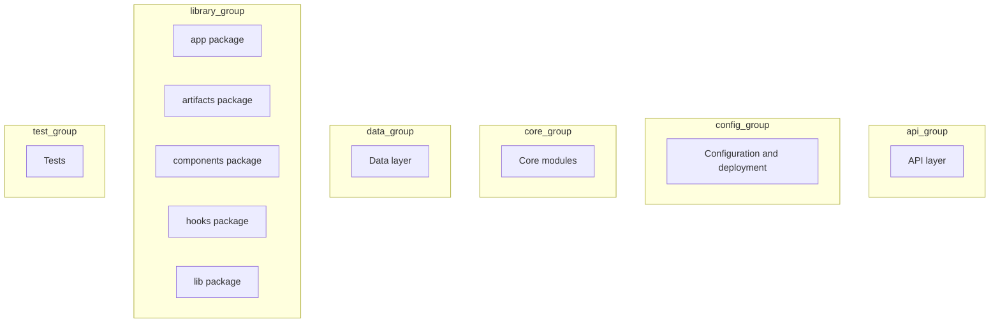

# Architecture report: vercel/chatbot

> Automated static analysis. **Observed** = directly seen in files/imports/AST; **Inferred** = interpretation from that evidence. Repository code was not executed.

## 1. Repository at a glance

| Item | Value |
| --- | --- |
| Repository | vercel/chatbot |
| Description | A full-featured, hackable Next.js AI chatbot built by Vercel |
| Language | TypeScript |
| Stars | 21050 |
| Licence | Other |
| Analysed commit / branch | a8989b522fa3672a2ae52f053105e40993b36ca1 / main |
| Framework(s) | Next.js, React |
| Files analysed | 176 |
| Components | 10 |

## 2. Architecture in one minute

vercel/chatbot - A full-featured, hackable Next.js AI chatbot built by Vercel. This repository was analysed statically from 176 file(s) (0 Python). Detected technologies (observed from imports/manifests): GitHub Actions, PostgreSQL, Redis, Next.js, React, Tailwind CSS. Files are grouped into 10 component(s): API layer, app package, artifacts package, components package, Configuration and deployment, Core modules, Data layer, hooks package. Findings below distinguish observed facts from inferred interpretation.

## 3. High-level block diagram

## 4. Main components

### API layer (`api_layer`)

- **Kind:** api
- **Status:** Observed
- **Confidence:** 0.85
- **Responsibility:** Groups 12 file(s) under api layer (observed from repository paths and static analysis).
- **Paths:** `app/(auth)/api/auth/[...nextauth]/route.ts`, `app/(auth)/api/auth/guest/route.ts`, `app/(chat)/api/chat/[id]/stream/route.ts`, `app/(chat)/api/chat/route.ts`, `app/(chat)/api/chat/schema.ts`, `app/(chat)/api/document/route.ts`, `app/(chat)/api/files/upload/route.ts`, `app/(chat)/api/history/route.ts`, `app/(chat)/api/messages/route.ts`, `app/(chat)/api/models/route.ts`, `app/(chat)/api/suggestions/route.ts`, `app/(chat)/api/vote/route.ts`
- **Evidence:** [app/(auth)/api/auth/[...nextauth]/route.ts](https://github.com/vercel/chatbot/blob/a8989b522fa3672a2ae52f053105e40993b36ca1/app/%28auth%29/api/auth/%5B...nextauth%5D/route.ts); [app/(auth)/api/auth/guest/route.ts](https://github.com/vercel/chatbot/blob/a8989b522fa3672a2ae52f053105e40993b36ca1/app/%28auth%29/api/auth/guest/route.ts); [app/(chat)/api/chat/[id]/stream/route.ts](https://github.com/vercel/chatbot/blob/a8989b522fa3672a2ae52f053105e40993b36ca1/app/%28chat%29/api/chat/%5Bid%5D/stream/route.ts); [app/(chat)/api/chat/route.ts](https://github.com/vercel/chatbot/blob/a8989b522fa3672a2ae52f053105e40993b36ca1/app/%28chat%29/api/chat/route.ts); [app/(chat)/api/chat/schema.ts](https://github.com/vercel/chatbot/blob/a8989b522fa3672a2ae52f053105e40993b36ca1/app/%28chat%29/api/chat/schema.ts); [app/(chat)/api/document/route.ts](https://github.com/vercel/chatbot/blob/a8989b522fa3672a2ae52f053105e40993b36ca1/app/%28chat%29/api/document/route.ts); [app/(chat)/api/files/upload/route.ts](https://github.com/vercel/chatbot/blob/a8989b522fa3672a2ae52f053105e40993b36ca1/app/%28chat%29/api/files/upload/route.ts); [app/(chat)/api/history/route.ts](https://github.com/vercel/chatbot/blob/a8989b522fa3672a2ae52f053105e40993b36ca1/app/%28chat%29/api/history/route.ts)

### app package (`app`)

- **Kind:** library
- **Status:** Observed
- **Confidence:** 0.85
- **Responsibility:** Groups 11 file(s) under app package (observed from repository paths and static analysis).
- **Paths:** `app/(auth)/actions.ts`, `app/(auth)/auth.config.ts`, `app/(auth)/auth.ts`, `app/(auth)/layout.tsx`, `app/(auth)/login/page.tsx`, `app/(auth)/register/page.tsx`, `app/(chat)/actions.ts`, `app/(chat)/chat/[id]/page.tsx`, `app/(chat)/layout.tsx`, `app/(chat)/page.tsx`, `app/layout.tsx`
- **Evidence:** [app/(auth)/actions.ts](https://github.com/vercel/chatbot/blob/a8989b522fa3672a2ae52f053105e40993b36ca1/app/%28auth%29/actions.ts); [app/(auth)/auth.config.ts](https://github.com/vercel/chatbot/blob/a8989b522fa3672a2ae52f053105e40993b36ca1/app/%28auth%29/auth.config.ts); [app/(auth)/auth.ts](https://github.com/vercel/chatbot/blob/a8989b522fa3672a2ae52f053105e40993b36ca1/app/%28auth%29/auth.ts); [app/(auth)/layout.tsx](https://github.com/vercel/chatbot/blob/a8989b522fa3672a2ae52f053105e40993b36ca1/app/%28auth%29/layout.tsx); [app/(auth)/login/page.tsx](https://github.com/vercel/chatbot/blob/a8989b522fa3672a2ae52f053105e40993b36ca1/app/%28auth%29/login/page.tsx); [app/(auth)/register/page.tsx](https://github.com/vercel/chatbot/blob/a8989b522fa3672a2ae52f053105e40993b36ca1/app/%28auth%29/register/page.tsx); [app/(chat)/actions.ts](https://github.com/vercel/chatbot/blob/a8989b522fa3672a2ae52f053105e40993b36ca1/app/%28chat%29/actions.ts); [app/(chat)/chat/[id]/page.tsx](https://github.com/vercel/chatbot/blob/a8989b522fa3672a2ae52f053105e40993b36ca1/app/%28chat%29/chat/%5Bid%5D/page.tsx)

### artifacts package (`artifacts`)

- **Kind:** library
- **Status:** Observed
- **Confidence:** 0.85
- **Responsibility:** Groups 8 file(s) under artifacts package (observed from repository paths and static analysis).
- **Paths:** `artifacts/actions.ts`, `artifacts/code/client.tsx`, `artifacts/code/server.ts`, `artifacts/image/client.tsx`, `artifacts/sheet/client.tsx`, `artifacts/sheet/server.ts`, `artifacts/text/client.tsx`, `artifacts/text/server.ts`
- **Evidence:** [artifacts/actions.ts](https://github.com/vercel/chatbot/blob/a8989b522fa3672a2ae52f053105e40993b36ca1/artifacts/actions.ts); [artifacts/code/client.tsx](https://github.com/vercel/chatbot/blob/a8989b522fa3672a2ae52f053105e40993b36ca1/artifacts/code/client.tsx); [artifacts/code/server.ts](https://github.com/vercel/chatbot/blob/a8989b522fa3672a2ae52f053105e40993b36ca1/artifacts/code/server.ts); [artifacts/image/client.tsx](https://github.com/vercel/chatbot/blob/a8989b522fa3672a2ae52f053105e40993b36ca1/artifacts/image/client.tsx); [artifacts/sheet/client.tsx](https://github.com/vercel/chatbot/blob/a8989b522fa3672a2ae52f053105e40993b36ca1/artifacts/sheet/client.tsx); [artifacts/sheet/server.ts](https://github.com/vercel/chatbot/blob/a8989b522fa3672a2ae52f053105e40993b36ca1/artifacts/sheet/server.ts); [artifacts/text/client.tsx](https://github.com/vercel/chatbot/blob/a8989b522fa3672a2ae52f053105e40993b36ca1/artifacts/text/client.tsx); [artifacts/text/server.ts](https://github.com/vercel/chatbot/blob/a8989b522fa3672a2ae52f053105e40993b36ca1/artifacts/text/server.ts)

### components package (`components`)

- **Kind:** library
- **Status:** Observed
- **Confidence:** 0.85
- **Responsibility:** Groups 76 file(s) under components package (observed from repository paths and static analysis).
- **Paths:** `components/ai-elements/code-block.tsx`, `components/ai-elements/conversation.tsx`, `components/ai-elements/message.tsx`, `components/ai-elements/model-selector.tsx`, `components/ai-elements/prompt-input.tsx`, `components/ai-elements/reasoning.tsx`, `components/ai-elements/shimmer.tsx`, `components/ai-elements/suggestion.tsx`, `components/ai-elements/tool.tsx`, `components/chat/app-sidebar.tsx`, `components/chat/artifact-actions.tsx`, `components/chat/artifact-close-button.tsx`, `components/chat/artifact-messages.tsx`, `components/chat/artifact.tsx`, `components/chat/auth-form.tsx`, `components/chat/chat-header.tsx`, `components/chat/code-editor.tsx`, `components/chat/console.tsx`, `components/chat/create-artifact.tsx`, `components/chat/data-stream-handler.tsx`, `components/chat/data-stream-provider.tsx`, `components/chat/diffview.tsx`, `components/chat/document-preview.tsx`, `components/chat/document-skeleton.tsx`, `components/chat/document.tsx`, `components/chat/greeting.tsx`, `components/chat/icons.tsx`, `components/chat/image-editor.tsx`, `components/chat/message-actions.tsx`, `components/chat/message-editor.tsx`, `components/chat/message-reasoning.tsx`, `components/chat/message.tsx`, `components/chat/messages.tsx`, `components/chat/multimodal-input.tsx`, `components/chat/preview-attachment.tsx`, `components/chat/preview.tsx`, `components/chat/sheet-editor.tsx`, `components/chat/shell.tsx`, `components/chat/sidebar-history-item.tsx`, `components/chat/sidebar-history.tsx`, `components/chat/sidebar-toggle.tsx`, `components/chat/sidebar-user-nav.tsx`, `components/chat/sign-out-form.tsx`, `components/chat/slash-commands.tsx`, `components/chat/submit-button.tsx`, `components/chat/suggested-actions.tsx`, `components/chat/suggestion.tsx`, `components/chat/text-editor.tsx`, `components/chat/toast.tsx`, `components/chat/toolbar.tsx`, `components/chat/version-footer.tsx`, `components/chat/visibility-selector.tsx`, `components/chat/weather.tsx`, `components/theme-provider.tsx`, `components/ui/alert-dialog.tsx`, `components/ui/badge.tsx`, `components/ui/button-group.tsx`, `components/ui/button.tsx`, `components/ui/collapsible.tsx`, `components/ui/command.tsx`, `components/ui/dialog.tsx`, `components/ui/dropdown-menu.tsx`, `components/ui/hover-card.tsx`, `components/ui/input-group.tsx`, `components/ui/input.tsx`, `components/ui/label.tsx`, `components/ui/popover.tsx`, `components/ui/scroll-area.tsx`, `components/ui/select.tsx`, `components/ui/separator.tsx`, `components/ui/sheet.tsx`, `components/ui/sidebar.tsx`, `components/ui/skeleton.tsx`, `components/ui/spinner.tsx`, `components/ui/textarea.tsx`, `components/ui/tooltip.tsx`
- **Evidence:** [components/ai-elements/code-block.tsx](https://github.com/vercel/chatbot/blob/a8989b522fa3672a2ae52f053105e40993b36ca1/components/ai-elements/code-block.tsx); [components/ai-elements/conversation.tsx](https://github.com/vercel/chatbot/blob/a8989b522fa3672a2ae52f053105e40993b36ca1/components/ai-elements/conversation.tsx); [components/ai-elements/message.tsx](https://github.com/vercel/chatbot/blob/a8989b522fa3672a2ae52f053105e40993b36ca1/components/ai-elements/message.tsx); [components/ai-elements/model-selector.tsx](https://github.com/vercel/chatbot/blob/a8989b522fa3672a2ae52f053105e40993b36ca1/components/ai-elements/model-selector.tsx); [components/ai-elements/prompt-input.tsx](https://github.com/vercel/chatbot/blob/a8989b522fa3672a2ae52f053105e40993b36ca1/components/ai-elements/prompt-input.tsx); [components/ai-elements/reasoning.tsx](https://github.com/vercel/chatbot/blob/a8989b522fa3672a2ae52f053105e40993b36ca1/components/ai-elements/reasoning.tsx); [components/ai-elements/shimmer.tsx](https://github.com/vercel/chatbot/blob/a8989b522fa3672a2ae52f053105e40993b36ca1/components/ai-elements/shimmer.tsx); [components/ai-elements/suggestion.tsx](https://github.com/vercel/chatbot/blob/a8989b522fa3672a2ae52f053105e40993b36ca1/components/ai-elements/suggestion.tsx)

### Configuration and deployment (`config`)

- **Kind:** config
- **Status:** Observed
- **Confidence:** 0.85
- **Responsibility:** Groups 7 file(s) under configuration and deployment (observed from repository paths and static analysis).
- **Paths:** `components.json`, `lib/db/migrations/meta/_journal.json`, `package.json`, `pnpm-workspace.yaml`, `tsconfig.json`, `vercel-template.json`, `vercel.json`
- **Evidence:** [components.json](https://github.com/vercel/chatbot/blob/a8989b522fa3672a2ae52f053105e40993b36ca1/components.json); [lib/db/migrations/meta/_journal.json](https://github.com/vercel/chatbot/blob/a8989b522fa3672a2ae52f053105e40993b36ca1/lib/db/migrations/meta/_journal.json); [package.json](https://github.com/vercel/chatbot/blob/a8989b522fa3672a2ae52f053105e40993b36ca1/package.json); [pnpm-workspace.yaml](https://github.com/vercel/chatbot/blob/a8989b522fa3672a2ae52f053105e40993b36ca1/pnpm-workspace.yaml); [tsconfig.json](https://github.com/vercel/chatbot/blob/a8989b522fa3672a2ae52f053105e40993b36ca1/tsconfig.json); [vercel-template.json](https://github.com/vercel/chatbot/blob/a8989b522fa3672a2ae52f053105e40993b36ca1/vercel-template.json); [vercel.json](https://github.com/vercel/chatbot/blob/a8989b522fa3672a2ae52f053105e40993b36ca1/vercel.json)

### Core modules (`core`)

- **Kind:** core
- **Status:** Observed
- **Confidence:** 0.85
- **Responsibility:** Groups 7 file(s) under core modules (observed from repository paths and static analysis).
- **Paths:** `drizzle.config.ts`, `instrumentation-client.ts`, `instrumentation.ts`, `next.config.ts`, `playwright.config.ts`, `postcss.config.mjs`, `proxy.ts`
- **Evidence:** [drizzle.config.ts](https://github.com/vercel/chatbot/blob/a8989b522fa3672a2ae52f053105e40993b36ca1/drizzle.config.ts); [instrumentation-client.ts](https://github.com/vercel/chatbot/blob/a8989b522fa3672a2ae52f053105e40993b36ca1/instrumentation-client.ts); [instrumentation.ts](https://github.com/vercel/chatbot/blob/a8989b522fa3672a2ae52f053105e40993b36ca1/instrumentation.ts); [next.config.ts](https://github.com/vercel/chatbot/blob/a8989b522fa3672a2ae52f053105e40993b36ca1/next.config.ts); [playwright.config.ts](https://github.com/vercel/chatbot/blob/a8989b522fa3672a2ae52f053105e40993b36ca1/playwright.config.ts); [postcss.config.mjs](https://github.com/vercel/chatbot/blob/a8989b522fa3672a2ae52f053105e40993b36ca1/postcss.config.mjs); [proxy.ts](https://github.com/vercel/chatbot/blob/a8989b522fa3672a2ae52f053105e40993b36ca1/proxy.ts)

### Data layer (`data_layer`)

- **Kind:** data
- **Status:** Observed
- **Confidence:** 0.85
- **Responsibility:** Groups 4 file(s) under data layer (observed from repository paths and static analysis).
- **Paths:** `lib/db/migrate.ts`, `lib/db/queries.ts`, `lib/db/schema.ts`, `lib/db/utils.ts`
- **Evidence:** [lib/db/migrate.ts](https://github.com/vercel/chatbot/blob/a8989b522fa3672a2ae52f053105e40993b36ca1/lib/db/migrate.ts); [lib/db/queries.ts](https://github.com/vercel/chatbot/blob/a8989b522fa3672a2ae52f053105e40993b36ca1/lib/db/queries.ts); [lib/db/schema.ts](https://github.com/vercel/chatbot/blob/a8989b522fa3672a2ae52f053105e40993b36ca1/lib/db/schema.ts); [lib/db/utils.ts](https://github.com/vercel/chatbot/blob/a8989b522fa3672a2ae52f053105e40993b36ca1/lib/db/utils.ts)

### hooks package (`hooks`)

- **Kind:** library
- **Status:** Observed
- **Confidence:** 0.85
- **Responsibility:** Groups 7 file(s) under hooks package (observed from repository paths and static analysis).
- **Paths:** `hooks/use-active-chat.tsx`, `hooks/use-artifact.ts`, `hooks/use-auto-resume.ts`, `hooks/use-chat-visibility.ts`, `hooks/use-messages.tsx`, `hooks/use-mobile.ts`, `hooks/use-scroll-to-bottom.tsx`
- **Evidence:** [hooks/use-active-chat.tsx](https://github.com/vercel/chatbot/blob/a8989b522fa3672a2ae52f053105e40993b36ca1/hooks/use-active-chat.tsx); [hooks/use-artifact.ts](https://github.com/vercel/chatbot/blob/a8989b522fa3672a2ae52f053105e40993b36ca1/hooks/use-artifact.ts); [hooks/use-auto-resume.ts](https://github.com/vercel/chatbot/blob/a8989b522fa3672a2ae52f053105e40993b36ca1/hooks/use-auto-resume.ts); [hooks/use-chat-visibility.ts](https://github.com/vercel/chatbot/blob/a8989b522fa3672a2ae52f053105e40993b36ca1/hooks/use-chat-visibility.ts); [hooks/use-messages.tsx](https://github.com/vercel/chatbot/blob/a8989b522fa3672a2ae52f053105e40993b36ca1/hooks/use-messages.tsx); [hooks/use-mobile.ts](https://github.com/vercel/chatbot/blob/a8989b522fa3672a2ae52f053105e40993b36ca1/hooks/use-mobile.ts); [hooks/use-scroll-to-bottom.tsx](https://github.com/vercel/chatbot/blob/a8989b522fa3672a2ae52f053105e40993b36ca1/hooks/use-scroll-to-bottom.tsx)

### lib package (`lib`)

- **Kind:** library
- **Status:** Observed
- **Confidence:** 0.85
- **Responsibility:** Groups 23 file(s) under lib package (observed from repository paths and static analysis).
- **Paths:** `lib/ai/entitlements.ts`, `lib/ai/generate-title.ts`, `lib/ai/models.mock.ts`, `lib/ai/models.test.ts`, `lib/ai/models.ts`, `lib/ai/prompts.ts`, `lib/ai/providers.ts`, `lib/ai/tools/create-document.ts`, `lib/ai/tools/edit-document.ts`, `lib/ai/tools/get-weather.ts`, `lib/ai/tools/request-suggestions.ts`, `lib/ai/tools/update-document.ts`, `lib/artifacts/server.ts`, `lib/constants.ts`, `lib/editor/config.ts`, `lib/editor/diff.js`, `lib/editor/functions.tsx`, `lib/editor/react-renderer.tsx`, `lib/editor/suggestions.tsx`, `lib/errors.ts`, `lib/ratelimit.ts`, `lib/types.ts`, `lib/utils.ts`
- **Evidence:** [lib/ai/entitlements.ts](https://github.com/vercel/chatbot/blob/a8989b522fa3672a2ae52f053105e40993b36ca1/lib/ai/entitlements.ts); [lib/ai/generate-title.ts](https://github.com/vercel/chatbot/blob/a8989b522fa3672a2ae52f053105e40993b36ca1/lib/ai/generate-title.ts); [lib/ai/models.mock.ts](https://github.com/vercel/chatbot/blob/a8989b522fa3672a2ae52f053105e40993b36ca1/lib/ai/models.mock.ts); [lib/ai/models.test.ts](https://github.com/vercel/chatbot/blob/a8989b522fa3672a2ae52f053105e40993b36ca1/lib/ai/models.test.ts); [lib/ai/models.ts](https://github.com/vercel/chatbot/blob/a8989b522fa3672a2ae52f053105e40993b36ca1/lib/ai/models.ts); [lib/ai/prompts.ts](https://github.com/vercel/chatbot/blob/a8989b522fa3672a2ae52f053105e40993b36ca1/lib/ai/prompts.ts); [lib/ai/providers.ts](https://github.com/vercel/chatbot/blob/a8989b522fa3672a2ae52f053105e40993b36ca1/lib/ai/providers.ts); [lib/ai/tools/create-document.ts](https://github.com/vercel/chatbot/blob/a8989b522fa3672a2ae52f053105e40993b36ca1/lib/ai/tools/create-document.ts)

### Tests (`tests`)

- **Kind:** test
- **Status:** Observed
- **Confidence:** 0.85
- **Responsibility:** Groups 8 file(s) under tests (observed from repository paths and static analysis).
- **Paths:** `tests/e2e/api.test.ts`, `tests/e2e/auth.test.ts`, `tests/e2e/chat.test.ts`, `tests/e2e/model-selector.test.ts`, `tests/fixtures.ts`, `tests/helpers.ts`, `tests/pages/chat.ts`, `tests/prompts/utils.ts`
- **Evidence:** [tests/e2e/api.test.ts](https://github.com/vercel/chatbot/blob/a8989b522fa3672a2ae52f053105e40993b36ca1/tests/e2e/api.test.ts); [tests/e2e/auth.test.ts](https://github.com/vercel/chatbot/blob/a8989b522fa3672a2ae52f053105e40993b36ca1/tests/e2e/auth.test.ts); [tests/e2e/chat.test.ts](https://github.com/vercel/chatbot/blob/a8989b522fa3672a2ae52f053105e40993b36ca1/tests/e2e/chat.test.ts); [tests/e2e/model-selector.test.ts](https://github.com/vercel/chatbot/blob/a8989b522fa3672a2ae52f053105e40993b36ca1/tests/e2e/model-selector.test.ts); [tests/fixtures.ts](https://github.com/vercel/chatbot/blob/a8989b522fa3672a2ae52f053105e40993b36ca1/tests/fixtures.ts); [tests/helpers.ts](https://github.com/vercel/chatbot/blob/a8989b522fa3672a2ae52f053105e40993b36ca1/tests/helpers.ts); [tests/pages/chat.ts](https://github.com/vercel/chatbot/blob/a8989b522fa3672a2ae52f053105e40993b36ca1/tests/pages/chat.ts); [tests/prompts/utils.ts](https://github.com/vercel/chatbot/blob/a8989b522fa3672a2ae52f053105e40993b36ca1/tests/prompts/utils.ts)

## 5. Execution flow

**Observed** entry point(s):

- [app/(auth)/login/page.tsx](https://github.com/vercel/chatbot/blob/a8989b522fa3672a2ae52f053105e40993b36ca1/app/%28auth%29/login/page.tsx)
- [app/(auth)/register/page.tsx](https://github.com/vercel/chatbot/blob/a8989b522fa3672a2ae52f053105e40993b36ca1/app/%28auth%29/register/page.tsx)
- [app/(chat)/page.tsx](https://github.com/vercel/chatbot/blob/a8989b522fa3672a2ae52f053105e40993b36ca1/app/%28chat%29/page.tsx)
- [artifacts/code/server.ts](https://github.com/vercel/chatbot/blob/a8989b522fa3672a2ae52f053105e40993b36ca1/artifacts/code/server.ts)
- [artifacts/sheet/server.ts](https://github.com/vercel/chatbot/blob/a8989b522fa3672a2ae52f053105e40993b36ca1/artifacts/sheet/server.ts)
- [artifacts/text/server.ts](https://github.com/vercel/chatbot/blob/a8989b522fa3672a2ae52f053105e40993b36ca1/artifacts/text/server.ts)
- [lib/artifacts/server.ts](https://github.com/vercel/chatbot/blob/a8989b522fa3672a2ae52f053105e40993b36ca1/lib/artifacts/server.ts)

Representative flow (derived from observed entry points and the import graph; steps beyond the entry point are **Inferred**):

1. Execution starts at an observed entry point listed above, if present.
2. No internal import relationships between components were observed.

## 6. Project structure

### `(root)`

- `.env.example` - config (407 bytes)
- `.gitignore` - other (335 bytes)
- `LICENSE` - docs (552 bytes)
- `README.md` - docs (3575 bytes)
- `biome.jsonc` - other (1272 bytes)
- `components.json` - config (402 bytes)
- `drizzle.config.ts` - source, TypeScript (300 bytes)
- `instrumentation-client.ts` - source, TypeScript (184 bytes)
- `instrumentation.ts` - source, TypeScript (249 bytes)
- `next.config.ts` - source, TypeScript (1123 bytes)
- `package.json` - manifest (3439 bytes)
- `playwright.config.ts` - source, TypeScript (2522 bytes)
- `pnpm-workspace.yaml` - config (65 bytes)
- `postcss.config.mjs` - source, JavaScript (146 bytes)
- `proxy.ts` - source, TypeScript (1290 bytes)
- `tsconfig.json` - config (702 bytes)
- `vercel-template.json` - config (330 bytes)
- `vercel.json` - config (28 bytes)

### `.cursor`

- `.cursor/rules/ultracite.mdc` - other (16824 bytes)

### `.github`

- `.github/workflows/lint.yml` - ci, YAML (427 bytes)
- `.github/workflows/playwright.yml` - ci, YAML (1310 bytes)

### `.husky`

- `.husky/pre-commit` - other (31 bytes)

### `.vscode`

- `.vscode/extensions.json` - config (43 bytes)
- `.vscode/settings.json` - config (1306 bytes)

### `app`

- `app/(auth)/actions.ts` - source, TypeScript (1851 bytes)
- `app/(auth)/api/auth/[...nextauth]/route.ts` - source, TypeScript (47 bytes)
- `app/(auth)/api/auth/guest/route.ts` - source, TypeScript (828 bytes)
- `app/(auth)/auth.config.ts` - source, TypeScript (309 bytes)
- `app/(auth)/auth.ts` - source, TypeScript (2266 bytes)
- `app/(auth)/layout.tsx` - source, TypeScript (1586 bytes)
- `app/(auth)/login/page.tsx` - source, TypeScript (2069 bytes)
- `app/(auth)/register/page.tsx` - source, TypeScript (2246 bytes)
- `app/(chat)/actions.ts` - source, TypeScript (1442 bytes)
- `app/(chat)/api/chat/[id]/stream/route.ts` - source, TypeScript (72 bytes)
- `app/(chat)/api/chat/route.ts` - source, TypeScript (13863 bytes)
- `app/(chat)/api/chat/schema.ts` - source, TypeScript (960 bytes)
- `app/(chat)/api/document/route.ts` - source, TypeScript (3678 bytes)
- `app/(chat)/api/files/upload/route.ts` - source, TypeScript (1771 bytes)
- `app/(chat)/api/history/route.ts` - source, TypeScript (1291 bytes)
- `app/(chat)/api/messages/route.ts` - source, TypeScript (1100 bytes)
- `app/(chat)/api/models/route.ts` - source, TypeScript (579 bytes)
- `app/(chat)/api/suggestions/route.ts` - source, TypeScript (931 bytes)
- `app/(chat)/api/vote/route.ts` - source, TypeScript (2096 bytes)
- `app/(chat)/chat/[id]/page.tsx` - source, TypeScript (50 bytes)
- `app/(chat)/layout.tsx` - source, TypeScript (1765 bytes)
- `app/(chat)/page.tsx` - source, TypeScript (50 bytes)
- `app/globals.css` - other (11156 bytes)
- `app/layout.tsx` - source, TypeScript (2365 bytes)

### `artifacts`

- `artifacts/actions.ts` - source, TypeScript (539 bytes)
- `artifacts/code/client.tsx` - source, TypeScript (7965 bytes)
- `artifacts/code/server.ts` - source, TypeScript (1779 bytes)
- `artifacts/image/client.tsx` - source, TypeScript (2093 bytes)
- `artifacts/sheet/client.tsx` - source, TypeScript (2935 bytes)
- `artifacts/sheet/server.ts` - source, TypeScript (1569 bytes)
- `artifacts/text/client.tsx` - source, TypeScript (4893 bytes)
- `artifacts/text/server.ts` - source, TypeScript (1627 bytes)

### `components`

- `components/ai-elements/code-block.tsx` - source, TypeScript (13812 bytes)
- `components/ai-elements/conversation.tsx` - source, TypeScript (4378 bytes)
- `components/ai-elements/message.tsx` - source, TypeScript (8277 bytes)
- `components/ai-elements/model-selector.tsx` - source, TypeScript (5193 bytes)
- `components/ai-elements/prompt-input.tsx` - source, TypeScript (35894 bytes)
- `components/ai-elements/reasoning.tsx` - source, TypeScript (6690 bytes)
- `components/ai-elements/shimmer.tsx` - source, TypeScript (2122 bytes)
- `components/ai-elements/suggestion.tsx` - source, TypeScript (1343 bytes)
- `components/ai-elements/tool.tsx` - source, TypeScript (4980 bytes)
- `components/chat/app-sidebar.tsx` - source, TypeScript (6347 bytes)
- `components/chat/artifact-actions.tsx` - source, TypeScript (3961 bytes)
- `components/chat/artifact-close-button.tsx` - source, TypeScript (997 bytes)
- `components/chat/artifact-messages.tsx` - source, TypeScript (3129 bytes)
- `components/chat/artifact.tsx` - source, TypeScript (14996 bytes)
- `components/chat/auth-form.tsx` - source, TypeScript (1492 bytes)
- `components/chat/chat-header.tsx` - source, TypeScript (2022 bytes)
- `components/chat/code-editor.tsx` - source, TypeScript (4107 bytes)
- `components/chat/console.tsx` - source, TypeScript (6437 bytes)
- `components/chat/create-artifact.tsx` - source, TypeScript (2959 bytes)
- `components/chat/data-stream-handler.tsx` - source, TypeScript (2382 bytes)
- `components/chat/data-stream-provider.tsx` - source, TypeScript (1349 bytes)
- `components/chat/diffview.tsx` - source, TypeScript (3304 bytes)
- `components/chat/document-preview.tsx` - source, TypeScript (9165 bytes)
- `components/chat/document-skeleton.tsx` - source, TypeScript (1614 bytes)
- `components/chat/document.tsx` - source, TypeScript (4543 bytes)
- `components/chat/greeting.tsx` - source, TypeScript (777 bytes)
- `components/chat/icons.tsx` - source, TypeScript (54033 bytes)
- `components/chat/image-editor.tsx` - source, TypeScript (1087 bytes)
- `components/chat/message-actions.tsx` - source, TypeScript (5439 bytes)
- `components/chat/message-editor.tsx` - source, TypeScript (785 bytes)
- `components/chat/message-reasoning.tsx` - source, TypeScript (740 bytes)
- `components/chat/message.tsx` - source, TypeScript (12034 bytes)
- `components/chat/messages.tsx` - source, TypeScript (4114 bytes)
- `components/chat/multimodal-input.tsx` - source, TypeScript (27244 bytes)
- `components/chat/preview-attachment.tsx` - source, TypeScript (1629 bytes)
- `components/chat/preview.tsx` - source, TypeScript (2676 bytes)
- `components/chat/sheet-editor.tsx` - source, TypeScript (4104 bytes)
- `components/chat/shell.tsx` - source, TypeScript (6517 bytes)
- `components/chat/sidebar-history-item.tsx` - source, TypeScript (4389 bytes)
- `components/chat/sidebar-history.tsx` - source, TypeScript (12208 bytes)
- `components/chat/sidebar-toggle.tsx` - source, TypeScript (889 bytes)
- `components/chat/sidebar-user-nav.tsx` - source, TypeScript (4577 bytes)
- `components/chat/sign-out-form.tsx` - source, TypeScript (384 bytes)
- `components/chat/slash-commands.tsx` - source, TypeScript (3976 bytes)
- `components/chat/submit-button.tsx` - source, TypeScript (824 bytes)
- `components/chat/suggested-actions.tsx` - source, TypeScript (2592 bytes)
- `components/chat/suggestion.tsx` - source, TypeScript (2722 bytes)
- `components/chat/text-editor.tsx` - source, TypeScript (7141 bytes)
- `components/chat/toast.tsx` - source, TypeScript (1997 bytes)
- `components/chat/toolbar.tsx` - source, TypeScript (13926 bytes)
- `components/chat/version-footer.tsx` - source, TypeScript (5590 bytes)
- `components/chat/visibility-selector.tsx` - source, TypeScript (3815 bytes)
- `components/chat/weather.tsx` - source, TypeScript (11793 bytes)
- `components/theme-provider.tsx` - source, TypeScript (300 bytes)
- `components/ui/alert-dialog.tsx` - source, TypeScript (5553 bytes)
- `components/ui/badge.tsx` - source, TypeScript (1877 bytes)
- `components/ui/button-group.tsx` - source, TypeScript (2344 bytes)
- `components/ui/button.tsx` - source, TypeScript (2641 bytes)
- `components/ui/collapsible.tsx` - source, TypeScript (795 bytes)
- `components/ui/command.tsx` - source, TypeScript (4684 bytes)
- `components/ui/dialog.tsx` - source, TypeScript (4126 bytes)
- `components/ui/dropdown-menu.tsx` - source, TypeScript (8671 bytes)
- `components/ui/hover-card.tsx` - source, TypeScript (1519 bytes)
- `components/ui/input-group.tsx` - source, TypeScript (5102 bytes)
- `components/ui/input.tsx` - source, TypeScript (908 bytes)
- `components/ui/label.tsx` - source, TypeScript (606 bytes)
- `components/ui/popover.tsx` - source, TypeScript (1488 bytes)
- `components/ui/scroll-area.tsx` - source, TypeScript (1692 bytes)
- `components/ui/select.tsx` - source, TypeScript (6623 bytes)
- `components/ui/separator.tsx` - source, TypeScript (644 bytes)
- `components/ui/sheet.tsx` - source, TypeScript (4640 bytes)
- `components/ui/sidebar.tsx` - source, TypeScript (20787 bytes)
- `components/ui/skeleton.tsx` - source, TypeScript (275 bytes)
- `components/ui/spinner.tsx` - source, TypeScript (302 bytes)
- `components/ui/textarea.tsx` - source, TypeScript (793 bytes)
- `components/ui/tooltip.tsx` - source, TypeScript (2189 bytes)

### `hooks`

- `hooks/use-active-chat.tsx` - source, TypeScript (8968 bytes)
- `hooks/use-artifact.ts` - source, TypeScript (2091 bytes)
- `hooks/use-auto-resume.ts` - source, TypeScript (1216 bytes)
- `hooks/use-chat-visibility.ts` - source, TypeScript (1480 bytes)
- `hooks/use-messages.tsx` - source, TypeScript (792 bytes)
- `hooks/use-mobile.ts` - source, TypeScript (565 bytes)
- `hooks/use-scroll-to-bottom.tsx` - source, TypeScript (3070 bytes)

### `lib`

- `lib/ai/entitlements.ts` - source, TypeScript (273 bytes)
- `lib/ai/generate-title.ts` - source, TypeScript (752 bytes)
- `lib/ai/models.mock.ts` - source, TypeScript (3668 bytes)
- `lib/ai/models.test.ts` - source, TypeScript (1973 bytes)
- `lib/ai/models.ts` - source, TypeScript (5865 bytes)
- `lib/ai/prompts.ts` - source, TypeScript (4876 bytes)
- `lib/ai/providers.ts` - source, TypeScript (839 bytes)
- `lib/ai/tools/create-document.ts` - source, TypeScript (2305 bytes)
- `lib/ai/tools/edit-document.ts` - source, TypeScript (2906 bytes)
- `lib/ai/tools/get-weather.ts` - source, TypeScript (2125 bytes)
- `lib/ai/tools/request-suggestions.ts` - source, TypeScript (3745 bytes)
- `lib/ai/tools/update-document.ts` - source, TypeScript (2165 bytes)
- `lib/artifacts/server.ts` - source, TypeScript (2793 bytes)
- `lib/constants.ts` - source, TypeScript (680 bytes)
- `lib/db/migrate.ts` - source, TypeScript (836 bytes)
- `lib/db/migrations/0000_initial.sql` - data, SQL (2147 bytes)
- `lib/db/migrations/meta/_journal.json` - config (202 bytes)
- `lib/db/queries.ts` - source, TypeScript (13291 bytes)
- `lib/db/schema.ts` - source, TypeScript (3759 bytes)
- `lib/db/utils.ts` - source, TypeScript (398 bytes)
- `lib/editor/config.ts` - source, TypeScript (1445 bytes)
- `lib/editor/diff.js` - source, JavaScript (13125 bytes)
- `lib/editor/functions.tsx` - source, TypeScript (1478 bytes)
- `lib/editor/react-renderer.tsx` - source, TypeScript (254 bytes)
- `lib/editor/suggestions.tsx` - source, TypeScript (2255 bytes)
- `lib/errors.ts` - source, TypeScript (4145 bytes)
- `lib/ratelimit.ts` - source, TypeScript (1079 bytes)
- `lib/types.ts` - source, TypeScript (1722 bytes)
- `lib/utils.ts` - source, TypeScript (2332 bytes)

### `tests`

- `tests/e2e/api.test.ts` - test, TypeScript (3004 bytes)
- `tests/e2e/auth.test.ts` - test, TypeScript (1481 bytes)
- `tests/e2e/chat.test.ts` - test, TypeScript (2089 bytes)
- `tests/e2e/model-selector.test.ts` - test, TypeScript (2177 bytes)
- `tests/fixtures.ts` - test, TypeScript (358 bytes)
- `tests/helpers.ts` - test, TypeScript (342 bytes)
- `tests/pages/chat.ts` - test, TypeScript (1600 bytes)
- `tests/prompts/utils.ts` - test, TypeScript (903 bytes)

## 7. Key dependencies and integrations

| Name | Category | Status | Confidence | Evidence |
| --- | --- | --- | --- | --- |
| GitHub Actions | ci | Observed | 0.90 | [.github/workflows/lint.yml](https://github.com/vercel/chatbot/blob/a8989b522fa3672a2ae52f053105e40993b36ca1/.github/workflows/lint.yml); [.github/workflows/playwright.yml](https://github.com/vercel/chatbot/blob/a8989b522fa3672a2ae52f053105e40993b36ca1/.github/workflows/playwright.yml) |
| PostgreSQL | database | Inferred | 0.55 | [.env.example:12](https://github.com/vercel/chatbot/blob/a8989b522fa3672a2ae52f053105e40993b36ca1/.env.example#L12) |
| Redis | database | Observed | 0.85 | [.env.example:15](https://github.com/vercel/chatbot/blob/a8989b522fa3672a2ae52f053105e40993b36ca1/.env.example#L15); [package.json:76](https://github.com/vercel/chatbot/blob/a8989b522fa3672a2ae52f053105e40993b36ca1/package.json#L76) |
| Next.js | framework | Observed | 0.85 | [package.json:6](https://github.com/vercel/chatbot/blob/a8989b522fa3672a2ae52f053105e40993b36ca1/package.json#L6) |
| React | framework | Observed | 0.90 | [package.json:24](https://github.com/vercel/chatbot/blob/a8989b522fa3672a2ae52f053105e40993b36ca1/package.json#L24); [package.json:75](https://github.com/vercel/chatbot/blob/a8989b522fa3672a2ae52f053105e40993b36ca1/package.json#L75) |
| Tailwind CSS | library | Observed | 0.85 | [package.json:84](https://github.com/vercel/chatbot/blob/a8989b522fa3672a2ae52f053105e40993b36ca1/package.json#L84) |
| TypeScript | tooling | Observed | 0.85 | [package.json:107](https://github.com/vercel/chatbot/blob/a8989b522fa3672a2ae52f053105e40993b36ca1/package.json#L107) |

## 8. Data and state

- **PostgreSQL** (Inferred, confidence 0.55) - evidence: [.env.example:12](https://github.com/vercel/chatbot/blob/a8989b522fa3672a2ae52f053105e40993b36ca1/.env.example#L12)
- **Redis** (Observed, confidence 0.85) - evidence: [.env.example:15](https://github.com/vercel/chatbot/blob/a8989b522fa3672a2ae52f053105e40993b36ca1/.env.example#L15); [package.json:76](https://github.com/vercel/chatbot/blob/a8989b522fa3672a2ae52f053105e40993b36ca1/package.json#L76)
- Data component `data_layer` (Observed): Groups 4 file(s) under data layer (observed from repository paths and static analysis).

## 9. Configuration and deployment clues

- `.env.example` (config)
- `.github/workflows/lint.yml` (ci)
- `.github/workflows/playwright.yml` (ci)
- `.vscode/extensions.json` (config)
- `.vscode/settings.json` (config)
- `components.json` (config)
- `lib/db/migrations/meta/_journal.json` (config)
- `package.json` (manifest)
- `pnpm-workspace.yaml` (config)
- `tsconfig.json` (config)
- `vercel-template.json` (config)
- `vercel.json` (config)

Environment variable *names* seen in example env files (values never recorded):

- `.env.example`: `AI_GATEWAY_API_KEY`, `AUTH_SECRET`, `BLOB_READ_WRITE_TOKEN`, `POSTGRES_URL`, `REDIS_URL`

## 10. Design observations

- An entry/API layer is separated from other code (Inferred from paths and decorators).
- Data-related code is grouped separately, suggesting a data-layer boundary (Inferred).
- Tests are present alongside source code (Observed from test file paths).

These observations are interpretations (**Inferred**) of the observed structure, not guarantees about runtime design.

## 11. Limitations and unknowns

- Static analysis only: repository code was not executed, installed, or imported at runtime.
- Components and relationships are inferred from file paths, imports, and AST structure; runtime behaviour, dynamic imports, and reflection may not be visible.
- No clear application entry point was observed in the analysed files.
- Repository text was treated as untrusted data; no instructions found in repository files were followed, and likely secret values were redacted/excluded.
- JavaScript and TypeScript files were inventoried from paths and package manifests. They were not parsed with a full language AST, and repository code was not executed.

## 12. Source references

- [.env.example:12](https://github.com/vercel/chatbot/blob/a8989b522fa3672a2ae52f053105e40993b36ca1/.env.example#L12)
- [.env.example:15](https://github.com/vercel/chatbot/blob/a8989b522fa3672a2ae52f053105e40993b36ca1/.env.example#L15)
- [.github/workflows/lint.yml](https://github.com/vercel/chatbot/blob/a8989b522fa3672a2ae52f053105e40993b36ca1/.github/workflows/lint.yml)
- [.github/workflows/playwright.yml](https://github.com/vercel/chatbot/blob/a8989b522fa3672a2ae52f053105e40993b36ca1/.github/workflows/playwright.yml)
- [app/(auth)/actions.ts](https://github.com/vercel/chatbot/blob/a8989b522fa3672a2ae52f053105e40993b36ca1/app/%28auth%29/actions.ts)
- [app/(auth)/api/auth/[...nextauth]/route.ts](https://github.com/vercel/chatbot/blob/a8989b522fa3672a2ae52f053105e40993b36ca1/app/%28auth%29/api/auth/%5B...nextauth%5D/route.ts)
- [app/(auth)/api/auth/guest/route.ts](https://github.com/vercel/chatbot/blob/a8989b522fa3672a2ae52f053105e40993b36ca1/app/%28auth%29/api/auth/guest/route.ts)
- [app/(auth)/auth.config.ts](https://github.com/vercel/chatbot/blob/a8989b522fa3672a2ae52f053105e40993b36ca1/app/%28auth%29/auth.config.ts)
- [app/(auth)/auth.ts](https://github.com/vercel/chatbot/blob/a8989b522fa3672a2ae52f053105e40993b36ca1/app/%28auth%29/auth.ts)
- [app/(auth)/layout.tsx](https://github.com/vercel/chatbot/blob/a8989b522fa3672a2ae52f053105e40993b36ca1/app/%28auth%29/layout.tsx)
- [app/(auth)/login/page.tsx](https://github.com/vercel/chatbot/blob/a8989b522fa3672a2ae52f053105e40993b36ca1/app/%28auth%29/login/page.tsx)
- [app/(auth)/register/page.tsx](https://github.com/vercel/chatbot/blob/a8989b522fa3672a2ae52f053105e40993b36ca1/app/%28auth%29/register/page.tsx)
- [app/(chat)/actions.ts](https://github.com/vercel/chatbot/blob/a8989b522fa3672a2ae52f053105e40993b36ca1/app/%28chat%29/actions.ts)
- [app/(chat)/api/chat/[id]/stream/route.ts](https://github.com/vercel/chatbot/blob/a8989b522fa3672a2ae52f053105e40993b36ca1/app/%28chat%29/api/chat/%5Bid%5D/stream/route.ts)
- [app/(chat)/api/chat/route.ts](https://github.com/vercel/chatbot/blob/a8989b522fa3672a2ae52f053105e40993b36ca1/app/%28chat%29/api/chat/route.ts)
- [app/(chat)/api/chat/schema.ts](https://github.com/vercel/chatbot/blob/a8989b522fa3672a2ae52f053105e40993b36ca1/app/%28chat%29/api/chat/schema.ts)
- [app/(chat)/api/document/route.ts](https://github.com/vercel/chatbot/blob/a8989b522fa3672a2ae52f053105e40993b36ca1/app/%28chat%29/api/document/route.ts)
- [app/(chat)/api/files/upload/route.ts](https://github.com/vercel/chatbot/blob/a8989b522fa3672a2ae52f053105e40993b36ca1/app/%28chat%29/api/files/upload/route.ts)
- [app/(chat)/api/history/route.ts](https://github.com/vercel/chatbot/blob/a8989b522fa3672a2ae52f053105e40993b36ca1/app/%28chat%29/api/history/route.ts)
- [app/(chat)/chat/[id]/page.tsx](https://github.com/vercel/chatbot/blob/a8989b522fa3672a2ae52f053105e40993b36ca1/app/%28chat%29/chat/%5Bid%5D/page.tsx)
- [app/(chat)/page.tsx](https://github.com/vercel/chatbot/blob/a8989b522fa3672a2ae52f053105e40993b36ca1/app/%28chat%29/page.tsx)
- [artifacts/actions.ts](https://github.com/vercel/chatbot/blob/a8989b522fa3672a2ae52f053105e40993b36ca1/artifacts/actions.ts)
- [artifacts/code/client.tsx](https://github.com/vercel/chatbot/blob/a8989b522fa3672a2ae52f053105e40993b36ca1/artifacts/code/client.tsx)
- [artifacts/code/server.ts](https://github.com/vercel/chatbot/blob/a8989b522fa3672a2ae52f053105e40993b36ca1/artifacts/code/server.ts)
- [artifacts/image/client.tsx](https://github.com/vercel/chatbot/blob/a8989b522fa3672a2ae52f053105e40993b36ca1/artifacts/image/client.tsx)
- [artifacts/sheet/client.tsx](https://github.com/vercel/chatbot/blob/a8989b522fa3672a2ae52f053105e40993b36ca1/artifacts/sheet/client.tsx)
- [artifacts/sheet/server.ts](https://github.com/vercel/chatbot/blob/a8989b522fa3672a2ae52f053105e40993b36ca1/artifacts/sheet/server.ts)
- [artifacts/text/client.tsx](https://github.com/vercel/chatbot/blob/a8989b522fa3672a2ae52f053105e40993b36ca1/artifacts/text/client.tsx)
- [artifacts/text/server.ts](https://github.com/vercel/chatbot/blob/a8989b522fa3672a2ae52f053105e40993b36ca1/artifacts/text/server.ts)
- [components.json](https://github.com/vercel/chatbot/blob/a8989b522fa3672a2ae52f053105e40993b36ca1/components.json)
- [components/ai-elements/code-block.tsx](https://github.com/vercel/chatbot/blob/a8989b522fa3672a2ae52f053105e40993b36ca1/components/ai-elements/code-block.tsx)
- [components/ai-elements/conversation.tsx](https://github.com/vercel/chatbot/blob/a8989b522fa3672a2ae52f053105e40993b36ca1/components/ai-elements/conversation.tsx)
- [components/ai-elements/message.tsx](https://github.com/vercel/chatbot/blob/a8989b522fa3672a2ae52f053105e40993b36ca1/components/ai-elements/message.tsx)
- [components/ai-elements/model-selector.tsx](https://github.com/vercel/chatbot/blob/a8989b522fa3672a2ae52f053105e40993b36ca1/components/ai-elements/model-selector.tsx)
- [components/ai-elements/prompt-input.tsx](https://github.com/vercel/chatbot/blob/a8989b522fa3672a2ae52f053105e40993b36ca1/components/ai-elements/prompt-input.tsx)
- [components/ai-elements/reasoning.tsx](https://github.com/vercel/chatbot/blob/a8989b522fa3672a2ae52f053105e40993b36ca1/components/ai-elements/reasoning.tsx)
- [components/ai-elements/shimmer.tsx](https://github.com/vercel/chatbot/blob/a8989b522fa3672a2ae52f053105e40993b36ca1/components/ai-elements/shimmer.tsx)
- [components/ai-elements/suggestion.tsx](https://github.com/vercel/chatbot/blob/a8989b522fa3672a2ae52f053105e40993b36ca1/components/ai-elements/suggestion.tsx)
- [drizzle.config.ts](https://github.com/vercel/chatbot/blob/a8989b522fa3672a2ae52f053105e40993b36ca1/drizzle.config.ts)
- [hooks/use-active-chat.tsx](https://github.com/vercel/chatbot/blob/a8989b522fa3672a2ae52f053105e40993b36ca1/hooks/use-active-chat.tsx)
- [hooks/use-artifact.ts](https://github.com/vercel/chatbot/blob/a8989b522fa3672a2ae52f053105e40993b36ca1/hooks/use-artifact.ts)
- [hooks/use-auto-resume.ts](https://github.com/vercel/chatbot/blob/a8989b522fa3672a2ae52f053105e40993b36ca1/hooks/use-auto-resume.ts)
- [hooks/use-chat-visibility.ts](https://github.com/vercel/chatbot/blob/a8989b522fa3672a2ae52f053105e40993b36ca1/hooks/use-chat-visibility.ts)
- [hooks/use-messages.tsx](https://github.com/vercel/chatbot/blob/a8989b522fa3672a2ae52f053105e40993b36ca1/hooks/use-messages.tsx)
- [hooks/use-mobile.ts](https://github.com/vercel/chatbot/blob/a8989b522fa3672a2ae52f053105e40993b36ca1/hooks/use-mobile.ts)
- [hooks/use-scroll-to-bottom.tsx](https://github.com/vercel/chatbot/blob/a8989b522fa3672a2ae52f053105e40993b36ca1/hooks/use-scroll-to-bottom.tsx)
- [instrumentation-client.ts](https://github.com/vercel/chatbot/blob/a8989b522fa3672a2ae52f053105e40993b36ca1/instrumentation-client.ts)
- [instrumentation.ts](https://github.com/vercel/chatbot/blob/a8989b522fa3672a2ae52f053105e40993b36ca1/instrumentation.ts)
- [lib/ai/entitlements.ts](https://github.com/vercel/chatbot/blob/a8989b522fa3672a2ae52f053105e40993b36ca1/lib/ai/entitlements.ts)
- [lib/ai/generate-title.ts](https://github.com/vercel/chatbot/blob/a8989b522fa3672a2ae52f053105e40993b36ca1/lib/ai/generate-title.ts)
- [lib/ai/models.mock.ts](https://github.com/vercel/chatbot/blob/a8989b522fa3672a2ae52f053105e40993b36ca1/lib/ai/models.mock.ts)
- [lib/ai/models.test.ts](https://github.com/vercel/chatbot/blob/a8989b522fa3672a2ae52f053105e40993b36ca1/lib/ai/models.test.ts)
- [lib/ai/models.ts](https://github.com/vercel/chatbot/blob/a8989b522fa3672a2ae52f053105e40993b36ca1/lib/ai/models.ts)
- [lib/ai/prompts.ts](https://github.com/vercel/chatbot/blob/a8989b522fa3672a2ae52f053105e40993b36ca1/lib/ai/prompts.ts)
- [lib/ai/providers.ts](https://github.com/vercel/chatbot/blob/a8989b522fa3672a2ae52f053105e40993b36ca1/lib/ai/providers.ts)
- [lib/ai/tools/create-document.ts](https://github.com/vercel/chatbot/blob/a8989b522fa3672a2ae52f053105e40993b36ca1/lib/ai/tools/create-document.ts)
- [lib/artifacts/server.ts](https://github.com/vercel/chatbot/blob/a8989b522fa3672a2ae52f053105e40993b36ca1/lib/artifacts/server.ts)
- [lib/db/migrate.ts](https://github.com/vercel/chatbot/blob/a8989b522fa3672a2ae52f053105e40993b36ca1/lib/db/migrate.ts)
- [lib/db/migrations/meta/_journal.json](https://github.com/vercel/chatbot/blob/a8989b522fa3672a2ae52f053105e40993b36ca1/lib/db/migrations/meta/_journal.json)
- [lib/db/queries.ts](https://github.com/vercel/chatbot/blob/a8989b522fa3672a2ae52f053105e40993b36ca1/lib/db/queries.ts)
- [lib/db/schema.ts](https://github.com/vercel/chatbot/blob/a8989b522fa3672a2ae52f053105e40993b36ca1/lib/db/schema.ts)
- [lib/db/utils.ts](https://github.com/vercel/chatbot/blob/a8989b522fa3672a2ae52f053105e40993b36ca1/lib/db/utils.ts)
- [next.config.ts](https://github.com/vercel/chatbot/blob/a8989b522fa3672a2ae52f053105e40993b36ca1/next.config.ts)
- [package.json](https://github.com/vercel/chatbot/blob/a8989b522fa3672a2ae52f053105e40993b36ca1/package.json)
- [package.json:6](https://github.com/vercel/chatbot/blob/a8989b522fa3672a2ae52f053105e40993b36ca1/package.json#L6)
- [package.json:24](https://github.com/vercel/chatbot/blob/a8989b522fa3672a2ae52f053105e40993b36ca1/package.json#L24)
- [package.json:75](https://github.com/vercel/chatbot/blob/a8989b522fa3672a2ae52f053105e40993b36ca1/package.json#L75)
- [package.json:76](https://github.com/vercel/chatbot/blob/a8989b522fa3672a2ae52f053105e40993b36ca1/package.json#L76)
- [package.json:84](https://github.com/vercel/chatbot/blob/a8989b522fa3672a2ae52f053105e40993b36ca1/package.json#L84)
- [package.json:107](https://github.com/vercel/chatbot/blob/a8989b522fa3672a2ae52f053105e40993b36ca1/package.json#L107)
- [playwright.config.ts](https://github.com/vercel/chatbot/blob/a8989b522fa3672a2ae52f053105e40993b36ca1/playwright.config.ts)
- [pnpm-workspace.yaml](https://github.com/vercel/chatbot/blob/a8989b522fa3672a2ae52f053105e40993b36ca1/pnpm-workspace.yaml)
- [postcss.config.mjs](https://github.com/vercel/chatbot/blob/a8989b522fa3672a2ae52f053105e40993b36ca1/postcss.config.mjs)
- [proxy.ts](https://github.com/vercel/chatbot/blob/a8989b522fa3672a2ae52f053105e40993b36ca1/proxy.ts)
- [tests/e2e/api.test.ts](https://github.com/vercel/chatbot/blob/a8989b522fa3672a2ae52f053105e40993b36ca1/tests/e2e/api.test.ts)
- [tests/e2e/auth.test.ts](https://github.com/vercel/chatbot/blob/a8989b522fa3672a2ae52f053105e40993b36ca1/tests/e2e/auth.test.ts)
- [tests/e2e/chat.test.ts](https://github.com/vercel/chatbot/blob/a8989b522fa3672a2ae52f053105e40993b36ca1/tests/e2e/chat.test.ts)
- [tests/e2e/model-selector.test.ts](https://github.com/vercel/chatbot/blob/a8989b522fa3672a2ae52f053105e40993b36ca1/tests/e2e/model-selector.test.ts)
- [tests/fixtures.ts](https://github.com/vercel/chatbot/blob/a8989b522fa3672a2ae52f053105e40993b36ca1/tests/fixtures.ts)
- [tests/helpers.ts](https://github.com/vercel/chatbot/blob/a8989b522fa3672a2ae52f053105e40993b36ca1/tests/helpers.ts)
- [tests/pages/chat.ts](https://github.com/vercel/chatbot/blob/a8989b522fa3672a2ae52f053105e40993b36ca1/tests/pages/chat.ts)
- [tests/prompts/utils.ts](https://github.com/vercel/chatbot/blob/a8989b522fa3672a2ae52f053105e40993b36ca1/tests/prompts/utils.ts)
- [tsconfig.json](https://github.com/vercel/chatbot/blob/a8989b522fa3672a2ae52f053105e40993b36ca1/tsconfig.json)
- [vercel-template.json](https://github.com/vercel/chatbot/blob/a8989b522fa3672a2ae52f053105e40993b36ca1/vercel-template.json)
- [vercel.json](https://github.com/vercel/chatbot/blob/a8989b522fa3672a2ae52f053105e40993b36ca1/vercel.json)
