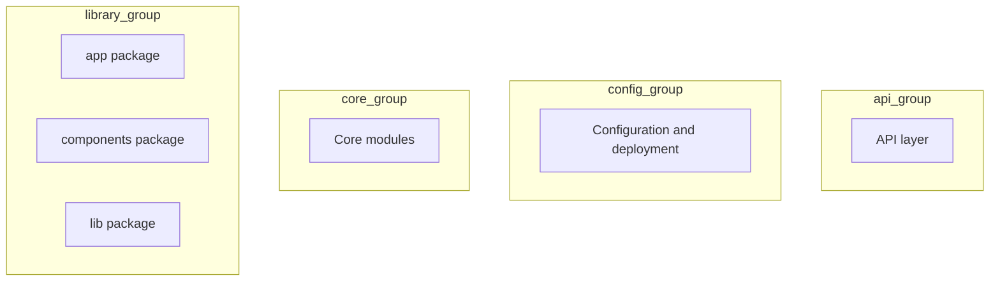

# Architecture report: vercel/commerce

> Automated static analysis. **Observed** = directly seen in files/imports/AST; **Inferred** = interpretation from that evidence. Repository code was not executed.

## 1. Repository at a glance

| Item | Value |
| --- | --- |
| Repository | vercel/commerce |
| Description | Next.js Commerce |
| Language | TypeScript |
| Stars | 14309 |
| Licence | MIT |
| Analysed commit / branch | f7521d57d29f0eb3d23c1399cf9bb299d61fcd21 / main |
| Framework(s) | Next.js, React |
| Files analysed | 75 |
| Components | 6 |

## 2. Architecture in one minute

vercel/commerce - Next.js Commerce. This repository was analysed statically from 75 file(s) (0 Python). Detected technologies (observed from imports/manifests): Next.js, React, Tailwind CSS, TypeScript. Files are grouped into 6 component(s): API layer, app package, components package, Configuration and deployment, Core modules, lib package. Findings below distinguish observed facts from inferred interpretation.

## 3. High-level block diagram

## 4. Main components

### API layer (`api_layer`)

- **Kind:** api
- **Status:** Observed
- **Confidence:** 0.85
- **Responsibility:** Groups 1 file(s) under api layer (observed from repository paths and static analysis).
- **Paths:** `app/api/revalidate/route.ts`
- **Evidence:** [app/api/revalidate/route.ts](https://github.com/vercel/commerce/blob/f7521d57d29f0eb3d23c1399cf9bb299d61fcd21/app/api/revalidate/route.ts)

### app package (`app`)

- **Kind:** library
- **Status:** Observed
- **Confidence:** 0.85
- **Responsibility:** Groups 16 file(s) under app package (observed from repository paths and static analysis).
- **Paths:** `app/[page]/layout.tsx`, `app/[page]/opengraph-image.tsx`, `app/[page]/page.tsx`, `app/error.tsx`, `app/layout.tsx`, `app/opengraph-image.tsx`, `app/page.tsx`, `app/product/[handle]/page.tsx`, `app/robots.ts`, `app/search/[collection]/opengraph-image.tsx`, `app/search/[collection]/page.tsx`, `app/search/children-wrapper.tsx`, `app/search/layout.tsx`, `app/search/loading.tsx`, `app/search/page.tsx`, `app/sitemap.ts`
- **Evidence:** [app/[page]/layout.tsx](https://github.com/vercel/commerce/blob/f7521d57d29f0eb3d23c1399cf9bb299d61fcd21/app/%5Bpage%5D/layout.tsx); [app/[page]/opengraph-image.tsx](https://github.com/vercel/commerce/blob/f7521d57d29f0eb3d23c1399cf9bb299d61fcd21/app/%5Bpage%5D/opengraph-image.tsx); [app/[page]/page.tsx](https://github.com/vercel/commerce/blob/f7521d57d29f0eb3d23c1399cf9bb299d61fcd21/app/%5Bpage%5D/page.tsx); [app/error.tsx](https://github.com/vercel/commerce/blob/f7521d57d29f0eb3d23c1399cf9bb299d61fcd21/app/error.tsx); [app/layout.tsx](https://github.com/vercel/commerce/blob/f7521d57d29f0eb3d23c1399cf9bb299d61fcd21/app/layout.tsx); [app/opengraph-image.tsx](https://github.com/vercel/commerce/blob/f7521d57d29f0eb3d23c1399cf9bb299d61fcd21/app/opengraph-image.tsx); [app/page.tsx](https://github.com/vercel/commerce/blob/f7521d57d29f0eb3d23c1399cf9bb299d61fcd21/app/page.tsx); [app/product/[handle]/page.tsx](https://github.com/vercel/commerce/blob/f7521d57d29f0eb3d23c1399cf9bb299d61fcd21/app/product/%5Bhandle%5D/page.tsx)

### components package (`components`)

- **Kind:** library
- **Status:** Observed
- **Confidence:** 0.85
- **Responsibility:** Groups 32 file(s) under components package (observed from repository paths and static analysis).
- **Paths:** `components/carousel.tsx`, `components/cart/actions.ts`, `components/cart/add-to-cart.tsx`, `components/cart/cart-context.tsx`, `components/cart/delete-item-button.tsx`, `components/cart/edit-item-quantity-button.tsx`, `components/cart/modal.tsx`, `components/cart/open-cart.tsx`, `components/grid/index.tsx`, `components/grid/three-items.tsx`, `components/grid/tile.tsx`, `components/icons/logo.tsx`, `components/label.tsx`, `components/layout/footer-menu.tsx`, `components/layout/footer.tsx`, `components/layout/navbar/index.tsx`, `components/layout/navbar/mobile-menu.tsx`, `components/layout/navbar/search.tsx`, `components/layout/product-grid-items.tsx`, `components/layout/search/collections.tsx`, `components/layout/search/filter/dropdown.tsx`, `components/layout/search/filter/index.tsx`, `components/layout/search/filter/item.tsx`, `components/loading-dots.tsx`, `components/logo-square.tsx`, `components/opengraph-image.tsx`, `components/price.tsx`, `components/product/gallery.tsx`, `components/product/product-description.tsx`, `components/product/variant-selector.tsx`, `components/prose.tsx`, `components/welcome-toast.tsx`
- **Evidence:** [components/carousel.tsx](https://github.com/vercel/commerce/blob/f7521d57d29f0eb3d23c1399cf9bb299d61fcd21/components/carousel.tsx); [components/cart/actions.ts](https://github.com/vercel/commerce/blob/f7521d57d29f0eb3d23c1399cf9bb299d61fcd21/components/cart/actions.ts); [components/cart/add-to-cart.tsx](https://github.com/vercel/commerce/blob/f7521d57d29f0eb3d23c1399cf9bb299d61fcd21/components/cart/add-to-cart.tsx); [components/cart/cart-context.tsx](https://github.com/vercel/commerce/blob/f7521d57d29f0eb3d23c1399cf9bb299d61fcd21/components/cart/cart-context.tsx); [components/cart/delete-item-button.tsx](https://github.com/vercel/commerce/blob/f7521d57d29f0eb3d23c1399cf9bb299d61fcd21/components/cart/delete-item-button.tsx); [components/cart/edit-item-quantity-button.tsx](https://github.com/vercel/commerce/blob/f7521d57d29f0eb3d23c1399cf9bb299d61fcd21/components/cart/edit-item-quantity-button.tsx); [components/cart/modal.tsx](https://github.com/vercel/commerce/blob/f7521d57d29f0eb3d23c1399cf9bb299d61fcd21/components/cart/modal.tsx); [components/cart/open-cart.tsx](https://github.com/vercel/commerce/blob/f7521d57d29f0eb3d23c1399cf9bb299d61fcd21/components/cart/open-cart.tsx)

### Configuration and deployment (`config`)

- **Kind:** config
- **Status:** Observed
- **Confidence:** 0.85
- **Responsibility:** Groups 2 file(s) under configuration and deployment (observed from repository paths and static analysis).
- **Paths:** `package.json`, `tsconfig.json`
- **Evidence:** [package.json](https://github.com/vercel/commerce/blob/f7521d57d29f0eb3d23c1399cf9bb299d61fcd21/package.json); [tsconfig.json](https://github.com/vercel/commerce/blob/f7521d57d29f0eb3d23c1399cf9bb299d61fcd21/tsconfig.json)

### Core modules (`core`)

- **Kind:** core
- **Status:** Observed
- **Confidence:** 0.85
- **Responsibility:** Groups 2 file(s) under core modules (observed from repository paths and static analysis).
- **Paths:** `next.config.ts`, `postcss.config.mjs`
- **Evidence:** [next.config.ts](https://github.com/vercel/commerce/blob/f7521d57d29f0eb3d23c1399cf9bb299d61fcd21/next.config.ts); [postcss.config.mjs](https://github.com/vercel/commerce/blob/f7521d57d29f0eb3d23c1399cf9bb299d61fcd21/postcss.config.mjs)

### lib package (`lib`)

- **Kind:** library
- **Status:** Observed
- **Confidence:** 0.85
- **Responsibility:** Groups 15 file(s) under lib package (observed from repository paths and static analysis).
- **Paths:** `lib/constants.ts`, `lib/shopify/fragments/cart.ts`, `lib/shopify/fragments/image.ts`, `lib/shopify/fragments/product.ts`, `lib/shopify/fragments/seo.ts`, `lib/shopify/index.ts`, `lib/shopify/mutations/cart.ts`, `lib/shopify/queries/cart.ts`, `lib/shopify/queries/collection.ts`, `lib/shopify/queries/menu.ts`, `lib/shopify/queries/page.ts`, `lib/shopify/queries/product.ts`, `lib/shopify/types.ts`, `lib/type-guards.ts`, `lib/utils.ts`
- **Evidence:** [lib/constants.ts](https://github.com/vercel/commerce/blob/f7521d57d29f0eb3d23c1399cf9bb299d61fcd21/lib/constants.ts); [lib/shopify/fragments/cart.ts](https://github.com/vercel/commerce/blob/f7521d57d29f0eb3d23c1399cf9bb299d61fcd21/lib/shopify/fragments/cart.ts); [lib/shopify/fragments/image.ts](https://github.com/vercel/commerce/blob/f7521d57d29f0eb3d23c1399cf9bb299d61fcd21/lib/shopify/fragments/image.ts); [lib/shopify/fragments/product.ts](https://github.com/vercel/commerce/blob/f7521d57d29f0eb3d23c1399cf9bb299d61fcd21/lib/shopify/fragments/product.ts); [lib/shopify/fragments/seo.ts](https://github.com/vercel/commerce/blob/f7521d57d29f0eb3d23c1399cf9bb299d61fcd21/lib/shopify/fragments/seo.ts); [lib/shopify/index.ts](https://github.com/vercel/commerce/blob/f7521d57d29f0eb3d23c1399cf9bb299d61fcd21/lib/shopify/index.ts); [lib/shopify/mutations/cart.ts](https://github.com/vercel/commerce/blob/f7521d57d29f0eb3d23c1399cf9bb299d61fcd21/lib/shopify/mutations/cart.ts); [lib/shopify/queries/cart.ts](https://github.com/vercel/commerce/blob/f7521d57d29f0eb3d23c1399cf9bb299d61fcd21/lib/shopify/queries/cart.ts)

## 5. Execution flow

**Observed** entry point(s):

- [app/[page]/page.tsx](https://github.com/vercel/commerce/blob/f7521d57d29f0eb3d23c1399cf9bb299d61fcd21/app/%5Bpage%5D/page.tsx)
- [app/page.tsx](https://github.com/vercel/commerce/blob/f7521d57d29f0eb3d23c1399cf9bb299d61fcd21/app/page.tsx)
- [app/product/[handle]/page.tsx](https://github.com/vercel/commerce/blob/f7521d57d29f0eb3d23c1399cf9bb299d61fcd21/app/product/%5Bhandle%5D/page.tsx)
- [app/search/[collection]/page.tsx](https://github.com/vercel/commerce/blob/f7521d57d29f0eb3d23c1399cf9bb299d61fcd21/app/search/%5Bcollection%5D/page.tsx)
- [app/search/page.tsx](https://github.com/vercel/commerce/blob/f7521d57d29f0eb3d23c1399cf9bb299d61fcd21/app/search/page.tsx)
- [components/grid/index.tsx](https://github.com/vercel/commerce/blob/f7521d57d29f0eb3d23c1399cf9bb299d61fcd21/components/grid/index.tsx)
- [components/layout/navbar/index.tsx](https://github.com/vercel/commerce/blob/f7521d57d29f0eb3d23c1399cf9bb299d61fcd21/components/layout/navbar/index.tsx)
- [lib/shopify/index.ts](https://github.com/vercel/commerce/blob/f7521d57d29f0eb3d23c1399cf9bb299d61fcd21/lib/shopify/index.ts)
- [lib/shopify/queries/page.ts](https://github.com/vercel/commerce/blob/f7521d57d29f0eb3d23c1399cf9bb299d61fcd21/lib/shopify/queries/page.ts)

Representative flow (derived from observed entry points and the import graph; steps beyond the entry point are **Inferred**):

1. Execution starts at an observed entry point listed above, if present.
2. No internal import relationships between components were observed.

## 6. Project structure

### `(root)`

- `.env.example` - config (190 bytes)
- `.gitignore` - other (417 bytes)
- `README.md` - docs (4495 bytes)
- `license.md` - docs (1079 bytes)
- `next.config.ts` - source, TypeScript (302 bytes)
- `package.json` - manifest (930 bytes)
- `postcss.config.mjs` - source, JavaScript (122 bytes)
- `tsconfig.json` - config (740 bytes)

### `.vscode`

- `.vscode/launch.json` - config (645 bytes)
- `.vscode/settings.json` - config (255 bytes)

### `app`

- `app/[page]/layout.tsx` - source, TypeScript (294 bytes)
- `app/[page]/opengraph-image.tsx` - source, TypeScript (312 bytes)
- `app/[page]/page.tsx` - source, TypeScript (1268 bytes)
- `app/api/revalidate/route.ts` - source, TypeScript (198 bytes)
- `app/error.tsx` - source, TypeScript (705 bytes)
- `app/globals.css` - other (711 bytes)
- `app/layout.tsx` - source, TypeScript (1263 bytes)
- `app/opengraph-image.tsx` - source, TypeScript (133 bytes)
- `app/page.tsx` - source, TypeScript (454 bytes)
- `app/product/[handle]/page.tsx` - source, TypeScript (4664 bytes)
- `app/robots.ts` - source, TypeScript (210 bytes)
- `app/search/[collection]/opengraph-image.tsx` - source, TypeScript (362 bytes)
- `app/search/[collection]/page.tsx` - source, TypeScript (1609 bytes)
- `app/search/children-wrapper.tsx` - source, TypeScript (373 bytes)
- `app/search/layout.tsx` - source, TypeScript (1035 bytes)
- `app/search/loading.tsx` - source, TypeScript (473 bytes)
- `app/search/page.tsx` - source, TypeScript (1319 bytes)
- `app/sitemap.ts` - source, TypeScript (1352 bytes)

### `components`

- `components/carousel.tsx` - source, TypeScript (1576 bytes)
- `components/cart/actions.ts` - source, TypeScript (2294 bytes)
- `components/cart/add-to-cart.tsx` - source, TypeScript (2579 bytes)
- `components/cart/cart-context.tsx` - source, TypeScript (5690 bytes)
- `components/cart/delete-item-button.tsx` - source, TypeScript (1040 bytes)
- `components/cart/edit-item-quantity-button.tsx` - source, TypeScript (1678 bytes)
- `components/cart/modal.tsx` - source, TypeScript (11388 bytes)
- `components/cart/open-cart.tsx` - source, TypeScript (762 bytes)
- `components/grid/index.tsx` - source, TypeScript (486 bytes)
- `components/grid/three-items.tsx` - source, TypeScript (1991 bytes)
- `components/grid/tile.tsx` - source, TypeScript (1234 bytes)
- `components/icons/logo.tsx` - source, TypeScript (492 bytes)
- `components/label.tsx` - source, TypeScript (1025 bytes)
- `components/layout/footer-menu.tsx` - source, TypeScript (1100 bytes)
- `components/layout/footer.tsx` - source, TypeScript (3142 bytes)
- `components/layout/navbar/index.tsx` - source, TypeScript (2051 bytes)
- `components/layout/navbar/mobile-menu.tsx` - source, TypeScript (3919 bytes)
- `components/layout/navbar/search.tsx` - source, TypeScript (1500 bytes)
- `components/layout/product-grid-items.tsx` - source, TypeScript (1047 bytes)
- `components/layout/search/collections.tsx` - source, TypeScript (1248 bytes)
- `components/layout/search/filter/dropdown.tsx` - source, TypeScript (1939 bytes)
- `components/layout/search/filter/index.tsx` - source, TypeScript (1105 bytes)
- `components/layout/search/filter/item.tsx` - source, TypeScript (2028 bytes)
- `components/loading-dots.tsx` - source, TypeScript (476 bytes)
- `components/logo-square.tsx` - source, TypeScript (616 bytes)
- `components/opengraph-image.tsx` - source, TypeScript (1095 bytes)
- `components/price.tsx` - source, TypeScript (624 bytes)
- `components/product/gallery.tsx` - source, TypeScript (3351 bytes)
- `components/product/product-description.tsx` - source, TypeScript (1082 bytes)
- `components/product/variant-selector.tsx` - source, TypeScript (3956 bytes)
- `components/prose.tsx` - source, TypeScript (828 bytes)
- `components/welcome-toast.tsx` - source, TypeScript (968 bytes)

### `lib`

- `lib/constants.ts` - source, TypeScript (1072 bytes)
- `lib/shopify/fragments/cart.ts` - source, TypeScript (926 bytes)
- `lib/shopify/fragments/image.ts` - source, TypeScript (145 bytes)
- `lib/shopify/fragments/product.ts` - source, TypeScript (990 bytes)
- `lib/shopify/fragments/seo.ts` - source, TypeScript (122 bytes)
- `lib/shopify/index.ts` - source, TypeScript (12925 bytes)
- `lib/shopify/mutations/cart.ts` - source, TypeScript (990 bytes)
- `lib/shopify/queries/cart.ts` - source, TypeScript (192 bytes)
- `lib/shopify/queries/collection.ts` - source, TypeScript (1097 bytes)
- `lib/shopify/queries/menu.ts` - source, TypeScript (169 bytes)
- `lib/shopify/queries/page.ts` - source, TypeScript (633 bytes)
- `lib/shopify/queries/product.ts` - source, TypeScript (769 bytes)
- `lib/shopify/types.ts` - source, TypeScript (4451 bytes)
- `lib/type-guards.ts` - source, TypeScript (741 bytes)
- `lib/utils.ts` - source, TypeScript (1665 bytes)

## 7. Key dependencies and integrations

| Name | Category | Status | Confidence | Evidence |
| --- | --- | --- | --- | --- |
| Next.js | framework | Observed | 0.85 | [package.json:4](https://github.com/vercel/commerce/blob/f7521d57d29f0eb3d23c1399cf9bb299d61fcd21/package.json#L4) |
| React | framework | Observed | 0.90 | [package.json:12](https://github.com/vercel/commerce/blob/f7521d57d29f0eb3d23c1399cf9bb299d61fcd21/package.json#L12); [package.json:18](https://github.com/vercel/commerce/blob/f7521d57d29f0eb3d23c1399cf9bb299d61fcd21/package.json#L18) |
| Tailwind CSS | library | Observed | 0.85 | [package.json:22](https://github.com/vercel/commerce/blob/f7521d57d29f0eb3d23c1399cf9bb299d61fcd21/package.json#L22) |
| TypeScript | tooling | Observed | 0.85 | [package.json:32](https://github.com/vercel/commerce/blob/f7521d57d29f0eb3d23c1399cf9bb299d61fcd21/package.json#L32) |

## 8. Data and state

No database, cache, queue, or persistent-state usage was observed in the analysed files. State handling, if any, may be in-memory or in files that were not analysed.

## 9. Configuration and deployment clues

- `.env.example` (config)
- `.vscode/launch.json` (config)
- `.vscode/settings.json` (config)
- `package.json` (manifest)
- `tsconfig.json` (config)

Environment variable *names* seen in example env files (values never recorded):

- `.env.example`: `COMPANY_NAME`, `SHOPIFY_REVALIDATION_SECRET`, `SHOPIFY_STOREFRONT_ACCESS_TOKEN`, `SHOPIFY_STORE_DOMAIN`, `SITE_NAME`

## 10. Design observations

- An entry/API layer is separated from other code (Inferred from paths and decorators).

These observations are interpretations (**Inferred**) of the observed structure, not guarantees about runtime design.

## 11. Limitations and unknowns

- Static analysis only: repository code was not executed, installed, or imported at runtime.
- Components and relationships are inferred from file paths, imports, and AST structure; runtime behaviour, dynamic imports, and reflection may not be visible.
- 1 file(s) were skipped during inventory (1 x lockfile excluded).
- No clear application entry point was observed in the analysed files.
- Repository text was treated as untrusted data; no instructions found in repository files were followed, and likely secret values were redacted/excluded.
- JavaScript and TypeScript files were inventoried from paths and package manifests. They were not parsed with a full language AST, and repository code was not executed.
- The GitHub repository was marked archived at selection time.

## 12. Source references

- [app/[page]/layout.tsx](https://github.com/vercel/commerce/blob/f7521d57d29f0eb3d23c1399cf9bb299d61fcd21/app/%5Bpage%5D/layout.tsx)
- [app/[page]/opengraph-image.tsx](https://github.com/vercel/commerce/blob/f7521d57d29f0eb3d23c1399cf9bb299d61fcd21/app/%5Bpage%5D/opengraph-image.tsx)
- [app/[page]/page.tsx](https://github.com/vercel/commerce/blob/f7521d57d29f0eb3d23c1399cf9bb299d61fcd21/app/%5Bpage%5D/page.tsx)
- [app/api/revalidate/route.ts](https://github.com/vercel/commerce/blob/f7521d57d29f0eb3d23c1399cf9bb299d61fcd21/app/api/revalidate/route.ts)
- [app/error.tsx](https://github.com/vercel/commerce/blob/f7521d57d29f0eb3d23c1399cf9bb299d61fcd21/app/error.tsx)
- [app/layout.tsx](https://github.com/vercel/commerce/blob/f7521d57d29f0eb3d23c1399cf9bb299d61fcd21/app/layout.tsx)
- [app/opengraph-image.tsx](https://github.com/vercel/commerce/blob/f7521d57d29f0eb3d23c1399cf9bb299d61fcd21/app/opengraph-image.tsx)
- [app/page.tsx](https://github.com/vercel/commerce/blob/f7521d57d29f0eb3d23c1399cf9bb299d61fcd21/app/page.tsx)
- [app/product/[handle]/page.tsx](https://github.com/vercel/commerce/blob/f7521d57d29f0eb3d23c1399cf9bb299d61fcd21/app/product/%5Bhandle%5D/page.tsx)
- [app/search/[collection]/page.tsx](https://github.com/vercel/commerce/blob/f7521d57d29f0eb3d23c1399cf9bb299d61fcd21/app/search/%5Bcollection%5D/page.tsx)
- [app/search/page.tsx](https://github.com/vercel/commerce/blob/f7521d57d29f0eb3d23c1399cf9bb299d61fcd21/app/search/page.tsx)
- [components/carousel.tsx](https://github.com/vercel/commerce/blob/f7521d57d29f0eb3d23c1399cf9bb299d61fcd21/components/carousel.tsx)
- [components/cart/actions.ts](https://github.com/vercel/commerce/blob/f7521d57d29f0eb3d23c1399cf9bb299d61fcd21/components/cart/actions.ts)
- [components/cart/add-to-cart.tsx](https://github.com/vercel/commerce/blob/f7521d57d29f0eb3d23c1399cf9bb299d61fcd21/components/cart/add-to-cart.tsx)
- [components/cart/cart-context.tsx](https://github.com/vercel/commerce/blob/f7521d57d29f0eb3d23c1399cf9bb299d61fcd21/components/cart/cart-context.tsx)
- [components/cart/delete-item-button.tsx](https://github.com/vercel/commerce/blob/f7521d57d29f0eb3d23c1399cf9bb299d61fcd21/components/cart/delete-item-button.tsx)
- [components/cart/edit-item-quantity-button.tsx](https://github.com/vercel/commerce/blob/f7521d57d29f0eb3d23c1399cf9bb299d61fcd21/components/cart/edit-item-quantity-button.tsx)
- [components/cart/modal.tsx](https://github.com/vercel/commerce/blob/f7521d57d29f0eb3d23c1399cf9bb299d61fcd21/components/cart/modal.tsx)
- [components/cart/open-cart.tsx](https://github.com/vercel/commerce/blob/f7521d57d29f0eb3d23c1399cf9bb299d61fcd21/components/cart/open-cart.tsx)
- [components/grid/index.tsx](https://github.com/vercel/commerce/blob/f7521d57d29f0eb3d23c1399cf9bb299d61fcd21/components/grid/index.tsx)
- [components/layout/navbar/index.tsx](https://github.com/vercel/commerce/blob/f7521d57d29f0eb3d23c1399cf9bb299d61fcd21/components/layout/navbar/index.tsx)
- [lib/constants.ts](https://github.com/vercel/commerce/blob/f7521d57d29f0eb3d23c1399cf9bb299d61fcd21/lib/constants.ts)
- [lib/shopify/fragments/cart.ts](https://github.com/vercel/commerce/blob/f7521d57d29f0eb3d23c1399cf9bb299d61fcd21/lib/shopify/fragments/cart.ts)
- [lib/shopify/fragments/image.ts](https://github.com/vercel/commerce/blob/f7521d57d29f0eb3d23c1399cf9bb299d61fcd21/lib/shopify/fragments/image.ts)
- [lib/shopify/fragments/product.ts](https://github.com/vercel/commerce/blob/f7521d57d29f0eb3d23c1399cf9bb299d61fcd21/lib/shopify/fragments/product.ts)
- [lib/shopify/fragments/seo.ts](https://github.com/vercel/commerce/blob/f7521d57d29f0eb3d23c1399cf9bb299d61fcd21/lib/shopify/fragments/seo.ts)
- [lib/shopify/index.ts](https://github.com/vercel/commerce/blob/f7521d57d29f0eb3d23c1399cf9bb299d61fcd21/lib/shopify/index.ts)
- [lib/shopify/mutations/cart.ts](https://github.com/vercel/commerce/blob/f7521d57d29f0eb3d23c1399cf9bb299d61fcd21/lib/shopify/mutations/cart.ts)
- [lib/shopify/queries/cart.ts](https://github.com/vercel/commerce/blob/f7521d57d29f0eb3d23c1399cf9bb299d61fcd21/lib/shopify/queries/cart.ts)
- [lib/shopify/queries/page.ts](https://github.com/vercel/commerce/blob/f7521d57d29f0eb3d23c1399cf9bb299d61fcd21/lib/shopify/queries/page.ts)
- [next.config.ts](https://github.com/vercel/commerce/blob/f7521d57d29f0eb3d23c1399cf9bb299d61fcd21/next.config.ts)
- [package.json](https://github.com/vercel/commerce/blob/f7521d57d29f0eb3d23c1399cf9bb299d61fcd21/package.json)
- [package.json:4](https://github.com/vercel/commerce/blob/f7521d57d29f0eb3d23c1399cf9bb299d61fcd21/package.json#L4)
- [package.json:12](https://github.com/vercel/commerce/blob/f7521d57d29f0eb3d23c1399cf9bb299d61fcd21/package.json#L12)
- [package.json:18](https://github.com/vercel/commerce/blob/f7521d57d29f0eb3d23c1399cf9bb299d61fcd21/package.json#L18)
- [package.json:22](https://github.com/vercel/commerce/blob/f7521d57d29f0eb3d23c1399cf9bb299d61fcd21/package.json#L22)
- [package.json:32](https://github.com/vercel/commerce/blob/f7521d57d29f0eb3d23c1399cf9bb299d61fcd21/package.json#L32)
- [postcss.config.mjs](https://github.com/vercel/commerce/blob/f7521d57d29f0eb3d23c1399cf9bb299d61fcd21/postcss.config.mjs)
- [tsconfig.json](https://github.com/vercel/commerce/blob/f7521d57d29f0eb3d23c1399cf9bb299d61fcd21/tsconfig.json)
