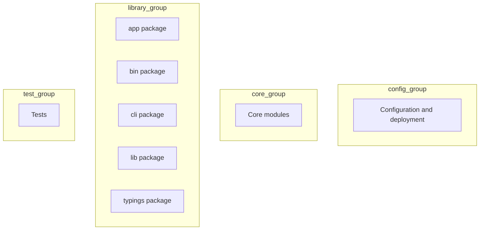

# Architecture report: vercel/hyper

> Automated static analysis. **Observed** = directly seen in files/imports/AST; **Inferred** = interpretation from that evidence. Repository code was not executed.

## 1. Repository at a glance

| Item | Value |
| --- | --- |
| Repository | vercel/hyper |
| Description | A terminal built on web technologies |
| Language | TypeScript |
| Stars | 44753 |
| Licence | MIT |
| Analysed commit / branch | 890a332ed9c35ed87343647d3ec6611b8045b157 / canary |
| Framework(s) | Electron, React |
| Files analysed | 153 |
| Components | 8 |

## 2. Architecture in one minute

vercel/hyper - A terminal built on web technologies. This repository was analysed statically from 153 file(s) (0 Python). Detected technologies (observed from imports/manifests): GitHub Actions, Electron, React, Redux, TypeScript, webpack. Files are grouped into 8 component(s): app package, bin package, cli package, Configuration and deployment, Core modules, lib package, Tests, typings package. Findings below distinguish observed facts from inferred interpretation.

## 3. High-level block diagram

## 4. Main components

### app package (`app`)

- **Kind:** library
- **Status:** Observed
- **Confidence:** 0.85
- **Responsibility:** Groups 31 file(s) under app package (observed from repository paths and static analysis).
- **Paths:** `app/auto-updater-linux.ts`, `app/commands.ts`, `app/config.ts`, `app/index.ts`, `app/menus/menu.ts`, `app/menus/menus/darwin.ts`, `app/menus/menus/edit.ts`, `app/menus/menus/help.ts`, `app/menus/menus/shell.ts`, `app/menus/menus/tools.ts`, `app/menus/menus/view.ts`, `app/menus/menus/window.ts`, `app/notifications.ts`, `app/notify.ts`, `app/plugins.ts`, `app/plugins/extensions.ts`, `app/plugins/install.ts`, `app/rpc.ts`, `app/session.ts`, `app/ui/contextmenu.ts`, `app/ui/window.ts`, `app/updater.ts`, `app/utils/cli-install.ts`, `app/utils/colors.ts`, `app/utils/map-keys.ts`, `app/utils/renderer-utils.ts`, `app/utils/shell-fallback.ts`, `app/utils/ssh-url.ts`, `app/utils/system-context-menu.ts`, `app/utils/to-electron-background-color.ts`, `app/utils/window-utils.ts`
- **Evidence:** [app/auto-updater-linux.ts](https://github.com/vercel/hyper/blob/890a332ed9c35ed87343647d3ec6611b8045b157/app/auto-updater-linux.ts); [app/commands.ts](https://github.com/vercel/hyper/blob/890a332ed9c35ed87343647d3ec6611b8045b157/app/commands.ts); [app/config.ts](https://github.com/vercel/hyper/blob/890a332ed9c35ed87343647d3ec6611b8045b157/app/config.ts); [app/index.ts](https://github.com/vercel/hyper/blob/890a332ed9c35ed87343647d3ec6611b8045b157/app/index.ts); [app/menus/menu.ts](https://github.com/vercel/hyper/blob/890a332ed9c35ed87343647d3ec6611b8045b157/app/menus/menu.ts); [app/menus/menus/darwin.ts](https://github.com/vercel/hyper/blob/890a332ed9c35ed87343647d3ec6611b8045b157/app/menus/menus/darwin.ts); [app/menus/menus/edit.ts](https://github.com/vercel/hyper/blob/890a332ed9c35ed87343647d3ec6611b8045b157/app/menus/menus/edit.ts); [app/menus/menus/help.ts](https://github.com/vercel/hyper/blob/890a332ed9c35ed87343647d3ec6611b8045b157/app/menus/menus/help.ts)

### bin package (`bin`)

- **Kind:** library
- **Status:** Observed
- **Confidence:** 0.85
- **Responsibility:** Groups 6 file(s) under bin package (observed from repository paths and static analysis).
- **Paths:** `bin/cp-snapshot.js`, `bin/download-mksnapshot.js`, `bin/mk-snapshot.js`, `bin/notarize.js`, `bin/rimraf-standalone.js`, `bin/snapshot-libs.js`
- **Evidence:** [bin/cp-snapshot.js](https://github.com/vercel/hyper/blob/890a332ed9c35ed87343647d3ec6611b8045b157/bin/cp-snapshot.js); [bin/download-mksnapshot.js](https://github.com/vercel/hyper/blob/890a332ed9c35ed87343647d3ec6611b8045b157/bin/download-mksnapshot.js); [bin/mk-snapshot.js](https://github.com/vercel/hyper/blob/890a332ed9c35ed87343647d3ec6611b8045b157/bin/mk-snapshot.js); [bin/notarize.js](https://github.com/vercel/hyper/blob/890a332ed9c35ed87343647d3ec6611b8045b157/bin/notarize.js); [bin/rimraf-standalone.js](https://github.com/vercel/hyper/blob/890a332ed9c35ed87343647d3ec6611b8045b157/bin/rimraf-standalone.js); [bin/snapshot-libs.js](https://github.com/vercel/hyper/blob/890a332ed9c35ed87343647d3ec6611b8045b157/bin/snapshot-libs.js)

### cli package (`cli`)

- **Kind:** library
- **Status:** Observed
- **Confidence:** 0.85
- **Responsibility:** Groups 2 file(s) under cli package (observed from repository paths and static analysis).
- **Paths:** `cli/api.ts`, `cli/index.ts`
- **Evidence:** [cli/api.ts](https://github.com/vercel/hyper/blob/890a332ed9c35ed87343647d3ec6611b8045b157/cli/api.ts); [cli/index.ts](https://github.com/vercel/hyper/blob/890a332ed9c35ed87343647d3ec6611b8045b157/cli/index.ts)

### Configuration and deployment (`config`)

- **Kind:** config
- **Status:** Observed
- **Confidence:** 0.85
- **Responsibility:** Groups 22 file(s) under configuration and deployment (observed from repository paths and static analysis).
- **Paths:** `app/config/config-default.json`, `app/config/import.ts`, `app/config/init.ts`, `app/config/migrate.ts`, `app/config/open.ts`, `app/config/paths.ts`, `app/config/schema.json`, `app/config/windows.ts`, `app/keymaps/darwin.json`, `app/keymaps/linux.json`, `app/keymaps/win32.json`, `app/package.json`, `app/pnpm-workspace.yaml`, `app/tsconfig.json`, `babel.config.json`, `electron-builder-linux-ci.json`, `electron-builder.json`, `package.json`, `pnpm-workspace.yaml`, `tsconfig.base.json`, `tsconfig.eslint.json`, `tsconfig.json`
- **Evidence:** [app/config/config-default.json](https://github.com/vercel/hyper/blob/890a332ed9c35ed87343647d3ec6611b8045b157/app/config/config-default.json); [app/config/import.ts](https://github.com/vercel/hyper/blob/890a332ed9c35ed87343647d3ec6611b8045b157/app/config/import.ts); [app/config/init.ts](https://github.com/vercel/hyper/blob/890a332ed9c35ed87343647d3ec6611b8045b157/app/config/init.ts); [app/config/migrate.ts](https://github.com/vercel/hyper/blob/890a332ed9c35ed87343647d3ec6611b8045b157/app/config/migrate.ts); [app/config/open.ts](https://github.com/vercel/hyper/blob/890a332ed9c35ed87343647d3ec6611b8045b157/app/config/open.ts); [app/config/paths.ts](https://github.com/vercel/hyper/blob/890a332ed9c35ed87343647d3ec6611b8045b157/app/config/paths.ts); [app/config/schema.json](https://github.com/vercel/hyper/blob/890a332ed9c35ed87343647d3ec6611b8045b157/app/config/schema.json); [app/config/windows.ts](https://github.com/vercel/hyper/blob/890a332ed9c35ed87343647d3ec6611b8045b157/app/config/windows.ts)

### Core modules (`core`)

- **Kind:** core
- **Status:** Observed
- **Confidence:** 0.85
- **Responsibility:** Groups 4 file(s) under core modules (observed from repository paths and static analysis).
- **Paths:** `ava-e2e.config.js`, `ava.config.js`, `release.js`, `webpack.config.ts`
- **Evidence:** [ava-e2e.config.js](https://github.com/vercel/hyper/blob/890a332ed9c35ed87343647d3ec6611b8045b157/ava-e2e.config.js); [ava.config.js](https://github.com/vercel/hyper/blob/890a332ed9c35ed87343647d3ec6611b8045b157/ava.config.js); [release.js](https://github.com/vercel/hyper/blob/890a332ed9c35ed87343647d3ec6611b8045b157/release.js); [webpack.config.ts](https://github.com/vercel/hyper/blob/890a332ed9c35ed87343647d3ec6611b8045b157/webpack.config.ts)

### lib package (`lib`)

- **Kind:** library
- **Status:** Observed
- **Confidence:** 0.85
- **Responsibility:** Groups 49 file(s) under lib package (observed from repository paths and static analysis).
- **Paths:** `lib/actions/config.ts`, `lib/actions/header.ts`, `lib/actions/index.ts`, `lib/actions/notifications.ts`, `lib/actions/sessions.ts`, `lib/actions/term-groups.ts`, `lib/actions/ui.ts`, `lib/actions/updater.ts`, `lib/command-registry.ts`, `lib/components/header.tsx`, `lib/components/new-tab.tsx`, `lib/components/notification.tsx`, `lib/components/notifications.tsx`, `lib/components/searchBox.tsx`, `lib/components/split-pane.tsx`, `lib/components/style-sheet.tsx`, `lib/components/tab.tsx`, `lib/components/tabs.tsx`, `lib/components/term-group.tsx`, `lib/components/term.tsx`, `lib/components/terms.tsx`, `lib/containers/header.ts`, `lib/containers/hyper.tsx`, `lib/containers/notifications.ts`, `lib/containers/terms.ts`, `lib/index.tsx`, `lib/reducers/index.ts`, `lib/reducers/sessions.ts`, `lib/reducers/term-groups.ts`, `lib/reducers/ui.ts`, `lib/rpc.ts`, `lib/selectors.ts`, `lib/store/configure-store.dev.ts`, `lib/store/configure-store.prod.ts`, `lib/store/configure-store.ts`, `lib/store/write-middleware.ts`, `lib/terms.ts`, `lib/utils/config.ts`, `lib/utils/effects.ts`, `lib/utils/file.ts`, `lib/utils/ipc-child-process.ts`, `lib/utils/ipc.ts`, `lib/utils/notify.ts`, `lib/utils/object.ts`, `lib/utils/paste.ts`, `lib/utils/plugins.ts`, `lib/utils/rpc.ts`, `lib/utils/term-groups.ts`, `lib/v8-snapshot-util.ts`
- **Evidence:** [lib/actions/config.ts](https://github.com/vercel/hyper/blob/890a332ed9c35ed87343647d3ec6611b8045b157/lib/actions/config.ts); [lib/actions/header.ts](https://github.com/vercel/hyper/blob/890a332ed9c35ed87343647d3ec6611b8045b157/lib/actions/header.ts); [lib/actions/index.ts](https://github.com/vercel/hyper/blob/890a332ed9c35ed87343647d3ec6611b8045b157/lib/actions/index.ts); [lib/actions/notifications.ts](https://github.com/vercel/hyper/blob/890a332ed9c35ed87343647d3ec6611b8045b157/lib/actions/notifications.ts); [lib/actions/sessions.ts](https://github.com/vercel/hyper/blob/890a332ed9c35ed87343647d3ec6611b8045b157/lib/actions/sessions.ts); [lib/actions/term-groups.ts](https://github.com/vercel/hyper/blob/890a332ed9c35ed87343647d3ec6611b8045b157/lib/actions/term-groups.ts); [lib/actions/ui.ts](https://github.com/vercel/hyper/blob/890a332ed9c35ed87343647d3ec6611b8045b157/lib/actions/ui.ts); [lib/actions/updater.ts](https://github.com/vercel/hyper/blob/890a332ed9c35ed87343647d3ec6611b8045b157/lib/actions/updater.ts)

### Tests (`tests`)

- **Kind:** test
- **Status:** Observed
- **Confidence:** 0.85
- **Responsibility:** Groups 6 file(s) under tests (observed from repository paths and static analysis).
- **Paths:** `test/index.ts`, `test/testUtils/is-hex-color.ts`, `test/unit/cli-api.test.ts`, `test/unit/ssh-url.test.ts`, `test/unit/to-electron-background-color.test.ts`, `test/unit/window-utils.test.ts`
- **Evidence:** [test/index.ts](https://github.com/vercel/hyper/blob/890a332ed9c35ed87343647d3ec6611b8045b157/test/index.ts); [test/testUtils/is-hex-color.ts](https://github.com/vercel/hyper/blob/890a332ed9c35ed87343647d3ec6611b8045b157/test/testUtils/is-hex-color.ts); [test/unit/cli-api.test.ts](https://github.com/vercel/hyper/blob/890a332ed9c35ed87343647d3ec6611b8045b157/test/unit/cli-api.test.ts); [test/unit/ssh-url.test.ts](https://github.com/vercel/hyper/blob/890a332ed9c35ed87343647d3ec6611b8045b157/test/unit/ssh-url.test.ts); [test/unit/to-electron-background-color.test.ts](https://github.com/vercel/hyper/blob/890a332ed9c35ed87343647d3ec6611b8045b157/test/unit/to-electron-background-color.test.ts); [test/unit/window-utils.test.ts](https://github.com/vercel/hyper/blob/890a332ed9c35ed87343647d3ec6611b8045b157/test/unit/window-utils.test.ts)

### typings package (`typings`)

- **Kind:** library
- **Status:** Observed
- **Confidence:** 0.85
- **Responsibility:** Groups 13 file(s) under typings package (observed from repository paths and static analysis).
- **Paths:** `typings/common.d.ts`, `typings/config.d.ts`, `typings/constants/config.d.ts`, `typings/constants/index.d.ts`, `typings/constants/notifications.d.ts`, `typings/constants/sessions.d.ts`, `typings/constants/tabs.d.ts`, `typings/constants/term-groups.d.ts`, `typings/constants/ui.d.ts`, `typings/constants/updater.d.ts`, `typings/ext-modules.d.ts`, `typings/extend-electron.d.ts`, `typings/hyper.d.ts`
- **Evidence:** [typings/common.d.ts](https://github.com/vercel/hyper/blob/890a332ed9c35ed87343647d3ec6611b8045b157/typings/common.d.ts); [typings/config.d.ts](https://github.com/vercel/hyper/blob/890a332ed9c35ed87343647d3ec6611b8045b157/typings/config.d.ts); [typings/constants/config.d.ts](https://github.com/vercel/hyper/blob/890a332ed9c35ed87343647d3ec6611b8045b157/typings/constants/config.d.ts); [typings/constants/index.d.ts](https://github.com/vercel/hyper/blob/890a332ed9c35ed87343647d3ec6611b8045b157/typings/constants/index.d.ts); [typings/constants/notifications.d.ts](https://github.com/vercel/hyper/blob/890a332ed9c35ed87343647d3ec6611b8045b157/typings/constants/notifications.d.ts); [typings/constants/sessions.d.ts](https://github.com/vercel/hyper/blob/890a332ed9c35ed87343647d3ec6611b8045b157/typings/constants/sessions.d.ts); [typings/constants/tabs.d.ts](https://github.com/vercel/hyper/blob/890a332ed9c35ed87343647d3ec6611b8045b157/typings/constants/tabs.d.ts); [typings/constants/term-groups.d.ts](https://github.com/vercel/hyper/blob/890a332ed9c35ed87343647d3ec6611b8045b157/typings/constants/term-groups.d.ts)

## 5. Execution flow

**Observed** entry point(s):

- [app/index.ts](https://github.com/vercel/hyper/blob/890a332ed9c35ed87343647d3ec6611b8045b157/app/index.ts)
- [cli/index.ts](https://github.com/vercel/hyper/blob/890a332ed9c35ed87343647d3ec6611b8045b157/cli/index.ts)
- [lib/actions/index.ts](https://github.com/vercel/hyper/blob/890a332ed9c35ed87343647d3ec6611b8045b157/lib/actions/index.ts)
- [lib/index.tsx](https://github.com/vercel/hyper/blob/890a332ed9c35ed87343647d3ec6611b8045b157/lib/index.tsx)
- [lib/reducers/index.ts](https://github.com/vercel/hyper/blob/890a332ed9c35ed87343647d3ec6611b8045b157/lib/reducers/index.ts)

Representative flow (derived from observed entry points and the import graph; steps beyond the entry point are **Inferred**):

1. Execution starts at an observed entry point listed above, if present.
2. No internal import relationships between components were observed.

## 6. Project structure

### `(root)`

- `.editorconfig` - config (188 bytes)
- `.eslintignore` - other (124 bytes)
- `.eslintrc.json` - config (4064 bytes)
- `.gitattributes` - other (88 bytes)
- `.gitignore` - other (251 bytes)
- `LICENSE` - docs (1071 bytes)
- `PLUGINS.md` - docs (8578 bytes)
- `README.md` - docs (5280 bytes)
- `ava-e2e.config.js` - source, JavaScript (130 bytes)
- `ava.config.js` - source, JavaScript (117 bytes)
- `babel.config.json` - config (351 bytes)
- `electron-builder-linux-ci.json` - config (146 bytes)
- `electron-builder.json` - config (4306 bytes)
- `package.json` - manifest (5646 bytes)
- `pnpm-workspace.yaml` - config (149 bytes)
- `release.js` - source, JavaScript (377 bytes)
- `tsconfig.base.json` - config (418 bytes)
- `tsconfig.eslint.json` - config (167 bytes)
- `tsconfig.json` - config (266 bytes)
- `webpack.config.ts` - source, TypeScript (6298 bytes)

### `.github`

- `.github/ISSUE_TEMPLATE/bug_report.md` - docs (1457 bytes)
- `.github/ISSUE_TEMPLATE/feature_request.md` - docs (596 bytes)
- `.github/dependabot.yml` - config (542 bytes)
- `.github/pull_request_template.md` - docs (542 bytes)
- `.github/workflows/codeql-analysis.yml` - ci, YAML (2448 bytes)
- `.github/workflows/nodejs.yml` - ci, YAML (7176 bytes)

### `.husky`

- `.husky/.gitignore` - other (2 bytes)
- `.husky/pre-push` - other (52 bytes)

### `.vscode`

- `.vscode/launch.json` - config (523 bytes)

### `app`

- `app/auto-updater-linux.ts` - source, TypeScript (1414 bytes)
- `app/commands.ts` - source, TypeScript (5464 bytes)
- `app/config.ts` - source, TypeScript (4512 bytes)
- `app/config/config-default.json` - config (1949 bytes)
- `app/config/import.ts` - source, TypeScript (1646 bytes)
- `app/config/init.ts` - source, TypeScript (2222 bytes)
- `app/config/migrate.ts` - source, TypeScript (6712 bytes)
- `app/config/open.ts` - source, TypeScript (2407 bytes)
- `app/config/paths.ts` - source, TypeScript (2435 bytes)
- `app/config/schema.json` - config (34929 bytes)
- `app/config/windows.ts` - source, TypeScript (584 bytes)
- `app/index.html` - other (836 bytes)
- `app/index.ts` - source, TypeScript (8142 bytes)
- `app/keymaps/darwin.json` - config (1604 bytes)
- `app/keymaps/linux.json` - config (1561 bytes)
- `app/keymaps/win32.json` - config (1436 bytes)
- `app/menus/menu.ts` - source, TypeScript (2820 bytes)
- `app/menus/menus/darwin.ts` - source, TypeScript (1184 bytes)
- `app/menus/menus/edit.ts` - source, TypeScript (3846 bytes)
- `app/menus/menus/help.ts` - source, TypeScript (3711 bytes)
- `app/menus/menus/shell.ts` - source, TypeScript (2901 bytes)
- `app/menus/menus/tools.ts` - source, TypeScript (1205 bytes)
- `app/menus/menus/view.ts` - source, TypeScript (1552 bytes)
- `app/menus/menus/window.ts` - source, TypeScript (2463 bytes)
- `app/notifications.ts` - source, TypeScript (1101 bytes)
- `app/notify.ts` - source, TypeScript (591 bytes)
- `app/package.json` - manifest (1330 bytes)
- `app/patches/node-pty+1.0.0.patch` - other (468 bytes)
- `app/plugins.ts` - source, TypeScript (13783 bytes)
- `app/plugins/extensions.ts` - source, TypeScript (928 bytes)
- `app/plugins/install.ts` - source, TypeScript (1138 bytes)
- `app/pnpm-workspace.yaml` - config (112 bytes)
- `app/rpc.ts` - source, TypeScript (2229 bytes)
- `app/session.ts` - source, TypeScript (7725 bytes)
- `app/tsconfig.json` - config (298 bytes)
- `app/ui/contextmenu.ts` - source, TypeScript (1525 bytes)
- `app/ui/window.ts` - source, TypeScript (11681 bytes)
- `app/updater.ts` - source, TypeScript (3314 bytes)
- `app/utils/cli-install.ts` - source, TypeScript (5663 bytes)
- `app/utils/colors.ts` - source, TypeScript (732 bytes)
- `app/utils/map-keys.ts` - source, TypeScript (1499 bytes)
- `app/utils/renderer-utils.ts` - source, TypeScript (331 bytes)
- `app/utils/shell-fallback.ts` - source, TypeScript (415 bytes)
- `app/utils/ssh-url.ts` - source, TypeScript (3263 bytes)
- `app/utils/system-context-menu.ts` - source, TypeScript (1737 bytes)
- `app/utils/to-electron-background-color.ts` - source, TypeScript (572 bytes)
- `app/utils/window-utils.ts` - source, TypeScript (346 bytes)

### `assets`

- `assets/icons.svg` - other (3339 bytes)

### `bin`

- `bin/cp-snapshot.js` - source, JavaScript (1881 bytes)
- `bin/download-mksnapshot.js` - source, JavaScript (220 bytes)
- `bin/mk-snapshot.js` - source, JavaScript (2018 bytes)
- `bin/notarize.js` - source, JavaScript (535 bytes)
- `bin/rimraf-standalone.js` - source, JavaScript (95733 bytes)
- `bin/snapshot-libs.js` - source, JavaScript (762 bytes)

### `cli`

- `cli/api.ts` - source, TypeScript (4027 bytes)
- `cli/index.ts` - source, TypeScript (6679 bytes)

### `lib`

- `lib/actions/config.ts` - source, TypeScript (464 bytes)
- `lib/actions/header.ts` - source, TypeScript (1801 bytes)
- `lib/actions/index.ts` - source, TypeScript (312 bytes)
- `lib/actions/notifications.ts` - source, TypeScript (477 bytes)
- `lib/actions/sessions.ts` - source, TypeScript (4487 bytes)
- `lib/actions/term-groups.ts` - source, TypeScript (6059 bytes)
- `lib/actions/ui.ts` - source, TypeScript (9493 bytes)
- `lib/actions/updater.ts` - source, TypeScript (541 bytes)
- `lib/command-registry.ts` - source, TypeScript (1372 bytes)
- `lib/components/header.tsx` - source, TypeScript (7357 bytes)
- `lib/components/new-tab.tsx` - source, TypeScript (3915 bytes)
- `lib/components/notification.tsx` - source, TypeScript (3043 bytes)
- `lib/components/notifications.tsx` - source, TypeScript (3746 bytes)
- `lib/components/searchBox.tsx` - source, TypeScript (6201 bytes)
- `lib/components/split-pane.tsx` - source, TypeScript (5575 bytes)
- `lib/components/style-sheet.tsx` - source, TypeScript (648 bytes)
- `lib/components/tab.tsx` - source, TypeScript (4018 bytes)
- `lib/components/tabs.tsx` - source, TypeScript (3154 bytes)
- `lib/components/term-group.tsx` - source, TypeScript (5527 bytes)
- `lib/components/term.tsx` - source, TypeScript (18432 bytes)
- `lib/components/terms.tsx` - source, TypeScript (6431 bytes)
- `lib/containers/header.ts` - source, TypeScript (2687 bytes)
- `lib/containers/hyper.tsx` - source, TypeScript (4817 bytes)
- `lib/containers/notifications.ts` - source, TypeScript (2518 bytes)
- `lib/containers/terms.ts` - source, TypeScript (3148 bytes)
- `lib/index.tsx` - source, TypeScript (7397 bytes)
- `lib/reducers/index.ts` - source, TypeScript (348 bytes)
- `lib/reducers/sessions.ts` - source, TypeScript (3341 bytes)
- `lib/reducers/term-groups.ts` - source, TypeScript (8232 bytes)
- `lib/reducers/ui.ts` - source, TypeScript (13866 bytes)
- `lib/rpc.ts` - source, TypeScript (76 bytes)
- `lib/selectors.ts` - source, TypeScript (368 bytes)
- `lib/store/configure-store.dev.ts` - source, TypeScript (772 bytes)
- `lib/store/configure-store.prod.ts` - source, TypeScript (632 bytes)
- `lib/store/configure-store.ts` - source, TypeScript (333 bytes)
- `lib/store/write-middleware.ts` - source, TypeScript (594 bytes)
- `lib/terms.ts` - source, TypeScript (344 bytes)
- `lib/utils/config.ts` - source, TypeScript (835 bytes)
- `lib/utils/effects.ts` - source, TypeScript (792 bytes)
- `lib/utils/file.ts` - source, TypeScript (1100 bytes)
- `lib/utils/ipc-child-process.ts` - source, TypeScript (1550 bytes)
- `lib/utils/ipc.ts` - source, TypeScript (175 bytes)
- `lib/utils/notify.ts` - source, TypeScript (262 bytes)
- `lib/utils/object.ts` - source, TypeScript (612 bytes)
- `lib/utils/paste.ts` - source, TypeScript (774 bytes)
- `lib/utils/plugins.ts` - source, TypeScript (17797 bytes)
- `lib/utils/rpc.ts` - source, TypeScript (2339 bytes)
- `lib/utils/term-groups.ts` - source, TypeScript (306 bytes)
- `lib/v8-snapshot-util.ts` - source, TypeScript (784 bytes)

### `test`

- `test/index.ts` - test, TypeScript (1486 bytes)
- `test/testUtils/is-hex-color.ts` - test, TypeScript (147 bytes)
- `test/unit/cli-api.test.ts` - test, TypeScript (1296 bytes)
- `test/unit/ssh-url.test.ts` - test, TypeScript (2768 bytes)
- `test/unit/to-electron-background-color.test.ts` - test, TypeScript (867 bytes)
- `test/unit/window-utils.test.ts` - test, TypeScript (2085 bytes)

### `typings`

- `typings/common.d.ts` - source, TypeScript (4920 bytes)
- `typings/config.d.ts` - source, TypeScript (7522 bytes)
- `typings/constants/config.d.ts` - source, TypeScript (422 bytes)
- `typings/constants/index.d.ts` - source, TypeScript (121 bytes)
- `typings/constants/notifications.d.ts` - source, TypeScript (455 bytes)
- `typings/constants/sessions.d.ts` - source, TypeScript (2511 bytes)
- `typings/constants/tabs.d.ts` - source, TypeScript (265 bytes)
- `typings/constants/term-groups.d.ts` - source, TypeScript (808 bytes)
- `typings/constants/ui.d.ts` - source, TypeScript (3865 bytes)
- `typings/constants/updater.d.ts` - source, TypeScript (411 bytes)
- `typings/ext-modules.d.ts` - source, TypeScript (517 bytes)
- `typings/extend-electron.d.ts` - source, TypeScript (827 bytes)
- `typings/hyper.d.ts` - source, TypeScript (10983 bytes)

## 7. Key dependencies and integrations

| Name | Category | Status | Confidence | Evidence |
| --- | --- | --- | --- | --- |
| GitHub Actions | ci | Observed | 0.90 | [.github/workflows/codeql-analysis.yml](https://github.com/vercel/hyper/blob/890a332ed9c35ed87343647d3ec6611b8045b157/.github/workflows/codeql-analysis.yml); [.github/workflows/nodejs.yml](https://github.com/vercel/hyper/blob/890a332ed9c35ed87343647d3ec6611b8045b157/.github/workflows/nodejs.yml) |
| Electron | framework | Observed | 0.85 | [package.json:8](https://github.com/vercel/hyper/blob/890a332ed9c35ed87343647d3ec6611b8045b157/package.json#L8) |
| React | framework | Observed | 0.90 | [app/package.json:37](https://github.com/vercel/hyper/blob/890a332ed9c35ed87343647d3ec6611b8045b157/app/package.json#L37); [app/package.json:38](https://github.com/vercel/hyper/blob/890a332ed9c35ed87343647d3ec6611b8045b157/app/package.json#L38); [package.json:33](https://github.com/vercel/hyper/blob/890a332ed9c35ed87343647d3ec6611b8045b157/package.json#L33); [package.json:50](https://github.com/vercel/hyper/blob/890a332ed9c35ed87343647d3ec6611b8045b157/package.json#L50) |
| Redux | library | Observed | 0.85 | [package.json:34](https://github.com/vercel/hyper/blob/890a332ed9c35ed87343647d3ec6611b8045b157/package.json#L34) |
| TypeScript | tooling | Observed | 0.85 | [package.json:9](https://github.com/vercel/hyper/blob/890a332ed9c35ed87343647d3ec6611b8045b157/package.json#L9) |
| webpack | tooling | Observed | 0.85 | [package.json:9](https://github.com/vercel/hyper/blob/890a332ed9c35ed87343647d3ec6611b8045b157/package.json#L9) |

## 8. Data and state

No database, cache, queue, or persistent-state usage was observed in the analysed files. State handling, if any, may be in-memory or in files that were not analysed.

## 9. Configuration and deployment clues

- `.editorconfig` (config)
- `.eslintrc.json` (config)
- `.github/dependabot.yml` (config)
- `.github/workflows/codeql-analysis.yml` (ci)
- `.github/workflows/nodejs.yml` (ci)
- `.vscode/launch.json` (config)
- `app/config/config-default.json` (config)
- `app/config/schema.json` (config)
- `app/keymaps/darwin.json` (config)
- `app/keymaps/linux.json` (config)
- `app/keymaps/win32.json` (config)
- `app/package.json` (manifest)
- `app/pnpm-workspace.yaml` (config)
- `app/tsconfig.json` (config)
- `babel.config.json` (config)
- `electron-builder-linux-ci.json` (config)
- `electron-builder.json` (config)
- `package.json` (manifest)
- `pnpm-workspace.yaml` (config)
- `tsconfig.base.json` (config)
- `tsconfig.eslint.json` (config)
- `tsconfig.json` (config)

## 10. Design observations

- Tests are present alongside source code (Observed from test file paths).

These observations are interpretations (**Inferred**) of the observed structure, not guarantees about runtime design.

## 11. Limitations and unknowns

- Static analysis only: repository code was not executed, installed, or imported at runtime.
- Components and relationships are inferred from file paths, imports, and AST structure; runtime behaviour, dynamic imports, and reflection may not be visible.
- 10 file(s) were skipped during inventory (2 x likely secret file excluded; 1 x lockfile excluded; 7 x vendored/generated directory excluded).
- No clear application entry point was observed in the analysed files.
- Repository text was treated as untrusted data; no instructions found in repository files were followed, and likely secret values were redacted/excluded.
- JavaScript and TypeScript files were inventoried from paths and package manifests. They were not parsed with a full language AST, and repository code was not executed.
- The GitHub repository was marked archived at selection time.

## 12. Source references

- [.github/workflows/codeql-analysis.yml](https://github.com/vercel/hyper/blob/890a332ed9c35ed87343647d3ec6611b8045b157/.github/workflows/codeql-analysis.yml)
- [.github/workflows/nodejs.yml](https://github.com/vercel/hyper/blob/890a332ed9c35ed87343647d3ec6611b8045b157/.github/workflows/nodejs.yml)
- [app/auto-updater-linux.ts](https://github.com/vercel/hyper/blob/890a332ed9c35ed87343647d3ec6611b8045b157/app/auto-updater-linux.ts)
- [app/commands.ts](https://github.com/vercel/hyper/blob/890a332ed9c35ed87343647d3ec6611b8045b157/app/commands.ts)
- [app/config.ts](https://github.com/vercel/hyper/blob/890a332ed9c35ed87343647d3ec6611b8045b157/app/config.ts)
- [app/config/config-default.json](https://github.com/vercel/hyper/blob/890a332ed9c35ed87343647d3ec6611b8045b157/app/config/config-default.json)
- [app/config/import.ts](https://github.com/vercel/hyper/blob/890a332ed9c35ed87343647d3ec6611b8045b157/app/config/import.ts)
- [app/config/init.ts](https://github.com/vercel/hyper/blob/890a332ed9c35ed87343647d3ec6611b8045b157/app/config/init.ts)
- [app/config/migrate.ts](https://github.com/vercel/hyper/blob/890a332ed9c35ed87343647d3ec6611b8045b157/app/config/migrate.ts)
- [app/config/open.ts](https://github.com/vercel/hyper/blob/890a332ed9c35ed87343647d3ec6611b8045b157/app/config/open.ts)
- [app/config/paths.ts](https://github.com/vercel/hyper/blob/890a332ed9c35ed87343647d3ec6611b8045b157/app/config/paths.ts)
- [app/config/schema.json](https://github.com/vercel/hyper/blob/890a332ed9c35ed87343647d3ec6611b8045b157/app/config/schema.json)
- [app/config/windows.ts](https://github.com/vercel/hyper/blob/890a332ed9c35ed87343647d3ec6611b8045b157/app/config/windows.ts)
- [app/index.ts](https://github.com/vercel/hyper/blob/890a332ed9c35ed87343647d3ec6611b8045b157/app/index.ts)
- [app/menus/menu.ts](https://github.com/vercel/hyper/blob/890a332ed9c35ed87343647d3ec6611b8045b157/app/menus/menu.ts)
- [app/menus/menus/darwin.ts](https://github.com/vercel/hyper/blob/890a332ed9c35ed87343647d3ec6611b8045b157/app/menus/menus/darwin.ts)
- [app/menus/menus/edit.ts](https://github.com/vercel/hyper/blob/890a332ed9c35ed87343647d3ec6611b8045b157/app/menus/menus/edit.ts)
- [app/menus/menus/help.ts](https://github.com/vercel/hyper/blob/890a332ed9c35ed87343647d3ec6611b8045b157/app/menus/menus/help.ts)
- [app/package.json:37](https://github.com/vercel/hyper/blob/890a332ed9c35ed87343647d3ec6611b8045b157/app/package.json#L37)
- [app/package.json:38](https://github.com/vercel/hyper/blob/890a332ed9c35ed87343647d3ec6611b8045b157/app/package.json#L38)
- [ava-e2e.config.js](https://github.com/vercel/hyper/blob/890a332ed9c35ed87343647d3ec6611b8045b157/ava-e2e.config.js)
- [ava.config.js](https://github.com/vercel/hyper/blob/890a332ed9c35ed87343647d3ec6611b8045b157/ava.config.js)
- [bin/cp-snapshot.js](https://github.com/vercel/hyper/blob/890a332ed9c35ed87343647d3ec6611b8045b157/bin/cp-snapshot.js)
- [bin/download-mksnapshot.js](https://github.com/vercel/hyper/blob/890a332ed9c35ed87343647d3ec6611b8045b157/bin/download-mksnapshot.js)
- [bin/mk-snapshot.js](https://github.com/vercel/hyper/blob/890a332ed9c35ed87343647d3ec6611b8045b157/bin/mk-snapshot.js)
- [bin/notarize.js](https://github.com/vercel/hyper/blob/890a332ed9c35ed87343647d3ec6611b8045b157/bin/notarize.js)
- [bin/rimraf-standalone.js](https://github.com/vercel/hyper/blob/890a332ed9c35ed87343647d3ec6611b8045b157/bin/rimraf-standalone.js)
- [bin/snapshot-libs.js](https://github.com/vercel/hyper/blob/890a332ed9c35ed87343647d3ec6611b8045b157/bin/snapshot-libs.js)
- [cli/api.ts](https://github.com/vercel/hyper/blob/890a332ed9c35ed87343647d3ec6611b8045b157/cli/api.ts)
- [cli/index.ts](https://github.com/vercel/hyper/blob/890a332ed9c35ed87343647d3ec6611b8045b157/cli/index.ts)
- [lib/actions/config.ts](https://github.com/vercel/hyper/blob/890a332ed9c35ed87343647d3ec6611b8045b157/lib/actions/config.ts)
- [lib/actions/header.ts](https://github.com/vercel/hyper/blob/890a332ed9c35ed87343647d3ec6611b8045b157/lib/actions/header.ts)
- [lib/actions/index.ts](https://github.com/vercel/hyper/blob/890a332ed9c35ed87343647d3ec6611b8045b157/lib/actions/index.ts)
- [lib/actions/notifications.ts](https://github.com/vercel/hyper/blob/890a332ed9c35ed87343647d3ec6611b8045b157/lib/actions/notifications.ts)
- [lib/actions/sessions.ts](https://github.com/vercel/hyper/blob/890a332ed9c35ed87343647d3ec6611b8045b157/lib/actions/sessions.ts)
- [lib/actions/term-groups.ts](https://github.com/vercel/hyper/blob/890a332ed9c35ed87343647d3ec6611b8045b157/lib/actions/term-groups.ts)
- [lib/actions/ui.ts](https://github.com/vercel/hyper/blob/890a332ed9c35ed87343647d3ec6611b8045b157/lib/actions/ui.ts)
- [lib/actions/updater.ts](https://github.com/vercel/hyper/blob/890a332ed9c35ed87343647d3ec6611b8045b157/lib/actions/updater.ts)
- [lib/index.tsx](https://github.com/vercel/hyper/blob/890a332ed9c35ed87343647d3ec6611b8045b157/lib/index.tsx)
- [lib/reducers/index.ts](https://github.com/vercel/hyper/blob/890a332ed9c35ed87343647d3ec6611b8045b157/lib/reducers/index.ts)
- [package.json:8](https://github.com/vercel/hyper/blob/890a332ed9c35ed87343647d3ec6611b8045b157/package.json#L8)
- [package.json:9](https://github.com/vercel/hyper/blob/890a332ed9c35ed87343647d3ec6611b8045b157/package.json#L9)
- [package.json:33](https://github.com/vercel/hyper/blob/890a332ed9c35ed87343647d3ec6611b8045b157/package.json#L33)
- [package.json:34](https://github.com/vercel/hyper/blob/890a332ed9c35ed87343647d3ec6611b8045b157/package.json#L34)
- [package.json:50](https://github.com/vercel/hyper/blob/890a332ed9c35ed87343647d3ec6611b8045b157/package.json#L50)
- [release.js](https://github.com/vercel/hyper/blob/890a332ed9c35ed87343647d3ec6611b8045b157/release.js)
- [test/index.ts](https://github.com/vercel/hyper/blob/890a332ed9c35ed87343647d3ec6611b8045b157/test/index.ts)
- [test/testUtils/is-hex-color.ts](https://github.com/vercel/hyper/blob/890a332ed9c35ed87343647d3ec6611b8045b157/test/testUtils/is-hex-color.ts)
- [test/unit/cli-api.test.ts](https://github.com/vercel/hyper/blob/890a332ed9c35ed87343647d3ec6611b8045b157/test/unit/cli-api.test.ts)
- [test/unit/ssh-url.test.ts](https://github.com/vercel/hyper/blob/890a332ed9c35ed87343647d3ec6611b8045b157/test/unit/ssh-url.test.ts)
- [test/unit/to-electron-background-color.test.ts](https://github.com/vercel/hyper/blob/890a332ed9c35ed87343647d3ec6611b8045b157/test/unit/to-electron-background-color.test.ts)
- [test/unit/window-utils.test.ts](https://github.com/vercel/hyper/blob/890a332ed9c35ed87343647d3ec6611b8045b157/test/unit/window-utils.test.ts)
- [typings/common.d.ts](https://github.com/vercel/hyper/blob/890a332ed9c35ed87343647d3ec6611b8045b157/typings/common.d.ts)
- [typings/config.d.ts](https://github.com/vercel/hyper/blob/890a332ed9c35ed87343647d3ec6611b8045b157/typings/config.d.ts)
- [typings/constants/config.d.ts](https://github.com/vercel/hyper/blob/890a332ed9c35ed87343647d3ec6611b8045b157/typings/constants/config.d.ts)
- [typings/constants/index.d.ts](https://github.com/vercel/hyper/blob/890a332ed9c35ed87343647d3ec6611b8045b157/typings/constants/index.d.ts)
- [typings/constants/notifications.d.ts](https://github.com/vercel/hyper/blob/890a332ed9c35ed87343647d3ec6611b8045b157/typings/constants/notifications.d.ts)
- [typings/constants/sessions.d.ts](https://github.com/vercel/hyper/blob/890a332ed9c35ed87343647d3ec6611b8045b157/typings/constants/sessions.d.ts)
- [typings/constants/tabs.d.ts](https://github.com/vercel/hyper/blob/890a332ed9c35ed87343647d3ec6611b8045b157/typings/constants/tabs.d.ts)
- [typings/constants/term-groups.d.ts](https://github.com/vercel/hyper/blob/890a332ed9c35ed87343647d3ec6611b8045b157/typings/constants/term-groups.d.ts)
- [webpack.config.ts](https://github.com/vercel/hyper/blob/890a332ed9c35ed87343647d3ec6611b8045b157/webpack.config.ts)
