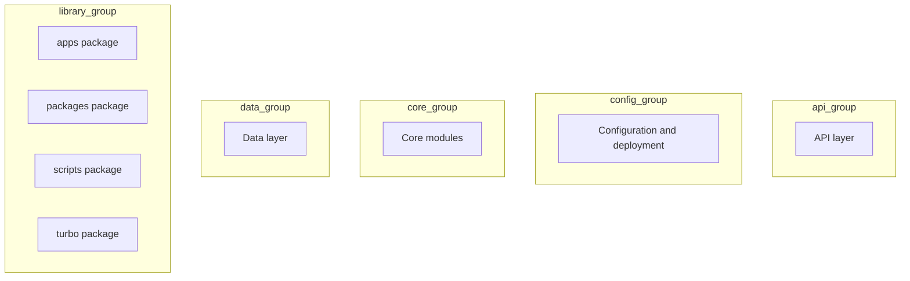

# Architecture report: vercel/next-forge

> Automated static analysis. **Observed** = directly seen in files/imports/AST; **Inferred** = interpretation from that evidence. Repository code was not executed.

## 1. Repository at a glance

| Item | Value |
| --- | --- |
| Repository | vercel/next-forge |
| Description | Production-grade Turborepo template for Next.js apps. |
| Language | TypeScript |
| Stars | 7778 |
| Licence | MIT |
| Analysed commit / branch | f189de79ceef7c1ef69f61f12e272f99b4cdb699 / main |
| Framework(s) | Next.js, React |
| Files analysed | 647 |
| Components | 8 |

## 2. Architecture in one minute

vercel/next-forge - Production-grade Turborepo template for Next.js apps.. This repository was analysed statically from 647 file(s) (0 Python). Detected technologies (observed from imports/manifests): GitHub Actions, Database (unspecified), Next.js, React, Prisma, Tailwind CSS. Files are grouped into 8 component(s): API layer, apps package, Configuration and deployment, Core modules, Data layer, packages package, scripts package, turbo package. Findings below distinguish observed facts from inferred interpretation.

## 3. High-level block diagram

## 4. Main components

### API layer (`api_layer`)

- **Kind:** api
- **Status:** Observed
- **Confidence:** 0.85
- **Responsibility:** Groups 15 file(s) under api layer (observed from repository paths and static analysis).
- **Paths:** `apps/api/__tests__/health.test.ts`, `apps/api/app/cron/keep-alive/route.ts`, `apps/api/app/global-error.tsx`, `apps/api/app/health/route.ts`, `apps/api/app/layout.tsx`, `apps/api/app/webhooks/auth/route.ts`, `apps/api/app/webhooks/payments/route.ts`, `apps/api/env.ts`, `apps/api/instrumentation-client.ts`, `apps/api/instrumentation.ts`, `apps/api/next.config.ts`, `apps/api/scripts/skip-ci.js`, `apps/api/sentry.edge.config.ts`, `apps/api/sentry.server.config.ts`, `apps/app/app/api/collaboration/auth/route.ts`
- **Evidence:** [apps/api/__tests__/health.test.ts](https://github.com/vercel/next-forge/blob/f189de79ceef7c1ef69f61f12e272f99b4cdb699/apps/api/__tests__/health.test.ts); [apps/api/app/cron/keep-alive/route.ts](https://github.com/vercel/next-forge/blob/f189de79ceef7c1ef69f61f12e272f99b4cdb699/apps/api/app/cron/keep-alive/route.ts); [apps/api/app/global-error.tsx](https://github.com/vercel/next-forge/blob/f189de79ceef7c1ef69f61f12e272f99b4cdb699/apps/api/app/global-error.tsx); [apps/api/app/health/route.ts](https://github.com/vercel/next-forge/blob/f189de79ceef7c1ef69f61f12e272f99b4cdb699/apps/api/app/health/route.ts); [apps/api/app/layout.tsx](https://github.com/vercel/next-forge/blob/f189de79ceef7c1ef69f61f12e272f99b4cdb699/apps/api/app/layout.tsx); [apps/api/app/webhooks/auth/route.ts](https://github.com/vercel/next-forge/blob/f189de79ceef7c1ef69f61f12e272f99b4cdb699/apps/api/app/webhooks/auth/route.ts); [apps/api/app/webhooks/payments/route.ts](https://github.com/vercel/next-forge/blob/f189de79ceef7c1ef69f61f12e272f99b4cdb699/apps/api/app/webhooks/payments/route.ts); [apps/api/env.ts](https://github.com/vercel/next-forge/blob/f189de79ceef7c1ef69f61f12e272f99b4cdb699/apps/api/env.ts)

### apps package (`apps`)

- **Kind:** library
- **Status:** Observed
- **Confidence:** 0.85
- **Responsibility:** Groups 116 file(s) under apps package (observed from repository paths and static analysis).
- **Paths:** `apps/app/__tests__/sign-in.test.tsx`, `apps/app/__tests__/sign-up.test.tsx`, `apps/app/app/(authenticated)/components/avatar-stack.tsx`, `apps/app/app/(authenticated)/components/collaboration-provider.tsx`, `apps/app/app/(authenticated)/components/cursors.tsx`, `apps/app/app/(authenticated)/components/header.tsx`, `apps/app/app/(authenticated)/components/notifications-provider.tsx`, `apps/app/app/(authenticated)/components/search.tsx`, `apps/app/app/(authenticated)/components/sidebar.tsx`, `apps/app/app/(authenticated)/layout.tsx`, `apps/app/app/(authenticated)/page.tsx`, `apps/app/app/(authenticated)/search/page.tsx`, `apps/app/app/(authenticated)/webhooks/page.tsx`, `apps/app/app/(unauthenticated)/layout.tsx`, `apps/app/app/(unauthenticated)/sign-in/[[...sign-in]]/page.tsx`, `apps/app/app/(unauthenticated)/sign-up/[[...sign-up]]/page.tsx`, `apps/app/app/.well-known/vercel/flags/route.ts`, `apps/app/app/actions/users/get.ts`, `apps/app/app/actions/users/search.ts`, `apps/app/app/global-error.tsx`, `apps/app/app/layout.tsx`, `apps/app/env.ts`, `apps/app/instrumentation-client.ts`, `apps/app/instrumentation.ts`, `apps/app/liveblocks.config.ts`, `apps/app/next.config.ts`, `apps/app/postcss.config.mjs`, `apps/app/proxy.ts`, `apps/app/scripts/skip-ci.js`, `apps/app/sentry.edge.config.ts`, `apps/app/sentry.server.config.ts`, `apps/storybook/.storybook/main.ts`, `apps/storybook/.storybook/preview.tsx`, `apps/storybook/next.config.ts`, `apps/storybook/postcss.config.mjs`, `apps/storybook/scripts/skip-ci.js`, `apps/storybook/stories/accordion.stories.tsx`, `apps/storybook/stories/alert-dialog.stories.tsx`, `apps/storybook/stories/alert.stories.tsx`, `apps/storybook/stories/aspect-ratio.stories.tsx`, `apps/storybook/stories/avatar.stories.tsx`, `apps/storybook/stories/badge.stories.tsx`, `apps/storybook/stories/breadcrumb.stories.tsx`, `apps/storybook/stories/button.stories.tsx`, `apps/storybook/stories/calendar.stories.tsx`, `apps/storybook/stories/card.stories.tsx`, `apps/storybook/stories/carousel.stories.tsx`, `apps/storybook/stories/chart.stories.tsx`, `apps/storybook/stories/checkbox.stories.tsx`, `apps/storybook/stories/collapsible.stories.tsx`, `apps/storybook/stories/command.stories.tsx`, `apps/storybook/stories/context-menu.stories.tsx`, `apps/storybook/stories/dialog.stories.tsx`, `apps/storybook/stories/drawer.stories.tsx`, `apps/storybook/stories/dropdown-menu.stories.tsx`, `apps/storybook/stories/form.stories.tsx`, `apps/storybook/stories/hover-card.stories.tsx`, `apps/storybook/stories/input-otp.stories.tsx`, `apps/storybook/stories/input.stories.tsx`, `apps/storybook/stories/label.stories.tsx`, `apps/storybook/stories/menubar.stories.tsx`, `apps/storybook/stories/navigation-menu.stories.tsx`, `apps/storybook/stories/pagination.stories.tsx`, `apps/storybook/stories/popover.stories.tsx`, `apps/storybook/stories/progress.stories.tsx`, `apps/storybook/stories/radio-group.stories.tsx`, `apps/storybook/stories/resizable.stories.tsx`, `apps/storybook/stories/scroll-area.stories.tsx`, `apps/storybook/stories/select.stories.tsx`, `apps/storybook/stories/separator.stories.tsx`, `apps/storybook/stories/sheet.stories.tsx`, `apps/storybook/stories/sidebar.stories.tsx`, `apps/storybook/stories/skeleton.stories.tsx`, `apps/storybook/stories/slider.stories.tsx`, `apps/storybook/stories/sonner.stories.tsx`, `apps/storybook/stories/switch.stories.tsx`, `apps/storybook/stories/table.stories.tsx`, `apps/storybook/stories/tabs.stories.tsx`, `apps/storybook/stories/textarea.stories.tsx`, `apps/storybook/stories/toggle-group.stories.tsx`, `apps/storybook/stories/toggle.stories.tsx`, `apps/storybook/stories/tooltip.stories.tsx`, `apps/web/app/.well-known/vercel/flags/route.ts`, `apps/web/app/[locale]/(home)/components/cases.tsx`, `apps/web/app/[locale]/(home)/components/cta.tsx`, `apps/web/app/[locale]/(home)/components/faq.tsx`, `apps/web/app/[locale]/(home)/components/features.tsx`, `apps/web/app/[locale]/(home)/components/hero.tsx`, `apps/web/app/[locale]/(home)/components/stats.tsx`, `apps/web/app/[locale]/(home)/components/testimonials.tsx`, `apps/web/app/[locale]/(home)/page.tsx`, `apps/web/app/[locale]/blog/[slug]/page.tsx`, `apps/web/app/[locale]/blog/page.tsx`, `apps/web/app/[locale]/components/footer.tsx`, `apps/web/app/[locale]/components/header/index.tsx`, `apps/web/app/[locale]/components/header/language-switcher.tsx`, `apps/web/app/[locale]/contact/actions/contact.tsx`, `apps/web/app/[locale]/contact/components/contact-form.tsx`, `apps/web/app/[locale]/contact/page.tsx`, `apps/web/app/[locale]/global-error.tsx`, `apps/web/app/[locale]/layout.tsx`, `apps/web/app/[locale]/legal/[slug]/page.tsx`, `apps/web/app/[locale]/legal/layout.tsx`, `apps/web/app/[locale]/pricing/page.tsx`, `apps/web/app/[locale]/robots.ts`, `apps/web/app/[locale]/sitemap.ts`, `apps/web/components/sidebar.tsx`, `apps/web/env.ts`, `apps/web/instrumentation-client.ts`, `apps/web/instrumentation.ts`, `apps/web/next.config.ts`, `apps/web/postcss.config.mjs`, `apps/web/proxy.ts`, `apps/web/scripts/skip-ci.js`, `apps/web/sentry.edge.config.ts`, `apps/web/sentry.server.config.ts`
- **Evidence:** [apps/app/__tests__/sign-in.test.tsx](https://github.com/vercel/next-forge/blob/f189de79ceef7c1ef69f61f12e272f99b4cdb699/apps/app/__tests__/sign-in.test.tsx); [apps/app/__tests__/sign-up.test.tsx](https://github.com/vercel/next-forge/blob/f189de79ceef7c1ef69f61f12e272f99b4cdb699/apps/app/__tests__/sign-up.test.tsx); [apps/app/app/(authenticated)/components/avatar-stack.tsx](https://github.com/vercel/next-forge/blob/f189de79ceef7c1ef69f61f12e272f99b4cdb699/apps/app/app/%28authenticated%29/components/avatar-stack.tsx); [apps/app/app/(authenticated)/components/collaboration-provider.tsx](https://github.com/vercel/next-forge/blob/f189de79ceef7c1ef69f61f12e272f99b4cdb699/apps/app/app/%28authenticated%29/components/collaboration-provider.tsx); [apps/app/app/(authenticated)/components/cursors.tsx](https://github.com/vercel/next-forge/blob/f189de79ceef7c1ef69f61f12e272f99b4cdb699/apps/app/app/%28authenticated%29/components/cursors.tsx); [apps/app/app/(authenticated)/components/header.tsx](https://github.com/vercel/next-forge/blob/f189de79ceef7c1ef69f61f12e272f99b4cdb699/apps/app/app/%28authenticated%29/components/header.tsx); [apps/app/app/(authenticated)/components/notifications-provider.tsx](https://github.com/vercel/next-forge/blob/f189de79ceef7c1ef69f61f12e272f99b4cdb699/apps/app/app/%28authenticated%29/components/notifications-provider.tsx); [apps/app/app/(authenticated)/components/search.tsx](https://github.com/vercel/next-forge/blob/f189de79ceef7c1ef69f61f12e272f99b4cdb699/apps/app/app/%28authenticated%29/components/search.tsx)

### Configuration and deployment (`config`)

- **Kind:** config
- **Status:** Observed
- **Confidence:** 0.85
- **Responsibility:** Groups 79 file(s) under configuration and deployment (observed from repository paths and static analysis).
- **Paths:** `apps/api/.env.example`, `apps/api/package.json`, `apps/api/tsconfig.json`, `apps/api/vercel.json`, `apps/app/.env.example`, `apps/app/package.json`, `apps/app/tsconfig.json`, `apps/app/vercel.json`, `apps/docs/api-reference/openapi.json`, `apps/docs/mint.json`, `apps/docs/package.json`, `apps/email/package.json`, `apps/email/tsconfig.json`, `apps/storybook/package.json`, `apps/storybook/tsconfig.json`, `apps/storybook/vercel.json`, `apps/studio/package.json`, `apps/studio/tsconfig.json`, `apps/web/.env.example`, `apps/web/package.json`, `apps/web/tsconfig.json`, `apps/web/vercel.json`, `package.json`, `packages/ai/package.json`, `packages/ai/tsconfig.json`, `packages/analytics/package.json`, `packages/analytics/tsconfig.json`, `packages/auth/package.json`, `packages/auth/tsconfig.json`, `packages/cms/.env.example`, `packages/cms/package.json`, `packages/cms/tsconfig.json`, `packages/cms/typescript-config.json`, `packages/collaboration/package.json`, `packages/collaboration/tsconfig.json`, `packages/database/.env.example`, `packages/database/package.json`, `packages/database/tsconfig.json`, `packages/design-system/components.json`, `packages/design-system/package.json`, `packages/design-system/tsconfig.json`, `packages/email/package.json`, `packages/email/tsconfig.json`, `packages/feature-flags/package.json`, `packages/feature-flags/tsconfig.json`, `packages/internationalization/.env.example`, `packages/internationalization/dictionaries/de.json`, `packages/internationalization/dictionaries/en.json`, `packages/internationalization/dictionaries/es.json`, `packages/internationalization/dictionaries/fr.json`, `packages/internationalization/dictionaries/pt.json`, `packages/internationalization/dictionaries/zh.json`, `packages/internationalization/languine.json`, `packages/internationalization/package.json`, `packages/internationalization/tsconfig.json`, `packages/next-config/package.json`, `packages/next-config/tsconfig.json`, `packages/notifications/package.json`, `packages/notifications/tsconfig.json`, `packages/observability/package.json`, `packages/observability/tsconfig.json`, `packages/payments/package.json`, `packages/payments/tsconfig.json`, `packages/rate-limit/package.json`, `packages/security/package.json`, `packages/security/tsconfig.json`, `packages/seo/package.json`, `packages/seo/tsconfig.json`, `packages/storage/package.json`, `packages/storage/tsconfig.json`, `packages/typescript-config/base.json`, `packages/typescript-config/nextjs.json`, `packages/typescript-config/package.json`, `packages/typescript-config/react-library.json`, `packages/webhooks/package.json`, `packages/webhooks/tsconfig.json`, `tsconfig.json`, `turbo.json`, `turbo/generators/package.json`
- **Evidence:** [apps/api/.env.example](https://github.com/vercel/next-forge/blob/f189de79ceef7c1ef69f61f12e272f99b4cdb699/apps/api/.env.example); [apps/api/package.json](https://github.com/vercel/next-forge/blob/f189de79ceef7c1ef69f61f12e272f99b4cdb699/apps/api/package.json); [apps/api/tsconfig.json](https://github.com/vercel/next-forge/blob/f189de79ceef7c1ef69f61f12e272f99b4cdb699/apps/api/tsconfig.json); [apps/api/vercel.json](https://github.com/vercel/next-forge/blob/f189de79ceef7c1ef69f61f12e272f99b4cdb699/apps/api/vercel.json); [apps/app/.env.example](https://github.com/vercel/next-forge/blob/f189de79ceef7c1ef69f61f12e272f99b4cdb699/apps/app/.env.example); [apps/app/package.json](https://github.com/vercel/next-forge/blob/f189de79ceef7c1ef69f61f12e272f99b4cdb699/apps/app/package.json); [apps/app/tsconfig.json](https://github.com/vercel/next-forge/blob/f189de79ceef7c1ef69f61f12e272f99b4cdb699/apps/app/tsconfig.json); [apps/app/vercel.json](https://github.com/vercel/next-forge/blob/f189de79ceef7c1ef69f61f12e272f99b4cdb699/apps/app/vercel.json)

### Core modules (`core`)

- **Kind:** core
- **Status:** Observed
- **Confidence:** 0.85
- **Responsibility:** Groups 1 file(s) under core modules (observed from repository paths and static analysis).
- **Paths:** `tsup.config.ts`
- **Evidence:** [tsup.config.ts](https://github.com/vercel/next-forge/blob/f189de79ceef7c1ef69f61f12e272f99b4cdb699/tsup.config.ts)

### Data layer (`data_layer`)

- **Kind:** data
- **Status:** Observed
- **Confidence:** 0.85
- **Responsibility:** Groups 6 file(s) under data layer (observed from repository paths and static analysis).
- **Paths:** `packages/database/index.ts`, `packages/database/keys.ts`, `packages/database/prisma.config.ts`, `packages/storage/client.ts`, `packages/storage/index.ts`, `packages/storage/keys.ts`
- **Evidence:** [packages/database/index.ts](https://github.com/vercel/next-forge/blob/f189de79ceef7c1ef69f61f12e272f99b4cdb699/packages/database/index.ts); [packages/database/keys.ts](https://github.com/vercel/next-forge/blob/f189de79ceef7c1ef69f61f12e272f99b4cdb699/packages/database/keys.ts); [packages/database/prisma.config.ts](https://github.com/vercel/next-forge/blob/f189de79ceef7c1ef69f61f12e272f99b4cdb699/packages/database/prisma.config.ts); [packages/storage/client.ts](https://github.com/vercel/next-forge/blob/f189de79ceef7c1ef69f61f12e272f99b4cdb699/packages/storage/client.ts); [packages/storage/index.ts](https://github.com/vercel/next-forge/blob/f189de79ceef7c1ef69f61f12e272f99b4cdb699/packages/storage/index.ts); [packages/storage/keys.ts](https://github.com/vercel/next-forge/blob/f189de79ceef7c1ef69f61f12e272f99b4cdb699/packages/storage/keys.ts)

### packages package (`packages`)

- **Kind:** library
- **Status:** Observed
- **Confidence:** 0.85
- **Responsibility:** Groups 134 file(s) under packages package (observed from repository paths and static analysis).
- **Paths:** `packages/ai/components/message.tsx`, `packages/ai/components/thread.tsx`, `packages/ai/index.ts`, `packages/ai/keys.ts`, `packages/ai/lib/models.ts`, `packages/ai/lib/react.ts`, `packages/analytics/index.ts`, `packages/analytics/instrumentation-client.ts`, `packages/analytics/keys.ts`, `packages/analytics/provider.tsx`, `packages/analytics/server.ts`, `packages/auth/client.ts`, `packages/auth/components/sign-in.tsx`, `packages/auth/components/sign-up.tsx`, `packages/auth/keys.ts`, `packages/auth/provider.tsx`, `packages/auth/proxy.ts`, `packages/auth/server.ts`, `packages/cms/basehub-types.d.ts`, `packages/cms/basehub.config.ts`, `packages/cms/components/body.tsx`, `packages/cms/components/code-block.tsx`, `packages/cms/components/feed.tsx`, `packages/cms/components/image.tsx`, `packages/cms/components/toc.tsx`, `packages/cms/components/toolbar.tsx`, `packages/cms/index.ts`, `packages/cms/keys.ts`, `packages/cms/next-config.ts`, `packages/collaboration/auth.ts`, `packages/collaboration/config.ts`, `packages/collaboration/hooks.ts`, `packages/collaboration/keys.ts`, `packages/collaboration/room.tsx`, `packages/design-system/components/mode-toggle.tsx`, `packages/design-system/components/ui/accordion.tsx`, `packages/design-system/components/ui/alert-dialog.tsx`, `packages/design-system/components/ui/alert.tsx`, `packages/design-system/components/ui/aspect-ratio.tsx`, `packages/design-system/components/ui/avatar.tsx`, `packages/design-system/components/ui/badge.tsx`, `packages/design-system/components/ui/breadcrumb.tsx`, `packages/design-system/components/ui/button-group.tsx`, `packages/design-system/components/ui/button.tsx`, `packages/design-system/components/ui/calendar.tsx`, `packages/design-system/components/ui/card.tsx`, `packages/design-system/components/ui/carousel.tsx`, `packages/design-system/components/ui/chart.tsx`, `packages/design-system/components/ui/checkbox.tsx`, `packages/design-system/components/ui/collapsible.tsx`, `packages/design-system/components/ui/command.tsx`, `packages/design-system/components/ui/context-menu.tsx`, `packages/design-system/components/ui/dialog.tsx`, `packages/design-system/components/ui/drawer.tsx`, `packages/design-system/components/ui/dropdown-menu.tsx`, `packages/design-system/components/ui/empty.tsx`, `packages/design-system/components/ui/field.tsx`, `packages/design-system/components/ui/form.tsx`, `packages/design-system/components/ui/hover-card.tsx`, `packages/design-system/components/ui/input-group.tsx`, `packages/design-system/components/ui/input-otp.tsx`, `packages/design-system/components/ui/input.tsx`, `packages/design-system/components/ui/item.tsx`, `packages/design-system/components/ui/kbd.tsx`, `packages/design-system/components/ui/label.tsx`, `packages/design-system/components/ui/menubar.tsx`, `packages/design-system/components/ui/navigation-menu.tsx`, `packages/design-system/components/ui/pagination.tsx`, `packages/design-system/components/ui/popover.tsx`, `packages/design-system/components/ui/progress.tsx`, `packages/design-system/components/ui/radio-group.tsx`, `packages/design-system/components/ui/resizable.tsx`, `packages/design-system/components/ui/scroll-area.tsx`, `packages/design-system/components/ui/select.tsx`, `packages/design-system/components/ui/separator.tsx`, `packages/design-system/components/ui/sheet.tsx`, `packages/design-system/components/ui/sidebar.tsx`, `packages/design-system/components/ui/skeleton.tsx`, `packages/design-system/components/ui/slider.tsx`, `packages/design-system/components/ui/sonner.tsx`, `packages/design-system/components/ui/spinner.tsx`, `packages/design-system/components/ui/switch.tsx`, `packages/design-system/components/ui/table.tsx`, `packages/design-system/components/ui/tabs.tsx`, `packages/design-system/components/ui/textarea.tsx`, `packages/design-system/components/ui/toggle-group.tsx`, `packages/design-system/components/ui/toggle.tsx`, `packages/design-system/components/ui/tooltip.tsx`, `packages/design-system/hooks/use-mobile.ts`, `packages/design-system/index.tsx`, `packages/design-system/lib/fonts.ts`, `packages/design-system/lib/utils.ts`, `packages/design-system/postcss.config.mjs`, `packages/design-system/providers/theme.tsx`, `packages/email/index.ts`, `packages/email/keys.ts`, `packages/email/templates/contact.tsx`, `packages/feature-flags/access.ts`, `packages/feature-flags/components/toolbar.tsx`, `packages/feature-flags/index.ts`, `packages/feature-flags/keys.ts`, `packages/feature-flags/lib/create-flag.ts`, `packages/feature-flags/lib/toolbar.ts`, `packages/internationalization/index.ts`, `packages/internationalization/proxy.ts`, `packages/next-config/index.ts`, `packages/next-config/keys.ts`, `packages/notifications/components/provider.tsx`, `packages/notifications/components/trigger.tsx`, `packages/notifications/index.ts`, `packages/notifications/keys.ts`, `packages/observability/client.ts`, `packages/observability/edge.ts`, `packages/observability/error.ts`, `packages/observability/instrumentation.ts`, `packages/observability/keys.ts`, `packages/observability/log.ts`, `packages/observability/next-config.ts`, `packages/observability/server.ts`, `packages/observability/status/index.tsx`, `packages/observability/status/types.ts`, `packages/payments/ai.ts`, `packages/payments/index.ts`, `packages/payments/keys.ts`, `packages/rate-limit/index.ts`, `packages/rate-limit/keys.ts`, `packages/security/index.ts`, `packages/security/keys.ts`, `packages/security/proxy.ts`, `packages/seo/json-ld.tsx`, `packages/seo/metadata.ts`, `packages/webhooks/index.ts`, `packages/webhooks/keys.ts`, `packages/webhooks/lib/svix.ts`
- **Evidence:** [packages/ai/components/message.tsx](https://github.com/vercel/next-forge/blob/f189de79ceef7c1ef69f61f12e272f99b4cdb699/packages/ai/components/message.tsx); [packages/ai/components/thread.tsx](https://github.com/vercel/next-forge/blob/f189de79ceef7c1ef69f61f12e272f99b4cdb699/packages/ai/components/thread.tsx); [packages/ai/index.ts](https://github.com/vercel/next-forge/blob/f189de79ceef7c1ef69f61f12e272f99b4cdb699/packages/ai/index.ts); [packages/ai/keys.ts](https://github.com/vercel/next-forge/blob/f189de79ceef7c1ef69f61f12e272f99b4cdb699/packages/ai/keys.ts); [packages/ai/lib/models.ts](https://github.com/vercel/next-forge/blob/f189de79ceef7c1ef69f61f12e272f99b4cdb699/packages/ai/lib/models.ts); [packages/ai/lib/react.ts](https://github.com/vercel/next-forge/blob/f189de79ceef7c1ef69f61f12e272f99b4cdb699/packages/ai/lib/react.ts); [packages/analytics/index.ts](https://github.com/vercel/next-forge/blob/f189de79ceef7c1ef69f61f12e272f99b4cdb699/packages/analytics/index.ts); [packages/analytics/instrumentation-client.ts](https://github.com/vercel/next-forge/blob/f189de79ceef7c1ef69f61f12e272f99b4cdb699/packages/analytics/instrumentation-client.ts)

### scripts package (`scripts`)

- **Kind:** library
- **Status:** Observed
- **Confidence:** 0.85
- **Responsibility:** Groups 4 file(s) under scripts package (observed from repository paths and static analysis).
- **Paths:** `scripts/index.ts`, `scripts/initialize.ts`, `scripts/update.ts`, `scripts/utils.ts`
- **Evidence:** [scripts/index.ts](https://github.com/vercel/next-forge/blob/f189de79ceef7c1ef69f61f12e272f99b4cdb699/scripts/index.ts); [scripts/initialize.ts](https://github.com/vercel/next-forge/blob/f189de79ceef7c1ef69f61f12e272f99b4cdb699/scripts/initialize.ts); [scripts/update.ts](https://github.com/vercel/next-forge/blob/f189de79ceef7c1ef69f61f12e272f99b4cdb699/scripts/update.ts); [scripts/utils.ts](https://github.com/vercel/next-forge/blob/f189de79ceef7c1ef69f61f12e272f99b4cdb699/scripts/utils.ts)

### turbo package (`turbo`)

- **Kind:** library
- **Status:** Observed
- **Confidence:** 0.85
- **Responsibility:** Groups 1 file(s) under turbo package (observed from repository paths and static analysis).
- **Paths:** `turbo/generators/config.ts`
- **Evidence:** [turbo/generators/config.ts](https://github.com/vercel/next-forge/blob/f189de79ceef7c1ef69f61f12e272f99b4cdb699/turbo/generators/config.ts)

## 5. Execution flow

**Observed** entry point(s):

- [apps/storybook/.storybook/main.ts](https://github.com/vercel/next-forge/blob/f189de79ceef7c1ef69f61f12e272f99b4cdb699/apps/storybook/.storybook/main.ts)
- [packages/ai/index.ts](https://github.com/vercel/next-forge/blob/f189de79ceef7c1ef69f61f12e272f99b4cdb699/packages/ai/index.ts)
- [packages/analytics/index.ts](https://github.com/vercel/next-forge/blob/f189de79ceef7c1ef69f61f12e272f99b4cdb699/packages/analytics/index.ts)
- [packages/analytics/server.ts](https://github.com/vercel/next-forge/blob/f189de79ceef7c1ef69f61f12e272f99b4cdb699/packages/analytics/server.ts)
- [packages/auth/server.ts](https://github.com/vercel/next-forge/blob/f189de79ceef7c1ef69f61f12e272f99b4cdb699/packages/auth/server.ts)
- [packages/cms/index.ts](https://github.com/vercel/next-forge/blob/f189de79ceef7c1ef69f61f12e272f99b4cdb699/packages/cms/index.ts)
- [packages/database/index.ts](https://github.com/vercel/next-forge/blob/f189de79ceef7c1ef69f61f12e272f99b4cdb699/packages/database/index.ts)
- [packages/design-system/index.tsx](https://github.com/vercel/next-forge/blob/f189de79ceef7c1ef69f61f12e272f99b4cdb699/packages/design-system/index.tsx)
- [packages/email/index.ts](https://github.com/vercel/next-forge/blob/f189de79ceef7c1ef69f61f12e272f99b4cdb699/packages/email/index.ts)
- [packages/feature-flags/index.ts](https://github.com/vercel/next-forge/blob/f189de79ceef7c1ef69f61f12e272f99b4cdb699/packages/feature-flags/index.ts)
- [packages/internationalization/index.ts](https://github.com/vercel/next-forge/blob/f189de79ceef7c1ef69f61f12e272f99b4cdb699/packages/internationalization/index.ts)
- [packages/next-config/index.ts](https://github.com/vercel/next-forge/blob/f189de79ceef7c1ef69f61f12e272f99b4cdb699/packages/next-config/index.ts)

Representative flow (derived from observed entry points and the import graph; steps beyond the entry point are **Inferred**):

1. Execution starts at an observed entry point listed above, if present.
2. No internal import relationships between components were observed.

## 6. Project structure

### `(root)`

- `.autorc` - other (201 bytes)
- `.cursorrules.example` - other (1421 bytes)
- `.gitignore` - other (4099 bytes)
- `CHANGELOG.md` - docs (127009 bytes)
- `README.md` - docs (5024 bytes)
- `biome.jsonc` - other (641 bytes)
- `license.md` - docs (1062 bytes)
- `package.json` - manifest (1756 bytes)
- `tsconfig.json` - config (562 bytes)
- `tsup.config.ts` - source, TypeScript (196 bytes)
- `turbo.json` - config (714 bytes)

### `.github`

- `.github/CODE_OF_CONDUCT.md` - docs (5220 bytes)
- `.github/CONTRIBUTING.md` - docs (1554 bytes)
- `.github/ISSUE_TEMPLATE/bug_report.md` - docs (629 bytes)
- `.github/ISSUE_TEMPLATE/feature_request.md` - docs (511 bytes)
- `.github/SECURITY.md` - docs (198 bytes)
- `.github/copilot-instructions.md.example` - other (1333 bytes)
- `.github/dependabot.yml` - config (404 bytes)
- `.github/pull_request_template.md` - docs (753 bytes)
- `.github/workflows/release.yml` - ci, YAML (950 bytes)

### `.vscode`

- `.vscode/extensions.json` - config (198 bytes)
- `.vscode/launch.json` - config (1570 bytes)
- `.vscode/settings.json` - config (752 bytes)

### `apps`

- `apps/api/.env.example` - config (796 bytes)
- `apps/api/.gitignore` - other (8 bytes)
- `apps/api/__tests__/health.test.ts` - source, TypeScript (235 bytes)
- `apps/api/app/cron/keep-alive/route.ts` - source, TypeScript (304 bytes)
- `apps/api/app/global-error.tsx` - source, TypeScript (744 bytes)
- `apps/api/app/health/route.ts` - source, TypeScript (72 bytes)
- `apps/api/app/layout.tsx` - source, TypeScript (371 bytes)
- `apps/api/app/webhooks/auth/route.ts` - source, TypeScript (5770 bytes)
- `apps/api/app/webhooks/payments/route.ts` - source, TypeScript (2757 bytes)
- `apps/api/env.ts` - source, TypeScript (706 bytes)
- `apps/api/instrumentation-client.ts` - source, TypeScript (256 bytes)
- `apps/api/instrumentation.ts` - source, TypeScript (185 bytes)
- `apps/api/next.config.ts` - source, TypeScript (415 bytes)
- `apps/api/package.json` - manifest (1368 bytes)
- `apps/api/scripts/skip-ci.js` - source, JavaScript (344 bytes)
- `apps/api/sentry.edge.config.ts` - source, TypeScript (82 bytes)
- `apps/api/sentry.server.config.ts` - source, TypeScript (84 bytes)
- `apps/api/tsconfig.json` - config (304 bytes)
- `apps/api/vercel.json` - config (220 bytes)
- `apps/api/vitest.config.mts` - other (374 bytes)
- `apps/app/.env.example` - config (886 bytes)
- `apps/app/.gitignore` - other (62 bytes)
- `apps/app/__tests__/sign-in.test.tsx` - source, TypeScript (272 bytes)
- `apps/app/__tests__/sign-up.test.tsx` - source, TypeScript (272 bytes)
- `apps/app/app/(authenticated)/components/avatar-stack.tsx` - source, TypeScript (1471 bytes)
- `apps/app/app/(authenticated)/components/collaboration-provider.tsx` - source, TypeScript (1160 bytes)
- `apps/app/app/(authenticated)/components/cursors.tsx` - source, TypeScript (2919 bytes)
- `apps/app/app/(authenticated)/components/header.tsx` - source, TypeScript (1411 bytes)
- `apps/app/app/(authenticated)/components/notifications-provider.tsx` - source, TypeScript (611 bytes)
- `apps/app/app/(authenticated)/components/search.tsx` - source, TypeScript (893 bytes)
- `apps/app/app/(authenticated)/components/sidebar.tsx` - source, TypeScript (9919 bytes)
- `apps/app/app/(authenticated)/layout.tsx` - source, TypeScript (1246 bytes)
- `apps/app/app/(authenticated)/page.tsx` - source, TypeScript (1543 bytes)
- `apps/app/app/(authenticated)/search/page.tsx` - source, TypeScript (1368 bytes)
- `apps/app/app/(authenticated)/webhooks/page.tsx` - source, TypeScript (605 bytes)
- `apps/app/app/(unauthenticated)/layout.tsx` - source, TypeScript (1443 bytes)
- `apps/app/app/(unauthenticated)/sign-in/[[...sign-in]]/page.tsx` - source, TypeScript (453 bytes)
- `apps/app/app/(unauthenticated)/sign-up/[[...sign-up]]/page.tsx` - source, TypeScript (462 bytes)
- `apps/app/app/.well-known/vercel/flags/route.ts` - source, TypeScript (85 bytes)
- `apps/app/app/actions/users/get.ts` - source, TypeScript (1833 bytes)
- `apps/app/app/actions/users/search.ts` - source, TypeScript (1338 bytes)
- `apps/app/app/api/collaboration/auth/route.ts` - source, TypeScript (1088 bytes)
- `apps/app/app/global-error.tsx` - source, TypeScript (744 bytes)
- `apps/app/app/layout.tsx` - source, TypeScript (1002 bytes)
- `apps/app/app/styles.css` - other (73 bytes)
- `apps/app/env.ts` - source, TypeScript (1023 bytes)
- `apps/app/instrumentation-client.ts` - source, TypeScript (256 bytes)
- `apps/app/instrumentation.ts` - source, TypeScript (185 bytes)
- `apps/app/liveblocks.config.ts` - source, TypeScript (44 bytes)
- `apps/app/next.config.ts` - source, TypeScript (491 bytes)
- `apps/app/package.json` - manifest (1626 bytes)
- `apps/app/postcss.config.mjs` - source, JavaScript (66 bytes)
- `apps/app/proxy.ts` - source, TypeScript (966 bytes)
- `apps/app/scripts/skip-ci.js` - source, JavaScript (344 bytes)
- `apps/app/sentry.edge.config.ts` - source, TypeScript (82 bytes)
- `apps/app/sentry.server.config.ts` - source, TypeScript (84 bytes)
- `apps/app/tsconfig.json` - config (304 bytes)
- `apps/app/vercel.json` - config (126 bytes)
- `apps/app/vitest.config.mts` - other (374 bytes)
- `apps/docs/api-reference/endpoint/create.mdx` - docs (54 bytes)
- `apps/docs/api-reference/endpoint/delete.mdx` - docs (61 bytes)
- `apps/docs/api-reference/endpoint/get.mdx` - docs (51 bytes)
- `apps/docs/api-reference/introduction.mdx` - docs (875 bytes)
- `apps/docs/api-reference/openapi.json` - config (4588 bytes)
- `apps/docs/development.mdx` - docs (2246 bytes)
- `apps/docs/essentials/code.mdx` - docs (906 bytes)
- `apps/docs/essentials/images.mdx` - docs (1553 bytes)
- `apps/docs/essentials/markdown.mdx` - docs (2567 bytes)
- `apps/docs/essentials/navigation.mdx` - docs (1716 bytes)
- `apps/docs/essentials/reusable-snippets.mdx` - docs (2574 bytes)
- `apps/docs/essentials/settings.mdx` - docs (11389 bytes)
- `apps/docs/favicon.svg` - docs (5461 bytes)
- `apps/docs/images/hero-dark.svg` - docs (12333 bytes)
- `apps/docs/images/hero-light.svg` - docs (10458 bytes)
- `apps/docs/introduction.mdx` - docs (1637 bytes)
- `apps/docs/logo/dark.svg` - docs (9513 bytes)
- `apps/docs/logo/light.svg` - docs (9201 bytes)
- `apps/docs/mint.json` - config (1822 bytes)
- `apps/docs/package.json` - manifest (190 bytes)
- `apps/docs/quickstart.mdx` - docs (2934 bytes)
- `apps/docs/snippets/snippet-intro.mdx` - docs (284 bytes)
- `apps/email/package.json` - manifest (787 bytes)
- `apps/email/tsconfig.json` - config (124 bytes)
- `apps/storybook/.storybook/main.ts` - source, TypeScript (890 bytes)
- `apps/storybook/.storybook/preview-head.html` - other (560 bytes)
- `apps/storybook/.storybook/preview.tsx` - source, TypeScript (1161 bytes)
- `apps/storybook/README.md` - docs (1900 bytes)
- `apps/storybook/next.config.ts` - source, TypeScript (130 bytes)
- `apps/storybook/package.json` - manifest (1218 bytes)
- `apps/storybook/postcss.config.mjs` - source, JavaScript (135 bytes)
- `apps/storybook/scripts/skip-ci.js` - source, JavaScript (344 bytes)
- `apps/storybook/stories/accordion.stories.tsx` - source, TypeScript (1594 bytes)
- `apps/storybook/stories/alert-dialog.stories.tsx` - source, TypeScript (1437 bytes)
- `apps/storybook/stories/alert.stories.tsx` - source, TypeScript (1270 bytes)
- `apps/storybook/stories/aspect-ratio.stories.tsx` - source, TypeScript (1413 bytes)
- `apps/storybook/stories/avatar.stories.tsx` - source, TypeScript (706 bytes)
- `apps/storybook/stories/badge.stories.tsx` - source, TypeScript (1208 bytes)
- `apps/storybook/stories/breadcrumb.stories.tsx` - source, TypeScript (1934 bytes)
- `apps/storybook/stories/button.stories.tsx` - source, TypeScript (3136 bytes)
- `apps/storybook/stories/calendar.stories.tsx` - source, TypeScript (1609 bytes)
- `apps/storybook/stories/card.stories.tsx` - source, TypeScript (1688 bytes)
- `apps/storybook/stories/carousel.stories.tsx` - source, TypeScript (2007 bytes)
- `apps/storybook/stories/chart.stories.tsx` - source, TypeScript (6613 bytes)
- `apps/storybook/stories/checkbox.stories.tsx` - source, TypeScript (1079 bytes)
- `apps/storybook/stories/collapsible.stories.tsx` - source, TypeScript (1224 bytes)
- `apps/storybook/stories/command.stories.tsx` - source, TypeScript (1362 bytes)
- `apps/storybook/stories/context-menu.stories.tsx` - source, TypeScript (4682 bytes)
- `apps/storybook/stories/dialog.stories.tsx` - source, TypeScript (1538 bytes)
- `apps/storybook/stories/drawer.stories.tsx` - source, TypeScript (1305 bytes)
- `apps/storybook/stories/dropdown-menu.stories.tsx` - source, TypeScript (4754 bytes)
- `apps/storybook/stories/form.stories.tsx` - source, TypeScript (2149 bytes)
- `apps/storybook/stories/hover-card.stories.tsx` - source, TypeScript (1024 bytes)
- `apps/storybook/stories/input-otp.stories.tsx` - source, TypeScript (1607 bytes)
- `apps/storybook/stories/input.stories.tsx` - source, TypeScript (2020 bytes)
- `apps/storybook/stories/label.stories.tsx` - source, TypeScript (582 bytes)
- `apps/storybook/stories/menubar.stories.tsx` - source, TypeScript (3212 bytes)
- `apps/storybook/stories/navigation-menu.stories.tsx` - source, TypeScript (2274 bytes)
- `apps/storybook/stories/pagination.stories.tsx` - source, TypeScript (1356 bytes)
- `apps/storybook/stories/popover.stories.tsx` - source, TypeScript (735 bytes)
- `apps/storybook/stories/progress.stories.tsx` - source, TypeScript (802 bytes)
- `apps/storybook/stories/radio-group.stories.tsx` - source, TypeScript (1033 bytes)
- `apps/storybook/stories/resizable.stories.tsx` - source, TypeScript (1694 bytes)
- `apps/storybook/stories/scroll-area.stories.tsx` - source, TypeScript (1737 bytes)
- `apps/storybook/stories/select.stories.tsx` - source, TypeScript (2052 bytes)
- `apps/storybook/stories/separator.stories.tsx` - source, TypeScript (868 bytes)
- `apps/storybook/stories/sheet.stories.tsx` - source, TypeScript (1657 bytes)
- `apps/storybook/stories/sidebar.stories.tsx` - source, TypeScript (16228 bytes)
- `apps/storybook/stories/skeleton.stories.tsx` - source, TypeScript (828 bytes)
- `apps/storybook/stories/slider.stories.tsx` - source, TypeScript (815 bytes)
- `apps/storybook/stories/sonner.stories.tsx` - source, TypeScript (1114 bytes)
- `apps/storybook/stories/switch.stories.tsx` - source, TypeScript (948 bytes)
- `apps/storybook/stories/table.stories.tsx` - source, TypeScript (1887 bytes)
- `apps/storybook/stories/tabs.stories.tsx` - source, TypeScript (1065 bytes)
- `apps/storybook/stories/textarea.stories.tsx` - source, TypeScript (1893 bytes)
- `apps/storybook/stories/toggle-group.stories.tsx` - source, TypeScript (2223 bytes)
- `apps/storybook/stories/toggle.stories.tsx` - source, TypeScript (1749 bytes)
- `apps/storybook/stories/tooltip.stories.tsx` - source, TypeScript (1675 bytes)
- `apps/storybook/tsconfig.json` - config (222 bytes)
- `apps/storybook/vercel.json` - config (126 bytes)
- `apps/studio/package.json` - manifest (328 bytes)
- `apps/studio/tsconfig.json` - config (124 bytes)
- `apps/web/.env.example` - config (840 bytes)
- `apps/web/.gitignore` - other (8 bytes)
- `apps/web/app/.well-known/vercel/flags/route.ts` - source, TypeScript (85 bytes)
- `apps/web/app/[locale]/(home)/components/cases.tsx` - source, TypeScript (1735 bytes)
- `apps/web/app/[locale]/(home)/components/cta.tsx` - source, TypeScript (1471 bytes)
- `apps/web/app/[locale]/(home)/components/faq.tsx` - source, TypeScript (1862 bytes)
- `apps/web/app/[locale]/(home)/components/features.tsx` - source, TypeScript (3126 bytes)
- `apps/web/app/[locale]/(home)/components/hero.tsx` - source, TypeScript (1950 bytes)
- `apps/web/app/[locale]/(home)/components/stats.tsx` - source, TypeScript (2278 bytes)
- `apps/web/app/[locale]/(home)/components/testimonials.tsx` - source, TypeScript (2690 bytes)
- `apps/web/app/[locale]/(home)/page.tsx` - source, TypeScript (1503 bytes)
- `apps/web/app/[locale]/blog/[slug]/page.tsx` - source, TypeScript (4712 bytes)
- `apps/web/app/[locale]/blog/page.tsx` - source, TypeScript (3318 bytes)
- `apps/web/app/[locale]/components/footer.tsx` - source, TypeScript (3702 bytes)
- `apps/web/app/[locale]/components/header/index.tsx` - source, TypeScript (7779 bytes)
- `apps/web/app/[locale]/components/header/language-switcher.tsx` - source, TypeScript (1978 bytes)
- `apps/web/app/[locale]/contact/actions/contact.tsx` - source, TypeScript (1371 bytes)
- `apps/web/app/[locale]/contact/components/contact-form.tsx` - source, TypeScript (4657 bytes)
- `apps/web/app/[locale]/contact/page.tsx` - source, TypeScript (737 bytes)
- `apps/web/app/[locale]/global-error.tsx` - source, TypeScript (744 bytes)
- `apps/web/app/[locale]/layout.tsx` - source, TypeScript (1323 bytes)
- `apps/web/app/[locale]/legal/[slug]/page.tsx` - source, TypeScript (2678 bytes)
- `apps/web/app/[locale]/legal/layout.tsx` - source, TypeScript (284 bytes)
- `apps/web/app/[locale]/pricing/page.tsx` - source, TypeScript (7086 bytes)
- `apps/web/app/[locale]/robots.ts` - source, TypeScript (433 bytes)
- `apps/web/app/[locale]/sitemap.ts` - source, TypeScript (1196 bytes)
- `apps/web/app/[locale]/styles.css` - other (682 bytes)
- `apps/web/components/sidebar.tsx` - source, TypeScript (1490 bytes)
- `apps/web/env.ts` - source, TypeScript (703 bytes)
- `apps/web/instrumentation-client.ts` - source, TypeScript (256 bytes)
- `apps/web/instrumentation.ts` - source, TypeScript (185 bytes)
- `apps/web/next.config.ts` - source, TypeScript (897 bytes)
- `apps/web/package.json` - manifest (1563 bytes)
- `apps/web/postcss.config.mjs` - source, JavaScript (66 bytes)
- `apps/web/proxy.ts` - source, TypeScript (2269 bytes)
- `apps/web/scripts/skip-ci.js` - source, JavaScript (344 bytes)
- `apps/web/sentry.edge.config.ts` - source, TypeScript (82 bytes)
- `apps/web/sentry.server.config.ts` - source, TypeScript (84 bytes)
- `apps/web/tsconfig.json` - config (354 bytes)
- `apps/web/vercel.json` - config (126 bytes)

### `docs`

- `docs/.env.example` - config (174 bytes)
- `docs/.gitignore` - docs (258 bytes)
- `docs/README.md` - docs (1003 bytes)
- `docs/app/[lang]/(home)/components/apps/index.tsx` - docs (3565 bytes)
- `docs/app/[lang]/(home)/components/cta.tsx` - docs (883 bytes)
- `docs/app/[lang]/(home)/components/demo.tsx` - docs (825 bytes)
- `docs/app/[lang]/(home)/components/features/arcjet.svg` - docs (591 bytes)
- `docs/app/[lang]/(home)/components/features/basehub.svg` - docs (2399 bytes)
- `docs/app/[lang]/(home)/components/features/better-stack.svg` - docs (1300 bytes)
- `docs/app/[lang]/(home)/components/features/clerk.svg` - docs (2208 bytes)
- `docs/app/[lang]/(home)/components/features/cmdk.svg` - docs (3063 bytes)
- `docs/app/[lang]/(home)/components/features/google-analytics.svg` - docs (819 bytes)
- `docs/app/[lang]/(home)/components/features/index.tsx` - docs (6732 bytes)
- `docs/app/[lang]/(home)/components/features/liveblocks.svg` - docs (220 bytes)
- `docs/app/[lang]/(home)/components/features/lucide.svg` - docs (590 bytes)
- `docs/app/[lang]/(home)/components/features/neon.svg` - docs (2279 bytes)
- `docs/app/[lang]/(home)/components/features/posthog.svg` - docs (3512 bytes)
- `docs/app/[lang]/(home)/components/features/prisma.svg` - docs (768 bytes)
- `docs/app/[lang]/(home)/components/features/radix.svg` - docs (784 bytes)
- `docs/app/[lang]/(home)/components/features/react-email.svg` - docs (2370 bytes)
- `docs/app/[lang]/(home)/components/features/react.svg` - docs (1114 bytes)
- `docs/app/[lang]/(home)/components/features/recharts.svg` - docs (763 bytes)
- `docs/app/[lang]/(home)/components/features/resend.svg` - docs (716 bytes)
- `docs/app/[lang]/(home)/components/features/sentry.svg` - docs (1271 bytes)
- `docs/app/[lang]/(home)/components/features/stripe.svg` - docs (1666 bytes)
- `docs/app/[lang]/(home)/components/features/svix.svg` - docs (1345 bytes)
- `docs/app/[lang]/(home)/components/features/tailwind.svg` - docs (891 bytes)
- `docs/app/[lang]/(home)/components/features/typescript.svg` - docs (1227 bytes)
- `docs/app/[lang]/(home)/components/features/ultracite.svg` - docs (1235 bytes)
- `docs/app/[lang]/(home)/components/features/vercel.svg` - docs (304 bytes)
- `docs/app/[lang]/(home)/components/features/zod.svg` - docs (1015 bytes)
- `docs/app/[lang]/(home)/components/hero.tsx` - docs (4458 bytes)
- `docs/app/[lang]/(home)/components/installer.tsx` - docs (1047 bytes)
- `docs/app/[lang]/(home)/components/video.tsx` - docs (593 bytes)
- `docs/app/[lang]/(home)/layout.tsx` - docs (390 bytes)
- `docs/app/[lang]/(home)/page.tsx` - docs (740 bytes)
- `docs/app/[lang]/docs/[[...slug]]/page.tsx` - docs (3679 bytes)
- `docs/app/[lang]/docs/layout.tsx` - docs (329 bytes)
- `docs/app/[lang]/layout.tsx` - docs (818 bytes)
- `docs/app/[lang]/llms.mdx/[[...slug]]/route.ts` - docs (668 bytes)
- `docs/app/[lang]/llms.txt/route.ts` - docs (508 bytes)
- `docs/app/[lang]/og/[...slug]/route.tsx` - docs (2497 bytes)
- `docs/app/[lang]/rss.xml/route.ts` - docs (1144 bytes)
- `docs/app/[lang]/sitemap.md/route.ts` - docs (4515 bytes)
- `docs/app/actions/feedback/emotions.ts` - docs (214 bytes)
- `docs/app/actions/feedback/index.ts` - docs (1188 bytes)
- `docs/app/api/chat/route.ts` - docs (2873 bytes)
- `docs/app/api/chat/tools.ts` - docs (6425 bytes)
- `docs/app/api/chat/types.ts` - docs (595 bytes)
- `docs/app/api/chat/utils.ts` - docs (3248 bytes)
- `docs/app/api/search/route.ts` - docs (1224 bytes)
- `docs/app/global.css` - docs (513 bytes)
- `docs/app/robots.ts` - docs (384 bytes)
- `docs/app/sitemap.ts` - docs (860 bytes)
- `docs/app/styles/geistdocs.css` - docs (5478 bytes)
- `docs/components.json` - config (446 bytes)
- `docs/components/ai-elements/code-block.tsx` - docs (4452 bytes)
- `docs/components/ai-elements/conversation.tsx` - docs (2538 bytes)
- `docs/components/ai-elements/message.tsx` - docs (7987 bytes)
- `docs/components/ai-elements/open-in-chat.tsx` - docs (16493 bytes)
- `docs/components/ai-elements/prompt-input.tsx` - docs (33757 bytes)
- `docs/components/ai-elements/shimmer.tsx` - docs (1550 bytes)
- `docs/components/ai-elements/sources.tsx` - docs (1858 bytes)
- `docs/components/ai-elements/suggestion.tsx` - docs (1269 bytes)
- `docs/components/geistdocs/ask-ai.tsx` - docs (911 bytes)
- `docs/components/geistdocs/callout.tsx` - docs (1178 bytes)
- `docs/components/geistdocs/chat.tsx` - docs (13990 bytes)
- `docs/components/geistdocs/code-block-tabs.tsx` - docs (1334 bytes)
- `docs/components/geistdocs/code-block.tsx` - docs (3519 bytes)
- `docs/components/geistdocs/copy-chat.tsx` - docs (1559 bytes)
- `docs/components/geistdocs/copy-page.tsx` - docs (674 bytes)
- `docs/components/geistdocs/desktop-menu.tsx` - docs (1523 bytes)
- `docs/components/geistdocs/docs-layout.tsx` - docs (985 bytes)
- `docs/components/geistdocs/docs-page.tsx` - docs (950 bytes)
- `docs/components/geistdocs/edit-source.tsx` - docs (743 bytes)
- `docs/components/geistdocs/feedback.tsx` - docs (4278 bytes)
- `docs/components/geistdocs/footer.tsx` - docs (983 bytes)
- `docs/components/geistdocs/github-button.tsx` - docs (505 bytes)
- `docs/components/geistdocs/home-layout.tsx` - docs (1122 bytes)
- `docs/components/geistdocs/icons.tsx` - docs (477 bytes)
- `docs/components/geistdocs/installer.tsx` - docs (1466 bytes)
- `docs/components/geistdocs/language-selector.tsx` - docs (1217 bytes)
- `docs/components/geistdocs/mdx-components.tsx` - docs (1270 bytes)
- `docs/components/geistdocs/mermaid.tsx` - docs (1520 bytes)
- `docs/components/geistdocs/message-metadata.tsx` - docs (1971 bytes)
- `docs/components/geistdocs/mobile-menu.tsx` - docs (452 bytes)
- `docs/components/geistdocs/navbar.tsx` - docs (1239 bytes)
- `docs/components/geistdocs/open-in-chat.tsx` - docs (1256 bytes)
- `docs/components/geistdocs/provider.tsx` - docs (1681 bytes)
- `docs/components/geistdocs/rss-button.tsx` - docs (293 bytes)
- `docs/components/geistdocs/scroll-top.tsx` - docs (549 bytes)
- `docs/components/geistdocs/search.tsx` - docs (1998 bytes)
- `docs/components/geistdocs/sidebar.tsx` - docs (4217 bytes)
- `docs/components/geistdocs/theme-toggle.tsx` - docs (837 bytes)
- `docs/components/geistdocs/video.tsx` - docs (429 bytes)
- `docs/components/ui/badge.tsx` - docs (1652 bytes)
- `docs/components/ui/button-group.tsx` - docs (2228 bytes)
- `docs/components/ui/button.tsx` - docs (2161 bytes)
- `docs/components/ui/card.tsx` - docs (1987 bytes)
- `docs/components/ui/collapsible.tsx` - docs (795 bytes)
- `docs/components/ui/command.tsx` - docs (4818 bytes)
- `docs/components/ui/dialog.tsx` - docs (3977 bytes)
- `docs/components/ui/drawer.tsx` - docs (4255 bytes)
- `docs/components/ui/dropdown-menu.tsx` - docs (8418 bytes)
- `docs/components/ui/hover-card.tsx` - docs (1526 bytes)
- `docs/components/ui/input-group.tsx` - docs (5065 bytes)
- `docs/components/ui/input.tsx` - docs (962 bytes)
- `docs/components/ui/kbd.tsx` - docs (862 bytes)
- `docs/components/ui/navigation-menu.tsx` - docs (6658 bytes)
- `docs/components/ui/popover.tsx` - docs (1630 bytes)
- `docs/components/ui/scroll-area.tsx` - docs (1639 bytes)
- `docs/components/ui/select.tsx` - docs (6290 bytes)
- `docs/components/ui/separator.tsx` - docs (694 bytes)
- `docs/components/ui/sheet.tsx` - docs (4085 bytes)
- `docs/components/ui/sonner.tsx` - docs (1034 bytes)
- `docs/components/ui/spinner.tsx` - docs (331 bytes)
- `docs/components/ui/textarea.tsx` - docs (759 bytes)
- `docs/components/ui/tooltip.tsx` - docs (1887 bytes)
- `docs/components/vercel.tsx` - docs (1811 bytes)
- `docs/content/docs/addons/c15t.mdx` - docs (3345 bytes)
- `docs/content/docs/addons/dub.mdx` - docs (1473 bytes)
- `docs/content/docs/addons/fuse.mdx` - docs (1004 bytes)
- `docs/content/docs/addons/joyful.mdx` - docs (1072 bytes)
- `docs/content/docs/addons/metabase.mdx` - docs (2673 bytes)
- `docs/content/docs/addons/motion.mdx` - docs (1061 bytes)
- `docs/content/docs/addons/next-safe-action.mdx` - docs (2613 bytes)
- `docs/content/docs/addons/nuqs.mdx` - docs (1710 bytes)
- `docs/content/docs/addons/react-wrap-balancer.mdx` - docs (1100 bytes)
- `docs/content/docs/addons/trunk.mdx` - docs (3416 bytes)
- `docs/content/docs/addons/zustand.mdx` - docs (1647 bytes)
- `docs/content/docs/apps/api.mdx` - docs (4813 bytes)
- `docs/content/docs/apps/app.mdx` - docs (1572 bytes)
- `docs/content/docs/apps/docs.mdx` - docs (1711 bytes)
- `docs/content/docs/apps/email.mdx` - docs (597 bytes)
- `docs/content/docs/apps/storybook.mdx` - docs (1213 bytes)
- `docs/content/docs/apps/studio.mdx` - docs (425 bytes)
- `docs/content/docs/apps/web.mdx` - docs (1431 bytes)
- `docs/content/docs/deployment/docker.mdx` - docs (4171 bytes)
- `docs/content/docs/deployment/netlify.mdx` - docs (968 bytes)
- `docs/content/docs/deployment/vercel.mdx` - docs (1384 bytes)
- `docs/content/docs/examples/ai-chatbot.mdx` - docs (5100 bytes)
- `docs/content/docs/faq.mdx` - docs (2652 bytes)
- `docs/content/docs/index.mdx` - docs (1238 bytes)
- `docs/content/docs/meta.json` - config (274 bytes)
- `docs/content/docs/migrations/authentication/appwrite.mdx` - docs (13907 bytes)
- `docs/content/docs/migrations/authentication/authjs.mdx` - docs (3762 bytes)
- `docs/content/docs/migrations/authentication/better-auth.mdx` - docs (8380 bytes)
- `docs/content/docs/migrations/authentication/supabase.mdx` - docs (14733 bytes)
- `docs/content/docs/migrations/cms/content-collections.mdx` - docs (10308 bytes)
- `docs/content/docs/migrations/database/appwrite.mdx` - docs (9166 bytes)
- `docs/content/docs/migrations/database/convex.mdx` - docs (6629 bytes)
- `docs/content/docs/migrations/database/drizzle.mdx` - docs (4264 bytes)
- `docs/content/docs/migrations/database/edgedb.mdx` - docs (4590 bytes)
- `docs/content/docs/migrations/database/planetscale.mdx` - docs (2968 bytes)
- `docs/content/docs/migrations/database/prisma-postgres.mdx` - docs (4858 bytes)
- `docs/content/docs/migrations/database/supabase.mdx` - docs (9493 bytes)
- `docs/content/docs/migrations/database/turso.mdx` - docs (3614 bytes)
- `docs/content/docs/migrations/documentation/fumadocs.mdx` - docs (7071 bytes)
- `docs/content/docs/migrations/flags/hypertune.mdx` - docs (5102 bytes)
- `docs/content/docs/migrations/formatting/eslint.mdx` - docs (2797 bytes)
- `docs/content/docs/migrations/notifications/novu.mdx` - docs (5134 bytes)
- `docs/content/docs/migrations/payments/lemon-squeezy.mdx` - docs (3002 bytes)
- `docs/content/docs/migrations/payments/paddle.mdx` - docs (5942 bytes)
- `docs/content/docs/migrations/storage/appwrite.mdx` - docs (7500 bytes)
- `docs/content/docs/migrations/storage/upload-thing.mdx` - docs (5552 bytes)
- `docs/content/docs/packages/analytics/product.mdx` - docs (1838 bytes)
- `docs/content/docs/packages/analytics/web.mdx` - docs (1736 bytes)
- `docs/content/docs/packages/authentication.mdx` - docs (1740 bytes)
- `docs/content/docs/packages/cms/components.mdx` - docs (1860 bytes)
- `docs/content/docs/packages/cms/meta.json` - config (53 bytes)
- `docs/content/docs/packages/cms/metadata.mdx` - docs (2181 bytes)
- `docs/content/docs/packages/cms/overview.mdx` - docs (2611 bytes)
- `docs/content/docs/packages/collaboration.mdx` - docs (6371 bytes)
- `docs/content/docs/packages/cron.mdx` - docs (2472 bytes)
- `docs/content/docs/packages/database.mdx` - docs (3452 bytes)
- `docs/content/docs/packages/design-system/colors.mdx` - docs (2358 bytes)
- `docs/content/docs/packages/design-system/components.mdx` - docs (1402 bytes)
- `docs/content/docs/packages/design-system/dark-mode.mdx` - docs (1743 bytes)
- `docs/content/docs/packages/design-system/meta.json` - config (31 bytes)
- `docs/content/docs/packages/design-system/provider.mdx` - docs (1222 bytes)
- `docs/content/docs/packages/design-system/typography.mdx` - docs (1120 bytes)
- `docs/content/docs/packages/email.mdx` - docs (1880 bytes)
- `docs/content/docs/packages/flags.mdx` - docs (2759 bytes)
- `docs/content/docs/packages/formatting.mdx` - docs (1014 bytes)
- `docs/content/docs/packages/internationalization.mdx` - docs (4066 bytes)
- `docs/content/docs/packages/meta.json` - config (426 bytes)
- `docs/content/docs/packages/next-config/bundle-analysis.mdx` - docs (1109 bytes)
- `docs/content/docs/packages/next-config/meta.json` - config (32 bytes)
- `docs/content/docs/packages/next-config/overview.mdx` - docs (1403 bytes)
- `docs/content/docs/packages/notifications.mdx` - docs (2702 bytes)
- `docs/content/docs/packages/observability/debugging.mdx` - docs (807 bytes)
- `docs/content/docs/packages/observability/error-capture.mdx` - docs (2202 bytes)
- `docs/content/docs/packages/observability/logging.mdx` - docs (880 bytes)
- `docs/content/docs/packages/observability/uptime.mdx` - docs (1485 bytes)
- `docs/content/docs/packages/payments.mdx` - docs (4227 bytes)
- `docs/content/docs/packages/security/application.mdx` - docs (4337 bytes)
- `docs/content/docs/packages/security/dependencies.mdx` - docs (820 bytes)
- `docs/content/docs/packages/security/headers.mdx` - docs (3218 bytes)
- `docs/content/docs/packages/security/ip-geolocation.mdx` - docs (2836 bytes)
- `docs/content/docs/packages/security/rate-limiting.mdx` - docs (6364 bytes)
- `docs/content/docs/packages/seo/json-ld.mdx` - docs (1010 bytes)
- `docs/content/docs/packages/seo/meta.json` - config (21 bytes)
- `docs/content/docs/packages/seo/metadata.mdx` - docs (1234 bytes)
- `docs/content/docs/packages/seo/sitemap.mdx` - docs (1816 bytes)
- `docs/content/docs/packages/storage.mdx` - docs (2519 bytes)
- `docs/content/docs/packages/toolbar.mdx` - docs (1220 bytes)
- `docs/content/docs/packages/webhooks/inbound.mdx` - docs (1816 bytes)
- `docs/content/docs/packages/webhooks/outbound.mdx` - docs (1824 bytes)
- `docs/content/docs/philosophy.mdx` - docs (1786 bytes)
- `docs/content/docs/setup/env.mdx` - docs (7663 bytes)
- `docs/content/docs/setup/installation.mdx` - docs (2214 bytes)
- `docs/content/docs/setup/meta.json` - config (90 bytes)
- `docs/content/docs/setup/prerequisites.mdx` - docs (2805 bytes)
- `docs/content/docs/setup/quickstart.mdx` - docs (3158 bytes)
- `docs/content/docs/structure.mdx` - docs (2346 bytes)
- `docs/content/docs/updates.mdx` - docs (2349 bytes)
- `docs/geistdocs.tsx` - docs (1083 bytes)
- `docs/hooks/geistdocs/use-chat.ts` - docs (581 bytes)
- `docs/hooks/geistdocs/use-sidebar.ts` - docs (322 bytes)
- `docs/hooks/use-mobile.ts` - docs (565 bytes)
- `docs/lib/geistdocs/db.ts` - docs (507 bytes)
- `docs/lib/geistdocs/fonts.ts` - docs (343 bytes)
- `docs/lib/geistdocs/i18n.ts` - docs (361 bytes)
- `docs/lib/geistdocs/md-tracking.ts` - docs (1231 bytes)
- `docs/lib/geistdocs/source.ts` - docs (1601 bytes)
- `docs/lib/utils.ts` - docs (166 bytes)
- `docs/next.config.ts` - docs (416 bytes)
- `docs/package.json` - manifest (1674 bytes)
- `docs/postcss.config.mjs` - docs (70 bytes)
- `docs/proxy.ts` - docs (2621 bytes)
- `docs/source.config.ts` - docs (1977 bytes)
- `docs/tsconfig.json` - config (778 bytes)
- `docs/turbo.json` - config (303 bytes)

### `packages`

- `packages/ai/components/message.tsx` - source, TypeScript (623 bytes)
- `packages/ai/components/thread.tsx` - source, TypeScript (389 bytes)
- `packages/ai/index.ts` - source, TypeScript (20 bytes)
- `packages/ai/keys.ts` - source, TypeScript (343 bytes)
- `packages/ai/lib/models.ts` - source, TypeScript (281 bytes)
- `packages/ai/lib/react.ts` - source, TypeScript (26 bytes)
- `packages/ai/package.json` - manifest (597 bytes)
- `packages/ai/tsconfig.json` - config (171 bytes)
- `packages/analytics/index.ts` - source, TypeScript (51 bytes)
- `packages/analytics/instrumentation-client.ts` - source, TypeScript (382 bytes)
- `packages/analytics/keys.ts` - source, TypeScript (650 bytes)
- `packages/analytics/package.json` - manifest (651 bytes)
- `packages/analytics/provider.tsx` - source, TypeScript (567 bytes)
- `packages/analytics/server.ts` - source, TypeScript (498 bytes)
- `packages/analytics/tsconfig.json` - config (171 bytes)
- `packages/auth/client.ts` - source, TypeScript (31 bytes)
- `packages/auth/components/sign-in.tsx` - source, TypeScript (187 bytes)
- `packages/auth/components/sign-up.tsx` - source, TypeScript (187 bytes)
- `packages/auth/keys.ts` - source, TypeScript (1439 bytes)
- `packages/auth/package.json` - manifest (666 bytes)
- `packages/auth/provider.tsx` - source, TypeScript (1593 bytes)
- `packages/auth/proxy.ts` - source, TypeScript (74 bytes)
- `packages/auth/server.ts` - source, TypeScript (61 bytes)
- `packages/auth/tsconfig.json` - config (171 bytes)
- `packages/cms/.env.example` - config (16 bytes)
- `packages/cms/basehub-types.d.ts` - source, TypeScript (72479 bytes)
- `packages/cms/basehub.config.ts` - source, TypeScript (65 bytes)
- `packages/cms/components/body.tsx` - source, TypeScript (83 bytes)
- `packages/cms/components/code-block.tsx` - source, TypeScript (54 bytes)
- `packages/cms/components/feed.tsx` - source, TypeScript (51 bytes)
- `packages/cms/components/image.tsx` - source, TypeScript (60 bytes)
- `packages/cms/components/toc.tsx` - source, TypeScript (1125 bytes)
- `packages/cms/components/toolbar.tsx` - source, TypeScript (48 bytes)
- `packages/cms/index.ts` - source, TypeScript (5220 bytes)
- `packages/cms/keys.ts` - source, TypeScript (345 bytes)
- `packages/cms/next-config.ts` - source, TypeScript (223 bytes)
- `packages/cms/package.json` - manifest (612 bytes)
- `packages/cms/tsconfig.json` - config (214 bytes)
- `packages/cms/typescript-config.json` - config (3 bytes)
- `packages/collaboration/auth.ts` - source, TypeScript (937 bytes)
- `packages/collaboration/config.ts` - source, TypeScript (1319 bytes)
- `packages/collaboration/hooks.ts` - source, TypeScript (44 bytes)
- `packages/collaboration/keys.ts` - source, TypeScript (352 bytes)
- `packages/collaboration/package.json` - manifest (630 bytes)
- `packages/collaboration/room.tsx` - source, TypeScript (1002 bytes)
- `packages/collaboration/tsconfig.json` - config (171 bytes)
- `packages/database/.env.example` - config (15 bytes)
- `packages/database/index.ts` - source, TypeScript (623 bytes)
- `packages/database/keys.ts` - source, TypeScript (305 bytes)
- `packages/database/package.json` - manifest (945 bytes)
- `packages/database/prisma.config.ts` - source, TypeScript (229 bytes)
- `packages/database/prisma/schema.prisma` - other (402 bytes)
- `packages/database/tsconfig.json` - config (171 bytes)
- `packages/design-system/components.json` - config (520 bytes)
- `packages/design-system/components/mode-toggle.tsx` - source, TypeScript (1303 bytes)
- `packages/design-system/components/ui/accordion.tsx` - source, TypeScript (2066 bytes)
- `packages/design-system/components/ui/alert-dialog.tsx` - source, TypeScript (3894 bytes)
- `packages/design-system/components/ui/alert.tsx` - source, TypeScript (1632 bytes)
- `packages/design-system/components/ui/aspect-ratio.tsx` - source, TypeScript (274 bytes)
- `packages/design-system/components/ui/avatar.tsx` - source, TypeScript (1110 bytes)
- `packages/design-system/components/ui/badge.tsx` - source, TypeScript (1670 bytes)
- `packages/design-system/components/ui/breadcrumb.tsx` - source, TypeScript (2394 bytes)
- `packages/design-system/components/ui/button-group.tsx` - source, TypeScript (2264 bytes)
- `packages/design-system/components/ui/button.tsx` - source, TypeScript (2179 bytes)
- `packages/design-system/components/ui/calendar.tsx` - source, TypeScript (7817 bytes)
- `packages/design-system/components/ui/card.tsx` - source, TypeScript (2005 bytes)
- `packages/design-system/components/ui/carousel.tsx` - source, TypeScript (5592 bytes)
- `packages/design-system/components/ui/chart.tsx` - source, TypeScript (10087 bytes)
- `packages/design-system/components/ui/checkbox.tsx` - source, TypeScript (1232 bytes)
- `packages/design-system/components/ui/collapsible.tsx` - source, TypeScript (795 bytes)
- `packages/design-system/components/ui/command.tsx` - source, TypeScript (4854 bytes)
- `packages/design-system/components/ui/context-menu.tsx` - source, TypeScript (8286 bytes)
- `packages/design-system/components/ui/dialog.tsx` - source, TypeScript (3995 bytes)
- `packages/design-system/components/ui/drawer.tsx` - source, TypeScript (4273 bytes)
- `packages/design-system/components/ui/dropdown-menu.tsx` - source, TypeScript (8436 bytes)
- `packages/design-system/components/ui/empty.tsx` - source, TypeScript (2414 bytes)
- `packages/design-system/components/ui/field.tsx` - source, TypeScript (6213 bytes)
- `packages/design-system/components/ui/form.tsx` - source, TypeScript (3798 bytes)
- `packages/design-system/components/ui/hover-card.tsx` - source, TypeScript (1544 bytes)
- `packages/design-system/components/ui/input-group.tsx` - source, TypeScript (5137 bytes)
- `packages/design-system/components/ui/input-otp.tsx` - source, TypeScript (2272 bytes)
- `packages/design-system/components/ui/input.tsx` - source, TypeScript (980 bytes)
- `packages/design-system/components/ui/item.tsx` - source, TypeScript (4549 bytes)
- `packages/design-system/components/ui/kbd.tsx` - source, TypeScript (880 bytes)
- `packages/design-system/components/ui/label.tsx` - source, TypeScript (624 bytes)
- `packages/design-system/components/ui/menubar.tsx` - source, TypeScript (8407 bytes)
- `packages/design-system/components/ui/navigation-menu.tsx` - source, TypeScript (6676 bytes)
- `packages/design-system/components/ui/pagination.tsx` - source, TypeScript (2748 bytes)
- `packages/design-system/components/ui/popover.tsx` - source, TypeScript (1648 bytes)
- `packages/design-system/components/ui/progress.tsx` - source, TypeScript (753 bytes)
- `packages/design-system/components/ui/radio-group.tsx` - source, TypeScript (1478 bytes)
- `packages/design-system/components/ui/resizable.tsx` - source, TypeScript (2046 bytes)
- `packages/design-system/components/ui/scroll-area.tsx` - source, TypeScript (1657 bytes)
- `packages/design-system/components/ui/select.tsx` - source, TypeScript (6308 bytes)
- `packages/design-system/components/ui/separator.tsx` - source, TypeScript (712 bytes)
- `packages/design-system/components/ui/sheet.tsx` - source, TypeScript (4103 bytes)
- `packages/design-system/components/ui/sidebar.tsx` - source, TypeScript (21857 bytes)
- `packages/design-system/components/ui/skeleton.tsx` - source, TypeScript (294 bytes)
- `packages/design-system/components/ui/slider.tsx` - source, TypeScript (2009 bytes)
- `packages/design-system/components/ui/sonner.tsx` - source, TypeScript (1034 bytes)
- `packages/design-system/components/ui/spinner.tsx` - source, TypeScript (349 bytes)
- `packages/design-system/components/ui/switch.tsx` - source, TypeScript (1190 bytes)
- `packages/design-system/components/ui/table.tsx` - source, TypeScript (2466 bytes)
- `packages/design-system/components/ui/tabs.tsx` - source, TypeScript (1982 bytes)
- `packages/design-system/components/ui/textarea.tsx` - source, TypeScript (777 bytes)
- `packages/design-system/components/ui/toggle-group.tsx` - source, TypeScript (2344 bytes)
- `packages/design-system/components/ui/toggle.tsx` - source, TypeScript (1583 bytes)
- `packages/design-system/components/ui/tooltip.tsx` - source, TypeScript (1905 bytes)
- `packages/design-system/hooks/use-mobile.ts` - source, TypeScript (565 bytes)
- `packages/design-system/index.tsx` - source, TypeScript (768 bytes)
- `packages/design-system/lib/fonts.ts` - source, TypeScript (260 bytes)
- `packages/design-system/lib/utils.ts` - source, TypeScript (489 bytes)
- `packages/design-system/package.json` - manifest (1330 bytes)
- `packages/design-system/postcss.config.mjs` - source, JavaScript (146 bytes)
- `packages/design-system/providers/theme.tsx` - source, TypeScript (391 bytes)
- `packages/design-system/styles/globals.css` - other (7023 bytes)
- `packages/design-system/tsconfig.json` - config (322 bytes)
- `packages/email/index.ts` - source, TypeScript (174 bytes)
- `packages/email/keys.ts` - source, TypeScript (431 bytes)
- `packages/email/package.json` - manifest (604 bytes)
- `packages/email/templates/contact.tsx` - source, TypeScript (1297 bytes)
- `packages/email/tsconfig.json` - config (175 bytes)
- `packages/feature-flags/access.ts` - source, TypeScript (723 bytes)
- `packages/feature-flags/components/toolbar.tsx` - source, TypeScript (166 bytes)
- `packages/feature-flags/index.ts` - source, TypeScript (111 bytes)
- `packages/feature-flags/keys.ts` - source, TypeScript (319 bytes)
- `packages/feature-flags/lib/create-flag.ts` - source, TypeScript (573 bytes)
- `packages/feature-flags/lib/toolbar.ts` - source, TypeScript (208 bytes)
- `packages/feature-flags/package.json` - manifest (740 bytes)
- `packages/feature-flags/tsconfig.json` - config (171 bytes)
- `packages/internationalization/.env.example` - config (22 bytes)
- `packages/internationalization/dictionaries/de.json` - config (8723 bytes)
- `packages/internationalization/dictionaries/en.json` - config (7703 bytes)
- `packages/internationalization/dictionaries/es.json` - config (8499 bytes)
- `packages/internationalization/dictionaries/fr.json` - config (8788 bytes)
- `packages/internationalization/dictionaries/pt.json` - config (8324 bytes)
- `packages/internationalization/dictionaries/zh.json` - config (7125 bytes)
- `packages/internationalization/index.ts` - source, TypeScript (968 bytes)
- `packages/internationalization/languine.json` - config (174 bytes)
- `packages/internationalization/languine.lock` - other (6296 bytes)
- `packages/internationalization/package.json` - manifest (667 bytes)
- `packages/internationalization/proxy.ts` - source, TypeScript (1533 bytes)
- `packages/internationalization/tsconfig.json` - config (171 bytes)
- `packages/next-config/index.ts` - source, TypeScript (969 bytes)
- `packages/next-config/keys.ts` - source, TypeScript (1411 bytes)
- `packages/next-config/package.json` - manifest (471 bytes)
- `packages/next-config/tsconfig.json` - config (171 bytes)
- `packages/notifications/components/provider.tsx` - source, TypeScript (801 bytes)
- `packages/notifications/components/trigger.tsx` - source, TypeScript (1079 bytes)
- `packages/notifications/index.ts` - source, TypeScript (160 bytes)
- `packages/notifications/keys.ts` - source, TypeScript (652 bytes)
- `packages/notifications/package.json` - manifest (590 bytes)
- `packages/notifications/styles.css` - other (197 bytes)
- `packages/notifications/tsconfig.json` - config (171 bytes)
- `packages/observability/client.ts` - source, TypeScript (1550 bytes)
- `packages/observability/edge.ts` - source, TypeScript (1032 bytes)
- `packages/observability/error.ts` - source, TypeScript (648 bytes)
- `packages/observability/instrumentation.ts` - source, TypeScript (498 bytes)
- `packages/observability/keys.ts` - source, TypeScript (865 bytes)
- `packages/observability/log.ts` - source, TypeScript (127 bytes)
- `packages/observability/next-config.ts` - source, TypeScript (1702 bytes)
- `packages/observability/package.json` - manifest (615 bytes)
- `packages/observability/server.ts` - source, TypeScript (1111 bytes)
- `packages/observability/status/index.tsx` - source, TypeScript (1762 bytes)
- `packages/observability/status/types.ts` - source, TypeScript (1456 bytes)
- `packages/observability/tsconfig.json` - config (171 bytes)
- `packages/payments/ai.ts` - source, TypeScript (526 bytes)
- `packages/payments/index.ts` - source, TypeScript (298 bytes)
- `packages/payments/keys.ts` - source, TypeScript (489 bytes)
- `packages/payments/package.json` - manifest (492 bytes)
- `packages/payments/tsconfig.json` - config (171 bytes)
- `packages/rate-limit/index.ts` - source, TypeScript (525 bytes)
- `packages/rate-limit/keys.ts` - source, TypeScript (471 bytes)
- `packages/rate-limit/package.json` - manifest (470 bytes)
- `packages/security/index.ts` - source, TypeScript (1176 bytes)
- `packages/security/keys.ts` - source, TypeScript (334 bytes)
- `packages/security/package.json` - manifest (479 bytes)
- `packages/security/proxy.ts` - source, TypeScript (659 bytes)
- `packages/security/tsconfig.json` - config (171 bytes)
- `packages/seo/json-ld.tsx` - source, TypeScript (650 bytes)
- `packages/seo/metadata.ts` - source, TypeScript (1643 bytes)
- `packages/seo/package.json` - manifest (541 bytes)
- `packages/seo/tsconfig.json` - config (171 bytes)
- `packages/storage/client.ts` - source, TypeScript (37 bytes)
- `packages/storage/index.ts` - source, TypeScript (30 bytes)
- `packages/storage/keys.ts` - source, TypeScript (346 bytes)
- `packages/storage/package.json` - manifest (400 bytes)
- `packages/storage/tsconfig.json` - config (171 bytes)
- `packages/typescript-config/base.json` - config (562 bytes)
- `packages/typescript-config/nextjs.json` - config (409 bytes)
- `packages/typescript-config/package.json` - manifest (224 bytes)
- `packages/typescript-config/react-library.json` - config (166 bytes)
- `packages/webhooks/index.ts` - source, TypeScript (103 bytes)
- `packages/webhooks/keys.ts` - source, TypeScript (394 bytes)
- `packages/webhooks/lib/svix.ts` - source, TypeScript (933 bytes)
- `packages/webhooks/package.json` - manifest (484 bytes)
- `packages/webhooks/tsconfig.json` - config (171 bytes)

### `scripts`

- `scripts/index.ts` - source, TypeScript (789 bytes)
- `scripts/initialize.ts` - source, TypeScript (7865 bytes)
- `scripts/update.ts` - source, TypeScript (5368 bytes)
- `scripts/utils.ts` - source, TypeScript (2040 bytes)

### `skills`

- `skills/next-forge/SKILL.md` - docs (5318 bytes)
- `skills/next-forge/references/architecture.md` - docs (5361 bytes)
- `skills/next-forge/references/customization.md` - docs (6986 bytes)
- `skills/next-forge/references/packages.md` - docs (8556 bytes)
- `skills/next-forge/references/setup.md` - docs (4317 bytes)

### `turbo`

- `turbo/generators/config.ts` - source, TypeScript (983 bytes)
- `turbo/generators/package.json` - manifest (25 bytes)
- `turbo/generators/templates/package.json.hbs` - other (217 bytes)
- `turbo/generators/templates/tsconfig.json.hbs` - other (253 bytes)

## 7. Key dependencies and integrations

| Name | Category | Status | Confidence | Evidence |
| --- | --- | --- | --- | --- |
| GitHub Actions | ci | Observed | 0.85 | [.github/workflows/release.yml](https://github.com/vercel/next-forge/blob/f189de79ceef7c1ef69f61f12e272f99b4cdb699/.github/workflows/release.yml) |
| Database (unspecified) | database | Inferred | 0.50 | [apps/api/.env.example:5](https://github.com/vercel/next-forge/blob/f189de79ceef7c1ef69f61f12e272f99b4cdb699/apps/api/.env.example#L5); [apps/app/.env.example:5](https://github.com/vercel/next-forge/blob/f189de79ceef7c1ef69f61f12e272f99b4cdb699/apps/app/.env.example#L5); [apps/web/.env.example:5](https://github.com/vercel/next-forge/blob/f189de79ceef7c1ef69f61f12e272f99b4cdb699/apps/web/.env.example#L5); [packages/database/.env.example:1](https://github.com/vercel/next-forge/blob/f189de79ceef7c1ef69f61f12e272f99b4cdb699/packages/database/.env.example#L1) |
| Next.js | framework | Observed | 0.90 | [apps/api/package.json:5](https://github.com/vercel/next-forge/blob/f189de79ceef7c1ef69f61f12e272f99b4cdb699/apps/api/package.json#L5); [apps/app/package.json:5](https://github.com/vercel/next-forge/blob/f189de79ceef7c1ef69f61f12e272f99b4cdb699/apps/app/package.json#L5); [apps/email/package.json:23](https://github.com/vercel/next-forge/blob/f189de79ceef7c1ef69f61f12e272f99b4cdb699/apps/email/package.json#L23); [apps/storybook/package.json:19](https://github.com/vercel/next-forge/blob/f189de79ceef7c1ef69f61f12e272f99b4cdb699/apps/storybook/package.json#L19) |
| React | framework | Observed | 0.90 | [apps/api/package.json:27](https://github.com/vercel/next-forge/blob/f189de79ceef7c1ef69f61f12e272f99b4cdb699/apps/api/package.json#L27); [apps/api/package.json:28](https://github.com/vercel/next-forge/blob/f189de79ceef7c1ef69f61f12e272f99b4cdb699/apps/api/package.json#L28); [apps/app/package.json:30](https://github.com/vercel/next-forge/blob/f189de79ceef7c1ef69f61f12e272f99b4cdb699/apps/app/package.json#L30); [apps/app/package.json:34](https://github.com/vercel/next-forge/blob/f189de79ceef7c1ef69f61f12e272f99b4cdb699/apps/app/package.json#L34) |
| Prisma | library | Observed | 0.90 | [apps/studio/package.json:5](https://github.com/vercel/next-forge/blob/f189de79ceef7c1ef69f61f12e272f99b4cdb699/apps/studio/package.json#L5); [packages/database/package.json:7](https://github.com/vercel/next-forge/blob/f189de79ceef7c1ef69f61f12e272f99b4cdb699/packages/database/package.json#L7) |
| Tailwind CSS | library | Observed | 0.90 | [apps/app/package.json:40](https://github.com/vercel/next-forge/blob/f189de79ceef7c1ef69f61f12e272f99b4cdb699/apps/app/package.json#L40); [apps/storybook/package.json:40](https://github.com/vercel/next-forge/blob/f189de79ceef7c1ef69f61f12e272f99b4cdb699/apps/storybook/package.json#L40); [apps/web/package.json:44](https://github.com/vercel/next-forge/blob/f189de79ceef7c1ef69f61f12e272f99b4cdb699/apps/web/package.json#L44); [docs/package.json:51](https://github.com/vercel/next-forge/blob/f189de79ceef7c1ef69f61f12e272f99b4cdb699/docs/package.json#L51) |
| TypeScript | tooling | Observed | 0.90 | [apps/api/package.json:34](https://github.com/vercel/next-forge/blob/f189de79ceef7c1ef69f61f12e272f99b4cdb699/apps/api/package.json#L34); [apps/app/package.json:39](https://github.com/vercel/next-forge/blob/f189de79ceef7c1ef69f61f12e272f99b4cdb699/apps/app/package.json#L39); [apps/docs/package.json:9](https://github.com/vercel/next-forge/blob/f189de79ceef7c1ef69f61f12e272f99b4cdb699/apps/docs/package.json#L9); [apps/email/package.json:20](https://github.com/vercel/next-forge/blob/f189de79ceef7c1ef69f61f12e272f99b4cdb699/apps/email/package.json#L20) |
| Vitest | tooling | Observed | 0.90 | [apps/api/package.json:10](https://github.com/vercel/next-forge/blob/f189de79ceef7c1ef69f61f12e272f99b4cdb699/apps/api/package.json#L10); [apps/app/package.json:9](https://github.com/vercel/next-forge/blob/f189de79ceef7c1ef69f61f12e272f99b4cdb699/apps/app/package.json#L9); [package.json:45](https://github.com/vercel/next-forge/blob/f189de79ceef7c1ef69f61f12e272f99b4cdb699/package.json#L45) |

## 8. Data and state

- **Database (unspecified)** (Inferred, confidence 0.50) - evidence: [apps/api/.env.example:5](https://github.com/vercel/next-forge/blob/f189de79ceef7c1ef69f61f12e272f99b4cdb699/apps/api/.env.example#L5); [apps/app/.env.example:5](https://github.com/vercel/next-forge/blob/f189de79ceef7c1ef69f61f12e272f99b4cdb699/apps/app/.env.example#L5); [apps/web/.env.example:5](https://github.com/vercel/next-forge/blob/f189de79ceef7c1ef69f61f12e272f99b4cdb699/apps/web/.env.example#L5); [packages/database/.env.example:1](https://github.com/vercel/next-forge/blob/f189de79ceef7c1ef69f61f12e272f99b4cdb699/packages/database/.env.example#L1)
- Data component `data_layer` (Observed): Groups 6 file(s) under data layer (observed from repository paths and static analysis).

## 9. Configuration and deployment clues

- `.github/dependabot.yml` (config)
- `.github/workflows/release.yml` (ci)
- `.vscode/extensions.json` (config)
- `.vscode/launch.json` (config)
- `.vscode/settings.json` (config)
- `apps/api/.env.example` (config)
- `apps/api/package.json` (manifest)
- `apps/api/tsconfig.json` (config)
- `apps/api/vercel.json` (config)
- `apps/app/.env.example` (config)
- `apps/app/package.json` (manifest)
- `apps/app/tsconfig.json` (config)
- `apps/app/vercel.json` (config)
- `apps/docs/api-reference/openapi.json` (config)
- `apps/docs/mint.json` (config)
- `apps/docs/package.json` (manifest)
- `apps/email/package.json` (manifest)
- `apps/email/tsconfig.json` (config)
- `apps/storybook/package.json` (manifest)
- `apps/storybook/tsconfig.json` (config)
- `apps/storybook/vercel.json` (config)
- `apps/studio/package.json` (manifest)
- `apps/studio/tsconfig.json` (config)
- `apps/web/.env.example` (config)
- `apps/web/package.json` (manifest)
- `apps/web/tsconfig.json` (config)
- `apps/web/vercel.json` (config)
- `docs/.env.example` (config)
- `docs/components.json` (config)
- `docs/content/docs/meta.json` (config)
- `docs/content/docs/packages/cms/meta.json` (config)
- `docs/content/docs/packages/design-system/meta.json` (config)
- `docs/content/docs/packages/meta.json` (config)
- `docs/content/docs/packages/next-config/meta.json` (config)
- `docs/content/docs/packages/seo/meta.json` (config)
- `docs/content/docs/setup/meta.json` (config)
- `docs/package.json` (manifest)
- `docs/tsconfig.json` (config)
- `docs/turbo.json` (config)
- `package.json` (manifest)
- `packages/ai/package.json` (manifest)
- `packages/ai/tsconfig.json` (config)
- `packages/analytics/package.json` (manifest)
- `packages/analytics/tsconfig.json` (config)
- `packages/auth/package.json` (manifest)
- `packages/auth/tsconfig.json` (config)
- `packages/cms/.env.example` (config)
- `packages/cms/package.json` (manifest)
- `packages/cms/tsconfig.json` (config)
- `packages/cms/typescript-config.json` (config)
- `packages/collaboration/package.json` (manifest)
- `packages/collaboration/tsconfig.json` (config)
- `packages/database/.env.example` (config)
- `packages/database/package.json` (manifest)
- `packages/database/tsconfig.json` (config)
- `packages/design-system/components.json` (config)
- `packages/design-system/package.json` (manifest)
- `packages/design-system/tsconfig.json` (config)
- `packages/email/package.json` (manifest)
- `packages/email/tsconfig.json` (config)
- `packages/feature-flags/package.json` (manifest)
- `packages/feature-flags/tsconfig.json` (config)
- `packages/internationalization/.env.example` (config)
- `packages/internationalization/dictionaries/de.json` (config)
- `packages/internationalization/dictionaries/en.json` (config)
- `packages/internationalization/dictionaries/es.json` (config)
- `packages/internationalization/dictionaries/fr.json` (config)
- `packages/internationalization/dictionaries/pt.json` (config)
- `packages/internationalization/dictionaries/zh.json` (config)
- `packages/internationalization/languine.json` (config)
- `packages/internationalization/package.json` (manifest)
- `packages/internationalization/tsconfig.json` (config)
- `packages/next-config/package.json` (manifest)
- `packages/next-config/tsconfig.json` (config)
- `packages/notifications/package.json` (manifest)
- `packages/notifications/tsconfig.json` (config)
- `packages/observability/package.json` (manifest)
- `packages/observability/tsconfig.json` (config)
- `packages/payments/package.json` (manifest)
- `packages/payments/tsconfig.json` (config)
- `packages/rate-limit/package.json` (manifest)
- `packages/security/package.json` (manifest)
- `packages/security/tsconfig.json` (config)
- `packages/seo/package.json` (manifest)
- `packages/seo/tsconfig.json` (config)
- `packages/storage/package.json` (manifest)
- `packages/storage/tsconfig.json` (config)
- `packages/typescript-config/base.json` (config)
- `packages/typescript-config/nextjs.json` (config)
- `packages/typescript-config/package.json` (manifest)
- `packages/typescript-config/react-library.json` (config)
- `packages/webhooks/package.json` (manifest)
- `packages/webhooks/tsconfig.json` (config)
- `tsconfig.json` (config)
- `turbo.json` (config)
- `turbo/generators/package.json` (manifest)

Environment variable *names* seen in example env files (values never recorded):

- `apps/api/.env.example`: `ARCJET_KEY`, `BASEHUB_TOKEN`, `BETTERSTACK_API_KEY`, `BETTERSTACK_URL`, `CLERK_SECRET_KEY`, `CLERK_WEBHOOK_SECRET`, `DATABASE_URL`, `FLAGS_SECRET`, `KNOCK_API_KEY`, `KNOCK_FEED_CHANNEL_ID`, `LIVEBLOCKS_SECRET`, `NEXT_PUBLIC_APP_URL`, `NEXT_PUBLIC_CLERK_AFTER_SIGN_IN_URL`, `NEXT_PUBLIC_CLERK_AFTER_SIGN_UP_URL`, `NEXT_PUBLIC_CLERK_PUBLISHABLE_KEY`, `NEXT_PUBLIC_CLERK_SIGN_IN_URL`, `NEXT_PUBLIC_CLERK_SIGN_UP_URL`, `NEXT_PUBLIC_DOCS_URL`, `NEXT_PUBLIC_GA_MEASUREMENT_ID`, `NEXT_PUBLIC_POSTHOG_HOST`, `NEXT_PUBLIC_POSTHOG_KEY`, `NEXT_PUBLIC_WEB_URL`, `RESEND_FROM`, `RESEND_TOKEN`, `STRIPE_SECRET_KEY`, `STRIPE_WEBHOOK_SECRET`, `SVIX_TOKEN`, `VERCEL_PROJECT_PRODUCTION_URL`
- `apps/app/.env.example`: `ARCJET_KEY`, `BASEHUB_TOKEN`, `BETTERSTACK_API_KEY`, `BETTERSTACK_URL`, `CLERK_SECRET_KEY`, `CLERK_WEBHOOK_SECRET`, `DATABASE_URL`, `FLAGS_SECRET`, `KNOCK_API_KEY`, `KNOCK_FEED_CHANNEL_ID`, `KNOCK_SECRET_API_KEY`, `LIVEBLOCKS_SECRET`, `NEXT_PUBLIC_APP_URL`, `NEXT_PUBLIC_CLERK_AFTER_SIGN_IN_URL`, `NEXT_PUBLIC_CLERK_AFTER_SIGN_UP_URL`, `NEXT_PUBLIC_CLERK_PUBLISHABLE_KEY`, `NEXT_PUBLIC_CLERK_SIGN_IN_URL`, `NEXT_PUBLIC_CLERK_SIGN_UP_URL`, `NEXT_PUBLIC_DOCS_URL`, `NEXT_PUBLIC_GA_MEASUREMENT_ID`, `NEXT_PUBLIC_KNOCK_API_KEY`, `NEXT_PUBLIC_KNOCK_FEED_CHANNEL_ID`, `NEXT_PUBLIC_POSTHOG_HOST`, `NEXT_PUBLIC_POSTHOG_KEY`, `NEXT_PUBLIC_WEB_URL`, `RESEND_FROM`, `RESEND_TOKEN`, `STRIPE_SECRET_KEY`, `STRIPE_WEBHOOK_SECRET`, `SVIX_TOKEN`, `VERCEL_PROJECT_PRODUCTION_URL`
- `apps/web/.env.example`: `ARCJET_KEY`, `BASEHUB_TOKEN`, `BETTERSTACK_API_KEY`, `BETTERSTACK_URL`, `CLERK_SECRET_KEY`, `CLERK_WEBHOOK_SECRET`, `DATABASE_URL`, `FLAGS_SECRET`, `KNOCK_API_KEY`, `KNOCK_FEED_CHANNEL_ID`, `LIVEBLOCKS_SECRET`, `NEXT_PUBLIC_API_URL`, `NEXT_PUBLIC_APP_URL`, `NEXT_PUBLIC_CLERK_AFTER_SIGN_IN_URL`, `NEXT_PUBLIC_CLERK_AFTER_SIGN_UP_URL`, `NEXT_PUBLIC_CLERK_PUBLISHABLE_KEY`, `NEXT_PUBLIC_CLERK_SIGN_IN_URL`, `NEXT_PUBLIC_CLERK_SIGN_UP_URL`, `NEXT_PUBLIC_DOCS_URL`, `NEXT_PUBLIC_GA_MEASUREMENT_ID`, `NEXT_PUBLIC_POSTHOG_HOST`, `NEXT_PUBLIC_POSTHOG_KEY`, `NEXT_PUBLIC_WEB_URL`, `RESEND_FROM`, `RESEND_TOKEN`, `STRIPE_SECRET_KEY`, `STRIPE_WEBHOOK_SECRET`, `SVIX_TOKEN`, `VERCEL_PROJECT_PRODUCTION_URL`
- `docs/.env.example`: `AI_GATEWAY_API_KEY`, `NEXT_PUBLIC_VERCEL_PROJECT_PRODUCTION_URL`
- `packages/cms/.env.example`: `BASEHUB_TOKEN`
- `packages/database/.env.example`: `DATABASE_URL`
- `packages/internationalization/.env.example`: `LANGUINE_PROJECT_ID`

## 10. Design observations

- An entry/API layer is separated from other code (Inferred from paths and decorators).
- Data-related code is grouped separately, suggesting a data-layer boundary (Inferred).

These observations are interpretations (**Inferred**) of the observed structure, not guarantees about runtime design.

## 11. Limitations and unknowns

- Static analysis only: repository code was not executed, installed, or imported at runtime.
- Components and relationships are inferred from file paths, imports, and AST structure; runtime behaviour, dynamic imports, and reflection may not be visible.
- No clear application entry point was observed in the analysed files.
- Repository text was treated as untrusted data; no instructions found in repository files were followed, and likely secret values were redacted/excluded.
- JavaScript and TypeScript files were inventoried from paths and package manifests. They were not parsed with a full language AST, and repository code was not executed.

## 12. Source references

- [.github/workflows/release.yml](https://github.com/vercel/next-forge/blob/f189de79ceef7c1ef69f61f12e272f99b4cdb699/.github/workflows/release.yml)
- [apps/api/.env.example](https://github.com/vercel/next-forge/blob/f189de79ceef7c1ef69f61f12e272f99b4cdb699/apps/api/.env.example)
- [apps/api/.env.example:5](https://github.com/vercel/next-forge/blob/f189de79ceef7c1ef69f61f12e272f99b4cdb699/apps/api/.env.example#L5)
- [apps/api/__tests__/health.test.ts](https://github.com/vercel/next-forge/blob/f189de79ceef7c1ef69f61f12e272f99b4cdb699/apps/api/__tests__/health.test.ts)
- [apps/api/app/cron/keep-alive/route.ts](https://github.com/vercel/next-forge/blob/f189de79ceef7c1ef69f61f12e272f99b4cdb699/apps/api/app/cron/keep-alive/route.ts)
- [apps/api/app/global-error.tsx](https://github.com/vercel/next-forge/blob/f189de79ceef7c1ef69f61f12e272f99b4cdb699/apps/api/app/global-error.tsx)
- [apps/api/app/health/route.ts](https://github.com/vercel/next-forge/blob/f189de79ceef7c1ef69f61f12e272f99b4cdb699/apps/api/app/health/route.ts)
- [apps/api/app/layout.tsx](https://github.com/vercel/next-forge/blob/f189de79ceef7c1ef69f61f12e272f99b4cdb699/apps/api/app/layout.tsx)
- [apps/api/app/webhooks/auth/route.ts](https://github.com/vercel/next-forge/blob/f189de79ceef7c1ef69f61f12e272f99b4cdb699/apps/api/app/webhooks/auth/route.ts)
- [apps/api/app/webhooks/payments/route.ts](https://github.com/vercel/next-forge/blob/f189de79ceef7c1ef69f61f12e272f99b4cdb699/apps/api/app/webhooks/payments/route.ts)
- [apps/api/env.ts](https://github.com/vercel/next-forge/blob/f189de79ceef7c1ef69f61f12e272f99b4cdb699/apps/api/env.ts)
- [apps/api/package.json](https://github.com/vercel/next-forge/blob/f189de79ceef7c1ef69f61f12e272f99b4cdb699/apps/api/package.json)
- [apps/api/package.json:5](https://github.com/vercel/next-forge/blob/f189de79ceef7c1ef69f61f12e272f99b4cdb699/apps/api/package.json#L5)
- [apps/api/package.json:10](https://github.com/vercel/next-forge/blob/f189de79ceef7c1ef69f61f12e272f99b4cdb699/apps/api/package.json#L10)
- [apps/api/package.json:27](https://github.com/vercel/next-forge/blob/f189de79ceef7c1ef69f61f12e272f99b4cdb699/apps/api/package.json#L27)
- [apps/api/package.json:28](https://github.com/vercel/next-forge/blob/f189de79ceef7c1ef69f61f12e272f99b4cdb699/apps/api/package.json#L28)
- [apps/api/package.json:34](https://github.com/vercel/next-forge/blob/f189de79ceef7c1ef69f61f12e272f99b4cdb699/apps/api/package.json#L34)
- [apps/api/tsconfig.json](https://github.com/vercel/next-forge/blob/f189de79ceef7c1ef69f61f12e272f99b4cdb699/apps/api/tsconfig.json)
- [apps/api/vercel.json](https://github.com/vercel/next-forge/blob/f189de79ceef7c1ef69f61f12e272f99b4cdb699/apps/api/vercel.json)
- [apps/app/.env.example](https://github.com/vercel/next-forge/blob/f189de79ceef7c1ef69f61f12e272f99b4cdb699/apps/app/.env.example)
- [apps/app/.env.example:5](https://github.com/vercel/next-forge/blob/f189de79ceef7c1ef69f61f12e272f99b4cdb699/apps/app/.env.example#L5)
- [apps/app/__tests__/sign-in.test.tsx](https://github.com/vercel/next-forge/blob/f189de79ceef7c1ef69f61f12e272f99b4cdb699/apps/app/__tests__/sign-in.test.tsx)
- [apps/app/__tests__/sign-up.test.tsx](https://github.com/vercel/next-forge/blob/f189de79ceef7c1ef69f61f12e272f99b4cdb699/apps/app/__tests__/sign-up.test.tsx)
- [apps/app/app/(authenticated)/components/avatar-stack.tsx](https://github.com/vercel/next-forge/blob/f189de79ceef7c1ef69f61f12e272f99b4cdb699/apps/app/app/%28authenticated%29/components/avatar-stack.tsx)
- [apps/app/app/(authenticated)/components/collaboration-provider.tsx](https://github.com/vercel/next-forge/blob/f189de79ceef7c1ef69f61f12e272f99b4cdb699/apps/app/app/%28authenticated%29/components/collaboration-provider.tsx)
- [apps/app/app/(authenticated)/components/cursors.tsx](https://github.com/vercel/next-forge/blob/f189de79ceef7c1ef69f61f12e272f99b4cdb699/apps/app/app/%28authenticated%29/components/cursors.tsx)
- [apps/app/app/(authenticated)/components/header.tsx](https://github.com/vercel/next-forge/blob/f189de79ceef7c1ef69f61f12e272f99b4cdb699/apps/app/app/%28authenticated%29/components/header.tsx)
- [apps/app/app/(authenticated)/components/notifications-provider.tsx](https://github.com/vercel/next-forge/blob/f189de79ceef7c1ef69f61f12e272f99b4cdb699/apps/app/app/%28authenticated%29/components/notifications-provider.tsx)
- [apps/app/app/(authenticated)/components/search.tsx](https://github.com/vercel/next-forge/blob/f189de79ceef7c1ef69f61f12e272f99b4cdb699/apps/app/app/%28authenticated%29/components/search.tsx)
- [apps/app/package.json](https://github.com/vercel/next-forge/blob/f189de79ceef7c1ef69f61f12e272f99b4cdb699/apps/app/package.json)
- [apps/app/package.json:5](https://github.com/vercel/next-forge/blob/f189de79ceef7c1ef69f61f12e272f99b4cdb699/apps/app/package.json#L5)
- [apps/app/package.json:9](https://github.com/vercel/next-forge/blob/f189de79ceef7c1ef69f61f12e272f99b4cdb699/apps/app/package.json#L9)
- [apps/app/package.json:30](https://github.com/vercel/next-forge/blob/f189de79ceef7c1ef69f61f12e272f99b4cdb699/apps/app/package.json#L30)
- [apps/app/package.json:34](https://github.com/vercel/next-forge/blob/f189de79ceef7c1ef69f61f12e272f99b4cdb699/apps/app/package.json#L34)
- [apps/app/package.json:39](https://github.com/vercel/next-forge/blob/f189de79ceef7c1ef69f61f12e272f99b4cdb699/apps/app/package.json#L39)
- [apps/app/package.json:40](https://github.com/vercel/next-forge/blob/f189de79ceef7c1ef69f61f12e272f99b4cdb699/apps/app/package.json#L40)
- [apps/app/tsconfig.json](https://github.com/vercel/next-forge/blob/f189de79ceef7c1ef69f61f12e272f99b4cdb699/apps/app/tsconfig.json)
- [apps/app/vercel.json](https://github.com/vercel/next-forge/blob/f189de79ceef7c1ef69f61f12e272f99b4cdb699/apps/app/vercel.json)
- [apps/docs/package.json:9](https://github.com/vercel/next-forge/blob/f189de79ceef7c1ef69f61f12e272f99b4cdb699/apps/docs/package.json#L9)
- [apps/email/package.json:13](https://github.com/vercel/next-forge/blob/f189de79ceef7c1ef69f61f12e272f99b4cdb699/apps/email/package.json#L13)
- [apps/email/package.json:20](https://github.com/vercel/next-forge/blob/f189de79ceef7c1ef69f61f12e272f99b4cdb699/apps/email/package.json#L20)
- [apps/email/package.json:23](https://github.com/vercel/next-forge/blob/f189de79ceef7c1ef69f61f12e272f99b4cdb699/apps/email/package.json#L23)
- [apps/storybook/.storybook/main.ts](https://github.com/vercel/next-forge/blob/f189de79ceef7c1ef69f61f12e272f99b4cdb699/apps/storybook/.storybook/main.ts)
- [apps/storybook/package.json:18](https://github.com/vercel/next-forge/blob/f189de79ceef7c1ef69f61f12e272f99b4cdb699/apps/storybook/package.json#L18)
- [apps/storybook/package.json:19](https://github.com/vercel/next-forge/blob/f189de79ceef7c1ef69f61f12e272f99b4cdb699/apps/storybook/package.json#L19)
- [apps/storybook/package.json:21](https://github.com/vercel/next-forge/blob/f189de79ceef7c1ef69f61f12e272f99b4cdb699/apps/storybook/package.json#L21)
- [apps/storybook/package.json:29](https://github.com/vercel/next-forge/blob/f189de79ceef7c1ef69f61f12e272f99b4cdb699/apps/storybook/package.json#L29)
- [apps/storybook/package.json:40](https://github.com/vercel/next-forge/blob/f189de79ceef7c1ef69f61f12e272f99b4cdb699/apps/storybook/package.json#L40)
- [apps/studio/package.json:5](https://github.com/vercel/next-forge/blob/f189de79ceef7c1ef69f61f12e272f99b4cdb699/apps/studio/package.json#L5)
- [apps/web/.env.example:5](https://github.com/vercel/next-forge/blob/f189de79ceef7c1ef69f61f12e272f99b4cdb699/apps/web/.env.example#L5)
- [apps/web/package.json:5](https://github.com/vercel/next-forge/blob/f189de79ceef7c1ef69f61f12e272f99b4cdb699/apps/web/package.json#L5)
- [apps/web/package.json:14](https://github.com/vercel/next-forge/blob/f189de79ceef7c1ef69f61f12e272f99b4cdb699/apps/web/package.json#L14)
- [apps/web/package.json:43](https://github.com/vercel/next-forge/blob/f189de79ceef7c1ef69f61f12e272f99b4cdb699/apps/web/package.json#L43)
- [apps/web/package.json:44](https://github.com/vercel/next-forge/blob/f189de79ceef7c1ef69f61f12e272f99b4cdb699/apps/web/package.json#L44)
- [docs/package.json:7](https://github.com/vercel/next-forge/blob/f189de79ceef7c1ef69f61f12e272f99b4cdb699/docs/package.json#L7)
- [docs/package.json:51](https://github.com/vercel/next-forge/blob/f189de79ceef7c1ef69f61f12e272f99b4cdb699/docs/package.json#L51)
- [docs/package.json:59](https://github.com/vercel/next-forge/blob/f189de79ceef7c1ef69f61f12e272f99b4cdb699/docs/package.json#L59)
- [package.json:38](https://github.com/vercel/next-forge/blob/f189de79ceef7c1ef69f61f12e272f99b4cdb699/package.json#L38)
- [package.json:45](https://github.com/vercel/next-forge/blob/f189de79ceef7c1ef69f61f12e272f99b4cdb699/package.json#L45)
- [packages/ai/components/message.tsx](https://github.com/vercel/next-forge/blob/f189de79ceef7c1ef69f61f12e272f99b4cdb699/packages/ai/components/message.tsx)
- [packages/ai/components/thread.tsx](https://github.com/vercel/next-forge/blob/f189de79ceef7c1ef69f61f12e272f99b4cdb699/packages/ai/components/thread.tsx)
- [packages/ai/index.ts](https://github.com/vercel/next-forge/blob/f189de79ceef7c1ef69f61f12e272f99b4cdb699/packages/ai/index.ts)
- [packages/ai/keys.ts](https://github.com/vercel/next-forge/blob/f189de79ceef7c1ef69f61f12e272f99b4cdb699/packages/ai/keys.ts)
- [packages/ai/lib/models.ts](https://github.com/vercel/next-forge/blob/f189de79ceef7c1ef69f61f12e272f99b4cdb699/packages/ai/lib/models.ts)
- [packages/ai/lib/react.ts](https://github.com/vercel/next-forge/blob/f189de79ceef7c1ef69f61f12e272f99b4cdb699/packages/ai/lib/react.ts)
- [packages/analytics/index.ts](https://github.com/vercel/next-forge/blob/f189de79ceef7c1ef69f61f12e272f99b4cdb699/packages/analytics/index.ts)
- [packages/analytics/instrumentation-client.ts](https://github.com/vercel/next-forge/blob/f189de79ceef7c1ef69f61f12e272f99b4cdb699/packages/analytics/instrumentation-client.ts)
- [packages/analytics/server.ts](https://github.com/vercel/next-forge/blob/f189de79ceef7c1ef69f61f12e272f99b4cdb699/packages/analytics/server.ts)
- [packages/auth/server.ts](https://github.com/vercel/next-forge/blob/f189de79ceef7c1ef69f61f12e272f99b4cdb699/packages/auth/server.ts)
- [packages/cms/index.ts](https://github.com/vercel/next-forge/blob/f189de79ceef7c1ef69f61f12e272f99b4cdb699/packages/cms/index.ts)
- [packages/cms/package.json:13](https://github.com/vercel/next-forge/blob/f189de79ceef7c1ef69f61f12e272f99b4cdb699/packages/cms/package.json#L13)
- [packages/database/.env.example:1](https://github.com/vercel/next-forge/blob/f189de79ceef7c1ef69f61f12e272f99b4cdb699/packages/database/.env.example#L1)
- [packages/database/index.ts](https://github.com/vercel/next-forge/blob/f189de79ceef7c1ef69f61f12e272f99b4cdb699/packages/database/index.ts)
- [packages/database/keys.ts](https://github.com/vercel/next-forge/blob/f189de79ceef7c1ef69f61f12e272f99b4cdb699/packages/database/keys.ts)
- [packages/database/package.json:7](https://github.com/vercel/next-forge/blob/f189de79ceef7c1ef69f61f12e272f99b4cdb699/packages/database/package.json#L7)
- [packages/database/prisma.config.ts](https://github.com/vercel/next-forge/blob/f189de79ceef7c1ef69f61f12e272f99b4cdb699/packages/database/prisma.config.ts)
- [packages/design-system/index.tsx](https://github.com/vercel/next-forge/blob/f189de79ceef7c1ef69f61f12e272f99b4cdb699/packages/design-system/index.tsx)
- [packages/design-system/package.json:39](https://github.com/vercel/next-forge/blob/f189de79ceef7c1ef69f61f12e272f99b4cdb699/packages/design-system/package.json#L39)
- [packages/email/index.ts](https://github.com/vercel/next-forge/blob/f189de79ceef7c1ef69f61f12e272f99b4cdb699/packages/email/index.ts)
- [packages/feature-flags/index.ts](https://github.com/vercel/next-forge/blob/f189de79ceef7c1ef69f61f12e272f99b4cdb699/packages/feature-flags/index.ts)
- [packages/feature-flags/package.json:13](https://github.com/vercel/next-forge/blob/f189de79ceef7c1ef69f61f12e272f99b4cdb699/packages/feature-flags/package.json#L13)
- [packages/internationalization/index.ts](https://github.com/vercel/next-forge/blob/f189de79ceef7c1ef69f61f12e272f99b4cdb699/packages/internationalization/index.ts)
- [packages/next-config/index.ts](https://github.com/vercel/next-forge/blob/f189de79ceef7c1ef69f61f12e272f99b4cdb699/packages/next-config/index.ts)
- [packages/storage/client.ts](https://github.com/vercel/next-forge/blob/f189de79ceef7c1ef69f61f12e272f99b4cdb699/packages/storage/client.ts)
- [packages/storage/index.ts](https://github.com/vercel/next-forge/blob/f189de79ceef7c1ef69f61f12e272f99b4cdb699/packages/storage/index.ts)
- [packages/storage/keys.ts](https://github.com/vercel/next-forge/blob/f189de79ceef7c1ef69f61f12e272f99b4cdb699/packages/storage/keys.ts)
- [scripts/index.ts](https://github.com/vercel/next-forge/blob/f189de79ceef7c1ef69f61f12e272f99b4cdb699/scripts/index.ts)
- [scripts/initialize.ts](https://github.com/vercel/next-forge/blob/f189de79ceef7c1ef69f61f12e272f99b4cdb699/scripts/initialize.ts)
- [scripts/update.ts](https://github.com/vercel/next-forge/blob/f189de79ceef7c1ef69f61f12e272f99b4cdb699/scripts/update.ts)
- [scripts/utils.ts](https://github.com/vercel/next-forge/blob/f189de79ceef7c1ef69f61f12e272f99b4cdb699/scripts/utils.ts)
- [tsup.config.ts](https://github.com/vercel/next-forge/blob/f189de79ceef7c1ef69f61f12e272f99b4cdb699/tsup.config.ts)
- [turbo/generators/config.ts](https://github.com/vercel/next-forge/blob/f189de79ceef7c1ef69f61f12e272f99b4cdb699/turbo/generators/config.ts)
