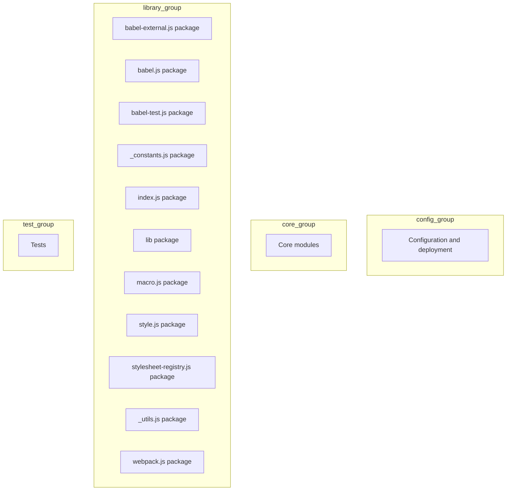

# Architecture report: vercel/styled-jsx

> Automated static analysis. **Observed** = directly seen in files/imports/AST; **Inferred** = interpretation from that evidence. Repository code was not executed.

## 1. Repository at a glance

| Item | Value |
| --- | --- |
| Repository | vercel/styled-jsx |
| Description | Full CSS support for JSX without compromises |
| Language | JavaScript |
| Stars | 7770 |
| Licence | MIT |
| Analysed commit / branch | a737ac442a9d032f9f824050b23dc9b6d766657e / main |
| Framework(s) | React |
| Files analysed | 107 |
| Components | 14 |

## 2. Architecture in one minute

vercel/styled-jsx - Full CSS support for JSX without compromises. This repository was analysed statically from 107 file(s) (0 Python). Detected technologies (observed from imports/manifests): GitHub Actions, React, TypeScript. Files are grouped into 14 component(s): babel-external.js package, babel.js package, babel-test.js package, Configuration and deployment, _constants.js package, Core modules, index.js package, lib package. Findings below distinguish observed facts from inferred interpretation.

## 3. High-level block diagram

## 4. Main components

### babel-external.js package (`babel_external_js`)

- **Kind:** library
- **Status:** Observed
- **Confidence:** 0.85
- **Responsibility:** Groups 1 file(s) under babel-external.js package (observed from repository paths and static analysis).
- **Paths:** `src/babel-external.js`
- **Evidence:** [src/babel-external.js](https://github.com/vercel/styled-jsx/blob/a737ac442a9d032f9f824050b23dc9b6d766657e/src/babel-external.js)

### babel.js package (`babel_js`)

- **Kind:** library
- **Status:** Observed
- **Confidence:** 0.85
- **Responsibility:** Groups 1 file(s) under babel.js package (observed from repository paths and static analysis).
- **Paths:** `src/babel.js`
- **Evidence:** [src/babel.js](https://github.com/vercel/styled-jsx/blob/a737ac442a9d032f9f824050b23dc9b6d766657e/src/babel.js)

### babel-test.js package (`babel_test_js`)

- **Kind:** library
- **Status:** Observed
- **Confidence:** 0.85
- **Responsibility:** Groups 1 file(s) under babel-test.js package (observed from repository paths and static analysis).
- **Paths:** `src/babel-test.js`
- **Evidence:** [src/babel-test.js](https://github.com/vercel/styled-jsx/blob/a737ac442a9d032f9f824050b23dc9b6d766657e/src/babel-test.js)

### Configuration and deployment (`config`)

- **Kind:** config
- **Status:** Observed
- **Confidence:** 0.85
- **Responsibility:** Groups 3 file(s) under configuration and deployment (observed from repository paths and static analysis).
- **Paths:** `package.json`, `pnpm-workspace.yaml`, `tsconfig.json`
- **Evidence:** [package.json](https://github.com/vercel/styled-jsx/blob/a737ac442a9d032f9f824050b23dc9b6d766657e/package.json); [pnpm-workspace.yaml](https://github.com/vercel/styled-jsx/blob/a737ac442a9d032f9f824050b23dc9b6d766657e/pnpm-workspace.yaml); [tsconfig.json](https://github.com/vercel/styled-jsx/blob/a737ac442a9d032f9f824050b23dc9b6d766657e/tsconfig.json)

### _constants.js package (`constants_js`)

- **Kind:** library
- **Status:** Observed
- **Confidence:** 0.85
- **Responsibility:** Groups 1 file(s) under _constants.js package (observed from repository paths and static analysis).
- **Paths:** `src/_constants.js`
- **Evidence:** [src/_constants.js](https://github.com/vercel/styled-jsx/blob/a737ac442a9d032f9f824050b23dc9b6d766657e/src/_constants.js)

### Core modules (`core`)

- **Kind:** core
- **Status:** Observed
- **Confidence:** 0.85
- **Responsibility:** Groups 12 file(s) under core modules (observed from repository paths and static analysis).
- **Paths:** `babel-test.js`, `babel.js`, `css.d.ts`, `css.js`, `global.d.ts`, `index.d.ts`, `index.js`, `macro.d.ts`, `macro.js`, `style.d.ts`, `style.js`, `webpack.js`
- **Evidence:** [babel-test.js](https://github.com/vercel/styled-jsx/blob/a737ac442a9d032f9f824050b23dc9b6d766657e/babel-test.js); [babel.js](https://github.com/vercel/styled-jsx/blob/a737ac442a9d032f9f824050b23dc9b6d766657e/babel.js); [css.d.ts](https://github.com/vercel/styled-jsx/blob/a737ac442a9d032f9f824050b23dc9b6d766657e/css.d.ts); [css.js](https://github.com/vercel/styled-jsx/blob/a737ac442a9d032f9f824050b23dc9b6d766657e/css.js); [global.d.ts](https://github.com/vercel/styled-jsx/blob/a737ac442a9d032f9f824050b23dc9b6d766657e/global.d.ts); [index.d.ts](https://github.com/vercel/styled-jsx/blob/a737ac442a9d032f9f824050b23dc9b6d766657e/index.d.ts); [index.js](https://github.com/vercel/styled-jsx/blob/a737ac442a9d032f9f824050b23dc9b6d766657e/index.js); [macro.d.ts](https://github.com/vercel/styled-jsx/blob/a737ac442a9d032f9f824050b23dc9b6d766657e/macro.d.ts)

### index.js package (`index_js`)

- **Kind:** library
- **Status:** Observed
- **Confidence:** 0.85
- **Responsibility:** Groups 1 file(s) under index.js package (observed from repository paths and static analysis).
- **Paths:** `src/index.js`
- **Evidence:** [src/index.js](https://github.com/vercel/styled-jsx/blob/a737ac442a9d032f9f824050b23dc9b6d766657e/src/index.js)

### lib package (`lib`)

- **Kind:** library
- **Status:** Observed
- **Confidence:** 0.85
- **Responsibility:** Groups 5 file(s) under lib package (observed from repository paths and static analysis).
- **Paths:** `lib/style-transform.js`, `lib/stylesheet.js`, `src/lib/hash.js`, `src/lib/style-transform.js`, `src/lib/stylesheet.js`
- **Evidence:** [lib/style-transform.js](https://github.com/vercel/styled-jsx/blob/a737ac442a9d032f9f824050b23dc9b6d766657e/lib/style-transform.js); [lib/stylesheet.js](https://github.com/vercel/styled-jsx/blob/a737ac442a9d032f9f824050b23dc9b6d766657e/lib/stylesheet.js); [src/lib/hash.js](https://github.com/vercel/styled-jsx/blob/a737ac442a9d032f9f824050b23dc9b6d766657e/src/lib/hash.js); [src/lib/style-transform.js](https://github.com/vercel/styled-jsx/blob/a737ac442a9d032f9f824050b23dc9b6d766657e/src/lib/style-transform.js); [src/lib/stylesheet.js](https://github.com/vercel/styled-jsx/blob/a737ac442a9d032f9f824050b23dc9b6d766657e/src/lib/stylesheet.js)

### macro.js package (`macro_js`)

- **Kind:** library
- **Status:** Observed
- **Confidence:** 0.85
- **Responsibility:** Groups 1 file(s) under macro.js package (observed from repository paths and static analysis).
- **Paths:** `src/macro.js`
- **Evidence:** [src/macro.js](https://github.com/vercel/styled-jsx/blob/a737ac442a9d032f9f824050b23dc9b6d766657e/src/macro.js)

### style.js package (`style_js`)

- **Kind:** library
- **Status:** Observed
- **Confidence:** 0.85
- **Responsibility:** Groups 1 file(s) under style.js package (observed from repository paths and static analysis).
- **Paths:** `src/style.js`
- **Evidence:** [src/style.js](https://github.com/vercel/styled-jsx/blob/a737ac442a9d032f9f824050b23dc9b6d766657e/src/style.js)

### stylesheet-registry.js package (`stylesheet_registry_js`)

- **Kind:** library
- **Status:** Observed
- **Confidence:** 0.85
- **Responsibility:** Groups 1 file(s) under stylesheet-registry.js package (observed from repository paths and static analysis).
- **Paths:** `src/stylesheet-registry.js`
- **Evidence:** [src/stylesheet-registry.js](https://github.com/vercel/styled-jsx/blob/a737ac442a9d032f9f824050b23dc9b6d766657e/src/stylesheet-registry.js)

### Tests (`tests`)

- **Kind:** test
- **Status:** Observed
- **Confidence:** 0.85
- **Responsibility:** Groups 66 file(s) under tests (observed from repository paths and static analysis).
- **Paths:** `test/.babelrc`, `test/__snapshots__/attribute.js.snap`, `test/__snapshots__/external.js.snap`, `test/__snapshots__/index.js.snap`, `test/__snapshots__/macro.js.snap`, `test/__snapshots__/plugins.js.snap`, `test/__snapshots__/styles.js.snap`, `test/_read.js`, `test/_transform.js`, `test/attribute.js`, `test/external.js`, `test/fixtures/absent.js`, `test/fixtures/attribute-generation-classname-rewriting.js`, `test/fixtures/attribute-generation-modes.js`, `test/fixtures/class.js`, `test/fixtures/component-attribute.js`, `test/fixtures/conflicts.js`, `test/fixtures/css-tag-same-file.js`, `test/fixtures/different-jsx-ids.js`, `test/fixtures/dynamic-element-class.js`, `test/fixtures/dynamic-element-external.js`, `test/fixtures/dynamic-element.js`, `test/fixtures/dynamic-this-value-in-arrow.js`, `test/fixtures/expressions.js`, `test/fixtures/external-stylesheet-global.js`, `test/fixtures/external-stylesheet-multi-line.js`, `test/fixtures/external-stylesheet.js`, `test/fixtures/fragment.js`, `test/fixtures/global.js`, `test/fixtures/ignore.js`, `test/fixtures/macro.js`, `test/fixtures/mixed-global-scoped.js`, `test/fixtures/multiple-jsx.js`, `test/fixtures/nested-style-tags.js`, `test/fixtures/non-styled-jsx-style.js`, `test/fixtures/not-styled-jsx-tagged-templates.js`, `test/fixtures/plugins/another-plugin.js`, `test/fixtures/plugins/invalid-plugin.js`, `test/fixtures/plugins/multiple-options.js`, `test/fixtures/plugins/options.js`, `test/fixtures/plugins/plugin.js`, `test/fixtures/simple-fragment.js`, `test/fixtures/source-maps.js`, `test/fixtures/stateless.js`, `test/fixtures/styles-external-invalid.js`, `test/fixtures/styles-external-invalid2.js`, `test/fixtures/styles.js`, `test/fixtures/styles2.js`, `test/fixtures/transform.css`, `test/fixtures/whitespace.js`, `test/fixtures/with-plugins.js`, `test/helpers/babel-test.macro.js`, `test/helpers/with-mock.js`, `test/index.js`, `test/index.ts`, `test/macro.js`, `test/plugins.js`, `test/snapshots/attribute.js.md`, `test/snapshots/external.js.md`, `test/snapshots/index.js.md`, `test/snapshots/macro.js.md`, `test/snapshots/plugins.js.md`, `test/snapshots/styles.js.md`, `test/styles.js`, `test/stylesheet-registry.js`, `test/stylesheet.js`
- **Evidence:** [test/.babelrc](https://github.com/vercel/styled-jsx/blob/a737ac442a9d032f9f824050b23dc9b6d766657e/test/.babelrc); [test/__snapshots__/attribute.js.snap](https://github.com/vercel/styled-jsx/blob/a737ac442a9d032f9f824050b23dc9b6d766657e/test/__snapshots__/attribute.js.snap); [test/__snapshots__/external.js.snap](https://github.com/vercel/styled-jsx/blob/a737ac442a9d032f9f824050b23dc9b6d766657e/test/__snapshots__/external.js.snap); [test/__snapshots__/index.js.snap](https://github.com/vercel/styled-jsx/blob/a737ac442a9d032f9f824050b23dc9b6d766657e/test/__snapshots__/index.js.snap); [test/__snapshots__/macro.js.snap](https://github.com/vercel/styled-jsx/blob/a737ac442a9d032f9f824050b23dc9b6d766657e/test/__snapshots__/macro.js.snap); [test/__snapshots__/plugins.js.snap](https://github.com/vercel/styled-jsx/blob/a737ac442a9d032f9f824050b23dc9b6d766657e/test/__snapshots__/plugins.js.snap); [test/__snapshots__/styles.js.snap](https://github.com/vercel/styled-jsx/blob/a737ac442a9d032f9f824050b23dc9b6d766657e/test/__snapshots__/styles.js.snap); [test/_read.js](https://github.com/vercel/styled-jsx/blob/a737ac442a9d032f9f824050b23dc9b6d766657e/test/_read.js)

### _utils.js package (`utils_js`)

- **Kind:** library
- **Status:** Observed
- **Confidence:** 0.85
- **Responsibility:** Groups 1 file(s) under _utils.js package (observed from repository paths and static analysis).
- **Paths:** `src/_utils.js`
- **Evidence:** [src/_utils.js](https://github.com/vercel/styled-jsx/blob/a737ac442a9d032f9f824050b23dc9b6d766657e/src/_utils.js)

### webpack.js package (`webpack_js`)

- **Kind:** library
- **Status:** Observed
- **Confidence:** 0.85
- **Responsibility:** Groups 1 file(s) under webpack.js package (observed from repository paths and static analysis).
- **Paths:** `src/webpack.js`
- **Evidence:** [src/webpack.js](https://github.com/vercel/styled-jsx/blob/a737ac442a9d032f9f824050b23dc9b6d766657e/src/webpack.js)

## 5. Execution flow

**Observed** entry point(s):

- [index.js](https://github.com/vercel/styled-jsx/blob/a737ac442a9d032f9f824050b23dc9b6d766657e/index.js)
- [src/index.js](https://github.com/vercel/styled-jsx/blob/a737ac442a9d032f9f824050b23dc9b6d766657e/src/index.js)

Representative flow (derived from observed entry points and the import graph; steps beyond the entry point are **Inferred**):

1. Execution starts at an observed entry point listed above, if present.
2. No internal import relationships between components were observed.

## 6. Project structure

### `(root)`

- `.eslintignore` - other (14 bytes)
- `.gitignore` - other (75 bytes)
- `.prettierrc.json` - config (39 bytes)
- `CODEOWNERS` - other (97 bytes)
- `Changelog.md` - docs (2082 bytes)
- `babel-test.js` - source, JavaScript (68 bytes)
- `babel.js` - source, JavaScript (49 bytes)
- `css.d.ts` - source, TypeScript (512 bytes)
- `css.js` - source, JavaScript (469 bytes)
- `global.d.ts` - source, TypeScript (160 bytes)
- `index.d.ts` - source, TypeScript (682 bytes)
- `index.js` - source, JavaScript (41 bytes)
- `license.md` - docs (1077 bytes)
- `macro.d.ts` - source, TypeScript (261 bytes)
- `macro.js` - source, JavaScript (49 bytes)
- `package.json` - manifest (3455 bytes)
- `pnpm-workspace.yaml` - config (99 bytes)
- `readme.md` - docs (31657 bytes)
- `style.d.ts` - source, TypeScript (91 bytes)
- `style.js` - source, JavaScript (47 bytes)
- `tsconfig.json` - config (12041 bytes)
- `webpack.js` - source, JavaScript (65 bytes)

### `.github`

- `.github/ISSUE_TEMPLATE.md` - docs (1084 bytes)
- `.github/workflows/main.yml` - ci, YAML (1149 bytes)
- `.github/workflows/prs.yml` - ci, YAML (342 bytes)

### `lib`

- `lib/style-transform.js` - source, JavaScript (76 bytes)
- `lib/stylesheet.js` - source, JavaScript (51 bytes)

### `src`

- `src/.babelrc` - other (157 bytes)
- `src/_constants.js` - source, JavaScript (209 bytes)
- `src/_utils.js` - source, JavaScript (16898 bytes)
- `src/babel-external.js` - source, JavaScript (6608 bytes)
- `src/babel-test.js` - source, JavaScript (449 bytes)
- `src/babel.js` - source, JavaScript (10008 bytes)
- `src/index.js` - source, JavaScript (165 bytes)
- `src/lib/hash.js` - source, JavaScript (1051 bytes)
- `src/lib/style-transform.js` - source, JavaScript (2411 bytes)
- `src/lib/stylesheet.js` - source, JavaScript (6788 bytes)
- `src/macro.js` - source, JavaScript (4716 bytes)
- `src/style.js` - source, JavaScript (1679 bytes)
- `src/stylesheet-registry.js` - source, JavaScript (5168 bytes)
- `src/webpack.js` - source, JavaScript (1596 bytes)

### `test`

- `test/.babelrc` - test (192 bytes)
- `test/__snapshots__/attribute.js.snap` - test (9148 bytes)
- `test/__snapshots__/external.js.snap` - test (7188 bytes)
- `test/__snapshots__/index.js.snap` - test (9951 bytes)
- `test/__snapshots__/macro.js.snap` - test (1586 bytes)
- `test/__snapshots__/plugins.js.snap` - test (1573 bytes)
- `test/__snapshots__/styles.js.snap` - test (2310 bytes)
- `test/_read.js` - test, JavaScript (189 bytes)
- `test/_transform.js` - test, JavaScript (700 bytes)
- `test/attribute.js` - test, JavaScript (565 bytes)
- `test/external.js` - test, JavaScript (3456 bytes)
- `test/fixtures/absent.js` - test, JavaScript (79 bytes)
- `test/fixtures/attribute-generation-classname-rewriting.js` - test, JavaScript (2397 bytes)
- `test/fixtures/attribute-generation-modes.js` - test, JavaScript (2833 bytes)
- `test/fixtures/class.js` - test, JavaScript (197 bytes)
- `test/fixtures/component-attribute.js` - test, JavaScript (154 bytes)
- `test/fixtures/conflicts.js` - test, JavaScript (210 bytes)
- `test/fixtures/css-tag-same-file.js` - test, JavaScript (365 bytes)
- `test/fixtures/different-jsx-ids.js` - test, JavaScript (375 bytes)
- `test/fixtures/dynamic-element-class.js` - test, JavaScript (543 bytes)
- `test/fixtures/dynamic-element-external.js` - test, JavaScript (225 bytes)
- `test/fixtures/dynamic-element.js` - test, JavaScript (750 bytes)
- `test/fixtures/dynamic-this-value-in-arrow.js` - test, JavaScript (919 bytes)
- `test/fixtures/expressions.js` - test, JavaScript (1672 bytes)
- `test/fixtures/external-stylesheet-global.js` - test, JavaScript (338 bytes)
- `test/fixtures/external-stylesheet-multi-line.js` - test, JavaScript (121 bytes)
- `test/fixtures/external-stylesheet.js` - test, JavaScript (712 bytes)
- `test/fixtures/fragment.js` - test, JavaScript (744 bytes)
- `test/fixtures/global.js` - test, JavaScript (407 bytes)
- `test/fixtures/ignore.js` - test, JavaScript (129 bytes)
- `test/fixtures/macro.js` - test, JavaScript (513 bytes)
- `test/fixtures/mixed-global-scoped.js` - test, JavaScript (269 bytes)
- `test/fixtures/multiple-jsx.js` - test, JavaScript (602 bytes)
- `test/fixtures/nested-style-tags.js` - test, JavaScript (923 bytes)
- `test/fixtures/non-styled-jsx-style.js` - test, JavaScript (176 bytes)
- `test/fixtures/not-styled-jsx-tagged-templates.js` - test, JavaScript (447 bytes)
- `test/fixtures/plugins/another-plugin.js` - test, JavaScript (50 bytes)
- `test/fixtures/plugins/invalid-plugin.js` - test, JavaScript (25 bytes)
- `test/fixtures/plugins/multiple-options.js` - test, JavaScript (245 bytes)
- `test/fixtures/plugins/options.js` - test, JavaScript (48 bytes)
- `test/fixtures/plugins/plugin.js` - test, JavaScript (45 bytes)
- `test/fixtures/simple-fragment.js` - test, JavaScript (150 bytes)
- `test/fixtures/source-maps.js` - test, JavaScript (118 bytes)
- `test/fixtures/stateless.js` - test, JavaScript (134 bytes)
- `test/fixtures/styles-external-invalid.js` - test, JavaScript (271 bytes)
- `test/fixtures/styles-external-invalid2.js` - test, JavaScript (206 bytes)
- `test/fixtures/styles.js` - test, JavaScript (761 bytes)
- `test/fixtures/styles2.js` - test, JavaScript (90 bytes)
- `test/fixtures/transform.css` - test (1909 bytes)
- `test/fixtures/whitespace.js` - test, JavaScript (134 bytes)
- `test/fixtures/with-plugins.js` - test, JavaScript (233 bytes)
- `test/helpers/babel-test.macro.js` - test, JavaScript (96 bytes)
- `test/helpers/with-mock.js` - test, JavaScript (703 bytes)
- `test/index.js` - test, JavaScript (10000 bytes)
- `test/index.ts` - test, TypeScript (28 bytes)
- `test/macro.js` - test, JavaScript (2912 bytes)
- `test/plugins.js` - test, JavaScript (3379 bytes)
- `test/snapshots/attribute.js.md` - test (11151 bytes)
- `test/snapshots/external.js.md` - test (8670 bytes)
- `test/snapshots/index.js.md` - test (15507 bytes)
- `test/snapshots/macro.js.md` - test (1907 bytes)
- `test/snapshots/plugins.js.md` - test (2003 bytes)
- `test/snapshots/styles.js.md` - test (2373 bytes)
- `test/styles.js` - test, JavaScript (6423 bytes)
- `test/stylesheet-registry.js` - test, JavaScript (9062 bytes)
- `test/stylesheet.js` - test, JavaScript (6761 bytes)

## 7. Key dependencies and integrations

| Name | Category | Status | Confidence | Evidence |
| --- | --- | --- | --- | --- |
| GitHub Actions | ci | Observed | 0.90 | [.github/workflows/main.yml](https://github.com/vercel/styled-jsx/blob/a737ac442a9d032f9f824050b23dc9b6d766657e/.github/workflows/main.yml); [.github/workflows/prs.yml](https://github.com/vercel/styled-jsx/blob/a737ac442a9d032f9f824050b23dc9b6d766657e/.github/workflows/prs.yml) |
| React | framework | Observed | 0.90 | [package.json:77](https://github.com/vercel/styled-jsx/blob/a737ac442a9d032f9f824050b23dc9b6d766657e/package.json#L77); [package.json:93](https://github.com/vercel/styled-jsx/blob/a737ac442a9d032f9f824050b23dc9b6d766657e/package.json#L93) |
| TypeScript | tooling | Observed | 0.85 | [package.json:99](https://github.com/vercel/styled-jsx/blob/a737ac442a9d032f9f824050b23dc9b6d766657e/package.json#L99) |

## 8. Data and state

No database, cache, queue, or persistent-state usage was observed in the analysed files. State handling, if any, may be in-memory or in files that were not analysed.

## 9. Configuration and deployment clues

- `.github/workflows/main.yml` (ci)
- `.github/workflows/prs.yml` (ci)
- `.prettierrc.json` (config)
- `package.json` (manifest)
- `pnpm-workspace.yaml` (config)
- `tsconfig.json` (config)

## 10. Design observations

- Tests are present alongside source code (Observed from test file paths).

These observations are interpretations (**Inferred**) of the observed structure, not guarantees about runtime design.

## 11. Limitations and unknowns

- Static analysis only: repository code was not executed, installed, or imported at runtime.
- Components and relationships are inferred from file paths, imports, and AST structure; runtime behaviour, dynamic imports, and reflection may not be visible.
- 1 file(s) were skipped during inventory (1 x likely secret file excluded).
- No clear application entry point was observed in the analysed files.
- Repository text was treated as untrusted data; no instructions found in repository files were followed, and likely secret values were redacted/excluded.
- JavaScript and TypeScript files were inventoried from paths and package manifests. They were not parsed with a full language AST, and repository code was not executed.

## 12. Source references

- [.github/workflows/main.yml](https://github.com/vercel/styled-jsx/blob/a737ac442a9d032f9f824050b23dc9b6d766657e/.github/workflows/main.yml)
- [.github/workflows/prs.yml](https://github.com/vercel/styled-jsx/blob/a737ac442a9d032f9f824050b23dc9b6d766657e/.github/workflows/prs.yml)
- [babel-test.js](https://github.com/vercel/styled-jsx/blob/a737ac442a9d032f9f824050b23dc9b6d766657e/babel-test.js)
- [babel.js](https://github.com/vercel/styled-jsx/blob/a737ac442a9d032f9f824050b23dc9b6d766657e/babel.js)
- [css.d.ts](https://github.com/vercel/styled-jsx/blob/a737ac442a9d032f9f824050b23dc9b6d766657e/css.d.ts)
- [css.js](https://github.com/vercel/styled-jsx/blob/a737ac442a9d032f9f824050b23dc9b6d766657e/css.js)
- [global.d.ts](https://github.com/vercel/styled-jsx/blob/a737ac442a9d032f9f824050b23dc9b6d766657e/global.d.ts)
- [index.d.ts](https://github.com/vercel/styled-jsx/blob/a737ac442a9d032f9f824050b23dc9b6d766657e/index.d.ts)
- [index.js](https://github.com/vercel/styled-jsx/blob/a737ac442a9d032f9f824050b23dc9b6d766657e/index.js)
- [lib/style-transform.js](https://github.com/vercel/styled-jsx/blob/a737ac442a9d032f9f824050b23dc9b6d766657e/lib/style-transform.js)
- [lib/stylesheet.js](https://github.com/vercel/styled-jsx/blob/a737ac442a9d032f9f824050b23dc9b6d766657e/lib/stylesheet.js)
- [macro.d.ts](https://github.com/vercel/styled-jsx/blob/a737ac442a9d032f9f824050b23dc9b6d766657e/macro.d.ts)
- [package.json](https://github.com/vercel/styled-jsx/blob/a737ac442a9d032f9f824050b23dc9b6d766657e/package.json)
- [package.json:77](https://github.com/vercel/styled-jsx/blob/a737ac442a9d032f9f824050b23dc9b6d766657e/package.json#L77)
- [package.json:93](https://github.com/vercel/styled-jsx/blob/a737ac442a9d032f9f824050b23dc9b6d766657e/package.json#L93)
- [package.json:99](https://github.com/vercel/styled-jsx/blob/a737ac442a9d032f9f824050b23dc9b6d766657e/package.json#L99)
- [pnpm-workspace.yaml](https://github.com/vercel/styled-jsx/blob/a737ac442a9d032f9f824050b23dc9b6d766657e/pnpm-workspace.yaml)
- [src/_constants.js](https://github.com/vercel/styled-jsx/blob/a737ac442a9d032f9f824050b23dc9b6d766657e/src/_constants.js)
- [src/_utils.js](https://github.com/vercel/styled-jsx/blob/a737ac442a9d032f9f824050b23dc9b6d766657e/src/_utils.js)
- [src/babel-external.js](https://github.com/vercel/styled-jsx/blob/a737ac442a9d032f9f824050b23dc9b6d766657e/src/babel-external.js)
- [src/babel-test.js](https://github.com/vercel/styled-jsx/blob/a737ac442a9d032f9f824050b23dc9b6d766657e/src/babel-test.js)
- [src/babel.js](https://github.com/vercel/styled-jsx/blob/a737ac442a9d032f9f824050b23dc9b6d766657e/src/babel.js)
- [src/index.js](https://github.com/vercel/styled-jsx/blob/a737ac442a9d032f9f824050b23dc9b6d766657e/src/index.js)
- [src/lib/hash.js](https://github.com/vercel/styled-jsx/blob/a737ac442a9d032f9f824050b23dc9b6d766657e/src/lib/hash.js)
- [src/lib/style-transform.js](https://github.com/vercel/styled-jsx/blob/a737ac442a9d032f9f824050b23dc9b6d766657e/src/lib/style-transform.js)
- [src/lib/stylesheet.js](https://github.com/vercel/styled-jsx/blob/a737ac442a9d032f9f824050b23dc9b6d766657e/src/lib/stylesheet.js)
- [src/macro.js](https://github.com/vercel/styled-jsx/blob/a737ac442a9d032f9f824050b23dc9b6d766657e/src/macro.js)
- [src/style.js](https://github.com/vercel/styled-jsx/blob/a737ac442a9d032f9f824050b23dc9b6d766657e/src/style.js)
- [src/stylesheet-registry.js](https://github.com/vercel/styled-jsx/blob/a737ac442a9d032f9f824050b23dc9b6d766657e/src/stylesheet-registry.js)
- [src/webpack.js](https://github.com/vercel/styled-jsx/blob/a737ac442a9d032f9f824050b23dc9b6d766657e/src/webpack.js)
- [test/.babelrc](https://github.com/vercel/styled-jsx/blob/a737ac442a9d032f9f824050b23dc9b6d766657e/test/.babelrc)
- [test/__snapshots__/attribute.js.snap](https://github.com/vercel/styled-jsx/blob/a737ac442a9d032f9f824050b23dc9b6d766657e/test/__snapshots__/attribute.js.snap)
- [test/__snapshots__/external.js.snap](https://github.com/vercel/styled-jsx/blob/a737ac442a9d032f9f824050b23dc9b6d766657e/test/__snapshots__/external.js.snap)
- [test/__snapshots__/index.js.snap](https://github.com/vercel/styled-jsx/blob/a737ac442a9d032f9f824050b23dc9b6d766657e/test/__snapshots__/index.js.snap)
- [test/__snapshots__/macro.js.snap](https://github.com/vercel/styled-jsx/blob/a737ac442a9d032f9f824050b23dc9b6d766657e/test/__snapshots__/macro.js.snap)
- [test/__snapshots__/plugins.js.snap](https://github.com/vercel/styled-jsx/blob/a737ac442a9d032f9f824050b23dc9b6d766657e/test/__snapshots__/plugins.js.snap)
- [test/__snapshots__/styles.js.snap](https://github.com/vercel/styled-jsx/blob/a737ac442a9d032f9f824050b23dc9b6d766657e/test/__snapshots__/styles.js.snap)
- [test/_read.js](https://github.com/vercel/styled-jsx/blob/a737ac442a9d032f9f824050b23dc9b6d766657e/test/_read.js)
- [tsconfig.json](https://github.com/vercel/styled-jsx/blob/a737ac442a9d032f9f824050b23dc9b6d766657e/tsconfig.json)
