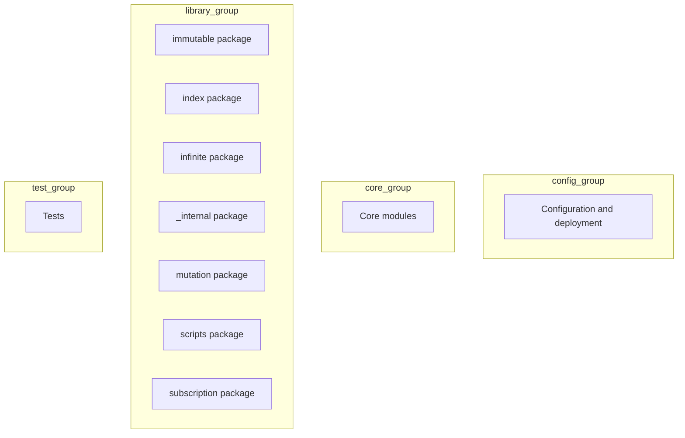

# Architecture report: vercel/swr

> Automated static analysis. **Observed** = directly seen in files/imports/AST; **Inferred** = interpretation from that evidence. Repository code was not executed.

## 1. Repository at a glance

| Item | Value |
| --- | --- |
| Repository | vercel/swr |
| Description | React Hooks for Data Fetching |
| Language | TypeScript |
| Stars | 32491 |
| Licence | MIT |
| Analysed commit / branch | 8148ef012fd5b317d1e8ec2da4b2ca0673f63c0f / main |
| Framework(s) | Next.js, React |
| Files analysed | 341 |
| Components | 10 |

## 2. Architecture in one minute

vercel/swr - React Hooks for Data Fetching. This repository was analysed statically from 341 file(s) (0 Python). Detected technologies (observed from imports/manifests): GitHub Actions, Next.js, React, Jest, TypeScript. Files are grouped into 10 component(s): Configuration and deployment, Core modules, immutable package, index package, infinite package, _internal package, mutation package, scripts package. Findings below distinguish observed facts from inferred interpretation.

## 3. High-level block diagram

## 4. Main components

### Configuration and deployment (`config`)

- **Kind:** config
- **Status:** Observed
- **Confidence:** 0.85
- **Responsibility:** Groups 9 file(s) under configuration and deployment (observed from repository paths and static analysis).
- **Paths:** `_internal/package.json`, `immutable/package.json`, `infinite/package.json`, `mutation/package.json`, `package.json`, `pnpm-workspace.yaml`, `subscription/package.json`, `tsconfig.json`, `vercel.json`
- **Evidence:** [_internal/package.json](https://github.com/vercel/swr/blob/8148ef012fd5b317d1e8ec2da4b2ca0673f63c0f/_internal/package.json); [immutable/package.json](https://github.com/vercel/swr/blob/8148ef012fd5b317d1e8ec2da4b2ca0673f63c0f/immutable/package.json); [infinite/package.json](https://github.com/vercel/swr/blob/8148ef012fd5b317d1e8ec2da4b2ca0673f63c0f/infinite/package.json); [mutation/package.json](https://github.com/vercel/swr/blob/8148ef012fd5b317d1e8ec2da4b2ca0673f63c0f/mutation/package.json); [package.json](https://github.com/vercel/swr/blob/8148ef012fd5b317d1e8ec2da4b2ca0673f63c0f/package.json); [pnpm-workspace.yaml](https://github.com/vercel/swr/blob/8148ef012fd5b317d1e8ec2da4b2ca0673f63c0f/pnpm-workspace.yaml); [subscription/package.json](https://github.com/vercel/swr/blob/8148ef012fd5b317d1e8ec2da4b2ca0673f63c0f/subscription/package.json); [tsconfig.json](https://github.com/vercel/swr/blob/8148ef012fd5b317d1e8ec2da4b2ca0673f63c0f/tsconfig.json)

### Core modules (`core`)

- **Kind:** core
- **Status:** Observed
- **Confidence:** 0.85
- **Responsibility:** Groups 2 file(s) under core modules (observed from repository paths and static analysis).
- **Paths:** `jest.config.build.js`, `jest.config.js`
- **Evidence:** [jest.config.build.js](https://github.com/vercel/swr/blob/8148ef012fd5b317d1e8ec2da4b2ca0673f63c0f/jest.config.build.js); [jest.config.js](https://github.com/vercel/swr/blob/8148ef012fd5b317d1e8ec2da4b2ca0673f63c0f/jest.config.js)

### immutable package (`immutable`)

- **Kind:** library
- **Status:** Observed
- **Confidence:** 0.85
- **Responsibility:** Groups 1 file(s) under immutable package (observed from repository paths and static analysis).
- **Paths:** `src/immutable/index.ts`
- **Evidence:** [src/immutable/index.ts](https://github.com/vercel/swr/blob/8148ef012fd5b317d1e8ec2da4b2ca0673f63c0f/src/immutable/index.ts)

### index package (`index`)

- **Kind:** library
- **Status:** Observed
- **Confidence:** 0.85
- **Responsibility:** Groups 5 file(s) under index package (observed from repository paths and static analysis).
- **Paths:** `src/index/config.ts`, `src/index/index.react-server.ts`, `src/index/index.ts`, `src/index/serialize.ts`, `src/index/use-swr.ts`
- **Evidence:** [src/index/config.ts](https://github.com/vercel/swr/blob/8148ef012fd5b317d1e8ec2da4b2ca0673f63c0f/src/index/config.ts); [src/index/index.react-server.ts](https://github.com/vercel/swr/blob/8148ef012fd5b317d1e8ec2da4b2ca0673f63c0f/src/index/index.react-server.ts); [src/index/index.ts](https://github.com/vercel/swr/blob/8148ef012fd5b317d1e8ec2da4b2ca0673f63c0f/src/index/index.ts); [src/index/serialize.ts](https://github.com/vercel/swr/blob/8148ef012fd5b317d1e8ec2da4b2ca0673f63c0f/src/index/serialize.ts); [src/index/use-swr.ts](https://github.com/vercel/swr/blob/8148ef012fd5b317d1e8ec2da4b2ca0673f63c0f/src/index/use-swr.ts)

### infinite package (`infinite`)

- **Kind:** library
- **Status:** Observed
- **Confidence:** 0.85
- **Responsibility:** Groups 4 file(s) under infinite package (observed from repository paths and static analysis).
- **Paths:** `src/infinite/index.react-server.ts`, `src/infinite/index.ts`, `src/infinite/serialize.ts`, `src/infinite/types.ts`
- **Evidence:** [src/infinite/index.react-server.ts](https://github.com/vercel/swr/blob/8148ef012fd5b317d1e8ec2da4b2ca0673f63c0f/src/infinite/index.react-server.ts); [src/infinite/index.ts](https://github.com/vercel/swr/blob/8148ef012fd5b317d1e8ec2da4b2ca0673f63c0f/src/infinite/index.ts); [src/infinite/serialize.ts](https://github.com/vercel/swr/blob/8148ef012fd5b317d1e8ec2da4b2ca0673f63c0f/src/infinite/serialize.ts); [src/infinite/types.ts](https://github.com/vercel/swr/blob/8148ef012fd5b317d1e8ec2da4b2ca0673f63c0f/src/infinite/types.ts)

### _internal package (`internal`)

- **Kind:** library
- **Status:** Observed
- **Confidence:** 0.85
- **Responsibility:** Groups 27 file(s) under _internal package (observed from repository paths and static analysis).
- **Paths:** `src/_internal/constants.ts`, `src/_internal/events.ts`, `src/_internal/index.react-server.ts`, `src/_internal/index.ts`, `src/_internal/types.ts`, `src/_internal/utils/cache.ts`, `src/_internal/utils/config-context.ts`, `src/_internal/utils/config.ts`, `src/_internal/utils/devtools.ts`, `src/_internal/utils/env.ts`, `src/_internal/utils/global-state.ts`, `src/_internal/utils/hash.ts`, `src/_internal/utils/helper.ts`, `src/_internal/utils/merge-config.ts`, `src/_internal/utils/middleware-preset.ts`, `src/_internal/utils/mutate.ts`, `src/_internal/utils/normalize-args.ts`, `src/_internal/utils/preload.ts`, `src/_internal/utils/resolve-args.ts`, `src/_internal/utils/serialize.ts`, `src/_internal/utils/server-preload.ts`, `src/_internal/utils/shared.ts`, `src/_internal/utils/subscribe-key.ts`, `src/_internal/utils/timestamp.ts`, `src/_internal/utils/use-swr-config.ts`, `src/_internal/utils/web-preset.ts`, `src/_internal/utils/with-middleware.ts`
- **Evidence:** [src/_internal/constants.ts](https://github.com/vercel/swr/blob/8148ef012fd5b317d1e8ec2da4b2ca0673f63c0f/src/_internal/constants.ts); [src/_internal/events.ts](https://github.com/vercel/swr/blob/8148ef012fd5b317d1e8ec2da4b2ca0673f63c0f/src/_internal/events.ts); [src/_internal/index.react-server.ts](https://github.com/vercel/swr/blob/8148ef012fd5b317d1e8ec2da4b2ca0673f63c0f/src/_internal/index.react-server.ts); [src/_internal/index.ts](https://github.com/vercel/swr/blob/8148ef012fd5b317d1e8ec2da4b2ca0673f63c0f/src/_internal/index.ts); [src/_internal/types.ts](https://github.com/vercel/swr/blob/8148ef012fd5b317d1e8ec2da4b2ca0673f63c0f/src/_internal/types.ts); [src/_internal/utils/cache.ts](https://github.com/vercel/swr/blob/8148ef012fd5b317d1e8ec2da4b2ca0673f63c0f/src/_internal/utils/cache.ts); [src/_internal/utils/config-context.ts](https://github.com/vercel/swr/blob/8148ef012fd5b317d1e8ec2da4b2ca0673f63c0f/src/_internal/utils/config-context.ts); [src/_internal/utils/config.ts](https://github.com/vercel/swr/blob/8148ef012fd5b317d1e8ec2da4b2ca0673f63c0f/src/_internal/utils/config.ts)

### mutation package (`mutation`)

- **Kind:** library
- **Status:** Observed
- **Confidence:** 0.85
- **Responsibility:** Groups 3 file(s) under mutation package (observed from repository paths and static analysis).
- **Paths:** `src/mutation/index.ts`, `src/mutation/state.ts`, `src/mutation/types.ts`
- **Evidence:** [src/mutation/index.ts](https://github.com/vercel/swr/blob/8148ef012fd5b317d1e8ec2da4b2ca0673f63c0f/src/mutation/index.ts); [src/mutation/state.ts](https://github.com/vercel/swr/blob/8148ef012fd5b317d1e8ec2da4b2ca0673f63c0f/src/mutation/state.ts); [src/mutation/types.ts](https://github.com/vercel/swr/blob/8148ef012fd5b317d1e8ec2da4b2ca0673f63c0f/src/mutation/types.ts)

### scripts package (`scripts`)

- **Kind:** library
- **Status:** Observed
- **Confidence:** 0.85
- **Responsibility:** Groups 1 file(s) under scripts package (observed from repository paths and static analysis).
- **Paths:** `scripts/bump-next-version.js`
- **Evidence:** [scripts/bump-next-version.js](https://github.com/vercel/swr/blob/8148ef012fd5b317d1e8ec2da4b2ca0673f63c0f/scripts/bump-next-version.js)

### subscription package (`subscription`)

- **Kind:** library
- **Status:** Observed
- **Confidence:** 0.85
- **Responsibility:** Groups 2 file(s) under subscription package (observed from repository paths and static analysis).
- **Paths:** `src/subscription/index.ts`, `src/subscription/types.ts`
- **Evidence:** [src/subscription/index.ts](https://github.com/vercel/swr/blob/8148ef012fd5b317d1e8ec2da4b2ca0673f63c0f/src/subscription/index.ts); [src/subscription/types.ts](https://github.com/vercel/swr/blob/8148ef012fd5b317d1e8ec2da4b2ca0673f63c0f/src/subscription/types.ts)

### Tests (`tests`)

- **Kind:** test
- **Status:** Observed
- **Confidence:** 0.85
- **Responsibility:** Groups 139 file(s) under tests (observed from repository paths and static analysis).
- **Paths:** `test/e2e/cache-tags.test.ts`, `test/e2e/concurrent-transition.test.ts`, `test/e2e/initial-render.test.ts`, `test/e2e/issue-2702-too-many-hooks.ts`, `test/e2e/mutate-server-action.test.ts`, `test/e2e/perf.test.ts`, `test/e2e/playwright.config.ts`, `test/e2e/preload-scenarios.test.ts`, `test/e2e/promise-scenarios.test.ts`, `test/e2e/server-prefetch-warning.test.ts`, `test/e2e/site/app/basic-ssr/block.tsx`, `test/e2e/site/app/basic-ssr/page.tsx`, `test/e2e/site/app/cache-tags/page.tsx`, `test/e2e/site/app/concurrent-transition/page.tsx`, `test/e2e/site/app/concurrent-transition/transition-demo.tsx`, `test/e2e/site/app/issue-2702/page.tsx`, `test/e2e/site/app/issue-2702/reproduction.tsx`, `test/e2e/site/app/layout.tsx`, `test/e2e/site/app/mutate-server-action/action.tsx`, `test/e2e/site/app/mutate-server-action/page.tsx`, `test/e2e/site/app/page.tsx`, `test/e2e/site/app/partially-hydrate/layout.tsx`, `test/e2e/site/app/partially-hydrate/loading.tsx`, `test/e2e/site/app/partially-hydrate/page.tsx`, `test/e2e/site/app/partially-hydrate/use-data.tsx`, `test/e2e/site/app/perf/page.tsx`, `test/e2e/site/app/react-server-entry/page.tsx`, `test/e2e/site/app/render-count/page.tsx`, `test/e2e/site/app/render-preload-avoid-waterfall/page.tsx`, `test/e2e/site/app/render-preload-basic/page.tsx`, `test/e2e/site/app/render-promise-suspense-error/page.tsx`, `test/e2e/site/app/render-promise-suspense-resolve/page.tsx`, `test/e2e/site/app/render-promise-suspense-shared/page.tsx`, `test/e2e/site/app/render-suspense-avoid-rerender/page.tsx`, `test/e2e/site/app/render-suspense-cached-error/page.tsx`, `test/e2e/site/app/render-suspense-error/page.tsx`, `test/e2e/site/app/render-suspense-fallback/page.tsx`, `test/e2e/site/app/render-suspense-fetcher/page.tsx`, `test/e2e/site/app/render-suspense-infinite-preload/page.tsx`, `test/e2e/site/app/render-suspense-initial-data/page.tsx`, `test/e2e/site/app/render-suspense-keep-previous/page.tsx`, `test/e2e/site/app/render-suspense-key-change/page.tsx`, `test/e2e/site/app/render-suspense-multiple-fallbacks/page.tsx`, `test/e2e/site/app/render-suspense-no-revalidate/page.tsx`, `test/e2e/site/app/render-suspense-non-promise/page.tsx`, `test/e2e/site/app/render-suspense-null-key/page.tsx`, `test/e2e/site/app/render-suspense-same-data/page.tsx`, `test/e2e/site/app/rsc-unstable-preload-conditional/client.tsx`, `test/e2e/site/app/rsc-unstable-preload-conditional/key.ts`, `test/e2e/site/app/rsc-unstable-preload-conditional/page.tsx`, `test/e2e/site/app/rsc-unstable-preload-no-suspense/client.tsx`, `test/e2e/site/app/rsc-unstable-preload-no-suspense/key.ts`, `test/e2e/site/app/rsc-unstable-preload-no-suspense/page.tsx`, `test/e2e/site/app/rsc-unstable-preload/client.tsx`, `test/e2e/site/app/rsc-unstable-preload/key.ts`, `test/e2e/site/app/rsc-unstable-preload/page.tsx`, `test/e2e/site/app/server-prefetch-warning/page.tsx`, `test/e2e/site/app/suspense-after-preload/page.tsx`, `test/e2e/site/app/suspense-after-preload/remote-data.tsx`, `test/e2e/site/app/suspense-fallback/layout.tsx`, `test/e2e/site/app/suspense-fallback/promise/page.tsx`, `test/e2e/site/app/suspense-infinite-get-key/page.tsx`, `test/e2e/site/app/suspense-retry/manual-retry.tsx`, `test/e2e/site/app/suspense-retry/page.tsx`, `test/e2e/site/app/suspense-retry/use-remote-data.ts`, `test/e2e/site/app/suspense-undefined-key/page.tsx`, `test/e2e/site/component/manual-retry-mutate.tsx`, `test/e2e/site/component/manual-retry.tsx`, `test/e2e/site/component/only-render-in-client.tsx`, `test/e2e/site/component/use-remote-data.ts`, `test/e2e/site/lib/sleep.ts`, `test/e2e/site/lib/use-debug-history.ts`, `test/e2e/site/next.config.js`, `test/e2e/site/package.json`, `test/e2e/site/pages/api/data.ts`, `test/e2e/site/pages/api/retry.ts`, `test/e2e/site/pages/suspense-retry-19.tsx`, `test/e2e/site/pages/suspense-retry-mutate.tsx`, `test/e2e/site/tsconfig.json`, `test/e2e/stream-ssr.test.ts`, `test/e2e/suspense-fallback.test.ts`, `test/e2e/suspense-scenarios.test.ts`, `test/e2e/suspense-undefined-key.test.ts`, `test/e2e/tsconfig.json`, `test/e2e/warmup.setup.ts`, `test/jest-setup.ts`, `test/tsconfig.json`, `test/type/config.tsx`, `test/type/fetcher.ts`, `test/type/helper-types.tsx`, `test/type/internal.tsx`, `test/type/mutate.ts`, `test/type/mutation.ts`, `test/type/option-fetcher.ts`, `test/type/preload.ts`, `test/type/subscription.ts`, `test/type/suspense/helper-types.tsx`, `test/type/suspense/suspense.ts`, `test/type/suspense/tsconfig.json`, `test/type/trigger.ts`, `test/type/tsconfig.json`, `test/type/utils.ts`, `test/unit/serialize.test.ts`, `test/unit/utils.test.tsx`, `test/unit/web-preset.test.ts`, `test/use-swr-cache.test.tsx`, `test/use-swr-concurrent-rendering.test.tsx`, `test/use-swr-config-callbacks.test.tsx`, `test/use-swr-config.test.tsx`, `test/use-swr-context-config.test.tsx`, `test/use-swr-devtools.test.tsx`, `test/use-swr-error.test.tsx`, `test/use-swr-fetcher.test.tsx`, `test/use-swr-focus.test.tsx`, `test/use-swr-immutable.test.tsx`, `test/use-swr-infinite-preload.test.tsx`, `test/use-swr-infinite.test.tsx`, `test/use-swr-integration.test.tsx`, `test/use-swr-key.test.tsx`, `test/use-swr-laggy.test.tsx`, `test/use-swr-legacy-react.test.tsx`, `test/use-swr-loading.test.tsx`, `test/use-swr-local-mutation.test.tsx`, `test/use-swr-middlewares.test.tsx`, `test/use-swr-node-env.test.tsx`, `test/use-swr-offline.test.tsx`, `test/use-swr-preload.test.tsx`, `test/use-swr-promise.test.tsx`, `test/use-swr-reconnect.test.tsx`, `test/use-swr-refresh.test.tsx`, `test/use-swr-remote-mutation.test.tsx`, `test/use-swr-revalidate.test.tsx`, `test/use-swr-server.test.tsx`, `test/use-swr-streaming-ssr.test.tsx`, `test/use-swr-subscription.test.tsx`, `test/use-swr-suspense.test.tsx`, `test/use-swr-tags.test.tsx`, `test/use-swr-unload.test.tsx`, `test/utils.tsx`
- **Evidence:** [test/e2e/cache-tags.test.ts](https://github.com/vercel/swr/blob/8148ef012fd5b317d1e8ec2da4b2ca0673f63c0f/test/e2e/cache-tags.test.ts); [test/e2e/concurrent-transition.test.ts](https://github.com/vercel/swr/blob/8148ef012fd5b317d1e8ec2da4b2ca0673f63c0f/test/e2e/concurrent-transition.test.ts); [test/e2e/initial-render.test.ts](https://github.com/vercel/swr/blob/8148ef012fd5b317d1e8ec2da4b2ca0673f63c0f/test/e2e/initial-render.test.ts); [test/e2e/issue-2702-too-many-hooks.ts](https://github.com/vercel/swr/blob/8148ef012fd5b317d1e8ec2da4b2ca0673f63c0f/test/e2e/issue-2702-too-many-hooks.ts); [test/e2e/mutate-server-action.test.ts](https://github.com/vercel/swr/blob/8148ef012fd5b317d1e8ec2da4b2ca0673f63c0f/test/e2e/mutate-server-action.test.ts); [test/e2e/perf.test.ts](https://github.com/vercel/swr/blob/8148ef012fd5b317d1e8ec2da4b2ca0673f63c0f/test/e2e/perf.test.ts); [test/e2e/playwright.config.ts](https://github.com/vercel/swr/blob/8148ef012fd5b317d1e8ec2da4b2ca0673f63c0f/test/e2e/playwright.config.ts); [test/e2e/preload-scenarios.test.ts](https://github.com/vercel/swr/blob/8148ef012fd5b317d1e8ec2da4b2ca0673f63c0f/test/e2e/preload-scenarios.test.ts)

## 5. Execution flow

**Observed** entry point(s):

- [src/_internal/index.ts](https://github.com/vercel/swr/blob/8148ef012fd5b317d1e8ec2da4b2ca0673f63c0f/src/_internal/index.ts)
- [src/immutable/index.ts](https://github.com/vercel/swr/blob/8148ef012fd5b317d1e8ec2da4b2ca0673f63c0f/src/immutable/index.ts)
- [src/index/index.ts](https://github.com/vercel/swr/blob/8148ef012fd5b317d1e8ec2da4b2ca0673f63c0f/src/index/index.ts)
- [src/infinite/index.ts](https://github.com/vercel/swr/blob/8148ef012fd5b317d1e8ec2da4b2ca0673f63c0f/src/infinite/index.ts)
- [src/mutation/index.ts](https://github.com/vercel/swr/blob/8148ef012fd5b317d1e8ec2da4b2ca0673f63c0f/src/mutation/index.ts)
- [src/subscription/index.ts](https://github.com/vercel/swr/blob/8148ef012fd5b317d1e8ec2da4b2ca0673f63c0f/src/subscription/index.ts)

Representative flow (derived from observed entry points and the import graph; steps beyond the entry point are **Inferred**):

1. Execution starts at an observed entry point listed above, if present.
2. No internal import relationships between components were observed.

## 6. Project structure

### `(root)`

- `.editorconfig` - config (69 bytes)
- `.gitignore` - other (206 bytes)
- `.oxfmtrc.json` - config (268 bytes)
- `.oxlintrc.json` - config (5324 bytes)
- `.swcrc` - other (244 bytes)
- `LICENSE` - docs (1069 bytes)
- `README.md` - docs (3740 bytes)
- `jest.config.build.js` - source, JavaScript (166 bytes)
- `jest.config.js` - source, JavaScript (932 bytes)
- `package.json` - manifest (4944 bytes)
- `pnpm-workspace.yaml` - config (245 bytes)
- `tsconfig.json` - config (757 bytes)
- `vercel.json` - config (52 bytes)

### `.github`

- `.github/CODEOWNERS` - other (22 bytes)
- `.github/CODE_OF_CONDUCT.md` - docs (3338 bytes)
- `.github/CONTRIBUTING.md` - docs (2112 bytes)
- `.github/ISSUE_TEMPLATE/bug_report.md` - docs (446 bytes)
- `.github/ISSUE_TEMPLATE/config.yml` - config (183 bytes)
- `.github/SECURITY.md` - docs (324 bytes)
- `.github/workflows/install/action.yml` - ci, YAML (512 bytes)
- `.github/workflows/test-canary.yml` - ci, YAML (594 bytes)
- `.github/workflows/test-legacy-react.yml` - ci, YAML (470 bytes)
- `.github/workflows/test.yml` - ci, YAML (1275 bytes)
- `.github/workflows/trigger-release.yml` - ci, YAML (1487 bytes)

### `.husky`

- `.husky/pre-commit` - other (37 bytes)

### `_internal`

- `_internal/package.json` - manifest (148 bytes)

### `examples`

- `examples/api-hooks/README.md` - docs (629 bytes)
- `examples/api-hooks/hooks/use-projects.js` - source, JavaScript (140 bytes)
- `examples/api-hooks/hooks/use-repository.js` - source, JavaScript (152 bytes)
- `examples/api-hooks/libs/fetch.js` - source, JavaScript (106 bytes)
- `examples/api-hooks/package.json` - manifest (299 bytes)
- `examples/api-hooks/pages/[user]/[repo].js` - source, JavaScript (590 bytes)
- `examples/api-hooks/pages/api/data.js` - source, JavaScript (459 bytes)
- `examples/api-hooks/pages/index.js` - source, JavaScript (445 bytes)
- `examples/autocomplete-suggestions/README.md` - docs (621 bytes)
- `examples/autocomplete-suggestions/libs/fetcher.js` - source, JavaScript (106 bytes)
- `examples/autocomplete-suggestions/package.json` - manifest (379 bytes)
- `examples/autocomplete-suggestions/pages/api/suggestions.js` - source, JavaScript (3579 bytes)
- `examples/autocomplete-suggestions/pages/index.js` - source, JavaScript (1268 bytes)
- `examples/basic-typescript/README.md` - docs (616 bytes)
- `examples/basic-typescript/libs/fetch.ts` - source, TypeScript (174 bytes)
- `examples/basic-typescript/next-env.d.ts` - source, TypeScript (245 bytes)
- `examples/basic-typescript/package.json` - manifest (420 bytes)
- `examples/basic-typescript/pages/[user]/[repo].tsx` - source, TypeScript (721 bytes)
- `examples/basic-typescript/pages/api/data.ts` - source, TypeScript (563 bytes)
- `examples/basic-typescript/pages/index.tsx` - source, TypeScript (628 bytes)
- `examples/basic-typescript/tsconfig.json` - config (532 bytes)
- `examples/basic/README.md` - docs (556 bytes)
- `examples/basic/libs/fetch.js` - source, JavaScript (106 bytes)
- `examples/basic/package.json` - manifest (270 bytes)
- `examples/basic/pages/[user]/[repo].js` - source, JavaScript (616 bytes)
- `examples/basic/pages/api/data.js` - source, JavaScript (468 bytes)
- `examples/basic/pages/index.js` - source, JavaScript (470 bytes)
- `examples/focus-revalidate/README.md` - docs (659 bytes)
- `examples/focus-revalidate/components/button.js` - source, JavaScript (350 bytes)
- `examples/focus-revalidate/libs/auth.js` - source, JavaScript (204 bytes)
- `examples/focus-revalidate/libs/fetch.js` - source, JavaScript (106 bytes)
- `examples/focus-revalidate/package.json` - manifest (306 bytes)
- `examples/focus-revalidate/pages/api/user.js` - source, JavaScript (311 bytes)
- `examples/focus-revalidate/pages/index.js` - source, JavaScript (701 bytes)
- `examples/global-fetcher/README.md` - docs (604 bytes)
- `examples/global-fetcher/libs/fetch.js` - source, JavaScript (106 bytes)
- `examples/global-fetcher/package.json` - manifest (304 bytes)
- `examples/global-fetcher/pages/[user]/[repo].js` - source, JavaScript (572 bytes)
- `examples/global-fetcher/pages/_app.js` - source, JavaScript (359 bytes)
- `examples/global-fetcher/pages/api/data.js` - source, JavaScript (468 bytes)
- `examples/global-fetcher/pages/index.js` - source, JavaScript (514 bytes)
- `examples/infinite-scroll/README.md` - docs (641 bytes)
- `examples/infinite-scroll/hooks/useOnScreen.js` - source, JavaScript (497 bytes)
- `examples/infinite-scroll/libs/fetch.js` - source, JavaScript (106 bytes)
- `examples/infinite-scroll/package.json` - manifest (305 bytes)
- `examples/infinite-scroll/pages/index.js` - source, JavaScript (2341 bytes)
- `examples/infinite/README.md` - docs (551 bytes)
- `examples/infinite/libs/fetch.js` - source, JavaScript (106 bytes)
- `examples/infinite/package.json` - manifest (298 bytes)
- `examples/infinite/pages/index.js` - source, JavaScript (2093 bytes)
- `examples/local-state-sharing/README.md` - docs (588 bytes)
- `examples/local-state-sharing/libs/store.js` - source, JavaScript (69 bytes)
- `examples/local-state-sharing/package.json` - manifest (309 bytes)
- `examples/local-state-sharing/pages/index.js` - source, JavaScript (1208 bytes)
- `examples/optimistic-ui-immer/README.md` - docs (705 bytes)
- `examples/optimistic-ui-immer/libs/fetch.js` - source, JavaScript (106 bytes)
- `examples/optimistic-ui-immer/package.json` - manifest (331 bytes)
- `examples/optimistic-ui-immer/pages/api/data.js` - source, JavaScript (404 bytes)
- `examples/optimistic-ui-immer/pages/index.js` - source, JavaScript (1471 bytes)
- `examples/optimistic-ui/README.md` - docs (666 bytes)
- `examples/optimistic-ui/libs/fetch.js` - source, JavaScript (156 bytes)
- `examples/optimistic-ui/package.json` - manifest (303 bytes)
- `examples/optimistic-ui/pages/_app.js` - source, JavaScript (120 bytes)
- `examples/optimistic-ui/pages/api/todos.js` - source, JavaScript (802 bytes)
- `examples/optimistic-ui/pages/index.js` - source, JavaScript (3585 bytes)
- `examples/optimistic-ui/styles.css` - other (1251 bytes)
- `examples/prefetch-preload/README.md` - docs (1046 bytes)
- `examples/prefetch-preload/libs/fetch.js` - source, JavaScript (106 bytes)
- `examples/prefetch-preload/package.json` - manifest (306 bytes)
- `examples/prefetch-preload/pages/[user]/[repo].js` - source, JavaScript (1304 bytes)
- `examples/prefetch-preload/pages/api/data.js` - source, JavaScript (468 bytes)
- `examples/prefetch-preload/pages/index.js` - source, JavaScript (1898 bytes)
- `examples/refetch-interval/README.md` - docs (636 bytes)
- `examples/refetch-interval/components/button.js` - source, JavaScript (350 bytes)
- `examples/refetch-interval/libs/fetch.js` - source, JavaScript (106 bytes)
- `examples/refetch-interval/package.json` - manifest (306 bytes)
- `examples/refetch-interval/pages/api/data.js` - source, JavaScript (223 bytes)
- `examples/refetch-interval/pages/index.js` - source, JavaScript (956 bytes)
- `examples/server-render/README.md` - docs (908 bytes)
- `examples/server-render/libs/fetcher.js` - source, JavaScript (106 bytes)
- `examples/server-render/package.json` - manifest (303 bytes)
- `examples/server-render/pages/[pokemon].js` - source, JavaScript (1012 bytes)
- `examples/server-render/pages/index.js` - source, JavaScript (795 bytes)
- `examples/storage-tab-sync/README.md` - docs (600 bytes)
- `examples/storage-tab-sync/libs/storage.js` - source, JavaScript (147 bytes)
- `examples/storage-tab-sync/package.json` - manifest (306 bytes)
- `examples/storage-tab-sync/pages/index.js` - source, JavaScript (556 bytes)
- `examples/subscription/README.md` - docs (585 bytes)
- `examples/subscription/package.json` - manifest (277 bytes)
- `examples/subscription/pages/index.js` - source, JavaScript (978 bytes)
- `examples/suspense-global/README.md` - docs (550 bytes)
- `examples/suspense-global/components/error-handling.ts` - source, TypeScript (361 bytes)
- `examples/suspense-global/global-swr-config.tsx` - source, TypeScript (377 bytes)
- `examples/suspense-global/libs/fetch.ts` - source, TypeScript (213 bytes)
- `examples/suspense-global/next-env.d.ts` - source, TypeScript (230 bytes)
- `examples/suspense-global/package.json` - manifest (305 bytes)
- `examples/suspense-global/pages/[user]/[repo].tsx` - source, TypeScript (765 bytes)
- `examples/suspense-global/pages/[user]/detail.tsx` - source, TypeScript (419 bytes)
- `examples/suspense-global/pages/_app.tsx` - source, TypeScript (259 bytes)
- `examples/suspense-global/pages/api/data.ts` - source, TypeScript (899 bytes)
- `examples/suspense-global/pages/index.tsx` - source, TypeScript (358 bytes)
- `examples/suspense-global/pages/repos.tsx` - source, TypeScript (404 bytes)
- `examples/suspense-global/tsconfig.json` - config (685 bytes)
- `examples/suspense-retry/app/api/route.ts` - source, TypeScript (218 bytes)
- `examples/suspense-retry/app/layout.tsx` - source, TypeScript (166 bytes)
- `examples/suspense-retry/app/manual-retry.tsx` - source, TypeScript (866 bytes)
- `examples/suspense-retry/app/page.tsx` - source, TypeScript (304 bytes)
- `examples/suspense-retry/app/use-remote-data.ts` - source, TypeScript (411 bytes)
- `examples/suspense-retry/next-env.d.ts` - source, TypeScript (267 bytes)
- `examples/suspense-retry/next.config.js` - source, JavaScript (141 bytes)
- `examples/suspense-retry/package.json` - manifest (420 bytes)
- `examples/suspense-retry/pages/retry.tsx` - source, TypeScript (309 bytes)
- `examples/suspense-retry/tsconfig.json` - config (658 bytes)
- `examples/suspense/README.md` - docs (550 bytes)
- `examples/suspense/app/layout.jsx` - source, JavaScript (165 bytes)
- `examples/suspense/app/rsc/[user]/[repo]/error.jsx` - source, JavaScript (86 bytes)
- `examples/suspense/app/rsc/[user]/[repo]/loading.jsx` - source, JavaScript (69 bytes)
- `examples/suspense/app/rsc/[user]/[repo]/page.jsx` - source, JavaScript (568 bytes)
- `examples/suspense/app/rsc/[user]/[repo]/repo.jsx` - source, JavaScript (474 bytes)
- `examples/suspense/app/rsc/loading.jsx` - source, JavaScript (69 bytes)
- `examples/suspense/app/rsc/page.jsx` - source, JavaScript (217 bytes)
- `examples/suspense/app/rsc/repos.jsx` - source, JavaScript (460 bytes)
- `examples/suspense/components/error-handling.js` - source, JavaScript (351 bytes)
- `examples/suspense/libs/fetch.js` - source, JavaScript (106 bytes)
- `examples/suspense/next-env.d.ts` - source, TypeScript (267 bytes)
- `examples/suspense/package.json` - manifest (298 bytes)
- `examples/suspense/pages/[user]/[repo].js` - source, JavaScript (1223 bytes)
- `examples/suspense/pages/api/data.js` - source, JavaScript (646 bytes)
- `examples/suspense/pages/index.js` - source, JavaScript (897 bytes)

### `immutable`

- `immutable/package.json` - manifest (148 bytes)

### `infinite`

- `infinite/package.json` - manifest (145 bytes)

### `mutation`

- `mutation/package.json` - manifest (145 bytes)

### `scripts`

- `scripts/bump-next-version.js` - source, JavaScript (1270 bytes)

### `src`

- `src/_internal/constants.ts` - source, TypeScript (39 bytes)
- `src/_internal/events.ts` - source, TypeScript (162 bytes)
- `src/_internal/index.react-server.ts` - source, TypeScript (177 bytes)
- `src/_internal/index.ts` - source, TypeScript (1192 bytes)
- `src/_internal/types.ts` - source, TypeScript (36679 bytes)
- `src/_internal/utils/cache.ts` - source, TypeScript (8502 bytes)
- `src/_internal/utils/config-context.ts` - source, TypeScript (2316 bytes)
- `src/_internal/utils/config.ts` - source, TypeScript (1944 bytes)
- `src/_internal/utils/devtools.ts` - source, TypeScript (392 bytes)
- `src/_internal/utils/env.ts` - source, TypeScript (1269 bytes)
- `src/_internal/utils/global-state.ts` - source, TypeScript (181 bytes)
- `src/_internal/utils/hash.ts` - source, TypeScript (2344 bytes)
- `src/_internal/utils/helper.ts` - source, TypeScript (1863 bytes)
- `src/_internal/utils/merge-config.ts` - source, TypeScript (745 bytes)
- `src/_internal/utils/middleware-preset.ts` - source, TypeScript (162 bytes)
- `src/_internal/utils/mutate.ts` - source, TypeScript (7033 bytes)
- `src/_internal/utils/normalize-args.ts` - source, TypeScript (545 bytes)
- `src/_internal/utils/preload.ts` - source, TypeScript (2013 bytes)
- `src/_internal/utils/resolve-args.ts` - source, TypeScript (967 bytes)
- `src/_internal/utils/serialize.ts` - source, TypeScript (655 bytes)
- `src/_internal/utils/server-preload.ts` - source, TypeScript (642 bytes)
- `src/_internal/utils/shared.ts` - source, TypeScript (801 bytes)
- `src/_internal/utils/subscribe-key.ts` - source, TypeScript (620 bytes)
- `src/_internal/utils/timestamp.ts` - source, TypeScript (90 bytes)
- `src/_internal/utils/use-swr-config.ts` - source, TypeScript (467 bytes)
- `src/_internal/utils/web-preset.ts` - source, TypeScript (1936 bytes)
- `src/_internal/utils/with-middleware.ts` - source, TypeScript (666 bytes)
- `src/immutable/index.ts` - source, TypeScript (517 bytes)
- `src/index/config.ts` - source, TypeScript (136 bytes)
- `src/index/index.react-server.ts` - source, TypeScript (146 bytes)
- `src/index/index.ts` - source, TypeScript (871 bytes)
- `src/index/serialize.ts` - source, TypeScript (164 bytes)
- `src/index/use-swr.ts` - source, TypeScript (33844 bytes)
- `src/infinite/index.react-server.ts` - source, TypeScript (49 bytes)
- `src/infinite/index.ts` - source, TypeScript (11785 bytes)
- `src/infinite/serialize.ts` - source, TypeScript (415 bytes)
- `src/infinite/types.ts` - source, TypeScript (4523 bytes)
- `src/mutation/index.ts` - source, TypeScript (5091 bytes)
- `src/mutation/state.ts` - source, TypeScript (2613 bytes)
- `src/mutation/types.ts` - source, TypeScript (7859 bytes)
- `src/subscription/index.ts` - source, TypeScript (3813 bytes)
- `src/subscription/types.ts` - source, TypeScript (958 bytes)

### `subscription`

- `subscription/package.json` - manifest (157 bytes)

### `test`

- `test/e2e/cache-tags.test.ts` - test, TypeScript (765 bytes)
- `test/e2e/concurrent-transition.test.ts` - test, TypeScript (1383 bytes)
- `test/e2e/initial-render.test.ts` - test, TypeScript (2587 bytes)
- `test/e2e/issue-2702-too-many-hooks.ts` - test, TypeScript (487 bytes)
- `test/e2e/mutate-server-action.test.ts` - test, TypeScript (487 bytes)
- `test/e2e/perf.test.ts` - test, TypeScript (3888 bytes)
- `test/e2e/playwright.config.ts` - test, TypeScript (2274 bytes)
- `test/e2e/preload-scenarios.test.ts` - test, TypeScript (802 bytes)
- `test/e2e/promise-scenarios.test.ts` - test, TypeScript (6275 bytes)
- `test/e2e/server-prefetch-warning.test.ts` - test, TypeScript (1070 bytes)
- `test/e2e/site/app/basic-ssr/block.tsx` - test, TypeScript (446 bytes)
- `test/e2e/site/app/basic-ssr/page.tsx` - test, TypeScript (91 bytes)
- `test/e2e/site/app/cache-tags/page.tsx` - test, TypeScript (1075 bytes)
- `test/e2e/site/app/concurrent-transition/page.tsx` - test, TypeScript (686 bytes)
- `test/e2e/site/app/concurrent-transition/transition-demo.tsx` - test, TypeScript (1755 bytes)
- `test/e2e/site/app/issue-2702/page.tsx` - test, TypeScript (126 bytes)
- `test/e2e/site/app/issue-2702/reproduction.tsx` - test, TypeScript (780 bytes)
- `test/e2e/site/app/layout.tsx` - test, TypeScript (377 bytes)
- `test/e2e/site/app/mutate-server-action/action.tsx` - test, TypeScript (260 bytes)
- `test/e2e/site/app/mutate-server-action/page.tsx` - test, TypeScript (484 bytes)
- `test/e2e/site/app/page.tsx` - test, TypeScript (824 bytes)
- `test/e2e/site/app/partially-hydrate/layout.tsx` - test, TypeScript (521 bytes)
- `test/e2e/site/app/partially-hydrate/loading.tsx` - test, TypeScript (69 bytes)
- `test/e2e/site/app/partially-hydrate/page.tsx` - test, TypeScript (598 bytes)
- `test/e2e/site/app/partially-hydrate/use-data.tsx` - test, TypeScript (204 bytes)
- `test/e2e/site/app/perf/page.tsx` - test, TypeScript (1379 bytes)
- `test/e2e/site/app/react-server-entry/page.tsx` - test, TypeScript (434 bytes)
- `test/e2e/site/app/render-count/page.tsx` - test, TypeScript (188 bytes)
- `test/e2e/site/app/render-preload-avoid-waterfall/page.tsx` - test, TypeScript (1380 bytes)
- `test/e2e/site/app/render-preload-basic/page.tsx` - test, TypeScript (1159 bytes)
- `test/e2e/site/app/render-promise-suspense-error/page.tsx` - test, TypeScript (1266 bytes)
- `test/e2e/site/app/render-promise-suspense-resolve/page.tsx` - test, TypeScript (1359 bytes)
- `test/e2e/site/app/render-promise-suspense-shared/page.tsx` - test, TypeScript (1141 bytes)
- `test/e2e/site/app/render-suspense-avoid-rerender/page.tsx` - test, TypeScript (1180 bytes)
- `test/e2e/site/app/render-suspense-cached-error/page.tsx` - test, TypeScript (1268 bytes)
- `test/e2e/site/app/render-suspense-error/page.tsx` - test, TypeScript (928 bytes)
- `test/e2e/site/app/render-suspense-fallback/page.tsx` - test, TypeScript (634 bytes)
- `test/e2e/site/app/render-suspense-fetcher/page.tsx` - test, TypeScript (1400 bytes)
- `test/e2e/site/app/render-suspense-infinite-preload/page.tsx` - test, TypeScript (1534 bytes)
- `test/e2e/site/app/render-suspense-initial-data/page.tsx` - test, TypeScript (463 bytes)
- `test/e2e/site/app/render-suspense-keep-previous/page.tsx` - test, TypeScript (1217 bytes)
- `test/e2e/site/app/render-suspense-key-change/page.tsx` - test, TypeScript (900 bytes)
- `test/e2e/site/app/render-suspense-multiple-fallbacks/page.tsx` - test, TypeScript (898 bytes)
- `test/e2e/site/app/render-suspense-no-revalidate/page.tsx` - test, TypeScript (1035 bytes)
- `test/e2e/site/app/render-suspense-non-promise/page.tsx` - test, TypeScript (523 bytes)
- `test/e2e/site/app/render-suspense-null-key/page.tsx` - test, TypeScript (1453 bytes)
- `test/e2e/site/app/render-suspense-same-data/page.tsx` - test, TypeScript (900 bytes)
- `test/e2e/site/app/rsc-unstable-preload-conditional/client.tsx` - test, TypeScript (1450 bytes)
- `test/e2e/site/app/rsc-unstable-preload-conditional/key.ts` - test, TypeScript (54 bytes)
- `test/e2e/site/app/rsc-unstable-preload-conditional/page.tsx` - test, TypeScript (1096 bytes)
- `test/e2e/site/app/rsc-unstable-preload-no-suspense/client.tsx` - test, TypeScript (1852 bytes)
- `test/e2e/site/app/rsc-unstable-preload-no-suspense/key.ts` - test, TypeScript (54 bytes)
- `test/e2e/site/app/rsc-unstable-preload-no-suspense/page.tsx` - test, TypeScript (856 bytes)
- `test/e2e/site/app/rsc-unstable-preload/client.tsx` - test, TypeScript (1703 bytes)
- `test/e2e/site/app/rsc-unstable-preload/key.ts` - test, TypeScript (42 bytes)
- `test/e2e/site/app/rsc-unstable-preload/page.tsx` - test, TypeScript (708 bytes)
- `test/e2e/site/app/server-prefetch-warning/page.tsx` - test, TypeScript (923 bytes)
- `test/e2e/site/app/suspense-after-preload/page.tsx` - test, TypeScript (317 bytes)
- `test/e2e/site/app/suspense-after-preload/remote-data.tsx` - test, TypeScript (865 bytes)
- `test/e2e/site/app/suspense-fallback/layout.tsx` - test, TypeScript (433 bytes)
- `test/e2e/site/app/suspense-fallback/promise/page.tsx` - test, TypeScript (190 bytes)
- `test/e2e/site/app/suspense-infinite-get-key/page.tsx` - test, TypeScript (1072 bytes)
- `test/e2e/site/app/suspense-retry/manual-retry.tsx` - test, TypeScript (855 bytes)
- `test/e2e/site/app/suspense-retry/page.tsx` - test, TypeScript (318 bytes)
- `test/e2e/site/app/suspense-retry/use-remote-data.ts` - test, TypeScript (422 bytes)
- `test/e2e/site/app/suspense-undefined-key/page.tsx` - test, TypeScript (750 bytes)
- `test/e2e/site/component/manual-retry-mutate.tsx` - test, TypeScript (1101 bytes)
- `test/e2e/site/component/manual-retry.tsx` - test, TypeScript (842 bytes)
- `test/e2e/site/component/only-render-in-client.tsx` - test, TypeScript (383 bytes)
- `test/e2e/site/component/use-remote-data.ts` - test, TypeScript (416 bytes)
- `test/e2e/site/lib/sleep.ts` - test, TypeScript (101 bytes)
- `test/e2e/site/lib/use-debug-history.ts` - test, TypeScript (407 bytes)
- `test/e2e/site/next.config.js` - test, JavaScript (504 bytes)
- `test/e2e/site/package.json` - test (467 bytes)
- `test/e2e/site/pages/api/data.ts` - test, TypeScript (308 bytes)
- `test/e2e/site/pages/api/retry.ts` - test, TypeScript (245 bytes)
- `test/e2e/site/pages/suspense-retry-19.tsx` - test, TypeScript (315 bytes)
- `test/e2e/site/pages/suspense-retry-mutate.tsx` - test, TypeScript (322 bytes)
- `test/e2e/site/tsconfig.json` - test (744 bytes)
- `test/e2e/stream-ssr.test.ts` - test, TypeScript (1689 bytes)
- `test/e2e/suspense-fallback.test.ts` - test, TypeScript (332 bytes)
- `test/e2e/suspense-scenarios.test.ts` - test, TypeScript (7663 bytes)
- `test/e2e/suspense-undefined-key.test.ts` - test, TypeScript (806 bytes)
- `test/e2e/tsconfig.json` - test (74 bytes)
- `test/e2e/warmup.setup.ts` - test, TypeScript (1417 bytes)
- `test/jest-setup.ts` - test, TypeScript (35 bytes)
- `test/tsconfig.json` - test (232 bytes)
- `test/type/config.tsx` - test, TypeScript (7206 bytes)
- `test/type/fetcher.ts` - test, TypeScript (10579 bytes)
- `test/type/helper-types.tsx` - test, TypeScript (439 bytes)
- `test/type/internal.tsx` - test, TypeScript (205 bytes)
- `test/type/mutate.ts` - test, TypeScript (2971 bytes)
- `test/type/mutation.ts` - test, TypeScript (1241 bytes)
- `test/type/option-fetcher.ts` - test, TypeScript (11169 bytes)
- `test/type/preload.ts` - test, TypeScript (1089 bytes)
- `test/type/subscription.ts` - test, TypeScript (2728 bytes)
- `test/type/suspense/helper-types.tsx` - test, TypeScript (517 bytes)
- `test/type/suspense/suspense.ts` - test, TypeScript (277 bytes)
- `test/type/suspense/tsconfig.json` - test (186 bytes)
- `test/type/trigger.ts` - test, TypeScript (3921 bytes)
- `test/type/tsconfig.json` - test (232 bytes)
- `test/type/utils.ts` - test, TypeScript (143 bytes)
- `test/unit/serialize.test.ts` - test, TypeScript (541 bytes)
- `test/unit/utils.test.tsx` - test, TypeScript (4793 bytes)
- `test/unit/web-preset.test.ts` - test, TypeScript (2818 bytes)
- `test/use-swr-cache.test.tsx` - test, TypeScript (13270 bytes)
- `test/use-swr-concurrent-rendering.test.tsx` - test, TypeScript (1879 bytes)
- `test/use-swr-config-callbacks.test.tsx` - test, TypeScript (6739 bytes)
- `test/use-swr-config.test.tsx` - test, TypeScript (19361 bytes)
- `test/use-swr-context-config.test.tsx` - test, TypeScript (2166 bytes)
- `test/use-swr-devtools.test.tsx` - test, TypeScript (1174 bytes)
- `test/use-swr-error.test.tsx` - test, TypeScript (15369 bytes)
- `test/use-swr-fetcher.test.tsx` - test, TypeScript (3318 bytes)
- `test/use-swr-focus.test.tsx` - test, TypeScript (6298 bytes)
- `test/use-swr-immutable.test.tsx` - test, TypeScript (8239 bytes)
- `test/use-swr-infinite-preload.test.tsx` - test, TypeScript (8378 bytes)
- `test/use-swr-infinite.test.tsx` - test, TypeScript (49658 bytes)
- `test/use-swr-integration.test.tsx` - test, TypeScript (15382 bytes)
- `test/use-swr-key.test.tsx` - test, TypeScript (6560 bytes)
- `test/use-swr-laggy.test.tsx` - test, TypeScript (7902 bytes)
- `test/use-swr-legacy-react.test.tsx` - test, TypeScript (2128 bytes)
- `test/use-swr-loading.test.tsx` - test, TypeScript (9929 bytes)
- `test/use-swr-local-mutation.test.tsx` - test, TypeScript (51494 bytes)
- `test/use-swr-middlewares.test.tsx` - test, TypeScript (7744 bytes)
- `test/use-swr-node-env.test.tsx` - test, TypeScript (1182 bytes)
- `test/use-swr-offline.test.tsx` - test, TypeScript (1575 bytes)
- `test/use-swr-preload.test.tsx` - test, TypeScript (5967 bytes)
- `test/use-swr-promise.test.tsx` - test, TypeScript (5239 bytes)
- `test/use-swr-reconnect.test.tsx` - test, TypeScript (2981 bytes)
- `test/use-swr-refresh.test.tsx` - test, TypeScript (18720 bytes)
- `test/use-swr-remote-mutation.test.tsx` - test, TypeScript (27325 bytes)
- `test/use-swr-revalidate.test.tsx` - test, TypeScript (5163 bytes)
- `test/use-swr-server.test.tsx` - test, TypeScript (6062 bytes)
- `test/use-swr-streaming-ssr.test.tsx` - test, TypeScript (2424 bytes)
- `test/use-swr-subscription.test.tsx` - test, TypeScript (9784 bytes)
- `test/use-swr-suspense.test.tsx` - test, TypeScript (13001 bytes)
- `test/use-swr-tags.test.tsx` - test, TypeScript (8734 bytes)
- `test/use-swr-unload.test.tsx` - test, TypeScript (7550 bytes)
- `test/utils.tsx` - test, TypeScript (3427 bytes)

## 7. Key dependencies and integrations

| Name | Category | Status | Confidence | Evidence |
| --- | --- | --- | --- | --- |
| GitHub Actions | ci | Observed | 0.90 | [.github/workflows/install/action.yml](https://github.com/vercel/swr/blob/8148ef012fd5b317d1e8ec2da4b2ca0673f63c0f/.github/workflows/install/action.yml); [.github/workflows/test-canary.yml](https://github.com/vercel/swr/blob/8148ef012fd5b317d1e8ec2da4b2ca0673f63c0f/.github/workflows/test-canary.yml); [.github/workflows/test-legacy-react.yml](https://github.com/vercel/swr/blob/8148ef012fd5b317d1e8ec2da4b2ca0673f63c0f/.github/workflows/test-legacy-react.yml); [.github/workflows/test.yml](https://github.com/vercel/swr/blob/8148ef012fd5b317d1e8ec2da4b2ca0673f63c0f/.github/workflows/test.yml) |
| Next.js | framework | Observed | 0.90 | [examples/api-hooks/package.json:7](https://github.com/vercel/swr/blob/8148ef012fd5b317d1e8ec2da4b2ca0673f63c0f/examples/api-hooks/package.json#L7); [examples/autocomplete-suggestions/package.json:9](https://github.com/vercel/swr/blob/8148ef012fd5b317d1e8ec2da4b2ca0673f63c0f/examples/autocomplete-suggestions/package.json#L9); [examples/basic-typescript/package.json:7](https://github.com/vercel/swr/blob/8148ef012fd5b317d1e8ec2da4b2ca0673f63c0f/examples/basic-typescript/package.json#L7); [examples/basic/package.json:6](https://github.com/vercel/swr/blob/8148ef012fd5b317d1e8ec2da4b2ca0673f63c0f/examples/basic/package.json#L6) |
| React | framework | Observed | 0.90 | [examples/api-hooks/package.json:8](https://github.com/vercel/swr/blob/8148ef012fd5b317d1e8ec2da4b2ca0673f63c0f/examples/api-hooks/package.json#L8); [examples/api-hooks/package.json:9](https://github.com/vercel/swr/blob/8148ef012fd5b317d1e8ec2da4b2ca0673f63c0f/examples/api-hooks/package.json#L9); [examples/autocomplete-suggestions/package.json:10](https://github.com/vercel/swr/blob/8148ef012fd5b317d1e8ec2da4b2ca0673f63c0f/examples/autocomplete-suggestions/package.json#L10); [examples/autocomplete-suggestions/package.json:11](https://github.com/vercel/swr/blob/8148ef012fd5b317d1e8ec2da4b2ca0673f63c0f/examples/autocomplete-suggestions/package.json#L11) |
| Jest | tooling | Observed | 0.85 | [package.json:113](https://github.com/vercel/swr/blob/8148ef012fd5b317d1e8ec2da4b2ca0673f63c0f/package.json#L113) |
| TypeScript | tooling | Observed | 0.90 | [examples/basic-typescript/package.json:2](https://github.com/vercel/swr/blob/8148ef012fd5b317d1e8ec2da4b2ca0673f63c0f/examples/basic-typescript/package.json#L2); [examples/suspense-retry/package.json:18](https://github.com/vercel/swr/blob/8148ef012fd5b317d1e8ec2da4b2ca0673f63c0f/examples/suspense-retry/package.json#L18); [package.json:141](https://github.com/vercel/swr/blob/8148ef012fd5b317d1e8ec2da4b2ca0673f63c0f/package.json#L141); [test/e2e/site/package.json:20](https://github.com/vercel/swr/blob/8148ef012fd5b317d1e8ec2da4b2ca0673f63c0f/test/e2e/site/package.json#L20) |

## 8. Data and state

No database, cache, queue, or persistent-state usage was observed in the analysed files. State handling, if any, may be in-memory or in files that were not analysed.

## 9. Configuration and deployment clues

- `.editorconfig` (config)
- `.github/ISSUE_TEMPLATE/config.yml` (config)
- `.github/workflows/install/action.yml` (ci)
- `.github/workflows/test-canary.yml` (ci)
- `.github/workflows/test-legacy-react.yml` (ci)
- `.github/workflows/test.yml` (ci)
- `.github/workflows/trigger-release.yml` (ci)
- `.oxfmtrc.json` (config)
- `.oxlintrc.json` (config)
- `_internal/package.json` (manifest)
- `examples/api-hooks/package.json` (manifest)
- `examples/autocomplete-suggestions/package.json` (manifest)
- `examples/basic-typescript/package.json` (manifest)
- `examples/basic-typescript/tsconfig.json` (config)
- `examples/basic/package.json` (manifest)
- `examples/focus-revalidate/package.json` (manifest)
- `examples/global-fetcher/package.json` (manifest)
- `examples/infinite-scroll/package.json` (manifest)
- `examples/infinite/package.json` (manifest)
- `examples/local-state-sharing/package.json` (manifest)
- `examples/optimistic-ui-immer/package.json` (manifest)
- `examples/optimistic-ui/package.json` (manifest)
- `examples/prefetch-preload/package.json` (manifest)
- `examples/refetch-interval/package.json` (manifest)
- `examples/server-render/package.json` (manifest)
- `examples/storage-tab-sync/package.json` (manifest)
- `examples/subscription/package.json` (manifest)
- `examples/suspense-global/package.json` (manifest)
- `examples/suspense-global/tsconfig.json` (config)
- `examples/suspense-retry/package.json` (manifest)
- `examples/suspense-retry/tsconfig.json` (config)
- `examples/suspense/package.json` (manifest)
- `immutable/package.json` (manifest)
- `infinite/package.json` (manifest)
- `mutation/package.json` (manifest)
- `package.json` (manifest)
- `pnpm-workspace.yaml` (config)
- `subscription/package.json` (manifest)
- `tsconfig.json` (config)
- `vercel.json` (config)

## 10. Design observations

- Tests are present alongside source code (Observed from test file paths).

These observations are interpretations (**Inferred**) of the observed structure, not guarantees about runtime design.

## 11. Limitations and unknowns

- Static analysis only: repository code was not executed, installed, or imported at runtime.
- Components and relationships are inferred from file paths, imports, and AST structure; runtime behaviour, dynamic imports, and reflection may not be visible.
- 1 file(s) were skipped during inventory (1 x likely secret file excluded).
- No clear application entry point was observed in the analysed files.
- Repository text was treated as untrusted data; no instructions found in repository files were followed, and likely secret values were redacted/excluded.
- JavaScript and TypeScript files were inventoried from paths and package manifests. They were not parsed with a full language AST, and repository code was not executed.

## 12. Source references

- [.github/workflows/install/action.yml](https://github.com/vercel/swr/blob/8148ef012fd5b317d1e8ec2da4b2ca0673f63c0f/.github/workflows/install/action.yml)
- [.github/workflows/test-canary.yml](https://github.com/vercel/swr/blob/8148ef012fd5b317d1e8ec2da4b2ca0673f63c0f/.github/workflows/test-canary.yml)
- [.github/workflows/test-legacy-react.yml](https://github.com/vercel/swr/blob/8148ef012fd5b317d1e8ec2da4b2ca0673f63c0f/.github/workflows/test-legacy-react.yml)
- [.github/workflows/test.yml](https://github.com/vercel/swr/blob/8148ef012fd5b317d1e8ec2da4b2ca0673f63c0f/.github/workflows/test.yml)
- [.github/workflows/trigger-release.yml](https://github.com/vercel/swr/blob/8148ef012fd5b317d1e8ec2da4b2ca0673f63c0f/.github/workflows/trigger-release.yml)
- [_internal/package.json](https://github.com/vercel/swr/blob/8148ef012fd5b317d1e8ec2da4b2ca0673f63c0f/_internal/package.json)
- [examples/api-hooks/package.json:7](https://github.com/vercel/swr/blob/8148ef012fd5b317d1e8ec2da4b2ca0673f63c0f/examples/api-hooks/package.json#L7)
- [examples/api-hooks/package.json:8](https://github.com/vercel/swr/blob/8148ef012fd5b317d1e8ec2da4b2ca0673f63c0f/examples/api-hooks/package.json#L8)
- [examples/api-hooks/package.json:9](https://github.com/vercel/swr/blob/8148ef012fd5b317d1e8ec2da4b2ca0673f63c0f/examples/api-hooks/package.json#L9)
- [examples/autocomplete-suggestions/package.json:9](https://github.com/vercel/swr/blob/8148ef012fd5b317d1e8ec2da4b2ca0673f63c0f/examples/autocomplete-suggestions/package.json#L9)
- [examples/autocomplete-suggestions/package.json:10](https://github.com/vercel/swr/blob/8148ef012fd5b317d1e8ec2da4b2ca0673f63c0f/examples/autocomplete-suggestions/package.json#L10)
- [examples/autocomplete-suggestions/package.json:11](https://github.com/vercel/swr/blob/8148ef012fd5b317d1e8ec2da4b2ca0673f63c0f/examples/autocomplete-suggestions/package.json#L11)
- [examples/basic-typescript/package.json:2](https://github.com/vercel/swr/blob/8148ef012fd5b317d1e8ec2da4b2ca0673f63c0f/examples/basic-typescript/package.json#L2)
- [examples/basic-typescript/package.json:7](https://github.com/vercel/swr/blob/8148ef012fd5b317d1e8ec2da4b2ca0673f63c0f/examples/basic-typescript/package.json#L7)
- [examples/basic-typescript/package.json:8](https://github.com/vercel/swr/blob/8148ef012fd5b317d1e8ec2da4b2ca0673f63c0f/examples/basic-typescript/package.json#L8)
- [examples/basic-typescript/package.json:9](https://github.com/vercel/swr/blob/8148ef012fd5b317d1e8ec2da4b2ca0673f63c0f/examples/basic-typescript/package.json#L9)
- [examples/basic/package.json:6](https://github.com/vercel/swr/blob/8148ef012fd5b317d1e8ec2da4b2ca0673f63c0f/examples/basic/package.json#L6)
- [examples/basic/package.json:7](https://github.com/vercel/swr/blob/8148ef012fd5b317d1e8ec2da4b2ca0673f63c0f/examples/basic/package.json#L7)
- [examples/basic/package.json:8](https://github.com/vercel/swr/blob/8148ef012fd5b317d1e8ec2da4b2ca0673f63c0f/examples/basic/package.json#L8)
- [examples/focus-revalidate/package.json:7](https://github.com/vercel/swr/blob/8148ef012fd5b317d1e8ec2da4b2ca0673f63c0f/examples/focus-revalidate/package.json#L7)
- [examples/global-fetcher/package.json:7](https://github.com/vercel/swr/blob/8148ef012fd5b317d1e8ec2da4b2ca0673f63c0f/examples/global-fetcher/package.json#L7)
- [examples/infinite-scroll/package.json:7](https://github.com/vercel/swr/blob/8148ef012fd5b317d1e8ec2da4b2ca0673f63c0f/examples/infinite-scroll/package.json#L7)
- [examples/infinite/package.json:7](https://github.com/vercel/swr/blob/8148ef012fd5b317d1e8ec2da4b2ca0673f63c0f/examples/infinite/package.json#L7)
- [examples/suspense-retry/package.json:18](https://github.com/vercel/swr/blob/8148ef012fd5b317d1e8ec2da4b2ca0673f63c0f/examples/suspense-retry/package.json#L18)
- [immutable/package.json](https://github.com/vercel/swr/blob/8148ef012fd5b317d1e8ec2da4b2ca0673f63c0f/immutable/package.json)
- [infinite/package.json](https://github.com/vercel/swr/blob/8148ef012fd5b317d1e8ec2da4b2ca0673f63c0f/infinite/package.json)
- [jest.config.build.js](https://github.com/vercel/swr/blob/8148ef012fd5b317d1e8ec2da4b2ca0673f63c0f/jest.config.build.js)
- [jest.config.js](https://github.com/vercel/swr/blob/8148ef012fd5b317d1e8ec2da4b2ca0673f63c0f/jest.config.js)
- [mutation/package.json](https://github.com/vercel/swr/blob/8148ef012fd5b317d1e8ec2da4b2ca0673f63c0f/mutation/package.json)
- [package.json](https://github.com/vercel/swr/blob/8148ef012fd5b317d1e8ec2da4b2ca0673f63c0f/package.json)
- [package.json:113](https://github.com/vercel/swr/blob/8148ef012fd5b317d1e8ec2da4b2ca0673f63c0f/package.json#L113)
- [package.json:141](https://github.com/vercel/swr/blob/8148ef012fd5b317d1e8ec2da4b2ca0673f63c0f/package.json#L141)
- [pnpm-workspace.yaml](https://github.com/vercel/swr/blob/8148ef012fd5b317d1e8ec2da4b2ca0673f63c0f/pnpm-workspace.yaml)
- [scripts/bump-next-version.js](https://github.com/vercel/swr/blob/8148ef012fd5b317d1e8ec2da4b2ca0673f63c0f/scripts/bump-next-version.js)
- [src/_internal/constants.ts](https://github.com/vercel/swr/blob/8148ef012fd5b317d1e8ec2da4b2ca0673f63c0f/src/_internal/constants.ts)
- [src/_internal/events.ts](https://github.com/vercel/swr/blob/8148ef012fd5b317d1e8ec2da4b2ca0673f63c0f/src/_internal/events.ts)
- [src/_internal/index.react-server.ts](https://github.com/vercel/swr/blob/8148ef012fd5b317d1e8ec2da4b2ca0673f63c0f/src/_internal/index.react-server.ts)
- [src/_internal/index.ts](https://github.com/vercel/swr/blob/8148ef012fd5b317d1e8ec2da4b2ca0673f63c0f/src/_internal/index.ts)
- [src/_internal/types.ts](https://github.com/vercel/swr/blob/8148ef012fd5b317d1e8ec2da4b2ca0673f63c0f/src/_internal/types.ts)
- [src/_internal/utils/cache.ts](https://github.com/vercel/swr/blob/8148ef012fd5b317d1e8ec2da4b2ca0673f63c0f/src/_internal/utils/cache.ts)
- [src/_internal/utils/config-context.ts](https://github.com/vercel/swr/blob/8148ef012fd5b317d1e8ec2da4b2ca0673f63c0f/src/_internal/utils/config-context.ts)
- [src/_internal/utils/config.ts](https://github.com/vercel/swr/blob/8148ef012fd5b317d1e8ec2da4b2ca0673f63c0f/src/_internal/utils/config.ts)
- [src/immutable/index.ts](https://github.com/vercel/swr/blob/8148ef012fd5b317d1e8ec2da4b2ca0673f63c0f/src/immutable/index.ts)
- [src/index/config.ts](https://github.com/vercel/swr/blob/8148ef012fd5b317d1e8ec2da4b2ca0673f63c0f/src/index/config.ts)
- [src/index/index.react-server.ts](https://github.com/vercel/swr/blob/8148ef012fd5b317d1e8ec2da4b2ca0673f63c0f/src/index/index.react-server.ts)
- [src/index/index.ts](https://github.com/vercel/swr/blob/8148ef012fd5b317d1e8ec2da4b2ca0673f63c0f/src/index/index.ts)
- [src/index/serialize.ts](https://github.com/vercel/swr/blob/8148ef012fd5b317d1e8ec2da4b2ca0673f63c0f/src/index/serialize.ts)
- [src/index/use-swr.ts](https://github.com/vercel/swr/blob/8148ef012fd5b317d1e8ec2da4b2ca0673f63c0f/src/index/use-swr.ts)
- [src/infinite/index.react-server.ts](https://github.com/vercel/swr/blob/8148ef012fd5b317d1e8ec2da4b2ca0673f63c0f/src/infinite/index.react-server.ts)
- [src/infinite/index.ts](https://github.com/vercel/swr/blob/8148ef012fd5b317d1e8ec2da4b2ca0673f63c0f/src/infinite/index.ts)
- [src/infinite/serialize.ts](https://github.com/vercel/swr/blob/8148ef012fd5b317d1e8ec2da4b2ca0673f63c0f/src/infinite/serialize.ts)
- [src/infinite/types.ts](https://github.com/vercel/swr/blob/8148ef012fd5b317d1e8ec2da4b2ca0673f63c0f/src/infinite/types.ts)
- [src/mutation/index.ts](https://github.com/vercel/swr/blob/8148ef012fd5b317d1e8ec2da4b2ca0673f63c0f/src/mutation/index.ts)
- [src/mutation/state.ts](https://github.com/vercel/swr/blob/8148ef012fd5b317d1e8ec2da4b2ca0673f63c0f/src/mutation/state.ts)
- [src/mutation/types.ts](https://github.com/vercel/swr/blob/8148ef012fd5b317d1e8ec2da4b2ca0673f63c0f/src/mutation/types.ts)
- [src/subscription/index.ts](https://github.com/vercel/swr/blob/8148ef012fd5b317d1e8ec2da4b2ca0673f63c0f/src/subscription/index.ts)
- [src/subscription/types.ts](https://github.com/vercel/swr/blob/8148ef012fd5b317d1e8ec2da4b2ca0673f63c0f/src/subscription/types.ts)
- [subscription/package.json](https://github.com/vercel/swr/blob/8148ef012fd5b317d1e8ec2da4b2ca0673f63c0f/subscription/package.json)
- [test/e2e/cache-tags.test.ts](https://github.com/vercel/swr/blob/8148ef012fd5b317d1e8ec2da4b2ca0673f63c0f/test/e2e/cache-tags.test.ts)
- [test/e2e/concurrent-transition.test.ts](https://github.com/vercel/swr/blob/8148ef012fd5b317d1e8ec2da4b2ca0673f63c0f/test/e2e/concurrent-transition.test.ts)
- [test/e2e/initial-render.test.ts](https://github.com/vercel/swr/blob/8148ef012fd5b317d1e8ec2da4b2ca0673f63c0f/test/e2e/initial-render.test.ts)
- [test/e2e/issue-2702-too-many-hooks.ts](https://github.com/vercel/swr/blob/8148ef012fd5b317d1e8ec2da4b2ca0673f63c0f/test/e2e/issue-2702-too-many-hooks.ts)
- [test/e2e/mutate-server-action.test.ts](https://github.com/vercel/swr/blob/8148ef012fd5b317d1e8ec2da4b2ca0673f63c0f/test/e2e/mutate-server-action.test.ts)
- [test/e2e/perf.test.ts](https://github.com/vercel/swr/blob/8148ef012fd5b317d1e8ec2da4b2ca0673f63c0f/test/e2e/perf.test.ts)
- [test/e2e/playwright.config.ts](https://github.com/vercel/swr/blob/8148ef012fd5b317d1e8ec2da4b2ca0673f63c0f/test/e2e/playwright.config.ts)
- [test/e2e/preload-scenarios.test.ts](https://github.com/vercel/swr/blob/8148ef012fd5b317d1e8ec2da4b2ca0673f63c0f/test/e2e/preload-scenarios.test.ts)
- [test/e2e/site/package.json:20](https://github.com/vercel/swr/blob/8148ef012fd5b317d1e8ec2da4b2ca0673f63c0f/test/e2e/site/package.json#L20)
- [tsconfig.json](https://github.com/vercel/swr/blob/8148ef012fd5b317d1e8ec2da4b2ca0673f63c0f/tsconfig.json)
