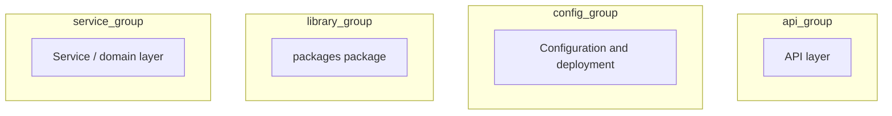

# Architecture report: vidstack/player

> Automated static analysis. **Observed** = directly seen in files/imports/AST; **Inferred** = interpretation from that evidence. Repository code was not executed.

## 1. Repository at a glance

| Item | Value |
| --- | --- |
| Repository | vidstack/player |
| Description | Deprecated in favour of Video.js 10; security fixes only until January 2028. UI components and hooks for building video and audio players on the web. |
| Language | TypeScript |
| Stars | 3735 |
| Licence | MIT |
| Analysed commit / branch | 0133da67e4f84a5aaad59c63853b12c6cda0a6a9 / main |
| Framework(s) | React, Svelte, Vue |
| Files analysed | 597 |
| Components | 4 |

## 2. Architecture in one minute

vidstack/player - Deprecated in favour of Video.js 10; security fixes only until January 2028. UI components and hooks for building video and audio players on the web.. This repository was analysed statically from 597 file(s) (0 Python). Detected technologies (observed from imports/manifests): GitHub Actions, React, Svelte, Vue, Tailwind CSS, TypeScript. Files are grouped into 4 component(s): API layer, Configuration and deployment, packages package, Service / domain layer. Findings below distinguish observed facts from inferred interpretation.

## 3. High-level block diagram

## 4. Main components

### API layer (`api_layer`)

- **Kind:** api
- **Status:** Observed
- **Confidence:** 0.85
- **Responsibility:** Groups 14 file(s) under api layer (observed from repository paths and static analysis).
- **Paths:** `packages/vidstack/src/components/ui/sliders/slider/api/cssvars.ts`, `packages/vidstack/src/components/ui/sliders/slider/api/events.ts`, `packages/vidstack/src/components/ui/sliders/slider/api/state.ts`, `packages/vidstack/src/core/api/media-attrs.ts`, `packages/vidstack/src/core/api/media-context.ts`, `packages/vidstack/src/core/api/media-events.ts`, `packages/vidstack/src/core/api/media-request-events.ts`, `packages/vidstack/src/core/api/player-controller.ts`, `packages/vidstack/src/core/api/player-events.ts`, `packages/vidstack/src/core/api/player-props.ts`, `packages/vidstack/src/core/api/player-state.test.ts`, `packages/vidstack/src/core/api/player-state.ts`, `packages/vidstack/src/core/api/src-types.ts`, `packages/vidstack/src/core/api/types.ts`
- **Evidence:** [packages/vidstack/src/components/ui/sliders/slider/api/cssvars.ts](https://github.com/vidstack/player/blob/0133da67e4f84a5aaad59c63853b12c6cda0a6a9/packages/vidstack/src/components/ui/sliders/slider/api/cssvars.ts); [packages/vidstack/src/components/ui/sliders/slider/api/events.ts](https://github.com/vidstack/player/blob/0133da67e4f84a5aaad59c63853b12c6cda0a6a9/packages/vidstack/src/components/ui/sliders/slider/api/events.ts); [packages/vidstack/src/components/ui/sliders/slider/api/state.ts](https://github.com/vidstack/player/blob/0133da67e4f84a5aaad59c63853b12c6cda0a6a9/packages/vidstack/src/components/ui/sliders/slider/api/state.ts); [packages/vidstack/src/core/api/media-attrs.ts](https://github.com/vidstack/player/blob/0133da67e4f84a5aaad59c63853b12c6cda0a6a9/packages/vidstack/src/core/api/media-attrs.ts); [packages/vidstack/src/core/api/media-context.ts](https://github.com/vidstack/player/blob/0133da67e4f84a5aaad59c63853b12c6cda0a6a9/packages/vidstack/src/core/api/media-context.ts); [packages/vidstack/src/core/api/media-events.ts](https://github.com/vidstack/player/blob/0133da67e4f84a5aaad59c63853b12c6cda0a6a9/packages/vidstack/src/core/api/media-events.ts); [packages/vidstack/src/core/api/media-request-events.ts](https://github.com/vidstack/player/blob/0133da67e4f84a5aaad59c63853b12c6cda0a6a9/packages/vidstack/src/core/api/media-request-events.ts); [packages/vidstack/src/core/api/player-controller.ts](https://github.com/vidstack/player/blob/0133da67e4f84a5aaad59c63853b12c6cda0a6a9/packages/vidstack/src/core/api/player-controller.ts)

### Configuration and deployment (`config`)

- **Kind:** config
- **Status:** Observed
- **Confidence:** 0.85
- **Responsibility:** Groups 11 file(s) under configuration and deployment (observed from repository paths and static analysis).
- **Paths:** `cliff.toml`, `package.json`, `packages/react/package.json`, `packages/react/tsconfig.build.json`, `packages/react/tsconfig.json`, `packages/vidstack/package.json`, `packages/vidstack/tsconfig.build.json`, `packages/vidstack/tsconfig.json`, `pnpm-workspace.yaml`, `tsconfig.json`, `turbo.json`
- **Evidence:** [cliff.toml](https://github.com/vidstack/player/blob/0133da67e4f84a5aaad59c63853b12c6cda0a6a9/cliff.toml); [package.json](https://github.com/vidstack/player/blob/0133da67e4f84a5aaad59c63853b12c6cda0a6a9/package.json); [packages/react/package.json](https://github.com/vidstack/player/blob/0133da67e4f84a5aaad59c63853b12c6cda0a6a9/packages/react/package.json); [packages/react/tsconfig.build.json](https://github.com/vidstack/player/blob/0133da67e4f84a5aaad59c63853b12c6cda0a6a9/packages/react/tsconfig.build.json); [packages/react/tsconfig.json](https://github.com/vidstack/player/blob/0133da67e4f84a5aaad59c63853b12c6cda0a6a9/packages/react/tsconfig.json); [packages/vidstack/package.json](https://github.com/vidstack/player/blob/0133da67e4f84a5aaad59c63853b12c6cda0a6a9/packages/vidstack/package.json); [packages/vidstack/tsconfig.build.json](https://github.com/vidstack/player/blob/0133da67e4f84a5aaad59c63853b12c6cda0a6a9/packages/vidstack/tsconfig.build.json); [packages/vidstack/tsconfig.json](https://github.com/vidstack/player/blob/0133da67e4f84a5aaad59c63853b12c6cda0a6a9/packages/vidstack/tsconfig.json)

### packages package (`packages`)

- **Kind:** library
- **Status:** Observed
- **Confidence:** 0.85
- **Responsibility:** Groups 475 file(s) under packages package (observed from repository paths and static analysis).
- **Paths:** `packages/react/.templates/sandbox/main.tsx`, `packages/react/.templates/sandbox/player.tsx`, `packages/react/.templates/sandbox/tracks.ts`, `packages/react/analyze.config.ts`, `packages/react/npm/analyze.json.d.ts`, `packages/react/src/components/announcer.tsx`, `packages/react/src/components/layouts/default/audio-layout.tsx`, `packages/react/src/components/layouts/default/context.ts`, `packages/react/src/components/layouts/default/hooks.ts`, `packages/react/src/components/layouts/default/icons.tsx`, `packages/react/src/components/layouts/default/index.ts`, `packages/react/src/components/layouts/default/media-layout.tsx`, `packages/react/src/components/layouts/default/slots.tsx`, `packages/react/src/components/layouts/default/ui.ts`, `packages/react/src/components/layouts/default/ui/announcer.tsx`, `packages/react/src/components/layouts/default/ui/buttons.tsx`, `packages/react/src/components/layouts/default/ui/captions.tsx`, `packages/react/src/components/layouts/default/ui/controls.tsx`, `packages/react/src/components/layouts/default/ui/keyboard-display.tsx`, `packages/react/src/components/layouts/default/ui/menus/accessibility-menu.tsx`, `packages/react/src/components/layouts/default/ui/menus/audio-menu.tsx`, `packages/react/src/components/layouts/default/ui/menus/captions-menu.tsx`, `packages/react/src/components/layouts/default/ui/menus/chapters-menu.tsx`, `packages/react/src/components/layouts/default/ui/menus/font-menu.tsx`, `packages/react/src/components/layouts/default/ui/menus/items/menu-checkbox.tsx`, `packages/react/src/components/layouts/default/ui/menus/items/menu-items.tsx`, `packages/react/src/components/layouts/default/ui/menus/items/menu-slider.tsx`, `packages/react/src/components/layouts/default/ui/menus/quality-menu.tsx`, `packages/react/src/components/layouts/default/ui/menus/settings-menu.tsx`, `packages/react/src/components/layouts/default/ui/menus/speed-menu.tsx`, `packages/react/src/components/layouts/default/ui/menus/utils.ts`, `packages/react/src/components/layouts/default/ui/sliders.tsx`, `packages/react/src/components/layouts/default/ui/time.tsx`, `packages/react/src/components/layouts/default/ui/title.tsx`, `packages/react/src/components/layouts/default/ui/tooltip.tsx`, `packages/react/src/components/layouts/default/video-layout.tsx`, `packages/react/src/components/layouts/plyr/context.ts`, `packages/react/src/components/layouts/plyr/icons.tsx`, `packages/react/src/components/layouts/plyr/icons/plyr-airplay.js`, `packages/react/src/components/layouts/plyr/icons/plyr-captions-off.js`, `packages/react/src/components/layouts/plyr/icons/plyr-captions-on.js`, `packages/react/src/components/layouts/plyr/icons/plyr-download.js`, `packages/react/src/components/layouts/plyr/icons/plyr-enter-fullscreen.js`, `packages/react/src/components/layouts/plyr/icons/plyr-exit-fullscreen.js`, `packages/react/src/components/layouts/plyr/icons/plyr-fast-forward.js`, `packages/react/src/components/layouts/plyr/icons/plyr-muted.js`, `packages/react/src/components/layouts/plyr/icons/plyr-pause.js`, `packages/react/src/components/layouts/plyr/icons/plyr-pip.js`, `packages/react/src/components/layouts/plyr/icons/plyr-play.js`, `packages/react/src/components/layouts/plyr/icons/plyr-restart.js`, `packages/react/src/components/layouts/plyr/icons/plyr-rewind.js`, `packages/react/src/components/layouts/plyr/icons/plyr-settings.js`, `packages/react/src/components/layouts/plyr/icons/plyr-volume.js`, `packages/react/src/components/layouts/plyr/index.ts`, `packages/react/src/components/layouts/plyr/layout.tsx`, `packages/react/src/components/layouts/plyr/props.ts`, `packages/react/src/components/layouts/plyr/slots.tsx`, `packages/react/src/components/layouts/remotion-ui.ts`, `packages/react/src/components/layouts/utils.ts`, `packages/react/src/components/player-callbacks.ts`, `packages/react/src/components/player.tsx`, `packages/react/src/components/primitives/instances.ts`, `packages/react/src/components/primitives/nodes.tsx`, `packages/react/src/components/primitives/slot.tsx`, `packages/react/src/components/provider.tsx`, `packages/react/src/components/text-track.tsx`, `packages/react/src/components/ui/buttons/airplay-button.tsx`, `packages/react/src/components/ui/buttons/caption-button.tsx`, `packages/react/src/components/ui/buttons/fullscreen-button.tsx`, `packages/react/src/components/ui/buttons/google-cast-button.tsx`, `packages/react/src/components/ui/buttons/live-button.tsx`, `packages/react/src/components/ui/buttons/mute-button.tsx`, `packages/react/src/components/ui/buttons/pip-button.tsx`, `packages/react/src/components/ui/buttons/play-button.tsx`, `packages/react/src/components/ui/buttons/seek-button.tsx`, `packages/react/src/components/ui/buttons/toggle-button.tsx`, `packages/react/src/components/ui/caption.tsx`, `packages/react/src/components/ui/captions.tsx`, `packages/react/src/components/ui/chapter-title.tsx`, `packages/react/src/components/ui/controls.tsx`, `packages/react/src/components/ui/gesture.tsx`, `packages/react/src/components/ui/menu.tsx`, `packages/react/src/components/ui/poster.tsx`, `packages/react/src/components/ui/radio-group.tsx`, `packages/react/src/components/ui/sliders/audio-gain-slider.tsx`, `packages/react/src/components/ui/sliders/quality-slider.tsx`, `packages/react/src/components/ui/sliders/slider-callbacks.ts`, `packages/react/src/components/ui/sliders/slider-value.tsx`, `packages/react/src/components/ui/sliders/slider.tsx`, `packages/react/src/components/ui/sliders/speed-slider.tsx`, `packages/react/src/components/ui/sliders/time-slider.tsx`, `packages/react/src/components/ui/sliders/volume-slider.tsx`, `packages/react/src/components/ui/spinner.tsx`, `packages/react/src/components/ui/thumbnail.tsx`, `packages/react/src/components/ui/time.tsx`, `packages/react/src/components/ui/title.tsx`, `packages/react/src/components/ui/tooltip.tsx`, `packages/react/src/globals.d.ts`, `packages/react/src/hooks/create-text-track.ts`, `packages/react/src/hooks/options/use-audio-gain-options.ts`, `packages/react/src/hooks/options/use-audio-options.ts`, `packages/react/src/hooks/options/use-caption-options.ts`, `packages/react/src/hooks/options/use-chapter-options.ts`, `packages/react/src/hooks/options/use-playback-rate-options.ts`, `packages/react/src/hooks/options/use-video-quality-options.ts`, `packages/react/src/hooks/use-active-text-cues.ts`, `packages/react/src/hooks/use-active-text-track.ts`, `packages/react/src/hooks/use-chapter-title.ts`, `packages/react/src/hooks/use-dom.ts`, `packages/react/src/hooks/use-media-context.ts`, `packages/react/src/hooks/use-media-player.ts`, `packages/react/src/hooks/use-media-provider.ts`, `packages/react/src/hooks/use-media-remote.ts`, `packages/react/src/hooks/use-media-state.ts`, `packages/react/src/hooks/use-signals.ts`, `packages/react/src/hooks/use-slider-preview.ts`, `packages/react/src/hooks/use-slider-state.ts`, `packages/react/src/hooks/use-state.ts`, `packages/react/src/hooks/use-text-cues.ts`, `packages/react/src/hooks/use-thumbnails.ts`, `packages/react/src/icon.ts`, `packages/react/src/index.ts`, `packages/react/src/providers/remotion/index.ts`, `packages/react/src/providers/remotion/layout-engine.ts`, `packages/react/src/providers/remotion/loader.ts`, `packages/react/src/providers/remotion/playback-engine.ts`, `packages/react/src/providers/remotion/provider.tsx`, `packages/react/src/providers/remotion/type-check.ts`, `packages/react/src/providers/remotion/types.ts`, `packages/react/src/providers/remotion/ui/context.tsx`, `packages/react/src/providers/remotion/ui/error-boundary.tsx`, `packages/react/src/providers/remotion/ui/poster.tsx`, `packages/react/src/providers/remotion/ui/slider-thumbnail.tsx`, `packages/react/src/providers/remotion/ui/thumbnail.tsx`, `packages/react/src/providers/remotion/validate.ts`, `packages/react/src/source.ts`, `packages/react/src/utils.ts`, `packages/react/tsdown.config.ts`, `packages/react/vite.config.ts`, `packages/vidstack/.templates/sandbox/main.ts`, `packages/vidstack/analyze.config.ts`, `packages/vidstack/npm/analyze.json.d.ts`, `packages/vidstack/npm/bundle.d.ts`, `packages/vidstack/npm/dom.d.ts`, `packages/vidstack/npm/google-cast.d.ts`, `packages/vidstack/npm/player/index.d.ts`, `packages/vidstack/npm/player/layouts/default.d.ts`, `packages/vidstack/npm/player/layouts/index.d.ts`, `packages/vidstack/npm/player/layouts/plyr.d.ts`, `packages/vidstack/npm/player/ui.d.ts`, `packages/vidstack/npm/tailwind.cjs`, `packages/vidstack/src/components/aria/announcer.ts`, `packages/vidstack/src/components/layouts/default/audio-layout.ts`, `packages/vidstack/src/components/layouts/default/context.ts`, `packages/vidstack/src/components/layouts/default/default-layout.ts`, `packages/vidstack/src/components/layouts/default/props.ts`, `packages/vidstack/src/components/layouts/default/translations.ts`, `packages/vidstack/src/components/layouts/default/video-layout.ts`, `packages/vidstack/src/components/layouts/plyr/context.ts`, `packages/vidstack/src/components/layouts/plyr/plyr-layout.ts`, `packages/vidstack/src/components/layouts/plyr/props.ts`, `packages/vidstack/src/components/layouts/plyr/translations.ts`, `packages/vidstack/src/components/player.ts`, `packages/vidstack/src/components/provider/provider.test.ts`, `packages/vidstack/src/components/provider/provider.ts`, `packages/vidstack/src/components/provider/source-select.ts`, `packages/vidstack/src/components/provider/tracks.ts`, `packages/vidstack/src/components/ui/buttons/airplay-button.ts`, `packages/vidstack/src/components/ui/buttons/caption-button.ts`, `packages/vidstack/src/components/ui/buttons/fullscreen-button.ts`, `packages/vidstack/src/components/ui/buttons/google-cast-button.ts`, `packages/vidstack/src/components/ui/buttons/live-button.ts`, `packages/vidstack/src/components/ui/buttons/mute-button.ts`, `packages/vidstack/src/components/ui/buttons/pip-button.ts`, `packages/vidstack/src/components/ui/buttons/play-button.ts`, `packages/vidstack/src/components/ui/buttons/seek-button.ts`, `packages/vidstack/src/components/ui/buttons/toggle-button-controller.ts`, `packages/vidstack/src/components/ui/buttons/toggle-button.ts`, `packages/vidstack/src/components/ui/captions/captions-renderer.ts`, `packages/vidstack/src/components/ui/captions/captions.ts`, `packages/vidstack/src/components/ui/controls-group.ts`, `packages/vidstack/src/components/ui/controls.ts`, `packages/vidstack/src/components/ui/gesture.ts`, `packages/vidstack/src/components/ui/menu/menu-button.ts`, `packages/vidstack/src/components/ui/menu/menu-context.ts`, `packages/vidstack/src/components/ui/menu/menu-focus-controller.ts`, `packages/vidstack/src/components/ui/menu/menu-item.ts`, `packages/vidstack/src/components/ui/menu/menu-items.ts`, `packages/vidstack/src/components/ui/menu/menu-portal.ts`, `packages/vidstack/src/components/ui/menu/menu.ts`, `packages/vidstack/src/components/ui/menu/radio-groups/audio-gain-radio-group.ts`, `packages/vidstack/src/components/ui/menu/radio-groups/audio-radio-group.ts`, `packages/vidstack/src/components/ui/menu/radio-groups/captions-radio-group.ts`, `packages/vidstack/src/components/ui/menu/radio-groups/chapters-radio-group.ts`, `packages/vidstack/src/components/ui/menu/radio-groups/quality-radio-group.ts`, `packages/vidstack/src/components/ui/menu/radio-groups/speed-radio-group.ts`, `packages/vidstack/src/components/ui/menu/radio/radio-controller.ts`, `packages/vidstack/src/components/ui/menu/radio/radio-group-controller.ts`, `packages/vidstack/src/components/ui/menu/radio/radio-group.ts`, `packages/vidstack/src/components/ui/menu/radio/radio.ts`, `packages/vidstack/src/components/ui/popper/popper.ts`, `packages/vidstack/src/components/ui/poster.ts`, `packages/vidstack/src/components/ui/sliders/audio-gain-slider.ts`, `packages/vidstack/src/components/ui/sliders/quality-slider.ts`, `packages/vidstack/src/components/ui/sliders/slider-preview.ts`, `packages/vidstack/src/components/ui/sliders/slider-thumbnail.ts`, `packages/vidstack/src/components/ui/sliders/slider-value.ts`, `packages/vidstack/src/components/ui/sliders/slider-video.test.ts`, `packages/vidstack/src/components/ui/sliders/slider-video.ts`, `packages/vidstack/src/components/ui/sliders/slider/events-controller.ts`, `packages/vidstack/src/components/ui/sliders/slider/format.ts`, `packages/vidstack/src/components/ui/sliders/slider/slider-context.ts`, `packages/vidstack/src/components/ui/sliders/slider/slider-controller.ts`, `packages/vidstack/src/components/ui/sliders/slider/slider.ts`, `packages/vidstack/src/components/ui/sliders/slider/types.ts`, `packages/vidstack/src/components/ui/sliders/slider/utils.ts`, `packages/vidstack/src/components/ui/sliders/speed-slider.ts`, `packages/vidstack/src/components/ui/sliders/time-slider/slider-chapters.ts`, `packages/vidstack/src/components/ui/sliders/time-slider/time-slider.ts`, `packages/vidstack/src/components/ui/sliders/volume-slider.ts`, `packages/vidstack/src/components/ui/thumbnails/thumbnail-cross-origin.test.ts`, `packages/vidstack/src/components/ui/thumbnails/thumbnail-loader.ts`, `packages/vidstack/src/components/ui/thumbnails/thumbnail-preload.test.ts`, `packages/vidstack/src/components/ui/thumbnails/thumbnail.test.ts`, `packages/vidstack/src/components/ui/thumbnails/thumbnail.ts`, `packages/vidstack/src/components/ui/time.ts`, `packages/vidstack/src/components/ui/tooltip/tooltip-content.ts`, `packages/vidstack/src/components/ui/tooltip/tooltip-context.ts`, `packages/vidstack/src/components/ui/tooltip/tooltip-trigger.ts`, `packages/vidstack/src/components/ui/tooltip/tooltip.ts`, `packages/vidstack/src/elements/bundles/cdn-legacy/player-with-default.ts`, `packages/vidstack/src/elements/bundles/cdn-legacy/player-with-layouts.ts`, `packages/vidstack/src/elements/bundles/cdn-legacy/player-with-plyr.ts`, `packages/vidstack/src/elements/bundles/cdn-legacy/player.ts`, `packages/vidstack/src/elements/bundles/cdn/player.core.ts`, `packages/vidstack/src/elements/bundles/cdn/player.ts`, `packages/vidstack/src/elements/bundles/cdn/plyr.ts`, `packages/vidstack/src/elements/bundles/icons.ts`, `packages/vidstack/src/elements/bundles/player-layouts/default.ts`, `packages/vidstack/src/elements/bundles/player-layouts/index.ts`, `packages/vidstack/src/elements/bundles/player-layouts/plyr.ts`, `packages/vidstack/src/elements/bundles/player-ui.ts`, `packages/vidstack/src/elements/bundles/player.ts`, `packages/vidstack/src/elements/define/announcer-element.ts`, `packages/vidstack/src/elements/define/buttons/airplay-button-element.ts`, `packages/vidstack/src/elements/define/buttons/caption-button-element.ts`, `packages/vidstack/src/elements/define/buttons/fullscreen-button-element.ts`, `packages/vidstack/src/elements/define/buttons/google-cast-button-element.ts`, `packages/vidstack/src/elements/define/buttons/live-button-element.ts`, `packages/vidstack/src/elements/define/buttons/mute-button-element.ts`, `packages/vidstack/src/elements/define/buttons/pip-button-element.ts`, `packages/vidstack/src/elements/define/buttons/play-button-element.ts`, `packages/vidstack/src/elements/define/buttons/seek-button-element.ts`, `packages/vidstack/src/elements/define/buttons/toggle-button-element.ts`, `packages/vidstack/src/elements/define/captions-element.ts`, `packages/vidstack/src/elements/define/chapter-title-element.ts`, `packages/vidstack/src/elements/define/controls-element.ts`, `packages/vidstack/src/elements/define/controls-group-element.ts`, `packages/vidstack/src/elements/define/gesture-element.ts`, `packages/vidstack/src/elements/define/layouts/default/audio-layout-element.ts`, `packages/vidstack/src/elements/define/layouts/default/audio-layout.ts`, `packages/vidstack/src/elements/define/layouts/default/icons-loader.ts`, `packages/vidstack/src/elements/define/layouts/default/icons.ts`, `packages/vidstack/src/elements/define/layouts/default/slots.ts`, `packages/vidstack/src/elements/define/layouts/default/ui/announcer.ts`, `packages/vidstack/src/elements/define/layouts/default/ui/buttons.ts`, `packages/vidstack/src/elements/define/layouts/default/ui/captions.ts`, `packages/vidstack/src/elements/define/layouts/default/ui/controls.ts`, `packages/vidstack/src/elements/define/layouts/default/ui/keyboard-display.ts`, `packages/vidstack/src/elements/define/layouts/default/ui/menu/accessibility-menu.ts`, `packages/vidstack/src/elements/define/layouts/default/ui/menu/audio-menu.ts`, `packages/vidstack/src/elements/define/layouts/default/ui/menu/captions-menu.ts`, `packages/vidstack/src/elements/define/layouts/default/ui/menu/chapters-menu.ts`, `packages/vidstack/src/elements/define/layouts/default/ui/menu/font-menu.ts`, `packages/vidstack/src/elements/define/layouts/default/ui/menu/items/menu-checkbox.ts`, `packages/vidstack/src/elements/define/layouts/default/ui/menu/items/menu-items.ts`, `packages/vidstack/src/elements/define/layouts/default/ui/menu/items/menu-slider.ts`, `packages/vidstack/src/elements/define/layouts/default/ui/menu/menu-portal.ts`, `packages/vidstack/src/elements/define/layouts/default/ui/menu/quality-menu.ts`, `packages/vidstack/src/elements/define/layouts/default/ui/menu/settings-menu.ts`, `packages/vidstack/src/elements/define/layouts/default/ui/menu/speed-menu.ts`, `packages/vidstack/src/elements/define/layouts/default/ui/slider.ts`, `packages/vidstack/src/elements/define/layouts/default/ui/time.ts`, `packages/vidstack/src/elements/define/layouts/default/ui/title.ts`, `packages/vidstack/src/elements/define/layouts/default/ui/utils.ts`, `packages/vidstack/src/elements/define/layouts/default/video-layout-element.ts`, `packages/vidstack/src/elements/define/layouts/default/video-layout.ts`, `packages/vidstack/src/elements/define/layouts/icons/icons-loader.ts`, `packages/vidstack/src/elements/define/layouts/icons/layout-icons-loader.ts`, `packages/vidstack/src/elements/define/layouts/layout-element.ts`, `packages/vidstack/src/elements/define/layouts/layout-name.ts`, `packages/vidstack/src/elements/define/layouts/plyr/icons-loader.ts`, `packages/vidstack/src/elements/define/layouts/plyr/icons.ts`, `packages/vidstack/src/elements/define/layouts/plyr/icons/plyr-airplay.js`, `packages/vidstack/src/elements/define/layouts/plyr/icons/plyr-captions-off.js`, `packages/vidstack/src/elements/define/layouts/plyr/icons/plyr-captions-on.js`, `packages/vidstack/src/elements/define/layouts/plyr/icons/plyr-download.js`, `packages/vidstack/src/elements/define/layouts/plyr/icons/plyr-enter-fullscreen.js`, `packages/vidstack/src/elements/define/layouts/plyr/icons/plyr-exit-fullscreen.js`, `packages/vidstack/src/elements/define/layouts/plyr/icons/plyr-fast-forward.js`, `packages/vidstack/src/elements/define/layouts/plyr/icons/plyr-muted.js`, `packages/vidstack/src/elements/define/layouts/plyr/icons/plyr-pause.js`, `packages/vidstack/src/elements/define/layouts/plyr/icons/plyr-pip.js`, `packages/vidstack/src/elements/define/layouts/plyr/icons/plyr-play.js`, `packages/vidstack/src/elements/define/layouts/plyr/icons/plyr-restart.js`, `packages/vidstack/src/elements/define/layouts/plyr/icons/plyr-rewind.js`, `packages/vidstack/src/elements/define/layouts/plyr/icons/plyr-settings.js`, `packages/vidstack/src/elements/define/layouts/plyr/icons/plyr-volume.js`, `packages/vidstack/src/elements/define/layouts/plyr/plyr-layout-element.ts`, `packages/vidstack/src/elements/define/layouts/plyr/ui.ts`, `packages/vidstack/src/elements/define/layouts/slot-manager.ts`, `packages/vidstack/src/elements/define/layouts/slot-observer.ts`, `packages/vidstack/src/elements/define/menus/_template.ts`, `packages/vidstack/src/elements/define/menus/audio-gain-group-element.ts`, `packages/vidstack/src/elements/define/menus/audio-radio-group-element.ts`, `packages/vidstack/src/elements/define/menus/captions-radio-group-element.ts`, `packages/vidstack/src/elements/define/menus/chapters-radio-group-element.ts`, `packages/vidstack/src/elements/define/menus/menu-button-element.ts`, `packages/vidstack/src/elements/define/menus/menu-element.ts`, `packages/vidstack/src/elements/define/menus/menu-item-element.ts`, `packages/vidstack/src/elements/define/menus/menu-items-element.ts`, `packages/vidstack/src/elements/define/menus/menu-portal-element.ts`, `packages/vidstack/src/elements/define/menus/quality-radio-group-element.ts`, `packages/vidstack/src/elements/define/menus/radio-element.ts`, `packages/vidstack/src/elements/define/menus/radio-group-element.ts`, `packages/vidstack/src/elements/define/menus/speed-radio-group-element.ts`, `packages/vidstack/src/elements/define/player-element.ts`, `packages/vidstack/src/elements/define/poster-element.ts`, `packages/vidstack/src/elements/define/provider-cast-display.ts`, `packages/vidstack/src/elements/define/provider-element.ts`, `packages/vidstack/src/elements/define/sliders/audio-gain-slider-element.ts`, `packages/vidstack/src/elements/define/sliders/quality-slider-element.ts`, `packages/vidstack/src/elements/define/sliders/slider-chapters-element.ts`, `packages/vidstack/src/elements/define/sliders/slider-element.ts`, `packages/vidstack/src/elements/define/sliders/slider-preview-element.ts`, `packages/vidstack/src/elements/define/sliders/slider-steps-element.ts`, `packages/vidstack/src/elements/define/sliders/slider-thumbnail-element.ts`, `packages/vidstack/src/elements/define/sliders/slider-value-element.ts`, `packages/vidstack/src/elements/define/sliders/slider-video-element.ts`, `packages/vidstack/src/elements/define/sliders/speed-slider-element.ts`, `packages/vidstack/src/elements/define/sliders/time-slider-element.ts`, `packages/vidstack/src/elements/define/sliders/volume-slider-element.ts`, `packages/vidstack/src/elements/define/spinner-element.ts`, `packages/vidstack/src/elements/define/thumbnail-element.ts`, `packages/vidstack/src/elements/define/time-element.ts`, `packages/vidstack/src/elements/define/title-element.ts`, `packages/vidstack/src/elements/define/tooltips/tooltip-content-element.ts`, `packages/vidstack/src/elements/define/tooltips/tooltip-element.ts`, `packages/vidstack/src/elements/define/tooltips/tooltip-trigger-element.ts`, `packages/vidstack/src/elements/icon.ts`, `packages/vidstack/src/elements/index.ts`, `packages/vidstack/src/elements/lit/directives/signal.ts`, `packages/vidstack/src/elements/lit/html.ts`, `packages/vidstack/src/elements/lit/lit-element.ts`, `packages/vidstack/src/elements/state-controller.ts`, `packages/vidstack/src/exports/components.ts`, `packages/vidstack/src/exports/core.ts`, `packages/vidstack/src/exports/events.ts`, `packages/vidstack/src/exports/font.ts`, `packages/vidstack/src/exports/foundation.ts`, `packages/vidstack/src/exports/maverick.ts`, `packages/vidstack/src/exports/providers.ts`, `packages/vidstack/src/exports/storage.ts`, `packages/vidstack/src/exports/utils.ts`, `packages/vidstack/src/foundation/fullscreen/controller.ts`, `packages/vidstack/src/foundation/fullscreen/events.ts`, `packages/vidstack/src/foundation/list/list.ts`, `packages/vidstack/src/foundation/list/select-list.ts`, `packages/vidstack/src/foundation/list/symbols.ts`, `packages/vidstack/src/foundation/logger/colors.ts`, `packages/vidstack/src/foundation/logger/controller.ts`, `packages/vidstack/src/foundation/logger/events.ts`, `packages/vidstack/src/foundation/logger/grouped-log.ts`, `packages/vidstack/src/foundation/logger/log-level.ts`, `packages/vidstack/src/foundation/logger/log-printer.ts`, `packages/vidstack/src/foundation/logger/ms.ts`, `packages/vidstack/src/foundation/observers/focus-visible.ts`, `packages/vidstack/src/foundation/observers/intersection-observer.ts`, `packages/vidstack/src/foundation/observers/page-visibility.ts`, `packages/vidstack/src/foundation/observers/raf-loop.ts`, `packages/vidstack/src/foundation/orientation/controller.ts`, `packages/vidstack/src/foundation/orientation/events.ts`, `packages/vidstack/src/foundation/orientation/types.ts`, `packages/vidstack/src/foundation/queue/queue.ts`, `packages/vidstack/src/foundation/queue/request-queue.test.ts`, `packages/vidstack/src/foundation/queue/request-queue.ts`, `packages/vidstack/src/global/layouts/default.ts`, `packages/vidstack/src/global/layouts/loader.ts`, `packages/vidstack/src/global/layouts/plyr.ts`, `packages/vidstack/src/global/player.ts`, `packages/vidstack/src/global/plyr.ts`, `packages/vidstack/src/globals.d.ts`, `packages/vidstack/src/index.ts`, `packages/vidstack/src/plugins.ts`, `packages/vidstack/src/providers/audio/loader.ts`, `packages/vidstack/src/providers/audio/provider.ts`, `packages/vidstack/src/providers/dash/dash.test.ts`, `packages/vidstack/src/providers/dash/dash.ts`, `packages/vidstack/src/providers/dash/events.ts`, `packages/vidstack/src/providers/dash/lib-loader.ts`, `packages/vidstack/src/providers/dash/loader.ts`, `packages/vidstack/src/providers/dash/provider.ts`, `packages/vidstack/src/providers/dash/types.ts`, `packages/vidstack/src/providers/embed/EmbedProvider.ts`, `packages/vidstack/src/providers/google-cast/events.ts`, `packages/vidstack/src/providers/google-cast/loader.ts`, `packages/vidstack/src/providers/google-cast/media-info.ts`, `packages/vidstack/src/providers/google-cast/provider.ts`, `packages/vidstack/src/providers/google-cast/tracks.ts`, `packages/vidstack/src/providers/google-cast/types.ts`, `packages/vidstack/src/providers/google-cast/utils.ts`, `packages/vidstack/src/providers/hls/events.ts`, `packages/vidstack/src/providers/hls/hls.test.ts`, `packages/vidstack/src/providers/hls/hls.ts`, `packages/vidstack/src/providers/hls/lib-loader.ts`, `packages/vidstack/src/providers/hls/loader.test.ts`, `packages/vidstack/src/providers/hls/loader.ts`, `packages/vidstack/src/providers/hls/provider.ts`, `packages/vidstack/src/providers/hls/types.ts`, `packages/vidstack/src/providers/html/audio/audio-context.ts`, `packages/vidstack/src/providers/html/audio/audio-gain.ts`, `packages/vidstack/src/providers/html/html–media-events.ts`, `packages/vidstack/src/providers/html/native-audio-tracks.ts`, `packages/vidstack/src/providers/html/provider.ts`, `packages/vidstack/src/providers/html/remote-playback.ts`, `packages/vidstack/src/providers/type-check.ts`, `packages/vidstack/src/providers/types.ts`, `packages/vidstack/src/providers/video/loader.ts`, `packages/vidstack/src/providers/video/native-hls-text-tracks.ts`, `packages/vidstack/src/providers/video/picture-in-picture.ts`, `packages/vidstack/src/providers/video/presentation/events.ts`, `packages/vidstack/src/providers/video/presentation/video-presentation.ts`, `packages/vidstack/src/providers/video/provider.ts`, `packages/vidstack/src/providers/vimeo/embed/command.ts`, `packages/vidstack/src/providers/vimeo/embed/event.ts`, `packages/vidstack/src/providers/vimeo/embed/message.ts`, `packages/vidstack/src/providers/vimeo/embed/misc.ts`, `packages/vidstack/src/providers/vimeo/embed/params.ts`, `packages/vidstack/src/providers/vimeo/loader.ts`, `packages/vidstack/src/providers/vimeo/provider.ts`, `packages/vidstack/src/providers/vimeo/utils.test.ts`, `packages/vidstack/src/providers/vimeo/utils.ts`, `packages/vidstack/src/providers/youtube/embed/command.ts`, `packages/vidstack/src/providers/youtube/embed/event.ts`, `packages/vidstack/src/providers/youtube/embed/message.ts`, `packages/vidstack/src/providers/youtube/embed/params.ts`, `packages/vidstack/src/providers/youtube/embed/quality.ts`, `packages/vidstack/src/providers/youtube/embed/state.ts`, `packages/vidstack/src/providers/youtube/loader.ts`, `packages/vidstack/src/providers/youtube/provider.ts`, `packages/vidstack/src/providers/youtube/utils.ts`, `packages/vidstack/src/tailwind.test.ts`, `packages/vidstack/src/test-utils/index.ts`, `packages/vidstack/src/test-utils/setup.ts`, `packages/vidstack/src/utils/aria.ts`, `packages/vidstack/src/utils/array.ts`, `packages/vidstack/src/utils/color.ts`, `packages/vidstack/src/utils/dom.ts`, `packages/vidstack/src/utils/error.ts`, `packages/vidstack/src/utils/language.ts`, `packages/vidstack/src/utils/manifest.ts`, `packages/vidstack/src/utils/mime.test.ts`, `packages/vidstack/src/utils/mime.ts`, `packages/vidstack/src/utils/network.ts`, `packages/vidstack/src/utils/number.ts`, `packages/vidstack/src/utils/promise.test.ts`, `packages/vidstack/src/utils/promise.ts`, `packages/vidstack/src/utils/scroll.ts`, `packages/vidstack/src/utils/storage.ts`, `packages/vidstack/src/utils/support.test.ts`, `packages/vidstack/src/utils/support.ts`, `packages/vidstack/src/utils/time.test.ts`, `packages/vidstack/src/utils/time.ts`, `packages/vidstack/tsdown.config.ts`, `packages/vidstack/vite.config.ts`
- **Evidence:** [packages/react/.templates/sandbox/main.tsx](https://github.com/vidstack/player/blob/0133da67e4f84a5aaad59c63853b12c6cda0a6a9/packages/react/.templates/sandbox/main.tsx); [packages/react/.templates/sandbox/player.tsx](https://github.com/vidstack/player/blob/0133da67e4f84a5aaad59c63853b12c6cda0a6a9/packages/react/.templates/sandbox/player.tsx); [packages/react/.templates/sandbox/tracks.ts](https://github.com/vidstack/player/blob/0133da67e4f84a5aaad59c63853b12c6cda0a6a9/packages/react/.templates/sandbox/tracks.ts); [packages/react/analyze.config.ts](https://github.com/vidstack/player/blob/0133da67e4f84a5aaad59c63853b12c6cda0a6a9/packages/react/analyze.config.ts); [packages/react/npm/analyze.json.d.ts](https://github.com/vidstack/player/blob/0133da67e4f84a5aaad59c63853b12c6cda0a6a9/packages/react/npm/analyze.json.d.ts); [packages/react/src/components/announcer.tsx](https://github.com/vidstack/player/blob/0133da67e4f84a5aaad59c63853b12c6cda0a6a9/packages/react/src/components/announcer.tsx); [packages/react/src/components/layouts/default/audio-layout.tsx](https://github.com/vidstack/player/blob/0133da67e4f84a5aaad59c63853b12c6cda0a6a9/packages/react/src/components/layouts/default/audio-layout.tsx); [packages/react/src/components/layouts/default/context.ts](https://github.com/vidstack/player/blob/0133da67e4f84a5aaad59c63853b12c6cda0a6a9/packages/react/src/components/layouts/default/context.ts)

### Service / domain layer (`service_layer`)

- **Kind:** service
- **Status:** Observed
- **Confidence:** 0.85
- **Responsibility:** Groups 35 file(s) under service / domain layer (observed from repository paths and static analysis).
- **Paths:** `packages/vidstack/src/core/controls.ts`, `packages/vidstack/src/core/font/font-options.ts`, `packages/vidstack/src/core/font/font-vars.test.ts`, `packages/vidstack/src/core/font/font-vars.ts`, `packages/vidstack/src/core/keyboard/aria-shortcuts.ts`, `packages/vidstack/src/core/keyboard/controller.ts`, `packages/vidstack/src/core/keyboard/types.ts`, `packages/vidstack/src/core/quality/events.ts`, `packages/vidstack/src/core/quality/symbols.ts`, `packages/vidstack/src/core/quality/utils.ts`, `packages/vidstack/src/core/quality/video-quality.ts`, `packages/vidstack/src/core/state/media-events-logger.ts`, `packages/vidstack/src/core/state/media-load-controller.ts`, `packages/vidstack/src/core/state/media-player-delegate.ts`, `packages/vidstack/src/core/state/media-request-manager.test.ts`, `packages/vidstack/src/core/state/media-request-manager.ts`, `packages/vidstack/src/core/state/media-state-manager.ts`, `packages/vidstack/src/core/state/media-state-sync.ts`, `packages/vidstack/src/core/state/media-storage.test.ts`, `packages/vidstack/src/core/state/media-storage.ts`, `packages/vidstack/src/core/state/navigator-media-session.ts`, `packages/vidstack/src/core/state/remote-control.ts`, `packages/vidstack/src/core/state/tracked-media-events.ts`, `packages/vidstack/src/core/time-ranges.ts`, `packages/vidstack/src/core/tracks/audio/audio-tracks.ts`, `packages/vidstack/src/core/tracks/audio/events.ts`, `packages/vidstack/src/core/tracks/text/events.ts`, `packages/vidstack/src/core/tracks/text/render/libass-text-renderer.ts`, `packages/vidstack/src/core/tracks/text/render/native-text-renderer.ts`, `packages/vidstack/src/core/tracks/text/render/text-renderer.ts`, `packages/vidstack/src/core/tracks/text/symbols.ts`, `packages/vidstack/src/core/tracks/text/text-track.test.ts`, `packages/vidstack/src/core/tracks/text/text-track.ts`, `packages/vidstack/src/core/tracks/text/text-tracks.ts`, `packages/vidstack/src/core/tracks/text/utils.ts`
- **Evidence:** [packages/vidstack/src/core/controls.ts](https://github.com/vidstack/player/blob/0133da67e4f84a5aaad59c63853b12c6cda0a6a9/packages/vidstack/src/core/controls.ts); [packages/vidstack/src/core/font/font-options.ts](https://github.com/vidstack/player/blob/0133da67e4f84a5aaad59c63853b12c6cda0a6a9/packages/vidstack/src/core/font/font-options.ts); [packages/vidstack/src/core/font/font-vars.test.ts](https://github.com/vidstack/player/blob/0133da67e4f84a5aaad59c63853b12c6cda0a6a9/packages/vidstack/src/core/font/font-vars.test.ts); [packages/vidstack/src/core/font/font-vars.ts](https://github.com/vidstack/player/blob/0133da67e4f84a5aaad59c63853b12c6cda0a6a9/packages/vidstack/src/core/font/font-vars.ts); [packages/vidstack/src/core/keyboard/aria-shortcuts.ts](https://github.com/vidstack/player/blob/0133da67e4f84a5aaad59c63853b12c6cda0a6a9/packages/vidstack/src/core/keyboard/aria-shortcuts.ts); [packages/vidstack/src/core/keyboard/controller.ts](https://github.com/vidstack/player/blob/0133da67e4f84a5aaad59c63853b12c6cda0a6a9/packages/vidstack/src/core/keyboard/controller.ts); [packages/vidstack/src/core/keyboard/types.ts](https://github.com/vidstack/player/blob/0133da67e4f84a5aaad59c63853b12c6cda0a6a9/packages/vidstack/src/core/keyboard/types.ts); [packages/vidstack/src/core/quality/events.ts](https://github.com/vidstack/player/blob/0133da67e4f84a5aaad59c63853b12c6cda0a6a9/packages/vidstack/src/core/quality/events.ts)

## 5. Execution flow

**Observed** entry point(s):

- [packages/react/src/index.ts](https://github.com/vidstack/player/blob/0133da67e4f84a5aaad59c63853b12c6cda0a6a9/packages/react/src/index.ts)
- [packages/vidstack/src/index.ts](https://github.com/vidstack/player/blob/0133da67e4f84a5aaad59c63853b12c6cda0a6a9/packages/vidstack/src/index.ts)

Representative flow (derived from observed entry points and the import graph; steps beyond the entry point are **Inferred**):

1. Execution starts at an observed entry point listed above, if present.
2. No internal import relationships between components were observed.

## 6. Project structure

### `(root)`

- `.editorconfig` - config (244 bytes)
- `.gitattributes` - other (88 bytes)
- `.gitignore` - other (1418 bytes)
- `.nvmrc` - other (3 bytes)
- `.oxfmtrc.json` - config (1378 bytes)
- `AGENTS.md` - docs (1590 bytes)
- `CHANGELOG.md` - docs (94269 bytes)
- `LICENSE` - docs (1068 bytes)
- `README.md` - docs (3947 bytes)
- `RELEASES.md` - docs (1527 bytes)
- `SECURITY.md` - docs (1500 bytes)
- `cliff.toml` - config (1761 bytes)
- `package.json` - manifest (1649 bytes)
- `pnpm-workspace.yaml` - config (27 bytes)
- `tsconfig.json` - config (1068 bytes)
- `turbo.json` - config (1004 bytes)

### `.build`

- `.build/copy-pkg-files.js` - source, JavaScript (1286 bytes)

### `.github`

- `.github/CONTRIBUTING.md` - docs (4330 bytes)
- `.github/ISSUE_TEMPLATE/bug_report.md` - docs (1249 bytes)
- `.github/ISSUE_TEMPLATE/config.yml` - config (695 bytes)
- `.github/PULL_REQUEST_TEMPLATE.md` - docs (456 bytes)
- `.github/REPRO.md` - docs (1596 bytes)
- `.github/maintenance/close-backlog.sh` - source, Shell (1177 bytes)
- `.github/maintenance/issue.md` - docs (1571 bytes)
- `.github/maintenance/pull-request.md` - docs (1436 bytes)
- `.github/maintenance/security.md` - docs (434 bytes)
- `.github/maintenance/triage.mjs` - source, JavaScript (3390 bytes)
- `.github/workflows/ci.yml` - ci, YAML (959 bytes)
- `.github/workflows/maintenance-triage.yml` - ci, YAML (3535 bytes)

### `.scripts`

- `.scripts/copy.js` - source, JavaScript (1228 bytes)
- `.scripts/release.js` - source, JavaScript (8465 bytes)
- `.scripts/run-on-change.js` - source, JavaScript (755 bytes)
- `.scripts/sandbox.js` - source, JavaScript (1147 bytes)
- `.scripts/test-node-esm.js` - source, JavaScript (1424 bytes)

### `.vscode`

- `.vscode/settings.json` - config (449 bytes)

### `examples`

- `examples/README.md` - docs (81 bytes)

### `packages`

- `packages/react/.templates/sandbox/document.css` - other (465 bytes)
- `packages/react/.templates/sandbox/index.html` - other (501 bytes)
- `packages/react/.templates/sandbox/main.tsx` - source, TypeScript (251 bytes)
- `packages/react/.templates/sandbox/player.css` - other (984 bytes)
- `packages/react/.templates/sandbox/player.tsx` - source, TypeScript (3654 bytes)
- `packages/react/.templates/sandbox/tracks.ts` - source, TypeScript (515 bytes)
- `packages/react/AGENTS.md` - docs (663 bytes)
- `packages/react/LICENSE` - docs (1068 bytes)
- `packages/react/README.md` - docs (1313 bytes)
- `packages/react/analyze.config.ts` - source, TypeScript (147 bytes)
- `packages/react/npm/analyze.json.d.ts` - source, TypeScript (147 bytes)
- `packages/react/package.json` - manifest (4829 bytes)
- `packages/react/src/components/announcer.tsx` - source, TypeScript (1460 bytes)
- `packages/react/src/components/layouts/default/audio-layout.tsx` - source, TypeScript (8138 bytes)
- `packages/react/src/components/layouts/default/context.ts` - source, TypeScript (879 bytes)
- `packages/react/src/components/layouts/default/hooks.ts` - source, TypeScript (440 bytes)
- `packages/react/src/components/layouts/default/icons.tsx` - source, TypeScript (8053 bytes)
- `packages/react/src/components/layouts/default/index.ts` - source, TypeScript (347 bytes)
- `packages/react/src/components/layouts/default/media-layout.tsx` - source, TypeScript (8365 bytes)
- `packages/react/src/components/layouts/default/slots.tsx` - source, TypeScript (2588 bytes)
- `packages/react/src/components/layouts/default/ui.ts` - source, TypeScript (356 bytes)
- `packages/react/src/components/layouts/default/ui/announcer.tsx` - source, TypeScript (780 bytes)
- `packages/react/src/components/layouts/default/ui/buttons.tsx` - source, TypeScript (12003 bytes)
- `packages/react/src/components/layouts/default/ui/captions.tsx` - source, TypeScript (610 bytes)
- `packages/react/src/components/layouts/default/ui/controls.tsx` - source, TypeScript (444 bytes)
- `packages/react/src/components/layouts/default/ui/keyboard-display.tsx` - source, TypeScript (4123 bytes)
- `packages/react/src/components/layouts/default/ui/menus/accessibility-menu.tsx` - source, TypeScript (3515 bytes)
- `packages/react/src/components/layouts/default/ui/menus/audio-menu.tsx` - source, TypeScript (5892 bytes)
- `packages/react/src/components/layouts/default/ui/menus/captions-menu.tsx` - source, TypeScript (2103 bytes)
- `packages/react/src/components/layouts/default/ui/menus/chapters-menu.tsx` - source, TypeScript (4592 bytes)
- `packages/react/src/components/layouts/default/ui/menus/font-menu.tsx` - source, TypeScript (11263 bytes)
- `packages/react/src/components/layouts/default/ui/menus/items/menu-checkbox.tsx` - source, TypeScript (1918 bytes)
- `packages/react/src/components/layouts/default/ui/menus/items/menu-items.tsx` - source, TypeScript (4582 bytes)
- `packages/react/src/components/layouts/default/ui/menus/items/menu-slider.tsx` - source, TypeScript (2615 bytes)
- `packages/react/src/components/layouts/default/ui/menus/quality-menu.tsx` - source, TypeScript (2383 bytes)
- `packages/react/src/components/layouts/default/ui/menus/settings-menu.tsx` - source, TypeScript (3650 bytes)
- `packages/react/src/components/layouts/default/ui/menus/speed-menu.tsx` - source, TypeScript (3256 bytes)
- `packages/react/src/components/layouts/default/ui/menus/utils.ts` - source, TypeScript (340 bytes)
- `packages/react/src/components/layouts/default/ui/sliders.tsx` - source, TypeScript (5413 bytes)
- `packages/react/src/components/layouts/default/ui/time.tsx` - source, TypeScript (2433 bytes)
- `packages/react/src/components/layouts/default/ui/title.tsx` - source, TypeScript (888 bytes)
- `packages/react/src/components/layouts/default/ui/tooltip.tsx` - source, TypeScript (790 bytes)
- `packages/react/src/components/layouts/default/video-layout.tsx` - source, TypeScript (13353 bytes)
- `packages/react/src/components/layouts/plyr/context.ts` - source, TypeScript (744 bytes)
- `packages/react/src/components/layouts/plyr/icons.tsx` - source, TypeScript (2282 bytes)
- `packages/react/src/components/layouts/plyr/icons/plyr-airplay.js` - source, JavaScript (271 bytes)
- `packages/react/src/components/layouts/plyr/icons/plyr-captions-off.js` - source, JavaScript (851 bytes)
- `packages/react/src/components/layouts/plyr/icons/plyr-captions-on.js` - source, JavaScript (832 bytes)
- `packages/react/src/components/layouts/plyr/icons/plyr-download.js` - source, JavaScript (222 bytes)
- `packages/react/src/components/layouts/plyr/icons/plyr-enter-fullscreen.js` - source, JavaScript (179 bytes)
- `packages/react/src/components/layouts/plyr/icons/plyr-exit-fullscreen.js` - source, JavaScript (181 bytes)
- `packages/react/src/components/layouts/plyr/icons/plyr-fast-forward.js` - source, JavaScript (112 bytes)
- `packages/react/src/components/layouts/plyr/icons/plyr-muted.js` - source, JavaScript (528 bytes)
- `packages/react/src/components/layouts/plyr/icons/plyr-pause.js` - source, JavaScript (281 bytes)
- `packages/react/src/components/layouts/plyr/icons/plyr-pip.js` - source, JavaScript (278 bytes)
- `packages/react/src/components/layouts/plyr/icons/plyr-play.js` - source, JavaScript (321 bytes)
- `packages/react/src/components/layouts/plyr/icons/plyr-restart.js` - source, JavaScript (357 bytes)
- `packages/react/src/components/layouts/plyr/icons/plyr-rewind.js` - source, JavaScript (117 bytes)
- `packages/react/src/components/layouts/plyr/icons/plyr-settings.js` - source, JavaScript (1162 bytes)
- `packages/react/src/components/layouts/plyr/icons/plyr-volume.js` - source, JavaScript (1572 bytes)
- `packages/react/src/components/layouts/plyr/index.ts` - source, TypeScript (376 bytes)
- `packages/react/src/components/layouts/plyr/layout.tsx` - source, TypeScript (34048 bytes)
- `packages/react/src/components/layouts/plyr/props.ts` - source, TypeScript (2679 bytes)
- `packages/react/src/components/layouts/plyr/slots.tsx` - source, TypeScript (1265 bytes)
- `packages/react/src/components/layouts/remotion-ui.ts` - source, TypeScript (425 bytes)
- `packages/react/src/components/layouts/utils.ts` - source, TypeScript (449 bytes)
- `packages/react/src/components/player-callbacks.ts` - source, TypeScript (1455 bytes)
- `packages/react/src/components/player.tsx` - source, TypeScript (2374 bytes)
- `packages/react/src/components/primitives/instances.ts` - source, TypeScript (2962 bytes)
- `packages/react/src/components/primitives/nodes.tsx` - source, TypeScript (2188 bytes)
- `packages/react/src/components/primitives/slot.tsx` - source, TypeScript (5432 bytes)
- `packages/react/src/components/provider.tsx` - source, TypeScript (6171 bytes)
- `packages/react/src/components/text-track.tsx` - source, TypeScript (3361 bytes)
- `packages/react/src/components/ui/buttons/airplay-button.tsx` - source, TypeScript (1641 bytes)
- `packages/react/src/components/ui/buttons/caption-button.tsx` - source, TypeScript (1710 bytes)
- `packages/react/src/components/ui/buttons/fullscreen-button.tsx` - source, TypeScript (1793 bytes)
- `packages/react/src/components/ui/buttons/google-cast-button.tsx` - source, TypeScript (1696 bytes)
- `packages/react/src/components/ui/buttons/live-button.tsx` - source, TypeScript (1830 bytes)
- `packages/react/src/components/ui/buttons/mute-button.tsx` - source, TypeScript (1748 bytes)
- `packages/react/src/components/ui/buttons/pip-button.tsx` - source, TypeScript (1696 bytes)
- `packages/react/src/components/ui/buttons/play-button.tsx` - source, TypeScript (1632 bytes)
- `packages/react/src/components/ui/buttons/seek-button.tsx` - source, TypeScript (1668 bytes)
- `packages/react/src/components/ui/buttons/toggle-button.tsx` - source, TypeScript (1608 bytes)
- `packages/react/src/components/ui/caption.tsx` - source, TypeScript (1969 bytes)
- `packages/react/src/components/ui/captions.tsx` - source, TypeScript (1274 bytes)
- `packages/react/src/components/ui/chapter-title.tsx` - source, TypeScript (1262 bytes)
- `packages/react/src/components/ui/controls.tsx` - source, TypeScript (2688 bytes)
- `packages/react/src/components/ui/gesture.tsx` - source, TypeScript (1375 bytes)
- `packages/react/src/components/ui/menu.tsx` - source, TypeScript (7490 bytes)
- `packages/react/src/components/ui/poster.tsx` - source, TypeScript (2924 bytes)
- `packages/react/src/components/ui/radio-group.tsx` - source, TypeScript (2713 bytes)
- `packages/react/src/components/ui/sliders/audio-gain-slider.tsx` - source, TypeScript (1922 bytes)
- `packages/react/src/components/ui/sliders/quality-slider.tsx` - source, TypeScript (1820 bytes)
- `packages/react/src/components/ui/sliders/slider-callbacks.ts` - source, TypeScript (431 bytes)
- `packages/react/src/components/ui/sliders/slider-value.tsx` - source, TypeScript (428 bytes)
- `packages/react/src/components/ui/sliders/slider.tsx` - source, TypeScript (8360 bytes)
- `packages/react/src/components/ui/sliders/speed-slider.tsx` - source, TypeScript (1786 bytes)
- `packages/react/src/components/ui/sliders/time-slider.tsx` - source, TypeScript (11906 bytes)
- `packages/react/src/components/ui/sliders/volume-slider.tsx` - source, TypeScript (1881 bytes)
- `packages/react/src/components/ui/spinner.tsx` - source, TypeScript (2778 bytes)
- `packages/react/src/components/ui/thumbnail.tsx` - source, TypeScript (2443 bytes)
- `packages/react/src/components/ui/time.tsx` - source, TypeScript (2172 bytes)
- `packages/react/src/components/ui/title.tsx` - source, TypeScript (984 bytes)
- `packages/react/src/components/ui/tooltip.tsx` - source, TypeScript (3990 bytes)
- `packages/react/src/globals.d.ts` - source, TypeScript (69 bytes)
- `packages/react/src/hooks/create-text-track.ts` - source, TypeScript (616 bytes)
- `packages/react/src/hooks/options/use-audio-gain-options.ts` - source, TypeScript (1919 bytes)
- `packages/react/src/hooks/options/use-audio-options.ts` - source, TypeScript (1783 bytes)
- `packages/react/src/hooks/options/use-caption-options.ts` - source, TypeScript (2512 bytes)
- `packages/react/src/hooks/options/use-chapter-options.ts` - source, TypeScript (3412 bytes)
- `packages/react/src/hooks/options/use-playback-rate-options.ts` - source, TypeScript (1962 bytes)
- `packages/react/src/hooks/options/use-video-quality-options.ts` - source, TypeScript (3457 bytes)
- `packages/react/src/hooks/use-active-text-cues.ts` - source, TypeScript (709 bytes)
- `packages/react/src/hooks/use-active-text-track.ts` - source, TypeScript (586 bytes)
- `packages/react/src/hooks/use-chapter-title.ts` - source, TypeScript (378 bytes)
- `packages/react/src/hooks/use-dom.ts` - source, TypeScript (3211 bytes)
- `packages/react/src/hooks/use-media-context.ts` - source, TypeScript (174 bytes)
- `packages/react/src/hooks/use-media-player.ts` - source, TypeScript (562 bytes)
- `packages/react/src/hooks/use-media-provider.ts` - source, TypeScript (815 bytes)
- `packages/react/src/hooks/use-media-remote.ts` - source, TypeScript (1357 bytes)
- `packages/react/src/hooks/use-media-state.ts` - source, TypeScript (1780 bytes)
- `packages/react/src/hooks/use-signals.ts` - source, TypeScript (912 bytes)
- `packages/react/src/hooks/use-slider-preview.ts` - source, TypeScript (4152 bytes)
- `packages/react/src/hooks/use-slider-state.ts` - source, TypeScript (1926 bytes)
- `packages/react/src/hooks/use-state.ts` - source, TypeScript (1449 bytes)
- `packages/react/src/hooks/use-text-cues.ts` - source, TypeScript (758 bytes)
- `packages/react/src/hooks/use-thumbnails.ts` - source, TypeScript (1870 bytes)
- `packages/react/src/icon.ts` - source, TypeScript (1131 bytes)
- `packages/react/src/index.ts` - source, TypeScript (6753 bytes)
- `packages/react/src/providers/remotion/index.ts` - source, TypeScript (525 bytes)
- `packages/react/src/providers/remotion/layout-engine.ts` - source, TypeScript (3344 bytes)
- `packages/react/src/providers/remotion/loader.ts` - source, TypeScript (869 bytes)
- `packages/react/src/providers/remotion/playback-engine.ts` - source, TypeScript (3396 bytes)
- `packages/react/src/providers/remotion/provider.tsx` - source, TypeScript (13262 bytes)
- `packages/react/src/providers/remotion/type-check.ts` - source, TypeScript (459 bytes)
- `packages/react/src/providers/remotion/types.ts` - source, TypeScript (3023 bytes)
- `packages/react/src/providers/remotion/ui/context.tsx` - source, TypeScript (4148 bytes)
- `packages/react/src/providers/remotion/ui/error-boundary.tsx` - source, TypeScript (1297 bytes)
- `packages/react/src/providers/remotion/ui/poster.tsx` - source, TypeScript (915 bytes)
- `packages/react/src/providers/remotion/ui/slider-thumbnail.tsx` - source, TypeScript (1209 bytes)
- `packages/react/src/providers/remotion/ui/thumbnail.tsx` - source, TypeScript (5299 bytes)
- `packages/react/src/providers/remotion/validate.ts` - source, TypeScript (6293 bytes)
- `packages/react/src/source.ts` - source, TypeScript (178 bytes)
- `packages/react/src/utils.ts` - source, TypeScript (650 bytes)
- `packages/react/tsconfig.build.json` - config (237 bytes)
- `packages/react/tsconfig.json` - config (239 bytes)
- `packages/react/tsdown.config.ts` - source, TypeScript (9376 bytes)
- `packages/react/vite.config.ts` - source, TypeScript (431 bytes)
- `packages/vidstack/.templates/sandbox/index.html` - other (1497 bytes)
- `packages/vidstack/.templates/sandbox/main.ts` - source, TypeScript (4281 bytes)
- `packages/vidstack/.templates/sandbox/styles.css` - other (1556 bytes)
- `packages/vidstack/AGENTS.md` - docs (830 bytes)
- `packages/vidstack/LICENSE` - docs (1068 bytes)
- `packages/vidstack/README.md` - docs (1222 bytes)
- `packages/vidstack/analyze.config.ts` - source, TypeScript (4257 bytes)
- `packages/vidstack/npm/analyze.json.d.ts` - source, TypeScript (194 bytes)
- `packages/vidstack/npm/bundle.d.ts` - source, TypeScript (41 bytes)
- `packages/vidstack/npm/dom.d.ts` - source, TypeScript (3319 bytes)
- `packages/vidstack/npm/empty.vtt` - other (7 bytes)
- `packages/vidstack/npm/google-cast.d.ts` - source, TypeScript (39396 bytes)
- `packages/vidstack/npm/player/index.d.ts` - source, TypeScript (54 bytes)
- `packages/vidstack/npm/player/layouts/default.d.ts` - source, TypeScript (57 bytes)
- `packages/vidstack/npm/player/layouts/index.d.ts` - source, TypeScript (57 bytes)
- `packages/vidstack/npm/player/layouts/plyr.d.ts` - source, TypeScript (57 bytes)
- `packages/vidstack/npm/player/ui.d.ts` - source, TypeScript (54 bytes)
- `packages/vidstack/npm/tailwind.cjs` - source, JavaScript (2887 bytes)
- `packages/vidstack/npm/tailwind.d.cts` - other (264 bytes)
- `packages/vidstack/package.json` - manifest (8779 bytes)
- `packages/vidstack/src/components/aria/announcer.ts` - source, TypeScript (4646 bytes)
- `packages/vidstack/src/components/layouts/default/audio-layout.ts` - source, TypeScript (780 bytes)
- `packages/vidstack/src/components/layouts/default/context.ts` - source, TypeScript (556 bytes)
- `packages/vidstack/src/components/layouts/default/default-layout.ts` - source, TypeScript (1922 bytes)
- `packages/vidstack/src/components/layouts/default/props.ts` - source, TypeScript (3913 bytes)
- `packages/vidstack/src/components/layouts/default/translations.ts` - source, TypeScript (1201 bytes)
- `packages/vidstack/src/components/layouts/default/video-layout.ts` - source, TypeScript (852 bytes)
- `packages/vidstack/src/components/layouts/plyr/context.ts` - source, TypeScript (419 bytes)
- `packages/vidstack/src/components/layouts/plyr/plyr-layout.ts` - source, TypeScript (2466 bytes)
- `packages/vidstack/src/components/layouts/plyr/props.ts` - source, TypeScript (2757 bytes)
- `packages/vidstack/src/components/layouts/plyr/translations.ts` - source, TypeScript (876 bytes)
- `packages/vidstack/src/components/player.ts` - source, TypeScript (24338 bytes)
- `packages/vidstack/src/components/provider/provider.test.ts` - source, TypeScript (4715 bytes)
- `packages/vidstack/src/components/provider/provider.ts` - source, TypeScript (5319 bytes)
- `packages/vidstack/src/components/provider/source-select.ts` - source, TypeScript (11978 bytes)
- `packages/vidstack/src/components/provider/tracks.ts` - source, TypeScript (1133 bytes)
- `packages/vidstack/src/components/ui/buttons/airplay-button.ts` - source, TypeScript (2434 bytes)
- `packages/vidstack/src/components/ui/buttons/caption-button.ts` - source, TypeScript (2105 bytes)
- `packages/vidstack/src/components/ui/buttons/fullscreen-button.ts` - source, TypeScript (2707 bytes)
- `packages/vidstack/src/components/ui/buttons/google-cast-button.ts` - source, TypeScript (2522 bytes)
- `packages/vidstack/src/components/ui/buttons/live-button.ts` - source, TypeScript (2464 bytes)
- `packages/vidstack/src/components/ui/buttons/mute-button.ts` - source, TypeScript (2088 bytes)
- `packages/vidstack/src/components/ui/buttons/pip-button.ts` - source, TypeScript (2259 bytes)
- `packages/vidstack/src/components/ui/buttons/play-button.ts` - source, TypeScript (1804 bytes)
- `packages/vidstack/src/components/ui/buttons/seek-button.ts` - source, TypeScript (2814 bytes)
- `packages/vidstack/src/components/ui/buttons/toggle-button-controller.ts` - source, TypeScript (2548 bytes)
- `packages/vidstack/src/components/ui/buttons/toggle-button.ts` - source, TypeScript (1313 bytes)
- `packages/vidstack/src/components/ui/captions/captions-renderer.ts` - source, TypeScript (1497 bytes)
- `packages/vidstack/src/components/ui/captions/captions.ts` - source, TypeScript (5895 bytes)
- `packages/vidstack/src/components/ui/controls-group.ts` - source, TypeScript (421 bytes)
- `packages/vidstack/src/components/ui/controls.ts` - source, TypeScript (2936 bytes)
- `packages/vidstack/src/components/ui/gesture.ts` - source, TypeScript (7886 bytes)
- `packages/vidstack/src/components/ui/menu/menu-button.ts` - source, TypeScript (2716 bytes)
- `packages/vidstack/src/components/ui/menu/menu-context.ts` - source, TypeScript (945 bytes)
- `packages/vidstack/src/components/ui/menu/menu-focus-controller.ts` - source, TypeScript (4771 bytes)
- `packages/vidstack/src/components/ui/menu/menu-item.ts` - source, TypeScript (356 bytes)
- `packages/vidstack/src/components/ui/menu/menu-items.ts` - source, TypeScript (3602 bytes)
- `packages/vidstack/src/components/ui/menu/menu-portal.ts` - source, TypeScript (3221 bytes)
- `packages/vidstack/src/components/ui/menu/menu.ts` - source, TypeScript (16025 bytes)
- `packages/vidstack/src/components/ui/menu/radio-groups/audio-gain-radio-group.ts` - source, TypeScript (3170 bytes)
- `packages/vidstack/src/components/ui/menu/radio-groups/audio-radio-group.ts` - source, TypeScript (3208 bytes)
- `packages/vidstack/src/components/ui/menu/radio-groups/captions-radio-group.ts` - source, TypeScript (4134 bytes)
- `packages/vidstack/src/components/ui/menu/radio-groups/chapters-radio-group.ts` - source, TypeScript (5854 bytes)
- `packages/vidstack/src/components/ui/menu/radio-groups/quality-radio-group.ts` - source, TypeScript (4950 bytes)
- `packages/vidstack/src/components/ui/menu/radio-groups/speed-radio-group.ts` - source, TypeScript (3086 bytes)
- `packages/vidstack/src/components/ui/menu/radio/radio-controller.ts` - source, TypeScript (488 bytes)
- `packages/vidstack/src/components/ui/menu/radio/radio-group-controller.ts` - source, TypeScript (2115 bytes)
- `packages/vidstack/src/components/ui/menu/radio/radio-group.ts` - source, TypeScript (1795 bytes)
- `packages/vidstack/src/components/ui/menu/radio/radio.ts` - source, TypeScript (3701 bytes)
- `packages/vidstack/src/components/ui/popper/popper.ts` - source, TypeScript (2571 bytes)
- `packages/vidstack/src/components/ui/poster.ts` - source, TypeScript (5401 bytes)
- `packages/vidstack/src/components/ui/sliders/audio-gain-slider.ts` - source, TypeScript (4774 bytes)
- `packages/vidstack/src/components/ui/sliders/quality-slider.ts` - source, TypeScript (4962 bytes)
- `packages/vidstack/src/components/ui/sliders/slider-preview.ts` - source, TypeScript (3801 bytes)
- `packages/vidstack/src/components/ui/sliders/slider-thumbnail.ts` - source, TypeScript (1081 bytes)
- `packages/vidstack/src/components/ui/sliders/slider-value.ts` - source, TypeScript (3718 bytes)
- `packages/vidstack/src/components/ui/sliders/slider-video.test.ts` - source, TypeScript (4390 bytes)
- `packages/vidstack/src/components/ui/sliders/slider-video.ts` - source, TypeScript (6173 bytes)
- `packages/vidstack/src/components/ui/sliders/slider/api/cssvars.ts` - source, TypeScript (225 bytes)
- `packages/vidstack/src/components/ui/sliders/slider/api/events.ts` - source, TypeScript (1939 bytes)
- `packages/vidstack/src/components/ui/sliders/slider/api/state.ts` - source, TypeScript (2214 bytes)
- `packages/vidstack/src/components/ui/sliders/slider/events-controller.ts` - source, TypeScript (11515 bytes)
- `packages/vidstack/src/components/ui/sliders/slider/format.ts` - source, TypeScript (452 bytes)
- `packages/vidstack/src/components/ui/sliders/slider/slider-context.ts` - source, TypeScript (520 bytes)
- `packages/vidstack/src/components/ui/sliders/slider/slider-controller.ts` - source, TypeScript (6976 bytes)
- `packages/vidstack/src/components/ui/sliders/slider/slider.ts` - source, TypeScript (3007 bytes)
- `packages/vidstack/src/components/ui/sliders/slider/types.ts` - source, TypeScript (59 bytes)
- `packages/vidstack/src/components/ui/sliders/slider/utils.ts` - source, TypeScript (542 bytes)
- `packages/vidstack/src/components/ui/sliders/speed-slider.ts` - source, TypeScript (4514 bytes)
- `packages/vidstack/src/components/ui/sliders/time-slider/slider-chapters.ts` - source, TypeScript (12156 bytes)
- `packages/vidstack/src/components/ui/sliders/time-slider/time-slider.ts` - source, TypeScript (10534 bytes)
- `packages/vidstack/src/components/ui/sliders/volume-slider.ts` - source, TypeScript (4908 bytes)
- `packages/vidstack/src/components/ui/thumbnails/thumbnail-cross-origin.test.ts` - source, TypeScript (1728 bytes)
- `packages/vidstack/src/components/ui/thumbnails/thumbnail-loader.ts` - source, TypeScript (8975 bytes)
- `packages/vidstack/src/components/ui/thumbnails/thumbnail-preload.test.ts` - source, TypeScript (3745 bytes)
- `packages/vidstack/src/components/ui/thumbnails/thumbnail.test.ts` - source, TypeScript (2510 bytes)
- `packages/vidstack/src/components/ui/thumbnails/thumbnail.ts` - source, TypeScript (8438 bytes)
- `packages/vidstack/src/components/ui/time.ts` - source, TypeScript (5041 bytes)
- `packages/vidstack/src/components/ui/tooltip/tooltip-content.ts` - source, TypeScript (3010 bytes)
- `packages/vidstack/src/components/ui/tooltip/tooltip-context.ts` - source, TypeScript (441 bytes)
- `packages/vidstack/src/components/ui/tooltip/tooltip-trigger.ts` - source, TypeScript (1533 bytes)
- `packages/vidstack/src/components/ui/tooltip/tooltip.ts` - source, TypeScript (3571 bytes)
- `packages/vidstack/src/core/api/media-attrs.ts` - source, TypeScript (655 bytes)
- `packages/vidstack/src/core/api/media-context.ts` - source, TypeScript (1776 bytes)
- `packages/vidstack/src/core/api/media-events.ts` - source, TypeScript (19999 bytes)
- `packages/vidstack/src/core/api/media-request-events.ts` - source, TypeScript (9368 bytes)
- `packages/vidstack/src/core/api/player-controller.ts` - source, TypeScript (342 bytes)
- `packages/vidstack/src/core/api/player-events.ts` - source, TypeScript (1467 bytes)
- `packages/vidstack/src/core/api/player-props.ts` - source, TypeScript (8542 bytes)
- `packages/vidstack/src/core/api/player-state.test.ts` - source, TypeScript (1198 bytes)
- `packages/vidstack/src/core/api/player-state.ts` - source, TypeScript (30426 bytes)
- `packages/vidstack/src/core/api/src-types.ts` - source, TypeScript (1866 bytes)
- `packages/vidstack/src/core/api/types.ts` - source, TypeScript (2169 bytes)
- `packages/vidstack/src/core/controls.ts` - source, TypeScript (6262 bytes)
- `packages/vidstack/src/core/font/font-options.ts` - source, TypeScript (2495 bytes)
- `packages/vidstack/src/core/font/font-vars.test.ts` - source, TypeScript (1397 bytes)
- `packages/vidstack/src/core/font/font-vars.ts` - source, TypeScript (4293 bytes)
- `packages/vidstack/src/core/keyboard/aria-shortcuts.ts` - source, TypeScript (1007 bytes)
- `packages/vidstack/src/core/keyboard/controller.ts` - source, TypeScript (8977 bytes)
- `packages/vidstack/src/core/keyboard/types.ts` - source, TypeScript (1157 bytes)
- `packages/vidstack/src/core/quality/events.ts` - source, TypeScript (1344 bytes)
- `packages/vidstack/src/core/quality/symbols.ts` - source, TypeScript (236 bytes)
- `packages/vidstack/src/core/quality/utils.ts` - source, TypeScript (550 bytes)
- `packages/vidstack/src/core/quality/video-quality.ts` - source, TypeScript (2680 bytes)
- `packages/vidstack/src/core/state/media-events-logger.ts` - source, TypeScript (1623 bytes)
- `packages/vidstack/src/core/state/media-load-controller.ts` - source, TypeScript (1113 bytes)
- `packages/vidstack/src/core/state/media-player-delegate.ts` - source, TypeScript (5086 bytes)
- `packages/vidstack/src/core/state/media-request-manager.test.ts` - source, TypeScript (3058 bytes)
- `packages/vidstack/src/core/state/media-request-manager.ts` - source, TypeScript (27713 bytes)
- `packages/vidstack/src/core/state/media-state-manager.ts` - source, TypeScript (30612 bytes)
- `packages/vidstack/src/core/state/media-state-sync.ts` - source, TypeScript (4516 bytes)
- `packages/vidstack/src/core/state/media-storage.test.ts` - source, TypeScript (783 bytes)
- `packages/vidstack/src/core/state/media-storage.ts` - source, TypeScript (4812 bytes)
- `packages/vidstack/src/core/state/navigator-media-session.ts` - source, TypeScript (1963 bytes)
- `packages/vidstack/src/core/state/remote-control.ts` - source, TypeScript (16636 bytes)
- `packages/vidstack/src/core/state/tracked-media-events.ts` - source, TypeScript (384 bytes)
- `packages/vidstack/src/core/time-ranges.ts` - source, TypeScript (3247 bytes)
- `packages/vidstack/src/core/tracks/audio/audio-tracks.ts` - source, TypeScript (1133 bytes)
- `packages/vidstack/src/core/tracks/audio/events.ts` - source, TypeScript (1095 bytes)
- `packages/vidstack/src/core/tracks/text/events.ts` - source, TypeScript (1471 bytes)
- `packages/vidstack/src/core/tracks/text/render/libass-text-renderer.ts` - source, TypeScript (6644 bytes)
- `packages/vidstack/src/core/tracks/text/render/native-text-renderer.ts` - source, TypeScript (2961 bytes)
- `packages/vidstack/src/core/tracks/text/render/text-renderer.ts` - source, TypeScript (3968 bytes)
- `packages/vidstack/src/core/tracks/text/symbols.ts` - source, TypeScript (694 bytes)
- `packages/vidstack/src/core/tracks/text/text-track.test.ts` - source, TypeScript (11797 bytes)
- `packages/vidstack/src/core/tracks/text/text-track.ts` - source, TypeScript (11699 bytes)
- `packages/vidstack/src/core/tracks/text/text-tracks.ts` - source, TypeScript (6170 bytes)
- `packages/vidstack/src/core/tracks/text/utils.ts` - source, TypeScript (2055 bytes)
- `packages/vidstack/src/elements/bundles/cdn-legacy/player-with-default.ts` - source, TypeScript (90 bytes)
- `packages/vidstack/src/elements/bundles/cdn-legacy/player-with-layouts.ts` - source, TypeScript (90 bytes)
- `packages/vidstack/src/elements/bundles/cdn-legacy/player-with-plyr.ts` - source, TypeScript (72 bytes)
- `packages/vidstack/src/elements/bundles/cdn-legacy/player.ts` - source, TypeScript (62 bytes)
- `packages/vidstack/src/elements/bundles/cdn/player.core.ts` - source, TypeScript (156 bytes)
- `packages/vidstack/src/elements/bundles/cdn/player.ts` - source, TypeScript (211 bytes)
- `packages/vidstack/src/elements/bundles/cdn/plyr.ts` - source, TypeScript (162 bytes)
- `packages/vidstack/src/elements/bundles/icons.ts` - source, TypeScript (76 bytes)
- `packages/vidstack/src/elements/bundles/player-layouts/default.ts` - source, TypeScript (339 bytes)
- `packages/vidstack/src/elements/bundles/player-layouts/index.ts` - source, TypeScript (472 bytes)
- `packages/vidstack/src/elements/bundles/player-layouts/plyr.ts` - source, TypeScript (3474 bytes)
- `packages/vidstack/src/elements/bundles/player-ui.ts` - source, TypeScript (6387 bytes)
- `packages/vidstack/src/elements/bundles/player.ts` - source, TypeScript (275 bytes)
- `packages/vidstack/src/elements/define/announcer-element.ts` - source, TypeScript (499 bytes)
- `packages/vidstack/src/elements/define/buttons/airplay-button-element.ts` - source, TypeScript (504 bytes)
- `packages/vidstack/src/elements/define/buttons/caption-button-element.ts` - source, TypeScript (569 bytes)
- `packages/vidstack/src/elements/define/buttons/fullscreen-button-element.ts` - source, TypeScript (588 bytes)
- `packages/vidstack/src/elements/define/buttons/google-cast-button-element.ts` - source, TypeScript (539 bytes)
- `packages/vidstack/src/elements/define/buttons/live-button-element.ts` - source, TypeScript (536 bytes)
- `packages/vidstack/src/elements/define/buttons/mute-button-element.ts` - source, TypeScript (573 bytes)
- `packages/vidstack/src/elements/define/buttons/pip-button-element.ts` - source, TypeScript (541 bytes)
- `packages/vidstack/src/elements/define/buttons/play-button-element.ts` - source, TypeScript (563 bytes)
- `packages/vidstack/src/elements/define/buttons/seek-button-element.ts` - source, TypeScript (690 bytes)
- `packages/vidstack/src/elements/define/buttons/toggle-button-element.ts` - source, TypeScript (484 bytes)
- `packages/vidstack/src/elements/define/captions-element.ts` - source, TypeScript (486 bytes)
- `packages/vidstack/src/elements/define/chapter-title-element.ts` - source, TypeScript (1443 bytes)
- `packages/vidstack/src/elements/define/controls-element.ts` - source, TypeScript (646 bytes)
- `packages/vidstack/src/elements/define/controls-group-element.ts` - source, TypeScript (684 bytes)
- `packages/vidstack/src/elements/define/gesture-element.ts` - source, TypeScript (594 bytes)
- `packages/vidstack/src/elements/define/layouts/default/audio-layout-element.ts` - source, TypeScript (3876 bytes)
- `packages/vidstack/src/elements/define/layouts/default/audio-layout.ts` - source, TypeScript (3833 bytes)
- `packages/vidstack/src/elements/define/layouts/default/icons-loader.ts` - source, TypeScript (498 bytes)
- `packages/vidstack/src/elements/define/layouts/default/icons.ts` - source, TypeScript (3500 bytes)
- `packages/vidstack/src/elements/define/layouts/default/slots.ts` - source, TypeScript (322 bytes)
- `packages/vidstack/src/elements/define/layouts/default/ui/announcer.ts` - source, TypeScript (486 bytes)
- `packages/vidstack/src/elements/define/layouts/default/ui/buttons.ts` - source, TypeScript (9647 bytes)
- `packages/vidstack/src/elements/define/layouts/default/ui/captions.ts` - source, TypeScript (412 bytes)
- `packages/vidstack/src/elements/define/layouts/default/ui/controls.ts` - source, TypeScript (134 bytes)
- `packages/vidstack/src/elements/define/layouts/default/ui/keyboard-display.ts` - source, TypeScript (3622 bytes)
- `packages/vidstack/src/elements/define/layouts/default/ui/menu/accessibility-menu.ts` - source, TypeScript (2541 bytes)
- `packages/vidstack/src/elements/define/layouts/default/ui/menu/audio-menu.ts` - source, TypeScript (4525 bytes)
- `packages/vidstack/src/elements/define/layouts/default/ui/menu/captions-menu.ts` - source, TypeScript (1479 bytes)
- `packages/vidstack/src/elements/define/layouts/default/ui/menu/chapters-menu.ts` - source, TypeScript (3960 bytes)
- `packages/vidstack/src/elements/define/layouts/default/ui/menu/font-menu.ts` - source, TypeScript (6806 bytes)
- `packages/vidstack/src/elements/define/layouts/default/ui/menu/items/menu-checkbox.ts` - source, TypeScript (2094 bytes)
- `packages/vidstack/src/elements/define/layouts/default/ui/menu/items/menu-items.ts` - source, TypeScript (3405 bytes)
- `packages/vidstack/src/elements/define/layouts/default/ui/menu/items/menu-slider.ts` - source, TypeScript (1468 bytes)
- `packages/vidstack/src/elements/define/layouts/default/ui/menu/menu-portal.ts` - source, TypeScript (1782 bytes)
- `packages/vidstack/src/elements/define/layouts/default/ui/menu/quality-menu.ts` - source, TypeScript (1678 bytes)
- `packages/vidstack/src/elements/define/layouts/default/ui/menu/settings-menu.ts` - source, TypeScript (3248 bytes)
- `packages/vidstack/src/elements/define/layouts/default/ui/menu/speed-menu.ts` - source, TypeScript (2844 bytes)
- `packages/vidstack/src/elements/define/layouts/default/ui/slider.ts` - source, TypeScript (3915 bytes)
- `packages/vidstack/src/elements/define/layouts/default/ui/time.ts` - source, TypeScript (1138 bytes)
- `packages/vidstack/src/elements/define/layouts/default/ui/title.ts` - source, TypeScript (937 bytes)
- `packages/vidstack/src/elements/define/layouts/default/ui/utils.ts` - source, TypeScript (418 bytes)
- `packages/vidstack/src/elements/define/layouts/default/video-layout-element.ts` - source, TypeScript (3257 bytes)
- `packages/vidstack/src/elements/define/layouts/default/video-layout.ts` - source, TypeScript (6465 bytes)
- `packages/vidstack/src/elements/define/layouts/icons/icons-loader.ts` - source, TypeScript (1067 bytes)
- `packages/vidstack/src/elements/define/layouts/icons/layout-icons-loader.ts` - source, TypeScript (661 bytes)
- `packages/vidstack/src/elements/define/layouts/layout-element.ts` - source, TypeScript (1957 bytes)
- `packages/vidstack/src/elements/define/layouts/layout-name.ts` - source, TypeScript (454 bytes)
- `packages/vidstack/src/elements/define/layouts/plyr/icons-loader.ts` - source, TypeScript (548 bytes)
- `packages/vidstack/src/elements/define/layouts/plyr/icons.ts` - source, TypeScript (1020 bytes)
- `packages/vidstack/src/elements/define/layouts/plyr/icons/plyr-airplay.js` - source, JavaScript (271 bytes)
- `packages/vidstack/src/elements/define/layouts/plyr/icons/plyr-captions-off.js` - source, JavaScript (851 bytes)
- `packages/vidstack/src/elements/define/layouts/plyr/icons/plyr-captions-on.js` - source, JavaScript (832 bytes)
- `packages/vidstack/src/elements/define/layouts/plyr/icons/plyr-download.js` - source, JavaScript (222 bytes)
- `packages/vidstack/src/elements/define/layouts/plyr/icons/plyr-enter-fullscreen.js` - source, JavaScript (179 bytes)
- `packages/vidstack/src/elements/define/layouts/plyr/icons/plyr-exit-fullscreen.js` - source, JavaScript (181 bytes)
- `packages/vidstack/src/elements/define/layouts/plyr/icons/plyr-fast-forward.js` - source, JavaScript (112 bytes)
- `packages/vidstack/src/elements/define/layouts/plyr/icons/plyr-muted.js` - source, JavaScript (528 bytes)
- `packages/vidstack/src/elements/define/layouts/plyr/icons/plyr-pause.js` - source, JavaScript (281 bytes)
- `packages/vidstack/src/elements/define/layouts/plyr/icons/plyr-pip.js` - source, JavaScript (278 bytes)
- `packages/vidstack/src/elements/define/layouts/plyr/icons/plyr-play.js` - source, JavaScript (321 bytes)
- `packages/vidstack/src/elements/define/layouts/plyr/icons/plyr-restart.js` - source, JavaScript (357 bytes)
- `packages/vidstack/src/elements/define/layouts/plyr/icons/plyr-rewind.js` - source, JavaScript (117 bytes)
- `packages/vidstack/src/elements/define/layouts/plyr/icons/plyr-settings.js` - source, JavaScript (1162 bytes)
- `packages/vidstack/src/elements/define/layouts/plyr/icons/plyr-volume.js` - source, JavaScript (1572 bytes)
- `packages/vidstack/src/elements/define/layouts/plyr/plyr-layout-element.ts` - source, TypeScript (1980 bytes)
- `packages/vidstack/src/elements/define/layouts/plyr/ui.ts` - source, TypeScript (19961 bytes)
- `packages/vidstack/src/elements/define/layouts/slot-manager.ts` - source, TypeScript (1689 bytes)
- `packages/vidstack/src/elements/define/layouts/slot-observer.ts` - source, TypeScript (1854 bytes)
- `packages/vidstack/src/elements/define/menus/_template.ts` - source, TypeScript (1586 bytes)
- `packages/vidstack/src/elements/define/menus/audio-gain-group-element.ts` - source, TypeScript (1048 bytes)
- `packages/vidstack/src/elements/define/menus/audio-radio-group-element.ts` - source, TypeScript (1009 bytes)
- `packages/vidstack/src/elements/define/menus/captions-radio-group-element.ts` - source, TypeScript (1044 bytes)
- `packages/vidstack/src/elements/define/menus/chapters-radio-group-element.ts` - source, TypeScript (2261 bytes)
- `packages/vidstack/src/elements/define/menus/menu-button-element.ts` - source, TypeScript (682 bytes)
- `packages/vidstack/src/elements/define/menus/menu-element.ts` - source, TypeScript (687 bytes)
- `packages/vidstack/src/elements/define/menus/menu-item-element.ts` - source, TypeScript (570 bytes)
- `packages/vidstack/src/elements/define/menus/menu-items-element.ts` - source, TypeScript (675 bytes)
- `packages/vidstack/src/elements/define/menus/menu-portal-element.ts` - source, TypeScript (905 bytes)
- `packages/vidstack/src/elements/define/menus/quality-radio-group-element.ts` - source, TypeScript (1474 bytes)
- `packages/vidstack/src/elements/define/menus/radio-element.ts` - source, TypeScript (604 bytes)
- `packages/vidstack/src/elements/define/menus/radio-group-element.ts` - source, TypeScript (648 bytes)
- `packages/vidstack/src/elements/define/menus/speed-radio-group-element.ts` - source, TypeScript (1003 bytes)
- `packages/vidstack/src/elements/define/player-element.ts` - source, TypeScript (1200 bytes)
- `packages/vidstack/src/elements/define/poster-element.ts` - source, TypeScript (1367 bytes)
- `packages/vidstack/src/elements/define/provider-cast-display.ts` - source, TypeScript (1135 bytes)
- `packages/vidstack/src/elements/define/provider-element.ts` - source, TypeScript (4581 bytes)
- `packages/vidstack/src/elements/define/sliders/audio-gain-slider-element.ts` - source, TypeScript (925 bytes)
- `packages/vidstack/src/elements/define/sliders/quality-slider-element.ts` - source, TypeScript (893 bytes)
- `packages/vidstack/src/elements/define/sliders/slider-chapters-element.ts` - source, TypeScript (1652 bytes)
- `packages/vidstack/src/elements/define/sliders/slider-element.ts` - source, TypeScript (663 bytes)
- `packages/vidstack/src/elements/define/sliders/slider-preview-element.ts` - source, TypeScript (465 bytes)
- `packages/vidstack/src/elements/define/sliders/slider-steps-element.ts` - source, TypeScript (1400 bytes)
- `packages/vidstack/src/elements/define/sliders/slider-thumbnail-element.ts` - source, TypeScript (1335 bytes)
- `packages/vidstack/src/elements/define/sliders/slider-value-element.ts` - source, TypeScript (1218 bytes)
- `packages/vidstack/src/elements/define/sliders/slider-video-element.ts` - source, TypeScript (1718 bytes)
- `packages/vidstack/src/elements/define/sliders/speed-slider-element.ts` - source, TypeScript (869 bytes)
- `packages/vidstack/src/elements/define/sliders/time-slider-element.ts` - source, TypeScript (868 bytes)
- `packages/vidstack/src/elements/define/sliders/volume-slider-element.ts` - source, TypeScript (881 bytes)
- `packages/vidstack/src/elements/define/spinner-element.ts` - source, TypeScript (2634 bytes)
- `packages/vidstack/src/elements/define/thumbnail-element.ts` - source, TypeScript (1667 bytes)
- `packages/vidstack/src/elements/define/time-element.ts` - source, TypeScript (709 bytes)
- `packages/vidstack/src/elements/define/title-element.ts` - source, TypeScript (823 bytes)
- `packages/vidstack/src/elements/define/tooltips/tooltip-content-element.ts` - source, TypeScript (813 bytes)
- `packages/vidstack/src/elements/define/tooltips/tooltip-element.ts` - source, TypeScript (767 bytes)
- `packages/vidstack/src/elements/define/tooltips/tooltip-trigger-element.ts` - source, TypeScript (877 bytes)
- `packages/vidstack/src/elements/icon.ts` - source, TypeScript (954 bytes)
- `packages/vidstack/src/elements/index.ts` - source, TypeScript (4468 bytes)
- `packages/vidstack/src/elements/lit/directives/signal.ts` - source, TypeScript (2245 bytes)
- `packages/vidstack/src/elements/lit/html.ts` - source, TypeScript (378 bytes)
- `packages/vidstack/src/elements/lit/lit-element.ts` - source, TypeScript (472 bytes)
- `packages/vidstack/src/elements/state-controller.ts` - source, TypeScript (1284 bytes)
- `packages/vidstack/src/exports/components.ts` - source, TypeScript (3900 bytes)
- `packages/vidstack/src/exports/core.ts` - source, TypeScript (1501 bytes)
- `packages/vidstack/src/exports/events.ts` - source, TypeScript (2354 bytes)
- `packages/vidstack/src/exports/font.ts` - source, TypeScript (111 bytes)
- `packages/vidstack/src/exports/foundation.ts` - source, TypeScript (399 bytes)
- `packages/vidstack/src/exports/maverick.ts` - source, TypeScript (177 bytes)
- `packages/vidstack/src/exports/providers.ts` - source, TypeScript (1537 bytes)
- `packages/vidstack/src/exports/storage.ts` - source, TypeScript (60 bytes)
- `packages/vidstack/src/exports/utils.ts` - source, TypeScript (377 bytes)
- `packages/vidstack/src/foundation/fullscreen/controller.ts` - source, TypeScript (3569 bytes)
- `packages/vidstack/src/foundation/fullscreen/events.ts` - source, TypeScript (728 bytes)
- `packages/vidstack/src/foundation/list/list.ts` - source, TypeScript (3194 bytes)
- `packages/vidstack/src/foundation/list/select-list.ts` - source, TypeScript (2280 bytes)
- `packages/vidstack/src/foundation/list/symbols.ts` - source, TypeScript (719 bytes)
- `packages/vidstack/src/foundation/logger/colors.ts` - source, TypeScript (849 bytes)
- `packages/vidstack/src/foundation/logger/controller.ts` - source, TypeScript (1656 bytes)
- `packages/vidstack/src/foundation/logger/events.ts` - source, TypeScript (480 bytes)
- `packages/vidstack/src/foundation/logger/grouped-log.ts` - source, TypeScript (1089 bytes)
- `packages/vidstack/src/foundation/logger/log-level.ts` - source, TypeScript (368 bytes)
- `packages/vidstack/src/foundation/logger/log-printer.ts` - source, TypeScript (3460 bytes)
- `packages/vidstack/src/foundation/logger/ms.ts` - source, TypeScript (520 bytes)
- `packages/vidstack/src/foundation/observers/focus-visible.ts` - source, TypeScript (1776 bytes)
- `packages/vidstack/src/foundation/observers/intersection-observer.ts` - source, TypeScript (2137 bytes)
- `packages/vidstack/src/foundation/observers/page-visibility.ts` - source, TypeScript (3778 bytes)
- `packages/vidstack/src/foundation/observers/raf-loop.ts` - source, TypeScript (600 bytes)
- `packages/vidstack/src/foundation/orientation/controller.ts` - source, TypeScript (4305 bytes)
- `packages/vidstack/src/foundation/orientation/events.ts` - source, TypeScript (553 bytes)
- `packages/vidstack/src/foundation/orientation/types.ts` - source, TypeScript (4517 bytes)
- `packages/vidstack/src/foundation/queue/queue.ts` - source, TypeScript (871 bytes)
- `packages/vidstack/src/foundation/queue/request-queue.test.ts` - source, TypeScript (2802 bytes)
- `packages/vidstack/src/foundation/queue/request-queue.ts` - source, TypeScript (2349 bytes)
- `packages/vidstack/src/global/layouts/default.ts` - source, TypeScript (781 bytes)
- `packages/vidstack/src/global/layouts/loader.ts` - source, TypeScript (157 bytes)
- `packages/vidstack/src/global/layouts/plyr.ts` - source, TypeScript (611 bytes)
- `packages/vidstack/src/global/player.ts` - source, TypeScript (4395 bytes)
- `packages/vidstack/src/global/plyr.ts` - source, TypeScript (23360 bytes)
- `packages/vidstack/src/globals.d.ts` - source, TypeScript (230 bytes)
- `packages/vidstack/src/index.ts` - source, TypeScript (272 bytes)
- `packages/vidstack/src/plugins.ts` - source, TypeScript (10760 bytes)
- `packages/vidstack/src/providers/audio/loader.ts` - source, TypeScript (1375 bytes)
- `packages/vidstack/src/providers/audio/provider.ts` - source, TypeScript (1451 bytes)
- `packages/vidstack/src/providers/dash/dash.test.ts` - source, TypeScript (4097 bytes)
- `packages/vidstack/src/providers/dash/dash.ts` - source, TypeScript (13487 bytes)
- `packages/vidstack/src/providers/dash/events.ts` - source, TypeScript (18940 bytes)
- `packages/vidstack/src/providers/dash/lib-loader.ts` - source, TypeScript (5245 bytes)
- `packages/vidstack/src/providers/dash/loader.ts` - source, TypeScript (981 bytes)
- `packages/vidstack/src/providers/dash/provider.ts` - source, TypeScript (3565 bytes)
- `packages/vidstack/src/providers/dash/types.ts` - source, TypeScript (618 bytes)
- `packages/vidstack/src/providers/embed/EmbedProvider.ts` - source, TypeScript (2314 bytes)
- `packages/vidstack/src/providers/google-cast/events.ts` - source, TypeScript (1496 bytes)
- `packages/vidstack/src/providers/google-cast/loader.ts` - source, TypeScript (5125 bytes)
- `packages/vidstack/src/providers/google-cast/media-info.ts` - source, TypeScript (1420 bytes)
- `packages/vidstack/src/providers/google-cast/provider.ts` - source, TypeScript (13905 bytes)
- `packages/vidstack/src/providers/google-cast/tracks.ts` - source, TypeScript (6137 bytes)
- `packages/vidstack/src/providers/google-cast/types.ts` - source, TypeScript (133 bytes)
- `packages/vidstack/src/providers/google-cast/utils.ts` - source, TypeScript (3529 bytes)
- `packages/vidstack/src/providers/hls/events.ts` - source, TypeScript (13488 bytes)
- `packages/vidstack/src/providers/hls/hls.test.ts` - source, TypeScript (4204 bytes)
- `packages/vidstack/src/providers/hls/hls.ts` - source, TypeScript (9759 bytes)
- `packages/vidstack/src/providers/hls/lib-loader.ts` - source, TypeScript (4783 bytes)
- `packages/vidstack/src/providers/hls/loader.test.ts` - source, TypeScript (786 bytes)
- `packages/vidstack/src/providers/hls/loader.ts` - source, TypeScript (1182 bytes)
- `packages/vidstack/src/providers/hls/provider.ts` - source, TypeScript (3756 bytes)
- `packages/vidstack/src/providers/hls/types.ts` - source, TypeScript (412 bytes)
- `packages/vidstack/src/providers/html/audio/audio-context.ts` - source, TypeScript (1381 bytes)
- `packages/vidstack/src/providers/html/audio/audio-gain.ts` - source, TypeScript (2221 bytes)
- `packages/vidstack/src/providers/html/html–media-events.ts` - source, TypeScript (10404 bytes)
- `packages/vidstack/src/providers/html/native-audio-tracks.ts` - source, TypeScript (2949 bytes)
- `packages/vidstack/src/providers/html/provider.ts` - source, TypeScript (3897 bytes)
- `packages/vidstack/src/providers/html/remote-playback.ts` - source, TypeScript (2608 bytes)
- `packages/vidstack/src/providers/type-check.ts` - source, TypeScript (2682 bytes)
- `packages/vidstack/src/providers/types.ts` - source, TypeScript (3255 bytes)
- `packages/vidstack/src/providers/video/loader.ts` - source, TypeScript (1379 bytes)
- `packages/vidstack/src/providers/video/native-hls-text-tracks.ts` - source, TypeScript (2179 bytes)
- `packages/vidstack/src/providers/video/picture-in-picture.ts` - source, TypeScript (1358 bytes)
- `packages/vidstack/src/providers/video/presentation/events.ts` - source, TypeScript (349 bytes)
- `packages/vidstack/src/providers/video/presentation/video-presentation.ts` - source, TypeScript (2730 bytes)
- `packages/vidstack/src/providers/video/provider.ts` - source, TypeScript (2671 bytes)
- `packages/vidstack/src/providers/vimeo/embed/command.ts` - source, TypeScript (2532 bytes)
- `packages/vidstack/src/providers/vimeo/embed/event.ts` - source, TypeScript (2462 bytes)
- `packages/vidstack/src/providers/vimeo/embed/message.ts` - source, TypeScript (221 bytes)
- `packages/vidstack/src/providers/vimeo/embed/misc.ts` - source, TypeScript (1097 bytes)
- `packages/vidstack/src/providers/vimeo/embed/params.ts` - source, TypeScript (3739 bytes)
- `packages/vidstack/src/providers/vimeo/loader.ts` - source, TypeScript (1729 bytes)
- `packages/vidstack/src/providers/vimeo/provider.ts` - source, TypeScript (19478 bytes)
- `packages/vidstack/src/providers/vimeo/utils.test.ts` - source, TypeScript (2248 bytes)
- `packages/vidstack/src/providers/vimeo/utils.ts` - source, TypeScript (2318 bytes)
- `packages/vidstack/src/providers/youtube/embed/command.ts` - source, TypeScript (425 bytes)
- `packages/vidstack/src/providers/youtube/embed/event.ts` - source, TypeScript (95 bytes)
- `packages/vidstack/src/providers/youtube/embed/message.ts` - source, TypeScript (1329 bytes)
- `packages/vidstack/src/providers/youtube/embed/params.ts` - source, TypeScript (8997 bytes)
- `packages/vidstack/src/providers/youtube/embed/quality.ts` - source, TypeScript (627 bytes)
- `packages/vidstack/src/providers/youtube/embed/state.ts` - source, TypeScript (329 bytes)
- `packages/vidstack/src/providers/youtube/loader.ts` - source, TypeScript (1750 bytes)
- `packages/vidstack/src/providers/youtube/provider.ts` - source, TypeScript (11346 bytes)
- `packages/vidstack/src/providers/youtube/utils.ts` - source, TypeScript (1433 bytes)
- `packages/vidstack/src/tailwind.test.ts` - source, TypeScript (12165 bytes)
- `packages/vidstack/src/test-utils/index.ts` - source, TypeScript (592 bytes)
- `packages/vidstack/src/test-utils/setup.ts` - source, TypeScript (82 bytes)
- `packages/vidstack/src/utils/aria.ts` - source, TypeScript (438 bytes)
- `packages/vidstack/src/utils/array.ts` - source, TypeScript (134 bytes)
- `packages/vidstack/src/utils/color.ts` - source, TypeScript (161 bytes)
- `packages/vidstack/src/utils/dom.ts` - source, TypeScript (11523 bytes)
- `packages/vidstack/src/utils/error.ts` - source, TypeScript (328 bytes)
- `packages/vidstack/src/utils/language.ts` - source, TypeScript (604 bytes)
- `packages/vidstack/src/utils/manifest.ts` - source, TypeScript (1757 bytes)
- `packages/vidstack/src/utils/mime.test.ts` - source, TypeScript (795 bytes)
- `packages/vidstack/src/utils/mime.ts` - source, TypeScript (3072 bytes)
- `packages/vidstack/src/utils/network.ts` - source, TypeScript (2656 bytes)
- `packages/vidstack/src/utils/number.ts` - source, TypeScript (649 bytes)
- `packages/vidstack/src/utils/promise.test.ts` - source, TypeScript (864 bytes)
- `packages/vidstack/src/utils/promise.ts` - source, TypeScript (379 bytes)
- `packages/vidstack/src/utils/scroll.ts` - source, TypeScript (618 bytes)
- `packages/vidstack/src/utils/storage.ts` - source, TypeScript (739 bytes)
- `packages/vidstack/src/utils/support.test.ts` - source, TypeScript (1145 bytes)
- `packages/vidstack/src/utils/support.ts` - source, TypeScript (5520 bytes)
- `packages/vidstack/src/utils/time.test.ts` - source, TypeScript (3985 bytes)
- `packages/vidstack/src/utils/time.ts` - source, TypeScript (3935 bytes)
- `packages/vidstack/styles/player/base.css` - other (3140 bytes)
- `packages/vidstack/styles/player/default/buffering.css` - other (1678 bytes)
- `packages/vidstack/styles/player/default/buttons.css` - other (4998 bytes)
- `packages/vidstack/styles/player/default/captions.css` - other (5918 bytes)
- `packages/vidstack/styles/player/default/chapter-title.css` - other (761 bytes)
- `packages/vidstack/styles/player/default/controls.css` - other (1518 bytes)
- `packages/vidstack/styles/player/default/gestures.css` - other (437 bytes)
- `packages/vidstack/styles/player/default/icons.css` - other (101 bytes)
- `packages/vidstack/styles/player/default/keyboard.css` - other (3421 bytes)
- `packages/vidstack/styles/player/default/layouts/audio.css` - other (11761 bytes)
- `packages/vidstack/styles/player/default/layouts/video.css` - other (16136 bytes)
- `packages/vidstack/styles/player/default/menus.css` - other (25826 bytes)
- `packages/vidstack/styles/player/default/poster.css` - other (1026 bytes)
- `packages/vidstack/styles/player/default/sliders.css` - other (11385 bytes)
- `packages/vidstack/styles/player/default/thumbnail.css` - other (1252 bytes)
- `packages/vidstack/styles/player/default/time.css` - other (1131 bytes)
- `packages/vidstack/styles/player/default/tooltips.css` - other (3993 bytes)
- `packages/vidstack/styles/player/plyr/theme.css` - other (33095 bytes)
- `packages/vidstack/tsconfig.build.json` - config (210 bytes)
- `packages/vidstack/tsconfig.json` - config (256 bytes)
- `packages/vidstack/tsdown.config.ts` - source, TypeScript (13274 bytes)
- `packages/vidstack/vite.config.ts` - source, TypeScript (1305 bytes)

## 7. Key dependencies and integrations

| Name | Category | Status | Confidence | Evidence |
| --- | --- | --- | --- | --- |
| GitHub Actions | ci | Observed | 0.90 | [.github/workflows/ci.yml](https://github.com/vidstack/player/blob/0133da67e4f84a5aaad59c63853b12c6cda0a6a9/.github/workflows/ci.yml); [.github/workflows/maintenance-triage.yml](https://github.com/vidstack/player/blob/0133da67e4f84a5aaad59c63853b12c6cda0a6a9/.github/workflows/maintenance-triage.yml) |
| React | framework | Observed | 0.90 | [packages/react/package.json:2](https://github.com/vidstack/player/blob/0133da67e4f84a5aaad59c63853b12c6cda0a6a9/packages/react/package.json#L2); [packages/react/package.json:45](https://github.com/vidstack/player/blob/0133da67e4f84a5aaad59c63853b12c6cda0a6a9/packages/react/package.json#L45) |
| Svelte | framework | Observed | 0.85 | [packages/vidstack/package.json:74](https://github.com/vidstack/player/blob/0133da67e4f84a5aaad59c63853b12c6cda0a6a9/packages/vidstack/package.json#L74) |
| Vue | framework | Observed | 0.85 | [packages/vidstack/package.json:83](https://github.com/vidstack/player/blob/0133da67e4f84a5aaad59c63853b12c6cda0a6a9/packages/vidstack/package.json#L83) |
| Tailwind CSS | library | Observed | 0.85 | [packages/vidstack/package.json:75](https://github.com/vidstack/player/blob/0133da67e4f84a5aaad59c63853b12c6cda0a6a9/packages/vidstack/package.json#L75) |
| TypeScript | tooling | Observed | 0.90 | [package.json:26](https://github.com/vidstack/player/blob/0133da67e4f84a5aaad59c63853b12c6cda0a6a9/package.json#L26); [packages/react/package.json:59](https://github.com/vidstack/player/blob/0133da67e4f84a5aaad59c63853b12c6cda0a6a9/packages/react/package.json#L59); [packages/vidstack/package.json:80](https://github.com/vidstack/player/blob/0133da67e4f84a5aaad59c63853b12c6cda0a6a9/packages/vidstack/package.json#L80) |
| Vite | tooling | Observed | 0.90 | [packages/react/package.json:24](https://github.com/vidstack/player/blob/0133da67e4f84a5aaad59c63853b12c6cda0a6a9/packages/react/package.json#L24); [packages/vidstack/package.json:34](https://github.com/vidstack/player/blob/0133da67e4f84a5aaad59c63853b12c6cda0a6a9/packages/vidstack/package.json#L34) |
| Vitest | tooling | Observed | 0.85 | [packages/vidstack/package.json:35](https://github.com/vidstack/player/blob/0133da67e4f84a5aaad59c63853b12c6cda0a6a9/packages/vidstack/package.json#L35) |

## 8. Data and state

No database, cache, queue, or persistent-state usage was observed in the analysed files. State handling, if any, may be in-memory or in files that were not analysed.

## 9. Configuration and deployment clues

- `.editorconfig` (config)
- `.github/ISSUE_TEMPLATE/config.yml` (config)
- `.github/workflows/ci.yml` (ci)
- `.github/workflows/maintenance-triage.yml` (ci)
- `.oxfmtrc.json` (config)
- `.vscode/settings.json` (config)
- `cliff.toml` (config)
- `package.json` (manifest)
- `packages/react/package.json` (manifest)
- `packages/react/tsconfig.build.json` (config)
- `packages/react/tsconfig.json` (config)
- `packages/vidstack/package.json` (manifest)
- `packages/vidstack/tsconfig.build.json` (config)
- `packages/vidstack/tsconfig.json` (config)
- `pnpm-workspace.yaml` (config)
- `tsconfig.json` (config)
- `turbo.json` (config)

## 10. Design observations

- An entry/API layer is separated from other code (Inferred from paths and decorators).
- Service/domain code is distinct from entry and data code, suggesting layered separation (Inferred).

These observations are interpretations (**Inferred**) of the observed structure, not guarantees about runtime design.

## 11. Limitations and unknowns

- Static analysis only: repository code was not executed, installed, or imported at runtime.
- Components and relationships are inferred from file paths, imports, and AST structure; runtime behaviour, dynamic imports, and reflection may not be visible.
- 3 file(s) were skipped during inventory (3 x vendored/generated directory excluded).
- No clear application entry point was observed in the analysed files.
- Repository text was treated as untrusted data; no instructions found in repository files were followed, and likely secret values were redacted/excluded.
- JavaScript and TypeScript files were inventoried from paths and package manifests. They were not parsed with a full language AST, and repository code was not executed.

## 12. Source references

- [.github/workflows/ci.yml](https://github.com/vidstack/player/blob/0133da67e4f84a5aaad59c63853b12c6cda0a6a9/.github/workflows/ci.yml)
- [.github/workflows/maintenance-triage.yml](https://github.com/vidstack/player/blob/0133da67e4f84a5aaad59c63853b12c6cda0a6a9/.github/workflows/maintenance-triage.yml)
- [cliff.toml](https://github.com/vidstack/player/blob/0133da67e4f84a5aaad59c63853b12c6cda0a6a9/cliff.toml)
- [package.json](https://github.com/vidstack/player/blob/0133da67e4f84a5aaad59c63853b12c6cda0a6a9/package.json)
- [package.json:26](https://github.com/vidstack/player/blob/0133da67e4f84a5aaad59c63853b12c6cda0a6a9/package.json#L26)
- [packages/react/.templates/sandbox/main.tsx](https://github.com/vidstack/player/blob/0133da67e4f84a5aaad59c63853b12c6cda0a6a9/packages/react/.templates/sandbox/main.tsx)
- [packages/react/.templates/sandbox/player.tsx](https://github.com/vidstack/player/blob/0133da67e4f84a5aaad59c63853b12c6cda0a6a9/packages/react/.templates/sandbox/player.tsx)
- [packages/react/.templates/sandbox/tracks.ts](https://github.com/vidstack/player/blob/0133da67e4f84a5aaad59c63853b12c6cda0a6a9/packages/react/.templates/sandbox/tracks.ts)
- [packages/react/analyze.config.ts](https://github.com/vidstack/player/blob/0133da67e4f84a5aaad59c63853b12c6cda0a6a9/packages/react/analyze.config.ts)
- [packages/react/npm/analyze.json.d.ts](https://github.com/vidstack/player/blob/0133da67e4f84a5aaad59c63853b12c6cda0a6a9/packages/react/npm/analyze.json.d.ts)
- [packages/react/package.json](https://github.com/vidstack/player/blob/0133da67e4f84a5aaad59c63853b12c6cda0a6a9/packages/react/package.json)
- [packages/react/package.json:2](https://github.com/vidstack/player/blob/0133da67e4f84a5aaad59c63853b12c6cda0a6a9/packages/react/package.json#L2)
- [packages/react/package.json:24](https://github.com/vidstack/player/blob/0133da67e4f84a5aaad59c63853b12c6cda0a6a9/packages/react/package.json#L24)
- [packages/react/package.json:45](https://github.com/vidstack/player/blob/0133da67e4f84a5aaad59c63853b12c6cda0a6a9/packages/react/package.json#L45)
- [packages/react/package.json:59](https://github.com/vidstack/player/blob/0133da67e4f84a5aaad59c63853b12c6cda0a6a9/packages/react/package.json#L59)
- [packages/react/src/components/announcer.tsx](https://github.com/vidstack/player/blob/0133da67e4f84a5aaad59c63853b12c6cda0a6a9/packages/react/src/components/announcer.tsx)
- [packages/react/src/components/layouts/default/audio-layout.tsx](https://github.com/vidstack/player/blob/0133da67e4f84a5aaad59c63853b12c6cda0a6a9/packages/react/src/components/layouts/default/audio-layout.tsx)
- [packages/react/src/components/layouts/default/context.ts](https://github.com/vidstack/player/blob/0133da67e4f84a5aaad59c63853b12c6cda0a6a9/packages/react/src/components/layouts/default/context.ts)
- [packages/react/src/index.ts](https://github.com/vidstack/player/blob/0133da67e4f84a5aaad59c63853b12c6cda0a6a9/packages/react/src/index.ts)
- [packages/react/tsconfig.build.json](https://github.com/vidstack/player/blob/0133da67e4f84a5aaad59c63853b12c6cda0a6a9/packages/react/tsconfig.build.json)
- [packages/react/tsconfig.json](https://github.com/vidstack/player/blob/0133da67e4f84a5aaad59c63853b12c6cda0a6a9/packages/react/tsconfig.json)
- [packages/vidstack/package.json](https://github.com/vidstack/player/blob/0133da67e4f84a5aaad59c63853b12c6cda0a6a9/packages/vidstack/package.json)
- [packages/vidstack/package.json:34](https://github.com/vidstack/player/blob/0133da67e4f84a5aaad59c63853b12c6cda0a6a9/packages/vidstack/package.json#L34)
- [packages/vidstack/package.json:35](https://github.com/vidstack/player/blob/0133da67e4f84a5aaad59c63853b12c6cda0a6a9/packages/vidstack/package.json#L35)
- [packages/vidstack/package.json:74](https://github.com/vidstack/player/blob/0133da67e4f84a5aaad59c63853b12c6cda0a6a9/packages/vidstack/package.json#L74)
- [packages/vidstack/package.json:75](https://github.com/vidstack/player/blob/0133da67e4f84a5aaad59c63853b12c6cda0a6a9/packages/vidstack/package.json#L75)
- [packages/vidstack/package.json:80](https://github.com/vidstack/player/blob/0133da67e4f84a5aaad59c63853b12c6cda0a6a9/packages/vidstack/package.json#L80)
- [packages/vidstack/package.json:83](https://github.com/vidstack/player/blob/0133da67e4f84a5aaad59c63853b12c6cda0a6a9/packages/vidstack/package.json#L83)
- [packages/vidstack/src/components/ui/sliders/slider/api/cssvars.ts](https://github.com/vidstack/player/blob/0133da67e4f84a5aaad59c63853b12c6cda0a6a9/packages/vidstack/src/components/ui/sliders/slider/api/cssvars.ts)
- [packages/vidstack/src/components/ui/sliders/slider/api/events.ts](https://github.com/vidstack/player/blob/0133da67e4f84a5aaad59c63853b12c6cda0a6a9/packages/vidstack/src/components/ui/sliders/slider/api/events.ts)
- [packages/vidstack/src/components/ui/sliders/slider/api/state.ts](https://github.com/vidstack/player/blob/0133da67e4f84a5aaad59c63853b12c6cda0a6a9/packages/vidstack/src/components/ui/sliders/slider/api/state.ts)
- [packages/vidstack/src/core/api/media-attrs.ts](https://github.com/vidstack/player/blob/0133da67e4f84a5aaad59c63853b12c6cda0a6a9/packages/vidstack/src/core/api/media-attrs.ts)
- [packages/vidstack/src/core/api/media-context.ts](https://github.com/vidstack/player/blob/0133da67e4f84a5aaad59c63853b12c6cda0a6a9/packages/vidstack/src/core/api/media-context.ts)
- [packages/vidstack/src/core/api/media-events.ts](https://github.com/vidstack/player/blob/0133da67e4f84a5aaad59c63853b12c6cda0a6a9/packages/vidstack/src/core/api/media-events.ts)
- [packages/vidstack/src/core/api/media-request-events.ts](https://github.com/vidstack/player/blob/0133da67e4f84a5aaad59c63853b12c6cda0a6a9/packages/vidstack/src/core/api/media-request-events.ts)
- [packages/vidstack/src/core/api/player-controller.ts](https://github.com/vidstack/player/blob/0133da67e4f84a5aaad59c63853b12c6cda0a6a9/packages/vidstack/src/core/api/player-controller.ts)
- [packages/vidstack/src/core/controls.ts](https://github.com/vidstack/player/blob/0133da67e4f84a5aaad59c63853b12c6cda0a6a9/packages/vidstack/src/core/controls.ts)
- [packages/vidstack/src/core/font/font-options.ts](https://github.com/vidstack/player/blob/0133da67e4f84a5aaad59c63853b12c6cda0a6a9/packages/vidstack/src/core/font/font-options.ts)
- [packages/vidstack/src/core/font/font-vars.test.ts](https://github.com/vidstack/player/blob/0133da67e4f84a5aaad59c63853b12c6cda0a6a9/packages/vidstack/src/core/font/font-vars.test.ts)
- [packages/vidstack/src/core/font/font-vars.ts](https://github.com/vidstack/player/blob/0133da67e4f84a5aaad59c63853b12c6cda0a6a9/packages/vidstack/src/core/font/font-vars.ts)
- [packages/vidstack/src/core/keyboard/aria-shortcuts.ts](https://github.com/vidstack/player/blob/0133da67e4f84a5aaad59c63853b12c6cda0a6a9/packages/vidstack/src/core/keyboard/aria-shortcuts.ts)
- [packages/vidstack/src/core/keyboard/controller.ts](https://github.com/vidstack/player/blob/0133da67e4f84a5aaad59c63853b12c6cda0a6a9/packages/vidstack/src/core/keyboard/controller.ts)
- [packages/vidstack/src/core/keyboard/types.ts](https://github.com/vidstack/player/blob/0133da67e4f84a5aaad59c63853b12c6cda0a6a9/packages/vidstack/src/core/keyboard/types.ts)
- [packages/vidstack/src/core/quality/events.ts](https://github.com/vidstack/player/blob/0133da67e4f84a5aaad59c63853b12c6cda0a6a9/packages/vidstack/src/core/quality/events.ts)
- [packages/vidstack/src/index.ts](https://github.com/vidstack/player/blob/0133da67e4f84a5aaad59c63853b12c6cda0a6a9/packages/vidstack/src/index.ts)
- [packages/vidstack/tsconfig.build.json](https://github.com/vidstack/player/blob/0133da67e4f84a5aaad59c63853b12c6cda0a6a9/packages/vidstack/tsconfig.build.json)
- [packages/vidstack/tsconfig.json](https://github.com/vidstack/player/blob/0133da67e4f84a5aaad59c63853b12c6cda0a6a9/packages/vidstack/tsconfig.json)
