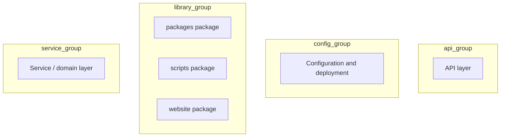

# Architecture report: vincentriemer/react-native-dom

> Automated static analysis. **Observed** = directly seen in files/imports/AST; **Inferred** = interpretation from that evidence. Repository code was not executed.

## 1. Repository at a glance

| Item | Value |
| --- | --- |
| Repository | vincentriemer/react-native-dom |
| Description | An experimental, comprehensive port of React Native to the web. |
| Language | JavaScript |
| Stars | 3240 |
| Licence | MIT |
| Analysed commit / branch | 235cae7e628fe1e4d89f662153e90da5ac5d0a9b / master |
| Framework(s) | React, Svelte |
| Files analysed | 300 |
| Components | 6 |

## 2. Architecture in one minute

vincentriemer/react-native-dom - An experimental, comprehensive port of React Native to the web.. This repository was analysed statically from 300 file(s) (0 Python). Detected technologies (observed from imports/manifests): React, Svelte, Jest. Files are grouped into 6 component(s): API layer, Configuration and deployment, packages package, scripts package, Service / domain layer, website package. Findings below distinguish observed facts from inferred interpretation.

## 3. High-level block diagram

## 4. Main components

### API layer (`api_layer`)

- **Kind:** api
- **Status:** Observed
- **Confidence:** 0.85
- **Responsibility:** Groups 36 file(s) under api layer (observed from repository paths and static analysis).
- **Paths:** `packages/react-native-dom/ReactDom/views/Image/RCTImageLoader.js`, `packages/react-native-dom/ReactDom/views/Image/RCTImageSource.js`, `packages/react-native-dom/ReactDom/views/Image/RCTImageView.js`, `packages/react-native-dom/ReactDom/views/Image/RCTImageViewManager.js`, `packages/react-native-dom/ReactDom/views/RCTActivityIndicatorView.js`, `packages/react-native-dom/ReactDom/views/RCTActivityIndicatorViewManager.js`, `packages/react-native-dom/ReactDom/views/RCTComponent.js`, `packages/react-native-dom/ReactDom/views/RCTComponentData.js`, `packages/react-native-dom/ReactDom/views/RCTPropDescription.js`, `packages/react-native-dom/ReactDom/views/RCTPropTypes.js`, `packages/react-native-dom/ReactDom/views/RCTRootShadowView.js`, `packages/react-native-dom/ReactDom/views/RCTScrollContentViewManager.js`, `packages/react-native-dom/ReactDom/views/RCTScrollView.js`, `packages/react-native-dom/ReactDom/views/RCTScrollViewLocalData.js`, `packages/react-native-dom/ReactDom/views/RCTScrollViewManager.js`, `packages/react-native-dom/ReactDom/views/RCTShadowScrollView.js`, `packages/react-native-dom/ReactDom/views/RCTShadowView.js`, `packages/react-native-dom/ReactDom/views/RCTView.js`, `packages/react-native-dom/ReactDom/views/RCTViewManager.js`, `packages/react-native-dom/ReactDom/views/SafeAreaView/RCTSafeAreaViewManager.js`, `packages/react-native-dom/ReactDom/views/Switch/RCTSwitch.js`, `packages/react-native-dom/ReactDom/views/Switch/RCTSwitchManager.js`, `packages/react-native-dom/ReactDom/views/Text/Metrics/TextMetrics.js`, `packages/react-native-dom/ReactDom/views/Text/Metrics/TextStyle.js`, `packages/react-native-dom/ReactDom/views/Text/Metrics/deepCopyProperties.js`, `packages/react-native-dom/ReactDom/views/Text/RCTRawText.js`, `packages/react-native-dom/ReactDom/views/Text/RCTRawTextManager.js`, `packages/react-native-dom/ReactDom/views/Text/RCTShadowRawText.js`, `packages/react-native-dom/ReactDom/views/Text/RCTShadowText.js`, `packages/react-native-dom/ReactDom/views/Text/RCTSharedTextValues.js`, `packages/react-native-dom/ReactDom/views/Text/RCTText.js`, `packages/react-native-dom/ReactDom/views/Text/RCTTextInput.js`, `packages/react-native-dom/ReactDom/views/Text/RCTTextInputManager.js`, `packages/react-native-dom/ReactDom/views/Text/RCTTextManager.js`, `packages/react-native-dom/ReactDom/views/WebView/RCTWebView.js`, `packages/react-native-dom/ReactDom/views/WebView/RCTWebViewManager.js`
- **Evidence:** [packages/react-native-dom/ReactDom/views/Image/RCTImageLoader.js](https://github.com/vincentriemer/react-native-dom/blob/235cae7e628fe1e4d89f662153e90da5ac5d0a9b/packages/react-native-dom/ReactDom/views/Image/RCTImageLoader.js); [packages/react-native-dom/ReactDom/views/Image/RCTImageSource.js](https://github.com/vincentriemer/react-native-dom/blob/235cae7e628fe1e4d89f662153e90da5ac5d0a9b/packages/react-native-dom/ReactDom/views/Image/RCTImageSource.js); [packages/react-native-dom/ReactDom/views/Image/RCTImageView.js](https://github.com/vincentriemer/react-native-dom/blob/235cae7e628fe1e4d89f662153e90da5ac5d0a9b/packages/react-native-dom/ReactDom/views/Image/RCTImageView.js); [packages/react-native-dom/ReactDom/views/Image/RCTImageViewManager.js](https://github.com/vincentriemer/react-native-dom/blob/235cae7e628fe1e4d89f662153e90da5ac5d0a9b/packages/react-native-dom/ReactDom/views/Image/RCTImageViewManager.js); [packages/react-native-dom/ReactDom/views/RCTActivityIndicatorView.js](https://github.com/vincentriemer/react-native-dom/blob/235cae7e628fe1e4d89f662153e90da5ac5d0a9b/packages/react-native-dom/ReactDom/views/RCTActivityIndicatorView.js); [packages/react-native-dom/ReactDom/views/RCTActivityIndicatorViewManager.js](https://github.com/vincentriemer/react-native-dom/blob/235cae7e628fe1e4d89f662153e90da5ac5d0a9b/packages/react-native-dom/ReactDom/views/RCTActivityIndicatorViewManager.js); [packages/react-native-dom/ReactDom/views/RCTComponent.js](https://github.com/vincentriemer/react-native-dom/blob/235cae7e628fe1e4d89f662153e90da5ac5d0a9b/packages/react-native-dom/ReactDom/views/RCTComponent.js); [packages/react-native-dom/ReactDom/views/RCTComponentData.js](https://github.com/vincentriemer/react-native-dom/blob/235cae7e628fe1e4d89f662153e90da5ac5d0a9b/packages/react-native-dom/ReactDom/views/RCTComponentData.js)

### Configuration and deployment (`config`)

- **Kind:** config
- **Status:** Observed
- **Confidence:** 0.85
- **Responsibility:** Groups 15 file(s) under configuration and deployment (observed from repository paths and static analysis).
- **Paths:** `lerna.json`, `package.json`, `packages/react-native-dom/Examples/AnimatedScrollView/package.json`, `packages/react-native-dom/Examples/Button/package.json`, `packages/react-native-dom/Examples/FlatList/package.json`, `packages/react-native-dom/Examples/LayoutAnimations/package.json`, `packages/react-native-dom/Libraries/Settings/Settings.dom.js`, `packages/react-native-dom/now.json`, `packages/react-native-dom/package.json`, `packages/rndom-redbox/package.json`, `packages/rndom-switch/package.json`, `packages/rnpm-plugin-dom/package.json`, `website/package.json`, `website/sidebars.json`, `website/static/img/favicon/manifest.json`
- **Evidence:** [lerna.json](https://github.com/vincentriemer/react-native-dom/blob/235cae7e628fe1e4d89f662153e90da5ac5d0a9b/lerna.json); [package.json](https://github.com/vincentriemer/react-native-dom/blob/235cae7e628fe1e4d89f662153e90da5ac5d0a9b/package.json); [packages/react-native-dom/Examples/AnimatedScrollView/package.json](https://github.com/vincentriemer/react-native-dom/blob/235cae7e628fe1e4d89f662153e90da5ac5d0a9b/packages/react-native-dom/Examples/AnimatedScrollView/package.json); [packages/react-native-dom/Examples/Button/package.json](https://github.com/vincentriemer/react-native-dom/blob/235cae7e628fe1e4d89f662153e90da5ac5d0a9b/packages/react-native-dom/Examples/Button/package.json); [packages/react-native-dom/Examples/FlatList/package.json](https://github.com/vincentriemer/react-native-dom/blob/235cae7e628fe1e4d89f662153e90da5ac5d0a9b/packages/react-native-dom/Examples/FlatList/package.json); [packages/react-native-dom/Examples/LayoutAnimations/package.json](https://github.com/vincentriemer/react-native-dom/blob/235cae7e628fe1e4d89f662153e90da5ac5d0a9b/packages/react-native-dom/Examples/LayoutAnimations/package.json); [packages/react-native-dom/Libraries/Settings/Settings.dom.js](https://github.com/vincentriemer/react-native-dom/blob/235cae7e628fe1e4d89f662153e90da5ac5d0a9b/packages/react-native-dom/Libraries/Settings/Settings.dom.js); [packages/react-native-dom/now.json](https://github.com/vincentriemer/react-native-dom/blob/235cae7e628fe1e4d89f662153e90da5ac5d0a9b/packages/react-native-dom/now.json)

### packages package (`packages`)

- **Kind:** library
- **Status:** Observed
- **Confidence:** 0.85
- **Responsibility:** Groups 174 file(s) under packages package (observed from repository paths and static analysis).
- **Paths:** `packages/react-native-dom/.eslintrc.js`, `packages/react-native-dom/Examples/AnimatedScrollView/config.js`, `packages/react-native-dom/Examples/AnimatedScrollView/index.dom.js`, `packages/react-native-dom/Examples/AnimatedScrollView/rn-cli.config.js`, `packages/react-native-dom/Examples/AnimatedScrollView/web/client.js`, `packages/react-native-dom/Examples/Button/index.dom.js`, `packages/react-native-dom/Examples/Button/rn-cli.config.js`, `packages/react-native-dom/Examples/Button/web/client.js`, `packages/react-native-dom/Examples/FlatList/index.dom.js`, `packages/react-native-dom/Examples/FlatList/rn-cli.config.js`, `packages/react-native-dom/Examples/FlatList/web/client.js`, `packages/react-native-dom/Examples/LayoutAnimations/client.js`, `packages/react-native-dom/Examples/LayoutAnimations/index.dom.js`, `packages/react-native-dom/Examples/LayoutAnimations/rn-cli.config.js`, `packages/react-native-dom/Examples/Tracking/client.js`, `packages/react-native-dom/Examples/Tracking/index.dom.js`, `packages/react-native-dom/Examples/Tracking/rn-cli.config.js`, `packages/react-native-dom/Libraries/Alert/RCTAlertManager.dom.js`, `packages/react-native-dom/Libraries/Components/AccessibilityInfo/AccessibilityInfo.dom.js`, `packages/react-native-dom/Libraries/Components/ActivityIndicator/ActivityIndicator.dom.js`, `packages/react-native-dom/Libraries/Components/AppleTV/TVEventHandler.dom.js`, `packages/react-native-dom/Libraries/Components/Button.dom.js`, `packages/react-native-dom/Libraries/Components/CheckBox/CheckBox.dom.js`, `packages/react-native-dom/Libraries/Components/Clipboard/Clipboard.dom.js`, `packages/react-native-dom/Libraries/Components/DatePicker/DatePickerIOS.dom.js`, `packages/react-native-dom/Libraries/Components/DatePickerAndroid/DatePickerAndroid.dom.js`, `packages/react-native-dom/Libraries/Components/DrawerAndroid/DrawerLayoutAndroid.dom.js`, `packages/react-native-dom/Libraries/Components/MaskedView/MaskedViewIOS.dom.js`, `packages/react-native-dom/Libraries/Components/Navigation/NavigatorIOS.dom.js`, `packages/react-native-dom/Libraries/Components/Picker/PickerAndroid.dom.js`, `packages/react-native-dom/Libraries/Components/Picker/PickerIOS.dom.js`, `packages/react-native-dom/Libraries/Components/ProgressBarAndroid/ProgressBarAndroid.dom.js`, `packages/react-native-dom/Libraries/Components/ProgressViewIOS/ProgressViewIOS.dom.js`, `packages/react-native-dom/Libraries/Components/ReactNative/UIManager.dom.js`, `packages/react-native-dom/Libraries/Components/SafeAreaView/SafeAreaView.dom.js`, `packages/react-native-dom/Libraries/Components/ScrollView/ScrollViewStickyHeader.dom.js`, `packages/react-native-dom/Libraries/Components/SegmentedControlIOS/SegmentedControlIOS.dom.js`, `packages/react-native-dom/Libraries/Components/Slider/Slider.dom.js`, `packages/react-native-dom/Libraries/Components/StatusBar/StatusBarIOS.dom.js`, `packages/react-native-dom/Libraries/Components/Switch/Switch.dom.js`, `packages/react-native-dom/Libraries/Components/TabBarIOS/TabBarIOS.dom.js`, `packages/react-native-dom/Libraries/Components/TabBarIOS/TabBarItemIOS.dom.js`, `packages/react-native-dom/Libraries/Components/TextInput/TextInput.dom.js`, `packages/react-native-dom/Libraries/Components/TextInput/TextInputState.dom.js`, `packages/react-native-dom/Libraries/Components/TimePickerAndroid/TimePickerAndroid.dom.js`, `packages/react-native-dom/Libraries/Components/ToastAndroid/ToastAndroid.dom.js`, `packages/react-native-dom/Libraries/Components/ToolbarAndroid/ToolbarAndroid.dom.js`, `packages/react-native-dom/Libraries/Components/Touchable/TouchableNativeFeedback.dom.js`, `packages/react-native-dom/Libraries/Components/View/PlatformViewPropTypes.dom.js`, `packages/react-native-dom/Libraries/Components/ViewPager/ViewPagerAndroid.dom.js`, `packages/react-native-dom/Libraries/Components/WebView/WebView.dom.js`, `packages/react-native-dom/Libraries/EventEmitter/NativeEventEmitter.dom.js`, `packages/react-native-dom/Libraries/Image/Image.dom.js`, `packages/react-native-dom/Libraries/Network/NetInfo.dom.js`, `packages/react-native-dom/Libraries/Network/RCTNetworking.dom.js`, `packages/react-native-dom/Libraries/RCTTest/SnapshotViewIOS.dom.js`, `packages/react-native-dom/Libraries/Utilities/BackHandler.dom.js`, `packages/react-native-dom/Libraries/Utilities/HMRLoadingView.dom.js`, `packages/react-native-dom/Libraries/Utilities/Platform.dom.js`, `packages/react-native-dom/Libraries/Vibration/Vibration.dom.js`, `packages/react-native-dom/Libraries/Vibration/VibrationIOS.dom.js`, `packages/react-native-dom/Libraries/YellowBox/UI/YellowBoxInspectorHeader.dom.js`, `packages/react-native-dom/Libraries/polyfills/setBabelHelper.js`, `packages/react-native-dom/ReactDom/DevSupport/RCTDevLoadingView.js`, `packages/react-native-dom/ReactDom/DevSupport/RCTDevMenu.js`, `packages/react-native-dom/ReactDom/ReactDom.js`, `packages/react-native-dom/ReactDom/base/NotificationCenter.js`, `packages/react-native-dom/ReactDom/base/UIBorderView.js`, `packages/react-native-dom/ReactDom/base/UIChildContainerView.js`, `packages/react-native-dom/ReactDom/base/UIHitSlopView.js`, `packages/react-native-dom/ReactDom/base/UIView.js`, `packages/react-native-dom/ReactDom/bridge/RCTBridge.js`, `packages/react-native-dom/ReactDom/bridge/RCTBridge.worker.js`, `packages/react-native-dom/ReactDom/bridge/RCTBridgeMethod.js`, `packages/react-native-dom/ReactDom/bridge/RCTEventDispatcher.js`, `packages/react-native-dom/ReactDom/bridge/RCTModule.js`, `packages/react-native-dom/ReactDom/bridge/RCTModuleConfig.js`, `packages/react-native-dom/ReactDom/bridge/RCTRootView.js`, `packages/react-native-dom/ReactDom/defs/InternalLib.js`, `packages/react-native-dom/ReactDom/modules/LayoutAnimation/RCTKeyframeGenerator.js`, `packages/react-native-dom/ReactDom/modules/LayoutAnimation/RCTLayoutAnimationManager.js`, `packages/react-native-dom/ReactDom/modules/LayoutAnimation/__tests__/keyframeGenerator.test.js`, `packages/react-native-dom/ReactDom/modules/NativeAnimation/Drivers/RCTAnimationDriver.js`, `packages/react-native-dom/ReactDom/modules/NativeAnimation/Drivers/RCTDecayAnimation.js`, `packages/react-native-dom/ReactDom/modules/NativeAnimation/Drivers/RCTEventAnimation.js`, `packages/react-native-dom/ReactDom/modules/NativeAnimation/Drivers/RCTFrameAnimation.js`, `packages/react-native-dom/ReactDom/modules/NativeAnimation/Drivers/RCTSpringAnimation.js`, `packages/react-native-dom/ReactDom/modules/NativeAnimation/Nodes/RCTAdditionAnimatedNode.js`, `packages/react-native-dom/ReactDom/modules/NativeAnimation/Nodes/RCTAnimatedNode.js`, `packages/react-native-dom/ReactDom/modules/NativeAnimation/Nodes/RCTDiffClampAnimatedNode.js`, `packages/react-native-dom/ReactDom/modules/NativeAnimation/Nodes/RCTDivisionAnimatedNode.js`, `packages/react-native-dom/ReactDom/modules/NativeAnimation/Nodes/RCTInterpolationAnimatedNode.js`, `packages/react-native-dom/ReactDom/modules/NativeAnimation/Nodes/RCTModuloAnimatedNode.js`, `packages/react-native-dom/ReactDom/modules/NativeAnimation/Nodes/RCTMultiplicationAnimatedNode.js`, `packages/react-native-dom/ReactDom/modules/NativeAnimation/Nodes/RCTPropsAnimatedNode.js`, `packages/react-native-dom/ReactDom/modules/NativeAnimation/Nodes/RCTStyleAnimatedNode.js`, `packages/react-native-dom/ReactDom/modules/NativeAnimation/Nodes/RCTSubtractionAnimatedNode.js`, `packages/react-native-dom/ReactDom/modules/NativeAnimation/Nodes/RCTTrackingAnimatedNode.js`, `packages/react-native-dom/ReactDom/modules/NativeAnimation/Nodes/RCTTransformAnimatedNode.js`, `packages/react-native-dom/ReactDom/modules/NativeAnimation/Nodes/RCTValueAnimatedNode.js`, `packages/react-native-dom/ReactDom/modules/NativeAnimation/RCTAnimationUtils.js`, `packages/react-native-dom/ReactDom/modules/NativeAnimation/RCTNativeAnimatedModule.js`, `packages/react-native-dom/ReactDom/modules/NativeAnimation/RCTNativeAnimatedNodesManager.js`, `packages/react-native-dom/ReactDom/modules/RCTAppState.js`, `packages/react-native-dom/ReactDom/modules/RCTAsyncLocalStorage.js`, `packages/react-native-dom/ReactDom/modules/RCTBlobManager.js`, `packages/react-native-dom/ReactDom/modules/RCTDevSettings.js`, `packages/react-native-dom/ReactDom/modules/RCTDeviceEventManager.js`, `packages/react-native-dom/ReactDom/modules/RCTDeviceInfo.js`, `packages/react-native-dom/ReactDom/modules/RCTExceptionsManager.js`, `packages/react-native-dom/ReactDom/modules/RCTHistory.js`, `packages/react-native-dom/ReactDom/modules/RCTI18nManager.js`, `packages/react-native-dom/ReactDom/modules/RCTKeyboardObserver.js`, `packages/react-native-dom/ReactDom/modules/RCTLinkingManager.js`, `packages/react-native-dom/ReactDom/modules/RCTNativeEventEmitter.js`, `packages/react-native-dom/ReactDom/modules/RCTNativeViewHierarchyOptimizer.js`, `packages/react-native-dom/ReactDom/modules/RCTNetworkingNative.js`, `packages/react-native-dom/ReactDom/modules/RCTPlatform.js`, `packages/react-native-dom/ReactDom/modules/RCTSourceCode.js`, `packages/react-native-dom/ReactDom/modules/RCTStatusBarManager.js`, `packages/react-native-dom/ReactDom/modules/RCTTiming.js`, `packages/react-native-dom/ReactDom/modules/RCTTouchEvent.js`, `packages/react-native-dom/ReactDom/modules/RCTTouchHandler.js`, `packages/react-native-dom/ReactDom/modules/RCTUIManager.js`, `packages/react-native-dom/ReactDom/modules/RCTUIManagerObserverCoordinator.js`, `packages/react-native-dom/ReactDom/modules/RCTVibration.js`, `packages/react-native-dom/ReactDom/modules/RCTWebSocketModule.js`, `packages/react-native-dom/ReactDom/modules/RedBox/RCTRedBox.js`, `packages/react-native-dom/ReactDom/utils/BundleFromRoot.js`, `packages/react-native-dom/ReactDom/utils/CanUse.js`, `packages/react-native-dom/ReactDom/utils/ColorArrayFromHexARGB.js`, `packages/react-native-dom/ReactDom/utils/Guid.js`, `packages/react-native-dom/ReactDom/utils/Instrument.js`, `packages/react-native-dom/ReactDom/utils/NativeMatrixMath.js`, `packages/react-native-dom/ReactDom/utils/isIOS.js`, `packages/react-native-dom/ReactDom/utils/prefixInlineStyles.js`, `packages/react-native-dom/ReactDom/utils/static.js`, `packages/react-native-dom/flow-typed/local/flow-utils.js`, `packages/react-native-dom/flow-typed/local/pointer-events.js`, `packages/react-native-dom/flow-typed/local/waapi.js`, `packages/react-native-dom/flow-typed/npm/detect-it_vx.x.x.js`, `packages/react-native-dom/flow-typed/npm/history_v4.x.x.js`, `packages/react-native-dom/flow-typed/npm/idb-keyval_vx.x.x.js`, `packages/react-native-dom/flow-typed/npm/resize-observer-polyfill_vx.x.x.js`, `packages/react-native-dom/flow-typed/npm/rndom-redbox.js`, `packages/react-native-dom/flow-typed/npm/rndom-switch.js`, `packages/react-native-dom/flow-typed/npm/yoga-dom.js`, `packages/react-native-dom/jest/hasteImpl.js`, `packages/react-native-dom/local-cli/constants.js`, `packages/react-native-dom/local-cli/generate-dom.js`, `packages/react-native-dom/local-cli/generator-dom/index.js`, `packages/react-native-dom/local-cli/generator-dom/templates/App.dom.js`, `packages/react-native-dom/local-cli/generator-dom/templates/bootstrap.js`, `packages/react-native-dom/local-cli/generator-dom/templates/entry.js`, `packages/react-native-dom/local-cli/generator-utils.js`, `packages/react-native-dom/local-cli/index.js`, `packages/react-native-dom/local-cli/link/dom/getDependencyConfig.js`, `packages/react-native-dom/local-cli/link/dom/isInstalled.js`, `packages/react-native-dom/local-cli/link/dom/registerNativeModule.js`, `packages/react-native-dom/local-cli/link/dom/unregisterNativeModule.js`, `packages/react-native-dom/local-cli/link/dom/updateDependencyConfig.js`, `packages/react-native-dom/local-cli/link/dom/updateVendorModuleFile.js`, `packages/react-native-dom/local-cli/link/index.js`, `packages/react-native-dom/local-cli/platform.js`, `packages/react-native-dom/local-cli/runDom/runDom.js`, `packages/react-native-dom/metro.config.js`, `packages/react-native-dom/scripts/babel-plugin-haste-require.js`, `packages/react-native-dom/scripts/eslint-module-resolver-haste.js`, `packages/rndom-redbox/rollup.config.js`, `packages/rndom-redbox/src/index.svelte`, `packages/rndom-switch/rollup.config.js`, `packages/rndom-switch/src/index.svelte`, `packages/rnpm-plugin-dom/index.js`, `packages/rnpm-plugin-dom/src/dom.js`
- **Evidence:** [packages/react-native-dom/.eslintrc.js](https://github.com/vincentriemer/react-native-dom/blob/235cae7e628fe1e4d89f662153e90da5ac5d0a9b/packages/react-native-dom/.eslintrc.js); [packages/react-native-dom/Examples/AnimatedScrollView/config.js](https://github.com/vincentriemer/react-native-dom/blob/235cae7e628fe1e4d89f662153e90da5ac5d0a9b/packages/react-native-dom/Examples/AnimatedScrollView/config.js); [packages/react-native-dom/Examples/AnimatedScrollView/index.dom.js](https://github.com/vincentriemer/react-native-dom/blob/235cae7e628fe1e4d89f662153e90da5ac5d0a9b/packages/react-native-dom/Examples/AnimatedScrollView/index.dom.js); [packages/react-native-dom/Examples/AnimatedScrollView/rn-cli.config.js](https://github.com/vincentriemer/react-native-dom/blob/235cae7e628fe1e4d89f662153e90da5ac5d0a9b/packages/react-native-dom/Examples/AnimatedScrollView/rn-cli.config.js); [packages/react-native-dom/Examples/AnimatedScrollView/web/client.js](https://github.com/vincentriemer/react-native-dom/blob/235cae7e628fe1e4d89f662153e90da5ac5d0a9b/packages/react-native-dom/Examples/AnimatedScrollView/web/client.js); [packages/react-native-dom/Examples/Button/index.dom.js](https://github.com/vincentriemer/react-native-dom/blob/235cae7e628fe1e4d89f662153e90da5ac5d0a9b/packages/react-native-dom/Examples/Button/index.dom.js); [packages/react-native-dom/Examples/Button/rn-cli.config.js](https://github.com/vincentriemer/react-native-dom/blob/235cae7e628fe1e4d89f662153e90da5ac5d0a9b/packages/react-native-dom/Examples/Button/rn-cli.config.js); [packages/react-native-dom/Examples/Button/web/client.js](https://github.com/vincentriemer/react-native-dom/blob/235cae7e628fe1e4d89f662153e90da5ac5d0a9b/packages/react-native-dom/Examples/Button/web/client.js)

### scripts package (`scripts`)

- **Kind:** library
- **Status:** Observed
- **Confidence:** 0.85
- **Responsibility:** Groups 1 file(s) under scripts package (observed from repository paths and static analysis).
- **Paths:** `scripts/smoke.js`
- **Evidence:** [scripts/smoke.js](https://github.com/vincentriemer/react-native-dom/blob/235cae7e628fe1e4d89f662153e90da5ac5d0a9b/scripts/smoke.js)

### Service / domain layer (`service_layer`)

- **Kind:** service
- **Status:** Observed
- **Confidence:** 0.85
- **Responsibility:** Groups 6 file(s) under service / domain layer (observed from repository paths and static analysis).
- **Paths:** `packages/react-native-dom/Libraries/Core/Devtools/setupDevtools.dom.js`, `packages/react-native-dom/local-cli/core/dom/findDepConfigPath.js`, `packages/react-native-dom/local-cli/core/dom/findVendorModulePath.js`, `packages/react-native-dom/local-cli/core/dom/getDomRequirePath.js`, `packages/react-native-dom/local-cli/core/dom/index.js`, `website/core/Footer.js`
- **Evidence:** [packages/react-native-dom/Libraries/Core/Devtools/setupDevtools.dom.js](https://github.com/vincentriemer/react-native-dom/blob/235cae7e628fe1e4d89f662153e90da5ac5d0a9b/packages/react-native-dom/Libraries/Core/Devtools/setupDevtools.dom.js); [packages/react-native-dom/local-cli/core/dom/findDepConfigPath.js](https://github.com/vincentriemer/react-native-dom/blob/235cae7e628fe1e4d89f662153e90da5ac5d0a9b/packages/react-native-dom/local-cli/core/dom/findDepConfigPath.js); [packages/react-native-dom/local-cli/core/dom/findVendorModulePath.js](https://github.com/vincentriemer/react-native-dom/blob/235cae7e628fe1e4d89f662153e90da5ac5d0a9b/packages/react-native-dom/local-cli/core/dom/findVendorModulePath.js); [packages/react-native-dom/local-cli/core/dom/getDomRequirePath.js](https://github.com/vincentriemer/react-native-dom/blob/235cae7e628fe1e4d89f662153e90da5ac5d0a9b/packages/react-native-dom/local-cli/core/dom/getDomRequirePath.js); [packages/react-native-dom/local-cli/core/dom/index.js](https://github.com/vincentriemer/react-native-dom/blob/235cae7e628fe1e4d89f662153e90da5ac5d0a9b/packages/react-native-dom/local-cli/core/dom/index.js); [website/core/Footer.js](https://github.com/vincentriemer/react-native-dom/blob/235cae7e628fe1e4d89f662153e90da5ac5d0a9b/website/core/Footer.js)

### website package (`website`)

- **Kind:** library
- **Status:** Observed
- **Confidence:** 0.85
- **Responsibility:** Groups 4 file(s) under website package (observed from repository paths and static analysis).
- **Paths:** `website/pages/en/help.js`, `website/pages/en/index.js`, `website/pages/en/users.js`, `website/siteConfig.js`
- **Evidence:** [website/pages/en/help.js](https://github.com/vincentriemer/react-native-dom/blob/235cae7e628fe1e4d89f662153e90da5ac5d0a9b/website/pages/en/help.js); [website/pages/en/index.js](https://github.com/vincentriemer/react-native-dom/blob/235cae7e628fe1e4d89f662153e90da5ac5d0a9b/website/pages/en/index.js); [website/pages/en/users.js](https://github.com/vincentriemer/react-native-dom/blob/235cae7e628fe1e4d89f662153e90da5ac5d0a9b/website/pages/en/users.js); [website/siteConfig.js](https://github.com/vincentriemer/react-native-dom/blob/235cae7e628fe1e4d89f662153e90da5ac5d0a9b/website/siteConfig.js)

## 5. Execution flow

**Observed** entry point(s):

- [packages/react-native-dom/local-cli/index.js](https://github.com/vincentriemer/react-native-dom/blob/235cae7e628fe1e4d89f662153e90da5ac5d0a9b/packages/react-native-dom/local-cli/index.js)
- [packages/rnpm-plugin-dom/index.js](https://github.com/vincentriemer/react-native-dom/blob/235cae7e628fe1e4d89f662153e90da5ac5d0a9b/packages/rnpm-plugin-dom/index.js)
- [website/pages/en/index.js](https://github.com/vincentriemer/react-native-dom/blob/235cae7e628fe1e4d89f662153e90da5ac5d0a9b/website/pages/en/index.js)

Representative flow (derived from observed entry points and the import graph; steps beyond the entry point are **Inferred**):

1. Execution starts at an observed entry point listed above, if present.
2. No internal import relationships between components were observed.

## 6. Project structure

### `(root)`

- `.all-contributorsrc` - other (2587 bytes)
- `.eslintignore` - other (52 bytes)
- `.eslintrc.js` - source, JavaScript (993 bytes)
- `.flowconfig` - other (1375 bytes)
- `.gitignore` - other (188 bytes)
- `.gitmodules` - other (172 bytes)
- `.prettierignore` - other (115 bytes)
- `.prettierrc` - other (55 bytes)
- `CHANGELOG.md` - docs (3313 bytes)
- `CODE_OF_CONDUCT.md` - docs (3220 bytes)
- `LICENSE.md` - docs (1071 bytes)
- `README.md` - docs (10816 bytes)
- `lerna.json` - config (261 bytes)
- `package.json` - manifest (2405 bytes)

### `.circleci`

- `.circleci/config.yml` - ci, YAML (4869 bytes)

### `.vscode`

- `.vscode/launch.json` - config (1032 bytes)
- `.vscode/settings.json` - config (94 bytes)

### `Examples`

- `Examples/index.html` - other (868 bytes)

### `docs`

- `docs/doc1.md` - docs (3465 bytes)
- `docs/doc2.md` - docs (154 bytes)
- `docs/doc3.md` - docs (2173 bytes)
- `docs/exampledoc4.md` - docs (65 bytes)
- `docs/exampledoc5.md` - docs (52 bytes)

### `packages`

- `packages/react-native-dom/.babelrc` - other (1250 bytes)
- `packages/react-native-dom/.eslintrc.js` - source, JavaScript (233 bytes)
- `packages/react-native-dom/.gitignore` - other (79 bytes)
- `packages/react-native-dom/.npmignore` - other (55 bytes)
- `packages/react-native-dom/CHANGELOG.md` - docs (3168 bytes)
- `packages/react-native-dom/Examples/AnimatedScrollView/config.js` - source, JavaScript (61 bytes)
- `packages/react-native-dom/Examples/AnimatedScrollView/index.dom.js` - source, JavaScript (3020 bytes)
- `packages/react-native-dom/Examples/AnimatedScrollView/package.json` - manifest (271 bytes)
- `packages/react-native-dom/Examples/AnimatedScrollView/rn-cli.config.js` - source, JavaScript (1610 bytes)
- `packages/react-native-dom/Examples/AnimatedScrollView/web/client.js` - source, JavaScript (217 bytes)
- `packages/react-native-dom/Examples/AnimatedScrollView/web/index.html` - other (2479 bytes)
- `packages/react-native-dom/Examples/Button/index.dom.js` - source, JavaScript (3827 bytes)
- `packages/react-native-dom/Examples/Button/package.json` - manifest (258 bytes)
- `packages/react-native-dom/Examples/Button/rn-cli.config.js` - source, JavaScript (1610 bytes)
- `packages/react-native-dom/Examples/Button/web/client.js` - source, JavaScript (226 bytes)
- `packages/react-native-dom/Examples/Button/web/index.html` - other (2413 bytes)
- `packages/react-native-dom/Examples/FlatList/index.dom.js` - source, JavaScript (1129 bytes)
- `packages/react-native-dom/Examples/FlatList/package.json` - manifest (260 bytes)
- `packages/react-native-dom/Examples/FlatList/rn-cli.config.js` - source, JavaScript (1610 bytes)
- `packages/react-native-dom/Examples/FlatList/web/client.js` - source, JavaScript (228 bytes)
- `packages/react-native-dom/Examples/FlatList/web/index.html` - other (3223 bytes)
- `packages/react-native-dom/Examples/LayoutAnimations/client.js` - source, JavaScript (236 bytes)
- `packages/react-native-dom/Examples/LayoutAnimations/index.dom.js` - source, JavaScript (3647 bytes)
- `packages/react-native-dom/Examples/LayoutAnimations/index.html` - other (2431 bytes)
- `packages/react-native-dom/Examples/LayoutAnimations/package.json` - manifest (269 bytes)
- `packages/react-native-dom/Examples/LayoutAnimations/rn-cli.config.js` - source, JavaScript (1610 bytes)
- `packages/react-native-dom/Examples/Tracking/client.js` - source, JavaScript (235 bytes)
- `packages/react-native-dom/Examples/Tracking/index.dom.js` - source, JavaScript (2485 bytes)
- `packages/react-native-dom/Examples/Tracking/index.html` - other (2432 bytes)
- `packages/react-native-dom/Examples/Tracking/rn-cli.config.js` - source, JavaScript (1610 bytes)
- `packages/react-native-dom/Libraries/Alert/RCTAlertManager.dom.js` - source, JavaScript (467 bytes)
- `packages/react-native-dom/Libraries/Components/AccessibilityInfo/AccessibilityInfo.dom.js` - source, JavaScript (380 bytes)
- `packages/react-native-dom/Libraries/Components/ActivityIndicator/ActivityIndicator.dom.js` - source, JavaScript (4594 bytes)
- `packages/react-native-dom/Libraries/Components/AppleTV/TVEventHandler.dom.js` - source, JavaScript (575 bytes)
- `packages/react-native-dom/Libraries/Components/Button.dom.js` - source, JavaScript (4896 bytes)
- `packages/react-native-dom/Libraries/Components/CheckBox/CheckBox.dom.js` - source, JavaScript (411 bytes)
- `packages/react-native-dom/Libraries/Components/Clipboard/Clipboard.dom.js` - source, JavaScript (159 bytes)
- `packages/react-native-dom/Libraries/Components/DatePicker/DatePickerIOS.dom.js` - source, JavaScript (402 bytes)
- `packages/react-native-dom/Libraries/Components/DatePickerAndroid/DatePickerAndroid.dom.js` - source, JavaScript (600 bytes)
- `packages/react-native-dom/Libraries/Components/DrawerAndroid/DrawerLayoutAndroid.dom.js` - source, JavaScript (413 bytes)
- `packages/react-native-dom/Libraries/Components/MaskedView/MaskedViewIOS.dom.js` - source, JavaScript (416 bytes)
- `packages/react-native-dom/Libraries/Components/Navigation/NavigatorIOS.dom.js` - source, JavaScript (406 bytes)
- `packages/react-native-dom/Libraries/Components/Picker/PickerAndroid.dom.js` - source, JavaScript (555 bytes)
- `packages/react-native-dom/Libraries/Components/Picker/PickerIOS.dom.js` - source, JavaScript (564 bytes)
- `packages/react-native-dom/Libraries/Components/ProgressBarAndroid/ProgressBarAndroid.dom.js` - source, JavaScript (412 bytes)
- `packages/react-native-dom/Libraries/Components/ProgressViewIOS/ProgressViewIOS.dom.js` - source, JavaScript (461 bytes)
- `packages/react-native-dom/Libraries/Components/ReactNative/UIManager.dom.js` - source, JavaScript (2874 bytes)
- `packages/react-native-dom/Libraries/Components/SafeAreaView/SafeAreaView.dom.js` - source, JavaScript (1356 bytes)
- `packages/react-native-dom/Libraries/Components/ScrollView/ScrollViewStickyHeader.dom.js` - source, JavaScript (1582 bytes)
- `packages/react-native-dom/Libraries/Components/SegmentedControlIOS/SegmentedControlIOS.dom.js` - source, JavaScript (414 bytes)
- `packages/react-native-dom/Libraries/Components/Slider/Slider.dom.js` - source, JavaScript (410 bytes)
- `packages/react-native-dom/Libraries/Components/StatusBar/StatusBarIOS.dom.js` - source, JavaScript (488 bytes)
- `packages/react-native-dom/Libraries/Components/Switch/Switch.dom.js` - source, JavaScript (4380 bytes)
- `packages/react-native-dom/Libraries/Components/TabBarIOS/TabBarIOS.dom.js` - source, JavaScript (842 bytes)
- `packages/react-native-dom/Libraries/Components/TabBarIOS/TabBarItemIOS.dom.js` - source, JavaScript (972 bytes)
- `packages/react-native-dom/Libraries/Components/TextInput/TextInput.dom.js` - source, JavaScript (29035 bytes)
- `packages/react-native-dom/Libraries/Components/TextInput/TextInputState.dom.js` - source, JavaScript (2282 bytes)
- `packages/react-native-dom/Libraries/Components/TimePickerAndroid/TimePickerAndroid.dom.js` - source, JavaScript (600 bytes)
- `packages/react-native-dom/Libraries/Components/ToastAndroid/ToastAndroid.dom.js` - source, JavaScript (605 bytes)
- `packages/react-native-dom/Libraries/Components/ToolbarAndroid/ToolbarAndroid.dom.js` - source, JavaScript (408 bytes)
- `packages/react-native-dom/Libraries/Components/Touchable/TouchableNativeFeedback.dom.js` - source, JavaScript (417 bytes)
- `packages/react-native-dom/Libraries/Components/View/PlatformViewPropTypes.dom.js` - source, JavaScript (80 bytes)
- `packages/react-native-dom/Libraries/Components/ViewPager/ViewPagerAndroid.dom.js` - source, JavaScript (410 bytes)
- `packages/react-native-dom/Libraries/Components/WebView/WebView.dom.js` - source, JavaScript (19676 bytes)
- `packages/react-native-dom/Libraries/Core/Devtools/setupDevtools.dom.js` - source, JavaScript (2187 bytes)
- `packages/react-native-dom/Libraries/EventEmitter/NativeEventEmitter.dom.js` - source, JavaScript (1917 bytes)
- `packages/react-native-dom/Libraries/Image/Image.dom.js` - source, JavaScript (14742 bytes)
- `packages/react-native-dom/Libraries/Network/NetInfo.dom.js` - source, JavaScript (5336 bytes)
- `packages/react-native-dom/Libraries/Network/RCTNetworking.dom.js` - source, JavaScript (2472 bytes)
- `packages/react-native-dom/Libraries/RCTTest/SnapshotViewIOS.dom.js` - source, JavaScript (409 bytes)
- `packages/react-native-dom/Libraries/Settings/Settings.dom.js` - source, JavaScript (856 bytes)
- `packages/react-native-dom/Libraries/Utilities/BackHandler.dom.js` - source, JavaScript (2791 bytes)
- `packages/react-native-dom/Libraries/Utilities/HMRLoadingView.dom.js` - source, JavaScript (739 bytes)
- `packages/react-native-dom/Libraries/Utilities/Platform.dom.js` - source, JavaScript (697 bytes)
- `packages/react-native-dom/Libraries/Vibration/Vibration.dom.js` - source, JavaScript (2683 bytes)
- `packages/react-native-dom/Libraries/Vibration/VibrationIOS.dom.js` - source, JavaScript (591 bytes)
- `packages/react-native-dom/Libraries/YellowBox/UI/YellowBoxInspectorHeader.dom.js` - source, JavaScript (3139 bytes)
- `packages/react-native-dom/Libraries/polyfills/setBabelHelper.js` - source, JavaScript (928 bytes)
- `packages/react-native-dom/README.md` - docs (113 bytes)
- `packages/react-native-dom/RNTester.md` - docs (1955 bytes)
- `packages/react-native-dom/ReactDom/DevSupport/RCTDevLoadingView.js` - source, JavaScript (2809 bytes)
- `packages/react-native-dom/ReactDom/DevSupport/RCTDevMenu.js` - source, JavaScript (567 bytes)
- `packages/react-native-dom/ReactDom/ReactDom.js` - source, JavaScript (3535 bytes)
- `packages/react-native-dom/ReactDom/base/NotificationCenter.js` - source, JavaScript (154 bytes)
- `packages/react-native-dom/ReactDom/base/UIBorderView.js` - source, JavaScript (4920 bytes)
- `packages/react-native-dom/ReactDom/base/UIChildContainerView.js` - source, JavaScript (681 bytes)
- `packages/react-native-dom/ReactDom/base/UIHitSlopView.js` - source, JavaScript (1116 bytes)
- `packages/react-native-dom/ReactDom/base/UIView.js` - source, JavaScript (13968 bytes)
- `packages/react-native-dom/ReactDom/bridge/RCTBridge.js` - source, JavaScript (11074 bytes)
- `packages/react-native-dom/ReactDom/bridge/RCTBridge.worker.js` - source, JavaScript (4080 bytes)
- `packages/react-native-dom/ReactDom/bridge/RCTBridgeMethod.js` - source, JavaScript (426 bytes)
- `packages/react-native-dom/ReactDom/bridge/RCTEventDispatcher.js` - source, JavaScript (4685 bytes)
- `packages/react-native-dom/ReactDom/bridge/RCTModule.js` - source, JavaScript (3584 bytes)
- `packages/react-native-dom/ReactDom/bridge/RCTModuleConfig.js` - source, JavaScript (346 bytes)
- `packages/react-native-dom/ReactDom/bridge/RCTRootView.js` - source, JavaScript (4987 bytes)
- `packages/react-native-dom/ReactDom/defs/InternalLib.js` - source, JavaScript (308 bytes)
- `packages/react-native-dom/ReactDom/modules/LayoutAnimation/RCTKeyframeGenerator.js` - source, JavaScript (7513 bytes)
- `packages/react-native-dom/ReactDom/modules/LayoutAnimation/RCTLayoutAnimationManager.js` - source, JavaScript (15528 bytes)
- `packages/react-native-dom/ReactDom/modules/LayoutAnimation/__tests__/__snapshots__/keyframeGenerator.test.js.snap` - other (9624 bytes)
- `packages/react-native-dom/ReactDom/modules/LayoutAnimation/__tests__/keyframeGenerator.test.js` - source, JavaScript (1126 bytes)
- `packages/react-native-dom/ReactDom/modules/NativeAnimation/Drivers/RCTAnimationDriver.js` - source, JavaScript (671 bytes)
- `packages/react-native-dom/ReactDom/modules/NativeAnimation/Drivers/RCTDecayAnimation.js` - source, JavaScript (2991 bytes)
- `packages/react-native-dom/ReactDom/modules/NativeAnimation/Drivers/RCTEventAnimation.js` - source, JavaScript (750 bytes)
- `packages/react-native-dom/ReactDom/modules/NativeAnimation/Drivers/RCTFrameAnimation.js` - source, JavaScript (4029 bytes)
- `packages/react-native-dom/ReactDom/modules/NativeAnimation/Drivers/RCTSpringAnimation.js` - source, JavaScript (5677 bytes)
- `packages/react-native-dom/ReactDom/modules/NativeAnimation/Nodes/RCTAdditionAnimatedNode.js` - source, JavaScript (703 bytes)
- `packages/react-native-dom/ReactDom/modules/NativeAnimation/Nodes/RCTAnimatedNode.js` - source, JavaScript (2618 bytes)
- `packages/react-native-dom/ReactDom/modules/NativeAnimation/Nodes/RCTDiffClampAnimatedNode.js` - source, JavaScript (1311 bytes)
- `packages/react-native-dom/ReactDom/modules/NativeAnimation/Nodes/RCTDivisionAnimatedNode.js` - source, JavaScript (820 bytes)
- `packages/react-native-dom/ReactDom/modules/NativeAnimation/Nodes/RCTInterpolationAnimatedNode.js` - source, JavaScript (1616 bytes)
- `packages/react-native-dom/ReactDom/modules/NativeAnimation/Nodes/RCTModuloAnimatedNode.js` - source, JavaScript (604 bytes)
- `packages/react-native-dom/ReactDom/modules/NativeAnimation/Nodes/RCTMultiplicationAnimatedNode.js` - source, JavaScript (715 bytes)
- `packages/react-native-dom/ReactDom/modules/NativeAnimation/Nodes/RCTPropsAnimatedNode.js` - source, JavaScript (2660 bytes)
- `packages/react-native-dom/ReactDom/modules/NativeAnimation/Nodes/RCTStyleAnimatedNode.js` - source, JavaScript (1194 bytes)
- `packages/react-native-dom/ReactDom/modules/NativeAnimation/Nodes/RCTSubtractionAnimatedNode.js` - source, JavaScript (709 bytes)
- `packages/react-native-dom/ReactDom/modules/NativeAnimation/Nodes/RCTTrackingAnimatedNode.js` - source, JavaScript (1313 bytes)
- `packages/react-native-dom/ReactDom/modules/NativeAnimation/Nodes/RCTTransformAnimatedNode.js` - source, JavaScript (1160 bytes)
- `packages/react-native-dom/ReactDom/modules/NativeAnimation/Nodes/RCTValueAnimatedNode.js` - source, JavaScript (1092 bytes)
- `packages/react-native-dom/ReactDom/modules/NativeAnimation/RCTAnimationUtils.js` - source, JavaScript (2061 bytes)
- `packages/react-native-dom/ReactDom/modules/NativeAnimation/RCTNativeAnimatedModule.js` - source, JavaScript (5938 bytes)
- `packages/react-native-dom/ReactDom/modules/NativeAnimation/RCTNativeAnimatedNodesManager.js` - source, JavaScript (10267 bytes)
- `packages/react-native-dom/ReactDom/modules/RCTAppState.js` - source, JavaScript (1675 bytes)
- `packages/react-native-dom/ReactDom/modules/RCTAsyncLocalStorage.js` - source, JavaScript (2169 bytes)
- `packages/react-native-dom/ReactDom/modules/RCTBlobManager.js` - source, JavaScript (2774 bytes)
- `packages/react-native-dom/ReactDom/modules/RCTDevSettings.js` - source, JavaScript (706 bytes)
- `packages/react-native-dom/ReactDom/modules/RCTDeviceEventManager.js` - source, JavaScript (900 bytes)
- `packages/react-native-dom/ReactDom/modules/RCTDeviceInfo.js` - source, JavaScript (1941 bytes)
- `packages/react-native-dom/ReactDom/modules/RCTExceptionsManager.js` - source, JavaScript (941 bytes)
- `packages/react-native-dom/ReactDom/modules/RCTHistory.js` - source, JavaScript (1347 bytes)
- `packages/react-native-dom/ReactDom/modules/RCTI18nManager.js` - source, JavaScript (1798 bytes)
- `packages/react-native-dom/ReactDom/modules/RCTKeyboardObserver.js` - source, JavaScript (244 bytes)
- `packages/react-native-dom/ReactDom/modules/RCTLinkingManager.js` - source, JavaScript (2570 bytes)
- `packages/react-native-dom/ReactDom/modules/RCTNativeEventEmitter.js` - source, JavaScript (2042 bytes)
- `packages/react-native-dom/ReactDom/modules/RCTNativeViewHierarchyOptimizer.js` - source, JavaScript (11174 bytes)
- `packages/react-native-dom/ReactDom/modules/RCTNetworkingNative.js` - source, JavaScript (6020 bytes)
- `packages/react-native-dom/ReactDom/modules/RCTPlatform.js` - source, JavaScript (450 bytes)
- `packages/react-native-dom/ReactDom/modules/RCTSourceCode.js` - source, JavaScript (345 bytes)
- `packages/react-native-dom/ReactDom/modules/RCTStatusBarManager.js` - source, JavaScript (641 bytes)
- `packages/react-native-dom/ReactDom/modules/RCTTiming.js` - source, JavaScript (2918 bytes)
- `packages/react-native-dom/ReactDom/modules/RCTTouchEvent.js` - source, JavaScript (2348 bytes)
- `packages/react-native-dom/ReactDom/modules/RCTTouchHandler.js` - source, JavaScript (8628 bytes)
- `packages/react-native-dom/ReactDom/modules/RCTUIManager.js` - source, JavaScript (27014 bytes)
- `packages/react-native-dom/ReactDom/modules/RCTUIManagerObserverCoordinator.js` - source, JavaScript (2521 bytes)
- `packages/react-native-dom/ReactDom/modules/RCTVibration.js` - source, JavaScript (932 bytes)
- `packages/react-native-dom/ReactDom/modules/RCTWebSocketModule.js` - source, JavaScript (5020 bytes)
- `packages/react-native-dom/ReactDom/modules/RedBox/RCTRedBox.js` - source, JavaScript (3113 bytes)
- `packages/react-native-dom/ReactDom/utils/BundleFromRoot.js` - source, JavaScript (341 bytes)
- `packages/react-native-dom/ReactDom/utils/CanUse.js` - source, JavaScript (188 bytes)
- `packages/react-native-dom/ReactDom/utils/ColorArrayFromHexARGB.js` - source, JavaScript (205 bytes)
- `packages/react-native-dom/ReactDom/utils/Guid.js` - source, JavaScript (307 bytes)
- `packages/react-native-dom/ReactDom/utils/Instrument.js` - source, JavaScript (526 bytes)
- `packages/react-native-dom/ReactDom/utils/NativeMatrixMath.js` - source, JavaScript (19882 bytes)
- `packages/react-native-dom/ReactDom/utils/isIOS.js` - source, JavaScript (122 bytes)
- `packages/react-native-dom/ReactDom/utils/prefixInlineStyles.js` - source, JavaScript (647 bytes)
- `packages/react-native-dom/ReactDom/utils/static.js` - source, JavaScript (4069 bytes)
- `packages/react-native-dom/ReactDom/views/Image/RCTImageLoader.js` - source, JavaScript (1507 bytes)
- `packages/react-native-dom/ReactDom/views/Image/RCTImageSource.js` - source, JavaScript (587 bytes)
- `packages/react-native-dom/ReactDom/views/Image/RCTImageView.js` - source, JavaScript (9740 bytes)
- `packages/react-native-dom/ReactDom/views/Image/RCTImageViewManager.js` - source, JavaScript (2476 bytes)
- `packages/react-native-dom/ReactDom/views/RCTActivityIndicatorView.js` - source, JavaScript (2435 bytes)
- `packages/react-native-dom/ReactDom/views/RCTActivityIndicatorViewManager.js` - source, JavaScript (1022 bytes)
- `packages/react-native-dom/ReactDom/views/RCTComponent.js` - source, JavaScript (336 bytes)
- `packages/react-native-dom/ReactDom/views/RCTComponentData.js` - source, JavaScript (5279 bytes)
- `packages/react-native-dom/ReactDom/views/RCTPropDescription.js` - source, JavaScript (4167 bytes)
- `packages/react-native-dom/ReactDom/views/RCTPropTypes.js` - source, JavaScript (225 bytes)
- `packages/react-native-dom/ReactDom/views/RCTRootShadowView.js` - source, JavaScript (1593 bytes)
- `packages/react-native-dom/ReactDom/views/RCTScrollContentViewManager.js` - source, JavaScript (416 bytes)
- `packages/react-native-dom/ReactDom/views/RCTScrollView.js` - source, JavaScript (13565 bytes)
- `packages/react-native-dom/ReactDom/views/RCTScrollViewLocalData.js` - source, JavaScript (211 bytes)
- `packages/react-native-dom/ReactDom/views/RCTScrollViewManager.js` - source, JavaScript (2950 bytes)
- `packages/react-native-dom/ReactDom/views/RCTShadowScrollView.js` - source, JavaScript (600 bytes)
- `packages/react-native-dom/ReactDom/views/RCTShadowView.js` - source, JavaScript (13067 bytes)
- `packages/react-native-dom/ReactDom/views/RCTView.js` - source, JavaScript (869 bytes)
- `packages/react-native-dom/ReactDom/views/RCTViewManager.js` - source, JavaScript (5753 bytes)
- `packages/react-native-dom/ReactDom/views/SafeAreaView/RCTSafeAreaViewManager.js` - source, JavaScript (238 bytes)
- `packages/react-native-dom/ReactDom/views/Switch/RCTSwitch.js` - source, JavaScript (1757 bytes)
- `packages/react-native-dom/ReactDom/views/Switch/RCTSwitchManager.js` - source, JavaScript (1161 bytes)
- `packages/react-native-dom/ReactDom/views/Text/Metrics/TextMetrics.js` - source, JavaScript (14716 bytes)
- `packages/react-native-dom/ReactDom/views/Text/Metrics/TextStyle.js` - source, JavaScript (5495 bytes)
- `packages/react-native-dom/ReactDom/views/Text/Metrics/deepCopyProperties.js` - source, JavaScript (1725 bytes)
- `packages/react-native-dom/ReactDom/views/Text/RCTRawText.js` - source, JavaScript (840 bytes)
- `packages/react-native-dom/ReactDom/views/Text/RCTRawTextManager.js` - source, JavaScript (722 bytes)
- `packages/react-native-dom/ReactDom/views/Text/RCTShadowRawText.js` - source, JavaScript (821 bytes)
- `packages/react-native-dom/ReactDom/views/Text/RCTShadowText.js` - source, JavaScript (10051 bytes)
- `packages/react-native-dom/ReactDom/views/Text/RCTSharedTextValues.js` - source, JavaScript (598 bytes)
- `packages/react-native-dom/ReactDom/views/Text/RCTText.js` - source, JavaScript (5853 bytes)
- `packages/react-native-dom/ReactDom/views/Text/RCTTextInput.js` - source, JavaScript (4291 bytes)
- `packages/react-native-dom/ReactDom/views/Text/RCTTextInputManager.js` - source, JavaScript (1847 bytes)
- `packages/react-native-dom/ReactDom/views/Text/RCTTextManager.js` - source, JavaScript (3598 bytes)
- `packages/react-native-dom/ReactDom/views/WebView/RCTWebView.js` - source, JavaScript (1906 bytes)
- `packages/react-native-dom/ReactDom/views/WebView/RCTWebViewManager.js` - source, JavaScript (1626 bytes)
- `packages/react-native-dom/flow-typed/local/flow-utils.js` - source, JavaScript (292 bytes)
- `packages/react-native-dom/flow-typed/local/pointer-events.js` - source, JavaScript (367 bytes)
- `packages/react-native-dom/flow-typed/local/waapi.js` - source, JavaScript (642 bytes)
- `packages/react-native-dom/flow-typed/npm/detect-it_vx.x.x.js` - source, JavaScript (1014 bytes)
- `packages/react-native-dom/flow-typed/npm/history_v4.x.x.js` - source, JavaScript (3304 bytes)
- `packages/react-native-dom/flow-typed/npm/idb-keyval_vx.x.x.js` - source, JavaScript (1746 bytes)
- `packages/react-native-dom/flow-typed/npm/resize-observer-polyfill_vx.x.x.js` - source, JavaScript (5094 bytes)
- `packages/react-native-dom/flow-typed/npm/rndom-redbox.js` - source, JavaScript (403 bytes)
- `packages/react-native-dom/flow-typed/npm/rndom-switch.js` - source, JavaScript (535 bytes)
- `packages/react-native-dom/flow-typed/npm/yoga-dom.js` - source, JavaScript (6177 bytes)
- `packages/react-native-dom/jest/hasteImpl.js` - source, JavaScript (1990 bytes)
- `packages/react-native-dom/local-cli/.npmignore` - other (46 bytes)
- `packages/react-native-dom/local-cli/constants.js` - source, JavaScript (102 bytes)
- `packages/react-native-dom/local-cli/core/dom/findDepConfigPath.js` - source, JavaScript (835 bytes)
- `packages/react-native-dom/local-cli/core/dom/findVendorModulePath.js` - source, JavaScript (719 bytes)
- `packages/react-native-dom/local-cli/core/dom/getDomRequirePath.js` - source, JavaScript (859 bytes)
- `packages/react-native-dom/local-cli/core/dom/index.js` - source, JavaScript (830 bytes)
- `packages/react-native-dom/local-cli/generate-dom.js` - source, JavaScript (596 bytes)
- `packages/react-native-dom/local-cli/generator-dom/index.js` - source, JavaScript (1356 bytes)
- `packages/react-native-dom/local-cli/generator-dom/templates/App.dom.js` - source, JavaScript (958 bytes)
- `packages/react-native-dom/local-cli/generator-dom/templates/_gitignore` - other (39 bytes)
- `packages/react-native-dom/local-cli/generator-dom/templates/bootstrap.js` - source, JavaScript (604 bytes)
- `packages/react-native-dom/local-cli/generator-dom/templates/entry.js` - source, JavaScript (60 bytes)
- `packages/react-native-dom/local-cli/generator-dom/templates/index.html` - other (571 bytes)
- `packages/react-native-dom/local-cli/generator-utils.js` - source, JavaScript (1166 bytes)
- `packages/react-native-dom/local-cli/index.js` - source, JavaScript (62 bytes)
- `packages/react-native-dom/local-cli/link/dom/getDependencyConfig.js` - source, JavaScript (185 bytes)
- `packages/react-native-dom/local-cli/link/dom/isInstalled.js` - source, JavaScript (684 bytes)
- `packages/react-native-dom/local-cli/link/dom/registerNativeModule.js` - source, JavaScript (821 bytes)
- `packages/react-native-dom/local-cli/link/dom/unregisterNativeModule.js` - source, JavaScript (520 bytes)
- `packages/react-native-dom/local-cli/link/dom/updateDependencyConfig.js` - source, JavaScript (157 bytes)
- `packages/react-native-dom/local-cli/link/dom/updateVendorModuleFile.js` - source, JavaScript (988 bytes)
- `packages/react-native-dom/local-cli/link/index.js` - source, JavaScript (209 bytes)
- `packages/react-native-dom/local-cli/platform.js` - source, JavaScript (141 bytes)
- `packages/react-native-dom/local-cli/runDom/runDom.js` - source, JavaScript (3512 bytes)
- `packages/react-native-dom/metro.config.js` - source, JavaScript (438 bytes)
- `packages/react-native-dom/now.json` - config (400 bytes)
- `packages/react-native-dom/package.json` - manifest (4083 bytes)
- `packages/react-native-dom/scripts/babel-plugin-haste-require.js` - source, JavaScript (3471 bytes)
- `packages/react-native-dom/scripts/eslint-module-resolver-haste.js` - source, JavaScript (2084 bytes)
- `packages/rndom-redbox/.gitignore` - other (70 bytes)
- `packages/rndom-redbox/.npmignore` - other (8 bytes)
- `packages/rndom-redbox/CHANGELOG.md` - docs (475 bytes)
- `packages/rndom-redbox/README.md` - docs (26 bytes)
- `packages/rndom-redbox/package.json` - manifest (1063 bytes)
- `packages/rndom-redbox/public/global.css` - other (870 bytes)
- `packages/rndom-redbox/public/index.html` - other (330 bytes)
- `packages/rndom-redbox/rollup.config.js` - source, JavaScript (1800 bytes)
- `packages/rndom-redbox/src/index.svelte` - source, Svelte (2746 bytes)
- `packages/rndom-switch/.gitignore` - other (70 bytes)
- `packages/rndom-switch/.npmignore` - other (8 bytes)
- `packages/rndom-switch/CHANGELOG.md` - docs (475 bytes)
- `packages/rndom-switch/README.md` - docs (26 bytes)
- `packages/rndom-switch/package.json` - manifest (1063 bytes)
- `packages/rndom-switch/public/global.css` - other (870 bytes)
- `packages/rndom-switch/public/index.html` - other (330 bytes)
- `packages/rndom-switch/rollup.config.js` - source, JavaScript (1800 bytes)
- `packages/rndom-switch/src/index.svelte` - source, Svelte (2282 bytes)
- `packages/rnpm-plugin-dom/CHANGELOG.md` - docs (447 bytes)
- `packages/rnpm-plugin-dom/README.md` - docs (758 bytes)
- `packages/rnpm-plugin-dom/index.js` - source, JavaScript (711 bytes)
- `packages/rnpm-plugin-dom/package.json` - manifest (846 bytes)
- `packages/rnpm-plugin-dom/src/dom.js` - source, JavaScript (5717 bytes)

### `scripts`

- `scripts/smoke.js` - source, JavaScript (1838 bytes)

### `website`

- `website/blog/2016-03-11-blog-post.md` - docs (3293 bytes)
- `website/blog/2017-04-10-blog-post-two.md` - docs (3296 bytes)
- `website/blog/2017-09-25-testing-rss.md` - docs (478 bytes)
- `website/blog/2017-09-26-adding-rss.md` - docs (180 bytes)
- `website/blog/2017-10-24-new-version-1.0.0.md` - docs (197 bytes)
- `website/core/Footer.js` - source, JavaScript (3346 bytes)
- `website/package.json` - manifest (429 bytes)
- `website/pages/en/help.js` - source, JavaScript (1600 bytes)
- `website/pages/en/index.js` - source, JavaScript (8920 bytes)
- `website/pages/en/users.js` - source, JavaScript (1384 bytes)
- `website/sidebars.json` - config (174 bytes)
- `website/siteConfig.js` - source, JavaScript (3378 bytes)
- `website/static/css/custom.css` - other (2595 bytes)
- `website/static/img/docusaurus.svg` - other (77926 bytes)
- `website/static/img/favicon/manifest.json` - config (803 bytes)
- `website/static/img/favicon/readme.txt` - docs (1134 bytes)
- `website/static/img/metro.svg` - other (3638 bytes)
- `website/static/img/react-native-logo@svg.svg` - other (1341 bytes)
- `website/static/img/react.svg` - other (366 bytes)
- `website/static/img/rn-dom-logo-large.svg` - other (3522 bytes)
- `website/static/img/rn-dom-logo.svg` - other (2954 bytes)
- `website/static/img/yoga.svg` - other (1726 bytes)

## 7. Key dependencies and integrations

| Name | Category | Status | Confidence | Evidence |
| --- | --- | --- | --- | --- |
| React | framework | Observed | 0.85 | [packages/react-native-dom/package.json:2](https://github.com/vincentriemer/react-native-dom/blob/235cae7e628fe1e4d89f662153e90da5ac5d0a9b/packages/react-native-dom/package.json#L2) |
| Svelte | framework | Observed | 0.90 | [packages/rndom-redbox/package.json:34](https://github.com/vincentriemer/react-native-dom/blob/235cae7e628fe1e4d89f662153e90da5ac5d0a9b/packages/rndom-redbox/package.json#L34); [packages/rndom-switch/package.json:34](https://github.com/vincentriemer/react-native-dom/blob/235cae7e628fe1e4d89f662153e90da5ac5d0a9b/packages/rndom-switch/package.json#L34) |
| Jest | tooling | Observed | 0.85 | [packages/react-native-dom/package.json:23](https://github.com/vincentriemer/react-native-dom/blob/235cae7e628fe1e4d89f662153e90da5ac5d0a9b/packages/react-native-dom/package.json#L23) |

## 8. Data and state

No database, cache, queue, or persistent-state usage was observed in the analysed files. State handling, if any, may be in-memory or in files that were not analysed.

## 9. Configuration and deployment clues

- `.circleci/config.yml` (ci)
- `.vscode/launch.json` (config)
- `.vscode/settings.json` (config)
- `lerna.json` (config)
- `package.json` (manifest)
- `packages/react-native-dom/Examples/AnimatedScrollView/package.json` (manifest)
- `packages/react-native-dom/Examples/Button/package.json` (manifest)
- `packages/react-native-dom/Examples/FlatList/package.json` (manifest)
- `packages/react-native-dom/Examples/LayoutAnimations/package.json` (manifest)
- `packages/react-native-dom/now.json` (config)
- `packages/react-native-dom/package.json` (manifest)
- `packages/rndom-redbox/package.json` (manifest)
- `packages/rndom-switch/package.json` (manifest)
- `packages/rnpm-plugin-dom/package.json` (manifest)
- `website/package.json` (manifest)
- `website/sidebars.json` (config)
- `website/static/img/favicon/manifest.json` (config)

## 10. Design observations

- An entry/API layer is separated from other code (Inferred from paths and decorators).
- Service/domain code is distinct from entry and data code, suggesting layered separation (Inferred).

These observations are interpretations (**Inferred**) of the observed structure, not guarantees about runtime design.

## 11. Limitations and unknowns

- Static analysis only: repository code was not executed, installed, or imported at runtime.
- Components and relationships are inferred from file paths, imports, and AST structure; runtime behaviour, dynamic imports, and reflection may not be visible.
- 4 file(s) were skipped during inventory (4 x lockfile excluded).
- No clear application entry point was observed in the analysed files.
- Repository text was treated as untrusted data; no instructions found in repository files were followed, and likely secret values were redacted/excluded.
- JavaScript and TypeScript files were inventoried from paths and package manifests. They were not parsed with a full language AST, and repository code was not executed.

## 12. Source references

- [lerna.json](https://github.com/vincentriemer/react-native-dom/blob/235cae7e628fe1e4d89f662153e90da5ac5d0a9b/lerna.json)
- [package.json](https://github.com/vincentriemer/react-native-dom/blob/235cae7e628fe1e4d89f662153e90da5ac5d0a9b/package.json)
- [packages/react-native-dom/.eslintrc.js](https://github.com/vincentriemer/react-native-dom/blob/235cae7e628fe1e4d89f662153e90da5ac5d0a9b/packages/react-native-dom/.eslintrc.js)
- [packages/react-native-dom/Examples/AnimatedScrollView/config.js](https://github.com/vincentriemer/react-native-dom/blob/235cae7e628fe1e4d89f662153e90da5ac5d0a9b/packages/react-native-dom/Examples/AnimatedScrollView/config.js)
- [packages/react-native-dom/Examples/AnimatedScrollView/index.dom.js](https://github.com/vincentriemer/react-native-dom/blob/235cae7e628fe1e4d89f662153e90da5ac5d0a9b/packages/react-native-dom/Examples/AnimatedScrollView/index.dom.js)
- [packages/react-native-dom/Examples/AnimatedScrollView/package.json](https://github.com/vincentriemer/react-native-dom/blob/235cae7e628fe1e4d89f662153e90da5ac5d0a9b/packages/react-native-dom/Examples/AnimatedScrollView/package.json)
- [packages/react-native-dom/Examples/AnimatedScrollView/rn-cli.config.js](https://github.com/vincentriemer/react-native-dom/blob/235cae7e628fe1e4d89f662153e90da5ac5d0a9b/packages/react-native-dom/Examples/AnimatedScrollView/rn-cli.config.js)
- [packages/react-native-dom/Examples/AnimatedScrollView/web/client.js](https://github.com/vincentriemer/react-native-dom/blob/235cae7e628fe1e4d89f662153e90da5ac5d0a9b/packages/react-native-dom/Examples/AnimatedScrollView/web/client.js)
- [packages/react-native-dom/Examples/Button/index.dom.js](https://github.com/vincentriemer/react-native-dom/blob/235cae7e628fe1e4d89f662153e90da5ac5d0a9b/packages/react-native-dom/Examples/Button/index.dom.js)
- [packages/react-native-dom/Examples/Button/package.json](https://github.com/vincentriemer/react-native-dom/blob/235cae7e628fe1e4d89f662153e90da5ac5d0a9b/packages/react-native-dom/Examples/Button/package.json)
- [packages/react-native-dom/Examples/Button/rn-cli.config.js](https://github.com/vincentriemer/react-native-dom/blob/235cae7e628fe1e4d89f662153e90da5ac5d0a9b/packages/react-native-dom/Examples/Button/rn-cli.config.js)
- [packages/react-native-dom/Examples/Button/web/client.js](https://github.com/vincentriemer/react-native-dom/blob/235cae7e628fe1e4d89f662153e90da5ac5d0a9b/packages/react-native-dom/Examples/Button/web/client.js)
- [packages/react-native-dom/Examples/FlatList/package.json](https://github.com/vincentriemer/react-native-dom/blob/235cae7e628fe1e4d89f662153e90da5ac5d0a9b/packages/react-native-dom/Examples/FlatList/package.json)
- [packages/react-native-dom/Examples/LayoutAnimations/package.json](https://github.com/vincentriemer/react-native-dom/blob/235cae7e628fe1e4d89f662153e90da5ac5d0a9b/packages/react-native-dom/Examples/LayoutAnimations/package.json)
- [packages/react-native-dom/Libraries/Core/Devtools/setupDevtools.dom.js](https://github.com/vincentriemer/react-native-dom/blob/235cae7e628fe1e4d89f662153e90da5ac5d0a9b/packages/react-native-dom/Libraries/Core/Devtools/setupDevtools.dom.js)
- [packages/react-native-dom/Libraries/Settings/Settings.dom.js](https://github.com/vincentriemer/react-native-dom/blob/235cae7e628fe1e4d89f662153e90da5ac5d0a9b/packages/react-native-dom/Libraries/Settings/Settings.dom.js)
- [packages/react-native-dom/ReactDom/views/Image/RCTImageLoader.js](https://github.com/vincentriemer/react-native-dom/blob/235cae7e628fe1e4d89f662153e90da5ac5d0a9b/packages/react-native-dom/ReactDom/views/Image/RCTImageLoader.js)
- [packages/react-native-dom/ReactDom/views/Image/RCTImageSource.js](https://github.com/vincentriemer/react-native-dom/blob/235cae7e628fe1e4d89f662153e90da5ac5d0a9b/packages/react-native-dom/ReactDom/views/Image/RCTImageSource.js)
- [packages/react-native-dom/ReactDom/views/Image/RCTImageView.js](https://github.com/vincentriemer/react-native-dom/blob/235cae7e628fe1e4d89f662153e90da5ac5d0a9b/packages/react-native-dom/ReactDom/views/Image/RCTImageView.js)
- [packages/react-native-dom/ReactDom/views/Image/RCTImageViewManager.js](https://github.com/vincentriemer/react-native-dom/blob/235cae7e628fe1e4d89f662153e90da5ac5d0a9b/packages/react-native-dom/ReactDom/views/Image/RCTImageViewManager.js)
- [packages/react-native-dom/ReactDom/views/RCTActivityIndicatorView.js](https://github.com/vincentriemer/react-native-dom/blob/235cae7e628fe1e4d89f662153e90da5ac5d0a9b/packages/react-native-dom/ReactDom/views/RCTActivityIndicatorView.js)
- [packages/react-native-dom/ReactDom/views/RCTActivityIndicatorViewManager.js](https://github.com/vincentriemer/react-native-dom/blob/235cae7e628fe1e4d89f662153e90da5ac5d0a9b/packages/react-native-dom/ReactDom/views/RCTActivityIndicatorViewManager.js)
- [packages/react-native-dom/ReactDom/views/RCTComponent.js](https://github.com/vincentriemer/react-native-dom/blob/235cae7e628fe1e4d89f662153e90da5ac5d0a9b/packages/react-native-dom/ReactDom/views/RCTComponent.js)
- [packages/react-native-dom/ReactDom/views/RCTComponentData.js](https://github.com/vincentriemer/react-native-dom/blob/235cae7e628fe1e4d89f662153e90da5ac5d0a9b/packages/react-native-dom/ReactDom/views/RCTComponentData.js)
- [packages/react-native-dom/local-cli/core/dom/findDepConfigPath.js](https://github.com/vincentriemer/react-native-dom/blob/235cae7e628fe1e4d89f662153e90da5ac5d0a9b/packages/react-native-dom/local-cli/core/dom/findDepConfigPath.js)
- [packages/react-native-dom/local-cli/core/dom/findVendorModulePath.js](https://github.com/vincentriemer/react-native-dom/blob/235cae7e628fe1e4d89f662153e90da5ac5d0a9b/packages/react-native-dom/local-cli/core/dom/findVendorModulePath.js)
- [packages/react-native-dom/local-cli/core/dom/getDomRequirePath.js](https://github.com/vincentriemer/react-native-dom/blob/235cae7e628fe1e4d89f662153e90da5ac5d0a9b/packages/react-native-dom/local-cli/core/dom/getDomRequirePath.js)
- [packages/react-native-dom/local-cli/core/dom/index.js](https://github.com/vincentriemer/react-native-dom/blob/235cae7e628fe1e4d89f662153e90da5ac5d0a9b/packages/react-native-dom/local-cli/core/dom/index.js)
- [packages/react-native-dom/local-cli/index.js](https://github.com/vincentriemer/react-native-dom/blob/235cae7e628fe1e4d89f662153e90da5ac5d0a9b/packages/react-native-dom/local-cli/index.js)
- [packages/react-native-dom/now.json](https://github.com/vincentriemer/react-native-dom/blob/235cae7e628fe1e4d89f662153e90da5ac5d0a9b/packages/react-native-dom/now.json)
- [packages/react-native-dom/package.json:2](https://github.com/vincentriemer/react-native-dom/blob/235cae7e628fe1e4d89f662153e90da5ac5d0a9b/packages/react-native-dom/package.json#L2)
- [packages/react-native-dom/package.json:23](https://github.com/vincentriemer/react-native-dom/blob/235cae7e628fe1e4d89f662153e90da5ac5d0a9b/packages/react-native-dom/package.json#L23)
- [packages/rndom-redbox/package.json:34](https://github.com/vincentriemer/react-native-dom/blob/235cae7e628fe1e4d89f662153e90da5ac5d0a9b/packages/rndom-redbox/package.json#L34)
- [packages/rndom-switch/package.json:34](https://github.com/vincentriemer/react-native-dom/blob/235cae7e628fe1e4d89f662153e90da5ac5d0a9b/packages/rndom-switch/package.json#L34)
- [packages/rnpm-plugin-dom/index.js](https://github.com/vincentriemer/react-native-dom/blob/235cae7e628fe1e4d89f662153e90da5ac5d0a9b/packages/rnpm-plugin-dom/index.js)
- [scripts/smoke.js](https://github.com/vincentriemer/react-native-dom/blob/235cae7e628fe1e4d89f662153e90da5ac5d0a9b/scripts/smoke.js)
- [website/core/Footer.js](https://github.com/vincentriemer/react-native-dom/blob/235cae7e628fe1e4d89f662153e90da5ac5d0a9b/website/core/Footer.js)
- [website/pages/en/help.js](https://github.com/vincentriemer/react-native-dom/blob/235cae7e628fe1e4d89f662153e90da5ac5d0a9b/website/pages/en/help.js)
- [website/pages/en/index.js](https://github.com/vincentriemer/react-native-dom/blob/235cae7e628fe1e4d89f662153e90da5ac5d0a9b/website/pages/en/index.js)
- [website/pages/en/users.js](https://github.com/vincentriemer/react-native-dom/blob/235cae7e628fe1e4d89f662153e90da5ac5d0a9b/website/pages/en/users.js)
- [website/siteConfig.js](https://github.com/vincentriemer/react-native-dom/blob/235cae7e628fe1e4d89f662153e90da5ac5d0a9b/website/siteConfig.js)
