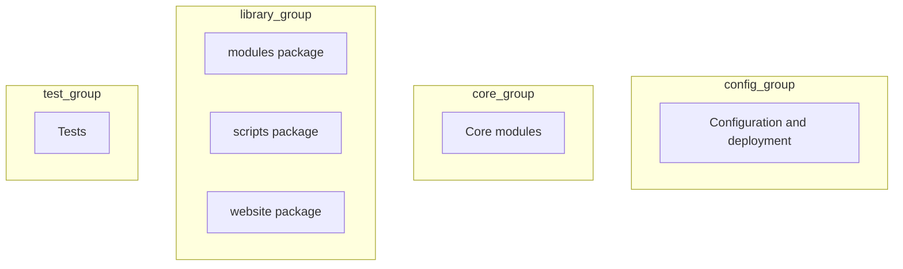

# Architecture report: visgl/react-map-gl

> Automated static analysis. **Observed** = directly seen in files/imports/AST; **Inferred** = interpretation from that evidence. Repository code was not executed.

## 1. Repository at a glance

| Item | Value |
| --- | --- |
| Repository | visgl/react-map-gl |
| Description | React friendly API wrapper around MapboxGL JS |
| Language | TypeScript |
| Stars | 8515 |
| Licence | Other |
| Analysed commit / branch | 1afe1a98580680c870eeb1139c40a94835333705 / master |
| Framework(s) | Next.js, React |
| Files analysed | 586 |
| Components | 6 |

## 2. Architecture in one minute

visgl/react-map-gl - React friendly API wrapper around MapboxGL JS. This repository was analysed statically from 586 file(s) (0 Python). Detected technologies (observed from imports/manifests): GitHub Actions, Next.js, React, TypeScript, Vite, Vitest. Files are grouped into 6 component(s): Configuration and deployment, Core modules, modules package, scripts package, Tests, website package. Findings below distinguish observed facts from inferred interpretation.

## 3. High-level block diagram

## 4. Main components

### Configuration and deployment (`config`)

- **Kind:** config
- **Status:** Observed
- **Confidence:** 0.85
- **Responsibility:** Groups 12 file(s) under configuration and deployment (observed from repository paths and static analysis).
- **Paths:** `lerna.json`, `modules/main/package.json`, `modules/main/tsconfig.json`, `modules/react-mapbox/package.json`, `modules/react-mapbox/tsconfig.json`, `modules/react-maplibre/package.json`, `modules/react-maplibre/tsconfig.json`, `package.json`, `tsconfig.json`, `website/.yarnrc.yml`, `website/package.json`, `website/src/examples/table-of-contents.json`
- **Evidence:** [lerna.json](https://github.com/visgl/react-map-gl/blob/1afe1a98580680c870eeb1139c40a94835333705/lerna.json); [modules/main/package.json](https://github.com/visgl/react-map-gl/blob/1afe1a98580680c870eeb1139c40a94835333705/modules/main/package.json); [modules/main/tsconfig.json](https://github.com/visgl/react-map-gl/blob/1afe1a98580680c870eeb1139c40a94835333705/modules/main/tsconfig.json); [modules/react-mapbox/package.json](https://github.com/visgl/react-map-gl/blob/1afe1a98580680c870eeb1139c40a94835333705/modules/react-mapbox/package.json); [modules/react-mapbox/tsconfig.json](https://github.com/visgl/react-map-gl/blob/1afe1a98580680c870eeb1139c40a94835333705/modules/react-mapbox/tsconfig.json); [modules/react-maplibre/package.json](https://github.com/visgl/react-map-gl/blob/1afe1a98580680c870eeb1139c40a94835333705/modules/react-maplibre/package.json); [modules/react-maplibre/tsconfig.json](https://github.com/visgl/react-map-gl/blob/1afe1a98580680c870eeb1139c40a94835333705/modules/react-maplibre/tsconfig.json); [package.json](https://github.com/visgl/react-map-gl/blob/1afe1a98580680c870eeb1139c40a94835333705/package.json)

### Core modules (`core`)

- **Kind:** core
- **Status:** Observed
- **Confidence:** 0.85
- **Responsibility:** Groups 1 file(s) under core modules (observed from repository paths and static analysis).
- **Paths:** `vitest.config.ts`
- **Evidence:** [vitest.config.ts](https://github.com/visgl/react-map-gl/blob/1afe1a98580680c870eeb1139c40a94835333705/vitest.config.ts)

### modules package (`modules`)

- **Kind:** library
- **Status:** Observed
- **Confidence:** 0.85
- **Responsibility:** Groups 90 file(s) under modules package (observed from repository paths and static analysis).
- **Paths:** `modules/main/src/mapbox-legacy/components/attribution-control.ts`, `modules/main/src/mapbox-legacy/components/fullscreen-control.ts`, `modules/main/src/mapbox-legacy/components/geolocate-control.ts`, `modules/main/src/mapbox-legacy/components/layer.ts`, `modules/main/src/mapbox-legacy/components/map.tsx`, `modules/main/src/mapbox-legacy/components/marker.ts`, `modules/main/src/mapbox-legacy/components/navigation-control.ts`, `modules/main/src/mapbox-legacy/components/popup.ts`, `modules/main/src/mapbox-legacy/components/scale-control.ts`, `modules/main/src/mapbox-legacy/components/source.ts`, `modules/main/src/mapbox-legacy/components/use-control.ts`, `modules/main/src/mapbox-legacy/components/use-map.tsx`, `modules/main/src/mapbox-legacy/index.ts`, `modules/main/src/mapbox-legacy/mapbox/create-ref.ts`, `modules/main/src/mapbox-legacy/mapbox/mapbox.ts`, `modules/main/src/mapbox-legacy/types/common.ts`, `modules/main/src/mapbox-legacy/types/events.ts`, `modules/main/src/mapbox-legacy/types/internal.ts`, `modules/main/src/mapbox-legacy/types/lib.ts`, `modules/main/src/mapbox-legacy/types/style-spec.ts`, `modules/main/src/mapbox-legacy/utils/apply-react-style.ts`, `modules/main/src/mapbox-legacy/utils/assert.ts`, `modules/main/src/mapbox-legacy/utils/deep-equal.ts`, `modules/main/src/mapbox-legacy/utils/set-globals.ts`, `modules/main/src/mapbox-legacy/utils/style-utils.ts`, `modules/main/src/mapbox-legacy/utils/transform.ts`, `modules/main/src/mapbox-legacy/utils/use-isomorphic-layout-effect.ts`, `modules/main/src/mapbox.ts`, `modules/main/src/maplibre.ts`, `modules/react-mapbox/src/components/attribution-control.ts`, `modules/react-mapbox/src/components/fullscreen-control.ts`, `modules/react-mapbox/src/components/geolocate-control.ts`, `modules/react-mapbox/src/components/layer.ts`, `modules/react-mapbox/src/components/map.tsx`, `modules/react-mapbox/src/components/marker.ts`, `modules/react-mapbox/src/components/navigation-control.ts`, `modules/react-mapbox/src/components/popup.ts`, `modules/react-mapbox/src/components/scale-control.ts`, `modules/react-mapbox/src/components/source.ts`, `modules/react-mapbox/src/components/use-control.ts`, `modules/react-mapbox/src/components/use-map.tsx`, `modules/react-mapbox/src/index.ts`, `modules/react-mapbox/src/mapbox/create-ref.ts`, `modules/react-mapbox/src/mapbox/mapbox.ts`, `modules/react-mapbox/src/mapbox/proxy-transform.ts`, `modules/react-mapbox/src/types/common.ts`, `modules/react-mapbox/src/types/events.ts`, `modules/react-mapbox/src/types/internal.ts`, `modules/react-mapbox/src/types/lib.ts`, `modules/react-mapbox/src/types/style-spec.ts`, `modules/react-mapbox/src/utils/apply-react-style.ts`, `modules/react-mapbox/src/utils/assert.ts`, `modules/react-mapbox/src/utils/compare-class-names.ts`, `modules/react-mapbox/src/utils/deep-equal.ts`, `modules/react-mapbox/src/utils/remove-source.ts`, `modules/react-mapbox/src/utils/set-globals.ts`, `modules/react-mapbox/src/utils/style-utils.ts`, `modules/react-mapbox/src/utils/transform.ts`, `modules/react-mapbox/src/utils/use-isomorphic-layout-effect.ts`, `modules/react-maplibre/src/components/attribution-control.ts`, `modules/react-maplibre/src/components/fullscreen-control.ts`, `modules/react-maplibre/src/components/geolocate-control.ts`, `modules/react-maplibre/src/components/globe-control.ts`, `modules/react-maplibre/src/components/layer.ts`, `modules/react-maplibre/src/components/logo-control.ts`, `modules/react-maplibre/src/components/map.tsx`, `modules/react-maplibre/src/components/marker.ts`, `modules/react-maplibre/src/components/navigation-control.ts`, `modules/react-maplibre/src/components/popup.ts`, `modules/react-maplibre/src/components/scale-control.ts`, `modules/react-maplibre/src/components/source.ts`, `modules/react-maplibre/src/components/terrain-control.ts`, `modules/react-maplibre/src/components/use-control.ts`, `modules/react-maplibre/src/components/use-map.tsx`, `modules/react-maplibre/src/index.ts`, `modules/react-maplibre/src/maplibre/create-ref.ts`, `modules/react-maplibre/src/maplibre/maplibre.ts`, `modules/react-maplibre/src/types/common.ts`, `modules/react-maplibre/src/types/events.ts`, `modules/react-maplibre/src/types/internal.ts`, `modules/react-maplibre/src/types/lib.ts`, `modules/react-maplibre/src/types/style-spec.ts`, `modules/react-maplibre/src/utils/apply-react-style.ts`, `modules/react-maplibre/src/utils/assert.ts`, `modules/react-maplibre/src/utils/compare-class-names.ts`, `modules/react-maplibre/src/utils/deep-equal.ts`, `modules/react-maplibre/src/utils/set-globals.ts`, `modules/react-maplibre/src/utils/style-utils.ts`, `modules/react-maplibre/src/utils/transform.ts`, `modules/react-maplibre/src/utils/use-isomorphic-layout-effect.ts`
- **Evidence:** [modules/main/src/mapbox-legacy/components/attribution-control.ts](https://github.com/visgl/react-map-gl/blob/1afe1a98580680c870eeb1139c40a94835333705/modules/main/src/mapbox-legacy/components/attribution-control.ts); [modules/main/src/mapbox-legacy/components/fullscreen-control.ts](https://github.com/visgl/react-map-gl/blob/1afe1a98580680c870eeb1139c40a94835333705/modules/main/src/mapbox-legacy/components/fullscreen-control.ts); [modules/main/src/mapbox-legacy/components/geolocate-control.ts](https://github.com/visgl/react-map-gl/blob/1afe1a98580680c870eeb1139c40a94835333705/modules/main/src/mapbox-legacy/components/geolocate-control.ts); [modules/main/src/mapbox-legacy/components/layer.ts](https://github.com/visgl/react-map-gl/blob/1afe1a98580680c870eeb1139c40a94835333705/modules/main/src/mapbox-legacy/components/layer.ts); [modules/main/src/mapbox-legacy/components/map.tsx](https://github.com/visgl/react-map-gl/blob/1afe1a98580680c870eeb1139c40a94835333705/modules/main/src/mapbox-legacy/components/map.tsx); [modules/main/src/mapbox-legacy/components/marker.ts](https://github.com/visgl/react-map-gl/blob/1afe1a98580680c870eeb1139c40a94835333705/modules/main/src/mapbox-legacy/components/marker.ts); [modules/main/src/mapbox-legacy/components/navigation-control.ts](https://github.com/visgl/react-map-gl/blob/1afe1a98580680c870eeb1139c40a94835333705/modules/main/src/mapbox-legacy/components/navigation-control.ts); [modules/main/src/mapbox-legacy/components/popup.ts](https://github.com/visgl/react-map-gl/blob/1afe1a98580680c870eeb1139c40a94835333705/modules/main/src/mapbox-legacy/components/popup.ts)

### scripts package (`scripts`)

- **Kind:** library
- **Status:** Observed
- **Confidence:** 0.85
- **Responsibility:** Groups 1 file(s) under scripts package (observed from repository paths and static analysis).
- **Paths:** `scripts/update-release-branch.sh`
- **Evidence:** [scripts/update-release-branch.sh](https://github.com/visgl/react-map-gl/blob/1afe1a98580680c870eeb1139c40a94835333705/scripts/update-release-branch.sh)

### Tests (`tests`)

- **Kind:** test
- **Status:** Observed
- **Confidence:** 0.85
- **Responsibility:** Groups 73 file(s) under tests (observed from repository paths and static analysis).
- **Paths:** `modules/main/test/components/controls.spec.jsx`, `modules/main/test/components/index.js`, `modules/main/test/components/layer.spec.jsx`, `modules/main/test/components/map.spec.jsx`, `modules/main/test/components/marker.spec.jsx`, `modules/main/test/components/popup.spec.jsx`, `modules/main/test/components/source.spec.jsx`, `modules/main/test/components/use-map.spec.jsx`, `modules/main/test/utils/apply-react-style.spec.js`, `modules/main/test/utils/deep-equal.spec.js`, `modules/main/test/utils/index.js`, `modules/main/test/utils/mapbox-gl-mock/edge_insets.js`, `modules/main/test/utils/mapbox-gl-mock/lng_lat.js`, `modules/main/test/utils/mapbox-gl-mock/lng_lat_bounds.js`, `modules/main/test/utils/mapbox-gl-mock/transform.js`, `modules/main/test/utils/mapbox-gl-mock/util.js`, `modules/main/test/utils/style-utils.spec.js`, `modules/main/test/utils/test-utils.jsx`, `modules/main/test/utils/transform.spec.js`, `modules/react-mapbox/test/components/controls.spec.jsx`, `modules/react-mapbox/test/components/index.js`, `modules/react-mapbox/test/components/layer.spec.jsx`, `modules/react-mapbox/test/components/map.spec.jsx`, `modules/react-mapbox/test/components/marker.spec.jsx`, `modules/react-mapbox/test/components/popup.spec.jsx`, `modules/react-mapbox/test/components/source.spec.jsx`, `modules/react-mapbox/test/components/use-map.spec.jsx`, `modules/react-mapbox/test/utils/apply-react-style.spec.js`, `modules/react-mapbox/test/utils/compare-class-names.spec.js`, `modules/react-mapbox/test/utils/deep-equal.spec.js`, `modules/react-mapbox/test/utils/index.js`, `modules/react-mapbox/test/utils/mapbox-gl-mock/edge_insets.js`, `modules/react-mapbox/test/utils/mapbox-gl-mock/lng_lat.js`, `modules/react-mapbox/test/utils/mapbox-gl-mock/lng_lat_bounds.js`, `modules/react-mapbox/test/utils/mapbox-gl-mock/transform.js`, `modules/react-mapbox/test/utils/mapbox-gl-mock/util.js`, `modules/react-mapbox/test/utils/remove-source.spec.js`, `modules/react-mapbox/test/utils/style-utils.spec.js`, `modules/react-mapbox/test/utils/test-utils.jsx`, `modules/react-mapbox/test/utils/token.js`, `modules/react-mapbox/test/utils/transform.spec.js`, `modules/react-maplibre/test/.eslintrc`, `modules/react-maplibre/test/components/controls.spec.jsx`, `modules/react-maplibre/test/components/index.js`, `modules/react-maplibre/test/components/layer.spec.jsx`, `modules/react-maplibre/test/components/map.spec.jsx`, `modules/react-maplibre/test/components/marker.spec.jsx`, `modules/react-maplibre/test/components/popup.spec.jsx`, `modules/react-maplibre/test/components/source.spec.jsx`, `modules/react-maplibre/test/components/use-map.spec.jsx`, `modules/react-maplibre/test/utils/apply-react-style.spec.js`, `modules/react-maplibre/test/utils/compare-class-names.spec.js`, `modules/react-maplibre/test/utils/deep-equal.spec.js`, `modules/react-maplibre/test/utils/index.js`, `modules/react-maplibre/test/utils/style-utils.spec.js`, `modules/react-maplibre/test/utils/test-utils.jsx`, `modules/react-maplibre/test/utils/transform.spec.js`, `test/.eslintrc`, `test/apps/reuse-maps/index.html`, `test/apps/reuse-maps/package.json`, `test/apps/reuse-maps/src/app.tsx`, `test/apps/reuse-maps/tsconfig.json`, `test/apps/reuse-maps/vite.config.js`, `test/browser-test-setup.ts`, `test/data/style.json`, `test/node.js`, `test/render/index.jsx`, `test/render/test-cases.jsx`, `test/size/mapbox-legacy.js`, `test/size/mapbox.js`, `test/size/maplibre.js`, `test/src/exports.ts`, `test/test-utils.js`
- **Evidence:** [modules/main/test/components/controls.spec.jsx](https://github.com/visgl/react-map-gl/blob/1afe1a98580680c870eeb1139c40a94835333705/modules/main/test/components/controls.spec.jsx); [modules/main/test/components/index.js](https://github.com/visgl/react-map-gl/blob/1afe1a98580680c870eeb1139c40a94835333705/modules/main/test/components/index.js); [modules/main/test/components/layer.spec.jsx](https://github.com/visgl/react-map-gl/blob/1afe1a98580680c870eeb1139c40a94835333705/modules/main/test/components/layer.spec.jsx); [modules/main/test/components/map.spec.jsx](https://github.com/visgl/react-map-gl/blob/1afe1a98580680c870eeb1139c40a94835333705/modules/main/test/components/map.spec.jsx); [modules/main/test/components/marker.spec.jsx](https://github.com/visgl/react-map-gl/blob/1afe1a98580680c870eeb1139c40a94835333705/modules/main/test/components/marker.spec.jsx); [modules/main/test/components/popup.spec.jsx](https://github.com/visgl/react-map-gl/blob/1afe1a98580680c870eeb1139c40a94835333705/modules/main/test/components/popup.spec.jsx); [modules/main/test/components/source.spec.jsx](https://github.com/visgl/react-map-gl/blob/1afe1a98580680c870eeb1139c40a94835333705/modules/main/test/components/source.spec.jsx); [modules/main/test/components/use-map.spec.jsx](https://github.com/visgl/react-map-gl/blob/1afe1a98580680c870eeb1139c40a94835333705/modules/main/test/components/use-map.spec.jsx)

### website package (`website`)

- **Kind:** library
- **Status:** Observed
- **Confidence:** 0.85
- **Responsibility:** Groups 4 file(s) under website package (observed from repository paths and static analysis).
- **Paths:** `website/babel.config.js`, `website/docusaurus.config.js`, `website/src/maplibre-worker.js`, `website/src/pages/index.jsx`
- **Evidence:** [website/babel.config.js](https://github.com/visgl/react-map-gl/blob/1afe1a98580680c870eeb1139c40a94835333705/website/babel.config.js); [website/docusaurus.config.js](https://github.com/visgl/react-map-gl/blob/1afe1a98580680c870eeb1139c40a94835333705/website/docusaurus.config.js); [website/src/maplibre-worker.js](https://github.com/visgl/react-map-gl/blob/1afe1a98580680c870eeb1139c40a94835333705/website/src/maplibre-worker.js); [website/src/pages/index.jsx](https://github.com/visgl/react-map-gl/blob/1afe1a98580680c870eeb1139c40a94835333705/website/src/pages/index.jsx)

## 5. Execution flow

**Observed** entry point(s):

- [modules/react-mapbox/src/index.ts](https://github.com/visgl/react-map-gl/blob/1afe1a98580680c870eeb1139c40a94835333705/modules/react-mapbox/src/index.ts)
- [modules/react-maplibre/src/index.ts](https://github.com/visgl/react-map-gl/blob/1afe1a98580680c870eeb1139c40a94835333705/modules/react-maplibre/src/index.ts)
- [website/src/pages/index.jsx](https://github.com/visgl/react-map-gl/blob/1afe1a98580680c870eeb1139c40a94835333705/website/src/pages/index.jsx)

Representative flow (derived from observed entry points and the import graph; steps beyond the entry point are **Inferred**):

1. Execution starts at an observed entry point listed above, if present.
2. No internal import relationships between components were observed.

## 6. Project structure

### `(root)`

- `.gitignore` - other (243 bytes)
- `.nvmrc` - other (8 bytes)
- `.ocularrc.js` - source, JavaScript (307 bytes)
- `.prettierrc` - other (106 bytes)
- `.yarnrc.yml` - config (47 bytes)
- `CHANGELOG.md` - docs (3303 bytes)
- `CODE_OF_CONDUCT.md` - docs (290 bytes)
- `CONTRIBUTING.md` - docs (2639 bytes)
- `LICENSE` - docs (3821 bytes)
- `README.md` - docs (2537 bytes)
- `TESTING.md` - docs (543 bytes)
- `biome.jsonc` - other (1580 bytes)
- `index.html` - other (201 bytes)
- `lerna.json` - config (92 bytes)
- `package.json` - manifest (1802 bytes)
- `tsconfig.json` - config (1168 bytes)
- `vitest.config.ts` - source, TypeScript (1263 bytes)

### `.github`

- `.github/ISSUE_TEMPLATE/bug-report.yml` - config (1675 bytes)
- `.github/ISSUE_TEMPLATE/config.yml` - config (198 bytes)
- `.github/ISSUE_TEMPLATE/feature-request.yml` - config (861 bytes)
- `.github/SECURITY.md` - docs (691 bytes)
- `.github/workflows/release.yml` - ci, YAML (1847 bytes)
- `.github/workflows/test.yml` - ci, YAML (1695 bytes)
- `.github/workflows/website.yml` - ci, YAML (1650 bytes)

### `docs`

- `docs/.gitignore` - docs (39 bytes)
- `docs/README.md` - docs (4768 bytes)
- `docs/api-reference/mapbox/attribution-control.md` - docs (1593 bytes)
- `docs/api-reference/mapbox/fullscreen-control.md` - docs (1351 bytes)
- `docs/api-reference/mapbox/geolocate-control.md` - docs (3251 bytes)
- `docs/api-reference/mapbox/layer.md` - docs (2725 bytes)
- `docs/api-reference/mapbox/map-provider.md` - docs (685 bytes)
- `docs/api-reference/mapbox/map.md` - docs (27157 bytes)
- `docs/api-reference/mapbox/marker.md` - docs (4639 bytes)
- `docs/api-reference/mapbox/navigation-control.md` - docs (1500 bytes)
- `docs/api-reference/mapbox/popup.md` - docs (3532 bytes)
- `docs/api-reference/mapbox/scale-control.md` - docs (1366 bytes)
- `docs/api-reference/mapbox/source.md` - docs (2065 bytes)
- `docs/api-reference/mapbox/types.md` - docs (10892 bytes)
- `docs/api-reference/mapbox/use-control.md` - docs (2365 bytes)
- `docs/api-reference/mapbox/use-map.md` - docs (2036 bytes)
- `docs/api-reference/maplibre/attribution-control.md` - docs (1492 bytes)
- `docs/api-reference/maplibre/fullscreen-control.md` - docs (1326 bytes)
- `docs/api-reference/maplibre/geolocate-control.md` - docs (3164 bytes)
- `docs/api-reference/maplibre/globe-control.md` - docs (1108 bytes)
- `docs/api-reference/maplibre/layer.md` - docs (2686 bytes)
- `docs/api-reference/maplibre/logo-control.md` - docs (1296 bytes)
- `docs/api-reference/maplibre/map-provider.md` - docs (689 bytes)
- `docs/api-reference/maplibre/map.md` - docs (25205 bytes)
- `docs/api-reference/maplibre/marker.md` - docs (4424 bytes)
- `docs/api-reference/maplibre/navigation-control.md` - docs (1386 bytes)
- `docs/api-reference/maplibre/popup.md` - docs (3444 bytes)
- `docs/api-reference/maplibre/scale-control.md` - docs (1341 bytes)
- `docs/api-reference/maplibre/source.md` - docs (2064 bytes)
- `docs/api-reference/maplibre/terrain-control.md` - docs (1958 bytes)
- `docs/api-reference/maplibre/types.md` - docs (10655 bytes)
- `docs/api-reference/maplibre/use-control.md` - docs (2344 bytes)
- `docs/api-reference/maplibre/use-map.md` - docs (1724 bytes)
- `docs/get-started/adding-custom-data.md` - docs (2560 bytes)
- `docs/get-started/get-started.md` - docs (3292 bytes)
- `docs/get-started/mapbox-tokens.md` - docs (3283 bytes)
- `docs/get-started/state-management.md` - docs (3257 bytes)
- `docs/get-started/tips-and-tricks.md` - docs (6929 bytes)
- `docs/table-of-contents.json` - config (2112 bytes)
- `docs/upgrade-guide.md` - docs (14120 bytes)
- `docs/whats-new.md` - docs (15557 bytes)

### `examples`

- `examples/.data/bart-station.json` - config (3234 bytes)
- `examples/.data/cities.json` - config (5115 bytes)
- `examples/.data/feature-example-sf.json` - config (80468 bytes)
- `examples/.eslintrc` - other (95 bytes)
- `examples/get-started/basic/README.md` - docs (608 bytes)
- `examples/get-started/basic/app.jsx` - source, JavaScript (711 bytes)
- `examples/get-started/basic/index.html` - other (190 bytes)
- `examples/get-started/basic/package.json` - manifest (287 bytes)
- `examples/get-started/basic/vite.config.mjs` - source, JavaScript (119 bytes)
- `examples/get-started/controlled/README.md` - docs (758 bytes)
- `examples/get-started/controlled/app.jsx` - source, JavaScript (795 bytes)
- `examples/get-started/controlled/index.html` - other (190 bytes)
- `examples/get-started/controlled/package.json` - manifest (287 bytes)
- `examples/get-started/controlled/vite.config.mjs` - source, JavaScript (119 bytes)
- `examples/get-started/hook/README.md` - docs (726 bytes)
- `examples/get-started/hook/app.jsx` - source, JavaScript (529 bytes)
- `examples/get-started/hook/controls.jsx` - source, JavaScript (1822 bytes)
- `examples/get-started/hook/controls2.jsx` - source, JavaScript (712 bytes)
- `examples/get-started/hook/index.html` - other (190 bytes)
- `examples/get-started/hook/map.jsx` - source, JavaScript (1046 bytes)
- `examples/get-started/hook/package.json` - manifest (287 bytes)
- `examples/get-started/hook/vite.config.mjs` - source, JavaScript (119 bytes)
- `examples/get-started/maplibre/README.md` - docs (377 bytes)
- `examples/get-started/maplibre/app.jsx` - source, JavaScript (839 bytes)
- `examples/get-started/maplibre/index.html` - other (190 bytes)
- `examples/get-started/maplibre/package.json` - manifest (289 bytes)
- `examples/get-started/nextjs/.gitignore` - other (386 bytes)
- `examples/get-started/nextjs/README.md` - docs (2126 bytes)
- `examples/get-started/nextjs/next.config.js` - source, JavaScript (284 bytes)
- `examples/get-started/nextjs/package.json` - manifest (363 bytes)
- `examples/get-started/nextjs/pages/_app.js` - source, JavaScript (130 bytes)
- `examples/get-started/nextjs/pages/index.js` - source, JavaScript (699 bytes)
- `examples/get-started/redux/README.md` - docs (720 bytes)
- `examples/get-started/redux/app.jsx` - source, JavaScript (449 bytes)
- `examples/get-started/redux/controls.jsx` - source, JavaScript (1276 bytes)
- `examples/get-started/redux/index.html` - other (190 bytes)
- `examples/get-started/redux/map.jsx` - source, JavaScript (722 bytes)
- `examples/get-started/redux/package.json` - manifest (316 bytes)
- `examples/get-started/redux/store.js` - source, JavaScript (438 bytes)
- `examples/get-started/redux/vite.config.mjs` - source, JavaScript (119 bytes)
- `examples/mapbox/clusters/README.md` - docs (847 bytes)
- `examples/mapbox/clusters/index.html` - other (966 bytes)
- `examples/mapbox/clusters/package.json` - manifest (350 bytes)
- `examples/mapbox/clusters/src/app.tsx` - source, TypeScript (1829 bytes)
- `examples/mapbox/clusters/src/control-panel.tsx` - source, TypeScript (518 bytes)
- `examples/mapbox/clusters/src/layers.ts` - source, TypeScript (983 bytes)
- `examples/mapbox/clusters/tsconfig.json` - config (238 bytes)
- `examples/mapbox/clusters/vite.config.mjs` - source, JavaScript (119 bytes)
- `examples/mapbox/controls/README.md` - docs (736 bytes)
- `examples/mapbox/controls/index.html` - other (966 bytes)
- `examples/mapbox/controls/package.json` - manifest (350 bytes)
- `examples/mapbox/controls/src/app.tsx` - source, TypeScript (2301 bytes)
- `examples/mapbox/controls/src/control-panel.tsx` - source, TypeScript (770 bytes)
- `examples/mapbox/controls/src/pin.tsx` - source, TypeScript (564 bytes)
- `examples/mapbox/controls/tsconfig.json` - config (238 bytes)
- `examples/mapbox/controls/vite.config.mjs` - source, JavaScript (119 bytes)
- `examples/mapbox/custom-cursor/README.md` - docs (763 bytes)
- `examples/mapbox/custom-cursor/index.html` - other (1094 bytes)
- `examples/mapbox/custom-cursor/package.json` - manifest (350 bytes)
- `examples/mapbox/custom-cursor/src/app.tsx` - source, TypeScript (1658 bytes)
- `examples/mapbox/custom-cursor/src/control-panel.tsx` - source, TypeScript (1682 bytes)
- `examples/mapbox/custom-cursor/tsconfig.json` - config (238 bytes)
- `examples/mapbox/custom-cursor/vite.config.mjs` - source, JavaScript (119 bytes)
- `examples/mapbox/custom-overlay/README.md` - docs (781 bytes)
- `examples/mapbox/custom-overlay/index.html` - other (1468 bytes)
- `examples/mapbox/custom-overlay/package.json` - manifest (376 bytes)
- `examples/mapbox/custom-overlay/src/app.tsx` - source, TypeScript (3541 bytes)
- `examples/mapbox/custom-overlay/src/control-panel.tsx` - source, TypeScript (1124 bytes)
- `examples/mapbox/custom-overlay/src/custom-overlay.tsx` - source, TypeScript (1426 bytes)
- `examples/mapbox/custom-overlay/tsconfig.json` - config (238 bytes)
- `examples/mapbox/custom-overlay/vite.config.mjs` - source, JavaScript (119 bytes)
- `examples/mapbox/deckgl-overlay/README.md` - docs (775 bytes)
- `examples/mapbox/deckgl-overlay/index.html` - other (619 bytes)
- `examples/mapbox/deckgl-overlay/package.json` - manifest (382 bytes)
- `examples/mapbox/deckgl-overlay/src/app.tsx` - source, TypeScript (1798 bytes)
- `examples/mapbox/deckgl-overlay/tsconfig.json` - config (238 bytes)
- `examples/mapbox/deckgl-overlay/vite.config.mjs` - source, JavaScript (119 bytes)
- `examples/mapbox/draggable-markers/README.md` - docs (737 bytes)
- `examples/mapbox/draggable-markers/index.html` - other (967 bytes)
- `examples/mapbox/draggable-markers/package.json` - manifest (350 bytes)
- `examples/mapbox/draggable-markers/src/app.tsx` - source, TypeScript (1824 bytes)
- `examples/mapbox/draggable-markers/src/control-panel.tsx` - source, TypeScript (1103 bytes)
- `examples/mapbox/draggable-markers/src/pin.tsx` - source, TypeScript (567 bytes)
- `examples/mapbox/draggable-markers/tsconfig.json` - config (238 bytes)
- `examples/mapbox/draggable-markers/vite.config.mjs` - source, JavaScript (119 bytes)
- `examples/mapbox/draw-polygon/README.md` - docs (805 bytes)
- `examples/mapbox/draw-polygon/index.html` - other (1102 bytes)
- `examples/mapbox/draw-polygon/package.json` - manifest (465 bytes)
- `examples/mapbox/draw-polygon/src/app.tsx` - source, TypeScript (1584 bytes)
- `examples/mapbox/draw-polygon/src/control-panel.tsx` - source, TypeScript (707 bytes)
- `examples/mapbox/draw-polygon/src/draw-control.ts` - source, TypeScript (1037 bytes)
- `examples/mapbox/draw-polygon/tsconfig.json` - config (238 bytes)
- `examples/mapbox/draw-polygon/vite.config.mjs` - source, JavaScript (119 bytes)
- `examples/mapbox/filter/README.md` - docs (899 bytes)
- `examples/mapbox/filter/index.html` - other (1048 bytes)
- `examples/mapbox/filter/package.json` - manifest (350 bytes)
- `examples/mapbox/filter/src/app.tsx` - source, TypeScript (1902 bytes)
- `examples/mapbox/filter/src/control-panel.tsx` - source, TypeScript (531 bytes)
- `examples/mapbox/filter/src/map-style.ts` - source, TypeScript (592 bytes)
- `examples/mapbox/filter/tsconfig.json` - config (238 bytes)
- `examples/mapbox/filter/vite.config.mjs` - source, JavaScript (119 bytes)
- `examples/mapbox/geocoder/README.md` - docs (782 bytes)
- `examples/mapbox/geocoder/index.html` - other (1110 bytes)
- `examples/mapbox/geocoder/package.json` - manifest (445 bytes)
- `examples/mapbox/geocoder/src/app.tsx` - source, TypeScript (800 bytes)
- `examples/mapbox/geocoder/src/control-panel.tsx` - source, TypeScript (418 bytes)
- `examples/mapbox/geocoder/src/geocoder-control.tsx` - source, TypeScript (4205 bytes)
- `examples/mapbox/geocoder/tsconfig.json` - config (238 bytes)
- `examples/mapbox/geocoder/vite.config.mjs` - source, JavaScript (119 bytes)
- `examples/mapbox/geojson-animation/README.md` - docs (884 bytes)
- `examples/mapbox/geojson-animation/index.html` - other (966 bytes)
- `examples/mapbox/geojson-animation/package.json` - manifest (350 bytes)
- `examples/mapbox/geojson-animation/src/app.tsx` - source, TypeScript (1515 bytes)
- `examples/mapbox/geojson-animation/src/control-panel.tsx` - source, TypeScript (498 bytes)
- `examples/mapbox/geojson-animation/tsconfig.json` - config (238 bytes)
- `examples/mapbox/geojson-animation/vite.config.mjs` - source, JavaScript (119 bytes)
- `examples/mapbox/geojson/README.md` - docs (738 bytes)
- `examples/mapbox/geojson/index.html` - other (1380 bytes)
- `examples/mapbox/geojson/package.json` - manifest (402 bytes)
- `examples/mapbox/geojson/src/app.tsx` - source, TypeScript (2244 bytes)
- `examples/mapbox/geojson/src/control-panel.tsx` - source, TypeScript (1033 bytes)
- `examples/mapbox/geojson/src/map-style.ts` - source, TypeScript (575 bytes)
- `examples/mapbox/geojson/src/utils.ts` - source, TypeScript (706 bytes)
- `examples/mapbox/geojson/tsconfig.json` - config (238 bytes)
- `examples/mapbox/geojson/vite.config.mjs` - source, JavaScript (119 bytes)
- `examples/mapbox/heatmap/README.md` - docs (790 bytes)
- `examples/mapbox/heatmap/index.html` - other (1175 bytes)
- `examples/mapbox/heatmap/package.json` - manifest (350 bytes)
- `examples/mapbox/heatmap/src/app.tsx` - source, TypeScript (2723 bytes)
- `examples/mapbox/heatmap/src/control-panel.tsx` - source, TypeScript (1944 bytes)
- `examples/mapbox/heatmap/src/map-style.ts` - source, TypeScript (1323 bytes)
- `examples/mapbox/heatmap/tsconfig.json` - config (238 bytes)
- `examples/mapbox/heatmap/vite.config.mjs` - source, JavaScript (119 bytes)
- `examples/mapbox/interaction/README.md` - docs (725 bytes)
- `examples/mapbox/interaction/index.html` - other (1119 bytes)
- `examples/mapbox/interaction/package.json` - manifest (350 bytes)
- `examples/mapbox/interaction/src/app.tsx` - source, TypeScript (1211 bytes)
- `examples/mapbox/interaction/src/control-panel.tsx` - source, TypeScript (1632 bytes)
- `examples/mapbox/interaction/tsconfig.json` - config (238 bytes)
- `examples/mapbox/interaction/vite.config.mjs` - source, JavaScript (119 bytes)
- `examples/mapbox/layers/README.md` - docs (743 bytes)
- `examples/mapbox/layers/index.html` - other (1092 bytes)
- `examples/mapbox/layers/package.json` - manifest (377 bytes)
- `examples/mapbox/layers/src/app.tsx` - source, TypeScript (745 bytes)
- `examples/mapbox/layers/src/control-panel.tsx` - source, TypeScript (2969 bytes)
- `examples/mapbox/layers/tsconfig.json` - config (238 bytes)
- `examples/mapbox/layers/vite.config.mjs` - source, JavaScript (119 bytes)
- `examples/mapbox/map-style-basic-v8.json` - config (23859 bytes)
- `examples/mapbox/side-by-side/README.md` - docs (725 bytes)
- `examples/mapbox/side-by-side/index.html` - other (967 bytes)
- `examples/mapbox/side-by-side/package.json` - manifest (350 bytes)
- `examples/mapbox/side-by-side/src/app.tsx` - source, TypeScript (2556 bytes)
- `examples/mapbox/side-by-side/src/control-panel.tsx` - source, TypeScript (1003 bytes)
- `examples/mapbox/side-by-side/tsconfig.json` - config (238 bytes)
- `examples/mapbox/side-by-side/vite.config.mjs` - source, JavaScript (119 bytes)
- `examples/mapbox/terrain/README.md` - docs (717 bytes)
- `examples/mapbox/terrain/index.html` - other (967 bytes)
- `examples/mapbox/terrain/package.json` - manifest (350 bytes)
- `examples/mapbox/terrain/src/app.tsx` - source, TypeScript (1244 bytes)
- `examples/mapbox/terrain/src/control-panel.tsx` - source, TypeScript (466 bytes)
- `examples/mapbox/terrain/tsconfig.json` - config (238 bytes)
- `examples/mapbox/terrain/vite.config.mjs` - source, JavaScript (119 bytes)
- `examples/mapbox/viewport-animation/README.md` - docs (754 bytes)
- `examples/mapbox/viewport-animation/index.html` - other (966 bytes)
- `examples/mapbox/viewport-animation/package.json` - manifest (350 bytes)
- `examples/mapbox/viewport-animation/src/app.tsx` - source, TypeScript (949 bytes)
- `examples/mapbox/viewport-animation/src/control-panel.tsx` - source, TypeScript (997 bytes)
- `examples/mapbox/viewport-animation/tsconfig.json` - config (238 bytes)
- `examples/mapbox/viewport-animation/vite.config.mjs` - source, JavaScript (119 bytes)
- `examples/mapbox/zoom-to-bounds/README.md` - docs (729 bytes)
- `examples/mapbox/zoom-to-bounds/index.html` - other (967 bytes)
- `examples/mapbox/zoom-to-bounds/package.json` - manifest (378 bytes)
- `examples/mapbox/zoom-to-bounds/src/app.tsx` - source, TypeScript (1300 bytes)
- `examples/mapbox/zoom-to-bounds/src/control-panel.tsx` - source, TypeScript (499 bytes)
- `examples/mapbox/zoom-to-bounds/src/map-style.tsx` - source, TypeScript (992 bytes)
- `examples/mapbox/zoom-to-bounds/tsconfig.json` - config (238 bytes)
- `examples/mapbox/zoom-to-bounds/vite.config.mjs` - source, JavaScript (119 bytes)
- `examples/maplibre/clusters/README.md` - docs (257 bytes)
- `examples/maplibre/clusters/index.html` - other (1078 bytes)
- `examples/maplibre/clusters/package.json` - manifest (352 bytes)
- `examples/maplibre/clusters/src/app.tsx` - source, TypeScript (1873 bytes)
- `examples/maplibre/clusters/src/control-panel.tsx` - source, TypeScript (522 bytes)
- `examples/maplibre/clusters/src/layers.ts` - source, TypeScript (918 bytes)
- `examples/maplibre/clusters/tsconfig.json` - config (238 bytes)
- `examples/maplibre/controls/README.md` - docs (141 bytes)
- `examples/maplibre/controls/index.html` - other (1078 bytes)
- `examples/maplibre/controls/package.json` - manifest (352 bytes)
- `examples/maplibre/controls/src/app.tsx` - source, TypeScript (2256 bytes)
- `examples/maplibre/controls/src/control-panel.tsx` - source, TypeScript (772 bytes)
- `examples/maplibre/controls/src/pin.tsx` - source, TypeScript (564 bytes)
- `examples/maplibre/controls/tsconfig.json` - config (238 bytes)
- `examples/maplibre/custom-cursor/README.md` - docs (166 bytes)
- `examples/maplibre/custom-cursor/index.html` - other (1206 bytes)
- `examples/maplibre/custom-cursor/package.json` - manifest (352 bytes)
- `examples/maplibre/custom-cursor/src/app.tsx` - source, TypeScript (1563 bytes)
- `examples/maplibre/custom-cursor/src/control-panel.tsx` - source, TypeScript (1684 bytes)
- `examples/maplibre/custom-cursor/tsconfig.json` - config (238 bytes)
- `examples/maplibre/custom-overlay/README.md` - docs (184 bytes)
- `examples/maplibre/custom-overlay/index.html` - other (1444 bytes)
- `examples/maplibre/custom-overlay/package.json` - manifest (378 bytes)
- `examples/maplibre/custom-overlay/src/app.tsx` - source, TypeScript (3498 bytes)
- `examples/maplibre/custom-overlay/src/control-panel.tsx` - source, TypeScript (1126 bytes)
- `examples/maplibre/custom-overlay/src/custom-overlay.tsx` - source, TypeScript (1347 bytes)
- `examples/maplibre/custom-overlay/tsconfig.json` - config (238 bytes)
- `examples/maplibre/deckgl-overlay/README.md` - docs (180 bytes)
- `examples/maplibre/deckgl-overlay/index.html` - other (731 bytes)
- `examples/maplibre/deckgl-overlay/package.json` - manifest (377 bytes)
- `examples/maplibre/deckgl-overlay/src/app.tsx` - source, TypeScript (1731 bytes)
- `examples/maplibre/deckgl-overlay/tsconfig.json` - config (238 bytes)
- `examples/maplibre/draggable-markers/README.md` - docs (142 bytes)
- `examples/maplibre/draggable-markers/index.html` - other (1079 bytes)
- `examples/maplibre/draggable-markers/package.json` - manifest (352 bytes)
- `examples/maplibre/draggable-markers/src/app.tsx` - source, TypeScript (1799 bytes)
- `examples/maplibre/draggable-markers/src/control-panel.tsx` - source, TypeScript (1107 bytes)
- `examples/maplibre/draggable-markers/src/pin.tsx` - source, TypeScript (567 bytes)
- `examples/maplibre/draggable-markers/tsconfig.json` - config (238 bytes)
- `examples/maplibre/draw-polygon/README.md` - docs (208 bytes)
- `examples/maplibre/draw-polygon/index.html` - other (1078 bytes)
- `examples/maplibre/draw-polygon/package.json` - manifest (467 bytes)
- `examples/maplibre/draw-polygon/src/app.tsx` - source, TypeScript (1588 bytes)
- `examples/maplibre/draw-polygon/src/control-panel.tsx` - source, TypeScript (709 bytes)
- `examples/maplibre/draw-polygon/src/draw-control.ts` - source, TypeScript (1041 bytes)
- `examples/maplibre/draw-polygon/tsconfig.json` - config (238 bytes)
- `examples/maplibre/filter/README.md` - docs (302 bytes)
- `examples/maplibre/filter/index.html` - other (1160 bytes)
- `examples/maplibre/filter/package.json` - manifest (352 bytes)
- `examples/maplibre/filter/src/app.tsx` - source, TypeScript (2027 bytes)
- `examples/maplibre/filter/src/control-panel.tsx` - source, TypeScript (533 bytes)
- `examples/maplibre/filter/src/map-style.ts` - source, TypeScript (534 bytes)
- `examples/maplibre/filter/tsconfig.json` - config (238 bytes)
- `examples/maplibre/geocoder/README.md` - docs (190 bytes)
- `examples/maplibre/geocoder/index.html` - other (1078 bytes)
- `examples/maplibre/geocoder/package.json` - manifest (400 bytes)
- `examples/maplibre/geocoder/src/app.tsx` - source, TypeScript (739 bytes)
- `examples/maplibre/geocoder/src/control-panel.tsx` - source, TypeScript (420 bytes)
- `examples/maplibre/geocoder/src/geocoder-control.tsx` - source, TypeScript (5261 bytes)
- `examples/maplibre/geocoder/tsconfig.json` - config (238 bytes)
- `examples/maplibre/geojson-animation/README.md` - docs (295 bytes)
- `examples/maplibre/geojson-animation/index.html` - other (1078 bytes)
- `examples/maplibre/geojson-animation/package.json` - manifest (352 bytes)
- `examples/maplibre/geojson-animation/src/app.tsx` - source, TypeScript (1452 bytes)
- `examples/maplibre/geojson-animation/src/control-panel.tsx` - source, TypeScript (500 bytes)
- `examples/maplibre/geojson-animation/tsconfig.json` - config (238 bytes)
- `examples/maplibre/geojson/README.md` - docs (141 bytes)
- `examples/maplibre/geojson/index.html` - other (1492 bytes)
- `examples/maplibre/geojson/package.json` - manifest (404 bytes)
- `examples/maplibre/geojson/src/app.tsx` - source, TypeScript (2179 bytes)
- `examples/maplibre/geojson/src/control-panel.tsx` - source, TypeScript (980 bytes)
- `examples/maplibre/geojson/src/map-style.ts` - source, TypeScript (591 bytes)
- `examples/maplibre/geojson/src/utils.ts` - source, TypeScript (706 bytes)
- `examples/maplibre/geojson/tsconfig.json` - config (238 bytes)
- `examples/maplibre/globe/README.md` - docs (167 bytes)
- `examples/maplibre/globe/index.html` - other (1079 bytes)
- `examples/maplibre/globe/package.json` - manifest (352 bytes)
- `examples/maplibre/globe/src/app.tsx` - source, TypeScript (592 bytes)
- `examples/maplibre/globe/src/control-panel.tsx` - source, TypeScript (450 bytes)
- `examples/maplibre/globe/tsconfig.json` - config (238 bytes)
- `examples/maplibre/heatmap/README.md` - docs (200 bytes)
- `examples/maplibre/heatmap/index.html` - other (1287 bytes)
- `examples/maplibre/heatmap/package.json` - manifest (352 bytes)
- `examples/maplibre/heatmap/src/app.tsx` - source, TypeScript (2666 bytes)
- `examples/maplibre/heatmap/src/control-panel.tsx` - source, TypeScript (1950 bytes)
- `examples/maplibre/heatmap/src/map-style.ts` - source, TypeScript (1325 bytes)
- `examples/maplibre/heatmap/tsconfig.json` - config (238 bytes)
- `examples/maplibre/interaction/README.md` - docs (128 bytes)
- `examples/maplibre/interaction/index.html` - other (1231 bytes)
- `examples/maplibre/interaction/package.json` - manifest (352 bytes)
- `examples/maplibre/interaction/src/app.tsx` - source, TypeScript (1152 bytes)
- `examples/maplibre/interaction/src/control-panel.tsx` - source, TypeScript (1634 bytes)
- `examples/maplibre/interaction/tsconfig.json` - config (238 bytes)
- `examples/maplibre/layers/README.md` - docs (146 bytes)
- `examples/maplibre/layers/index.html` - other (1204 bytes)
- `examples/maplibre/layers/package.json` - manifest (379 bytes)
- `examples/maplibre/layers/src/app.tsx` - source, TypeScript (652 bytes)
- `examples/maplibre/layers/src/control-panel.tsx` - source, TypeScript (2971 bytes)
- `examples/maplibre/layers/tsconfig.json` - config (238 bytes)
- `examples/maplibre/map-style-basic-v8.json` - config (164937 bytes)
- `examples/maplibre/side-by-side/README.md` - docs (130 bytes)
- `examples/maplibre/side-by-side/index.html` - other (1079 bytes)
- `examples/maplibre/side-by-side/package.json` - manifest (352 bytes)
- `examples/maplibre/side-by-side/src/app.tsx` - source, TypeScript (1888 bytes)
- `examples/maplibre/side-by-side/src/control-panel.tsx` - source, TypeScript (1005 bytes)
- `examples/maplibre/side-by-side/tsconfig.json` - config (238 bytes)
- `examples/maplibre/terrain/README.md` - docs (182 bytes)
- `examples/maplibre/terrain/index.html` - other (1079 bytes)
- `examples/maplibre/terrain/package.json` - manifest (352 bytes)
- `examples/maplibre/terrain/src/app.tsx` - source, TypeScript (1603 bytes)
- `examples/maplibre/terrain/src/control-panel.tsx` - source, TypeScript (468 bytes)
- `examples/maplibre/terrain/tsconfig.json` - config (238 bytes)
- `examples/maplibre/viewport-animation/README.md` - docs (157 bytes)
- `examples/maplibre/viewport-animation/index.html` - other (1078 bytes)
- `examples/maplibre/viewport-animation/package.json` - manifest (352 bytes)
- `examples/maplibre/viewport-animation/src/app.tsx` - source, TypeScript (884 bytes)
- `examples/maplibre/viewport-animation/src/control-panel.tsx` - source, TypeScript (999 bytes)
- `examples/maplibre/viewport-animation/tsconfig.json` - config (238 bytes)
- `examples/maplibre/zoom-to-bounds/README.md` - docs (134 bytes)
- `examples/maplibre/zoom-to-bounds/index.html` - other (1079 bytes)
- `examples/maplibre/zoom-to-bounds/package.json` - manifest (380 bytes)
- `examples/maplibre/zoom-to-bounds/src/app.tsx` - source, TypeScript (1223 bytes)
- `examples/maplibre/zoom-to-bounds/src/control-panel.tsx` - source, TypeScript (501 bytes)
- `examples/maplibre/zoom-to-bounds/src/map-style.tsx` - source, TypeScript (995 bytes)
- `examples/maplibre/zoom-to-bounds/tsconfig.json` - config (238 bytes)
- `examples/vite.config.local.js` - source, JavaScript (819 bytes)

### `modules`

- `modules/main/package.json` - manifest (1638 bytes)
- `modules/main/src/mapbox-legacy/components/attribution-control.ts` - source, TypeScript (905 bytes)
- `modules/main/src/mapbox-legacy/components/fullscreen-control.ts` - source, TypeScript (1200 bytes)
- `modules/main/src/mapbox-legacy/components/geolocate-control.ts` - source, TypeScript (3158 bytes)
- `modules/main/src/mapbox-legacy/components/layer.ts` - source, TypeScript (3846 bytes)
- `modules/main/src/mapbox-legacy/components/map.tsx` - source, TypeScript (3628 bytes)
- `modules/main/src/mapbox-legacy/components/marker.ts` - source, TypeScript (3721 bytes)
- `modules/main/src/mapbox-legacy/components/navigation-control.ts` - source, TypeScript (897 bytes)
- `modules/main/src/mapbox-legacy/components/popup.ts` - source, TypeScript (3684 bytes)
- `modules/main/src/mapbox-legacy/components/scale-control.ts` - source, TypeScript (1284 bytes)
- `modules/main/src/mapbox-legacy/components/source.ts` - source, TypeScript (4029 bytes)
- `modules/main/src/mapbox-legacy/components/use-control.ts` - source, TypeScript (1816 bytes)
- `modules/main/src/mapbox-legacy/components/use-map.tsx` - source, TypeScript (1776 bytes)
- `modules/main/src/mapbox-legacy/index.ts` - source, TypeScript (1505 bytes)
- `modules/main/src/mapbox-legacy/mapbox/create-ref.ts` - source, TypeScript (2969 bytes)
- `modules/main/src/mapbox-legacy/mapbox/mapbox.ts` - source, TypeScript (21955 bytes)
- `modules/main/src/mapbox-legacy/types/common.ts` - source, TypeScript (817 bytes)
- `modules/main/src/mapbox-legacy/types/events.ts` - source, TypeScript (3494 bytes)
- `modules/main/src/mapbox-legacy/types/internal.ts` - source, TypeScript (1292 bytes)
- `modules/main/src/mapbox-legacy/types/lib.ts` - source, TypeScript (2228 bytes)
- `modules/main/src/mapbox-legacy/types/style-spec.ts` - source, TypeScript (1119 bytes)
- `modules/main/src/mapbox-legacy/utils/apply-react-style.ts` - source, TypeScript (673 bytes)
- `modules/main/src/mapbox-legacy/utils/assert.ts` - source, TypeScript (122 bytes)
- `modules/main/src/mapbox-legacy/utils/deep-equal.ts` - source, TypeScript (1423 bytes)
- `modules/main/src/mapbox-legacy/utils/set-globals.ts` - source, TypeScript (1913 bytes)
- `modules/main/src/mapbox-legacy/utils/style-utils.ts` - source, TypeScript (1788 bytes)
- `modules/main/src/mapbox-legacy/utils/transform.ts` - source, TypeScript (2423 bytes)
- `modules/main/src/mapbox-legacy/utils/use-isomorphic-layout-effect.ts` - source, TypeScript (356 bytes)
- `modules/main/src/mapbox.ts` - source, TypeScript (92 bytes)
- `modules/main/src/maplibre.ts` - source, TypeScript (96 bytes)
- `modules/main/test/components/controls.spec.jsx` - test, JavaScript (2095 bytes)
- `modules/main/test/components/index.js` - test, JavaScript (166 bytes)
- `modules/main/test/components/layer.spec.jsx` - test, JavaScript (2333 bytes)
- `modules/main/test/components/map.spec.jsx` - test, JavaScript (5533 bytes)
- `modules/main/test/components/marker.spec.jsx` - test, JavaScript (3138 bytes)
- `modules/main/test/components/popup.spec.jsx` - test, JavaScript (2398 bytes)
- `modules/main/test/components/source.spec.jsx` - test, JavaScript (1887 bytes)
- `modules/main/test/components/use-map.spec.jsx` - test, JavaScript (1351 bytes)
- `modules/main/test/utils/apply-react-style.spec.js` - test, JavaScript (886 bytes)
- `modules/main/test/utils/deep-equal.spec.js` - test, JavaScript (1766 bytes)
- `modules/main/test/utils/index.js` - test, JavaScript (119 bytes)
- `modules/main/test/utils/mapbox-gl-mock/edge_insets.js` - test, JavaScript (1852 bytes)
- `modules/main/test/utils/mapbox-gl-mock/lng_lat.js` - test, JavaScript (2266 bytes)
- `modules/main/test/utils/mapbox-gl-mock/lng_lat_bounds.js` - test, JavaScript (3094 bytes)
- `modules/main/test/utils/mapbox-gl-mock/transform.js` - test, JavaScript (1995 bytes)
- `modules/main/test/utils/mapbox-gl-mock/util.js` - test, JavaScript (522 bytes)
- `modules/main/test/utils/style-utils.spec.js` - test, JavaScript (4453 bytes)
- `modules/main/test/utils/test-utils.jsx` - test, JavaScript (1392 bytes)
- `modules/main/test/utils/transform.spec.js` - test, JavaScript (2587 bytes)
- `modules/main/tsconfig.json` - config (281 bytes)
- `modules/react-mapbox/package.json` - manifest (899 bytes)
- `modules/react-mapbox/src/components/attribution-control.ts` - source, TypeScript (856 bytes)
- `modules/react-mapbox/src/components/fullscreen-control.ts` - source, TypeScript (1151 bytes)
- `modules/react-mapbox/src/components/geolocate-control.ts` - source, TypeScript (2953 bytes)
- `modules/react-mapbox/src/components/layer.ts` - source, TypeScript (3846 bytes)
- `modules/react-mapbox/src/components/map.tsx` - source, TypeScript (3594 bytes)
- `modules/react-mapbox/src/components/marker.ts` - source, TypeScript (4024 bytes)
- `modules/react-mapbox/src/components/navigation-control.ts` - source, TypeScript (848 bytes)
- `modules/react-mapbox/src/components/popup.ts` - source, TypeScript (3178 bytes)
- `modules/react-mapbox/src/components/scale-control.ts` - source, TypeScript (1274 bytes)
- `modules/react-mapbox/src/components/source.ts` - source, TypeScript (4139 bytes)
- `modules/react-mapbox/src/components/use-control.ts` - source, TypeScript (1816 bytes)
- `modules/react-mapbox/src/components/use-map.tsx` - source, TypeScript (1776 bytes)
- `modules/react-mapbox/src/index.ts` - source, TypeScript (1505 bytes)
- `modules/react-mapbox/src/mapbox/create-ref.ts` - source, TypeScript (2874 bytes)
- `modules/react-mapbox/src/mapbox/mapbox.ts` - source, TypeScript (21492 bytes)
- `modules/react-mapbox/src/mapbox/proxy-transform.ts` - source, TypeScript (5513 bytes)
- `modules/react-mapbox/src/types/common.ts` - source, TypeScript (870 bytes)
- `modules/react-mapbox/src/types/events.ts` - source, TypeScript (3437 bytes)
- `modules/react-mapbox/src/types/internal.ts` - source, TypeScript (506 bytes)
- `modules/react-mapbox/src/types/lib.ts` - source, TypeScript (1748 bytes)
- `modules/react-mapbox/src/types/style-spec.ts` - source, TypeScript (1127 bytes)
- `modules/react-mapbox/src/utils/apply-react-style.ts` - source, TypeScript (673 bytes)
- `modules/react-mapbox/src/utils/assert.ts` - source, TypeScript (122 bytes)
- `modules/react-mapbox/src/utils/compare-class-names.ts` - source, TypeScript (755 bytes)
- `modules/react-mapbox/src/utils/deep-equal.ts` - source, TypeScript (1423 bytes)
- `modules/react-mapbox/src/utils/remove-source.ts` - source, TypeScript (679 bytes)
- `modules/react-mapbox/src/utils/set-globals.ts` - source, TypeScript (1913 bytes)
- `modules/react-mapbox/src/utils/style-utils.ts` - source, TypeScript (1788 bytes)
- `modules/react-mapbox/src/utils/transform.ts` - source, TypeScript (3304 bytes)
- `modules/react-mapbox/src/utils/use-isomorphic-layout-effect.ts` - source, TypeScript (356 bytes)
- `modules/react-mapbox/test/components/controls.spec.jsx` - test, JavaScript (2329 bytes)
- `modules/react-mapbox/test/components/index.js` - test, JavaScript (166 bytes)
- `modules/react-mapbox/test/components/layer.spec.jsx` - test, JavaScript (2544 bytes)
- `modules/react-mapbox/test/components/map.spec.jsx` - test, JavaScript (7613 bytes)
- `modules/react-mapbox/test/components/marker.spec.jsx` - test, JavaScript (3513 bytes)
- `modules/react-mapbox/test/components/popup.spec.jsx` - test, JavaScript (2613 bytes)
- `modules/react-mapbox/test/components/source.spec.jsx` - test, JavaScript (2211 bytes)
- `modules/react-mapbox/test/components/use-map.spec.jsx` - test, JavaScript (1557 bytes)
- `modules/react-mapbox/test/utils/apply-react-style.spec.js` - test, JavaScript (880 bytes)
- `modules/react-mapbox/test/utils/compare-class-names.spec.js` - test, JavaScript (1207 bytes)
- `modules/react-mapbox/test/utils/deep-equal.spec.js` - test, JavaScript (1760 bytes)
- `modules/react-mapbox/test/utils/index.js` - test, JavaScript (187 bytes)
- `modules/react-mapbox/test/utils/mapbox-gl-mock/edge_insets.js` - test, JavaScript (1852 bytes)
- `modules/react-mapbox/test/utils/mapbox-gl-mock/lng_lat.js` - test, JavaScript (2266 bytes)
- `modules/react-mapbox/test/utils/mapbox-gl-mock/lng_lat_bounds.js` - test, JavaScript (3094 bytes)
- `modules/react-mapbox/test/utils/mapbox-gl-mock/transform.js` - test, JavaScript (2066 bytes)
- `modules/react-mapbox/test/utils/mapbox-gl-mock/util.js` - test, JavaScript (522 bytes)
- `modules/react-mapbox/test/utils/remove-source.spec.js` - test, JavaScript (1453 bytes)
- `modules/react-mapbox/test/utils/style-utils.spec.js` - test, JavaScript (4447 bytes)
- `modules/react-mapbox/test/utils/test-utils.jsx` - test, JavaScript (1392 bytes)
- `modules/react-mapbox/test/utils/token.js` - test, JavaScript (68 bytes)
- `modules/react-mapbox/test/utils/transform.spec.js` - test, JavaScript (3173 bytes)
- `modules/react-mapbox/tsconfig.json` - config (214 bytes)
- `modules/react-maplibre/package.json` - manifest (990 bytes)
- `modules/react-maplibre/src/components/attribution-control.ts` - source, TypeScript (856 bytes)
- `modules/react-maplibre/src/components/fullscreen-control.ts` - source, TypeScript (1151 bytes)
- `modules/react-maplibre/src/components/geolocate-control.ts` - source, TypeScript (2938 bytes)
- `modules/react-maplibre/src/components/globe-control.ts` - source, TypeScript (965 bytes)
- `modules/react-maplibre/src/components/layer.ts` - source, TypeScript (3846 bytes)
- `modules/react-maplibre/src/components/logo-control.ts` - source, TypeScript (792 bytes)
- `modules/react-maplibre/src/components/map.tsx` - source, TypeScript (3667 bytes)
- `modules/react-maplibre/src/components/marker.ts` - source, TypeScript (4029 bytes)
- `modules/react-maplibre/src/components/navigation-control.ts` - source, TypeScript (848 bytes)
- `modules/react-maplibre/src/components/popup.ts` - source, TypeScript (3178 bytes)
- `modules/react-maplibre/src/components/scale-control.ts` - source, TypeScript (1274 bytes)
- `modules/react-maplibre/src/components/source.ts` - source, TypeScript (3888 bytes)
- `modules/react-maplibre/src/components/terrain-control.ts` - source, TypeScript (863 bytes)
- `modules/react-maplibre/src/components/use-control.ts` - source, TypeScript (1816 bytes)
- `modules/react-maplibre/src/components/use-map.tsx` - source, TypeScript (1778 bytes)
- `modules/react-maplibre/src/index.ts` - source, TypeScript (1883 bytes)
- `modules/react-maplibre/src/maplibre/create-ref.ts` - source, TypeScript (1471 bytes)
- `modules/react-maplibre/src/maplibre/maplibre.ts` - source, TypeScript (20042 bytes)
- `modules/react-maplibre/src/types/common.ts` - source, TypeScript (797 bytes)
- `modules/react-maplibre/src/types/events.ts` - source, TypeScript (4152 bytes)
- `modules/react-maplibre/src/types/internal.ts` - source, TypeScript (739 bytes)
- `modules/react-maplibre/src/types/lib.ts` - source, TypeScript (2362 bytes)
- `modules/react-maplibre/src/types/style-spec.ts` - source, TypeScript (784 bytes)
- `modules/react-maplibre/src/utils/apply-react-style.ts` - source, TypeScript (673 bytes)
- `modules/react-maplibre/src/utils/assert.ts` - source, TypeScript (122 bytes)
- `modules/react-maplibre/src/utils/compare-class-names.ts` - source, TypeScript (755 bytes)
- `modules/react-maplibre/src/utils/deep-equal.ts` - source, TypeScript (1423 bytes)
- `modules/react-maplibre/src/utils/set-globals.ts` - source, TypeScript (1705 bytes)
- `modules/react-maplibre/src/utils/style-utils.ts` - source, TypeScript (1798 bytes)
- `modules/react-maplibre/src/utils/transform.ts` - source, TypeScript (4493 bytes)
- `modules/react-maplibre/src/utils/use-isomorphic-layout-effect.ts` - source, TypeScript (356 bytes)
- `modules/react-maplibre/test/.eslintrc` - test (95 bytes)
- `modules/react-maplibre/test/components/controls.spec.jsx` - test, JavaScript (1963 bytes)
- `modules/react-maplibre/test/components/index.js` - test, JavaScript (166 bytes)
- `modules/react-maplibre/test/components/layer.spec.jsx` - test, JavaScript (2215 bytes)
- `modules/react-maplibre/test/components/map.spec.jsx` - test, JavaScript (8130 bytes)
- `modules/react-maplibre/test/components/marker.spec.jsx` - test, JavaScript (3141 bytes)
- `modules/react-maplibre/test/components/popup.spec.jsx` - test, JavaScript (2309 bytes)
- `modules/react-maplibre/test/components/source.spec.jsx` - test, JavaScript (1774 bytes)
- `modules/react-maplibre/test/components/use-map.spec.jsx` - test, JavaScript (1273 bytes)
- `modules/react-maplibre/test/utils/apply-react-style.spec.js` - test, JavaScript (882 bytes)
- `modules/react-maplibre/test/utils/compare-class-names.spec.js` - test, JavaScript (1209 bytes)
- `modules/react-maplibre/test/utils/deep-equal.spec.js` - test, JavaScript (1762 bytes)
- `modules/react-maplibre/test/utils/index.js` - test, JavaScript (156 bytes)
- `modules/react-maplibre/test/utils/style-utils.spec.js` - test, JavaScript (4449 bytes)
- `modules/react-maplibre/test/utils/test-utils.jsx` - test, JavaScript (1365 bytes)
- `modules/react-maplibre/test/utils/transform.spec.js` - test, JavaScript (7579 bytes)
- `modules/react-maplibre/tsconfig.json` - config (214 bytes)

### `scripts`

- `scripts/update-release-branch.sh` - source, Shell (978 bytes)

### `test`

- `test/.eslintrc` - test (95 bytes)
- `test/apps/reuse-maps/index.html` - test (720 bytes)
- `test/apps/reuse-maps/package.json` - test (332 bytes)
- `test/apps/reuse-maps/src/app.tsx` - test, TypeScript (1375 bytes)
- `test/apps/reuse-maps/tsconfig.json` - test (206 bytes)
- `test/apps/reuse-maps/vite.config.js` - test, JavaScript (119 bytes)
- `test/browser-test-setup.ts` - test, TypeScript (886 bytes)
- `test/data/style.json` - test (163413 bytes)
- `test/node.js` - test, JavaScript (153 bytes)
- `test/render/index.jsx` - test, JavaScript (3379 bytes)
- `test/render/test-cases.jsx` - test, JavaScript (5017 bytes)
- `test/size/mapbox-legacy.js` - test, JavaScript (93 bytes)
- `test/size/mapbox.js` - test, JavaScript (86 bytes)
- `test/size/maplibre.js` - test, JavaScript (88 bytes)
- `test/src/exports.ts` - test, TypeScript (1290 bytes)
- `test/test-utils.js` - test, JavaScript (921 bytes)

### `website`

- `website/.eslintignore` - other (20 bytes)
- `website/.gitignore` - other (36 bytes)
- `website/.yarnrc.yml` - config (20 bytes)
- `website/babel.config.js` - source, JavaScript (122 bytes)
- `website/docusaurus.config.js` - source, JavaScript (3165 bytes)
- `website/package.json` - manifest (1409 bytes)
- `website/src/examples/index.mdx` - other (251 bytes)
- `website/src/examples/mapbox/clusters.mdx` - other (73 bytes)
- `website/src/examples/mapbox/controls.mdx` - other (93 bytes)
- `website/src/examples/mapbox/custom-cursor.mdx` - other (83 bytes)
- `website/src/examples/mapbox/draggable-markers.mdx` - other (90 bytes)
- `website/src/examples/mapbox/draw-polygon.mdx` - other (81 bytes)
- `website/src/examples/mapbox/filter.mdx` - other (82 bytes)
- `website/src/examples/mapbox/geocoder.mdx` - other (73 bytes)
- `website/src/examples/mapbox/geojson-animation.mdx` - other (91 bytes)
- `website/src/examples/mapbox/geojson.mdx` - other (71 bytes)
- `website/src/examples/mapbox/heatmap.mdx` - other (71 bytes)
- `website/src/examples/mapbox/interaction.mdx` - other (89 bytes)
- `website/src/examples/mapbox/layers.mdx` - other (78 bytes)
- `website/src/examples/mapbox/side-by-side.mdx` - other (81 bytes)
- `website/src/examples/mapbox/terrain.mdx` - other (71 bytes)
- `website/src/examples/mapbox/viewport-animation.mdx` - other (92 bytes)
- `website/src/examples/mapbox/zoom-to-bounds.mdx` - other (85 bytes)
- `website/src/examples/maplibre/clusters.mdx` - other (75 bytes)
- `website/src/examples/maplibre/controls.mdx` - other (95 bytes)
- `website/src/examples/maplibre/custom-cursor.mdx` - other (85 bytes)
- `website/src/examples/maplibre/draggable-markers.mdx` - other (92 bytes)
- `website/src/examples/maplibre/draw-polygon.mdx` - other (83 bytes)
- `website/src/examples/maplibre/filter.mdx` - other (84 bytes)
- `website/src/examples/maplibre/geocoder.mdx` - other (75 bytes)
- `website/src/examples/maplibre/geojson-animation.mdx` - other (93 bytes)
- `website/src/examples/maplibre/geojson.mdx` - other (73 bytes)
- `website/src/examples/maplibre/heatmap.mdx` - other (73 bytes)
- `website/src/examples/maplibre/interaction.mdx` - other (91 bytes)
- `website/src/examples/maplibre/layers.mdx` - other (80 bytes)
- `website/src/examples/maplibre/side-by-side.mdx` - other (83 bytes)
- `website/src/examples/maplibre/terrain.mdx` - other (73 bytes)
- `website/src/examples/maplibre/viewport-animation.mdx` - other (94 bytes)
- `website/src/examples/maplibre/zoom-to-bounds.mdx` - other (87 bytes)
- `website/src/examples/table-of-contents.json` - config (1145 bytes)
- `website/src/mapbox-gl.css` - other (36468 bytes)
- `website/src/maplibre-gl.css` - other (70024 bytes)
- `website/src/maplibre-worker.js` - source, JavaScript (159 bytes)
- `website/src/pages/index.jsx` - source, JavaScript (2461 bytes)
- `website/src/styles.css` - other (3242 bytes)
- `website/static/images/icon-high-precision.svg` - other (2103 bytes)
- `website/static/images/icon-layers.svg` - other (4777 bytes)
- `website/static/images/icon-react.svg` - other (5591 bytes)

## 7. Key dependencies and integrations

| Name | Category | Status | Confidence | Evidence |
| --- | --- | --- | --- | --- |
| GitHub Actions | ci | Observed | 0.90 | [.github/workflows/release.yml](https://github.com/visgl/react-map-gl/blob/1afe1a98580680c870eeb1139c40a94835333705/.github/workflows/release.yml); [.github/workflows/test.yml](https://github.com/visgl/react-map-gl/blob/1afe1a98580680c870eeb1139c40a94835333705/.github/workflows/test.yml); [.github/workflows/website.yml](https://github.com/visgl/react-map-gl/blob/1afe1a98580680c870eeb1139c40a94835333705/.github/workflows/website.yml) |
| Next.js | framework | Observed | 0.85 | [examples/get-started/nextjs/package.json:3](https://github.com/visgl/react-map-gl/blob/1afe1a98580680c870eeb1139c40a94835333705/examples/get-started/nextjs/package.json#L3) |
| React | framework | Observed | 0.90 | [examples/get-started/basic/package.json:7](https://github.com/visgl/react-map-gl/blob/1afe1a98580680c870eeb1139c40a94835333705/examples/get-started/basic/package.json#L7); [examples/get-started/basic/package.json:8](https://github.com/visgl/react-map-gl/blob/1afe1a98580680c870eeb1139c40a94835333705/examples/get-started/basic/package.json#L8); [examples/get-started/controlled/package.json:7](https://github.com/visgl/react-map-gl/blob/1afe1a98580680c870eeb1139c40a94835333705/examples/get-started/controlled/package.json#L7); [examples/get-started/controlled/package.json:8](https://github.com/visgl/react-map-gl/blob/1afe1a98580680c870eeb1139c40a94835333705/examples/get-started/controlled/package.json#L8) |
| TypeScript | tooling | Observed | 0.90 | [examples/get-started/basic/package.json:13](https://github.com/visgl/react-map-gl/blob/1afe1a98580680c870eeb1139c40a94835333705/examples/get-started/basic/package.json#L13); [examples/get-started/controlled/package.json:13](https://github.com/visgl/react-map-gl/blob/1afe1a98580680c870eeb1139c40a94835333705/examples/get-started/controlled/package.json#L13); [examples/get-started/hook/package.json:13](https://github.com/visgl/react-map-gl/blob/1afe1a98580680c870eeb1139c40a94835333705/examples/get-started/hook/package.json#L13); [examples/get-started/maplibre/package.json:13](https://github.com/visgl/react-map-gl/blob/1afe1a98580680c870eeb1139c40a94835333705/examples/get-started/maplibre/package.json#L13) |
| Vite | tooling | Observed | 0.90 | [examples/get-started/basic/package.json:3](https://github.com/visgl/react-map-gl/blob/1afe1a98580680c870eeb1139c40a94835333705/examples/get-started/basic/package.json#L3); [examples/get-started/controlled/package.json:3](https://github.com/visgl/react-map-gl/blob/1afe1a98580680c870eeb1139c40a94835333705/examples/get-started/controlled/package.json#L3); [examples/get-started/hook/package.json:3](https://github.com/visgl/react-map-gl/blob/1afe1a98580680c870eeb1139c40a94835333705/examples/get-started/hook/package.json#L3); [examples/get-started/maplibre/package.json:3](https://github.com/visgl/react-map-gl/blob/1afe1a98580680c870eeb1139c40a94835333705/examples/get-started/maplibre/package.json#L3) |
| Vitest | tooling | Observed | 0.85 | [package.json:37](https://github.com/visgl/react-map-gl/blob/1afe1a98580680c870eeb1139c40a94835333705/package.json#L37) |

## 8. Data and state

No database, cache, queue, or persistent-state usage was observed in the analysed files. State handling, if any, may be in-memory or in files that were not analysed.

## 9. Configuration and deployment clues

- `.github/ISSUE_TEMPLATE/bug-report.yml` (config)
- `.github/ISSUE_TEMPLATE/config.yml` (config)
- `.github/ISSUE_TEMPLATE/feature-request.yml` (config)
- `.github/workflows/release.yml` (ci)
- `.github/workflows/test.yml` (ci)
- `.github/workflows/website.yml` (ci)
- `.yarnrc.yml` (config)
- `docs/table-of-contents.json` (config)
- `examples/.data/bart-station.json` (config)
- `examples/.data/cities.json` (config)
- `examples/.data/feature-example-sf.json` (config)
- `examples/get-started/basic/package.json` (manifest)
- `examples/get-started/controlled/package.json` (manifest)
- `examples/get-started/hook/package.json` (manifest)
- `examples/get-started/maplibre/package.json` (manifest)
- `examples/get-started/nextjs/package.json` (manifest)
- `examples/get-started/redux/package.json` (manifest)
- `examples/mapbox/clusters/package.json` (manifest)
- `examples/mapbox/clusters/tsconfig.json` (config)
- `examples/mapbox/controls/package.json` (manifest)
- `examples/mapbox/controls/tsconfig.json` (config)
- `examples/mapbox/custom-cursor/package.json` (manifest)
- `examples/mapbox/custom-cursor/tsconfig.json` (config)
- `examples/mapbox/custom-overlay/package.json` (manifest)
- `examples/mapbox/custom-overlay/tsconfig.json` (config)
- `examples/mapbox/deckgl-overlay/package.json` (manifest)
- `examples/mapbox/deckgl-overlay/tsconfig.json` (config)
- `examples/mapbox/draggable-markers/package.json` (manifest)
- `examples/mapbox/draggable-markers/tsconfig.json` (config)
- `examples/mapbox/draw-polygon/package.json` (manifest)
- `examples/mapbox/draw-polygon/tsconfig.json` (config)
- `examples/mapbox/filter/package.json` (manifest)
- `examples/mapbox/filter/tsconfig.json` (config)
- `examples/mapbox/geocoder/package.json` (manifest)
- `examples/mapbox/geocoder/tsconfig.json` (config)
- `examples/mapbox/geojson-animation/package.json` (manifest)
- `examples/mapbox/geojson-animation/tsconfig.json` (config)
- `examples/mapbox/geojson/package.json` (manifest)
- `examples/mapbox/geojson/tsconfig.json` (config)
- `examples/mapbox/heatmap/package.json` (manifest)
- `examples/mapbox/heatmap/tsconfig.json` (config)
- `examples/mapbox/interaction/package.json` (manifest)
- `examples/mapbox/interaction/tsconfig.json` (config)
- `examples/mapbox/layers/package.json` (manifest)
- `examples/mapbox/layers/tsconfig.json` (config)
- `examples/mapbox/map-style-basic-v8.json` (config)
- `examples/mapbox/side-by-side/package.json` (manifest)
- `examples/mapbox/side-by-side/tsconfig.json` (config)
- `examples/mapbox/terrain/package.json` (manifest)
- `examples/mapbox/terrain/tsconfig.json` (config)
- `examples/mapbox/viewport-animation/package.json` (manifest)
- `examples/mapbox/viewport-animation/tsconfig.json` (config)
- `examples/mapbox/zoom-to-bounds/package.json` (manifest)
- `examples/mapbox/zoom-to-bounds/tsconfig.json` (config)
- `examples/maplibre/clusters/package.json` (manifest)
- `examples/maplibre/clusters/tsconfig.json` (config)
- `examples/maplibre/controls/package.json` (manifest)
- `examples/maplibre/controls/tsconfig.json` (config)
- `examples/maplibre/custom-cursor/package.json` (manifest)
- `examples/maplibre/custom-cursor/tsconfig.json` (config)
- `examples/maplibre/custom-overlay/package.json` (manifest)
- `examples/maplibre/custom-overlay/tsconfig.json` (config)
- `examples/maplibre/deckgl-overlay/package.json` (manifest)
- `examples/maplibre/deckgl-overlay/tsconfig.json` (config)
- `examples/maplibre/draggable-markers/package.json` (manifest)
- `examples/maplibre/draggable-markers/tsconfig.json` (config)
- `examples/maplibre/draw-polygon/package.json` (manifest)
- `examples/maplibre/draw-polygon/tsconfig.json` (config)
- `examples/maplibre/filter/package.json` (manifest)
- `examples/maplibre/filter/tsconfig.json` (config)
- `examples/maplibre/geocoder/package.json` (manifest)
- `examples/maplibre/geocoder/tsconfig.json` (config)
- `examples/maplibre/geojson-animation/package.json` (manifest)
- `examples/maplibre/geojson-animation/tsconfig.json` (config)
- `examples/maplibre/geojson/package.json` (manifest)
- `examples/maplibre/geojson/tsconfig.json` (config)
- `examples/maplibre/globe/package.json` (manifest)
- `examples/maplibre/globe/tsconfig.json` (config)
- `examples/maplibre/heatmap/package.json` (manifest)
- `examples/maplibre/heatmap/tsconfig.json` (config)
- `examples/maplibre/interaction/package.json` (manifest)
- `examples/maplibre/interaction/tsconfig.json` (config)
- `examples/maplibre/layers/package.json` (manifest)
- `examples/maplibre/layers/tsconfig.json` (config)
- `examples/maplibre/map-style-basic-v8.json` (config)
- `examples/maplibre/side-by-side/package.json` (manifest)
- `examples/maplibre/side-by-side/tsconfig.json` (config)
- `examples/maplibre/terrain/package.json` (manifest)
- `examples/maplibre/terrain/tsconfig.json` (config)
- `examples/maplibre/viewport-animation/package.json` (manifest)
- `examples/maplibre/viewport-animation/tsconfig.json` (config)
- `examples/maplibre/zoom-to-bounds/package.json` (manifest)
- `examples/maplibre/zoom-to-bounds/tsconfig.json` (config)
- `lerna.json` (config)
- `modules/main/package.json` (manifest)
- `modules/main/tsconfig.json` (config)
- `modules/react-mapbox/package.json` (manifest)
- `modules/react-mapbox/tsconfig.json` (config)
- `modules/react-maplibre/package.json` (manifest)
- `modules/react-maplibre/tsconfig.json` (config)
- `package.json` (manifest)
- `tsconfig.json` (config)
- `website/.yarnrc.yml` (config)
- `website/package.json` (manifest)
- `website/src/examples/table-of-contents.json` (config)

## 10. Design observations

- Tests are present alongside source code (Observed from test file paths).

These observations are interpretations (**Inferred**) of the observed structure, not guarantees about runtime design.

## 11. Limitations and unknowns

- Static analysis only: repository code was not executed, installed, or imported at runtime.
- Components and relationships are inferred from file paths, imports, and AST structure; runtime behaviour, dynamic imports, and reflection may not be visible.
- No clear application entry point was observed in the analysed files.
- Repository text was treated as untrusted data; no instructions found in repository files were followed, and likely secret values were redacted/excluded.
- JavaScript and TypeScript files were inventoried from paths and package manifests. They were not parsed with a full language AST, and repository code was not executed.

## 12. Source references

- [.github/workflows/release.yml](https://github.com/visgl/react-map-gl/blob/1afe1a98580680c870eeb1139c40a94835333705/.github/workflows/release.yml)
- [.github/workflows/test.yml](https://github.com/visgl/react-map-gl/blob/1afe1a98580680c870eeb1139c40a94835333705/.github/workflows/test.yml)
- [.github/workflows/website.yml](https://github.com/visgl/react-map-gl/blob/1afe1a98580680c870eeb1139c40a94835333705/.github/workflows/website.yml)
- [examples/get-started/basic/package.json:3](https://github.com/visgl/react-map-gl/blob/1afe1a98580680c870eeb1139c40a94835333705/examples/get-started/basic/package.json#L3)
- [examples/get-started/basic/package.json:7](https://github.com/visgl/react-map-gl/blob/1afe1a98580680c870eeb1139c40a94835333705/examples/get-started/basic/package.json#L7)
- [examples/get-started/basic/package.json:8](https://github.com/visgl/react-map-gl/blob/1afe1a98580680c870eeb1139c40a94835333705/examples/get-started/basic/package.json#L8)
- [examples/get-started/basic/package.json:13](https://github.com/visgl/react-map-gl/blob/1afe1a98580680c870eeb1139c40a94835333705/examples/get-started/basic/package.json#L13)
- [examples/get-started/controlled/package.json:3](https://github.com/visgl/react-map-gl/blob/1afe1a98580680c870eeb1139c40a94835333705/examples/get-started/controlled/package.json#L3)
- [examples/get-started/controlled/package.json:7](https://github.com/visgl/react-map-gl/blob/1afe1a98580680c870eeb1139c40a94835333705/examples/get-started/controlled/package.json#L7)
- [examples/get-started/controlled/package.json:8](https://github.com/visgl/react-map-gl/blob/1afe1a98580680c870eeb1139c40a94835333705/examples/get-started/controlled/package.json#L8)
- [examples/get-started/controlled/package.json:13](https://github.com/visgl/react-map-gl/blob/1afe1a98580680c870eeb1139c40a94835333705/examples/get-started/controlled/package.json#L13)
- [examples/get-started/hook/package.json:3](https://github.com/visgl/react-map-gl/blob/1afe1a98580680c870eeb1139c40a94835333705/examples/get-started/hook/package.json#L3)
- [examples/get-started/hook/package.json:7](https://github.com/visgl/react-map-gl/blob/1afe1a98580680c870eeb1139c40a94835333705/examples/get-started/hook/package.json#L7)
- [examples/get-started/hook/package.json:8](https://github.com/visgl/react-map-gl/blob/1afe1a98580680c870eeb1139c40a94835333705/examples/get-started/hook/package.json#L8)
- [examples/get-started/hook/package.json:13](https://github.com/visgl/react-map-gl/blob/1afe1a98580680c870eeb1139c40a94835333705/examples/get-started/hook/package.json#L13)
- [examples/get-started/maplibre/package.json:3](https://github.com/visgl/react-map-gl/blob/1afe1a98580680c870eeb1139c40a94835333705/examples/get-started/maplibre/package.json#L3)
- [examples/get-started/maplibre/package.json:8](https://github.com/visgl/react-map-gl/blob/1afe1a98580680c870eeb1139c40a94835333705/examples/get-started/maplibre/package.json#L8)
- [examples/get-started/maplibre/package.json:9](https://github.com/visgl/react-map-gl/blob/1afe1a98580680c870eeb1139c40a94835333705/examples/get-started/maplibre/package.json#L9)
- [examples/get-started/maplibre/package.json:13](https://github.com/visgl/react-map-gl/blob/1afe1a98580680c870eeb1139c40a94835333705/examples/get-started/maplibre/package.json#L13)
- [examples/get-started/nextjs/package.json:3](https://github.com/visgl/react-map-gl/blob/1afe1a98580680c870eeb1139c40a94835333705/examples/get-started/nextjs/package.json#L3)
- [examples/get-started/redux/package.json:3](https://github.com/visgl/react-map-gl/blob/1afe1a98580680c870eeb1139c40a94835333705/examples/get-started/redux/package.json#L3)
- [examples/get-started/redux/package.json:14](https://github.com/visgl/react-map-gl/blob/1afe1a98580680c870eeb1139c40a94835333705/examples/get-started/redux/package.json#L14)
- [examples/mapbox/clusters/package.json:3](https://github.com/visgl/react-map-gl/blob/1afe1a98580680c870eeb1139c40a94835333705/examples/mapbox/clusters/package.json#L3)
- [examples/mapbox/clusters/package.json:14](https://github.com/visgl/react-map-gl/blob/1afe1a98580680c870eeb1139c40a94835333705/examples/mapbox/clusters/package.json#L14)
- [examples/mapbox/controls/package.json:3](https://github.com/visgl/react-map-gl/blob/1afe1a98580680c870eeb1139c40a94835333705/examples/mapbox/controls/package.json#L3)
- [examples/mapbox/controls/package.json:14](https://github.com/visgl/react-map-gl/blob/1afe1a98580680c870eeb1139c40a94835333705/examples/mapbox/controls/package.json#L14)
- [examples/mapbox/custom-cursor/package.json:3](https://github.com/visgl/react-map-gl/blob/1afe1a98580680c870eeb1139c40a94835333705/examples/mapbox/custom-cursor/package.json#L3)
- [examples/mapbox/custom-cursor/package.json:14](https://github.com/visgl/react-map-gl/blob/1afe1a98580680c870eeb1139c40a94835333705/examples/mapbox/custom-cursor/package.json#L14)
- [lerna.json](https://github.com/visgl/react-map-gl/blob/1afe1a98580680c870eeb1139c40a94835333705/lerna.json)
- [modules/main/package.json](https://github.com/visgl/react-map-gl/blob/1afe1a98580680c870eeb1139c40a94835333705/modules/main/package.json)
- [modules/main/src/mapbox-legacy/components/attribution-control.ts](https://github.com/visgl/react-map-gl/blob/1afe1a98580680c870eeb1139c40a94835333705/modules/main/src/mapbox-legacy/components/attribution-control.ts)
- [modules/main/src/mapbox-legacy/components/fullscreen-control.ts](https://github.com/visgl/react-map-gl/blob/1afe1a98580680c870eeb1139c40a94835333705/modules/main/src/mapbox-legacy/components/fullscreen-control.ts)
- [modules/main/src/mapbox-legacy/components/geolocate-control.ts](https://github.com/visgl/react-map-gl/blob/1afe1a98580680c870eeb1139c40a94835333705/modules/main/src/mapbox-legacy/components/geolocate-control.ts)
- [modules/main/src/mapbox-legacy/components/layer.ts](https://github.com/visgl/react-map-gl/blob/1afe1a98580680c870eeb1139c40a94835333705/modules/main/src/mapbox-legacy/components/layer.ts)
- [modules/main/src/mapbox-legacy/components/map.tsx](https://github.com/visgl/react-map-gl/blob/1afe1a98580680c870eeb1139c40a94835333705/modules/main/src/mapbox-legacy/components/map.tsx)
- [modules/main/src/mapbox-legacy/components/marker.ts](https://github.com/visgl/react-map-gl/blob/1afe1a98580680c870eeb1139c40a94835333705/modules/main/src/mapbox-legacy/components/marker.ts)
- [modules/main/src/mapbox-legacy/components/navigation-control.ts](https://github.com/visgl/react-map-gl/blob/1afe1a98580680c870eeb1139c40a94835333705/modules/main/src/mapbox-legacy/components/navigation-control.ts)
- [modules/main/src/mapbox-legacy/components/popup.ts](https://github.com/visgl/react-map-gl/blob/1afe1a98580680c870eeb1139c40a94835333705/modules/main/src/mapbox-legacy/components/popup.ts)
- [modules/main/test/components/controls.spec.jsx](https://github.com/visgl/react-map-gl/blob/1afe1a98580680c870eeb1139c40a94835333705/modules/main/test/components/controls.spec.jsx)
- [modules/main/test/components/index.js](https://github.com/visgl/react-map-gl/blob/1afe1a98580680c870eeb1139c40a94835333705/modules/main/test/components/index.js)
- [modules/main/test/components/layer.spec.jsx](https://github.com/visgl/react-map-gl/blob/1afe1a98580680c870eeb1139c40a94835333705/modules/main/test/components/layer.spec.jsx)
- [modules/main/test/components/map.spec.jsx](https://github.com/visgl/react-map-gl/blob/1afe1a98580680c870eeb1139c40a94835333705/modules/main/test/components/map.spec.jsx)
- [modules/main/test/components/marker.spec.jsx](https://github.com/visgl/react-map-gl/blob/1afe1a98580680c870eeb1139c40a94835333705/modules/main/test/components/marker.spec.jsx)
- [modules/main/test/components/popup.spec.jsx](https://github.com/visgl/react-map-gl/blob/1afe1a98580680c870eeb1139c40a94835333705/modules/main/test/components/popup.spec.jsx)
- [modules/main/test/components/source.spec.jsx](https://github.com/visgl/react-map-gl/blob/1afe1a98580680c870eeb1139c40a94835333705/modules/main/test/components/source.spec.jsx)
- [modules/main/test/components/use-map.spec.jsx](https://github.com/visgl/react-map-gl/blob/1afe1a98580680c870eeb1139c40a94835333705/modules/main/test/components/use-map.spec.jsx)
- [modules/main/tsconfig.json](https://github.com/visgl/react-map-gl/blob/1afe1a98580680c870eeb1139c40a94835333705/modules/main/tsconfig.json)
- [modules/react-mapbox/package.json](https://github.com/visgl/react-map-gl/blob/1afe1a98580680c870eeb1139c40a94835333705/modules/react-mapbox/package.json)
- [modules/react-mapbox/src/index.ts](https://github.com/visgl/react-map-gl/blob/1afe1a98580680c870eeb1139c40a94835333705/modules/react-mapbox/src/index.ts)
- [modules/react-mapbox/tsconfig.json](https://github.com/visgl/react-map-gl/blob/1afe1a98580680c870eeb1139c40a94835333705/modules/react-mapbox/tsconfig.json)
- [modules/react-maplibre/package.json](https://github.com/visgl/react-map-gl/blob/1afe1a98580680c870eeb1139c40a94835333705/modules/react-maplibre/package.json)
- [modules/react-maplibre/src/index.ts](https://github.com/visgl/react-map-gl/blob/1afe1a98580680c870eeb1139c40a94835333705/modules/react-maplibre/src/index.ts)
- [modules/react-maplibre/tsconfig.json](https://github.com/visgl/react-map-gl/blob/1afe1a98580680c870eeb1139c40a94835333705/modules/react-maplibre/tsconfig.json)
- [package.json](https://github.com/visgl/react-map-gl/blob/1afe1a98580680c870eeb1139c40a94835333705/package.json)
- [package.json:37](https://github.com/visgl/react-map-gl/blob/1afe1a98580680c870eeb1139c40a94835333705/package.json#L37)
- [scripts/update-release-branch.sh](https://github.com/visgl/react-map-gl/blob/1afe1a98580680c870eeb1139c40a94835333705/scripts/update-release-branch.sh)
- [vitest.config.ts](https://github.com/visgl/react-map-gl/blob/1afe1a98580680c870eeb1139c40a94835333705/vitest.config.ts)
- [website/babel.config.js](https://github.com/visgl/react-map-gl/blob/1afe1a98580680c870eeb1139c40a94835333705/website/babel.config.js)
- [website/docusaurus.config.js](https://github.com/visgl/react-map-gl/blob/1afe1a98580680c870eeb1139c40a94835333705/website/docusaurus.config.js)
- [website/src/maplibre-worker.js](https://github.com/visgl/react-map-gl/blob/1afe1a98580680c870eeb1139c40a94835333705/website/src/maplibre-worker.js)
- [website/src/pages/index.jsx](https://github.com/visgl/react-map-gl/blob/1afe1a98580680c870eeb1139c40a94835333705/website/src/pages/index.jsx)
