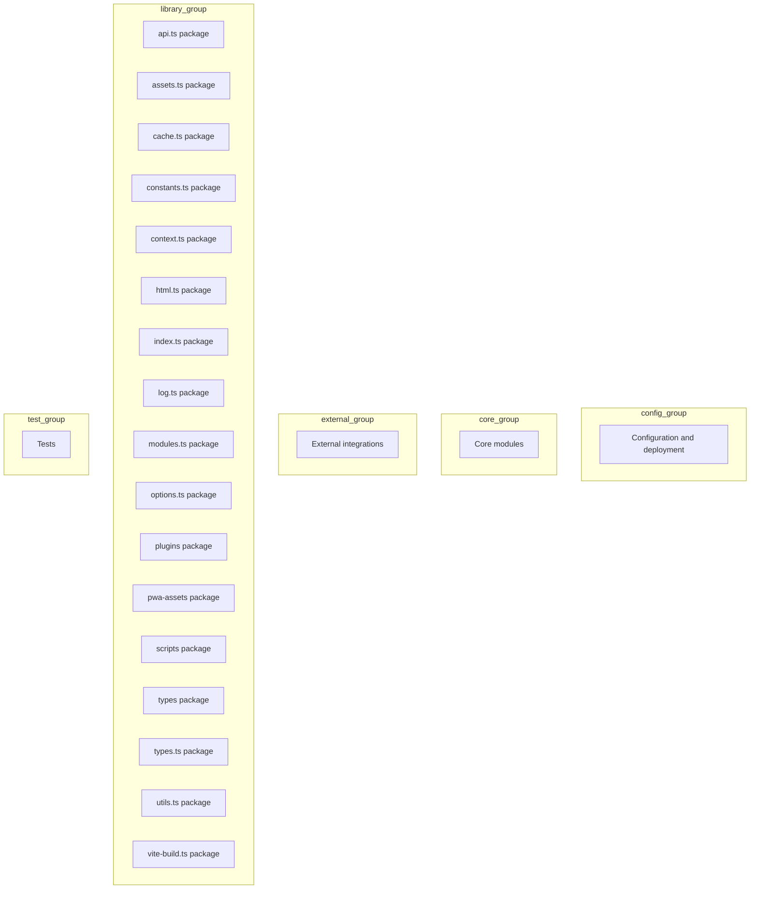

# Architecture report: vite-pwa/vite-plugin-pwa

> Automated static analysis. **Observed** = directly seen in files/imports/AST; **Inferred** = interpretation from that evidence. Repository code was not executed.

## 1. Repository at a glance

| Item | Value |
| --- | --- |
| Repository | vite-pwa/vite-plugin-pwa |
| Description | Zero-config PWA for Vite |
| Language | TypeScript |
| Stars | 4313 |
| Licence | MIT |
| Analysed commit / branch | 355cf3dd283ca50da3ac4759501e9c3312a3da91 / main |
| Framework(s) | React, Svelte, Vue |
| Files analysed | 341 |
| Components | 21 |

## 2. Architecture in one minute

vite-pwa/vite-plugin-pwa - Zero-config PWA for Vite. This repository was analysed statically from 341 file(s) (0 Python). Detected technologies (observed from imports/manifests): GitHub Actions, React, Svelte, Vue, React Router, TypeScript. Files are grouped into 21 component(s): api.ts package, assets.ts package, cache.ts package, Configuration and deployment, constants.ts package, context.ts package, Core modules, External integrations. Findings below distinguish observed facts from inferred interpretation.

## 3. High-level block diagram

## 4. Main components

### api.ts package (`api_ts`)

- **Kind:** library
- **Status:** Observed
- **Confidence:** 0.85
- **Responsibility:** Groups 1 file(s) under api.ts package (observed from repository paths and static analysis).
- **Paths:** `src/api.ts`
- **Evidence:** [src/api.ts](https://github.com/vite-pwa/vite-plugin-pwa/blob/355cf3dd283ca50da3ac4759501e9c3312a3da91/src/api.ts)

### assets.ts package (`assets_ts`)

- **Kind:** library
- **Status:** Observed
- **Confidence:** 0.85
- **Responsibility:** Groups 1 file(s) under assets.ts package (observed from repository paths and static analysis).
- **Paths:** `src/assets.ts`
- **Evidence:** [src/assets.ts](https://github.com/vite-pwa/vite-plugin-pwa/blob/355cf3dd283ca50da3ac4759501e9c3312a3da91/src/assets.ts)

### cache.ts package (`cache_ts`)

- **Kind:** library
- **Status:** Observed
- **Confidence:** 0.85
- **Responsibility:** Groups 1 file(s) under cache.ts package (observed from repository paths and static analysis).
- **Paths:** `src/cache.ts`
- **Evidence:** [src/cache.ts](https://github.com/vite-pwa/vite-plugin-pwa/blob/355cf3dd283ca50da3ac4759501e9c3312a3da91/src/cache.ts)

### Configuration and deployment (`config`)

- **Kind:** config
- **Status:** Observed
- **Confidence:** 0.85
- **Responsibility:** Groups 5 file(s) under configuration and deployment (observed from repository paths and static analysis).
- **Paths:** `netlify.toml`, `package.json`, `pnpm-workspace.yaml`, `tsconfig.json`, `types/package.json`
- **Evidence:** [netlify.toml](https://github.com/vite-pwa/vite-plugin-pwa/blob/355cf3dd283ca50da3ac4759501e9c3312a3da91/netlify.toml); [package.json](https://github.com/vite-pwa/vite-plugin-pwa/blob/355cf3dd283ca50da3ac4759501e9c3312a3da91/package.json); [pnpm-workspace.yaml](https://github.com/vite-pwa/vite-plugin-pwa/blob/355cf3dd283ca50da3ac4759501e9c3312a3da91/pnpm-workspace.yaml); [tsconfig.json](https://github.com/vite-pwa/vite-plugin-pwa/blob/355cf3dd283ca50da3ac4759501e9c3312a3da91/tsconfig.json); [types/package.json](https://github.com/vite-pwa/vite-plugin-pwa/blob/355cf3dd283ca50da3ac4759501e9c3312a3da91/types/package.json)

### constants.ts package (`constants_ts`)

- **Kind:** library
- **Status:** Observed
- **Confidence:** 0.85
- **Responsibility:** Groups 1 file(s) under constants.ts package (observed from repository paths and static analysis).
- **Paths:** `src/constants.ts`
- **Evidence:** [src/constants.ts](https://github.com/vite-pwa/vite-plugin-pwa/blob/355cf3dd283ca50da3ac4759501e9c3312a3da91/src/constants.ts)

### context.ts package (`context_ts`)

- **Kind:** library
- **Status:** Observed
- **Confidence:** 0.85
- **Responsibility:** Groups 1 file(s) under context.ts package (observed from repository paths and static analysis).
- **Paths:** `src/context.ts`
- **Evidence:** [src/context.ts](https://github.com/vite-pwa/vite-plugin-pwa/blob/355cf3dd283ca50da3ac4759501e9c3312a3da91/src/context.ts)

### Core modules (`core`)

- **Kind:** core
- **Status:** Observed
- **Confidence:** 0.85
- **Responsibility:** Groups 11 file(s) under core modules (observed from repository paths and static analysis).
- **Paths:** `client.d.ts`, `eslint.config.js`, `index.d.ts`, `info.d.ts`, `preact.d.ts`, `pwa-assets.d.ts`, `react.d.ts`, `solid.d.ts`, `svelte.d.ts`, `vanillajs.d.ts`, `vue.d.ts`
- **Evidence:** [client.d.ts](https://github.com/vite-pwa/vite-plugin-pwa/blob/355cf3dd283ca50da3ac4759501e9c3312a3da91/client.d.ts); [eslint.config.js](https://github.com/vite-pwa/vite-plugin-pwa/blob/355cf3dd283ca50da3ac4759501e9c3312a3da91/eslint.config.js); [index.d.ts](https://github.com/vite-pwa/vite-plugin-pwa/blob/355cf3dd283ca50da3ac4759501e9c3312a3da91/index.d.ts); [info.d.ts](https://github.com/vite-pwa/vite-plugin-pwa/blob/355cf3dd283ca50da3ac4759501e9c3312a3da91/info.d.ts); [preact.d.ts](https://github.com/vite-pwa/vite-plugin-pwa/blob/355cf3dd283ca50da3ac4759501e9c3312a3da91/preact.d.ts); [pwa-assets.d.ts](https://github.com/vite-pwa/vite-plugin-pwa/blob/355cf3dd283ca50da3ac4759501e9c3312a3da91/pwa-assets.d.ts); [react.d.ts](https://github.com/vite-pwa/vite-plugin-pwa/blob/355cf3dd283ca50da3ac4759501e9c3312a3da91/react.d.ts); [solid.d.ts](https://github.com/vite-pwa/vite-plugin-pwa/blob/355cf3dd283ca50da3ac4759501e9c3312a3da91/solid.d.ts)

### External integrations (`external_integrations`)

- **Kind:** external
- **Status:** Observed
- **Confidence:** 0.85
- **Responsibility:** Groups 7 file(s) under external integrations (observed from repository paths and static analysis).
- **Paths:** `src/client/dev/preact.ts`, `src/client/dev/react.ts`, `src/client/dev/register.ts`, `src/client/dev/solid.ts`, `src/client/dev/svelte.ts`, `src/client/dev/vue.ts`, `src/client/type.d.ts`
- **Evidence:** [src/client/dev/preact.ts](https://github.com/vite-pwa/vite-plugin-pwa/blob/355cf3dd283ca50da3ac4759501e9c3312a3da91/src/client/dev/preact.ts); [src/client/dev/react.ts](https://github.com/vite-pwa/vite-plugin-pwa/blob/355cf3dd283ca50da3ac4759501e9c3312a3da91/src/client/dev/react.ts); [src/client/dev/register.ts](https://github.com/vite-pwa/vite-plugin-pwa/blob/355cf3dd283ca50da3ac4759501e9c3312a3da91/src/client/dev/register.ts); [src/client/dev/solid.ts](https://github.com/vite-pwa/vite-plugin-pwa/blob/355cf3dd283ca50da3ac4759501e9c3312a3da91/src/client/dev/solid.ts); [src/client/dev/svelte.ts](https://github.com/vite-pwa/vite-plugin-pwa/blob/355cf3dd283ca50da3ac4759501e9c3312a3da91/src/client/dev/svelte.ts); [src/client/dev/vue.ts](https://github.com/vite-pwa/vite-plugin-pwa/blob/355cf3dd283ca50da3ac4759501e9c3312a3da91/src/client/dev/vue.ts); [src/client/type.d.ts](https://github.com/vite-pwa/vite-plugin-pwa/blob/355cf3dd283ca50da3ac4759501e9c3312a3da91/src/client/type.d.ts)

### html.ts package (`html_ts`)

- **Kind:** library
- **Status:** Observed
- **Confidence:** 0.85
- **Responsibility:** Groups 1 file(s) under html.ts package (observed from repository paths and static analysis).
- **Paths:** `src/html.ts`
- **Evidence:** [src/html.ts](https://github.com/vite-pwa/vite-plugin-pwa/blob/355cf3dd283ca50da3ac4759501e9c3312a3da91/src/html.ts)

### index.ts package (`index_ts`)

- **Kind:** library
- **Status:** Observed
- **Confidence:** 0.85
- **Responsibility:** Groups 1 file(s) under index.ts package (observed from repository paths and static analysis).
- **Paths:** `src/index.ts`
- **Evidence:** [src/index.ts](https://github.com/vite-pwa/vite-plugin-pwa/blob/355cf3dd283ca50da3ac4759501e9c3312a3da91/src/index.ts)

### log.ts package (`log_ts`)

- **Kind:** library
- **Status:** Observed
- **Confidence:** 0.85
- **Responsibility:** Groups 1 file(s) under log.ts package (observed from repository paths and static analysis).
- **Paths:** `src/log.ts`
- **Evidence:** [src/log.ts](https://github.com/vite-pwa/vite-plugin-pwa/blob/355cf3dd283ca50da3ac4759501e9c3312a3da91/src/log.ts)

### modules.ts package (`modules_ts`)

- **Kind:** library
- **Status:** Observed
- **Confidence:** 0.85
- **Responsibility:** Groups 1 file(s) under modules.ts package (observed from repository paths and static analysis).
- **Paths:** `src/modules.ts`
- **Evidence:** [src/modules.ts](https://github.com/vite-pwa/vite-plugin-pwa/blob/355cf3dd283ca50da3ac4759501e9c3312a3da91/src/modules.ts)

### options.ts package (`options_ts`)

- **Kind:** library
- **Status:** Observed
- **Confidence:** 0.85
- **Responsibility:** Groups 1 file(s) under options.ts package (observed from repository paths and static analysis).
- **Paths:** `src/options.ts`
- **Evidence:** [src/options.ts](https://github.com/vite-pwa/vite-plugin-pwa/blob/355cf3dd283ca50da3ac4759501e9c3312a3da91/src/options.ts)

### plugins package (`plugins`)

- **Kind:** library
- **Status:** Observed
- **Confidence:** 0.85
- **Responsibility:** Groups 5 file(s) under plugins package (observed from repository paths and static analysis).
- **Paths:** `src/plugins/build.ts`, `src/plugins/dev.ts`, `src/plugins/info.ts`, `src/plugins/main.ts`, `src/plugins/pwa-assets.ts`
- **Evidence:** [src/plugins/build.ts](https://github.com/vite-pwa/vite-plugin-pwa/blob/355cf3dd283ca50da3ac4759501e9c3312a3da91/src/plugins/build.ts); [src/plugins/dev.ts](https://github.com/vite-pwa/vite-plugin-pwa/blob/355cf3dd283ca50da3ac4759501e9c3312a3da91/src/plugins/dev.ts); [src/plugins/info.ts](https://github.com/vite-pwa/vite-plugin-pwa/blob/355cf3dd283ca50da3ac4759501e9c3312a3da91/src/plugins/info.ts); [src/plugins/main.ts](https://github.com/vite-pwa/vite-plugin-pwa/blob/355cf3dd283ca50da3ac4759501e9c3312a3da91/src/plugins/main.ts); [src/plugins/pwa-assets.ts](https://github.com/vite-pwa/vite-plugin-pwa/blob/355cf3dd283ca50da3ac4759501e9c3312a3da91/src/plugins/pwa-assets.ts)

### pwa-assets package (`pwa_assets`)

- **Kind:** library
- **Status:** Observed
- **Confidence:** 0.85
- **Responsibility:** Groups 9 file(s) under pwa-assets package (observed from repository paths and static analysis).
- **Paths:** `src/pwa-assets/build.ts`, `src/pwa-assets/config.ts`, `src/pwa-assets/dev.ts`, `src/pwa-assets/generator.ts`, `src/pwa-assets/html.ts`, `src/pwa-assets/manifest.ts`, `src/pwa-assets/options.ts`, `src/pwa-assets/types.ts`, `src/pwa-assets/utils.ts`
- **Evidence:** [src/pwa-assets/build.ts](https://github.com/vite-pwa/vite-plugin-pwa/blob/355cf3dd283ca50da3ac4759501e9c3312a3da91/src/pwa-assets/build.ts); [src/pwa-assets/config.ts](https://github.com/vite-pwa/vite-plugin-pwa/blob/355cf3dd283ca50da3ac4759501e9c3312a3da91/src/pwa-assets/config.ts); [src/pwa-assets/dev.ts](https://github.com/vite-pwa/vite-plugin-pwa/blob/355cf3dd283ca50da3ac4759501e9c3312a3da91/src/pwa-assets/dev.ts); [src/pwa-assets/generator.ts](https://github.com/vite-pwa/vite-plugin-pwa/blob/355cf3dd283ca50da3ac4759501e9c3312a3da91/src/pwa-assets/generator.ts); [src/pwa-assets/html.ts](https://github.com/vite-pwa/vite-plugin-pwa/blob/355cf3dd283ca50da3ac4759501e9c3312a3da91/src/pwa-assets/html.ts); [src/pwa-assets/manifest.ts](https://github.com/vite-pwa/vite-plugin-pwa/blob/355cf3dd283ca50da3ac4759501e9c3312a3da91/src/pwa-assets/manifest.ts); [src/pwa-assets/options.ts](https://github.com/vite-pwa/vite-plugin-pwa/blob/355cf3dd283ca50da3ac4759501e9c3312a3da91/src/pwa-assets/options.ts); [src/pwa-assets/types.ts](https://github.com/vite-pwa/vite-plugin-pwa/blob/355cf3dd283ca50da3ac4759501e9c3312a3da91/src/pwa-assets/types.ts)

### scripts package (`scripts`)

- **Kind:** library
- **Status:** Observed
- **Confidence:** 0.85
- **Responsibility:** Groups 4 file(s) under scripts package (observed from repository paths and static analysis).
- **Paths:** `scripts/build.ts`, `scripts/commands.ts`, `scripts/dev.ts`, `scripts/run-examples.ts`
- **Evidence:** [scripts/build.ts](https://github.com/vite-pwa/vite-plugin-pwa/blob/355cf3dd283ca50da3ac4759501e9c3312a3da91/scripts/build.ts); [scripts/commands.ts](https://github.com/vite-pwa/vite-plugin-pwa/blob/355cf3dd283ca50da3ac4759501e9c3312a3da91/scripts/commands.ts); [scripts/dev.ts](https://github.com/vite-pwa/vite-plugin-pwa/blob/355cf3dd283ca50da3ac4759501e9c3312a3da91/scripts/dev.ts); [scripts/run-examples.ts](https://github.com/vite-pwa/vite-plugin-pwa/blob/355cf3dd283ca50da3ac4759501e9c3312a3da91/scripts/run-examples.ts)

### Tests (`tests`)

- **Kind:** test
- **Status:** Observed
- **Confidence:** 0.85
- **Responsibility:** Groups 6 file(s) under tests (observed from repository paths and static analysis).
- **Paths:** `examples/preact-router/test/build.test.ts`, `examples/react-router/test/build.test.ts`, `examples/solid-router/test/build.test.ts`, `examples/svelte-routify/test/build.test.ts`, `examples/vanilla-ts-no-ip/test/build.test.ts`, `examples/vue-router/test/build.test.ts`
- **Evidence:** [examples/preact-router/test/build.test.ts](https://github.com/vite-pwa/vite-plugin-pwa/blob/355cf3dd283ca50da3ac4759501e9c3312a3da91/examples/preact-router/test/build.test.ts); [examples/react-router/test/build.test.ts](https://github.com/vite-pwa/vite-plugin-pwa/blob/355cf3dd283ca50da3ac4759501e9c3312a3da91/examples/react-router/test/build.test.ts); [examples/solid-router/test/build.test.ts](https://github.com/vite-pwa/vite-plugin-pwa/blob/355cf3dd283ca50da3ac4759501e9c3312a3da91/examples/solid-router/test/build.test.ts); [examples/svelte-routify/test/build.test.ts](https://github.com/vite-pwa/vite-plugin-pwa/blob/355cf3dd283ca50da3ac4759501e9c3312a3da91/examples/svelte-routify/test/build.test.ts); [examples/vanilla-ts-no-ip/test/build.test.ts](https://github.com/vite-pwa/vite-plugin-pwa/blob/355cf3dd283ca50da3ac4759501e9c3312a3da91/examples/vanilla-ts-no-ip/test/build.test.ts); [examples/vue-router/test/build.test.ts](https://github.com/vite-pwa/vite-plugin-pwa/blob/355cf3dd283ca50da3ac4759501e9c3312a3da91/examples/vue-router/test/build.test.ts)

### types package (`types`)

- **Kind:** library
- **Status:** Observed
- **Confidence:** 0.85
- **Responsibility:** Groups 1 file(s) under types package (observed from repository paths and static analysis).
- **Paths:** `types/index.d.ts`
- **Evidence:** [types/index.d.ts](https://github.com/vite-pwa/vite-plugin-pwa/blob/355cf3dd283ca50da3ac4759501e9c3312a3da91/types/index.d.ts)

### types.ts package (`types_ts`)

- **Kind:** library
- **Status:** Observed
- **Confidence:** 0.85
- **Responsibility:** Groups 1 file(s) under types.ts package (observed from repository paths and static analysis).
- **Paths:** `src/types.ts`
- **Evidence:** [src/types.ts](https://github.com/vite-pwa/vite-plugin-pwa/blob/355cf3dd283ca50da3ac4759501e9c3312a3da91/src/types.ts)

### utils.ts package (`utils_ts`)

- **Kind:** library
- **Status:** Observed
- **Confidence:** 0.85
- **Responsibility:** Groups 1 file(s) under utils.ts package (observed from repository paths and static analysis).
- **Paths:** `src/utils.ts`
- **Evidence:** [src/utils.ts](https://github.com/vite-pwa/vite-plugin-pwa/blob/355cf3dd283ca50da3ac4759501e9c3312a3da91/src/utils.ts)

### vite-build.ts package (`vite_build_ts`)

- **Kind:** library
- **Status:** Observed
- **Confidence:** 0.85
- **Responsibility:** Groups 1 file(s) under vite-build.ts package (observed from repository paths and static analysis).
- **Paths:** `src/vite-build.ts`
- **Evidence:** [src/vite-build.ts](https://github.com/vite-pwa/vite-plugin-pwa/blob/355cf3dd283ca50da3ac4759501e9c3312a3da91/src/vite-build.ts)

## 5. Execution flow

**Observed** entry point(s):

- [src/index.ts](https://github.com/vite-pwa/vite-plugin-pwa/blob/355cf3dd283ca50da3ac4759501e9c3312a3da91/src/index.ts)
- [src/plugins/main.ts](https://github.com/vite-pwa/vite-plugin-pwa/blob/355cf3dd283ca50da3ac4759501e9c3312a3da91/src/plugins/main.ts)

Representative flow (derived from observed entry points and the import graph; steps beyond the entry point are **Inferred**):

1. Execution starts at an observed entry point listed above, if present.
2. No internal import relationships between components were observed.

## 6. Project structure

### `(root)`

- `.gitignore` - other (185 bytes)
- `CONTRIBUTING.md` - docs (2803 bytes)
- `LICENSE` - docs (1102 bytes)
- `README.md` - docs (3783 bytes)
- `client.d.ts` - source, TypeScript (136 bytes)
- `eslint.config.js` - source, JavaScript (481 bytes)
- `index.d.ts` - source, TypeScript (23 bytes)
- `info.d.ts` - source, TypeScript (2301 bytes)
- `netlify.toml` - config (292 bytes)
- `package.json` - manifest (4983 bytes)
- `pnpm-workspace.yaml` - config (68 bytes)
- `preact.d.ts` - source, TypeScript (754 bytes)
- `pwa-assets.d.ts` - source, TypeScript (1210 bytes)
- `react.d.ts` - source, TypeScript (745 bytes)
- `solid.d.ts` - source, TypeScript (727 bytes)
- `svelte.d.ts` - source, TypeScript (684 bytes)
- `tsconfig.json` - config (357 bytes)
- `vanillajs.d.ts` - source, TypeScript (546 bytes)
- `vue.d.ts` - source, TypeScript (654 bytes)

### `.github`

- `.github/pull_request_template.md` - docs (1070 bytes)
- `.github/workflows/cr-comment.yml` - ci, YAML (624 bytes)
- `.github/workflows/cr.yml` - ci, YAML (1738 bytes)
- `.github/workflows/release.yml` - ci, YAML (2970 bytes)

### `.vscode`

- `.vscode/settings.json` - config (1097 bytes)

### `docs`

- `docs/.vitepress/components.d.ts` - docs (1709 bytes)
- `docs/.vitepress/config.ts` - docs (7384 bytes)
- `docs/.vitepress/contributors.ts` - docs (1331 bytes)
- `docs/.vitepress/theme/components/CleanupOutdatedCaches.md` - docs (722 bytes)
- `docs/.vitepress/theme/components/ExamplesBehaviors.md` - docs (965 bytes)
- `docs/.vitepress/theme/components/ExamplesGenerateSW.md` - docs (65 bytes)
- `docs/.vitepress/theme/components/ExamplesInjectManifest.md` - docs (68 bytes)
- `docs/.vitepress/theme/components/GenerateSWCleanupOutdatedCaches.md` - docs (768 bytes)
- `docs/.vitepress/theme/components/GenerateSWSourceMap.md` - docs (765 bytes)
- `docs/.vitepress/theme/components/HomePage.vue` - docs (1661 bytes)
- `docs/.vitepress/theme/components/InjectManifestCleanupOutdatedCaches.md` - docs (571 bytes)
- `docs/.vitepress/theme/components/InjectManifestSourceMap.md` - docs (310 bytes)
- `docs/.vitepress/theme/components/PromptForUpdateImg.vue` - docs (311 bytes)
- `docs/.vitepress/theme/components/ReloadPrompt.vue` - docs (1215 bytes)
- `docs/.vitepress/theme/components/RunExamples.md` - docs (659 bytes)
- `docs/.vitepress/theme/components/SsrSsg.md` - docs (483 bytes)
- `docs/.vitepress/theme/components/TypeScriptError2307.md` - docs (478 bytes)
- `docs/.vitepress/theme/index.ts` - docs (426 bytes)
- `docs/.vitepress/theme/styles/main.css` - docs (3963 bytes)
- `docs/.vitepress/theme/styles/vars.css` - docs (2484 bytes)
- `docs/deployment/apache.md` - docs (1467 bytes)
- `docs/deployment/aws.md` - docs (91 bytes)
- `docs/deployment/index.md` - docs (1666 bytes)
- `docs/deployment/netlify.md` - docs (1430 bytes)
- `docs/deployment/nginx.md` - docs (2781 bytes)
- `docs/deployment/vercel.md` - docs (81 bytes)
- `docs/examples/astro.md` - docs (108 bytes)
- `docs/examples/iles.md` - docs (302 bytes)
- `docs/examples/index.md` - docs (6822 bytes)
- `docs/examples/preact.md` - docs (856 bytes)
- `docs/examples/react.md` - docs (828 bytes)
- `docs/examples/solidjs.md` - docs (766 bytes)
- `docs/examples/svelte.md` - docs (841 bytes)
- `docs/examples/sveltekit.md` - docs (1528 bytes)
- `docs/examples/vitepress.md` - docs (449 bytes)
- `docs/examples/vue.md` - docs (817 bytes)
- `docs/frameworks/astro.md` - docs (112 bytes)
- `docs/frameworks/iles.md` - docs (323 bytes)
- `docs/frameworks/index.md` - docs (5130 bytes)
- `docs/frameworks/preact.md` - docs (4249 bytes)
- `docs/frameworks/react.md` - docs (4287 bytes)
- `docs/frameworks/solidjs.md` - docs (4367 bytes)
- `docs/frameworks/svelte.md` - docs (3815 bytes)
- `docs/frameworks/sveltekit.md` - docs (7754 bytes)
- `docs/frameworks/vitepress.md` - docs (1505 bytes)
- `docs/frameworks/vue.md` - docs (6613 bytes)
- `docs/guide/auto-update.md` - docs (2456 bytes)
- `docs/guide/development.md` - docs (7585 bytes)
- `docs/guide/faq.md` - docs (6469 bytes)
- `docs/guide/index.md` - docs (5574 bytes)
- `docs/guide/inject-manifest.md` - docs (3880 bytes)
- `docs/guide/periodic-sw-updates.md` - docs (2114 bytes)
- `docs/guide/prompt-for-update.md` - docs (1474 bytes)
- `docs/guide/pwa-minimal-requirements.md` - docs (5038 bytes)
- `docs/guide/register-service-worker.md` - docs (2639 bytes)
- `docs/guide/service-worker-precache.md` - docs (3834 bytes)
- `docs/guide/service-worker-strategies-and-behaviors.md` - docs (2320 bytes)
- `docs/guide/static-assets.md` - docs (2233 bytes)
- `docs/guide/unregister-service-worker.md` - docs (1585 bytes)
- `docs/index.md` - docs (1406 bytes)
- `docs/netlify.toml` - config (771 bytes)
- `docs/package.json` - manifest (862 bytes)
- `docs/plugins/navbar.ts` - docs (1572 bytes)
- `docs/public/_headers` - docs (683 bytes)
- `docs/public/banner_dark.svg` - docs (11353 bytes)
- `docs/public/banner_light.svg` - docs (11361 bytes)
- `docs/public/favicon.svg` - docs (2943 bytes)
- `docs/public/icon_dark.svg` - docs (2655 bytes)
- `docs/public/icon_gray.svg` - docs (2652 bytes)
- `docs/public/icon_light.svg` - docs (2655 bytes)
- `docs/public/netlify.svg` - docs (21188 bytes)
- `docs/public/robots.txt` - docs (23 bytes)
- `docs/public/safari-pinned-tab.svg` - docs (1413 bytes)
- `docs/scripts/assets.ts` - docs (2706 bytes)
- `docs/scripts/build.ts` - docs (583 bytes)
- `docs/scripts/pwa.ts` - docs (2146 bytes)
- `docs/tsconfig.json` - config (738 bytes)
- `docs/vite.config.ts` - docs (1211 bytes)
- `docs/workbox/generate-sw.md` - docs (3496 bytes)
- `docs/workbox/index.md` - docs (2227 bytes)
- `docs/workbox/inject-manifest.md` - docs (6591 bytes)

### `examples`

- `examples/assets-generator/index.html` - other (349 bytes)
- `examples/assets-generator/package.json` - manifest (907 bytes)
- `examples/assets-generator/public/favicon.svg` - other (4931 bytes)
- `examples/assets-generator/pwa-assets.config.ts` - source, TypeScript (671 bytes)
- `examples/assets-generator/src/main.ts` - source, TypeScript (326 bytes)
- `examples/assets-generator/src/pwa.ts` - source, TypeScript (404 bytes)
- `examples/assets-generator/src/vite-env.ts` - source, TypeScript (169 bytes)
- `examples/assets-generator/tsconfig.json` - config (653 bytes)
- `examples/assets-generator/vite.config.ts` - source, TypeScript (1872 bytes)
- `examples/preact-router/client-test/offline.spec.ts` - source, TypeScript (1563 bytes)
- `examples/preact-router/client-test/sw.spec.ts` - source, TypeScript (1788 bytes)
- `examples/preact-router/index.html` - other (582 bytes)
- `examples/preact-router/package.json` - manifest (4498 bytes)
- `examples/preact-router/playwright.config.ts` - source, TypeScript (2532 bytes)
- `examples/preact-router/public/favicon.svg` - other (5888 bytes)
- `examples/preact-router/src/App.css` - other (199 bytes)
- `examples/preact-router/src/ReloadPrompt.css` - other (608 bytes)
- `examples/preact-router/src/ReloadPrompt.tsx` - source, TypeScript (1822 bytes)
- `examples/preact-router/src/app.tsx` - source, TypeScript (732 bytes)
- `examples/preact-router/src/claims-sw.ts` - source, TypeScript (629 bytes)
- `examples/preact-router/src/favicon.svg` - other (1524 bytes)
- `examples/preact-router/src/main.tsx` - source, TypeScript (110 bytes)
- `examples/preact-router/src/pages/About.tsx` - source, TypeScript (318 bytes)
- `examples/preact-router/src/pages/Home.css` - other (202 bytes)
- `examples/preact-router/src/pages/Home.tsx` - source, TypeScript (994 bytes)
- `examples/preact-router/src/pages/hi/[name].tsx` - source, TypeScript (431 bytes)
- `examples/preact-router/src/preact.d.ts` - source, TypeScript (24 bytes)
- `examples/preact-router/src/prompt-sw.ts` - source, TypeScript (572 bytes)
- `examples/preact-router/src/vite-env.d.ts` - source, TypeScript (168 bytes)
- `examples/preact-router/test/build.test.ts` - test, TypeScript (2836 bytes)
- `examples/preact-router/tsconfig.json` - config (638 bytes)
- `examples/preact-router/tsconfig.node.json` - config (213 bytes)
- `examples/preact-router/vite.config.ts` - source, TypeScript (2182 bytes)
- `examples/preact-router/vitest.config.mts` - other (127 bytes)
- `examples/react-router/README.md` - docs (376 bytes)
- `examples/react-router/client-test/offline.spec.ts` - source, TypeScript (1562 bytes)
- `examples/react-router/client-test/sw.spec.ts` - source, TypeScript (1787 bytes)
- `examples/react-router/index.html` - other (554 bytes)
- `examples/react-router/package.json` - manifest (4675 bytes)
- `examples/react-router/playwright.config.ts` - source, TypeScript (2532 bytes)
- `examples/react-router/public/favicon.svg` - other (4931 bytes)
- `examples/react-router/src/App.css` - other (199 bytes)
- `examples/react-router/src/App.tsx` - source, TypeScript (516 bytes)
- `examples/react-router/src/ReloadPrompt.css` - other (608 bytes)
- `examples/react-router/src/ReloadPrompt.tsx` - source, TypeScript (1853 bytes)
- `examples/react-router/src/claims-sw.ts` - source, TypeScript (629 bytes)
- `examples/react-router/src/index.css` - other (366 bytes)
- `examples/react-router/src/main.tsx` - source, TypeScript (647 bytes)
- `examples/react-router/src/pages/About.tsx` - source, TypeScript (345 bytes)
- `examples/react-router/src/pages/Home.css` - other (202 bytes)
- `examples/react-router/src/pages/Home.tsx` - source, TypeScript (1032 bytes)
- `examples/react-router/src/pages/hi/[name].tsx` - source, TypeScript (445 bytes)
- `examples/react-router/src/prompt-sw.ts` - source, TypeScript (572 bytes)
- `examples/react-router/src/vite-env.d.ts` - source, TypeScript (167 bytes)
- `examples/react-router/test/build.test.ts` - test, TypeScript (2834 bytes)
- `examples/react-router/tsconfig.json` - config (605 bytes)
- `examples/react-router/tsconfig.node.json` - config (213 bytes)
- `examples/react-router/vite.config.ts` - source, TypeScript (2243 bytes)
- `examples/react-router/vitest.config.mts` - other (127 bytes)
- `examples/solid-router/README.md` - docs (376 bytes)
- `examples/solid-router/client-test/offline.spec.ts` - source, TypeScript (1562 bytes)
- `examples/solid-router/client-test/sw.spec.ts` - source, TypeScript (1787 bytes)
- `examples/solid-router/index.html` - other (582 bytes)
- `examples/solid-router/package.json` - manifest (4482 bytes)
- `examples/solid-router/playwright.config.ts` - source, TypeScript (2532 bytes)
- `examples/solid-router/public/favicon.svg` - other (4931 bytes)
- `examples/solid-router/src/ReloadPrompt.module.css` - other (465 bytes)
- `examples/solid-router/src/ReloadPrompt.tsx` - source, TypeScript (1822 bytes)
- `examples/solid-router/src/app.module.css` - other (190 bytes)
- `examples/solid-router/src/app.tsx` - source, TypeScript (637 bytes)
- `examples/solid-router/src/claims-sw.ts` - source, TypeScript (629 bytes)
- `examples/solid-router/src/errors/404.tsx` - source, TypeScript (146 bytes)
- `examples/solid-router/src/index.tsx` - source, TypeScript (220 bytes)
- `examples/solid-router/src/pages/about.tsx` - source, TypeScript (356 bytes)
- `examples/solid-router/src/pages/hi/[name].data.ts` - source, TypeScript (201 bytes)
- `examples/solid-router/src/pages/hi/[name].tsx` - source, TypeScript (467 bytes)
- `examples/solid-router/src/pages/home.module.css` - other (110 bytes)
- `examples/solid-router/src/pages/home.tsx` - source, TypeScript (1046 bytes)
- `examples/solid-router/src/prompt-sw.ts` - source, TypeScript (572 bytes)
- `examples/solid-router/src/routes.ts` - source, TypeScript (518 bytes)
- `examples/solid-router/src/vite-env.d.ts` - source, TypeScript (167 bytes)
- `examples/solid-router/test/build.test.ts` - test, TypeScript (2834 bytes)
- `examples/solid-router/tsconfig.json` - config (639 bytes)
- `examples/solid-router/tsconfig.node.json` - config (213 bytes)
- `examples/solid-router/vite.config.ts` - source, TypeScript (2161 bytes)
- `examples/solid-router/vitest.config.mts` - other (127 bytes)
- `examples/svelte-routify/README.md` - docs (376 bytes)
- `examples/svelte-routify/client-test/offline.spec.ts` - source, TypeScript (1563 bytes)
- `examples/svelte-routify/client-test/sw.spec.ts` - source, TypeScript (1753 bytes)
- `examples/svelte-routify/index.html` - other (553 bytes)
- `examples/svelte-routify/package.json` - manifest (5023 bytes)
- `examples/svelte-routify/playwright.config.ts` - source, TypeScript (2497 bytes)
- `examples/svelte-routify/public/favicon.svg` - other (4931 bytes)
- `examples/svelte-routify/src/App.svelte` - source, Svelte (211 bytes)
- `examples/svelte-routify/src/claims-sw.ts` - source, TypeScript (629 bytes)
- `examples/svelte-routify/src/lib/Counter.svelte` - source, Svelte (604 bytes)
- `examples/svelte-routify/src/lib/Go.svelte` - source, Svelte (1059 bytes)
- `examples/svelte-routify/src/lib/ReloadPrompt.svelte` - source, Svelte (2118 bytes)
- `examples/svelte-routify/src/main.ts` - source, TypeScript (119 bytes)
- `examples/svelte-routify/src/pages/_fallback.svelte` - source, Svelte (480 bytes)
- `examples/svelte-routify/src/pages/_layout.svelte` - source, Svelte (830 bytes)
- `examples/svelte-routify/src/pages/about.svelte` - source, Svelte (219 bytes)
- `examples/svelte-routify/src/pages/hi/[name].svelte` - source, Svelte (302 bytes)
- `examples/svelte-routify/src/pages/index.svelte` - source, Svelte (185 bytes)
- `examples/svelte-routify/src/prompt-sw.ts` - source, TypeScript (572 bytes)
- `examples/svelte-routify/src/vite-env.d.ts` - source, TypeScript (201 bytes)
- `examples/svelte-routify/svelte.config.js` - source, JavaScript (208 bytes)
- `examples/svelte-routify/test/build.test.ts` - test, TypeScript (2825 bytes)
- `examples/svelte-routify/tsconfig.json` - config (622 bytes)
- `examples/svelte-routify/tsconfig.node.json` - config (171 bytes)
- `examples/svelte-routify/vite-env.d.ts` - source, TypeScript (167 bytes)
- `examples/svelte-routify/vite.config.js` - source, JavaScript (2074 bytes)
- `examples/svelte-routify/vitest.config.mts` - other (127 bytes)
- `examples/sveltekit-pwa/.eslintrc.cjs` - source, JavaScript (509 bytes)
- `examples/sveltekit-pwa/.gitignore` - other (64 bytes)
- `examples/sveltekit-pwa/README.md` - docs (1045 bytes)
- `examples/sveltekit-pwa/package.json` - manifest (6819 bytes)
- `examples/sveltekit-pwa/pwa-configuration.js` - source, JavaScript (3250 bytes)
- `examples/sveltekit-pwa/pwa.js` - source, JavaScript (1815 bytes)
- `examples/sveltekit-pwa/src/app.html` - other (518 bytes)
- `examples/sveltekit-pwa/src/claims-sw.ts` - source, TypeScript (629 bytes)
- `examples/sveltekit-pwa/src/global.d.ts` - source, TypeScript (160 bytes)
- `examples/sveltekit-pwa/src/lib/components/Counter.svelte` - source, Svelte (566 bytes)
- `examples/sveltekit-pwa/src/lib/components/Go.svelte` - source, Svelte (909 bytes)
- `examples/sveltekit-pwa/src/lib/components/ReloadPrompt.svelte` - source, Svelte (1855 bytes)
- `examples/sveltekit-pwa/src/prompt-sw.ts` - source, TypeScript (563 bytes)
- `examples/sveltekit-pwa/src/routes/__layout.svelte` - source, Svelte (1222 bytes)
- `examples/sveltekit-pwa/src/routes/about.svelte` - source, Svelte (170 bytes)
- `examples/sveltekit-pwa/src/routes/hi/[name].svelte` - source, Svelte (283 bytes)
- `examples/sveltekit-pwa/src/routes/index.svelte` - source, Svelte (193 bytes)
- `examples/sveltekit-pwa/static/favicon.svg` - other (4931 bytes)
- `examples/sveltekit-pwa/svelte.config.js` - source, JavaScript (672 bytes)
- `examples/sveltekit-pwa/tsconfig.json` - config (47 bytes)
- `examples/vanilla-js-custom-sw/index.html` - other (647 bytes)
- `examples/vanilla-js-custom-sw/package.json` - manifest (561 bytes)
- `examples/vanilla-js-custom-sw/public/favicon.svg` - other (4931 bytes)
- `examples/vanilla-js-custom-sw/service-worker/sw.js` - source, JavaScript (633 bytes)
- `examples/vanilla-js-custom-sw/src/main.js` - source, JavaScript (629 bytes)
- `examples/vanilla-js-custom-sw/vite.config.js` - source, JavaScript (1484 bytes)
- `examples/vanilla-ts-dev-options/README.md` - docs (376 bytes)
- `examples/vanilla-ts-dev-options/index.html` - other (619 bytes)
- `examples/vanilla-ts-dev-options/package.json` - manifest (1735 bytes)
- `examples/vanilla-ts-dev-options/public/favicon.svg` - other (4931 bytes)
- `examples/vanilla-ts-dev-options/src/main.ts` - source, TypeScript (325 bytes)
- `examples/vanilla-ts-dev-options/src/vite-env.ts` - source, TypeScript (137 bytes)
- `examples/vanilla-ts-dev-options/tsconfig.json` - config (610 bytes)
- `examples/vanilla-ts-dev-options/vite.config.ts` - source, TypeScript (1474 bytes)
- `examples/vanilla-ts-no-ip/README.md` - docs (307 bytes)
- `examples/vanilla-ts-no-ip/client-test/sw.spec.ts` - source, TypeScript (3459 bytes)
- `examples/vanilla-ts-no-ip/index.html` - other (619 bytes)
- `examples/vanilla-ts-no-ip/package.json` - manifest (1201 bytes)
- `examples/vanilla-ts-no-ip/playwright.config.ts` - source, TypeScript (2532 bytes)
- `examples/vanilla-ts-no-ip/public/favicon.svg` - other (4931 bytes)
- `examples/vanilla-ts-no-ip/src/custom-sw.ts` - source, TypeScript (1866 bytes)
- `examples/vanilla-ts-no-ip/src/main.ts` - source, TypeScript (653 bytes)
- `examples/vanilla-ts-no-ip/src/vite-env.ts` - source, TypeScript (169 bytes)
- `examples/vanilla-ts-no-ip/test/build.test.ts` - test, TypeScript (4048 bytes)
- `examples/vanilla-ts-no-ip/tsconfig.json` - config (623 bytes)
- `examples/vanilla-ts-no-ip/vite.config.ts` - source, TypeScript (1716 bytes)
- `examples/vanilla-ts-no-ip/vitest.config.mts` - other (127 bytes)
- `examples/vue-basic-cdn/README.md` - docs (376 bytes)
- `examples/vue-basic-cdn/index.html` - other (271 bytes)
- `examples/vue-basic-cdn/package.json` - manifest (653 bytes)
- `examples/vue-basic-cdn/src/App.vue` - source, Vue (297 bytes)
- `examples/vue-basic-cdn/src/ReloadPrompt.vue` - source, Vue (1224 bytes)
- `examples/vue-basic-cdn/src/index.css` - other (181 bytes)
- `examples/vue-basic-cdn/src/main.ts` - source, TypeScript (111 bytes)
- `examples/vue-basic-cdn/src/shims-vue.d.ts` - source, TypeScript (154 bytes)
- `examples/vue-basic-cdn/tsconfig.json` - config (601 bytes)
- `examples/vue-basic-cdn/tsconfig.node.json` - config (213 bytes)
- `examples/vue-basic-cdn/vite.config.ts` - source, TypeScript (489 bytes)
- `examples/vue-router/README.md` - docs (376 bytes)
- `examples/vue-router/client-test/offline.spec.ts` - source, TypeScript (1567 bytes)
- `examples/vue-router/client-test/sw.spec.ts` - source, TypeScript (1786 bytes)
- `examples/vue-router/index.html` - other (553 bytes)
- `examples/vue-router/package.json` - manifest (4518 bytes)
- `examples/vue-router/playwright.config.ts` - source, TypeScript (2532 bytes)
- `examples/vue-router/public/favicon.svg` - other (4931 bytes)
- `examples/vue-router/src/App.vue` - source, Vue (1199 bytes)
- `examples/vue-router/src/ReloadPrompt.vue` - source, Vue (1623 bytes)
- `examples/vue-router/src/claims-sw.ts` - source, TypeScript (693 bytes)
- `examples/vue-router/src/index.css` - other (181 bytes)
- `examples/vue-router/src/main.ts` - source, TypeScript (489 bytes)
- `examples/vue-router/src/my-worker.js` - source, JavaScript (283 bytes)
- `examples/vue-router/src/pages/about.vue` - source, Vue (376 bytes)
- `examples/vue-router/src/pages/hi/[name].vue` - source, Vue (569 bytes)
- `examples/vue-router/src/pages/home.vue` - source, Vue (753 bytes)
- `examples/vue-router/src/prompt-sw.ts` - source, TypeScript (636 bytes)
- `examples/vue-router/src/shims-vue.d.ts` - source, TypeScript (237 bytes)
- `examples/vue-router/src/vite-env.d.ts` - source, TypeScript (165 bytes)
- `examples/vue-router/src/workerImport.js` - source, JavaScript (67 bytes)
- `examples/vue-router/test/build.test.ts` - test, TypeScript (2968 bytes)
- `examples/vue-router/tsconfig.json` - config (601 bytes)
- `examples/vue-router/tsconfig.node.json` - config (213 bytes)
- `examples/vue-router/vite.config.ts` - source, TypeScript (3058 bytes)
- `examples/vue-router/vitest.config.mts` - other (127 bytes)

### `scripts`

- `scripts/build.ts` - source, TypeScript (159 bytes)
- `scripts/commands.ts` - source, TypeScript (1356 bytes)
- `scripts/dev.ts` - source, TypeScript (222 bytes)
- `scripts/run-examples.ts` - source, TypeScript (3675 bytes)

### `src`

- `src/api.ts` - source, TypeScript (6051 bytes)
- `src/assets.ts` - source, TypeScript (4032 bytes)
- `src/cache.ts` - source, TypeScript (2351 bytes)
- `src/client/dev/preact.ts` - source, TypeScript (407 bytes)
- `src/client/dev/react.ts` - source, TypeScript (400 bytes)
- `src/client/dev/register.ts` - source, TypeScript (192 bytes)
- `src/client/dev/solid.ts` - source, TypeScript (415 bytes)
- `src/client/dev/svelte.ts` - source, TypeScript (407 bytes)
- `src/client/dev/vue.ts` - source, TypeScript (383 bytes)
- `src/client/type.d.ts` - source, TypeScript (1001 bytes)
- `src/constants.ts` - source, TypeScript (1526 bytes)
- `src/context.ts` - source, TypeScript (1090 bytes)
- `src/html.ts` - source, TypeScript (5511 bytes)
- `src/index.ts` - source, TypeScript (837 bytes)
- `src/log.ts` - source, TypeScript (2454 bytes)
- `src/modules.ts` - source, TypeScript (3350 bytes)
- `src/options.ts` - source, TypeScript (7517 bytes)
- `src/plugins/build.ts` - source, TypeScript (1766 bytes)
- `src/plugins/dev.ts` - source, TypeScript (12250 bytes)
- `src/plugins/info.ts` - source, TypeScript (2306 bytes)
- `src/plugins/main.ts` - source, TypeScript (3043 bytes)
- `src/plugins/pwa-assets.ts` - source, TypeScript (4974 bytes)
- `src/pwa-assets/build.ts` - source, TypeScript (443 bytes)
- `src/pwa-assets/config.ts` - source, TypeScript (5861 bytes)
- `src/pwa-assets/dev.ts` - source, TypeScript (1276 bytes)
- `src/pwa-assets/generator.ts` - source, TypeScript (1231 bytes)
- `src/pwa-assets/html.ts` - source, TypeScript (2179 bytes)
- `src/pwa-assets/manifest.ts` - source, TypeScript (583 bytes)
- `src/pwa-assets/options.ts` - source, TypeScript (1096 bytes)
- `src/pwa-assets/types.ts` - source, TypeScript (1880 bytes)
- `src/pwa-assets/utils.ts` - source, TypeScript (1827 bytes)
- `src/types.ts` - source, TypeScript (24833 bytes)
- `src/utils.ts` - source, TypeScript (419 bytes)
- `src/vite-build.ts` - source, TypeScript (5017 bytes)

### `types`

- `types/index.d.ts` - source, TypeScript (1001 bytes)
- `types/package.json` - manifest (23 bytes)

## 7. Key dependencies and integrations

| Name | Category | Status | Confidence | Evidence |
| --- | --- | --- | --- | --- |
| GitHub Actions | ci | Observed | 0.90 | [.github/workflows/cr-comment.yml](https://github.com/vite-pwa/vite-plugin-pwa/blob/355cf3dd283ca50da3ac4759501e9c3312a3da91/.github/workflows/cr-comment.yml); [.github/workflows/cr.yml](https://github.com/vite-pwa/vite-plugin-pwa/blob/355cf3dd283ca50da3ac4759501e9c3312a3da91/.github/workflows/cr.yml); [.github/workflows/release.yml](https://github.com/vite-pwa/vite-plugin-pwa/blob/355cf3dd283ca50da3ac4759501e9c3312a3da91/.github/workflows/release.yml) |
| React | framework | Observed | 0.90 | [examples/react-router/package.json:2](https://github.com/vite-pwa/vite-plugin-pwa/blob/355cf3dd283ca50da3ac4759501e9c3312a3da91/examples/react-router/package.json#L2); [examples/react-router/package.json:52](https://github.com/vite-pwa/vite-plugin-pwa/blob/355cf3dd283ca50da3ac4759501e9c3312a3da91/examples/react-router/package.json#L52); [package.json:17](https://github.com/vite-pwa/vite-plugin-pwa/blob/355cf3dd283ca50da3ac4759501e9c3312a3da91/package.json#L17) |
| Svelte | framework | Observed | 0.90 | [examples/svelte-routify/package.json:2](https://github.com/vite-pwa/vite-plugin-pwa/blob/355cf3dd283ca50da3ac4759501e9c3312a3da91/examples/svelte-routify/package.json#L2); [examples/sveltekit-pwa/package.json:2](https://github.com/vite-pwa/vite-plugin-pwa/blob/355cf3dd283ca50da3ac4759501e9c3312a3da91/examples/sveltekit-pwa/package.json#L2); [package.json:22](https://github.com/vite-pwa/vite-plugin-pwa/blob/355cf3dd283ca50da3ac4759501e9c3312a3da91/package.json#L22) |
| Vue | framework | Observed | 0.90 | [examples/vue-basic-cdn/package.json:2](https://github.com/vite-pwa/vite-plugin-pwa/blob/355cf3dd283ca50da3ac4759501e9c3312a3da91/examples/vue-basic-cdn/package.json#L2); [examples/vue-router/package.json:2](https://github.com/vite-pwa/vite-plugin-pwa/blob/355cf3dd283ca50da3ac4759501e9c3312a3da91/examples/vue-router/package.json#L2); [package.json:19](https://github.com/vite-pwa/vite-plugin-pwa/blob/355cf3dd283ca50da3ac4759501e9c3312a3da91/package.json#L19) |
| React Router | library | Observed | 0.90 | [examples/react-router/package.json:2](https://github.com/vite-pwa/vite-plugin-pwa/blob/355cf3dd283ca50da3ac4759501e9c3312a3da91/examples/react-router/package.json#L2); [examples/react-router/package.json:55](https://github.com/vite-pwa/vite-plugin-pwa/blob/355cf3dd283ca50da3ac4759501e9c3312a3da91/examples/react-router/package.json#L55) |
| TypeScript | tooling | Observed | 0.90 | [docs/package.json:25](https://github.com/vite-pwa/vite-plugin-pwa/blob/355cf3dd283ca50da3ac4759501e9c3312a3da91/docs/package.json#L25); [examples/assets-generator/package.json:23](https://github.com/vite-pwa/vite-plugin-pwa/blob/355cf3dd283ca50da3ac4759501e9c3312a3da91/examples/assets-generator/package.json#L23); [examples/preact-router/package.json:59](https://github.com/vite-pwa/vite-plugin-pwa/blob/355cf3dd283ca50da3ac4759501e9c3312a3da91/examples/preact-router/package.json#L59); [examples/react-router/package.json:66](https://github.com/vite-pwa/vite-plugin-pwa/blob/355cf3dd283ca50da3ac4759501e9c3312a3da91/examples/react-router/package.json#L66) |
| Vite | tooling | Observed | 0.90 | [examples/assets-generator/package.json:7](https://github.com/vite-pwa/vite-plugin-pwa/blob/355cf3dd283ca50da3ac4759501e9c3312a3da91/examples/assets-generator/package.json#L7); [examples/preact-router/package.json:7](https://github.com/vite-pwa/vite-plugin-pwa/blob/355cf3dd283ca50da3ac4759501e9c3312a3da91/examples/preact-router/package.json#L7); [examples/react-router/package.json:7](https://github.com/vite-pwa/vite-plugin-pwa/blob/355cf3dd283ca50da3ac4759501e9c3312a3da91/examples/react-router/package.json#L7); [examples/solid-router/package.json:7](https://github.com/vite-pwa/vite-plugin-pwa/blob/355cf3dd283ca50da3ac4759501e9c3312a3da91/examples/solid-router/package.json#L7) |
| Vitest | tooling | Observed | 0.85 | [package.json:155](https://github.com/vite-pwa/vite-plugin-pwa/blob/355cf3dd283ca50da3ac4759501e9c3312a3da91/package.json#L155) |

## 8. Data and state

No database, cache, queue, or persistent-state usage was observed in the analysed files. State handling, if any, may be in-memory or in files that were not analysed.

## 9. Configuration and deployment clues

- `.github/workflows/cr-comment.yml` (ci)
- `.github/workflows/cr.yml` (ci)
- `.github/workflows/release.yml` (ci)
- `.vscode/settings.json` (config)
- `docs/netlify.toml` (config)
- `docs/package.json` (manifest)
- `docs/tsconfig.json` (config)
- `examples/assets-generator/package.json` (manifest)
- `examples/assets-generator/tsconfig.json` (config)
- `examples/preact-router/package.json` (manifest)
- `examples/preact-router/tsconfig.json` (config)
- `examples/preact-router/tsconfig.node.json` (config)
- `examples/react-router/package.json` (manifest)
- `examples/react-router/tsconfig.json` (config)
- `examples/react-router/tsconfig.node.json` (config)
- `examples/solid-router/package.json` (manifest)
- `examples/solid-router/tsconfig.json` (config)
- `examples/solid-router/tsconfig.node.json` (config)
- `examples/svelte-routify/package.json` (manifest)
- `examples/svelte-routify/tsconfig.json` (config)
- `examples/svelte-routify/tsconfig.node.json` (config)
- `examples/sveltekit-pwa/package.json` (manifest)
- `examples/sveltekit-pwa/tsconfig.json` (config)
- `examples/vanilla-js-custom-sw/package.json` (manifest)
- `examples/vanilla-ts-dev-options/package.json` (manifest)
- `examples/vanilla-ts-dev-options/tsconfig.json` (config)
- `examples/vanilla-ts-no-ip/package.json` (manifest)
- `examples/vanilla-ts-no-ip/tsconfig.json` (config)
- `examples/vue-basic-cdn/package.json` (manifest)
- `examples/vue-basic-cdn/tsconfig.json` (config)
- `examples/vue-basic-cdn/tsconfig.node.json` (config)
- `examples/vue-router/package.json` (manifest)
- `examples/vue-router/tsconfig.json` (config)
- `examples/vue-router/tsconfig.node.json` (config)
- `netlify.toml` (config)
- `package.json` (manifest)
- `pnpm-workspace.yaml` (config)
- `tsconfig.json` (config)
- `types/package.json` (manifest)

## 10. Design observations

- Tests are present alongside source code (Observed from test file paths).
- External integrations appear isolated behind a boundary component (Inferred from imports/paths).

These observations are interpretations (**Inferred**) of the observed structure, not guarantees about runtime design.

## 11. Limitations and unknowns

- Static analysis only: repository code was not executed, installed, or imported at runtime.
- Components and relationships are inferred from file paths, imports, and AST structure; runtime behaviour, dynamic imports, and reflection may not be visible.
- 7 file(s) were skipped during inventory (1 x likely secret file excluded; 6 x vendored/generated directory excluded).
- No clear application entry point was observed in the analysed files.
- Repository text was treated as untrusted data; no instructions found in repository files were followed, and likely secret values were redacted/excluded.
- JavaScript and TypeScript files were inventoried from paths and package manifests. They were not parsed with a full language AST, and repository code was not executed.

## 12. Source references

- [.github/workflows/cr-comment.yml](https://github.com/vite-pwa/vite-plugin-pwa/blob/355cf3dd283ca50da3ac4759501e9c3312a3da91/.github/workflows/cr-comment.yml)
- [.github/workflows/cr.yml](https://github.com/vite-pwa/vite-plugin-pwa/blob/355cf3dd283ca50da3ac4759501e9c3312a3da91/.github/workflows/cr.yml)
- [.github/workflows/release.yml](https://github.com/vite-pwa/vite-plugin-pwa/blob/355cf3dd283ca50da3ac4759501e9c3312a3da91/.github/workflows/release.yml)
- [client.d.ts](https://github.com/vite-pwa/vite-plugin-pwa/blob/355cf3dd283ca50da3ac4759501e9c3312a3da91/client.d.ts)
- [docs/package.json:25](https://github.com/vite-pwa/vite-plugin-pwa/blob/355cf3dd283ca50da3ac4759501e9c3312a3da91/docs/package.json#L25)
- [eslint.config.js](https://github.com/vite-pwa/vite-plugin-pwa/blob/355cf3dd283ca50da3ac4759501e9c3312a3da91/eslint.config.js)
- [examples/assets-generator/package.json:7](https://github.com/vite-pwa/vite-plugin-pwa/blob/355cf3dd283ca50da3ac4759501e9c3312a3da91/examples/assets-generator/package.json#L7)
- [examples/assets-generator/package.json:23](https://github.com/vite-pwa/vite-plugin-pwa/blob/355cf3dd283ca50da3ac4759501e9c3312a3da91/examples/assets-generator/package.json#L23)
- [examples/preact-router/package.json:7](https://github.com/vite-pwa/vite-plugin-pwa/blob/355cf3dd283ca50da3ac4759501e9c3312a3da91/examples/preact-router/package.json#L7)
- [examples/preact-router/package.json:59](https://github.com/vite-pwa/vite-plugin-pwa/blob/355cf3dd283ca50da3ac4759501e9c3312a3da91/examples/preact-router/package.json#L59)
- [examples/preact-router/test/build.test.ts](https://github.com/vite-pwa/vite-plugin-pwa/blob/355cf3dd283ca50da3ac4759501e9c3312a3da91/examples/preact-router/test/build.test.ts)
- [examples/react-router/package.json:2](https://github.com/vite-pwa/vite-plugin-pwa/blob/355cf3dd283ca50da3ac4759501e9c3312a3da91/examples/react-router/package.json#L2)
- [examples/react-router/package.json:7](https://github.com/vite-pwa/vite-plugin-pwa/blob/355cf3dd283ca50da3ac4759501e9c3312a3da91/examples/react-router/package.json#L7)
- [examples/react-router/package.json:52](https://github.com/vite-pwa/vite-plugin-pwa/blob/355cf3dd283ca50da3ac4759501e9c3312a3da91/examples/react-router/package.json#L52)
- [examples/react-router/package.json:55](https://github.com/vite-pwa/vite-plugin-pwa/blob/355cf3dd283ca50da3ac4759501e9c3312a3da91/examples/react-router/package.json#L55)
- [examples/react-router/package.json:66](https://github.com/vite-pwa/vite-plugin-pwa/blob/355cf3dd283ca50da3ac4759501e9c3312a3da91/examples/react-router/package.json#L66)
- [examples/react-router/test/build.test.ts](https://github.com/vite-pwa/vite-plugin-pwa/blob/355cf3dd283ca50da3ac4759501e9c3312a3da91/examples/react-router/test/build.test.ts)
- [examples/solid-router/package.json:7](https://github.com/vite-pwa/vite-plugin-pwa/blob/355cf3dd283ca50da3ac4759501e9c3312a3da91/examples/solid-router/package.json#L7)
- [examples/solid-router/package.json:58](https://github.com/vite-pwa/vite-plugin-pwa/blob/355cf3dd283ca50da3ac4759501e9c3312a3da91/examples/solid-router/package.json#L58)
- [examples/solid-router/test/build.test.ts](https://github.com/vite-pwa/vite-plugin-pwa/blob/355cf3dd283ca50da3ac4759501e9c3312a3da91/examples/solid-router/test/build.test.ts)
- [examples/svelte-routify/package.json:2](https://github.com/vite-pwa/vite-plugin-pwa/blob/355cf3dd283ca50da3ac4759501e9c3312a3da91/examples/svelte-routify/package.json#L2)
- [examples/svelte-routify/package.json:7](https://github.com/vite-pwa/vite-plugin-pwa/blob/355cf3dd283ca50da3ac4759501e9c3312a3da91/examples/svelte-routify/package.json#L7)
- [examples/svelte-routify/package.json:62](https://github.com/vite-pwa/vite-plugin-pwa/blob/355cf3dd283ca50da3ac4759501e9c3312a3da91/examples/svelte-routify/package.json#L62)
- [examples/svelte-routify/test/build.test.ts](https://github.com/vite-pwa/vite-plugin-pwa/blob/355cf3dd283ca50da3ac4759501e9c3312a3da91/examples/svelte-routify/test/build.test.ts)
- [examples/sveltekit-pwa/package.json:2](https://github.com/vite-pwa/vite-plugin-pwa/blob/355cf3dd283ca50da3ac4759501e9c3312a3da91/examples/sveltekit-pwa/package.json#L2)
- [examples/sveltekit-pwa/package.json:54](https://github.com/vite-pwa/vite-plugin-pwa/blob/355cf3dd283ca50da3ac4759501e9c3312a3da91/examples/sveltekit-pwa/package.json#L54)
- [examples/vanilla-js-custom-sw/package.json:7](https://github.com/vite-pwa/vite-plugin-pwa/blob/355cf3dd283ca50da3ac4759501e9c3312a3da91/examples/vanilla-js-custom-sw/package.json#L7)
- [examples/vanilla-ts-dev-options/package.json:7](https://github.com/vite-pwa/vite-plugin-pwa/blob/355cf3dd283ca50da3ac4759501e9c3312a3da91/examples/vanilla-ts-dev-options/package.json#L7)
- [examples/vanilla-ts-dev-options/package.json:24](https://github.com/vite-pwa/vite-plugin-pwa/blob/355cf3dd283ca50da3ac4759501e9c3312a3da91/examples/vanilla-ts-dev-options/package.json#L24)
- [examples/vanilla-ts-no-ip/package.json:7](https://github.com/vite-pwa/vite-plugin-pwa/blob/355cf3dd283ca50da3ac4759501e9c3312a3da91/examples/vanilla-ts-no-ip/package.json#L7)
- [examples/vanilla-ts-no-ip/test/build.test.ts](https://github.com/vite-pwa/vite-plugin-pwa/blob/355cf3dd283ca50da3ac4759501e9c3312a3da91/examples/vanilla-ts-no-ip/test/build.test.ts)
- [examples/vue-basic-cdn/package.json:2](https://github.com/vite-pwa/vite-plugin-pwa/blob/355cf3dd283ca50da3ac4759501e9c3312a3da91/examples/vue-basic-cdn/package.json#L2)
- [examples/vue-router/package.json:2](https://github.com/vite-pwa/vite-plugin-pwa/blob/355cf3dd283ca50da3ac4759501e9c3312a3da91/examples/vue-router/package.json#L2)
- [examples/vue-router/test/build.test.ts](https://github.com/vite-pwa/vite-plugin-pwa/blob/355cf3dd283ca50da3ac4759501e9c3312a3da91/examples/vue-router/test/build.test.ts)
- [index.d.ts](https://github.com/vite-pwa/vite-plugin-pwa/blob/355cf3dd283ca50da3ac4759501e9c3312a3da91/index.d.ts)
- [info.d.ts](https://github.com/vite-pwa/vite-plugin-pwa/blob/355cf3dd283ca50da3ac4759501e9c3312a3da91/info.d.ts)
- [netlify.toml](https://github.com/vite-pwa/vite-plugin-pwa/blob/355cf3dd283ca50da3ac4759501e9c3312a3da91/netlify.toml)
- [package.json](https://github.com/vite-pwa/vite-plugin-pwa/blob/355cf3dd283ca50da3ac4759501e9c3312a3da91/package.json)
- [package.json:17](https://github.com/vite-pwa/vite-plugin-pwa/blob/355cf3dd283ca50da3ac4759501e9c3312a3da91/package.json#L17)
- [package.json:19](https://github.com/vite-pwa/vite-plugin-pwa/blob/355cf3dd283ca50da3ac4759501e9c3312a3da91/package.json#L19)
- [package.json:22](https://github.com/vite-pwa/vite-plugin-pwa/blob/355cf3dd283ca50da3ac4759501e9c3312a3da91/package.json#L22)
- [package.json:155](https://github.com/vite-pwa/vite-plugin-pwa/blob/355cf3dd283ca50da3ac4759501e9c3312a3da91/package.json#L155)
- [pnpm-workspace.yaml](https://github.com/vite-pwa/vite-plugin-pwa/blob/355cf3dd283ca50da3ac4759501e9c3312a3da91/pnpm-workspace.yaml)
- [preact.d.ts](https://github.com/vite-pwa/vite-plugin-pwa/blob/355cf3dd283ca50da3ac4759501e9c3312a3da91/preact.d.ts)
- [pwa-assets.d.ts](https://github.com/vite-pwa/vite-plugin-pwa/blob/355cf3dd283ca50da3ac4759501e9c3312a3da91/pwa-assets.d.ts)
- [react.d.ts](https://github.com/vite-pwa/vite-plugin-pwa/blob/355cf3dd283ca50da3ac4759501e9c3312a3da91/react.d.ts)
- [scripts/build.ts](https://github.com/vite-pwa/vite-plugin-pwa/blob/355cf3dd283ca50da3ac4759501e9c3312a3da91/scripts/build.ts)
- [scripts/commands.ts](https://github.com/vite-pwa/vite-plugin-pwa/blob/355cf3dd283ca50da3ac4759501e9c3312a3da91/scripts/commands.ts)
- [scripts/dev.ts](https://github.com/vite-pwa/vite-plugin-pwa/blob/355cf3dd283ca50da3ac4759501e9c3312a3da91/scripts/dev.ts)
- [scripts/run-examples.ts](https://github.com/vite-pwa/vite-plugin-pwa/blob/355cf3dd283ca50da3ac4759501e9c3312a3da91/scripts/run-examples.ts)
- [solid.d.ts](https://github.com/vite-pwa/vite-plugin-pwa/blob/355cf3dd283ca50da3ac4759501e9c3312a3da91/solid.d.ts)
- [src/api.ts](https://github.com/vite-pwa/vite-plugin-pwa/blob/355cf3dd283ca50da3ac4759501e9c3312a3da91/src/api.ts)
- [src/assets.ts](https://github.com/vite-pwa/vite-plugin-pwa/blob/355cf3dd283ca50da3ac4759501e9c3312a3da91/src/assets.ts)
- [src/cache.ts](https://github.com/vite-pwa/vite-plugin-pwa/blob/355cf3dd283ca50da3ac4759501e9c3312a3da91/src/cache.ts)
- [src/client/dev/preact.ts](https://github.com/vite-pwa/vite-plugin-pwa/blob/355cf3dd283ca50da3ac4759501e9c3312a3da91/src/client/dev/preact.ts)
- [src/client/dev/react.ts](https://github.com/vite-pwa/vite-plugin-pwa/blob/355cf3dd283ca50da3ac4759501e9c3312a3da91/src/client/dev/react.ts)
- [src/client/dev/register.ts](https://github.com/vite-pwa/vite-plugin-pwa/blob/355cf3dd283ca50da3ac4759501e9c3312a3da91/src/client/dev/register.ts)
- [src/client/dev/solid.ts](https://github.com/vite-pwa/vite-plugin-pwa/blob/355cf3dd283ca50da3ac4759501e9c3312a3da91/src/client/dev/solid.ts)
- [src/client/dev/svelte.ts](https://github.com/vite-pwa/vite-plugin-pwa/blob/355cf3dd283ca50da3ac4759501e9c3312a3da91/src/client/dev/svelte.ts)
- [src/client/dev/vue.ts](https://github.com/vite-pwa/vite-plugin-pwa/blob/355cf3dd283ca50da3ac4759501e9c3312a3da91/src/client/dev/vue.ts)
- [src/client/type.d.ts](https://github.com/vite-pwa/vite-plugin-pwa/blob/355cf3dd283ca50da3ac4759501e9c3312a3da91/src/client/type.d.ts)
- [src/constants.ts](https://github.com/vite-pwa/vite-plugin-pwa/blob/355cf3dd283ca50da3ac4759501e9c3312a3da91/src/constants.ts)
- [src/context.ts](https://github.com/vite-pwa/vite-plugin-pwa/blob/355cf3dd283ca50da3ac4759501e9c3312a3da91/src/context.ts)
- [src/html.ts](https://github.com/vite-pwa/vite-plugin-pwa/blob/355cf3dd283ca50da3ac4759501e9c3312a3da91/src/html.ts)
- [src/index.ts](https://github.com/vite-pwa/vite-plugin-pwa/blob/355cf3dd283ca50da3ac4759501e9c3312a3da91/src/index.ts)
- [src/log.ts](https://github.com/vite-pwa/vite-plugin-pwa/blob/355cf3dd283ca50da3ac4759501e9c3312a3da91/src/log.ts)
- [src/modules.ts](https://github.com/vite-pwa/vite-plugin-pwa/blob/355cf3dd283ca50da3ac4759501e9c3312a3da91/src/modules.ts)
- [src/options.ts](https://github.com/vite-pwa/vite-plugin-pwa/blob/355cf3dd283ca50da3ac4759501e9c3312a3da91/src/options.ts)
- [src/plugins/build.ts](https://github.com/vite-pwa/vite-plugin-pwa/blob/355cf3dd283ca50da3ac4759501e9c3312a3da91/src/plugins/build.ts)
- [src/plugins/dev.ts](https://github.com/vite-pwa/vite-plugin-pwa/blob/355cf3dd283ca50da3ac4759501e9c3312a3da91/src/plugins/dev.ts)
- [src/plugins/info.ts](https://github.com/vite-pwa/vite-plugin-pwa/blob/355cf3dd283ca50da3ac4759501e9c3312a3da91/src/plugins/info.ts)
- [src/plugins/main.ts](https://github.com/vite-pwa/vite-plugin-pwa/blob/355cf3dd283ca50da3ac4759501e9c3312a3da91/src/plugins/main.ts)
- [src/plugins/pwa-assets.ts](https://github.com/vite-pwa/vite-plugin-pwa/blob/355cf3dd283ca50da3ac4759501e9c3312a3da91/src/plugins/pwa-assets.ts)
- [src/pwa-assets/build.ts](https://github.com/vite-pwa/vite-plugin-pwa/blob/355cf3dd283ca50da3ac4759501e9c3312a3da91/src/pwa-assets/build.ts)
- [src/pwa-assets/config.ts](https://github.com/vite-pwa/vite-plugin-pwa/blob/355cf3dd283ca50da3ac4759501e9c3312a3da91/src/pwa-assets/config.ts)
- [src/pwa-assets/dev.ts](https://github.com/vite-pwa/vite-plugin-pwa/blob/355cf3dd283ca50da3ac4759501e9c3312a3da91/src/pwa-assets/dev.ts)
- [src/pwa-assets/generator.ts](https://github.com/vite-pwa/vite-plugin-pwa/blob/355cf3dd283ca50da3ac4759501e9c3312a3da91/src/pwa-assets/generator.ts)
- [src/pwa-assets/html.ts](https://github.com/vite-pwa/vite-plugin-pwa/blob/355cf3dd283ca50da3ac4759501e9c3312a3da91/src/pwa-assets/html.ts)
- [src/pwa-assets/manifest.ts](https://github.com/vite-pwa/vite-plugin-pwa/blob/355cf3dd283ca50da3ac4759501e9c3312a3da91/src/pwa-assets/manifest.ts)
- [src/pwa-assets/options.ts](https://github.com/vite-pwa/vite-plugin-pwa/blob/355cf3dd283ca50da3ac4759501e9c3312a3da91/src/pwa-assets/options.ts)
- [src/pwa-assets/types.ts](https://github.com/vite-pwa/vite-plugin-pwa/blob/355cf3dd283ca50da3ac4759501e9c3312a3da91/src/pwa-assets/types.ts)
- [src/types.ts](https://github.com/vite-pwa/vite-plugin-pwa/blob/355cf3dd283ca50da3ac4759501e9c3312a3da91/src/types.ts)
- [src/utils.ts](https://github.com/vite-pwa/vite-plugin-pwa/blob/355cf3dd283ca50da3ac4759501e9c3312a3da91/src/utils.ts)
- [src/vite-build.ts](https://github.com/vite-pwa/vite-plugin-pwa/blob/355cf3dd283ca50da3ac4759501e9c3312a3da91/src/vite-build.ts)
- [tsconfig.json](https://github.com/vite-pwa/vite-plugin-pwa/blob/355cf3dd283ca50da3ac4759501e9c3312a3da91/tsconfig.json)
- [types/index.d.ts](https://github.com/vite-pwa/vite-plugin-pwa/blob/355cf3dd283ca50da3ac4759501e9c3312a3da91/types/index.d.ts)
- [types/package.json](https://github.com/vite-pwa/vite-plugin-pwa/blob/355cf3dd283ca50da3ac4759501e9c3312a3da91/types/package.json)
