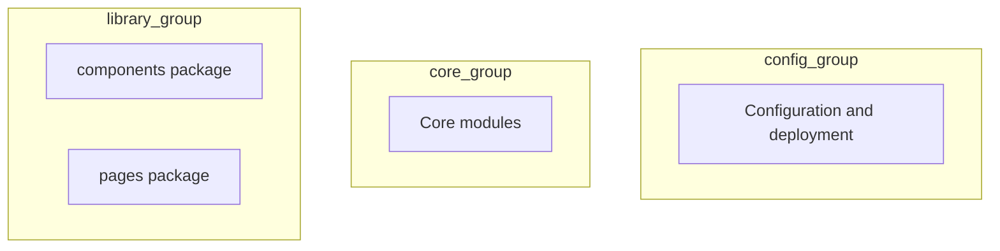

# Architecture report: vivek9patel/vivek9patel.github.io

> Automated static analysis. **Observed** = directly seen in files/imports/AST; **Inferred** = interpretation from that evidence. Repository code was not executed.

## 1. Repository at a glance

| Item | Value |
| --- | --- |
| Repository | vivek9patel/vivek9patel.github.io |
| Description | Web simulation of Ubuntu 20.04, made using NEXT.js & tailwind CSS |
| Language | JavaScript |
| Stars | 4325 |
| Licence | MIT |
| Analysed commit / branch | df42a171d42789a576de91cf83fc48b85dbfbc00 / master |
| Framework(s) | Next.js, React |
| Files analysed | 76 |
| Components | 4 |

## 2. Architecture in one minute

vivek9patel/vivek9patel.github.io - Web simulation of Ubuntu 20.04, made using NEXT.js & tailwind CSS. This repository was analysed statically from 76 file(s) (0 Python). Detected technologies (observed from imports/manifests): GitHub Actions, Next.js, React, Tailwind CSS. Files are grouped into 4 component(s): components package, Configuration and deployment, Core modules, pages package. Findings below distinguish observed facts from inferred interpretation.

## 3. High-level block diagram

## 4. Main components

### components package (`components`)

- **Kind:** library
- **Status:** Observed
- **Confidence:** 0.85
- **Responsibility:** Groups 28 file(s) under components package (observed from repository paths and static analysis).
- **Paths:** `components/SEO/Meta.js`, `components/apps/calc.js`, `components/apps/chrome.js`, `components/apps/gedit.js`, `components/apps/settings.js`, `components/apps/spotify.js`, `components/apps/terminal.js`, `components/apps/todoist.js`, `components/apps/trash.js`, `components/apps/vivek.js`, `components/apps/vscode.js`, `components/base/side_bar_app.js`, `components/base/ubuntu_app.js`, `components/base/window.js`, `components/context menus/default.js`, `components/context menus/desktop-menu.js`, `components/screen/all-applications.js`, `components/screen/booting_screen.js`, `components/screen/desktop.js`, `components/screen/lock_screen.js`, `components/screen/navbar.js`, `components/screen/side_bar.js`, `components/ubuntu.js`, `components/util components/background-image.js`, `components/util components/clock.js`, `components/util components/small_arrow.js`, `components/util components/status.js`, `components/util components/status_card.js`
- **Evidence:** [components/SEO/Meta.js](https://github.com/vivek9patel/vivek9patel.github.io/blob/df42a171d42789a576de91cf83fc48b85dbfbc00/components/SEO/Meta.js); [components/apps/calc.js](https://github.com/vivek9patel/vivek9patel.github.io/blob/df42a171d42789a576de91cf83fc48b85dbfbc00/components/apps/calc.js); [components/apps/chrome.js](https://github.com/vivek9patel/vivek9patel.github.io/blob/df42a171d42789a576de91cf83fc48b85dbfbc00/components/apps/chrome.js); [components/apps/gedit.js](https://github.com/vivek9patel/vivek9patel.github.io/blob/df42a171d42789a576de91cf83fc48b85dbfbc00/components/apps/gedit.js); [components/apps/settings.js](https://github.com/vivek9patel/vivek9patel.github.io/blob/df42a171d42789a576de91cf83fc48b85dbfbc00/components/apps/settings.js); [components/apps/spotify.js](https://github.com/vivek9patel/vivek9patel.github.io/blob/df42a171d42789a576de91cf83fc48b85dbfbc00/components/apps/spotify.js); [components/apps/terminal.js](https://github.com/vivek9patel/vivek9patel.github.io/blob/df42a171d42789a576de91cf83fc48b85dbfbc00/components/apps/terminal.js); [components/apps/todoist.js](https://github.com/vivek9patel/vivek9patel.github.io/blob/df42a171d42789a576de91cf83fc48b85dbfbc00/components/apps/todoist.js)

### Configuration and deployment (`config`)

- **Kind:** config
- **Status:** Observed
- **Confidence:** 0.85
- **Responsibility:** Groups 1 file(s) under configuration and deployment (observed from repository paths and static analysis).
- **Paths:** `package.json`
- **Evidence:** [package.json](https://github.com/vivek9patel/vivek9patel.github.io/blob/df42a171d42789a576de91cf83fc48b85dbfbc00/package.json)

### Core modules (`core`)

- **Kind:** core
- **Status:** Observed
- **Confidence:** 0.85
- **Responsibility:** Groups 3 file(s) under core modules (observed from repository paths and static analysis).
- **Paths:** `apps.config.js`, `postcss.config.js`, `tailwind.config.js`
- **Evidence:** [apps.config.js](https://github.com/vivek9patel/vivek9patel.github.io/blob/df42a171d42789a576de91cf83fc48b85dbfbc00/apps.config.js); [postcss.config.js](https://github.com/vivek9patel/vivek9patel.github.io/blob/df42a171d42789a576de91cf83fc48b85dbfbc00/postcss.config.js); [tailwind.config.js](https://github.com/vivek9patel/vivek9patel.github.io/blob/df42a171d42789a576de91cf83fc48b85dbfbc00/tailwind.config.js)

### pages package (`pages`)

- **Kind:** library
- **Status:** Observed
- **Confidence:** 0.85
- **Responsibility:** Groups 3 file(s) under pages package (observed from repository paths and static analysis).
- **Paths:** `pages/_app.js`, `pages/_document.js`, `pages/index.js`
- **Evidence:** [pages/_app.js](https://github.com/vivek9patel/vivek9patel.github.io/blob/df42a171d42789a576de91cf83fc48b85dbfbc00/pages/_app.js); [pages/_document.js](https://github.com/vivek9patel/vivek9patel.github.io/blob/df42a171d42789a576de91cf83fc48b85dbfbc00/pages/_document.js); [pages/index.js](https://github.com/vivek9patel/vivek9patel.github.io/blob/df42a171d42789a576de91cf83fc48b85dbfbc00/pages/index.js)

## 5. Execution flow

**Observed** entry point(s):

- [pages/index.js](https://github.com/vivek9patel/vivek9patel.github.io/blob/df42a171d42789a576de91cf83fc48b85dbfbc00/pages/index.js)

Representative flow (derived from observed entry points and the import graph; steps beyond the entry point are **Inferred**):

1. Execution starts at an observed entry point listed above, if present.
2. No internal import relationships between components were observed.

## 6. Project structure

### `(root)`

- `.gitattributes` - other (32 bytes)
- `.gitignore` - other (390 bytes)
- `LICENSE` - docs (1068 bytes)
- `README.md` - docs (2642 bytes)
- `apps.config.js` - source, JavaScript (3215 bytes)
- `package.json` - manifest (693 bytes)
- `postcss.config.js` - source, JavaScript (203 bytes)
- `tailwind.config.js` - source, JavaScript (1400 bytes)

### `.github`

- `.github/FUNDING.yml` - config (627 bytes)
- `.github/workflows/gh-deploy.yml` - ci, YAML (1469 bytes)

### `.vscode`

- `.vscode/settings.json` - config (66 bytes)

### `components`

- `components/SEO/Meta.js` - source, JavaScript (3429 bytes)
- `components/apps/calc.js` - source, JavaScript (10702 bytes)
- `components/apps/chrome.js` - source, JavaScript (3469 bytes)
- `components/apps/gedit.js` - source, JavaScript (4790 bytes)
- `components/apps/settings.js` - source, JavaScript (1917 bytes)
- `components/apps/spotify.js` - source, JavaScript (319 bytes)
- `components/apps/terminal.js` - source, JavaScript (21176 bytes)
- `components/apps/todoist.js` - source, JavaScript (328 bytes)
- `components/apps/trash.js` - source, JavaScript (4052 bytes)
- `components/apps/vivek.js` - source, JavaScript (23577 bytes)
- `components/apps/vscode.js` - source, JavaScript (473 bytes)
- `components/base/side_bar_app.js` - source, JavaScript (2454 bytes)
- `components/base/ubuntu_app.js` - source, JavaScript (1448 bytes)
- `components/base/window.js` - source, JavaScript (11561 bytes)
- `components/context menus/default.js` - source, JavaScript (2480 bytes)
- `components/context menus/desktop-menu.js` - source, JavaScript (3197 bytes)
- `components/screen/all-applications.js` - source, JavaScript (4047 bytes)
- `components/screen/booting_screen.js` - source, JavaScript (1812 bytes)
- `components/screen/desktop.js` - source, JavaScript (19570 bytes)
- `components/screen/lock_screen.js` - source, JavaScript (1830 bytes)
- `components/screen/navbar.js` - source, JavaScript (1658 bytes)
- `components/screen/side_bar.js` - source, JavaScript (2686 bytes)
- `components/ubuntu.js` - source, JavaScript (3716 bytes)
- `components/util components/background-image.js` - source, JavaScript (813 bytes)
- `components/util components/clock.js` - source, JavaScript (1586 bytes)
- `components/util components/small_arrow.js` - source, JavaScript (222 bytes)
- `components/util components/status.js` - source, JavaScript (1067 bytes)
- `components/util components/status_card.js` - source, JavaScript (6096 bytes)

### `pages`

- `pages/_app.js` - source, JavaScript (169 bytes)
- `pages/_document.js` - source, JavaScript (516 bytes)
- `pages/index.js` - source, JavaScript (336 bytes)

### `public`

- `public/images/logos/fevicon.svg` - other (2295 bytes)
- `public/robots.txt` - docs (67 bytes)
- `public/themes/Yaru/apps/tars.svg` - other (3085 bytes)
- `public/themes/Yaru/status/about.svg` - other (2237 bytes)
- `public/themes/Yaru/status/arrow-up-right.svg` - other (171 bytes)
- `public/themes/Yaru/status/audio-headphones-symbolic.svg` - other (1917 bytes)
- `public/themes/Yaru/status/audio-volume-medium-symbolic.svg` - other (1422 bytes)
- `public/themes/Yaru/status/battery-good-symbolic.svg` - other (1367 bytes)
- `public/themes/Yaru/status/bluetooth-symbolic.svg` - other (927 bytes)
- `public/themes/Yaru/status/changes-prevent-symbolic.svg` - other (509 bytes)
- `public/themes/Yaru/status/chrome_home.svg` - other (206 bytes)
- `public/themes/Yaru/status/chrome_refresh.svg` - other (329 bytes)
- `public/themes/Yaru/status/cof_orange_hex.svg` - other (1987 bytes)
- `public/themes/Yaru/status/contact.svg` - other (417 bytes)
- `public/themes/Yaru/status/display-brightness-symbolic.svg` - other (391 bytes)
- `public/themes/Yaru/status/download.svg` - other (3700 bytes)
- `public/themes/Yaru/status/education.svg` - other (1169 bytes)
- `public/themes/Yaru/status/emblem-system-symbolic.svg` - other (5294 bytes)
- `public/themes/Yaru/status/experience.svg` - other (3821 bytes)
- `public/themes/Yaru/status/external-link.svg` - other (470 bytes)
- `public/themes/Yaru/status/network-wireless-signal-good-symbolic.svg` - other (993 bytes)
- `public/themes/Yaru/status/power-button.svg` - other (765 bytes)
- `public/themes/Yaru/status/process-working-symbolic.svg` - other (6890 bytes)
- `public/themes/Yaru/status/projects.svg` - other (4911 bytes)
- `public/themes/Yaru/status/skills.svg` - other (4325 bytes)
- `public/themes/Yaru/status/system-shutdown-symbolic.svg` - other (3814 bytes)
- `public/themes/Yaru/status/ubuntu_white_hex.svg` - other (5328 bytes)
- `public/themes/Yaru/status/user-trash-symbolic.svg` - other (957 bytes)
- `public/themes/Yaru/system/view-app-grid-symbolic.svg` - other (1131 bytes)
- `public/themes/Yaru/window/window-close-symbolic.svg` - other (808 bytes)
- `public/themes/Yaru/window/window-maximize-symbolic.svg` - other (618 bytes)
- `public/themes/Yaru/window/window-minimize-symbolic.svg` - other (609 bytes)
- `public/themes/Yaru/window/window-restore-symbolic.svg` - other (1091 bytes)

### `styles`

- `styles/index.css` - other (4052 bytes)

## 7. Key dependencies and integrations

| Name | Category | Status | Confidence | Evidence |
| --- | --- | --- | --- | --- |
| GitHub Actions | ci | Observed | 0.85 | [.github/workflows/gh-deploy.yml](https://github.com/vivek9patel/vivek9patel.github.io/blob/df42a171d42789a576de91cf83fc48b85dbfbc00/.github/workflows/gh-deploy.yml) |
| Next.js | framework | Observed | 0.85 | [package.json:7](https://github.com/vivek9patel/vivek9patel.github.io/blob/df42a171d42789a576de91cf83fc48b85dbfbc00/package.json#L7) |
| React | framework | Observed | 0.90 | [package.json:23](https://github.com/vivek9patel/vivek9patel.github.io/blob/df42a171d42789a576de91cf83fc48b85dbfbc00/package.json#L23); [package.json:24](https://github.com/vivek9patel/vivek9patel.github.io/blob/df42a171d42789a576de91cf83fc48b85dbfbc00/package.json#L24) |
| Tailwind CSS | library | Observed | 0.85 | [package.json:28](https://github.com/vivek9patel/vivek9patel.github.io/blob/df42a171d42789a576de91cf83fc48b85dbfbc00/package.json#L28) |

## 8. Data and state

No database, cache, queue, or persistent-state usage was observed in the analysed files. State handling, if any, may be in-memory or in files that were not analysed.

## 9. Configuration and deployment clues

- `.github/FUNDING.yml` (config)
- `.github/workflows/gh-deploy.yml` (ci)
- `.vscode/settings.json` (config)
- `package.json` (manifest)

## 10. Design observations

- No strong design patterns could be established from the available evidence.

These observations are interpretations (**Inferred**) of the observed structure, not guarantees about runtime design.

## 11. Limitations and unknowns

- Static analysis only: repository code was not executed, installed, or imported at runtime.
- Components and relationships are inferred from file paths, imports, and AST structure; runtime behaviour, dynamic imports, and reflection may not be visible.
- 1 file(s) were skipped during inventory (1 x lockfile excluded).
- No clear application entry point was observed in the analysed files.
- Repository text was treated as untrusted data; no instructions found in repository files were followed, and likely secret values were redacted/excluded.
- JavaScript and TypeScript files were inventoried from paths and package manifests. They were not parsed with a full language AST, and repository code was not executed.

## 12. Source references

- [.github/workflows/gh-deploy.yml](https://github.com/vivek9patel/vivek9patel.github.io/blob/df42a171d42789a576de91cf83fc48b85dbfbc00/.github/workflows/gh-deploy.yml)
- [apps.config.js](https://github.com/vivek9patel/vivek9patel.github.io/blob/df42a171d42789a576de91cf83fc48b85dbfbc00/apps.config.js)
- [components/SEO/Meta.js](https://github.com/vivek9patel/vivek9patel.github.io/blob/df42a171d42789a576de91cf83fc48b85dbfbc00/components/SEO/Meta.js)
- [components/apps/calc.js](https://github.com/vivek9patel/vivek9patel.github.io/blob/df42a171d42789a576de91cf83fc48b85dbfbc00/components/apps/calc.js)
- [components/apps/chrome.js](https://github.com/vivek9patel/vivek9patel.github.io/blob/df42a171d42789a576de91cf83fc48b85dbfbc00/components/apps/chrome.js)
- [components/apps/gedit.js](https://github.com/vivek9patel/vivek9patel.github.io/blob/df42a171d42789a576de91cf83fc48b85dbfbc00/components/apps/gedit.js)
- [components/apps/settings.js](https://github.com/vivek9patel/vivek9patel.github.io/blob/df42a171d42789a576de91cf83fc48b85dbfbc00/components/apps/settings.js)
- [components/apps/spotify.js](https://github.com/vivek9patel/vivek9patel.github.io/blob/df42a171d42789a576de91cf83fc48b85dbfbc00/components/apps/spotify.js)
- [components/apps/terminal.js](https://github.com/vivek9patel/vivek9patel.github.io/blob/df42a171d42789a576de91cf83fc48b85dbfbc00/components/apps/terminal.js)
- [components/apps/todoist.js](https://github.com/vivek9patel/vivek9patel.github.io/blob/df42a171d42789a576de91cf83fc48b85dbfbc00/components/apps/todoist.js)
- [package.json](https://github.com/vivek9patel/vivek9patel.github.io/blob/df42a171d42789a576de91cf83fc48b85dbfbc00/package.json)
- [package.json:7](https://github.com/vivek9patel/vivek9patel.github.io/blob/df42a171d42789a576de91cf83fc48b85dbfbc00/package.json#L7)
- [package.json:23](https://github.com/vivek9patel/vivek9patel.github.io/blob/df42a171d42789a576de91cf83fc48b85dbfbc00/package.json#L23)
- [package.json:24](https://github.com/vivek9patel/vivek9patel.github.io/blob/df42a171d42789a576de91cf83fc48b85dbfbc00/package.json#L24)
- [package.json:28](https://github.com/vivek9patel/vivek9patel.github.io/blob/df42a171d42789a576de91cf83fc48b85dbfbc00/package.json#L28)
- [pages/_app.js](https://github.com/vivek9patel/vivek9patel.github.io/blob/df42a171d42789a576de91cf83fc48b85dbfbc00/pages/_app.js)
- [pages/_document.js](https://github.com/vivek9patel/vivek9patel.github.io/blob/df42a171d42789a576de91cf83fc48b85dbfbc00/pages/_document.js)
- [pages/index.js](https://github.com/vivek9patel/vivek9patel.github.io/blob/df42a171d42789a576de91cf83fc48b85dbfbc00/pages/index.js)
- [postcss.config.js](https://github.com/vivek9patel/vivek9patel.github.io/blob/df42a171d42789a576de91cf83fc48b85dbfbc00/postcss.config.js)
- [tailwind.config.js](https://github.com/vivek9patel/vivek9patel.github.io/blob/df42a171d42789a576de91cf83fc48b85dbfbc00/tailwind.config.js)
