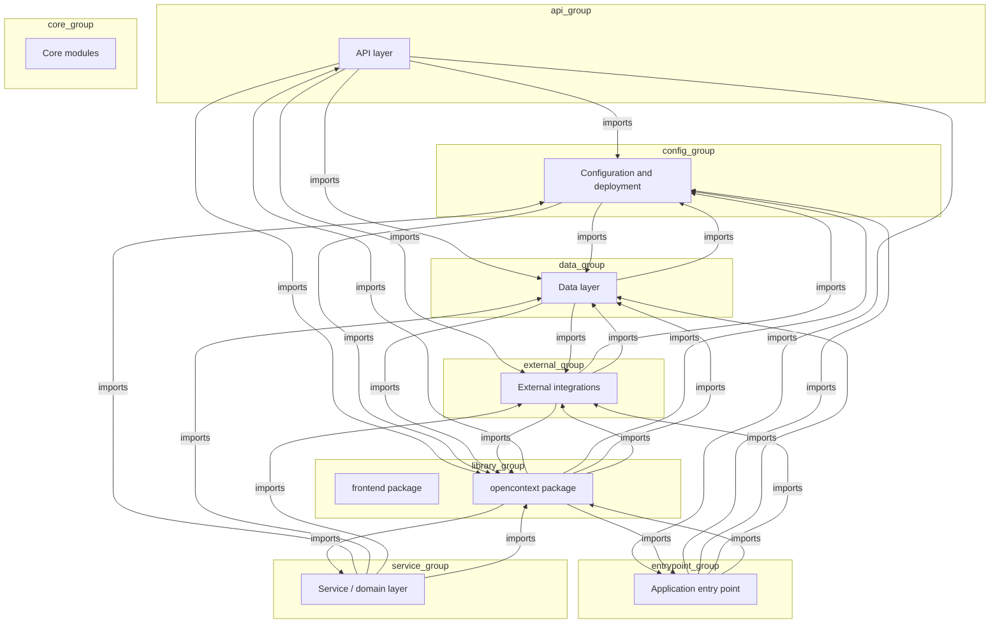

# Architecture report: volcengine/MineContext

> Automated static analysis. **Observed** = directly seen in files/imports/AST; **Inferred** = interpretation from that evidence. Repository code was not executed.

## 1. Repository at a glance

| Item | Value |
| --- | --- |
| Repository | volcengine/MineContext |
| Description | MineContext is your proactive context-aware AI partner（Context-Engineering+ChatGPT Pulse） |
| Language | Python |
| Stars | 5547 |
| Licence | Apache-2.0 |
| Analysed commit / branch | 171c7a9ea8091e326ddcf0f10718aa1b58c83c65 / main |
| Framework(s) | Electron, Express, FastAPI, React |
| Files analysed | 461 |
| Components | 9 |

## 2. Architecture in one minute

volcengine/MineContext - MineContext is your proactive context-aware AI partner（Context-Engineering+ChatGPT Pulse）. This repository was analysed statically from 461 file(s) (144 Python). Detected technologies (observed from imports/manifests): GitHub Actions, SQLite, Electron, Express, FastAPI, React. Files are grouped into 9 component(s): API layer, Configuration and deployment, Core modules, Data layer, Application entry point, External integrations, frontend package, opencontext package. Observed entry point(s): opencontext/cli.py, opencontext/server/opencontext.py. Findings below distinguish observed facts from inferred interpretation.

## 3. High-level block diagram

## 4. Main components

### API layer (`api_layer`)

- **Kind:** api
- **Status:** Observed
- **Confidence:** 0.85
- **Responsibility:** Groups 16 file(s) under api layer (observed from repository paths and static analysis). Observed routes: POST /chat, POST /chat/stream, POST /resume/{workflow_id}, GET /state/{workflow_id}, DELETE /cancel/{workflow_id}. Observed top-level classes: ActivityConfig, AddScreenshotRequest, AddScreenshotsRequest, AppendMessageContentParams, ChatRequest, ChatResponse. Observed top-level functions: _build_llm_config, add_screenshot, add_screenshots, advanced_chat_page, api_health_check, append_message.
- **Paths:** `opencontext/server/routes/__init__.py`, `opencontext/server/routes/agent_chat.py`, `opencontext/server/routes/completions.py`, `opencontext/server/routes/content_generation.py`, `opencontext/server/routes/context.py`, `opencontext/server/routes/conversation.py`, `opencontext/server/routes/debug.py`, `opencontext/server/routes/documents.py`, `opencontext/server/routes/events.py`, `opencontext/server/routes/health.py`, `opencontext/server/routes/messages.py`, `opencontext/server/routes/monitoring.py`, `opencontext/server/routes/screenshots.py`, `opencontext/server/routes/settings.py`, `opencontext/server/routes/vaults.py`, `opencontext/server/routes/web.py`
- **Evidence:** [opencontext/server/routes/__init__.py](https://github.com/volcengine/MineContext/blob/171c7a9ea8091e326ddcf0f10718aa1b58c83c65/opencontext/server/routes/__init__.py); [opencontext/server/routes/agent_chat.py:39](https://github.com/volcengine/MineContext/blob/171c7a9ea8091e326ddcf0f10718aa1b58c83c65/opencontext/server/routes/agent_chat.py#L39); [opencontext/server/routes/completions.py:31](https://github.com/volcengine/MineContext/blob/171c7a9ea8091e326ddcf0f10718aa1b58c83c65/opencontext/server/routes/completions.py#L31); [opencontext/server/routes/content_generation.py:26](https://github.com/volcengine/MineContext/blob/171c7a9ea8091e326ddcf0f10718aa1b58c83c65/opencontext/server/routes/content_generation.py#L26); [opencontext/server/routes/context.py:35](https://github.com/volcengine/MineContext/blob/171c7a9ea8091e326ddcf0f10718aa1b58c83c65/opencontext/server/routes/context.py#L35); [opencontext/server/routes/conversation.py:30](https://github.com/volcengine/MineContext/blob/171c7a9ea8091e326ddcf0f10718aa1b58c83c65/opencontext/server/routes/conversation.py#L30); [opencontext/server/routes/debug.py:29](https://github.com/volcengine/MineContext/blob/171c7a9ea8091e326ddcf0f10718aa1b58c83c65/opencontext/server/routes/debug.py#L29); [opencontext/server/routes/documents.py:27](https://github.com/volcengine/MineContext/blob/171c7a9ea8091e326ddcf0f10718aa1b58c83c65/opencontext/server/routes/documents.py#L27)

### Configuration and deployment (`config`)

- **Kind:** config
- **Status:** Observed
- **Confidence:** 0.85
- **Responsibility:** Groups 27 file(s) under configuration and deployment (observed from repository paths and static analysis). Observed top-level classes: ConfigManager, GlobalConfig, PromptManager. Observed top-level functions: get_config, get_global_config, get_language, get_prompt, get_prompt_group, get_prompt_manager.
- **Paths:** `config/config.yaml`, `config/prompts_en.yaml`, `config/prompts_zh.yaml`, `frontend/.editorconfig`, `frontend/.env.example`, `frontend/.prettierrc.yaml`, `frontend/components.json`, `frontend/dev-app-update.yml`, `frontend/electron-builder.yml`, `frontend/externals/python/window_capture/requirements.txt`, `frontend/externals/python/window_inspector/requirements.txt`, `frontend/package.json`, `frontend/packages/shared/config/constant.ts`, `frontend/packages/shared/config/languages.ts`, `frontend/packages/shared/config/logger.ts`, `frontend/src/renderer/src/pages/settings/components/modelRadio/model-radio.tsx`, `frontend/src/renderer/src/pages/settings/constants.tsx`, `frontend/src/renderer/src/pages/settings/settings.tsx`, `frontend/tsconfig.json`, `frontend/tsconfig.node.json`, `frontend/tsconfig.web.json`, `opencontext/config/__init__.py`, `opencontext/config/config_manager.py`, `opencontext/config/global_config.py`, `opencontext/config/prompt_manager.py`, `package.json`, `pyproject.toml`
- **Evidence:** [config/config.yaml](https://github.com/volcengine/MineContext/blob/171c7a9ea8091e326ddcf0f10718aa1b58c83c65/config/config.yaml); [config/prompts_en.yaml](https://github.com/volcengine/MineContext/blob/171c7a9ea8091e326ddcf0f10718aa1b58c83c65/config/prompts_en.yaml); [config/prompts_zh.yaml](https://github.com/volcengine/MineContext/blob/171c7a9ea8091e326ddcf0f10718aa1b58c83c65/config/prompts_zh.yaml); [frontend/.editorconfig](https://github.com/volcengine/MineContext/blob/171c7a9ea8091e326ddcf0f10718aa1b58c83c65/frontend/.editorconfig); [frontend/.env.example](https://github.com/volcengine/MineContext/blob/171c7a9ea8091e326ddcf0f10718aa1b58c83c65/frontend/.env.example); [frontend/.prettierrc.yaml](https://github.com/volcengine/MineContext/blob/171c7a9ea8091e326ddcf0f10718aa1b58c83c65/frontend/.prettierrc.yaml); [frontend/components.json](https://github.com/volcengine/MineContext/blob/171c7a9ea8091e326ddcf0f10718aa1b58c83c65/frontend/components.json); [frontend/dev-app-update.yml](https://github.com/volcengine/MineContext/blob/171c7a9ea8091e326ddcf0f10718aa1b58c83c65/frontend/dev-app-update.yml)

### Core modules (`core`)

- **Kind:** core
- **Status:** Observed
- **Confidence:** 0.85
- **Responsibility:** Groups 2 file(s) under core modules (observed from repository paths and static analysis). Observed top-level functions: get_resource_path.
- **Paths:** `build.sh`, `hook-opencontext.py`
- **Evidence:** [build.sh](https://github.com/volcengine/MineContext/blob/171c7a9ea8091e326ddcf0f10718aa1b58c83c65/build.sh); [hook-opencontext.py:12](https://github.com/volcengine/MineContext/blob/171c7a9ea8091e326ddcf0f10718aa1b58c83c65/hook-opencontext.py#L12)

### Data layer (`data_layer`)

- **Kind:** data
- **Status:** Observed
- **Confidence:** 0.85
- **Responsibility:** Groups 17 file(s) under data layer (observed from repository paths and static analysis). Observed top-level classes: ActionType, ChatMessage, ChromaDBBackend, Chunk, CompletionType, ContentFormat. Observed top-level functions: get_context_descriptions, get_context_type_choices_for_tools, get_context_type_descriptions_for_extraction, get_context_type_descriptions_for_prompts, get_context_type_descriptions_for_retrieval, get_context_type_for_analysis.
- **Paths:** `frontend/src/interface/db/activity.ts`, `frontend/src/interface/db/todo.ts`, `opencontext/context_consumption/context_agent/models/__init__.py`, `opencontext/context_consumption/context_agent/models/enums.py`, `opencontext/context_consumption/context_agent/models/events.py`, `opencontext/context_consumption/context_agent/models/schemas.py`, `opencontext/models/__init__.py`, `opencontext/models/context.py`, `opencontext/models/enums.py`, `opencontext/storage/__init__.py`, `opencontext/storage/backends/__init__.py`, `opencontext/storage/backends/chromadb_backend.py`, `opencontext/storage/backends/qdrant_backend.py`, `opencontext/storage/backends/sqlite_backend.py`, `opencontext/storage/base_storage.py`, `opencontext/storage/global_storage.py`, `opencontext/storage/unified_storage.py`
- **Evidence:** [frontend/src/interface/db/activity.ts](https://github.com/volcengine/MineContext/blob/171c7a9ea8091e326ddcf0f10718aa1b58c83c65/frontend/src/interface/db/activity.ts); [frontend/src/interface/db/todo.ts](https://github.com/volcengine/MineContext/blob/171c7a9ea8091e326ddcf0f10718aa1b58c83c65/frontend/src/interface/db/todo.ts); [opencontext/context_consumption/context_agent/models/__init__.py](https://github.com/volcengine/MineContext/blob/171c7a9ea8091e326ddcf0f10718aa1b58c83c65/opencontext/context_consumption/context_agent/models/__init__.py); [opencontext/context_consumption/context_agent/models/enums.py:12](https://github.com/volcengine/MineContext/blob/171c7a9ea8091e326ddcf0f10718aa1b58c83c65/opencontext/context_consumption/context_agent/models/enums.py#L12); [opencontext/context_consumption/context_agent/models/events.py:17](https://github.com/volcengine/MineContext/blob/171c7a9ea8091e326ddcf0f10718aa1b58c83c65/opencontext/context_consumption/context_agent/models/events.py#L17); [opencontext/context_consumption/context_agent/models/schemas.py:18](https://github.com/volcengine/MineContext/blob/171c7a9ea8091e326ddcf0f10718aa1b58c83c65/opencontext/context_consumption/context_agent/models/schemas.py#L18); [opencontext/models/__init__.py](https://github.com/volcengine/MineContext/blob/171c7a9ea8091e326ddcf0f10718aa1b58c83c65/opencontext/models/__init__.py); [opencontext/models/context.py:24](https://github.com/volcengine/MineContext/blob/171c7a9ea8091e326ddcf0f10718aa1b58c83c65/opencontext/models/context.py#L24)

### Application entry point (`entrypoint`)

- **Kind:** entrypoint
- **Status:** Observed
- **Confidence:** 0.85
- **Responsibility:** Groups 2 file(s) under application entry point (observed from repository paths and static analysis). Observed application object created via FastAPI. Observed top-level classes: OpenContext. Observed top-level functions: _get_project_root, _initialize_context_lab, _run_headless_mode, _setup_logging, _setup_static_files, get_or_create_context_lab.
- **Paths:** `opencontext/cli.py`, `opencontext/server/opencontext.py`
- **Evidence:** [opencontext/cli.py:55](https://github.com/volcengine/MineContext/blob/171c7a9ea8091e326ddcf0f10718aa1b58c83c65/opencontext/cli.py#L55); [opencontext/server/opencontext.py:31](https://github.com/volcengine/MineContext/blob/171c7a9ea8091e326ddcf0f10718aa1b58c83c65/opencontext/server/opencontext.py#L31)

### External integrations (`external_integrations`)

- **Kind:** external
- **Status:** Observed
- **Confidence:** 0.85
- **Responsibility:** Groups 3 file(s) under external integrations (observed from repository paths and static analysis). Observed top-level classes: GlobalEmbeddingClient, GlobalVLMClient, LLMClient, LLMProvider, LLMType. Observed top-level functions: do_embedding, do_vectorize, do_vectorize_async, generate_for_agent_async, generate_stream_for_agent, generate_with_messages.
- **Paths:** `opencontext/llm/global_embedding_client.py`, `opencontext/llm/global_vlm_client.py`, `opencontext/llm/llm_client.py`
- **Evidence:** [opencontext/llm/global_embedding_client.py:23](https://github.com/volcengine/MineContext/blob/171c7a9ea8091e326ddcf0f10718aa1b58c83c65/opencontext/llm/global_embedding_client.py#L23); [opencontext/llm/global_vlm_client.py:27](https://github.com/volcengine/MineContext/blob/171c7a9ea8091e326ddcf0f10718aa1b58c83c65/opencontext/llm/global_vlm_client.py#L27); [opencontext/llm/llm_client.py:23](https://github.com/volcengine/MineContext/blob/171c7a9ea8091e326ddcf0f10718aa1b58c83c65/opencontext/llm/llm_client.py#L23)

### frontend package (`frontend`)

- **Kind:** library
- **Status:** Observed
- **Confidence:** 0.85
- **Responsibility:** Groups 155 file(s) under frontend package (observed from repository paths and static analysis).
- **Paths:** `frontend/build-python.js`, `frontend/build-python.sh`, `frontend/electron.vite.config.ts`, `frontend/eslint.config.mjs`, `frontend/externals/python/window_capture/window_capture.py`, `frontend/externals/python/window_inspector/window_inspector.py`, `frontend/packages/shared/IpcChannel.ts`, `frontend/packages/shared/constant/power-monitor.ts`, `frontend/packages/shared/enums/global-enum.ts`, `frontend/packages/shared/ipc-server-push-channel.ts`, `frontend/packages/shared/logger/init.ts`, `frontend/packages/shared/logger/main.ts`, `frontend/packages/shared/logger/performance.ts`, `frontend/packages/shared/logger/redact.ts`, `frontend/packages/shared/logger/renderer.ts`, `frontend/resources/js/bridge.js`, `frontend/resources/js/utils.js`, `frontend/scripts/copy-prebuilt-backend.js`, `frontend/scripts/define-the-license-header.ts`, `frontend/src/interface/common/source.ts`, `frontend/src/main/backend.ts`, `frontend/src/main/background/os/Power.ts`, `frontend/src/main/background/task/cache-value.ts`, `frontend/src/main/background/task/latest-activity.ts`, `frontend/src/main/background/task/schedule-next-task.ts`, `frontend/src/main/background/task/screen-monitor-task.ts`, `frontend/src/main/background/utils/task-queue.ts`, `frontend/src/main/bootstrap.ts`, `frontend/src/main/config.ts`, `frontend/src/main/constant.ts`, `frontend/src/main/index.ts`, `frontend/src/main/ipc.ts`, `frontend/src/main/utils/env.ts`, `frontend/src/main/utils/file.ts`, `frontend/src/main/utils/get-capture-sources.ts`, `frontend/src/main/utils/get-visible-source.ts`, `frontend/src/main/utils/index.ts`, `frontend/src/main/utils/init.ts`, `frontend/src/main/utils/inspector.ts`, `frontend/src/main/utils/mac-window-manager.ts`, `frontend/src/main/utils/native-capture-helper.ts`, `frontend/src/main/utils/time.ts`, `frontend/src/preload/index.d.ts`, `frontend/src/preload/index.ts`, `frontend/src/preload/server-push-api.tsx`, `frontend/src/renderer/src/App.tsx`, `frontend/src/renderer/src/Router.tsx`, `frontend/src/renderer/src/atom/capture.atom.tsx`, `frontend/src/renderer/src/atom/event-loop.atom.tsx`, `frontend/src/renderer/src/components/Loading/index.tsx`, `frontend/src/renderer/src/components/Sidebar/index.tsx`, `frontend/src/renderer/src/components/UpdateAvailableButton/index.tsx`, `frontend/src/renderer/src/components/ai-assistant/chat-history-list-item.tsx`, `frontend/src/renderer/src/components/ai-assistant/chat-history-list.tsx`, `frontend/src/renderer/src/components/ai-assistant/header.tsx`, `frontend/src/renderer/src/components/ai-assistant/index.tsx`, `frontend/src/renderer/src/components/ai-elements/actions.tsx`, `frontend/src/renderer/src/components/ai-elements/branch.tsx`, `frontend/src/renderer/src/components/ai-elements/code-block.tsx`, `frontend/src/renderer/src/components/ai-elements/conversation.tsx`, `frontend/src/renderer/src/components/ai-elements/image.tsx`, `frontend/src/renderer/src/components/ai-elements/inline-citation.tsx`, `frontend/src/renderer/src/components/ai-elements/loader.tsx`, `frontend/src/renderer/src/components/ai-elements/message.tsx`, `frontend/src/renderer/src/components/ai-elements/prompt-input.tsx`, `frontend/src/renderer/src/components/ai-elements/reasoning.tsx`, `frontend/src/renderer/src/components/ai-elements/response.tsx`, `frontend/src/renderer/src/components/ai-elements/sources.tsx`, `frontend/src/renderer/src/components/ai-elements/suggestion.tsx`, `frontend/src/renderer/src/components/ai-elements/task.tsx`, `frontend/src/renderer/src/components/ai-elements/tool.tsx`, `frontend/src/renderer/src/components/ai-elements/web-preview.tsx`, `frontend/src/renderer/src/components/ai-sidebar/index.tsx`, `frontend/src/renderer/src/components/ai-toggle-button/index.tsx`, `frontend/src/renderer/src/components/markdown-editor/index.tsx`, `frontend/src/renderer/src/components/proactive-feed-modal/index.tsx`, `frontend/src/renderer/src/components/status-bar/StatusBar.tsx`, `frontend/src/renderer/src/components/ui/avatar.tsx`, `frontend/src/renderer/src/components/ui/badge.tsx`, `frontend/src/renderer/src/components/ui/button.tsx`, `frontend/src/renderer/src/components/ui/carousel.tsx`, `frontend/src/renderer/src/components/ui/collapsible.tsx`, `frontend/src/renderer/src/components/ui/hover-card.tsx`, `frontend/src/renderer/src/components/ui/input.tsx`, `frontend/src/renderer/src/components/ui/scroll-area.tsx`, `frontend/src/renderer/src/components/ui/select.tsx`, `frontend/src/renderer/src/components/ui/textarea.tsx`, `frontend/src/renderer/src/components/ui/tooltip.tsx`, `frontend/src/renderer/src/components/vault-tree/index.tsx`, `frontend/src/renderer/src/constant/feed.ts`, `frontend/src/renderer/src/context/NotificationProvider.tsx`, `frontend/src/renderer/src/databases/index.tsx`, `frontend/src/renderer/src/env.d.ts`, `frontend/src/renderer/src/hooks/use-ai-assistant.ts`, `frontend/src/renderer/src/hooks/use-allotment.ts`, `frontend/src/renderer/src/hooks/use-chat-stream.ts`, `frontend/src/renderer/src/hooks/use-events.ts`, `frontend/src/renderer/src/hooks/use-files.ts`, `frontend/src/renderer/src/hooks/use-home-info.ts`, `frontend/src/renderer/src/hooks/use-init-prepare-data.ts`, `frontend/src/renderer/src/hooks/use-navigation.ts`, `frontend/src/renderer/src/hooks/use-screen.tsx`, `frontend/src/renderer/src/hooks/use-setting.ts`, `frontend/src/renderer/src/hooks/use-vault.ts`, `frontend/src/renderer/src/lib/utils.ts`, `frontend/src/renderer/src/main.tsx`, `frontend/src/renderer/src/pages/ai-demo/ai-demo.tsx`, `frontend/src/renderer/src/pages/files/Files.tsx`, `frontend/src/renderer/src/pages/home/components/chat-card/chat-card.tsx`, `frontend/src/renderer/src/pages/home/components/doc-column-card/index.tsx`, `frontend/src/renderer/src/pages/home/components/heatmap/heatmap.tsx`, `frontend/src/renderer/src/pages/home/components/latest-activity-card/index.tsx`, `frontend/src/renderer/src/pages/home/components/layout/index.tsx`, `frontend/src/renderer/src/pages/home/components/proactive-feed-card/index.tsx`, `frontend/src/renderer/src/pages/home/components/to-do-card/index.tsx`, `frontend/src/renderer/src/pages/home/home-page.tsx`, `frontend/src/renderer/src/pages/screen-monitor/components/activitie-timeline-item.tsx`, `frontend/src/renderer/src/pages/screen-monitor/components/application.tsx`, `frontend/src/renderer/src/pages/screen-monitor/components/date-navigation.tsx`, `frontend/src/renderer/src/pages/screen-monitor/components/empty-state-placeholder.tsx`, `frontend/src/renderer/src/pages/screen-monitor/components/recording-stats-card.tsx`, `frontend/src/renderer/src/pages/screen-monitor/components/recording-status-indicator.tsx`, `frontend/src/renderer/src/pages/screen-monitor/components/recording-timeline.tsx`, `frontend/src/renderer/src/pages/screen-monitor/components/screen-monitor-header.tsx`, `frontend/src/renderer/src/pages/screen-monitor/components/settings-modal.tsx`, `frontend/src/renderer/src/pages/screen-monitor/constant.tsx`, `frontend/src/renderer/src/pages/screen-monitor/hooks/useActivityPolling.tsx`, `frontend/src/renderer/src/pages/screen-monitor/hooks/useCheckVisibleSources.tsx`, `frontend/src/renderer/src/pages/screen-monitor/hooks/useRecordingTimeValidation.tsx`, `frontend/src/renderer/src/pages/screen-monitor/screen-monitor.tsx`, `frontend/src/renderer/src/pages/vault/Vault.tsx`, `frontend/src/renderer/src/store/chat-history.ts`, `frontend/src/renderer/src/store/events.ts`, `frontend/src/renderer/src/store/index.ts`, `frontend/src/renderer/src/store/migrations.ts`, `frontend/src/renderer/src/store/navigation.ts`, `frontend/src/renderer/src/store/screen.ts`, `frontend/src/renderer/src/store/setting.ts`, `frontend/src/renderer/src/store/thunk/screen-thunk.ts`, `frontend/src/renderer/src/store/thunk/vault-thunk.ts`, `frontend/src/renderer/src/store/vault.ts`, `frontend/src/renderer/src/types/electron.d.ts`, `frontend/src/renderer/src/types/events.ts`, `frontend/src/renderer/src/types/file.ts`, `frontend/src/renderer/src/types/index.ts`, `frontend/src/renderer/src/types/notification.ts`, `frontend/src/renderer/src/types/vault.ts`, `frontend/src/renderer/src/utils/file.ts`, `frontend/src/renderer/src/utils/format-mame.ts`, `frontend/src/renderer/src/utils/queue/NotificationQueue.ts`, `frontend/src/renderer/src/utils/time.ts`, `frontend/src/renderer/src/utils/vault.ts`, `frontend/src/renderer/src/utils/window.ts`, `frontend/start-dev.sh`, `frontend/tailwind.config.js`
- **Evidence:** [frontend/build-python.js](https://github.com/volcengine/MineContext/blob/171c7a9ea8091e326ddcf0f10718aa1b58c83c65/frontend/build-python.js); [frontend/build-python.sh](https://github.com/volcengine/MineContext/blob/171c7a9ea8091e326ddcf0f10718aa1b58c83c65/frontend/build-python.sh); [frontend/electron.vite.config.ts](https://github.com/volcengine/MineContext/blob/171c7a9ea8091e326ddcf0f10718aa1b58c83c65/frontend/electron.vite.config.ts); [frontend/eslint.config.mjs](https://github.com/volcengine/MineContext/blob/171c7a9ea8091e326ddcf0f10718aa1b58c83c65/frontend/eslint.config.mjs); [frontend/externals/python/window_capture/window_capture.py](https://github.com/volcengine/MineContext/blob/171c7a9ea8091e326ddcf0f10718aa1b58c83c65/frontend/externals/python/window_capture/window_capture.py); [frontend/externals/python/window_inspector/window_inspector.py](https://github.com/volcengine/MineContext/blob/171c7a9ea8091e326ddcf0f10718aa1b58c83c65/frontend/externals/python/window_inspector/window_inspector.py); [frontend/packages/shared/IpcChannel.ts](https://github.com/volcengine/MineContext/blob/171c7a9ea8091e326ddcf0f10718aa1b58c83c65/frontend/packages/shared/IpcChannel.ts); [frontend/packages/shared/constant/power-monitor.ts](https://github.com/volcengine/MineContext/blob/171c7a9ea8091e326ddcf0f10718aa1b58c83c65/frontend/packages/shared/constant/power-monitor.ts)

### opencontext package (`opencontext`)

- **Kind:** library
- **Status:** Observed
- **Confidence:** 0.85
- **Responsibility:** Groups 94 file(s) under opencontext package (observed from repository paths and static analysis). Observed top-level classes: ActivityContextStrategy, ActivityContextTool, ActivityInsight, ActivityPattern, ActivitySummaryResult, BaseCaptureComponent. Observed top-level functions: _fix_json_quotes, _process_single_entity, cache_completion, calculate_bytes2phash, calculate_phash, clear_completion_cache.
- **Paths:** `opencontext/__init__.py`, `opencontext/context_capture/__init__.py`, `opencontext/context_capture/base.py`, `opencontext/context_capture/folder_monitor.py`, `opencontext/context_capture/screenshot.py`, `opencontext/context_capture/vault_document_monitor.py`, `opencontext/context_capture/web_link_capture.py`, `opencontext/context_consumption/__init__.py`, `opencontext/context_consumption/completion/__init__.py`, `opencontext/context_consumption/completion/completion_cache.py`, `opencontext/context_consumption/context_agent/__init__.py`, `opencontext/context_consumption/context_agent/agent.py`, `opencontext/context_consumption/context_agent/nodes/__init__.py`, `opencontext/context_consumption/context_agent/nodes/base.py`, `opencontext/context_consumption/context_agent/nodes/context.py`, `opencontext/context_consumption/context_agent/nodes/executor.py`, `opencontext/context_consumption/context_agent/nodes/intent.py`, `opencontext/context_consumption/context_agent/nodes/reflection.py`, `opencontext/context_consumption/generation/__init__.py`, `opencontext/context_consumption/generation/debug_helper.py`, `opencontext/context_consumption/generation/generation_report.py`, `opencontext/context_consumption/generation/realtime_activity_monitor.py`, `opencontext/context_consumption/generation/smart_tip_generator.py`, `opencontext/context_consumption/generation/smart_todo_manager.py`, `opencontext/context_processing/__init__.py`, `opencontext/context_processing/chunker/__init__.py`, `opencontext/context_processing/chunker/chunkers.py`, `opencontext/context_processing/chunker/document_text_chunker.py`, `opencontext/context_processing/merger/__init__.py`, `opencontext/context_processing/merger/context_merger.py`, `opencontext/context_processing/merger/cross_type_relationships.py`, `opencontext/context_processing/merger/merge_strategies.py`, `opencontext/context_processing/processor/__init__.py`, `opencontext/context_processing/processor/base_processor.py`, `opencontext/context_processing/processor/document_converter.py`, `opencontext/context_processing/processor/document_processor.py`, `opencontext/context_processing/processor/entity_processor.py`, `opencontext/context_processing/processor/processor_factory.py`, `opencontext/context_processing/processor/screenshot_processor.py`, `opencontext/interfaces/__init__.py`, `opencontext/interfaces/capture_interface.py`, `opencontext/interfaces/processor_interface.py`, `opencontext/interfaces/storage_interface.py`, `opencontext/llm/__init__.py`, `opencontext/managers/__init__.py`, `opencontext/managers/capture_manager.py`, `opencontext/managers/consumption_manager.py`, `opencontext/managers/event_manager.py`, `opencontext/managers/processor_manager.py`, `opencontext/monitoring/__init__.py`, `opencontext/monitoring/metrics_collector.py`, `opencontext/monitoring/monitor.py`, `opencontext/server/__init__.py`, `opencontext/server/api.py`, `opencontext/server/component_initializer.py`, `opencontext/server/context_operations.py`, `opencontext/server/middleware/__init__.py`, `opencontext/server/middleware/auth.py`, `opencontext/server/utils.py`, `opencontext/tools/base.py`, `opencontext/tools/operation_tools/__init__.py`, `opencontext/tools/operation_tools/web_search_tool.py`, `opencontext/tools/profile_tools/__init__.py`, `opencontext/tools/profile_tools/profile_entity_tool.py`, `opencontext/tools/retrieval_tools/__init__.py`, `opencontext/tools/retrieval_tools/activity_context_tool.py`, `opencontext/tools/retrieval_tools/base_context_retrieval_tool.py`, `opencontext/tools/retrieval_tools/base_document_retrieval_tool.py`, `opencontext/tools/retrieval_tools/base_retrieval_tool.py`, `opencontext/tools/retrieval_tools/document_management_tool.py`, `opencontext/tools/retrieval_tools/get_activities_tool.py`, `opencontext/tools/retrieval_tools/get_daily_reports_tool.py`, `opencontext/tools/retrieval_tools/get_tips_tool.py`, `opencontext/tools/retrieval_tools/get_todos_tool.py`, `opencontext/tools/retrieval_tools/intent_context_tool.py`, `opencontext/tools/retrieval_tools/procedural_context_tool.py`, `opencontext/tools/retrieval_tools/semantic_context_tool.py`, `opencontext/tools/retrieval_tools/state_context_tool.py`, `opencontext/tools/tool_definitions.py`, `opencontext/tools/tools_executor.py`, `opencontext/utils/__init__.py`, `opencontext/utils/file_utils.py`, `opencontext/utils/image.py`, `opencontext/utils/json_encoder.py`, `opencontext/utils/json_parser.py`, `opencontext/utils/logger.py`, `opencontext/utils/logging_utils.py`, `opencontext/web/__init__.py`, `opencontext/web/static/js/agent_chat.js`, `opencontext/web/static/js/api_auth.js`, `opencontext/web/static/js/assistant.js`, `opencontext/web/static/js/completion_handler.js`, `opencontext/web/static/js/note_editor.js`, `opencontext/web/static/js/settings.js`
- **Evidence:** [opencontext/__init__.py](https://github.com/volcengine/MineContext/blob/171c7a9ea8091e326ddcf0f10718aa1b58c83c65/opencontext/__init__.py); [opencontext/context_capture/__init__.py](https://github.com/volcengine/MineContext/blob/171c7a9ea8091e326ddcf0f10718aa1b58c83c65/opencontext/context_capture/__init__.py); [opencontext/context_capture/base.py:26](https://github.com/volcengine/MineContext/blob/171c7a9ea8091e326ddcf0f10718aa1b58c83c65/opencontext/context_capture/base.py#L26); [opencontext/context_capture/folder_monitor.py:29](https://github.com/volcengine/MineContext/blob/171c7a9ea8091e326ddcf0f10718aa1b58c83c65/opencontext/context_capture/folder_monitor.py#L29); [opencontext/context_capture/screenshot.py:28](https://github.com/volcengine/MineContext/blob/171c7a9ea8091e326ddcf0f10718aa1b58c83c65/opencontext/context_capture/screenshot.py#L28); [opencontext/context_capture/vault_document_monitor.py:26](https://github.com/volcengine/MineContext/blob/171c7a9ea8091e326ddcf0f10718aa1b58c83c65/opencontext/context_capture/vault_document_monitor.py#L26); [opencontext/context_capture/web_link_capture.py:24](https://github.com/volcengine/MineContext/blob/171c7a9ea8091e326ddcf0f10718aa1b58c83c65/opencontext/context_capture/web_link_capture.py#L24); [opencontext/context_consumption/__init__.py](https://github.com/volcengine/MineContext/blob/171c7a9ea8091e326ddcf0f10718aa1b58c83c65/opencontext/context_consumption/__init__.py)

### Service / domain layer (`service_layer`)

- **Kind:** service
- **Status:** Observed
- **Confidence:** 0.85
- **Responsibility:** Groups 32 file(s) under service / domain layer (observed from repository paths and static analysis). Observed top-level classes: CompletionService, CompletionSuggestion, LLMContextStrategy, StateManager, StreamingManager, WorkflowEngine. Observed top-level functions: get_completion_service.
- **Paths:** `frontend/src/main/services/ActivityService.ts`, `frontend/src/main/services/AppService.ts`, `frontend/src/main/services/AppUpdater.ts`, `frontend/src/main/services/Database.ts`, `frontend/src/main/services/DatabaseService.ts`, `frontend/src/main/services/ExpressService.ts`, `frontend/src/main/services/FileService.ts`, `frontend/src/main/services/FileStorage.ts`, `frontend/src/main/services/FileSystemService.ts`, `frontend/src/main/services/HeatmapService.ts`, `frontend/src/main/services/LocalStoreService.ts`, `frontend/src/main/services/MessagesService.ts`, `frontend/src/main/services/NotificationService.ts`, `frontend/src/main/services/ProxyManager.ts`, `frontend/src/main/services/ScreenshotService.ts`, `frontend/src/main/services/StoreSyncService.ts`, `frontend/src/main/services/ToDoService.ts`, `frontend/src/main/services/TrayService.ts`, `frontend/src/main/services/VaultDatabaseService.ts`, `frontend/src/renderer/src/services/ChatStreamService.ts`, `frontend/src/renderer/src/services/GlobalEventService.ts`, `frontend/src/renderer/src/services/Settings.ts`, `frontend/src/renderer/src/services/StoreSyncService.ts`, `frontend/src/renderer/src/services/axiosConfig.ts`, `frontend/src/renderer/src/services/conversation-service.ts`, `frontend/src/renderer/src/services/messages-service.ts`, `opencontext/context_consumption/completion/completion_service.py`, `opencontext/context_consumption/context_agent/core/__init__.py`, `opencontext/context_consumption/context_agent/core/llm_context_strategy.py`, `opencontext/context_consumption/context_agent/core/state.py`, `opencontext/context_consumption/context_agent/core/streaming.py`, `opencontext/context_consumption/context_agent/core/workflow.py`
- **Evidence:** [frontend/src/main/services/ActivityService.ts](https://github.com/volcengine/MineContext/blob/171c7a9ea8091e326ddcf0f10718aa1b58c83c65/frontend/src/main/services/ActivityService.ts); [frontend/src/main/services/AppService.ts](https://github.com/volcengine/MineContext/blob/171c7a9ea8091e326ddcf0f10718aa1b58c83c65/frontend/src/main/services/AppService.ts); [frontend/src/main/services/AppUpdater.ts](https://github.com/volcengine/MineContext/blob/171c7a9ea8091e326ddcf0f10718aa1b58c83c65/frontend/src/main/services/AppUpdater.ts); [frontend/src/main/services/Database.ts](https://github.com/volcengine/MineContext/blob/171c7a9ea8091e326ddcf0f10718aa1b58c83c65/frontend/src/main/services/Database.ts); [frontend/src/main/services/DatabaseService.ts](https://github.com/volcengine/MineContext/blob/171c7a9ea8091e326ddcf0f10718aa1b58c83c65/frontend/src/main/services/DatabaseService.ts); [frontend/src/main/services/ExpressService.ts](https://github.com/volcengine/MineContext/blob/171c7a9ea8091e326ddcf0f10718aa1b58c83c65/frontend/src/main/services/ExpressService.ts); [frontend/src/main/services/FileService.ts](https://github.com/volcengine/MineContext/blob/171c7a9ea8091e326ddcf0f10718aa1b58c83c65/frontend/src/main/services/FileService.ts); [frontend/src/main/services/FileStorage.ts](https://github.com/volcengine/MineContext/blob/171c7a9ea8091e326ddcf0f10718aa1b58c83c65/frontend/src/main/services/FileStorage.ts)

## 5. Execution flow

**Observed** entry point(s):

- [frontend/src/main/index.ts](https://github.com/volcengine/MineContext/blob/171c7a9ea8091e326ddcf0f10718aa1b58c83c65/frontend/src/main/index.ts)
- [frontend/src/preload/index.ts](https://github.com/volcengine/MineContext/blob/171c7a9ea8091e326ddcf0f10718aa1b58c83c65/frontend/src/preload/index.ts)
- [opencontext/cli.py](https://github.com/volcengine/MineContext/blob/171c7a9ea8091e326ddcf0f10718aa1b58c83c65/opencontext/cli.py)
- [opencontext/server/opencontext.py:298](https://github.com/volcengine/MineContext/blob/171c7a9ea8091e326ddcf0f10718aa1b58c83c65/opencontext/server/opencontext.py#L298)

**Observed** routes (from decorators):

- `PATCH opencontext.context_capture.folder_monitor.get_storage` -> `run_verification` in `examples/verify_folder_monitor.py:32`
- `POST /chat` -> `chat` in `opencontext/server/routes/agent_chat.py:81`
- `POST /chat/stream` -> `chat_stream` in `opencontext/server/routes/agent_chat.py:119`
- `POST /resume/{workflow_id}` -> `resume_workflow` in `opencontext/server/routes/agent_chat.py:294`
- `GET /state/{workflow_id}` -> `get_workflow_state` in `opencontext/server/routes/agent_chat.py:323`
- `DELETE /cancel/{workflow_id}` -> `cancel_workflow` in `opencontext/server/routes/agent_chat.py:340`
- `GET /test` -> `test_agent` in `opencontext/server/routes/agent_chat.py:354`
- `POST /api/completions/suggest` -> `get_completion_suggestions` in `opencontext/server/routes/completions.py:58`
- `POST /api/completions/suggest/stream` -> `get_completion_suggestions_stream` in `opencontext/server/routes/completions.py:135`
- `POST /api/completions/feedback` -> `submit_completion_feedback` in `opencontext/server/routes/completions.py:206`
- `GET /api/completions/stats` -> `get_completion_stats` in `opencontext/server/routes/completions.py:243`
- `GET /api/completions/cache/stats` -> `get_cache_stats` in `opencontext/server/routes/completions.py:267`
- `POST /api/completions/cache/optimize` -> `optimize_cache` in `opencontext/server/routes/completions.py:283`
- `POST /api/completions/precompute/{document_id}` -> `precompute_document_context` in `opencontext/server/routes/completions.py:302`
- `POST /api/completions/cache/clear` -> `clear_completion_cache` in `opencontext/server/routes/completions.py:318`
- `GET /api/content_generation/config` -> `get_content_generation_config` in `opencontext/server/routes/content_generation.py:70`
- `POST /api/content_generation/config` -> `update_content_generation_config` in `opencontext/server/routes/content_generation.py:89`
- `POST /contexts/delete` -> `delete_context` in `opencontext/server/routes/context.py:70`
- `POST /contexts/detail` -> `read_context_detail` in `opencontext/server/routes/context.py:83`
- `GET /api/context_types` -> `get_context_types` in `opencontext/server/routes/context.py:105`
- `POST /api/vector_search` -> `vector_search` in `opencontext/server/routes/context.py:118`
- `POST /conversations` -> `create_conversation` in `opencontext/server/routes/conversation.py:78`
- `GET /conversations/list` -> `get_conversation_list` in `opencontext/server/routes/conversation.py:114`
- `GET /conversations/{cid}` -> `get_conversation_detail` in `opencontext/server/routes/conversation.py:149`
- `PATCH /conversations/{cid}/update` -> `update_conversation_title` in `opencontext/server/routes/conversation.py:174`
- `DELETE /conversations/{cid}/update` -> `delete_conversation` in `opencontext/server/routes/conversation.py:207`
- `GET /api/debug/reports` -> `get_debug_reports` in `opencontext/server/routes/debug.py:29`
- `GET /api/debug/todos` -> `get_debug_todos` in `opencontext/server/routes/debug.py:48`
- `GET /api/debug/activities` -> `get_debug_activities` in `opencontext/server/routes/debug.py:66`
- `GET /api/debug/tips` -> `get_debug_tips` in `opencontext/server/routes/debug.py:105`
- `PATCH /api/debug/todos/{todo_id}` -> `update_debug_todo_status` in `opencontext/server/routes/debug.py:122`
- `POST /api/debug/generate/report` -> `manual_generate_debug_report` in `opencontext/server/routes/debug.py:146`
- `POST /api/debug/generate/activity` -> `manual_generate_debug_activity` in `opencontext/server/routes/debug.py:190`
- `POST /api/debug/generate/tips` -> `manual_generate_debug_tips` in `opencontext/server/routes/debug.py:227`
- `POST /api/debug/generate/todos` -> `manual_generate_debug_todos` in `opencontext/server/routes/debug.py:257`
- `GET /api/debug/prompts/export` -> `export_debug_prompts` in `opencontext/server/routes/debug.py:290`
- `POST /api/debug/prompts/restore` -> `restore_debug_prompts` in `opencontext/server/routes/debug.py:341`
- `GET /api/debug/prompts/{category}` -> `get_debug_prompts` in `opencontext/server/routes/debug.py:392`
- `POST /api/debug/prompts/{category}` -> `update_debug_prompts` in `opencontext/server/routes/debug.py:450`
- `POST /api/debug/generate/{category}/custom` -> `generate_with_custom_prompts` in `opencontext/server/routes/debug.py:504`
- `POST /api/documents/upload` -> `upload_document` in `opencontext/server/routes/documents.py:41`
- `POST /api/weblinks/upload` -> `upload_weblink` in `opencontext/server/routes/documents.py:64`
- `GET /api/events/fetch` -> `fetch_and_clear_events` in `opencontext/server/routes/events.py:31`
- `GET /api/events/status` -> `get_event_status` in `opencontext/server/routes/events.py:50`
- `POST /api/events/publish` -> `publish_event` in `opencontext/server/routes/events.py:66`
- `GET /health` -> `health_check` in `opencontext/server/routes/health.py:20`
- `GET /api/health` -> `api_health_check` in `opencontext/server/routes/health.py:26`
- `GET /api/auth/status` -> `auth_status` in `opencontext/server/routes/health.py:44`
- `POST /message/{mid}/create` -> `create_message` in `opencontext/server/routes/messages.py:103`
- `POST /message/stream/{mid}/create` -> `create_streaming_message` in `opencontext/server/routes/messages.py:137`
- `POST /message/{mid}/update` -> `update_message` in `opencontext/server/routes/messages.py:168`
- `POST /message/{mid}/append` -> `append_message` in `opencontext/server/routes/messages.py:200`
- `POST /message/{mid}/finished` -> `mark_message_finished_route` in `opencontext/server/routes/messages.py:231`
- `GET /conversations/{cid}/messages` -> `get_conversation_messages` in `opencontext/server/routes/messages.py:259`
- `POST /messages/{mid}/interrupt` -> `interrupt_message_generation` in `opencontext/server/routes/messages.py:283`
- `GET /overview` -> `get_system_overview` in `opencontext/server/routes/monitoring.py:24`
- `GET /context-types` -> `get_context_type_stats` in `opencontext/server/routes/monitoring.py:39`
- `GET /token-usage` -> `get_token_usage_summary` in `opencontext/server/routes/monitoring.py:58`
- `GET /processing` -> `get_processing_metrics` in `opencontext/server/routes/monitoring.py:76`
- `GET /stage-timing` -> `get_stage_timing_metrics` in `opencontext/server/routes/monitoring.py:94`
- `GET /data-stats` -> `get_data_stats` in `opencontext/server/routes/monitoring.py:110`
- `GET /data-stats-trend` -> `get_data_stats_trend` in `opencontext/server/routes/monitoring.py:126`
- `GET /data-stats-range` -> `get_data_stats_by_range` in `opencontext/server/routes/monitoring.py:144`
- `POST /refresh-context-stats` -> `refresh_context_type_stats` in `opencontext/server/routes/monitoring.py:171`
- `GET /health` -> `monitoring_health` in `opencontext/server/routes/monitoring.py:186`
- `GET /processing-errors` -> `get_processing_errors` in `opencontext/server/routes/monitoring.py:203`
- `GET /recording-stats` -> `get_recording_stats` in `opencontext/server/routes/monitoring.py:220`
- `POST /recording-stats/reset` -> `reset_recording_stats` in `opencontext/server/routes/monitoring.py:233`
- `POST /api/add_screenshot` -> `add_screenshot` in `opencontext/server/routes/screenshots.py:37`
- `POST /api/add_screenshots` -> `add_screenshots` in `opencontext/server/routes/screenshots.py:55`
- `GET /api/model_settings/get` -> `get_model_settings` in `opencontext/server/routes/settings.py:80`
- `POST /api/model_settings/update` -> `update_model_settings` in `opencontext/server/routes/settings.py:109`
- `POST /api/model_settings/validate` -> `validate_llm_config` in `opencontext/server/routes/settings.py:199`
- `GET /api/settings/system_info` -> `get_system_info` in `opencontext/server/routes/settings.py:257`
- `GET /api/settings/general` -> `get_general_settings` in `opencontext/server/routes/settings.py:292`
- `POST /api/settings/general` -> `update_general_settings` in `opencontext/server/routes/settings.py:331`
- `GET /api/settings/prompts` -> `get_prompts` in `opencontext/server/routes/settings.py:396`
- `POST /api/settings/prompts` -> `update_prompts` in `opencontext/server/routes/settings.py:411`
- `POST /api/settings/prompts/import` -> `import_prompts` in `opencontext/server/routes/settings.py:430`
- `GET /api/settings/prompts/export` -> `export_prompts` in `opencontext/server/routes/settings.py:453`
- `GET /api/settings/prompts/language` -> `get_prompt_language` in `opencontext/server/routes/settings.py:480`
- `POST /api/settings/prompts/language` -> `change_prompt_language` in `opencontext/server/routes/settings.py:497`
- `POST /api/settings/reset` -> `reset_settings` in `opencontext/server/routes/settings.py:517`
- `GET /api/settings/prompts/history/{category}` -> `get_prompts_history` in `opencontext/server/routes/settings.py:553`
- `GET /api/settings/prompts/history/{category}/{filename}` -> `get_prompts_history_detail` in `opencontext/server/routes/settings.py:635`
- `POST /api/settings/prompts/regenerate` -> `regenerate_with_custom_prompts` in `opencontext/server/routes/settings.py:709`
- `GET /vaults` -> `vaults_workspace` in `opencontext/server/routes/vaults.py:49`
- `GET /vaults/editor` -> `note_editor_page` in `opencontext/server/routes/vaults.py:63`
- `GET /api/vaults/list` -> `get_documents_list` in `opencontext/server/routes/vaults.py:78`
- `POST /api/vaults/create` -> `create_document` in `opencontext/server/routes/vaults.py:117`
- `GET /api/vaults/{document_id}` -> `get_document` in `opencontext/server/routes/vaults.py:162`
- `POST /api/vaults/{document_id}` -> `save_document` in `opencontext/server/routes/vaults.py:205`
- `DELETE /api/vaults/{document_id}` -> `delete_document` in `opencontext/server/routes/vaults.py:262`
- `GET /api/vaults/{document_id}/context` -> `get_document_context_status` in `opencontext/server/routes/vaults.py:296`
- `GET /` -> `root` in `opencontext/server/routes/web.py:32`
- `GET /contexts` -> `read_contexts` in `opencontext/server/routes/web.py:37`
- `GET /vector_search` -> `vector_search_page` in `opencontext/server/routes/web.py:89`
- `GET /debug` -> `debug_page` in `opencontext/server/routes/web.py:94`
- `GET /chat` -> `chat_page` in `opencontext/server/routes/web.py:99`
- `GET /advanced_chat` -> `advanced_chat_page` in `opencontext/server/routes/web.py:105`
- `GET /files/{file_path:path}` -> `serve_file` in `opencontext/server/routes/web.py:111`
- `GET /monitoring` -> `monitoring_page` in `opencontext/server/routes/web.py:164`
- `GET /assistant` -> `assistant_page` in `opencontext/server/routes/web.py:170`
- `GET /settings` -> `settings_page` in `opencontext/server/routes/web.py:178`

Representative flow (derived from observed entry points and the import graph; steps beyond the entry point are **Inferred**):

1. Execution starts at an observed entry point listed above, if present.
2. `api_layer` imports `config` (API layer -> Configuration and deployment).
3. `api_layer` imports `data_layer` (API layer -> Data layer).
4. `api_layer` imports `entrypoint` (API layer -> Application entry point).
5. `api_layer` imports `external_integrations` (API layer -> External integrations).
6. `api_layer` imports `opencontext` (API layer -> opencontext package).
7. `config` imports `data_layer` (Configuration and deployment -> Data layer).
8. `config` imports `opencontext` (Configuration and deployment -> opencontext package).
9. `data_layer` imports `config` (Data layer -> Configuration and deployment).

## 6. Project structure

### `(root)`

- `.gitignore` - other (286 bytes)
- `.pre-commit-config.yaml` - config (484 bytes)
- `CONTRIBUTING.md` - docs (11420 bytes)
- `LICENSE` - docs (11356 bytes)
- `README.md` - docs (26805 bytes)
- `README_zh.md` - docs (22486 bytes)
- `SECURITY.md` - docs (1646 bytes)
- `build.bat` - other (3360 bytes)
- `build.sh` - source, Shell (3218 bytes)
- `hook-opencontext.py` - source, Python (736 bytes)
- `opencontext.spec` - other (4133 bytes)
- `package.json` - manifest (52 bytes)
- `pyproject.toml` - manifest (2150 bytes)

### `.github`

- `.github/ISSUE_TEMPLATE/01_bug_report.yml` - config (1908 bytes)
- `.github/ISSUE_TEMPLATE/02_feature_request.yml` - config (1198 bytes)
- `.github/ISSUE_TEMPLATE/03_docs_advice.yml` - config (725 bytes)
- `.github/ISSUE_TEMPLATE/config.yml` - config (229 bytes)
- `.github/PULL_REQUEST_TEMPLATE.md` - docs (561 bytes)
- `.github/workflows/release.yml` - ci, YAML (5411 bytes)

### `config`

- `config/config.yaml` - config (7404 bytes)
- `config/prompts_en.yaml` - config (112714 bytes)
- `config/prompts_zh.yaml` - config (94846 bytes)
- `config/quick_start_default.md` - docs (1741 bytes)

### `examples`

- `examples/.gitignore` - other (21 bytes)
- `examples/example_document_processor.py` - source, Python (8149 bytes)
- `examples/example_screenshot_processor.py` - source, Python (5914 bytes)
- `examples/example_screenshot_to_insights.py` - source, Python (22837 bytes)
- `examples/example_todo_deduplication.py` - source, Python (9166 bytes)
- `examples/example_weblink_processor.py` - source, Python (3490 bytes)
- `examples/regenerate_debug_file.py` - source, Python (5385 bytes)
- `examples/verify_folder_monitor.py` - source, Python (5418 bytes)

### `frontend`

- `frontend/.editorconfig` - config (154 bytes)
- `frontend/.env.example` - config (1092 bytes)
- `frontend/.gitignore` - other (326 bytes)
- `frontend/.prettierignore` - other (341 bytes)
- `frontend/.prettierrc` - other (255 bytes)
- `frontend/.prettierrc.yaml` - config (66 bytes)
- `frontend/README.md` - docs (425 bytes)
- `frontend/build-python.js` - source, JavaScript (4623 bytes)
- `frontend/build-python.sh` - source, Shell (2967 bytes)
- `frontend/components.json` - config (435 bytes)
- `frontend/dev-app-update.yml` - config (94 bytes)
- `frontend/electron-builder.yml` - config (2127 bytes)
- `frontend/electron.vite.config.ts` - source, TypeScript (2275 bytes)
- `frontend/eslint.config.mjs` - source, JavaScript (4595 bytes)
- `frontend/externals/python/window_capture/README.md` - docs (589 bytes)
- `frontend/externals/python/window_capture/requirements.txt` - manifest (194 bytes)
- `frontend/externals/python/window_capture/window_capture.py` - source, Python (9692 bytes)
- `frontend/externals/python/window_capture/window_capture.spec` - other (867 bytes)
- `frontend/externals/python/window_inspector/README.md` - docs (605 bytes)
- `frontend/externals/python/window_inspector/requirements.txt` - manifest (193 bytes)
- `frontend/externals/python/window_inspector/window_inspector.py` - source, Python (4881 bytes)
- `frontend/externals/python/window_inspector/window_inspector.spec` - other (1191 bytes)
- `frontend/package.json` - manifest (5467 bytes)
- `frontend/packages/shared/IpcChannel.ts` - source, TypeScript (13447 bytes)
- `frontend/packages/shared/config/constant.ts` - source, TypeScript (4731 bytes)
- `frontend/packages/shared/config/languages.ts` - source, TypeScript (70539 bytes)
- `frontend/packages/shared/config/logger.ts` - source, TypeScript (754 bytes)
- `frontend/packages/shared/constant/power-monitor.ts` - source, TypeScript (141 bytes)
- `frontend/packages/shared/enums/global-enum.ts` - source, TypeScript (134 bytes)
- `frontend/packages/shared/ipc-server-push-channel.ts` - source, TypeScript (545 bytes)
- `frontend/packages/shared/logger/init.ts` - source, TypeScript (4253 bytes)
- `frontend/packages/shared/logger/main.ts` - source, TypeScript (528 bytes)
- `frontend/packages/shared/logger/performance.ts` - source, TypeScript (12286 bytes)
- `frontend/packages/shared/logger/redact.ts` - source, TypeScript (498 bytes)
- `frontend/packages/shared/logger/renderer.ts` - source, TypeScript (543 bytes)
- `frontend/resources/js/bridge.js` - source, JavaScript (955 bytes)
- `frontend/resources/js/utils.js` - source, JavaScript (275 bytes)
- `frontend/scripts/copy-prebuilt-backend.js` - source, JavaScript (2835 bytes)
- `frontend/scripts/define-the-license-header.ts` - source, TypeScript (2962 bytes)
- `frontend/src/interface/common/source.ts` - source, TypeScript (314 bytes)
- `frontend/src/interface/db/activity.ts` - source, TypeScript (1149 bytes)
- `frontend/src/interface/db/todo.ts` - source, TypeScript (300 bytes)
- `frontend/src/main/backend.ts` - source, TypeScript (27264 bytes)
- `frontend/src/main/background/os/Power.ts` - source, TypeScript (3511 bytes)
- `frontend/src/main/background/task/cache-value.ts` - source, TypeScript (2418 bytes)
- `frontend/src/main/background/task/latest-activity.ts` - source, TypeScript (3372 bytes)
- `frontend/src/main/background/task/schedule-next-task.ts` - source, TypeScript (1535 bytes)
- `frontend/src/main/background/task/screen-monitor-task.ts` - source, TypeScript (8598 bytes)
- `frontend/src/main/background/utils/task-queue.ts` - source, TypeScript (2549 bytes)
- `frontend/src/main/bootstrap.ts` - source, TypeScript (2698 bytes)
- `frontend/src/main/config.ts` - source, TypeScript (344 bytes)
- `frontend/src/main/constant.ts` - source, TypeScript (451 bytes)
- `frontend/src/main/db/schema.sql` - data, SQL (3352 bytes)
- `frontend/src/main/index.ts` - source, TypeScript (10854 bytes)
- `frontend/src/main/ipc.ts` - source, TypeScript (21682 bytes)
- `frontend/src/main/services/ActivityService.ts` - source, TypeScript (909 bytes)
- `frontend/src/main/services/AppService.ts` - source, TypeScript (2731 bytes)
- `frontend/src/main/services/AppUpdater.ts` - source, TypeScript (3396 bytes)
- `frontend/src/main/services/Database.ts` - source, TypeScript (6846 bytes)
- `frontend/src/main/services/DatabaseService.ts` - source, TypeScript (11538 bytes)
- `frontend/src/main/services/ExpressService.ts` - source, TypeScript (3348 bytes)
- `frontend/src/main/services/FileService.ts` - source, TypeScript (2620 bytes)
- `frontend/src/main/services/FileStorage.ts` - source, TypeScript (19926 bytes)
- `frontend/src/main/services/FileSystemService.ts` - source, TypeScript (575 bytes)
- `frontend/src/main/services/HeatmapService.ts` - source, TypeScript (14059 bytes)
- `frontend/src/main/services/LocalStoreService.ts` - source, TypeScript (627 bytes)
- `frontend/src/main/services/MessagesService.ts` - source, TypeScript (11802 bytes)
- `frontend/src/main/services/NotificationService.ts` - source, TypeScript (886 bytes)
- `frontend/src/main/services/ProxyManager.ts` - source, TypeScript (9182 bytes)
- `frontend/src/main/services/ScreenshotService.ts` - source, TypeScript (14762 bytes)
- `frontend/src/main/services/StoreSyncService.ts` - source, TypeScript (3610 bytes)
- `frontend/src/main/services/ToDoService.ts` - source, TypeScript (7547 bytes)
- `frontend/src/main/services/TrayService.ts` - source, TypeScript (9073 bytes)
- `frontend/src/main/services/VaultDatabaseService.ts` - source, TypeScript (13380 bytes)
- `frontend/src/main/utils/env.ts` - source, TypeScript (1237 bytes)
- `frontend/src/main/utils/file.ts` - source, TypeScript (6061 bytes)
- `frontend/src/main/utils/get-capture-sources.ts` - source, TypeScript (30807 bytes)
- `frontend/src/main/utils/get-visible-source.ts` - source, TypeScript (6607 bytes)
- `frontend/src/main/utils/index.ts` - source, TypeScript (2472 bytes)
- `frontend/src/main/utils/init.ts` - source, TypeScript (5191 bytes)
- `frontend/src/main/utils/inspector.ts` - source, TypeScript (524 bytes)
- `frontend/src/main/utils/mac-window-manager.ts` - source, TypeScript (5288 bytes)
- `frontend/src/main/utils/native-capture-helper.ts` - source, TypeScript (5155 bytes)
- `frontend/src/main/utils/time.ts` - source, TypeScript (844 bytes)
- `frontend/src/preload/index.d.ts` - source, TypeScript (1918 bytes)
- `frontend/src/preload/index.ts` - source, TypeScript (8304 bytes)
- `frontend/src/preload/server-push-api.tsx` - source, TypeScript (1599 bytes)
- `frontend/src/renderer/index.html` - other (1118 bytes)
- `frontend/src/renderer/src/App.tsx` - source, TypeScript (4443 bytes)
- `frontend/src/renderer/src/Router.tsx` - source, TypeScript (3169 bytes)
- `frontend/src/renderer/src/assets/base.css` - other (1662 bytes)
- `frontend/src/renderer/src/assets/electron.svg` - other (5822 bytes)
- `frontend/src/renderer/src/assets/icons/add-document.svg` - other (1903 bytes)
- `frontend/src/renderer/src/assets/icons/add-folder.svg` - other (1451 bytes)
- `frontend/src/renderer/src/assets/icons/add.svg` - other (767 bytes)
- `frontend/src/renderer/src/assets/icons/ai-assistant-welcome.svg` - other (1803 bytes)
- `frontend/src/renderer/src/assets/icons/ai-assistant/add-chat.svg` - other (971 bytes)
- `frontend/src/renderer/src/assets/icons/ai-assistant/chat-history.svg` - other (663 bytes)
- `frontend/src/renderer/src/assets/icons/ai.svg` - other (2150 bytes)
- `frontend/src/renderer/src/assets/icons/chat-bubble.svg` - other (348 bytes)
- `frontend/src/renderer/src/assets/icons/chat-edit.svg` - other (2223 bytes)
- `frontend/src/renderer/src/assets/icons/chat-icon.svg` - other (1999 bytes)
- `frontend/src/renderer/src/assets/icons/chat-send.svg` - other (394 bytes)
- `frontend/src/renderer/src/assets/icons/check.svg` - other (1233 bytes)
- `frontend/src/renderer/src/assets/icons/delete.svg` - other (1701 bytes)
- `frontend/src/renderer/src/assets/icons/doc-icon.svg` - other (1201 bytes)
- `frontend/src/renderer/src/assets/icons/done.svg` - other (1203 bytes)
- `frontend/src/renderer/src/assets/icons/feed-empty.svg` - other (14704 bytes)
- `frontend/src/renderer/src/assets/icons/file.svg` - other (1286 bytes)
- `frontend/src/renderer/src/assets/icons/folder-open.svg` - other (4358 bytes)
- `frontend/src/renderer/src/assets/icons/folder-stroked.svg` - other (2784 bytes)
- `frontend/src/renderer/src/assets/icons/high-priority.svg` - other (1652 bytes)
- `frontend/src/renderer/src/assets/icons/home.svg` - other (850 bytes)
- `frontend/src/renderer/src/assets/icons/light-icon.svg` - other (2238 bytes)
- `frontend/src/renderer/src/assets/icons/loader.svg` - other (1239 bytes)
- `frontend/src/renderer/src/assets/icons/logo-icon.svg` - other (14582 bytes)
- `frontend/src/renderer/src/assets/icons/logo.svg` - other (4807 bytes)
- `frontend/src/renderer/src/assets/icons/low-priority.svg` - other (681 bytes)
- `frontend/src/renderer/src/assets/icons/medium-priority.svg` - other (1100 bytes)
- `frontend/src/renderer/src/assets/icons/rename.svg` - other (1191 bytes)
- `frontend/src/renderer/src/assets/icons/resources.svg` - other (1477 bytes)
- `frontend/src/renderer/src/assets/icons/rocket.svg` - other (1685 bytes)
- `frontend/src/renderer/src/assets/icons/screen-monitor.svg` - other (1567 bytes)
- `frontend/src/renderer/src/assets/icons/screen.svg` - other (236 bytes)
- `frontend/src/renderer/src/assets/icons/send-arrow.svg` - other (304 bytes)
- `frontend/src/renderer/src/assets/icons/setting.svg` - other (1186 bytes)
- `frontend/src/renderer/src/assets/icons/settings.svg` - other (1178 bytes)
- `frontend/src/renderer/src/assets/icons/start-recording.svg` - other (1582 bytes)
- `frontend/src/renderer/src/assets/icons/stop-recording.svg` - other (826 bytes)
- `frontend/src/renderer/src/assets/icons/summary.svg` - other (1901 bytes)
- `frontend/src/renderer/src/assets/icons/tasks.svg` - other (1286 bytes)
- `frontend/src/renderer/src/assets/icons/tips.svg` - other (1343 bytes)
- `frontend/src/renderer/src/assets/images/copy.svg` - other (586 bytes)
- `frontend/src/renderer/src/assets/images/screen-monitor/need-permission.svg` - other (38668 bytes)
- `frontend/src/renderer/src/assets/images/screen-monitor/screen-monitor-empty.svg` - other (1154 bytes)
- `frontend/src/renderer/src/assets/images/settings/custom.svg` - other (4741 bytes)
- `frontend/src/renderer/src/assets/images/summary-empty.svg` - other (2387 bytes)
- `frontend/src/renderer/src/assets/images/task-empty.svg` - other (2046 bytes)
- `frontend/src/renderer/src/assets/images/tips-empty.svg` - other (3732 bytes)
- `frontend/src/renderer/src/assets/main.css` - other (4514 bytes)
- `frontend/src/renderer/src/assets/theme/components.less` - other (107996 bytes)
- `frontend/src/renderer/src/assets/theme/index.less` - other (264 bytes)
- `frontend/src/renderer/src/assets/theme/theme.less` - other (97584 bytes)
- `frontend/src/renderer/src/assets/theme/variables.less` - other (99733 bytes)
- `frontend/src/renderer/src/assets/wavy-lines.svg` - other (1782 bytes)
- `frontend/src/renderer/src/atom/capture.atom.tsx` - source, TypeScript (2428 bytes)
- `frontend/src/renderer/src/atom/event-loop.atom.tsx` - source, TypeScript (2242 bytes)
- `frontend/src/renderer/src/components/Loading/index.tsx` - source, TypeScript (3123 bytes)
- `frontend/src/renderer/src/components/Sidebar/index.css` - other (2884 bytes)
- `frontend/src/renderer/src/components/Sidebar/index.tsx` - source, TypeScript (3655 bytes)
- `frontend/src/renderer/src/components/UpdateAvailableButton/index.tsx` - source, TypeScript (2178 bytes)
- `frontend/src/renderer/src/components/ai-assistant/chat-history-list-item.tsx` - source, TypeScript (5935 bytes)
- `frontend/src/renderer/src/components/ai-assistant/chat-history-list.tsx` - source, TypeScript (1507 bytes)
- `frontend/src/renderer/src/components/ai-assistant/header.tsx` - source, TypeScript (3646 bytes)
- `frontend/src/renderer/src/components/ai-assistant/index.tsx` - source, TypeScript (12562 bytes)
- `frontend/src/renderer/src/components/ai-elements/actions.tsx` - source, TypeScript (1427 bytes)
- `frontend/src/renderer/src/components/ai-elements/branch.tsx` - source, TypeScript (5126 bytes)
- `frontend/src/renderer/src/components/ai-elements/code-block.tsx` - source, TypeScript (3761 bytes)
- `frontend/src/renderer/src/components/ai-elements/conversation.tsx` - source, TypeScript (1666 bytes)
- `frontend/src/renderer/src/components/ai-elements/image.tsx` - source, TypeScript (562 bytes)
- `frontend/src/renderer/src/components/ai-elements/inline-citation.tsx` - source, TypeScript (6221 bytes)
- `frontend/src/renderer/src/components/ai-elements/loader.tsx` - source, TypeScript (1913 bytes)
- `frontend/src/renderer/src/components/ai-elements/message.tsx` - source, TypeScript (1664 bytes)
- `frontend/src/renderer/src/components/ai-elements/prompt-input.tsx` - source, TypeScript (5366 bytes)
- `frontend/src/renderer/src/components/ai-elements/reasoning.tsx` - source, TypeScript (4767 bytes)
- `frontend/src/renderer/src/components/ai-elements/response.tsx` - source, TypeScript (612 bytes)
- `frontend/src/renderer/src/components/ai-elements/sources.tsx` - source, TypeScript (1903 bytes)
- `frontend/src/renderer/src/components/ai-elements/suggestion.tsx` - source, TypeScript (1357 bytes)
- `frontend/src/renderer/src/components/ai-elements/task.tsx` - source, TypeScript (2571 bytes)
- `frontend/src/renderer/src/components/ai-elements/tool.tsx` - source, TypeScript (3876 bytes)
- `frontend/src/renderer/src/components/ai-elements/web-preview.tsx` - source, TypeScript (6154 bytes)
- `frontend/src/renderer/src/components/ai-sidebar/index.tsx` - source, TypeScript (13124 bytes)
- `frontend/src/renderer/src/components/ai-toggle-button/index.tsx` - source, TypeScript (5968 bytes)
- `frontend/src/renderer/src/components/markdown-editor/index.css` - other (335 bytes)
- `frontend/src/renderer/src/components/markdown-editor/index.tsx` - source, TypeScript (1104 bytes)
- `frontend/src/renderer/src/components/proactive-feed-modal/index.tsx` - source, TypeScript (2430 bytes)
- `frontend/src/renderer/src/components/status-bar/StatusBar.tsx` - source, TypeScript (3698 bytes)
- `frontend/src/renderer/src/components/ui/avatar.tsx` - source, TypeScript (1115 bytes)
- `frontend/src/renderer/src/components/ui/badge.tsx` - source, TypeScript (1677 bytes)
- `frontend/src/renderer/src/components/ui/button.tsx` - source, TypeScript (2170 bytes)
- `frontend/src/renderer/src/components/ui/carousel.tsx` - source, TypeScript (5497 bytes)
- `frontend/src/renderer/src/components/ui/collapsible.tsx` - source, TypeScript (834 bytes)
- `frontend/src/renderer/src/components/ui/hover-card.tsx` - source, TypeScript (1632 bytes)
- `frontend/src/renderer/src/components/ui/input.tsx` - source, TypeScript (1081 bytes)
- `frontend/src/renderer/src/components/ui/scroll-area.tsx` - source, TypeScript (1698 bytes)
- `frontend/src/renderer/src/components/ui/select.tsx` - source, TypeScript (6258 bytes)
- `frontend/src/renderer/src/components/ui/textarea.tsx` - source, TypeScript (873 bytes)
- `frontend/src/renderer/src/components/ui/tooltip.tsx` - source, TypeScript (1944 bytes)
- `frontend/src/renderer/src/components/vault-tree/index.tsx` - source, TypeScript (12000 bytes)
- `frontend/src/renderer/src/constant/feed.ts` - source, TypeScript (528 bytes)
- `frontend/src/renderer/src/context/NotificationProvider.tsx` - source, TypeScript (2432 bytes)
- `frontend/src/renderer/src/databases/index.tsx` - source, TypeScript (4577 bytes)
- `frontend/src/renderer/src/env.d.ts` - source, TypeScript (484 bytes)
- `frontend/src/renderer/src/hooks/use-ai-assistant.ts` - source, TypeScript (1176 bytes)
- `frontend/src/renderer/src/hooks/use-allotment.ts` - source, TypeScript (1389 bytes)
- `frontend/src/renderer/src/hooks/use-chat-stream.ts` - source, TypeScript (8384 bytes)
- `frontend/src/renderer/src/hooks/use-events.ts` - source, TypeScript (2167 bytes)
- `frontend/src/renderer/src/hooks/use-files.ts` - source, TypeScript (1301 bytes)
- `frontend/src/renderer/src/hooks/use-home-info.ts` - source, TypeScript (3778 bytes)
- `frontend/src/renderer/src/hooks/use-init-prepare-data.ts` - source, TypeScript (3703 bytes)
- `frontend/src/renderer/src/hooks/use-navigation.ts` - source, TypeScript (2017 bytes)
- `frontend/src/renderer/src/hooks/use-screen.tsx` - source, TypeScript (7234 bytes)
- `frontend/src/renderer/src/hooks/use-setting.ts` - source, TypeScript (1463 bytes)
- `frontend/src/renderer/src/hooks/use-vault.ts` - source, TypeScript (9176 bytes)
- `frontend/src/renderer/src/lib/utils.ts` - source, TypeScript (272 bytes)
- `frontend/src/renderer/src/main.tsx` - source, TypeScript (296 bytes)
- `frontend/src/renderer/src/pages/ai-demo/ai-demo.tsx` - source, TypeScript (2197 bytes)
- `frontend/src/renderer/src/pages/files/Files.tsx` - source, TypeScript (9934 bytes)
- `frontend/src/renderer/src/pages/home/components/chat-card/chat-card.tsx` - source, TypeScript (3238 bytes)
- `frontend/src/renderer/src/pages/home/components/doc-column-card/index.tsx` - source, TypeScript (2539 bytes)
- `frontend/src/renderer/src/pages/home/components/heatmap/heatmap.tsx` - source, TypeScript (10072 bytes)
- `frontend/src/renderer/src/pages/home/components/latest-activity-card/index.tsx` - source, TypeScript (3277 bytes)
- `frontend/src/renderer/src/pages/home/components/layout/index.tsx` - source, TypeScript (1763 bytes)
- `frontend/src/renderer/src/pages/home/components/proactive-feed-card/index.tsx` - source, TypeScript (6857 bytes)
- `frontend/src/renderer/src/pages/home/components/to-do-card/index.tsx` - source, TypeScript (13585 bytes)
- `frontend/src/renderer/src/pages/home/home-page.css` - other (2470 bytes)
- `frontend/src/renderer/src/pages/home/home-page.tsx` - source, TypeScript (5002 bytes)
- `frontend/src/renderer/src/pages/screen-monitor/components/activitie-timeline-item.tsx` - source, TypeScript (1590 bytes)
- `frontend/src/renderer/src/pages/screen-monitor/components/application.tsx` - source, TypeScript (2288 bytes)
- `frontend/src/renderer/src/pages/screen-monitor/components/date-navigation.tsx` - source, TypeScript (2579 bytes)
- `frontend/src/renderer/src/pages/screen-monitor/components/empty-state-placeholder.tsx` - source, TypeScript (2301 bytes)
- `frontend/src/renderer/src/pages/screen-monitor/components/recording-stats-card.tsx` - source, TypeScript (2935 bytes)
- `frontend/src/renderer/src/pages/screen-monitor/components/recording-status-indicator.tsx` - source, TypeScript (1672 bytes)
- `frontend/src/renderer/src/pages/screen-monitor/components/recording-timeline.tsx` - source, TypeScript (3075 bytes)
- `frontend/src/renderer/src/pages/screen-monitor/components/screen-monitor-header.tsx` - source, TypeScript (3179 bytes)
- `frontend/src/renderer/src/pages/screen-monitor/components/settings-modal.tsx` - source, TypeScript (9105 bytes)
- `frontend/src/renderer/src/pages/screen-monitor/constant.tsx` - source, TypeScript (145 bytes)
- `frontend/src/renderer/src/pages/screen-monitor/hooks/useActivityPolling.tsx` - source, TypeScript (4200 bytes)
- `frontend/src/renderer/src/pages/screen-monitor/hooks/useCheckVisibleSources.tsx` - source, TypeScript (2083 bytes)
- `frontend/src/renderer/src/pages/screen-monitor/hooks/useRecordingTimeValidation.tsx` - source, TypeScript (2560 bytes)
- `frontend/src/renderer/src/pages/screen-monitor/screen-monitor.tsx` - source, TypeScript (20528 bytes)
- `frontend/src/renderer/src/pages/settings/components/modelRadio/model-radio.tsx` - source, TypeScript (1224 bytes)
- `frontend/src/renderer/src/pages/settings/constants.tsx` - source, TypeScript (1815 bytes)
- `frontend/src/renderer/src/pages/settings/settings.tsx` - source, TypeScript (12053 bytes)
- `frontend/src/renderer/src/pages/vault/Vault.tsx` - source, TypeScript (4727 bytes)
- `frontend/src/renderer/src/pages/vault/vault.css` - other (2784 bytes)
- `frontend/src/renderer/src/services/ChatStreamService.ts` - source, TypeScript (4640 bytes)
- `frontend/src/renderer/src/services/GlobalEventService.ts` - source, TypeScript (4034 bytes)
- `frontend/src/renderer/src/services/Settings.ts` - source, TypeScript (1669 bytes)
- `frontend/src/renderer/src/services/StoreSyncService.ts` - source, TypeScript (4514 bytes)
- `frontend/src/renderer/src/services/axiosConfig.ts` - source, TypeScript (1611 bytes)
- `frontend/src/renderer/src/services/conversation-service.ts` - source, TypeScript (4394 bytes)
- `frontend/src/renderer/src/services/messages-service.ts` - source, TypeScript (5806 bytes)
- `frontend/src/renderer/src/store/chat-history.ts` - source, TypeScript (6769 bytes)
- `frontend/src/renderer/src/store/events.ts` - source, TypeScript (1410 bytes)
- `frontend/src/renderer/src/store/index.ts` - source, TypeScript (2321 bytes)
- `frontend/src/renderer/src/store/migrations.ts` - source, TypeScript (684 bytes)
- `frontend/src/renderer/src/store/navigation.ts` - source, TypeScript (2707 bytes)
- `frontend/src/renderer/src/store/screen.ts` - source, TypeScript (4312 bytes)
- `frontend/src/renderer/src/store/setting.ts` - source, TypeScript (917 bytes)
- `frontend/src/renderer/src/store/thunk/screen-thunk.ts` - source, TypeScript (3670 bytes)
- `frontend/src/renderer/src/store/thunk/vault-thunk.ts` - source, TypeScript (6011 bytes)
- `frontend/src/renderer/src/store/vault.ts` - source, TypeScript (4993 bytes)
- `frontend/src/renderer/src/types/electron.d.ts` - source, TypeScript (3347 bytes)
- `frontend/src/renderer/src/types/events.ts` - source, TypeScript (105 bytes)
- `frontend/src/renderer/src/types/file.ts` - source, TypeScript (988 bytes)
- `frontend/src/renderer/src/types/index.ts` - source, TypeScript (280 bytes)
- `frontend/src/renderer/src/types/notification.ts` - source, TypeScript (1384 bytes)
- `frontend/src/renderer/src/types/vault.ts` - source, TypeScript (848 bytes)
- `frontend/src/renderer/src/utils/file.ts` - source, TypeScript (1644 bytes)
- `frontend/src/renderer/src/utils/format-mame.ts` - source, TypeScript (5294 bytes)
- `frontend/src/renderer/src/utils/queue/NotificationQueue.ts` - source, TypeScript (1515 bytes)
- `frontend/src/renderer/src/utils/time.ts` - source, TypeScript (2561 bytes)
- `frontend/src/renderer/src/utils/vault.ts` - source, TypeScript (6347 bytes)
- `frontend/src/renderer/src/utils/window.ts` - source, TypeScript (311 bytes)
- `frontend/start-dev.sh` - source, Shell (8221 bytes)
- `frontend/tailwind.config.js` - source, JavaScript (611 bytes)
- `frontend/tsconfig.json` - config (269 bytes)
- `frontend/tsconfig.node.json` - config (827 bytes)
- `frontend/tsconfig.web.json` - config (735 bytes)

### `opencontext`

- `opencontext/__init__.py` - source, Python (559 bytes)
- `opencontext/cli.py` - source, Python (8303 bytes)
- `opencontext/config/__init__.py` - source, Python (540 bytes)
- `opencontext/config/config_manager.py` - source, Python (8679 bytes)
- `opencontext/config/global_config.py` - source, Python (11030 bytes)
- `opencontext/config/prompt_manager.py` - source, Python (8118 bytes)
- `opencontext/context_capture/__init__.py` - source, Python (649 bytes)
- `opencontext/context_capture/base.py` - source, Python (16897 bytes)
- `opencontext/context_capture/folder_monitor.py` - source, Python (19549 bytes)
- `opencontext/context_capture/screenshot.py` - source, Python (19899 bytes)
- `opencontext/context_capture/vault_document_monitor.py` - source, Python (13544 bytes)
- `opencontext/context_capture/web_link_capture.py` - source, Python (14287 bytes)
- `opencontext/context_consumption/__init__.py` - source, Python (191 bytes)
- `opencontext/context_consumption/completion/__init__.py` - source, Python (463 bytes)
- `opencontext/context_consumption/completion/completion_cache.py` - source, Python (14976 bytes)
- `opencontext/context_consumption/completion/completion_service.py` - source, Python (17898 bytes)
- `opencontext/context_consumption/context_agent/__init__.py` - source, Python (219 bytes)
- `opencontext/context_consumption/context_agent/agent.py` - source, Python (5221 bytes)
- `opencontext/context_consumption/context_agent/core/__init__.py` - source, Python (315 bytes)
- `opencontext/context_consumption/context_agent/core/llm_context_strategy.py` - source, Python (17189 bytes)
- `opencontext/context_consumption/context_agent/core/state.py` - source, Python (9777 bytes)
- `opencontext/context_consumption/context_agent/core/streaming.py` - source, Python (1367 bytes)
- `opencontext/context_consumption/context_agent/core/workflow.py` - source, Python (7845 bytes)
- `opencontext/context_consumption/context_agent/models/__init__.py` - source, Python (138 bytes)
- `opencontext/context_consumption/context_agent/models/enums.py` - source, Python (2968 bytes)
- `opencontext/context_consumption/context_agent/models/events.py` - source, Python (4517 bytes)
- `opencontext/context_consumption/context_agent/models/schemas.py` - source, Python (7877 bytes)
- `opencontext/context_consumption/context_agent/nodes/__init__.py` - source, Python (300 bytes)
- `opencontext/context_consumption/context_agent/nodes/base.py` - source, Python (1730 bytes)
- `opencontext/context_consumption/context_agent/nodes/context.py` - source, Python (6790 bytes)
- `opencontext/context_consumption/context_agent/nodes/executor.py` - source, Python (11480 bytes)
- `opencontext/context_consumption/context_agent/nodes/intent.py` - source, Python (10663 bytes)
- `opencontext/context_consumption/context_agent/nodes/reflection.py` - source, Python (13645 bytes)
- `opencontext/context_consumption/generation/__init__.py` - source, Python (210 bytes)
- `opencontext/context_consumption/generation/debug_helper.py` - source, Python (5565 bytes)
- `opencontext/context_consumption/generation/generation_report.py` - source, Python (10918 bytes)
- `opencontext/context_consumption/generation/realtime_activity_monitor.py` - source, Python (14310 bytes)
- `opencontext/context_consumption/generation/smart_tip_generator.py` - source, Python (14363 bytes)
- `opencontext/context_consumption/generation/smart_todo_manager.py` - source, Python (21165 bytes)
- `opencontext/context_processing/__init__.py` - source, Python (818 bytes)
- `opencontext/context_processing/chunker/__init__.py` - source, Python (548 bytes)
- `opencontext/context_processing/chunker/chunkers.py` - source, Python (14861 bytes)
- `opencontext/context_processing/chunker/document_text_chunker.py` - source, Python (13335 bytes)
- `opencontext/context_processing/merger/__init__.py` - source, Python (977 bytes)
- `opencontext/context_processing/merger/context_merger.py` - source, Python (40236 bytes)
- `opencontext/context_processing/merger/cross_type_relationships.py` - source, Python (19057 bytes)
- `opencontext/context_processing/merger/merge_strategies.py` - source, Python (50229 bytes)
- `opencontext/context_processing/processor/__init__.py` - source, Python (697 bytes)
- `opencontext/context_processing/processor/base_processor.py` - source, Python (8454 bytes)
- `opencontext/context_processing/processor/document_converter.py` - source, Python (22162 bytes)
- `opencontext/context_processing/processor/document_processor.py` - source, Python (25107 bytes)
- `opencontext/context_processing/processor/entity_processor.py` - source, Python (7092 bytes)
- `opencontext/context_processing/processor/processor_factory.py` - source, Python (6330 bytes)
- `opencontext/context_processing/processor/screenshot_processor.py` - source, Python (26029 bytes)
- `opencontext/interfaces/__init__.py` - source, Python (542 bytes)
- `opencontext/interfaces/capture_interface.py` - source, Python (3628 bytes)
- `opencontext/interfaces/processor_interface.py` - source, Python (3314 bytes)
- `opencontext/interfaces/storage_interface.py` - source, Python (1737 bytes)
- `opencontext/llm/__init__.py` - source, Python (213 bytes)
- `opencontext/llm/global_embedding_client.py` - source, Python (4783 bytes)
- `opencontext/llm/global_vlm_client.py` - source, Python (12061 bytes)
- `opencontext/llm/llm_client.py` - source, Python (21297 bytes)
- `opencontext/managers/__init__.py` - source, Python (480 bytes)
- `opencontext/managers/capture_manager.py` - source, Python (13875 bytes)
- `opencontext/managers/consumption_manager.py` - source, Python (21004 bytes)
- `opencontext/managers/event_manager.py` - source, Python (3274 bytes)
- `opencontext/managers/processor_manager.py` - source, Python (8466 bytes)
- `opencontext/models/__init__.py` - source, Python (550 bytes)
- `opencontext/models/context.py` - source, Python (11914 bytes)
- `opencontext/models/enums.py` - source, Python (15710 bytes)
- `opencontext/monitoring/__init__.py` - source, Python (1132 bytes)
- `opencontext/monitoring/metrics_collector.py` - source, Python (6557 bytes)
- `opencontext/monitoring/monitor.py` - source, Python (29858 bytes)
- `opencontext/server/__init__.py` - source, Python (261 bytes)
- `opencontext/server/api.py` - source, Python (1388 bytes)
- `opencontext/server/component_initializer.py` - source, Python (9651 bytes)
- `opencontext/server/context_operations.py` - source, Python (7988 bytes)
- `opencontext/server/middleware/__init__.py` - source, Python (213 bytes)
- `opencontext/server/middleware/auth.py` - source, Python (3242 bytes)
- `opencontext/server/opencontext.py` - source, Python (11730 bytes)
- `opencontext/server/routes/__init__.py` - source, Python (172 bytes)
- `opencontext/server/routes/agent_chat.py` - source, Python (14972 bytes)
- `opencontext/server/routes/completions.py` - source, Python (11636 bytes)
- `opencontext/server/routes/content_generation.py` - source, Python (5319 bytes)
- `opencontext/server/routes/context.py` - source, Python (4457 bytes)
- `opencontext/server/routes/conversation.py` - source, Python (6913 bytes)
- `opencontext/server/routes/debug.py` - source, Python (27558 bytes)
- `opencontext/server/routes/documents.py` - source, Python (3390 bytes)
- `opencontext/server/routes/events.py` - source, Python (3085 bytes)
- `opencontext/server/routes/health.py` - source, Python (1404 bytes)
- `opencontext/server/routes/messages.py` - source, Python (9337 bytes)
- `opencontext/server/routes/monitoring.py` - source, Python (8027 bytes)
- `opencontext/server/routes/screenshots.py` - source, Python (2286 bytes)
- `opencontext/server/routes/settings.py` - source, Python (30965 bytes)
- `opencontext/server/routes/vaults.py` - source, Python (14012 bytes)
- `opencontext/server/routes/web.py` - source, Python (5854 bytes)
- `opencontext/server/utils.py` - source, Python (1270 bytes)
- `opencontext/storage/__init__.py` - source, Python (197 bytes)
- `opencontext/storage/backends/__init__.py` - source, Python (420 bytes)
- `opencontext/storage/backends/chromadb_backend.py` - source, Python (36733 bytes)
- `opencontext/storage/backends/qdrant_backend.py` - source, Python (23618 bytes)
- `opencontext/storage/backends/sqlite_backend.py` - source, Python (72998 bytes)
- `opencontext/storage/base_storage.py` - source, Python (8051 bytes)
- `opencontext/storage/global_storage.py` - source, Python (6858 bytes)
- `opencontext/storage/unified_storage.py` - source, Python (33092 bytes)
- `opencontext/tools/base.py` - source, Python (1079 bytes)
- `opencontext/tools/operation_tools/__init__.py` - source, Python (232 bytes)
- `opencontext/tools/operation_tools/web_search_tool.py` - source, Python (6998 bytes)
- `opencontext/tools/profile_tools/__init__.py` - source, Python (280 bytes)
- `opencontext/tools/profile_tools/profile_entity_tool.py` - source, Python (25952 bytes)
- `opencontext/tools/retrieval_tools/__init__.py` - source, Python (1320 bytes)
- `opencontext/tools/retrieval_tools/activity_context_tool.py` - source, Python (3136 bytes)
- `opencontext/tools/retrieval_tools/base_context_retrieval_tool.py` - source, Python (9638 bytes)
- `opencontext/tools/retrieval_tools/base_document_retrieval_tool.py` - source, Python (3967 bytes)
- `opencontext/tools/retrieval_tools/base_retrieval_tool.py` - source, Python (5168 bytes)
- `opencontext/tools/retrieval_tools/document_management_tool.py` - source, Python (8021 bytes)
- `opencontext/tools/retrieval_tools/get_activities_tool.py` - source, Python (4103 bytes)
- `opencontext/tools/retrieval_tools/get_daily_reports_tool.py` - source, Python (5465 bytes)
- `opencontext/tools/retrieval_tools/get_tips_tool.py` - source, Python (3681 bytes)
- `opencontext/tools/retrieval_tools/get_todos_tool.py` - source, Python (5148 bytes)
- `opencontext/tools/retrieval_tools/intent_context_tool.py` - source, Python (3053 bytes)
- `opencontext/tools/retrieval_tools/procedural_context_tool.py` - source, Python (3117 bytes)
- `opencontext/tools/retrieval_tools/semantic_context_tool.py` - source, Python (3246 bytes)
- `opencontext/tools/retrieval_tools/state_context_tool.py` - source, Python (3164 bytes)
- `opencontext/tools/tool_definitions.py` - source, Python (1409 bytes)
- `opencontext/tools/tools_executor.py` - source, Python (5760 bytes)
- `opencontext/utils/__init__.py` - source, Python (413 bytes)
- `opencontext/utils/file_utils.py` - source, Python (3158 bytes)
- `opencontext/utils/image.py` - source, Python (2003 bytes)
- `opencontext/utils/json_encoder.py` - source, Python (603 bytes)
- `opencontext/utils/json_parser.py` - source, Python (2828 bytes)
- `opencontext/utils/logger.py` - source, Python (2246 bytes)
- `opencontext/utils/logging_utils.py` - source, Python (600 bytes)
- `opencontext/web/__init__.py` - source, Python (175 bytes)
- `opencontext/web/static/css/agent_chat.css` - other (28014 bytes)
- `opencontext/web/static/css/assistant.css` - other (6916 bytes)
- `opencontext/web/static/css/note_editor.css` - other (8527 bytes)
- `opencontext/web/static/css/style.css` - other (1329 bytes)
- `opencontext/web/static/js/agent_chat.js` - source, JavaScript (61511 bytes)
- `opencontext/web/static/js/api_auth.js` - source, JavaScript (11555 bytes)
- `opencontext/web/static/js/assistant.js` - source, JavaScript (19920 bytes)
- `opencontext/web/static/js/completion_handler.js` - source, JavaScript (19271 bytes)
- `opencontext/web/static/js/note_editor.js` - source, JavaScript (19315 bytes)
- `opencontext/web/static/js/settings.js` - source, JavaScript (40315 bytes)
- `opencontext/web/templates/agent_chat.html` - other (10127 bytes)
- `opencontext/web/templates/assistant.html` - other (4714 bytes)
- `opencontext/web/templates/base.html` - other (8094 bytes)
- `opencontext/web/templates/chat.html` - other (23031 bytes)
- `opencontext/web/templates/context_detail.html` - other (10008 bytes)
- `opencontext/web/templates/contexts.html` - other (6096 bytes)
- `opencontext/web/templates/debug.html` - other (21996 bytes)
- `opencontext/web/templates/error.html` - other (1468 bytes)
- `opencontext/web/templates/index.html` - other (5466 bytes)
- `opencontext/web/templates/monitoring.html` - other (24224 bytes)
- `opencontext/web/templates/note_editor.html` - other (12685 bytes)
- `opencontext/web/templates/settings.html` - other (37826 bytes)
- `opencontext/web/templates/vector_search.html` - other (13183 bytes)

### `src`

- `src/MineContext-Banner.svg` - other (31861 bytes)
- `src/architecture-overview-zh.md` - docs (17606 bytes)
- `src/architecture-overview.md` - docs (18780 bytes)

## 7. Key dependencies and integrations

| Name | Category | Status | Confidence | Evidence |
| --- | --- | --- | --- | --- |
| GitHub Actions | ci | Observed | 0.85 | [.github/workflows/release.yml](https://github.com/volcengine/MineContext/blob/171c7a9ea8091e326ddcf0f10718aa1b58c83c65/.github/workflows/release.yml) |
| SQLite | database | Observed | 0.90 | [opencontext/storage/backends/sqlite_backend.py:13](https://github.com/volcengine/MineContext/blob/171c7a9ea8091e326ddcf0f10718aa1b58c83c65/opencontext/storage/backends/sqlite_backend.py#L13) |
| Electron | framework | Observed | 0.85 | [frontend/package.json:4](https://github.com/volcengine/MineContext/blob/171c7a9ea8091e326ddcf0f10718aa1b58c83c65/frontend/package.json#L4) |
| Express | framework | Observed | 0.85 | [frontend/package.json:66](https://github.com/volcengine/MineContext/blob/171c7a9ea8091e326ddcf0f10718aa1b58c83c65/frontend/package.json#L66) |
| FastAPI | framework | Observed | 0.95 | [opencontext/cli.py:18](https://github.com/volcengine/MineContext/blob/171c7a9ea8091e326ddcf0f10718aa1b58c83c65/opencontext/cli.py#L18); [opencontext/cli.py:19](https://github.com/volcengine/MineContext/blob/171c7a9ea8091e326ddcf0f10718aa1b58c83c65/opencontext/cli.py#L19); [opencontext/cli.py:20](https://github.com/volcengine/MineContext/blob/171c7a9ea8091e326ddcf0f10718aa1b58c83c65/opencontext/cli.py#L20); [opencontext/server/api.py:12](https://github.com/volcengine/MineContext/blob/171c7a9ea8091e326ddcf0f10718aa1b58c83c65/opencontext/server/api.py#L12) |
| React | framework | Observed | 0.90 | [frontend/package.json:4](https://github.com/volcengine/MineContext/blob/171c7a9ea8091e326ddcf0f10718aa1b58c83c65/frontend/package.json#L4); [frontend/package.json:102](https://github.com/volcengine/MineContext/blob/171c7a9ea8091e326ddcf0f10718aa1b58c83c65/frontend/package.json#L102) |
| axios | library | Observed | 0.85 | [frontend/package.json:105](https://github.com/volcengine/MineContext/blob/171c7a9ea8091e326ddcf0f10718aa1b58c83c65/frontend/package.json#L105) |
| NumPy | library | Observed | 0.90 | [opencontext/context_consumption/generation/smart_todo_manager.py:454](https://github.com/volcengine/MineContext/blob/171c7a9ea8091e326ddcf0f10718aa1b58c83c65/opencontext/context_consumption/generation/smart_todo_manager.py#L454) |
| pandas | library | Observed | 0.90 | [opencontext/context_processing/chunker/chunkers.py:20](https://github.com/volcengine/MineContext/blob/171c7a9ea8091e326ddcf0f10718aa1b58c83c65/opencontext/context_processing/chunker/chunkers.py#L20); [pyproject.toml:27](https://github.com/volcengine/MineContext/blob/171c7a9ea8091e326ddcf0f10718aa1b58c83c65/pyproject.toml#L27) |
| Pydantic | library | Observed | 0.95 | [opencontext/models/context.py:15](https://github.com/volcengine/MineContext/blob/171c7a9ea8091e326ddcf0f10718aa1b58c83c65/opencontext/models/context.py#L15); [opencontext/server/routes/agent_chat.py:18](https://github.com/volcengine/MineContext/blob/171c7a9ea8091e326ddcf0f10718aa1b58c83c65/opencontext/server/routes/agent_chat.py#L18); [opencontext/server/routes/completions.py:19](https://github.com/volcengine/MineContext/blob/171c7a9ea8091e326ddcf0f10718aa1b58c83c65/opencontext/server/routes/completions.py#L19); [opencontext/server/routes/content_generation.py:13](https://github.com/volcengine/MineContext/blob/171c7a9ea8091e326ddcf0f10718aa1b58c83c65/opencontext/server/routes/content_generation.py#L13) |
| React Router | library | Observed | 0.90 | [frontend/package.json:134](https://github.com/volcengine/MineContext/blob/171c7a9ea8091e326ddcf0f10718aa1b58c83c65/frontend/package.json#L134); [frontend/package.json:135](https://github.com/volcengine/MineContext/blob/171c7a9ea8091e326ddcf0f10718aa1b58c83c65/frontend/package.json#L135) |
| Redux | library | Observed | 0.85 | [frontend/package.json:93](https://github.com/volcengine/MineContext/blob/171c7a9ea8091e326ddcf0f10718aa1b58c83c65/frontend/package.json#L93) |
| Redux Toolkit | library | Observed | 0.85 | [frontend/package.json:93](https://github.com/volcengine/MineContext/blob/171c7a9ea8091e326ddcf0f10718aa1b58c83c65/frontend/package.json#L93) |
| Tailwind CSS | library | Observed | 0.85 | [frontend/package.json:95](https://github.com/volcengine/MineContext/blob/171c7a9ea8091e326ddcf0f10718aa1b58c83c65/frontend/package.json#L95) |
| Uvicorn | library | Observed | 0.95 | [opencontext/cli.py:17](https://github.com/volcengine/MineContext/blob/171c7a9ea8091e326ddcf0f10718aa1b58c83c65/opencontext/cli.py#L17); [opencontext/server/opencontext.py:276](https://github.com/volcengine/MineContext/blob/171c7a9ea8091e326ddcf0f10718aa1b58c83c65/opencontext/server/opencontext.py#L276); [pyproject.toml:29](https://github.com/volcengine/MineContext/blob/171c7a9ea8091e326ddcf0f10718aa1b58c83c65/pyproject.toml#L29) |
| Poetry | packaging | Observed | 0.85 | [pyproject.toml](https://github.com/volcengine/MineContext/blob/171c7a9ea8091e326ddcf0f10718aa1b58c83c65/pyproject.toml) |
| TypeScript | tooling | Observed | 0.85 | [frontend/package.json:4](https://github.com/volcengine/MineContext/blob/171c7a9ea8091e326ddcf0f10718aa1b58c83c65/frontend/package.json#L4) |
| unittest | tooling | Observed | 0.90 | [examples/verify_folder_monitor.py:6](https://github.com/volcengine/MineContext/blob/171c7a9ea8091e326ddcf0f10718aa1b58c83c65/examples/verify_folder_monitor.py#L6) |
| Vite | tooling | Observed | 0.85 | [frontend/package.json:7](https://github.com/volcengine/MineContext/blob/171c7a9ea8091e326ddcf0f10718aa1b58c83c65/frontend/package.json#L7) |

## 8. Data and state

- **SQLite** (Observed, confidence 0.90) - evidence: [opencontext/storage/backends/sqlite_backend.py:13](https://github.com/volcengine/MineContext/blob/171c7a9ea8091e326ddcf0f10718aa1b58c83c65/opencontext/storage/backends/sqlite_backend.py#L13)
- Data component `data_layer` (Observed): Groups 17 file(s) under data layer (observed from repository paths and static analysis). Observed top-level classes: ActionType, ChatMessage, ChromaDBBackend, Chunk, CompletionType, ContentFormat. Observed top-level functions: get_context_descriptions, get_context_type_choices_for_tools, get_contex…

## 9. Configuration and deployment clues

- `.github/ISSUE_TEMPLATE/01_bug_report.yml` (config)
- `.github/ISSUE_TEMPLATE/02_feature_request.yml` (config)
- `.github/ISSUE_TEMPLATE/03_docs_advice.yml` (config)
- `.github/ISSUE_TEMPLATE/config.yml` (config)
- `.github/workflows/release.yml` (ci)
- `.pre-commit-config.yaml` (config)
- `config/config.yaml` (config)
- `config/prompts_en.yaml` (config)
- `config/prompts_zh.yaml` (config)
- `frontend/.editorconfig` (config)
- `frontend/.env.example` (config)
- `frontend/.prettierrc.yaml` (config)
- `frontend/components.json` (config)
- `frontend/dev-app-update.yml` (config)
- `frontend/electron-builder.yml` (config)
- `frontend/externals/python/window_capture/requirements.txt` (manifest)
- `frontend/externals/python/window_inspector/requirements.txt` (manifest)
- `frontend/package.json` (manifest)
- `frontend/tsconfig.json` (config)
- `frontend/tsconfig.node.json` (config)
- `frontend/tsconfig.web.json` (config)
- `package.json` (manifest)
- `pyproject.toml` (manifest)

Environment variable *names* seen in example env files (values never recorded):

- `frontend/.env.example`: `APPLE_APP_SPECIFIC_PASSWORD`, `APPLE_ID`, `APPLE_TEAM_ID`, `CSC_KEY_PASSWORD`, `CSC_LINK`

Console scripts declared in packaging metadata (**Observed**):

- `opencontext` -> `opencontext.cli:main`

## 10. Design observations

- An entry/API layer is separated from other code (Inferred from paths and decorators).
- Data-related code is grouped separately, suggesting a data-layer boundary (Inferred).
- Service/domain code is distinct from entry and data code, suggesting layered separation (Inferred).
- External integrations appear isolated behind a boundary component (Inferred from imports/paths).

These observations are interpretations (**Inferred**) of the observed structure, not guarantees about runtime design.

## 11. Limitations and unknowns

- Static analysis only: repository code was not executed, installed, or imported at runtime.
- Components and relationships are inferred from file paths, imports, and AST structure; runtime behaviour, dynamic imports, and reflection may not be visible.
- 5 file(s) were skipped during inventory (1 x likely secret file excluded; 1 x lockfile excluded; 3 x vendored/generated directory excluded).
- Repository text was treated as untrusted data; no instructions found in repository files were followed, and likely secret values were redacted/excluded.

## 12. Source references

- [.github/workflows/release.yml](https://github.com/volcengine/MineContext/blob/171c7a9ea8091e326ddcf0f10718aa1b58c83c65/.github/workflows/release.yml)
- [build.sh](https://github.com/volcengine/MineContext/blob/171c7a9ea8091e326ddcf0f10718aa1b58c83c65/build.sh)
- [config/config.yaml](https://github.com/volcengine/MineContext/blob/171c7a9ea8091e326ddcf0f10718aa1b58c83c65/config/config.yaml)
- [config/prompts_en.yaml](https://github.com/volcengine/MineContext/blob/171c7a9ea8091e326ddcf0f10718aa1b58c83c65/config/prompts_en.yaml)
- [config/prompts_zh.yaml](https://github.com/volcengine/MineContext/blob/171c7a9ea8091e326ddcf0f10718aa1b58c83c65/config/prompts_zh.yaml)
- [examples/verify_folder_monitor.py:6](https://github.com/volcengine/MineContext/blob/171c7a9ea8091e326ddcf0f10718aa1b58c83c65/examples/verify_folder_monitor.py#L6)
- [frontend/.editorconfig](https://github.com/volcengine/MineContext/blob/171c7a9ea8091e326ddcf0f10718aa1b58c83c65/frontend/.editorconfig)
- [frontend/.env.example](https://github.com/volcengine/MineContext/blob/171c7a9ea8091e326ddcf0f10718aa1b58c83c65/frontend/.env.example)
- [frontend/.prettierrc.yaml](https://github.com/volcengine/MineContext/blob/171c7a9ea8091e326ddcf0f10718aa1b58c83c65/frontend/.prettierrc.yaml)
- [frontend/build-python.js](https://github.com/volcengine/MineContext/blob/171c7a9ea8091e326ddcf0f10718aa1b58c83c65/frontend/build-python.js)
- [frontend/build-python.sh](https://github.com/volcengine/MineContext/blob/171c7a9ea8091e326ddcf0f10718aa1b58c83c65/frontend/build-python.sh)
- [frontend/components.json](https://github.com/volcengine/MineContext/blob/171c7a9ea8091e326ddcf0f10718aa1b58c83c65/frontend/components.json)
- [frontend/dev-app-update.yml](https://github.com/volcengine/MineContext/blob/171c7a9ea8091e326ddcf0f10718aa1b58c83c65/frontend/dev-app-update.yml)
- [frontend/electron.vite.config.ts](https://github.com/volcengine/MineContext/blob/171c7a9ea8091e326ddcf0f10718aa1b58c83c65/frontend/electron.vite.config.ts)
- [frontend/eslint.config.mjs](https://github.com/volcengine/MineContext/blob/171c7a9ea8091e326ddcf0f10718aa1b58c83c65/frontend/eslint.config.mjs)
- [frontend/externals/python/window_capture/window_capture.py](https://github.com/volcengine/MineContext/blob/171c7a9ea8091e326ddcf0f10718aa1b58c83c65/frontend/externals/python/window_capture/window_capture.py)
- [frontend/externals/python/window_inspector/window_inspector.py](https://github.com/volcengine/MineContext/blob/171c7a9ea8091e326ddcf0f10718aa1b58c83c65/frontend/externals/python/window_inspector/window_inspector.py)
- [frontend/package.json:4](https://github.com/volcengine/MineContext/blob/171c7a9ea8091e326ddcf0f10718aa1b58c83c65/frontend/package.json#L4)
- [frontend/package.json:7](https://github.com/volcengine/MineContext/blob/171c7a9ea8091e326ddcf0f10718aa1b58c83c65/frontend/package.json#L7)
- [frontend/package.json:66](https://github.com/volcengine/MineContext/blob/171c7a9ea8091e326ddcf0f10718aa1b58c83c65/frontend/package.json#L66)
- [frontend/package.json:93](https://github.com/volcengine/MineContext/blob/171c7a9ea8091e326ddcf0f10718aa1b58c83c65/frontend/package.json#L93)
- [frontend/package.json:95](https://github.com/volcengine/MineContext/blob/171c7a9ea8091e326ddcf0f10718aa1b58c83c65/frontend/package.json#L95)
- [frontend/package.json:102](https://github.com/volcengine/MineContext/blob/171c7a9ea8091e326ddcf0f10718aa1b58c83c65/frontend/package.json#L102)
- [frontend/package.json:105](https://github.com/volcengine/MineContext/blob/171c7a9ea8091e326ddcf0f10718aa1b58c83c65/frontend/package.json#L105)
- [frontend/package.json:134](https://github.com/volcengine/MineContext/blob/171c7a9ea8091e326ddcf0f10718aa1b58c83c65/frontend/package.json#L134)
- [frontend/package.json:135](https://github.com/volcengine/MineContext/blob/171c7a9ea8091e326ddcf0f10718aa1b58c83c65/frontend/package.json#L135)
- [frontend/packages/shared/IpcChannel.ts](https://github.com/volcengine/MineContext/blob/171c7a9ea8091e326ddcf0f10718aa1b58c83c65/frontend/packages/shared/IpcChannel.ts)
- [frontend/packages/shared/constant/power-monitor.ts](https://github.com/volcengine/MineContext/blob/171c7a9ea8091e326ddcf0f10718aa1b58c83c65/frontend/packages/shared/constant/power-monitor.ts)
- [frontend/src/interface/db/activity.ts](https://github.com/volcengine/MineContext/blob/171c7a9ea8091e326ddcf0f10718aa1b58c83c65/frontend/src/interface/db/activity.ts)
- [frontend/src/interface/db/todo.ts](https://github.com/volcengine/MineContext/blob/171c7a9ea8091e326ddcf0f10718aa1b58c83c65/frontend/src/interface/db/todo.ts)
- [frontend/src/main/index.ts](https://github.com/volcengine/MineContext/blob/171c7a9ea8091e326ddcf0f10718aa1b58c83c65/frontend/src/main/index.ts)
- [frontend/src/main/services/ActivityService.ts](https://github.com/volcengine/MineContext/blob/171c7a9ea8091e326ddcf0f10718aa1b58c83c65/frontend/src/main/services/ActivityService.ts)
- [frontend/src/main/services/AppService.ts](https://github.com/volcengine/MineContext/blob/171c7a9ea8091e326ddcf0f10718aa1b58c83c65/frontend/src/main/services/AppService.ts)
- [frontend/src/main/services/AppUpdater.ts](https://github.com/volcengine/MineContext/blob/171c7a9ea8091e326ddcf0f10718aa1b58c83c65/frontend/src/main/services/AppUpdater.ts)
- [frontend/src/main/services/Database.ts](https://github.com/volcengine/MineContext/blob/171c7a9ea8091e326ddcf0f10718aa1b58c83c65/frontend/src/main/services/Database.ts)
- [frontend/src/main/services/DatabaseService.ts](https://github.com/volcengine/MineContext/blob/171c7a9ea8091e326ddcf0f10718aa1b58c83c65/frontend/src/main/services/DatabaseService.ts)
- [frontend/src/main/services/ExpressService.ts](https://github.com/volcengine/MineContext/blob/171c7a9ea8091e326ddcf0f10718aa1b58c83c65/frontend/src/main/services/ExpressService.ts)
- [frontend/src/main/services/FileService.ts](https://github.com/volcengine/MineContext/blob/171c7a9ea8091e326ddcf0f10718aa1b58c83c65/frontend/src/main/services/FileService.ts)
- [frontend/src/main/services/FileStorage.ts](https://github.com/volcengine/MineContext/blob/171c7a9ea8091e326ddcf0f10718aa1b58c83c65/frontend/src/main/services/FileStorage.ts)
- [frontend/src/preload/index.ts](https://github.com/volcengine/MineContext/blob/171c7a9ea8091e326ddcf0f10718aa1b58c83c65/frontend/src/preload/index.ts)
- [hook-opencontext.py:12](https://github.com/volcengine/MineContext/blob/171c7a9ea8091e326ddcf0f10718aa1b58c83c65/hook-opencontext.py#L12)
- [opencontext/__init__.py](https://github.com/volcengine/MineContext/blob/171c7a9ea8091e326ddcf0f10718aa1b58c83c65/opencontext/__init__.py)
- [opencontext/cli.py](https://github.com/volcengine/MineContext/blob/171c7a9ea8091e326ddcf0f10718aa1b58c83c65/opencontext/cli.py)
- [opencontext/cli.py:17](https://github.com/volcengine/MineContext/blob/171c7a9ea8091e326ddcf0f10718aa1b58c83c65/opencontext/cli.py#L17)
- [opencontext/cli.py:18](https://github.com/volcengine/MineContext/blob/171c7a9ea8091e326ddcf0f10718aa1b58c83c65/opencontext/cli.py#L18)
- [opencontext/cli.py:19](https://github.com/volcengine/MineContext/blob/171c7a9ea8091e326ddcf0f10718aa1b58c83c65/opencontext/cli.py#L19)
- [opencontext/cli.py:20](https://github.com/volcengine/MineContext/blob/171c7a9ea8091e326ddcf0f10718aa1b58c83c65/opencontext/cli.py#L20)
- [opencontext/cli.py:55](https://github.com/volcengine/MineContext/blob/171c7a9ea8091e326ddcf0f10718aa1b58c83c65/opencontext/cli.py#L55)
- [opencontext/context_capture/__init__.py](https://github.com/volcengine/MineContext/blob/171c7a9ea8091e326ddcf0f10718aa1b58c83c65/opencontext/context_capture/__init__.py)
- [opencontext/context_capture/base.py:26](https://github.com/volcengine/MineContext/blob/171c7a9ea8091e326ddcf0f10718aa1b58c83c65/opencontext/context_capture/base.py#L26)
- [opencontext/context_capture/folder_monitor.py:29](https://github.com/volcengine/MineContext/blob/171c7a9ea8091e326ddcf0f10718aa1b58c83c65/opencontext/context_capture/folder_monitor.py#L29)
- [opencontext/context_capture/screenshot.py:28](https://github.com/volcengine/MineContext/blob/171c7a9ea8091e326ddcf0f10718aa1b58c83c65/opencontext/context_capture/screenshot.py#L28)
- [opencontext/context_capture/vault_document_monitor.py:26](https://github.com/volcengine/MineContext/blob/171c7a9ea8091e326ddcf0f10718aa1b58c83c65/opencontext/context_capture/vault_document_monitor.py#L26)
- [opencontext/context_capture/web_link_capture.py:24](https://github.com/volcengine/MineContext/blob/171c7a9ea8091e326ddcf0f10718aa1b58c83c65/opencontext/context_capture/web_link_capture.py#L24)
- [opencontext/context_consumption/__init__.py](https://github.com/volcengine/MineContext/blob/171c7a9ea8091e326ddcf0f10718aa1b58c83c65/opencontext/context_consumption/__init__.py)
- [opencontext/context_consumption/context_agent/models/__init__.py](https://github.com/volcengine/MineContext/blob/171c7a9ea8091e326ddcf0f10718aa1b58c83c65/opencontext/context_consumption/context_agent/models/__init__.py)
- [opencontext/context_consumption/context_agent/models/enums.py:12](https://github.com/volcengine/MineContext/blob/171c7a9ea8091e326ddcf0f10718aa1b58c83c65/opencontext/context_consumption/context_agent/models/enums.py#L12)
- [opencontext/context_consumption/context_agent/models/events.py:17](https://github.com/volcengine/MineContext/blob/171c7a9ea8091e326ddcf0f10718aa1b58c83c65/opencontext/context_consumption/context_agent/models/events.py#L17)
- [opencontext/context_consumption/context_agent/models/schemas.py:18](https://github.com/volcengine/MineContext/blob/171c7a9ea8091e326ddcf0f10718aa1b58c83c65/opencontext/context_consumption/context_agent/models/schemas.py#L18)
- [opencontext/context_consumption/generation/smart_todo_manager.py:454](https://github.com/volcengine/MineContext/blob/171c7a9ea8091e326ddcf0f10718aa1b58c83c65/opencontext/context_consumption/generation/smart_todo_manager.py#L454)
- [opencontext/context_processing/chunker/chunkers.py:20](https://github.com/volcengine/MineContext/blob/171c7a9ea8091e326ddcf0f10718aa1b58c83c65/opencontext/context_processing/chunker/chunkers.py#L20)
- [opencontext/llm/global_embedding_client.py:23](https://github.com/volcengine/MineContext/blob/171c7a9ea8091e326ddcf0f10718aa1b58c83c65/opencontext/llm/global_embedding_client.py#L23)
- [opencontext/llm/global_vlm_client.py:27](https://github.com/volcengine/MineContext/blob/171c7a9ea8091e326ddcf0f10718aa1b58c83c65/opencontext/llm/global_vlm_client.py#L27)
- [opencontext/llm/llm_client.py:23](https://github.com/volcengine/MineContext/blob/171c7a9ea8091e326ddcf0f10718aa1b58c83c65/opencontext/llm/llm_client.py#L23)
- [opencontext/models/__init__.py](https://github.com/volcengine/MineContext/blob/171c7a9ea8091e326ddcf0f10718aa1b58c83c65/opencontext/models/__init__.py)
- [opencontext/models/context.py:15](https://github.com/volcengine/MineContext/blob/171c7a9ea8091e326ddcf0f10718aa1b58c83c65/opencontext/models/context.py#L15)
- [opencontext/models/context.py:24](https://github.com/volcengine/MineContext/blob/171c7a9ea8091e326ddcf0f10718aa1b58c83c65/opencontext/models/context.py#L24)
- [opencontext/server/api.py:12](https://github.com/volcengine/MineContext/blob/171c7a9ea8091e326ddcf0f10718aa1b58c83c65/opencontext/server/api.py#L12)
- [opencontext/server/middleware/auth.py:14](https://github.com/volcengine/MineContext/blob/171c7a9ea8091e326ddcf0f10718aa1b58c83c65/opencontext/server/middleware/auth.py#L14)
- [opencontext/server/opencontext.py:31](https://github.com/volcengine/MineContext/blob/171c7a9ea8091e326ddcf0f10718aa1b58c83c65/opencontext/server/opencontext.py#L31)
- [opencontext/server/opencontext.py:276](https://github.com/volcengine/MineContext/blob/171c7a9ea8091e326ddcf0f10718aa1b58c83c65/opencontext/server/opencontext.py#L276)
- [opencontext/server/opencontext.py:298](https://github.com/volcengine/MineContext/blob/171c7a9ea8091e326ddcf0f10718aa1b58c83c65/opencontext/server/opencontext.py#L298)
- [opencontext/server/routes/__init__.py](https://github.com/volcengine/MineContext/blob/171c7a9ea8091e326ddcf0f10718aa1b58c83c65/opencontext/server/routes/__init__.py)
- [opencontext/server/routes/agent_chat.py:16](https://github.com/volcengine/MineContext/blob/171c7a9ea8091e326ddcf0f10718aa1b58c83c65/opencontext/server/routes/agent_chat.py#L16)
- [opencontext/server/routes/agent_chat.py:17](https://github.com/volcengine/MineContext/blob/171c7a9ea8091e326ddcf0f10718aa1b58c83c65/opencontext/server/routes/agent_chat.py#L17)
- [opencontext/server/routes/agent_chat.py:18](https://github.com/volcengine/MineContext/blob/171c7a9ea8091e326ddcf0f10718aa1b58c83c65/opencontext/server/routes/agent_chat.py#L18)
- [opencontext/server/routes/agent_chat.py:39](https://github.com/volcengine/MineContext/blob/171c7a9ea8091e326ddcf0f10718aa1b58c83c65/opencontext/server/routes/agent_chat.py#L39)
- [opencontext/server/routes/completions.py:17](https://github.com/volcengine/MineContext/blob/171c7a9ea8091e326ddcf0f10718aa1b58c83c65/opencontext/server/routes/completions.py#L17)
- [opencontext/server/routes/completions.py:19](https://github.com/volcengine/MineContext/blob/171c7a9ea8091e326ddcf0f10718aa1b58c83c65/opencontext/server/routes/completions.py#L19)
- [opencontext/server/routes/completions.py:31](https://github.com/volcengine/MineContext/blob/171c7a9ea8091e326ddcf0f10718aa1b58c83c65/opencontext/server/routes/completions.py#L31)
- [opencontext/server/routes/content_generation.py:13](https://github.com/volcengine/MineContext/blob/171c7a9ea8091e326ddcf0f10718aa1b58c83c65/opencontext/server/routes/content_generation.py#L13)
- [opencontext/server/routes/content_generation.py:26](https://github.com/volcengine/MineContext/blob/171c7a9ea8091e326ddcf0f10718aa1b58c83c65/opencontext/server/routes/content_generation.py#L26)
- [opencontext/server/routes/context.py:17](https://github.com/volcengine/MineContext/blob/171c7a9ea8091e326ddcf0f10718aa1b58c83c65/opencontext/server/routes/context.py#L17)
- [opencontext/server/routes/context.py:35](https://github.com/volcengine/MineContext/blob/171c7a9ea8091e326ddcf0f10718aa1b58c83c65/opencontext/server/routes/context.py#L35)
- [opencontext/server/routes/conversation.py:15](https://github.com/volcengine/MineContext/blob/171c7a9ea8091e326ddcf0f10718aa1b58c83c65/opencontext/server/routes/conversation.py#L15)
- [opencontext/server/routes/conversation.py:30](https://github.com/volcengine/MineContext/blob/171c7a9ea8091e326ddcf0f10718aa1b58c83c65/opencontext/server/routes/conversation.py#L30)
- [opencontext/server/routes/debug.py:29](https://github.com/volcengine/MineContext/blob/171c7a9ea8091e326ddcf0f10718aa1b58c83c65/opencontext/server/routes/debug.py#L29)
- [opencontext/server/routes/documents.py:16](https://github.com/volcengine/MineContext/blob/171c7a9ea8091e326ddcf0f10718aa1b58c83c65/opencontext/server/routes/documents.py#L16)
- [opencontext/server/routes/documents.py:27](https://github.com/volcengine/MineContext/blob/171c7a9ea8091e326ddcf0f10718aa1b58c83c65/opencontext/server/routes/documents.py#L27)
- [opencontext/server/routes/events.py:13](https://github.com/volcengine/MineContext/blob/171c7a9ea8091e326ddcf0f10718aa1b58c83c65/opencontext/server/routes/events.py#L13)
- [opencontext/storage/backends/sqlite_backend.py:13](https://github.com/volcengine/MineContext/blob/171c7a9ea8091e326ddcf0f10718aa1b58c83c65/opencontext/storage/backends/sqlite_backend.py#L13)
- [pyproject.toml](https://github.com/volcengine/MineContext/blob/171c7a9ea8091e326ddcf0f10718aa1b58c83c65/pyproject.toml)
- [pyproject.toml:27](https://github.com/volcengine/MineContext/blob/171c7a9ea8091e326ddcf0f10718aa1b58c83c65/pyproject.toml#L27)
- [pyproject.toml:29](https://github.com/volcengine/MineContext/blob/171c7a9ea8091e326ddcf0f10718aa1b58c83c65/pyproject.toml#L29)
