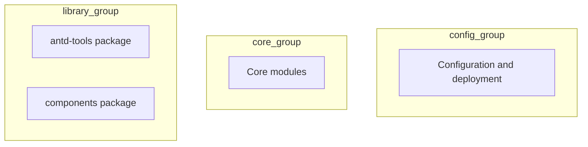

# Architecture report: vueComponent/ant-design-vue

> Automated static analysis. **Observed** = directly seen in files/imports/AST; **Inferred** = interpretation from that evidence. Repository code was not executed.

## 1. Repository at a glance

| Item | Value |
| --- | --- |
| Repository | vueComponent/ant-design-vue |
| Description | 🌈  An enterprise-class UI components based on Ant Design and Vue. 🐜 |
| Language | Vue |
| Stars | 21714 |
| Licence | Other |
| Analysed commit / branch | 7483836f0adac76516e527df893c3d84a7cd4005 / main |
| Framework(s) | None detected |
| Files analysed | 799 |
| Components | 4 |

## 2. Architecture in one minute

vueComponent/ant-design-vue - 🌈  An enterprise-class UI components based on Ant Design and Vue. 🐜. This repository was analysed statically from 799 file(s) (0 Python). Detected technologies (observed from imports/manifests): GitHub Actions. Files are grouped into 4 component(s): antd-tools package, components package, Configuration and deployment, Core modules. Findings below distinguish observed facts from inferred interpretation.

## 3. High-level block diagram

## 4. Main components

### antd-tools package (`antd_tools`)

- **Kind:** library
- **Status:** Observed
- **Confidence:** 0.85
- **Responsibility:** Groups 23 file(s) under antd-tools package (observed from repository paths and static analysis).
- **Paths:** `antd-tools/apiCollection.js`, `antd-tools/cli/index.js`, `antd-tools/cli/run.js`, `antd-tools/generator-types/index.js`, `antd-tools/generator-types/src/formatter.ts`, `antd-tools/generator-types/src/index.ts`, `antd-tools/generator-types/src/parser.ts`, `antd-tools/generator-types/src/type.ts`, `antd-tools/generator-types/src/utils.ts`, `antd-tools/generator-types/src/web-types.ts`, `antd-tools/getBabelCommonConfig.js`, `antd-tools/getNpm.js`, `antd-tools/getTSCommonConfig.js`, `antd-tools/getWebpackConfig.js`, `antd-tools/gulpfile.js`, `antd-tools/replaceLib.js`, `antd-tools/runCmd.js`, `antd-tools/sortApiTable.js`, `antd-tools/utils/CleanUpStatsPlugin.js`, `antd-tools/utils/get-npm-args.js`, `antd-tools/utils/getChangelog.js`, `antd-tools/utils/getRunCmdEnv.js`, `antd-tools/utils/projectHelper.js`
- **Evidence:** [antd-tools/apiCollection.js](https://github.com/vueComponent/ant-design-vue/blob/7483836f0adac76516e527df893c3d84a7cd4005/antd-tools/apiCollection.js); [antd-tools/cli/index.js](https://github.com/vueComponent/ant-design-vue/blob/7483836f0adac76516e527df893c3d84a7cd4005/antd-tools/cli/index.js); [antd-tools/cli/run.js](https://github.com/vueComponent/ant-design-vue/blob/7483836f0adac76516e527df893c3d84a7cd4005/antd-tools/cli/run.js); [antd-tools/generator-types/index.js](https://github.com/vueComponent/ant-design-vue/blob/7483836f0adac76516e527df893c3d84a7cd4005/antd-tools/generator-types/index.js); [antd-tools/generator-types/src/formatter.ts](https://github.com/vueComponent/ant-design-vue/blob/7483836f0adac76516e527df893c3d84a7cd4005/antd-tools/generator-types/src/formatter.ts); [antd-tools/generator-types/src/index.ts](https://github.com/vueComponent/ant-design-vue/blob/7483836f0adac76516e527df893c3d84a7cd4005/antd-tools/generator-types/src/index.ts); [antd-tools/generator-types/src/parser.ts](https://github.com/vueComponent/ant-design-vue/blob/7483836f0adac76516e527df893c3d84a7cd4005/antd-tools/generator-types/src/parser.ts); [antd-tools/generator-types/src/type.ts](https://github.com/vueComponent/ant-design-vue/blob/7483836f0adac76516e527df893c3d84a7cd4005/antd-tools/generator-types/src/type.ts)

### components package (`components`)

- **Kind:** library
- **Status:** Observed
- **Confidence:** 0.85
- **Responsibility:** Groups 639 file(s) under components package (observed from repository paths and static analysis).
- **Paths:** `components/__tests__/util/domHook.js`, `components/_util/ActionButton.tsx`, `components/_util/BaseInput.tsx`, `components/_util/BaseInputInner.tsx`, `components/_util/BaseMixin.ts`, `components/_util/EventInterface.ts`, `components/_util/KeyCode.ts`, `components/_util/Portal.tsx`, `components/_util/PortalWrapper.tsx`, `components/_util/__mocks__/Portal.tsx`, `components/_util/__mocks__/RenderSlot.tsx`, `components/_util/__tests__/easings.test.js`, `components/_util/__tests__/scrollTo.test.js`, `components/_util/__tests__/unreachableException.test.js`, `components/_util/__tests__/vNode.test.js`, `components/_util/canUseDom.ts`, `components/_util/classNames.ts`, `components/_util/collapseMotion.tsx`, `components/_util/colors.ts`, `components/_util/component-classes.ts`, `components/_util/copy-to-clipboard/index.ts`, `components/_util/copy-to-clipboard/toggle-selection.ts`, `components/_util/createContext.ts`, `components/_util/createRef.ts`, `components/_util/cssinjs/Cache.ts`, `components/_util/cssinjs/Keyframes.ts`, `components/_util/cssinjs/StyleContext.tsx`, `components/_util/cssinjs/hooks/useCacheToken.tsx`, `components/_util/cssinjs/hooks/useGlobalCache.tsx`, `components/_util/cssinjs/hooks/useHMR.ts`, `components/_util/cssinjs/hooks/useStyleRegister/cacheMapUtil.ts`, `components/_util/cssinjs/hooks/useStyleRegister/index.tsx`, `components/_util/cssinjs/index.ts`, `components/_util/cssinjs/linters/contentQuotesLinter.ts`, `components/_util/cssinjs/linters/hashedAnimationLinter.ts`, `components/_util/cssinjs/linters/index.ts`, `components/_util/cssinjs/linters/interface.ts`, `components/_util/cssinjs/linters/legacyNotSelectorLinter.ts`, `components/_util/cssinjs/linters/logicalPropertiesLinter.ts`, `components/_util/cssinjs/linters/parentSelectorLinter.ts`, `components/_util/cssinjs/linters/utils.ts`, `components/_util/cssinjs/theme/Theme.ts`, `components/_util/cssinjs/theme/ThemeCache.ts`, `components/_util/cssinjs/theme/createTheme.ts`, `components/_util/cssinjs/theme/index.ts`, `components/_util/cssinjs/theme/interface.ts`, `components/_util/cssinjs/transformers/interface.ts`, `components/_util/cssinjs/transformers/legacyLogicalProperties.ts`, `components/_util/cssinjs/transformers/px2rem.ts`, `components/_util/cssinjs/util.ts`, `components/_util/debouncedWatch.ts`, `components/_util/eagerComputed.ts`, `components/_util/easings.ts`, `components/_util/env.ts`, `components/_util/extendsObject.ts`, `components/_util/firstNotUndefined.ts`, `components/_util/gapSize.ts`, `components/_util/getRequestAnimationFrame.ts`, `components/_util/getScroll.ts`, `components/_util/getScrollBarSize.ts`, `components/_util/hooks/_vueuse/_configurable.ts`, `components/_util/hooks/_vueuse/is.ts`, `components/_util/hooks/_vueuse/resolveUnref.ts`, `components/_util/hooks/_vueuse/tryOnMounted.ts`, `components/_util/hooks/_vueuse/tryOnScopeDispose.ts`, `components/_util/hooks/_vueuse/types.ts`, `components/_util/hooks/_vueuse/unrefElement.ts`, `components/_util/hooks/_vueuse/useElementSize.ts`, `components/_util/hooks/_vueuse/useMutationObserver.ts`, `components/_util/hooks/_vueuse/useResizeObserver.ts`, `components/_util/hooks/_vueuse/useSupported.ts`, `components/_util/hooks/useBreakpoint.ts`, `components/_util/hooks/useDestroyed.ts`, `components/_util/hooks/useFlexGapSupport.ts`, `components/_util/hooks/useId.ts`, `components/_util/hooks/useLayoutState.ts`, `components/_util/hooks/useMemo.ts`, `components/_util/hooks/useMergedState.ts`, `components/_util/hooks/useRefs.ts`, `components/_util/hooks/useScrollLocker.ts`, `components/_util/hooks/useState.ts`, `components/_util/isNumeric.ts`, `components/_util/isValid.ts`, `components/_util/isValidValue.ts`, `components/_util/json2mq.ts`, `components/_util/omit.ts`, `components/_util/pickAttrs.ts`, `components/_util/placements.ts`, `components/_util/props-util/index.ts`, `components/_util/props-util/initDefaultProps.ts`, `components/_util/raf.ts`, `components/_util/reactivePick.ts`, `components/_util/requestAnimationTimeout.ts`, `components/_util/responsiveObserve.ts`, `components/_util/scrollTo.ts`, `components/_util/setStyle.ts`, `components/_util/shallowequal.ts`, `components/_util/static-style-extract/__tests__/index.test.js`, `components/_util/static-style-extract/index.tsx`, `components/_util/static-style-extract/interface.ts`, `components/_util/statusUtils.tsx`, `components/_util/styleChecker.ts`, `components/_util/supportsPassive.js`, `components/_util/throttleByAnimationFrame.ts`, `components/_util/toReactive.ts`, `components/_util/transButton.tsx`, `components/_util/transKeys.ts`, `components/_util/transition.tsx`, `components/_util/type.ts`, `components/_util/unreachableException.ts`, `components/_util/util.ts`, `components/_util/vnode.ts`, `components/_util/vue-types/index.ts`, `components/_util/warning.ts`, `components/_util/wave/WaveEffect.tsx`, `components/_util/wave/index.tsx`, `components/_util/wave/style.ts`, `components/_util/wave/useWave.ts`, `components/_util/wave/util.ts`, `components/affix/__tests__/demo.test.js`, `components/affix/__tests__/index.test.js`, `components/affix/demo/basic.vue`, `components/affix/demo/index.vue`, `components/affix/demo/on-change.vue`, `components/affix/demo/target.vue`, `components/affix/index.tsx`, `components/affix/style/index.ts`, `components/affix/utils.ts`, `components/alert/__tests__/demo.test.js`, `components/alert/__tests__/index.test.js`, `components/alert/demo/action.vue`, `components/alert/demo/banner.vue`, `components/alert/demo/basic.vue`, `components/alert/demo/closable.vue`, `components/alert/demo/close-text.vue`, `components/alert/demo/custom-icon.vue`, `components/alert/demo/description.vue`, `components/alert/demo/icon.vue`, `components/alert/demo/index.vue`, `components/alert/demo/smooth-closed.vue`, `components/alert/demo/style.vue`, `components/alert/index.tsx`, `components/alert/style/index.ts`, `components/anchor/Anchor.tsx`, `components/anchor/AnchorLink.tsx`, `components/anchor/__tests__/Anchor.test.js`, `components/anchor/__tests__/demo.test.js`, `components/anchor/context.ts`, `components/anchor/demo/basic.vue`, `components/anchor/demo/customizeHighlight.vue`, `components/anchor/demo/horizontal.vue`, `components/anchor/demo/index.vue`, `components/anchor/demo/onChange.vue`, `components/anchor/demo/onClick.vue`, `components/anchor/demo/static.vue`, `components/anchor/demo/targetOffset.vue`, `components/anchor/index.tsx`, `components/anchor/style/index.ts`, `components/app/__tests__/demo.test.js`, `components/app/context.ts`, `components/app/demo/basic.vue`, `components/app/demo/index.vue`, `components/app/demo/myPage.vue`, `components/app/index.tsx`, `components/app/style/index.ts`, `components/auto-complete/OptGroup.tsx`, `components/auto-complete/Option.tsx`, `components/auto-complete/__tests__/demo.test.js`, `components/auto-complete/__tests__/index.test.js`, `components/auto-complete/demo/allow-clear.vue`, `components/auto-complete/demo/basic.vue`, `components/auto-complete/demo/border-less.vue`, `components/auto-complete/demo/certain-category.vue`, `components/auto-complete/demo/custom.vue`, `components/auto-complete/demo/index.vue`, `components/auto-complete/demo/non-case-sensitive.vue`, `components/auto-complete/demo/options.vue`, `components/auto-complete/demo/status.vue`, `components/auto-complete/demo/uncertain-category.vue`, `components/auto-complete/index.tsx`, `components/avatar/Avatar.tsx`, `components/avatar/AvatarContext.ts`, `components/avatar/Group.tsx`, `components/avatar/__tests__/Avatar.test.js`, `components/avatar/__tests__/demo.test.js`, `components/avatar/demo/badge.vue`, `components/avatar/demo/basic.vue`, `components/avatar/demo/dynamic.vue`, `components/avatar/demo/group.vue`, `components/avatar/demo/index.vue`, `components/avatar/demo/responsive.vue`, `components/avatar/demo/type.vue`, `components/avatar/index.ts`, `components/avatar/style/index.ts`, `components/badge/Badge.tsx`, `components/badge/Ribbon.tsx`, `components/badge/ScrollNumber.tsx`, `components/badge/SingleNumber.tsx`, `components/badge/__tests__/demo.test.js`, `components/badge/__tests__/index.test.js`, `components/badge/demo/basic.vue`, `components/badge/demo/change.vue`, `components/badge/demo/colors.vue`, `components/badge/demo/dot.vue`, `components/badge/demo/index.vue`, `components/badge/demo/link.vue`, `components/badge/demo/no-wrapper.vue`, `components/badge/demo/overflow.vue`, `components/badge/demo/ribbon.vue`, `components/badge/demo/status.vue`, `components/badge/demo/title.vue`, `components/badge/index.ts`, `components/badge/style/index.ts`, `components/breadcrumb/Breadcrumb.tsx`, `components/breadcrumb/BreadcrumbItem.tsx`, `components/breadcrumb/BreadcrumbSeparator.tsx`, `components/breadcrumb/__tests__/Breadcrumb.test.js`, `components/breadcrumb/__tests__/demo.test.js`, `components/breadcrumb/demo/basic.vue`, `components/breadcrumb/demo/index.vue`, `components/breadcrumb/demo/overlay.vue`, `components/breadcrumb/demo/router.vue`, `components/breadcrumb/demo/separator-indepent.vue`, `components/breadcrumb/demo/separator.vue`, `components/breadcrumb/demo/withIcon.vue`, `components/breadcrumb/index.ts`, `components/breadcrumb/style/index.ts`, `components/button/LoadingIcon.tsx`, `components/button/__tests__/demo.test.js`, `components/button/__tests__/index.test.js`, `components/button/__tests__/wave.test.js`, `components/button/button-group.tsx`, `components/button/button.tsx`, `components/button/buttonTypes.ts`, `components/button/demo/basic.vue`, `components/button/demo/block.vue`, `components/button/demo/button-group.vue`, `components/button/demo/danger.vue`, `components/button/demo/disabled.vue`, `components/button/demo/ghost.vue`, `components/button/demo/icon.vue`, `components/button/demo/index.vue`, `components/button/demo/loading.vue`, `components/button/demo/multiple.vue`, `components/button/demo/size.vue`, `components/button/index.ts`, `components/button/style/group.ts`, `components/button/style/index.ts`, `components/calendar/Header.tsx`, `components/calendar/__tests__/demo.test.js`, `components/calendar/__tests__/index.test.js`, `components/calendar/date-fns.tsx`, `components/calendar/dayjs.tsx`, `components/calendar/demo/basic.vue`, `components/calendar/demo/card.vue`, `components/calendar/demo/customize-header.vue`, `components/calendar/demo/index.vue`, `components/calendar/demo/notice-calendar.vue`, `components/calendar/demo/select.vue`, `components/calendar/generateCalendar.tsx`, `components/calendar/index.tsx`, `components/calendar/locale/ar_EG.ts`, `components/calendar/locale/az_AZ.ts`, `components/calendar/locale/bg_BG.ts`, `components/calendar/locale/bn_BD.ts`, `components/calendar/locale/by_BY.ts`, `components/calendar/locale/ca_ES.ts`, `components/calendar/locale/ckb_IQ.ts`, `components/calendar/locale/cs_CZ.ts`, `components/calendar/locale/da_DK.ts`, `components/calendar/locale/de_DE.ts`, `components/calendar/locale/el_GR.ts`, `components/calendar/locale/en_GB.ts`, `components/calendar/locale/en_US.ts`, `components/calendar/locale/es_ES.ts`, `components/calendar/locale/et_EE.ts`, `components/calendar/locale/fa_IR.ts`, `components/calendar/locale/fi_FI.ts`, `components/calendar/locale/fr_BE.ts`, `components/calendar/locale/fr_CA.ts`, `components/calendar/locale/fr_FR.ts`, `components/calendar/locale/ga_IE.ts`, `components/calendar/locale/gl_ES.ts`, `components/calendar/locale/he_IL.ts`, `components/calendar/locale/hi_IN.ts`, `components/calendar/locale/hr_HR.ts`, `components/calendar/locale/hu_HU.ts`, `components/calendar/locale/id_ID.ts`, `components/calendar/locale/is_IS.ts`, `components/calendar/locale/it_IT.ts`, `components/calendar/locale/ja_JP.ts`, `components/calendar/locale/ka_GE.ts`, `components/calendar/locale/kk_KZ.ts`, `components/calendar/locale/km_KH.ts`, `components/calendar/locale/kmr_IQ.ts`, `components/calendar/locale/kn_IN.ts`, `components/calendar/locale/ko_KR.ts`, `components/calendar/locale/lt_LT.ts`, `components/calendar/locale/lv_LV.ts`, `components/calendar/locale/mk_MK.ts`, `components/calendar/locale/ml_IN.ts`, `components/calendar/locale/mn_MN.ts`, `components/calendar/locale/ms_MY.ts`, `components/calendar/locale/nb_NO.ts`, `components/calendar/locale/nl_BE.ts`, `components/calendar/locale/nl_NL.ts`, `components/calendar/locale/pl_PL.ts`, `components/calendar/locale/pt_BR.ts`, `components/calendar/locale/pt_PT.ts`, `components/calendar/locale/ro_RO.ts`, `components/calendar/locale/ru_RU.ts`, `components/calendar/locale/sk_SK.ts`, `components/calendar/locale/sl_SI.ts`, `components/calendar/locale/sr_RS.ts`, `components/calendar/locale/sv_SE.ts`, `components/calendar/locale/ta_IN.ts`, `components/calendar/locale/th_TH.ts`, `components/calendar/locale/tr_TR.ts`, `components/calendar/locale/uk_UA.ts`, `components/calendar/locale/ur_PK.ts`, `components/calendar/locale/vi_VN.ts`, `components/calendar/locale/zh_CN.ts`, `components/calendar/locale/zh_TW.ts`, `components/calendar/moment.tsx`, `components/calendar/style/index.tsx`, `components/card/Card.tsx`, `components/card/Grid.tsx`, `components/card/Meta.tsx`, `components/card/__tests__/demo.test.js`, `components/card/__tests__/index.test.js`, `components/card/demo/basic.vue`, `components/card/demo/border-less.vue`, `components/card/demo/flexible-content.vue`, `components/card/demo/grid-card.vue`, `components/card/demo/in-column.vue`, `components/card/demo/index.vue`, `components/card/demo/inner.vue`, `components/card/demo/loading.vue`, `components/card/demo/meta.vue`, `components/card/demo/simple.vue`, `components/card/demo/tabs.vue`, `components/card/index.ts`, `components/card/style/index.tsx`, `components/carousel/__tests__/demo.test.js`, `components/carousel/__tests__/index.test.js`, `components/carousel/demo/autoplay.vue`, `components/carousel/demo/basic.vue`, `components/carousel/demo/customArrows.vue`, `components/carousel/demo/customPaging.vue`, `components/carousel/demo/fade.vue`, `components/carousel/demo/index.vue`, `components/carousel/demo/position.vue`, `components/carousel/index.tsx`, `components/carousel/style/index.tsx`, `components/cascader/__tests__/demo.test.js`, `components/cascader/__tests__/index.test.js`, `components/cascader/demo/basic.vue`, `components/cascader/demo/change-on-select.vue`, `components/cascader/demo/custom-render.vue`, `components/cascader/demo/custom-trigger.vue`, `components/cascader/demo/disabled-option.vue`, `components/cascader/demo/fields-name.vue`, `components/cascader/demo/hover.vue`, `components/cascader/demo/index.vue`, `components/cascader/demo/lazy.vue`, `components/cascader/demo/multiple.vue`, `components/cascader/demo/search.vue`, `components/cascader/demo/size.vue`, `components/cascader/demo/suffix.vue`, `components/cascader/demo/tagRender.vue`, `components/cascader/index.tsx`, `components/cascader/style/index.ts`, `components/checkbox/Checkbox.tsx`, `components/checkbox/Group.tsx`, `components/checkbox/__tests__/checkbox.test.js`, `components/checkbox/__tests__/demo.test.js`, `components/checkbox/__tests__/group.test.js`, `components/checkbox/demo/basic.vue`, `components/checkbox/demo/check-all.vue`, `components/checkbox/demo/controller.vue`, `components/checkbox/demo/disabled.vue`, `components/checkbox/demo/group.vue`, `components/checkbox/demo/index.vue`, `components/checkbox/demo/layout.vue`, `components/checkbox/index.ts`, `components/checkbox/interface.ts`, `components/checkbox/style/index.ts`, `components/col/index.ts`, `components/col/style/index.ts`, `components/collapse/Collapse.tsx`, `components/collapse/CollapsePanel.tsx`, `components/collapse/PanelContent.tsx`, `components/collapse/__tests__/demo.test.js`, `components/collapse/__tests__/index.test.js`, `components/collapse/commonProps.ts`, `components/collapse/demo/accordion.vue`, `components/collapse/demo/basic.vue`, `components/collapse/demo/borderless.vue`, `components/collapse/demo/collapsible.vue`, `components/collapse/demo/custom.vue`, `components/collapse/demo/extra.vue`, `components/collapse/demo/ghost.vue`, `components/collapse/demo/index.vue`, `components/collapse/demo/mix.vue`, `components/collapse/demo/noarrow.vue`, `components/collapse/index.ts`, `components/collapse/style/index.tsx`, `components/comment/__tests__/demo.test.js`, `components/comment/__tests__/index.test.js`, `components/comment/demo/basic.vue`, `components/comment/demo/editor.vue`, `components/comment/demo/index.vue`, `components/comment/demo/list.vue`, `components/comment/demo/nested.vue`, `components/comment/index.tsx`, `components/comment/style/index.ts`, `components/components.ts`, `components/config-provider/DisabledContext.ts`, `components/config-provider/SizeContext.ts`, `components/config-provider/__tests__/index.test.js`, `components/config-provider/context.ts`, `components/config-provider/cssVariables.ts`, `components/config-provider/demo/direction.vue`, `components/config-provider/demo/index.vue`, `components/config-provider/demo/locale.vue`, `components/config-provider/demo/size.vue`, `components/config-provider/demo/theme.vue`, `components/config-provider/hooks/useConfigInject.ts`, `components/config-provider/hooks/useTheme.ts`, `components/config-provider/index.tsx`, `components/config-provider/renderEmpty.tsx`, `components/config-provider/style/index.ts`, `components/date-picker/PickerButton.tsx`, `components/date-picker/PickerTag.tsx`, `components/date-picker/__tests__/DatePicker.test.js`, `components/date-picker/__tests__/QuarterPicker.test.js`, `components/date-picker/__tests__/RangePicker.test.js`, `components/date-picker/__tests__/WeekPicker.test.js`, `components/date-picker/__tests__/demo.test.js`, `components/date-picker/__tests__/mount.test.js`, `components/date-picker/__tests__/other.test.js`, `components/date-picker/__tests__/utils.js`, `components/date-picker/date-fns.tsx`, `components/date-picker/dayjs.tsx`, `components/date-picker/demo/basic.vue`, `components/date-picker/demo/bordered.vue`, `components/date-picker/demo/date-render.vue`, `components/date-picker/demo/disabled-date.vue`, `components/date-picker/demo/disabled.vue`, `components/date-picker/demo/extra-footer.vue`, `components/date-picker/demo/format.vue`, `components/date-picker/demo/index.vue`, `components/date-picker/demo/mode.vue`, `components/date-picker/demo/placement.vue`, `components/date-picker/demo/presetted-ranges.vue`, `components/date-picker/demo/range-picker.vue`, `components/date-picker/demo/select-in-range.vue`, `components/date-picker/demo/size.vue`, `components/date-picker/demo/start-end.vue`, `components/date-picker/demo/status.vue`, `components/date-picker/demo/suffix.vue`, `components/date-picker/demo/switchable.vue`, `components/date-picker/demo/text.vue`, `components/date-picker/demo/time.vue`, `components/date-picker/generatePicker/generateRangePicker.tsx`, `components/date-picker/generatePicker/generateSinglePicker.tsx`, `components/date-picker/generatePicker/index.tsx`, `components/date-picker/generatePicker/interface.ts`, `components/date-picker/generatePicker/props.ts`, `components/date-picker/index.tsx`, `components/date-picker/locale/ar_EG.ts`, `components/date-picker/locale/az_AZ.ts`, `components/date-picker/locale/bg_BG.ts`, `components/date-picker/locale/bn_BD.ts`, `components/date-picker/locale/by_BY.ts`, `components/date-picker/locale/ca_ES.ts`, `components/date-picker/locale/ckb_IQ.ts`, `components/date-picker/locale/cs_CZ.ts`, `components/date-picker/locale/da_DK.ts`, `components/date-picker/locale/de_DE.ts`, `components/date-picker/locale/el_GR.ts`, `components/date-picker/locale/en_GB.ts`, `components/date-picker/locale/en_US.ts`, `components/date-picker/locale/es_ES.ts`, `components/date-picker/locale/et_EE.ts`, `components/date-picker/locale/fa_IR.ts`, `components/date-picker/locale/fi_FI.ts`, `components/date-picker/locale/fr_BE.ts`, `components/date-picker/locale/fr_CA.ts`, `components/date-picker/locale/fr_FR.ts`, `components/date-picker/locale/ga_IE.ts`, `components/date-picker/locale/gl_ES.ts`, `components/date-picker/locale/he_IL.ts`, `components/date-picker/locale/hi_IN.ts`, `components/date-picker/locale/hr_HR.ts`, `components/date-picker/locale/hu_HU.ts`, `components/date-picker/locale/id_ID.ts`, `components/date-picker/locale/is_IS.ts`, `components/date-picker/locale/it_IT.ts`, `components/date-picker/locale/ja_JP.ts`, `components/date-picker/locale/ka_GE.ts`, `components/date-picker/locale/kk_KZ.ts`, `components/date-picker/locale/km_KH.ts`, `components/date-picker/locale/kmr_IQ.ts`, `components/date-picker/locale/kn_IN.ts`, `components/date-picker/locale/ko_KR.ts`, `components/date-picker/locale/lt_LT.ts`, `components/date-picker/locale/lv_LV.ts`, `components/date-picker/locale/mk_MK.ts`, `components/date-picker/locale/ml_IN.ts`, `components/date-picker/locale/mn_MN.ts`, `components/date-picker/locale/ms_MY.ts`, `components/date-picker/locale/nb_NO.ts`, `components/date-picker/locale/nl_BE.ts`, `components/date-picker/locale/nl_NL.ts`, `components/date-picker/locale/pl_PL.ts`, `components/date-picker/locale/pt_BR.ts`, `components/date-picker/locale/pt_PT.ts`, `components/date-picker/locale/ro_RO.ts`, `components/date-picker/locale/ru_RU.ts`, `components/date-picker/locale/sk_SK.ts`, `components/date-picker/locale/sl_SI.ts`, `components/date-picker/locale/sr_RS.ts`, `components/date-picker/locale/sv_SE.ts`, `components/date-picker/locale/ta_IN.ts`, `components/date-picker/locale/th_TH.ts`, `components/date-picker/locale/tr_TR.ts`, `components/date-picker/locale/uk_UA.ts`, `components/date-picker/locale/ur_PK.ts`, `components/date-picker/locale/vi_VN.ts`, `components/date-picker/locale/zh_CN.ts`, `components/date-picker/locale/zh_TW.ts`, `components/date-picker/moment.tsx`, `components/date-picker/style/index.ts`, `components/date-picker/util.ts`, `components/descriptions/Cell.tsx`, `components/descriptions/Row.tsx`, `components/descriptions/__tests__/demo.test.js`, `components/descriptions/__tests__/index.test.js`, `components/descriptions/demo/basic.vue`, `components/descriptions/demo/border.vue`, `components/descriptions/demo/index.vue`, `components/descriptions/demo/responsive.vue`, `components/descriptions/demo/size.vue`, `components/descriptions/demo/vertical-border.vue`, `components/descriptions/demo/vertical.vue`, `components/descriptions/index.tsx`, `components/descriptions/style/index.ts`, `components/divider/__tests__/demo.test.js`, `components/divider/__tests__/index.test.js`, `components/divider/demo/customize-style.vue`, `components/divider/demo/horizontal.vue`, `components/divider/demo/index.vue`, `components/divider/demo/vertical.vue`, `components/divider/demo/with-text.vue`, `components/divider/index.tsx`, `components/divider/style/index.ts`, `components/drawer/__tests__/Drawer.test.js`, `components/drawer/__tests__/DrawerEvent.test.js`, `components/drawer/__tests__/MultiDrawer.test.js`, `components/drawer/__tests__/demo.test.js`, `components/drawer/demo/basic.vue`, `components/drawer/demo/descriptionItem/index.vue`, `components/drawer/demo/extra.vue`, `components/drawer/demo/form-in-drawer.vue`, `components/drawer/demo/index.vue`, `components/drawer/demo/multi-level-drawer.vue`, `components/drawer/demo/placement.vue`, `components/drawer/demo/render-in-current.vue`, `components/drawer/demo/size.vue`, `components/drawer/demo/user-profile.vue`, `components/drawer/index.tsx`, `components/drawer/style/index.ts`, `components/drawer/style/motion.ts`, `components/dropdown/__tests__/demo.test.js`, `components/dropdown/__tests__/dropdown-button.test.js`, `components/dropdown/demo/arrow-center.vue`, `components/dropdown/demo/arrow.vue`, `components/dropdown/demo/basic.vue`, `components/dropdown/demo/context-menu.vue`, `components/dropdown/demo/dropdown-button.vue`, `components/dropdown/demo/event.vue`, `components/dropdown/demo/index.vue`, `components/dropdown/demo/item.vue`, `components/dropdown/demo/loading.vue`, `components/dropdown/demo/overlay-visible.vue`, `components/dropdown/demo/placement.vue`, `components/dropdown/demo/sub-menu.vue`, `components/dropdown/demo/trigger.vue`, `components/dropdown/dropdown-button.tsx`, `components/dropdown/dropdown.tsx`, `components/dropdown/index.ts`, `components/dropdown/props.ts`, `components/dropdown/style/button.ts`, `components/dropdown/style/index.ts`, `components/dropdown/style/status.ts`, `components/empty/__tests__/demo.test.js`, `components/empty/__tests__/index.test.js`, `components/empty/demo/basic.vue`, `components/empty/demo/config-provider.vue`, `components/empty/demo/customize.vue`, `components/empty/demo/description.vue`, `components/empty/demo/index.vue`, `components/empty/demo/simple.vue`, `components/empty/empty.tsx`, `components/empty/index.tsx`, `components/empty/simple.tsx`, `components/empty/style/index.ts`, `components/flex/__tests__/demo.test.js`, `components/flex/__tests__/index.test.js`, `components/flex/demo/align.vue`, `components/flex/demo/basic.vue`, `components/flex/demo/combination.vue`, `components/flex/demo/gap.vue`, `components/flex/demo/index.vue`, `components/flex/demo/wrap.vue`, `components/flex/index.tsx`, `components/flex/interface.ts`, `components/flex/style/index.ts`, `components/flex/utils.ts`, `components/float-button/BackTop.tsx`, `components/float-button/FloatButton.tsx`, `components/float-button/FloatButtonContent.tsx`, `components/float-button/FloatButtonGroup.tsx`, `components/float-button/__tests__/demo.test.js`, `components/float-button/__tests__/index.test.js`, `components/float-button/__tests__/wave.test.js`, `components/float-button/context.ts`, `components/float-button/demo/back-top.vue`, `components/float-button/demo/badge.vue`, `components/float-button/demo/basic.vue`, `components/float-button/demo/description.vue`, `components/float-button/demo/group-menu.vue`, `components/float-button/demo/group.vue`, `components/float-button/demo/index.vue`, `components/float-button/demo/shape.vue`, `components/float-button/demo/tooltip.vue`, `components/float-button/demo/type.vue`, `components/float-button/index.ts`
- **Evidence:** [components/__tests__/util/domHook.js](https://github.com/vueComponent/ant-design-vue/blob/7483836f0adac76516e527df893c3d84a7cd4005/components/__tests__/util/domHook.js); [components/_util/ActionButton.tsx](https://github.com/vueComponent/ant-design-vue/blob/7483836f0adac76516e527df893c3d84a7cd4005/components/_util/ActionButton.tsx); [components/_util/BaseInput.tsx](https://github.com/vueComponent/ant-design-vue/blob/7483836f0adac76516e527df893c3d84a7cd4005/components/_util/BaseInput.tsx); [components/_util/BaseInputInner.tsx](https://github.com/vueComponent/ant-design-vue/blob/7483836f0adac76516e527df893c3d84a7cd4005/components/_util/BaseInputInner.tsx); [components/_util/BaseMixin.ts](https://github.com/vueComponent/ant-design-vue/blob/7483836f0adac76516e527df893c3d84a7cd4005/components/_util/BaseMixin.ts); [components/_util/EventInterface.ts](https://github.com/vueComponent/ant-design-vue/blob/7483836f0adac76516e527df893c3d84a7cd4005/components/_util/EventInterface.ts); [components/_util/KeyCode.ts](https://github.com/vueComponent/ant-design-vue/blob/7483836f0adac76516e527df893c3d84a7cd4005/components/_util/KeyCode.ts); [components/_util/Portal.tsx](https://github.com/vueComponent/ant-design-vue/blob/7483836f0adac76516e527df893c3d84a7cd4005/components/_util/Portal.tsx)

### Configuration and deployment (`config`)

- **Kind:** config
- **Status:** Observed
- **Confidence:** 0.85
- **Responsibility:** Groups 2 file(s) under configuration and deployment (observed from repository paths and static analysis).
- **Paths:** `antd-tools/generator-types/tsconfig.json`, `components/date-picker/locale/example.json`
- **Evidence:** [antd-tools/generator-types/tsconfig.json](https://github.com/vueComponent/ant-design-vue/blob/7483836f0adac76516e527df893c3d84a7cd4005/antd-tools/generator-types/tsconfig.json); [components/date-picker/locale/example.json](https://github.com/vueComponent/ant-design-vue/blob/7483836f0adac76516e527df893c3d84a7cd4005/components/date-picker/locale/example.json)

### Core modules (`core`)

- **Kind:** core
- **Status:** Observed
- **Confidence:** 0.85
- **Responsibility:** Groups 2 file(s) under core modules (observed from repository paths and static analysis).
- **Paths:** `babel.config.js`, `build.sh`
- **Evidence:** [babel.config.js](https://github.com/vueComponent/ant-design-vue/blob/7483836f0adac76516e527df893c3d84a7cd4005/babel.config.js); [build.sh](https://github.com/vueComponent/ant-design-vue/blob/7483836f0adac76516e527df893c3d84a7cd4005/build.sh)

## 5. Execution flow

**Observed** entry point(s):

- [antd-tools/cli/index.js](https://github.com/vueComponent/ant-design-vue/blob/7483836f0adac76516e527df893c3d84a7cd4005/antd-tools/cli/index.js)
- [antd-tools/generator-types/index.js](https://github.com/vueComponent/ant-design-vue/blob/7483836f0adac76516e527df893c3d84a7cd4005/antd-tools/generator-types/index.js)
- [antd-tools/generator-types/src/index.ts](https://github.com/vueComponent/ant-design-vue/blob/7483836f0adac76516e527df893c3d84a7cd4005/antd-tools/generator-types/src/index.ts)
- [components/_util/copy-to-clipboard/index.ts](https://github.com/vueComponent/ant-design-vue/blob/7483836f0adac76516e527df893c3d84a7cd4005/components/_util/copy-to-clipboard/index.ts)
- [components/_util/cssinjs/index.ts](https://github.com/vueComponent/ant-design-vue/blob/7483836f0adac76516e527df893c3d84a7cd4005/components/_util/cssinjs/index.ts)
- [components/_util/props-util/index.ts](https://github.com/vueComponent/ant-design-vue/blob/7483836f0adac76516e527df893c3d84a7cd4005/components/_util/props-util/index.ts)
- [components/_util/static-style-extract/index.tsx](https://github.com/vueComponent/ant-design-vue/blob/7483836f0adac76516e527df893c3d84a7cd4005/components/_util/static-style-extract/index.tsx)
- [components/_util/vue-types/index.ts](https://github.com/vueComponent/ant-design-vue/blob/7483836f0adac76516e527df893c3d84a7cd4005/components/_util/vue-types/index.ts)
- [components/_util/wave/index.tsx](https://github.com/vueComponent/ant-design-vue/blob/7483836f0adac76516e527df893c3d84a7cd4005/components/_util/wave/index.tsx)
- [components/affix/index.tsx](https://github.com/vueComponent/ant-design-vue/blob/7483836f0adac76516e527df893c3d84a7cd4005/components/affix/index.tsx)
- [components/affix/style/index.ts](https://github.com/vueComponent/ant-design-vue/blob/7483836f0adac76516e527df893c3d84a7cd4005/components/affix/style/index.ts)
- [components/alert/index.tsx](https://github.com/vueComponent/ant-design-vue/blob/7483836f0adac76516e527df893c3d84a7cd4005/components/alert/index.tsx)

Representative flow (derived from observed entry points and the import graph; steps beyond the entry point are **Inferred**):

1. Execution starts at an observed entry point listed above, if present.
2. No internal import relationships between components were observed.

## 6. Project structure

### `(root)`

- `.antd-tools.config.js` - source, JavaScript (1340 bytes)
- `.codecov.yml` - config (26 bytes)
- `.editorconfig` - config (171 bytes)
- `.eslintignore` - other (162 bytes)
- `.eslintrc.js` - source, JavaScript (3152 bytes)
- `.gitattributes` - other (56 bytes)
- `.gitignore` - other (1229 bytes)
- `.huskyrc` - other (180 bytes)
- `.jest.js` - source, JavaScript (1903 bytes)
- `.prettierignore` - other (292 bytes)
- `.prettierrc` - other (301 bytes)
- `.stylelintrc` - other (818 bytes)
- `.stylelintrc.json` - config (1062 bytes)
- `.vcmrc` - other (305 bytes)
- `BACKERS.md` - docs (5114 bytes)
- `CHANGELOG.en-US.md` - docs (16863 bytes)
- `CHANGELOG.zh-CN.md` - docs (15849 bytes)
- `LICENSE` - docs (3284 bytes)
- `README-zh_CN.md` - docs (11422 bytes)
- `README.md` - docs (8964 bytes)
- `SECURITY.md` - docs (586 bytes)
- `babel.config.js` - source, JavaScript (647 bytes)
- `build.sh` - source, Shell (133 bytes)

### `.github`

- `.github/FUNDING.yml` - config (124 bytes)
- `.github/ISSUE_TEMPLATE/config.yml` - config (626 bytes)
- `.github/PULL_REQUEST_TEMPLATE/pr_cn.md` - docs (1485 bytes)
- `.github/PULL_REQUEST_TEMPLATE/pr_en.md` - docs (1627 bytes)
- `.github/issue-close-app.yml` - config (808 bytes)
- `.github/workflows/ai-co-author.yml` - ci, YAML (2462 bytes)
- `.github/workflows/cloudflare.yml` - ci, YAML (1524 bytes)
- `.github/workflows/codecov.yml` - ci, YAML (1964 bytes)
- `.github/workflows/emoji-helper.yml` - ci, YAML (257 bytes)
- `.github/workflows/issue-close-require.yml` - ci, YAML (684 bytes)
- `.github/workflows/issue-labeled.yml` - ci, YAML (5042 bytes)
- `.github/workflows/issue-open-check.yml` - ci, YAML (1464 bytes)
- `.github/workflows/lock-issue.yml` - ci, YAML (730 bytes)
- `.github/workflows/stale.yml` - ci, YAML (641 bytes)
- `.github/workflows/test.yml` - ci, YAML (2813 bytes)

### `.husky`

- `.husky/.gitignore` - other (2 bytes)
- `.husky/pre-commit` - other (81 bytes)

### `antd-tools`

- `antd-tools/apiCollection.js` - source, JavaScript (1862 bytes)
- `antd-tools/cli/index.js` - source, JavaScript (559 bytes)
- `antd-tools/cli/run.js` - source, JavaScript (1106 bytes)
- `antd-tools/generator-types/README.md` - docs (53 bytes)
- `antd-tools/generator-types/index.js` - source, JavaScript (721 bytes)
- `antd-tools/generator-types/src/formatter.ts` - source, TypeScript (3039 bytes)
- `antd-tools/generator-types/src/index.ts` - source, TypeScript (3067 bytes)
- `antd-tools/generator-types/src/parser.ts` - source, TypeScript (2206 bytes)
- `antd-tools/generator-types/src/type.ts` - source, TypeScript (729 bytes)
- `antd-tools/generator-types/src/utils.ts` - source, TypeScript (805 bytes)
- `antd-tools/generator-types/src/web-types.ts` - source, TypeScript (499 bytes)
- `antd-tools/generator-types/tsconfig.json` - config (253 bytes)
- `antd-tools/getBabelCommonConfig.js` - source, JavaScript (1892 bytes)
- `antd-tools/getNpm.js` - source, JavaScript (289 bytes)
- `antd-tools/getTSCommonConfig.js` - source, JavaScript (562 bytes)
- `antd-tools/getWebpackConfig.js` - source, JavaScript (6696 bytes)
- `antd-tools/gulpfile.js` - source, JavaScript (13561 bytes)
- `antd-tools/replaceLib.js` - source, JavaScript (1151 bytes)
- `antd-tools/runCmd.js` - source, JavaScript (512 bytes)
- `antd-tools/sortApiTable.js` - source, JavaScript (4394 bytes)
- `antd-tools/utils/CleanUpStatsPlugin.js` - source, JavaScript (1078 bytes)
- `antd-tools/utils/get-npm-args.js` - source, JavaScript (538 bytes)
- `antd-tools/utils/getChangelog.js` - source, JavaScript (652 bytes)
- `antd-tools/utils/getRunCmdEnv.js` - source, JavaScript (665 bytes)
- `antd-tools/utils/projectHelper.js` - source, JavaScript (1862 bytes)

### `components`

- `components/__tests__/util/domHook.js` - source, JavaScript (1737 bytes)
- `components/_util/ActionButton.tsx` - source, TypeScript (3560 bytes)
- `components/_util/BaseInput.tsx` - source, TypeScript (4624 bytes)
- `components/_util/BaseInputInner.tsx` - source, TypeScript (2657 bytes)
- `components/_util/BaseMixin.ts` - source, TypeScript (1368 bytes)
- `components/_util/EventInterface.ts` - source, TypeScript (656 bytes)
- `components/_util/KeyCode.ts` - source, TypeScript (6996 bytes)
- `components/_util/Portal.tsx` - source, TypeScript (1680 bytes)
- `components/_util/PortalWrapper.tsx` - source, TypeScript (5384 bytes)
- `components/_util/__mocks__/Portal.tsx` - source, TypeScript (266 bytes)
- `components/_util/__mocks__/RenderSlot.tsx` - source, TypeScript (282 bytes)
- `components/_util/__tests__/easings.test.js` - source, JavaScript (349 bytes)
- `components/_util/__tests__/scrollTo.test.js` - source, JavaScript (1171 bytes)
- `components/_util/__tests__/unreachableException.test.js` - source, JavaScript (319 bytes)
- `components/_util/__tests__/vNode.test.js` - source, JavaScript (645 bytes)
- `components/_util/canUseDom.ts` - source, TypeScript (148 bytes)
- `components/_util/classNames.ts` - source, TypeScript (668 bytes)
- `components/_util/collapseMotion.tsx` - source, TypeScript (1361 bytes)
- `components/_util/colors.ts` - source, TypeScript (1026 bytes)
- `components/_util/component-classes.ts` - source, TypeScript (3496 bytes)
- `components/_util/copy-to-clipboard/index.ts` - source, TypeScript (3507 bytes)
- `components/_util/copy-to-clipboard/toggle-selection.ts` - source, TypeScript (915 bytes)
- `components/_util/createContext.ts` - source, TypeScript (609 bytes)
- `components/_util/createRef.ts` - source, TypeScript (619 bytes)
- `components/_util/cssinjs/Cache.ts` - source, TypeScript (864 bytes)
- `components/_util/cssinjs/Keyframes.ts` - source, TypeScript (386 bytes)
- `components/_util/cssinjs/StyleContext.tsx` - source, TypeScript (6702 bytes)
- `components/_util/cssinjs/hooks/useCacheToken.tsx` - source, TypeScript (5409 bytes)
- `components/_util/cssinjs/hooks/useGlobalCache.tsx` - source, TypeScript (1806 bytes)
- `components/_util/cssinjs/hooks/useHMR.ts` - source, TypeScript (807 bytes)
- `components/_util/cssinjs/hooks/useStyleRegister/cacheMapUtil.ts` - source, TypeScript (2328 bytes)
- `components/_util/cssinjs/hooks/useStyleRegister/index.tsx` - source, TypeScript (17895 bytes)
- `components/_util/cssinjs/index.ts` - source, TypeScript (1914 bytes)
- `components/_util/cssinjs/linters/contentQuotesLinter.ts` - source, TypeScript (944 bytes)
- `components/_util/cssinjs/linters/hashedAnimationLinter.ts` - source, TypeScript (411 bytes)
- `components/_util/cssinjs/linters/index.ts` - source, TypeScript (425 bytes)
- `components/_util/cssinjs/linters/interface.ts` - source, TypeScript (191 bytes)
- `components/_util/cssinjs/linters/legacyNotSelectorLinter.ts` - source, TypeScript (948 bytes)
- `components/_util/cssinjs/linters/logicalPropertiesLinter.ts` - source, TypeScript (3258 bytes)
- `components/_util/cssinjs/linters/parentSelectorLinter.ts` - source, TypeScript (402 bytes)
- `components/_util/cssinjs/linters/utils.ts` - source, TypeScript (415 bytes)
- `components/_util/cssinjs/theme/Theme.ts` - source, TypeScript (1126 bytes)
- `components/_util/cssinjs/theme/ThemeCache.ts` - source, TypeScript (3910 bytes)
- `components/_util/cssinjs/theme/createTheme.ts` - source, TypeScript (801 bytes)
- `components/_util/cssinjs/theme/index.ts` - source, TypeScript (216 bytes)
- `components/_util/cssinjs/theme/interface.ts` - source, TypeScript (216 bytes)
- `components/_util/cssinjs/transformers/interface.ts` - source, TypeScript (115 bytes)
- `components/_util/cssinjs/transformers/legacyLogicalProperties.ts` - source, TypeScript (4943 bytes)
- `components/_util/cssinjs/transformers/px2rem.ts` - source, TypeScript (2048 bytes)
- `components/_util/cssinjs/util.ts` - source, TypeScript (2947 bytes)
- `components/_util/debouncedWatch.ts` - source, TypeScript (2329 bytes)
- `components/_util/eagerComputed.ts` - source, TypeScript (431 bytes)
- `components/_util/easings.ts` - source, TypeScript (217 bytes)
- `components/_util/env.ts` - source, TypeScript (524 bytes)
- `components/_util/extendsObject.ts` - source, TypeScript (442 bytes)
- `components/_util/firstNotUndefined.ts` - source, TypeScript (222 bytes)
- `components/_util/gapSize.ts` - source, TypeScript (573 bytes)
- `components/_util/getRequestAnimationFrame.ts` - source, TypeScript (1389 bytes)
- `components/_util/getScroll.ts` - source, TypeScript (1232 bytes)
- `components/_util/getScrollBarSize.ts` - source, TypeScript (1597 bytes)
- `components/_util/hooks/_vueuse/_configurable.ts` - source, TypeScript (1001 bytes)
- `components/_util/hooks/_vueuse/is.ts` - source, TypeScript (1480 bytes)
- `components/_util/hooks/_vueuse/resolveUnref.ts` - source, TypeScript (248 bytes)
- `components/_util/hooks/_vueuse/tryOnMounted.ts` - source, TypeScript (472 bytes)
- `components/_util/hooks/_vueuse/tryOnScopeDispose.ts` - source, TypeScript (334 bytes)
- `components/_util/hooks/_vueuse/types.ts` - source, TypeScript (2917 bytes)
- `components/_util/hooks/_vueuse/unrefElement.ts` - source, TypeScript (930 bytes)
- `components/_util/hooks/_vueuse/useElementSize.ts` - source, TypeScript (1678 bytes)
- `components/_util/hooks/_vueuse/useMutationObserver.ts` - source, TypeScript (1645 bytes)
- `components/_util/hooks/_vueuse/useResizeObserver.ts` - source, TypeScript (2569 bytes)
- `components/_util/hooks/_vueuse/useSupported.ts` - source, TypeScript (332 bytes)
- `components/_util/hooks/useBreakpoint.ts` - source, TypeScript (649 bytes)
- `components/_util/hooks/useDestroyed.ts` - source, TypeScript (234 bytes)
- `components/_util/hooks/useFlexGapSupport.ts` - source, TypeScript (261 bytes)
- `components/_util/hooks/useId.ts` - source, TypeScript (683 bytes)
- `components/_util/hooks/useLayoutState.ts` - source, TypeScript (1043 bytes)
- `components/_util/hooks/useMemo.ts` - source, TypeScript (520 bytes)
- `components/_util/hooks/useMergedState.ts` - source, TypeScript (1488 bytes)
- `components/_util/hooks/useRefs.ts` - source, TypeScript (574 bytes)
- `components/_util/hooks/useScrollLocker.ts` - source, TypeScript (1289 bytes)
- `components/_util/hooks/useState.ts` - source, TypeScript (475 bytes)
- `components/_util/isNumeric.ts` - source, TypeScript (130 bytes)
- `components/_util/isValid.ts` - source, TypeScript (134 bytes)
- `components/_util/isValidValue.ts` - source, TypeScript (83 bytes)
- `components/_util/json2mq.ts` - source, TypeScript (1372 bytes)
- `components/_util/omit.ts` - source, TypeScript (335 bytes)
- `components/_util/pickAttrs.ts` - source, TypeScript (3058 bytes)
- `components/_util/placements.ts` - source, TypeScript (2607 bytes)
- `components/_util/props-util/index.ts` - source, TypeScript (8092 bytes)
- `components/_util/props-util/initDefaultProps.ts` - source, TypeScript (883 bytes)
- `components/_util/raf.ts` - source, TypeScript (1048 bytes)
- `components/_util/reactivePick.ts` - source, TypeScript (427 bytes)
- `components/_util/requestAnimationTimeout.ts` - source, TypeScript (513 bytes)
- `components/_util/responsiveObserve.ts` - source, TypeScript (2833 bytes)
- `components/_util/scrollTo.ts` - source, TypeScript (1292 bytes)
- `components/_util/setStyle.ts` - source, TypeScript (756 bytes)
- `components/_util/shallowequal.ts` - source, TypeScript (1126 bytes)
- `components/_util/static-style-extract/__tests__/index.test.js` - source, JavaScript (2224 bytes)
- `components/_util/static-style-extract/index.tsx` - source, TypeScript (2297 bytes)
- `components/_util/static-style-extract/interface.ts` - source, TypeScript (96 bytes)
- `components/_util/statusUtils.tsx` - source, TypeScript (772 bytes)
- `components/_util/styleChecker.ts` - source, TypeScript (1844 bytes)
- `components/_util/supportsPassive.js` - source, JavaScript (389 bytes)
- `components/_util/throttleByAnimationFrame.ts` - source, TypeScript (613 bytes)
- `components/_util/toReactive.ts` - source, TypeScript (1005 bytes)
- `components/_util/transButton.tsx` - source, TypeScript (2299 bytes)
- `components/_util/transKeys.ts` - source, TypeScript (435 bytes)
- `components/_util/transition.tsx` - source, TypeScript (4566 bytes)
- `components/_util/type.ts` - source, TypeScript (2964 bytes)
- `components/_util/unreachableException.ts` - source, TypeScript (169 bytes)
- `components/_util/util.ts` - source, TypeScript (2831 bytes)
- `components/_util/vnode.ts` - source, TypeScript (2475 bytes)
- `components/_util/vue-types/index.ts` - source, TypeScript (982 bytes)
- `components/_util/warning.ts` - source, TypeScript (615 bytes)
- `components/_util/wave/WaveEffect.tsx` - source, TypeScript (4699 bytes)
- `components/_util/wave/index.tsx` - source, TypeScript (2639 bytes)
- `components/_util/wave/style.ts` - source, TypeScript (1097 bytes)
- `components/_util/wave/useWave.ts` - source, TypeScript (659 bytes)
- `components/_util/wave/util.ts` - source, TypeScript (1016 bytes)
- `components/affix/__tests__/__snapshots__/demo.test.js.snap` - other (1040 bytes)
- `components/affix/__tests__/demo.test.js` - source, JavaScript (75 bytes)
- `components/affix/__tests__/index.test.js` - source, JavaScript (2774 bytes)
- `components/affix/demo/basic.vue` - source, Vue (528 bytes)
- `components/affix/demo/index.vue` - source, Vue (456 bytes)
- `components/affix/demo/on-change.vue` - source, Vue (412 bytes)
- `components/affix/demo/target.vue` - source, Vue (984 bytes)
- `components/affix/index.en-US.md` - docs (2324 bytes)
- `components/affix/index.tsx` - source, TypeScript (8507 bytes)
- `components/affix/index.zh-CN.md` - docs (2336 bytes)
- `components/affix/style/index.ts` - source, TypeScript (844 bytes)
- `components/affix/utils.ts` - source, TypeScript (3111 bytes)
- `components/alert/__tests__/__snapshots__/demo.test.js.snap` - other (37060 bytes)
- `components/alert/__tests__/demo.test.js` - source, JavaScript (75 bytes)
- `components/alert/__tests__/index.test.js` - source, JavaScript (1899 bytes)
- `components/alert/demo/action.vue` - source, Vue (1352 bytes)
- `components/alert/demo/banner.vue` - source, Vue (598 bytes)
- `components/alert/demo/basic.vue` - source, Vue (275 bytes)
- `components/alert/demo/closable.vue` - source, Vue (819 bytes)
- `components/alert/demo/close-text.vue` - source, Vue (304 bytes)
- `components/alert/demo/custom-icon.vue` - source, Vue (1942 bytes)
- `components/alert/demo/description.vue` - source, Vue (1040 bytes)
- `components/alert/demo/icon.vue` - source, Vue (1157 bytes)
- `components/alert/demo/index.vue` - source, Vue (1113 bytes)
- `components/alert/demo/smooth-closed.vue` - source, Vue (497 bytes)
- `components/alert/demo/style.vue` - source, Vue (530 bytes)
- `components/alert/index.en-US.md` - docs (1610 bytes)
- `components/alert/index.tsx` - source, TypeScript (7163 bytes)
- `components/alert/index.zh-CN.md` - docs (1704 bytes)
- `components/alert/style/index.ts` - source, TypeScript (5680 bytes)
- `components/anchor/Anchor.tsx` - source, TypeScript (10434 bytes)
- `components/anchor/AnchorLink.tsx` - source, TypeScript (3116 bytes)
- `components/anchor/__tests__/Anchor.test.js` - source, JavaScript (6063 bytes)
- `components/anchor/__tests__/__snapshots__/demo.test.js.snap` - other (7092 bytes)
- `components/anchor/__tests__/demo.test.js` - source, JavaScript (76 bytes)
- `components/anchor/context.ts` - source, TypeScript (1083 bytes)
- `components/anchor/demo/basic.vue` - source, Vue (581 bytes)
- `components/anchor/demo/customizeHighlight.vue` - source, Vue (1002 bytes)
- `components/anchor/demo/horizontal.vue` - source, Vue (1108 bytes)
- `components/anchor/demo/index.vue` - source, Vue (830 bytes)
- `components/anchor/demo/onChange.vue` - source, Vue (993 bytes)
- `components/anchor/demo/onClick.vue` - source, Vue (1078 bytes)
- `components/anchor/demo/static.vue` - source, Vue (844 bytes)
- `components/anchor/demo/targetOffset.vue` - source, Vue (1081 bytes)
- `components/anchor/index.en-US.md` - docs (2983 bytes)
- `components/anchor/index.tsx` - source, TypeScript (635 bytes)
- `components/anchor/index.zh-CN.md` - docs (2947 bytes)
- `components/anchor/style/index.ts` - source, TypeScript (4832 bytes)
- `components/app/__tests__/__snapshots__/demo.test.js.snap` - other (1523 bytes)
- `components/app/__tests__/demo.test.js` - source, JavaScript (73 bytes)
- `components/app/context.ts` - source, TypeScript (1337 bytes)
- `components/app/demo/basic.vue` - source, Vue (350 bytes)
- `components/app/demo/index.vue` - source, Vue (331 bytes)
- `components/app/demo/myPage.vue` - source, Vue (784 bytes)
- `components/app/index.en-US.md` - docs (3533 bytes)
- `components/app/index.tsx` - source, TypeScript (2503 bytes)
- `components/app/index.zh-CN.md` - docs (3710 bytes)
- `components/app/style/index.ts` - source, TypeScript (697 bytes)
- `components/auto-complete/OptGroup.tsx` - source, TypeScript (472 bytes)
- `components/auto-complete/Option.tsx` - source, TypeScript (580 bytes)
- `components/auto-complete/__tests__/__snapshots__/demo.test.js.snap` - other (11206 bytes)
- `components/auto-complete/__tests__/demo.test.js` - source, JavaScript (83 bytes)
- `components/auto-complete/__tests__/index.test.js` - source, JavaScript (1030 bytes)
- `components/auto-complete/demo/allow-clear.vue` - source, Vue (1296 bytes)
- `components/auto-complete/demo/basic.vue` - source, Vue (1037 bytes)
- `components/auto-complete/demo/border-less.vue` - source, Vue (885 bytes)
- `components/auto-complete/demo/certain-category.vue` - source, Vue (2884 bytes)
- `components/auto-complete/demo/custom.vue` - source, Vue (959 bytes)
- `components/auto-complete/demo/index.vue` - source, Vue (1028 bytes)
- `components/auto-complete/demo/non-case-sensitive.vue` - source, Vue (770 bytes)
- `components/auto-complete/demo/options.vue` - source, Vue (982 bytes)
- `components/auto-complete/demo/status.vue` - source, Vue (1515 bytes)
- `components/auto-complete/demo/uncertain-category.vue` - source, Vue (1874 bytes)
- `components/auto-complete/index.en-US.md` - docs (4504 bytes)
- `components/auto-complete/index.tsx` - source, TypeScript (5695 bytes)
- `components/auto-complete/index.zh-CN.md` - docs (4204 bytes)
- `components/avatar/Avatar.tsx` - source, TypeScript (6834 bytes)
- `components/avatar/AvatarContext.ts` - source, TypeScript (614 bytes)
- `components/avatar/Group.tsx` - source, TypeScript (3353 bytes)
- `components/avatar/__tests__/Avatar.test.js` - source, JavaScript (5837 bytes)
- `components/avatar/__tests__/__snapshots__/Avatar.test.js.snap` - other (2593 bytes)
- `components/avatar/__tests__/__snapshots__/demo.test.js.snap` - other (18336 bytes)
- `components/avatar/__tests__/demo.test.js` - source, JavaScript (76 bytes)
- `components/avatar/demo/badge.vue` - source, Vue (610 bytes)
- `components/avatar/demo/basic.vue` - source, Vue (1271 bytes)
- `components/avatar/demo/dynamic.vue` - source, Vue (1634 bytes)
- `components/avatar/demo/group.vue` - source, Vue (3185 bytes)
- `components/avatar/demo/index.vue` - source, Vue (668 bytes)
- `components/avatar/demo/responsive.vue` - source, Vue (503 bytes)
- `components/avatar/demo/type.vue` - source, Vue (922 bytes)
- `components/avatar/index.en-US.md` - docs (2071 bytes)
- `components/avatar/index.ts` - source, TypeScript (553 bytes)
- `components/avatar/index.zh-CN.md` - docs (2094 bytes)
- `components/avatar/style/index.ts` - source, TypeScript (4750 bytes)
- `components/badge/Badge.tsx` - source, TypeScript (8432 bytes)
- `components/badge/Ribbon.tsx` - source, TypeScript (2323 bytes)
- `components/badge/ScrollNumber.tsx` - source, TypeScript (2664 bytes)
- `components/badge/SingleNumber.tsx` - source, TypeScript (3416 bytes)
- `components/badge/__tests__/__snapshots__/demo.test.js.snap` - other (20177 bytes)
- `components/badge/__tests__/__snapshots__/index.test.js.snap` - other (8730 bytes)
- `components/badge/__tests__/demo.test.js` - source, JavaScript (75 bytes)
- `components/badge/__tests__/index.test.js` - source, JavaScript (5788 bytes)
- `components/badge/demo/basic.vue` - source, Vue (759 bytes)
- `components/badge/demo/change.vue` - source, Vue (952 bytes)
- `components/badge/demo/colors.vue` - source, Vue (1090 bytes)
- `components/badge/demo/dot.vue` - source, Vue (510 bytes)
- `components/badge/demo/index.vue` - source, Vue (1270 bytes)
- `components/badge/demo/link.vue` - source, Vue (324 bytes)
- `components/badge/demo/no-wrapper.vue` - source, Vue (535 bytes)
- `components/badge/demo/overflow.vue` - source, Vue (727 bytes)
- `components/badge/demo/ribbon.vue` - source, Vue (1528 bytes)
- `components/badge/demo/status.vue` - source, Vue (638 bytes)
- `components/badge/demo/title.vue` - source, Vue (352 bytes)
- `components/badge/index.en_US.md` - docs (1880 bytes)
- `components/badge/index.ts` - source, TypeScript (402 bytes)
- `components/badge/index.zh-CN.md` - docs (1921 bytes)
- `components/badge/style/index.ts` - source, TypeScript (12304 bytes)
- `components/breadcrumb/Breadcrumb.tsx` - source, TypeScript (5349 bytes)
- `components/breadcrumb/BreadcrumbItem.tsx` - source, TypeScript (2960 bytes)
- `components/breadcrumb/BreadcrumbSeparator.tsx` - source, TypeScript (1024 bytes)
- `components/breadcrumb/__tests__/Breadcrumb.test.js` - source, JavaScript (3413 bytes)
- `components/breadcrumb/__tests__/__snapshots__/Breadcrumb.test.js.snap` - other (2496 bytes)
- `components/breadcrumb/__tests__/__snapshots__/demo.test.js.snap` - other (5533 bytes)
- `components/breadcrumb/__tests__/demo.test.js` - source, JavaScript (102 bytes)
- `components/breadcrumb/demo/basic.vue` - source, Vue (456 bytes)
- `components/breadcrumb/demo/index.vue` - source, Vue (707 bytes)
- `components/breadcrumb/demo/overlay.vue` - source, Vue (1045 bytes)
- `components/breadcrumb/demo/router.vue` - source, Vue (1379 bytes)
- `components/breadcrumb/demo/separator-indepent.vue` - source, Vue (702 bytes)
- `components/breadcrumb/demo/separator.vue` - source, Vue (995 bytes)
- `components/breadcrumb/demo/withIcon.vue` - source, Vue (600 bytes)
- `components/breadcrumb/index.en-US.md` - docs (3685 bytes)
- `components/breadcrumb/index.ts` - source, TypeScript (910 bytes)
- `components/breadcrumb/index.zh-CN.md` - docs (3541 bytes)
- `components/breadcrumb/style/index.ts` - source, TypeScript (3544 bytes)
- `components/button/LoadingIcon.tsx` - source, TypeScript (1801 bytes)
- `components/button/__tests__/__snapshots__/demo.test.js.snap` - other (35931 bytes)
- `components/button/__tests__/__snapshots__/index.test.js.snap` - other (3934 bytes)
- `components/button/__tests__/demo.test.js` - source, JavaScript (76 bytes)
- `components/button/__tests__/index.test.js` - source, JavaScript (7645 bytes)
- `components/button/__tests__/wave.test.js` - source, JavaScript (916 bytes)
- `components/button/button-group.tsx` - source, TypeScript (1876 bytes)
- `components/button/button.tsx` - source, TypeScript (7393 bytes)
- `components/button/buttonTypes.ts` - source, TypeScript (1585 bytes)
- `components/button/demo/basic.vue` - source, Vue (653 bytes)
- `components/button/demo/block.vue` - source, Vue (509 bytes)
- `components/button/demo/button-group.vue` - source, Vue (1694 bytes)
- `components/button/demo/danger.vue` - source, Vue (530 bytes)
- `components/button/demo/disabled.vue` - source, Vue (1719 bytes)
- `components/button/demo/ghost.vue` - source, Vue (648 bytes)
- `components/button/demo/icon.vue` - source, Vue (1801 bytes)
- `components/button/demo/index.vue` - source, Vue (1284 bytes)
- `components/button/demo/loading.vue` - source, Vue (1437 bytes)
- `components/button/demo/multiple.vue` - source, Vue (1315 bytes)
- `components/button/demo/size.vue` - source, Vue (2152 bytes)
- `components/button/index.en-US.md` - docs (3450 bytes)
- `components/button/index.ts` - source, TypeScript (720 bytes)
- `components/button/index.zh-CN.md` - docs (3448 bytes)
- `components/button/style/group.ts` - source, TypeScript (1874 bytes)
- `components/button/style/index.ts` - source, TypeScript (14349 bytes)
- `components/calendar/Header.tsx` - source, TypeScript (6064 bytes)
- `components/calendar/__tests__/__snapshots__/demo.test.js.snap` - other (109264 bytes)
- `components/calendar/__tests__/__snapshots__/index.test.js.snap` - other (20524 bytes)
- `components/calendar/__tests__/demo.test.js` - source, JavaScript (78 bytes)
- `components/calendar/__tests__/index.test.js` - source, JavaScript (11509 bytes)
- `components/calendar/date-fns.tsx` - source, TypeScript (341 bytes)
- `components/calendar/dayjs.tsx` - source, TypeScript (333 bytes)
- `components/calendar/demo/basic.vue` - source, Vue (496 bytes)
- `components/calendar/demo/card.vue` - source, Vue (624 bytes)
- `components/calendar/demo/customize-header.vue` - source, Vue (2929 bytes)
- `components/calendar/demo/index.vue` - source, Vue (642 bytes)
- `components/calendar/demo/notice-calendar.vue` - source, Vue (2412 bytes)
- `components/calendar/demo/select.vue` - source, Vue (769 bytes)
- `components/calendar/generateCalendar.tsx` - source, TypeScript (13602 bytes)
- `components/calendar/index.en-US.md` - docs (3549 bytes)
- `components/calendar/index.tsx` - source, TypeScript (83 bytes)
- `components/calendar/index.zh-CN.md` - docs (3341 bytes)
- `components/calendar/locale/ar_EG.ts` - source, TypeScript (73 bytes)
- `components/calendar/locale/az_AZ.ts` - source, TypeScript (73 bytes)
- `components/calendar/locale/bg_BG.ts` - source, TypeScript (73 bytes)
- `components/calendar/locale/bn_BD.ts` - source, TypeScript (73 bytes)
- `components/calendar/locale/by_BY.ts` - source, TypeScript (73 bytes)
- `components/calendar/locale/ca_ES.ts` - source, TypeScript (73 bytes)
- `components/calendar/locale/ckb_IQ.ts` - source, TypeScript (76 bytes)
- `components/calendar/locale/cs_CZ.ts` - source, TypeScript (73 bytes)
- `components/calendar/locale/da_DK.ts` - source, TypeScript (73 bytes)
- `components/calendar/locale/de_DE.ts` - source, TypeScript (73 bytes)
- `components/calendar/locale/el_GR.ts` - source, TypeScript (73 bytes)
- `components/calendar/locale/en_GB.ts` - source, TypeScript (73 bytes)
- `components/calendar/locale/en_US.ts` - source, TypeScript (73 bytes)
- `components/calendar/locale/es_ES.ts` - source, TypeScript (73 bytes)
- `components/calendar/locale/et_EE.ts` - source, TypeScript (73 bytes)
- `components/calendar/locale/fa_IR.ts` - source, TypeScript (73 bytes)
- `components/calendar/locale/fi_FI.ts` - source, TypeScript (73 bytes)
- `components/calendar/locale/fr_BE.ts` - source, TypeScript (73 bytes)
- `components/calendar/locale/fr_CA.ts` - source, TypeScript (73 bytes)
- `components/calendar/locale/fr_FR.ts` - source, TypeScript (73 bytes)
- `components/calendar/locale/ga_IE.ts` - source, TypeScript (73 bytes)
- `components/calendar/locale/gl_ES.ts` - source, TypeScript (73 bytes)
- `components/calendar/locale/he_IL.ts` - source, TypeScript (73 bytes)
- `components/calendar/locale/hi_IN.ts` - source, TypeScript (73 bytes)
- `components/calendar/locale/hr_HR.ts` - source, TypeScript (73 bytes)
- `components/calendar/locale/hu_HU.ts` - source, TypeScript (73 bytes)
- `components/calendar/locale/id_ID.ts` - source, TypeScript (73 bytes)
- `components/calendar/locale/is_IS.ts` - source, TypeScript (73 bytes)
- `components/calendar/locale/it_IT.ts` - source, TypeScript (73 bytes)
- `components/calendar/locale/ja_JP.ts` - source, TypeScript (73 bytes)
- `components/calendar/locale/ka_GE.ts` - source, TypeScript (73 bytes)
- `components/calendar/locale/kk_KZ.ts` - source, TypeScript (73 bytes)
- `components/calendar/locale/km_KH.ts` - source, TypeScript (73 bytes)
- `components/calendar/locale/kmr_IQ.ts` - source, TypeScript (76 bytes)
- `components/calendar/locale/kn_IN.ts` - source, TypeScript (73 bytes)
- `components/calendar/locale/ko_KR.ts` - source, TypeScript (73 bytes)
- `components/calendar/locale/lt_LT.ts` - source, TypeScript (73 bytes)
- `components/calendar/locale/lv_LV.ts` - source, TypeScript (73 bytes)
- `components/calendar/locale/mk_MK.ts` - source, TypeScript (73 bytes)
- `components/calendar/locale/ml_IN.ts` - source, TypeScript (73 bytes)
- `components/calendar/locale/mn_MN.ts` - source, TypeScript (73 bytes)
- `components/calendar/locale/ms_MY.ts` - source, TypeScript (73 bytes)
- `components/calendar/locale/nb_NO.ts` - source, TypeScript (73 bytes)
- `components/calendar/locale/nl_BE.ts` - source, TypeScript (73 bytes)
- `components/calendar/locale/nl_NL.ts` - source, TypeScript (73 bytes)
- `components/calendar/locale/pl_PL.ts` - source, TypeScript (73 bytes)
- `components/calendar/locale/pt_BR.ts` - source, TypeScript (73 bytes)
- `components/calendar/locale/pt_PT.ts` - source, TypeScript (73 bytes)
- `components/calendar/locale/ro_RO.ts` - source, TypeScript (73 bytes)
- `components/calendar/locale/ru_RU.ts` - source, TypeScript (73 bytes)
- `components/calendar/locale/sk_SK.ts` - source, TypeScript (73 bytes)
- `components/calendar/locale/sl_SI.ts` - source, TypeScript (73 bytes)
- `components/calendar/locale/sr_RS.ts` - source, TypeScript (73 bytes)
- `components/calendar/locale/sv_SE.ts` - source, TypeScript (73 bytes)
- `components/calendar/locale/ta_IN.ts` - source, TypeScript (73 bytes)
- `components/calendar/locale/th_TH.ts` - source, TypeScript (73 bytes)
- `components/calendar/locale/tr_TR.ts` - source, TypeScript (73 bytes)
- `components/calendar/locale/uk_UA.ts` - source, TypeScript (73 bytes)
- `components/calendar/locale/ur_PK.ts` - source, TypeScript (73 bytes)
- `components/calendar/locale/vi_VN.ts` - source, TypeScript (73 bytes)
- `components/calendar/locale/zh_CN.ts` - source, TypeScript (73 bytes)
- `components/calendar/locale/zh_TW.ts` - source, TypeScript (73 bytes)
- `components/calendar/moment.tsx` - source, TypeScript (380 bytes)
- `components/calendar/style/index.tsx` - source, TypeScript (6672 bytes)
- `components/card/Card.tsx` - source, TypeScript (6590 bytes)
- `components/card/Grid.tsx` - source, TypeScript (870 bytes)
- `components/card/Meta.tsx` - source, TypeScript (1827 bytes)
- `components/card/__tests__/__snapshots__/demo.test.js.snap` - other (17044 bytes)
- `components/card/__tests__/__snapshots__/index.test.js.snap` - other (1124 bytes)
- `components/card/__tests__/demo.test.js` - source, JavaScript (74 bytes)
- `components/card/__tests__/index.test.js` - source, JavaScript (1885 bytes)
- `components/card/demo/basic.vue` - source, Vue (750 bytes)
- `components/card/demo/border-less.vue` - source, Vue (429 bytes)
- `components/card/demo/flexible-content.vue` - source, Vue (563 bytes)
- `components/card/demo/grid-card.vue` - source, Vue (889 bytes)
- `components/card/demo/in-column.vue` - source, Vue (777 bytes)
- `components/card/demo/index.vue` - source, Vue (941 bytes)
- `components/card/demo/inner.vue` - source, Vue (784 bytes)
- `components/card/demo/loading.vue` - source, Vue (562 bytes)
- `components/card/demo/meta.vue` - source, Vue (994 bytes)
- `components/card/demo/simple.vue` - source, Vue (316 bytes)
- `components/card/demo/tabs.vue` - source, Vue (1729 bytes)
- `components/card/index.en-US.md` - docs (2576 bytes)
- `components/card/index.ts` - source, TypeScript (552 bytes)
- `components/card/index.zh-CN.md` - docs (2744 bytes)
- `components/card/style/index.tsx` - source, TypeScript (10615 bytes)
- `components/carousel/__tests__/__snapshots__/demo.test.js.snap` - other (22501 bytes)
- `components/carousel/__tests__/__snapshots__/index.test.js.snap` - other (2411 bytes)
- `components/carousel/__tests__/demo.test.js` - source, JavaScript (78 bytes)
- `components/carousel/__tests__/index.test.js` - source, JavaScript (3833 bytes)
- `components/carousel/demo/autoplay.vue` - source, Vue (563 bytes)
- `components/carousel/demo/basic.vue` - source, Vue (630 bytes)
- `components/carousel/demo/customArrows.vue` - source, Vue (1316 bytes)
- `components/carousel/demo/customPaging.vue` - source, Vue (1361 bytes)
- `components/carousel/demo/fade.vue` - source, Vue (536 bytes)
- `components/carousel/demo/index.vue` - source, Vue (699 bytes)
- `components/carousel/demo/position.vue` - source, Vue (1052 bytes)
- `components/carousel/index.en-US.md` - docs (1764 bytes)
- `components/carousel/index.tsx` - source, TypeScript (4954 bytes)
- `components/carousel/index.zh-CN.md` - docs (1802 bytes)
- `components/carousel/style/index.tsx` - source, TypeScript (8029 bytes)
- `components/cascader/__tests__/__snapshots__/demo.test.js.snap` - other (21029 bytes)
- `components/cascader/__tests__/__snapshots__/index.test.js.snap` - other (14471 bytes)
- `components/cascader/__tests__/demo.test.js` - source, JavaScript (78 bytes)
- `components/cascader/__tests__/index.test.js` - source, JavaScript (6350 bytes)
- `components/cascader/demo/basic.vue` - source, Vue (1017 bytes)
- `components/cascader/demo/change-on-select.vue` - source, Vue (1065 bytes)
- `components/cascader/demo/custom-render.vue` - source, Vue (1813 bytes)
- `components/cascader/demo/custom-trigger.vue` - source, Vue (1342 bytes)
- `components/cascader/demo/disabled-option.vue` - source, Vue (1084 bytes)
- `components/cascader/demo/fields-name.vue` - source, Vue (1060 bytes)
- `components/cascader/demo/hover.vue` - source, Vue (1085 bytes)
- `components/cascader/demo/index.vue` - source, Vue (1292 bytes)
- `components/cascader/demo/lazy.vue` - source, Vue (1357 bytes)
- `components/cascader/demo/multiple.vue` - source, Vue (1595 bytes)
- `components/cascader/demo/search.vue` - source, Vue (1663 bytes)
- `components/cascader/demo/size.vue` - source, Vue (1259 bytes)
- `components/cascader/demo/suffix.vue` - source, Vue (1405 bytes)
- `components/cascader/demo/tagRender.vue` - source, Vue (1557 bytes)
- `components/cascader/index.en-US.md` - docs (5434 bytes)
- `components/cascader/index.tsx` - source, TypeScript (11934 bytes)
- `components/cascader/index.zh-CN.md` - docs (5662 bytes)
- `components/cascader/style/index.ts` - source, TypeScript (5396 bytes)
- `components/checkbox/Checkbox.tsx` - source, TypeScript (4747 bytes)
- `components/checkbox/Group.tsx` - source, TypeScript (4243 bytes)
- `components/checkbox/__tests__/__snapshots__/demo.test.js.snap` - other (7517 bytes)
- `components/checkbox/__tests__/__snapshots__/group.test.js.snap` - other (588 bytes)
- `components/checkbox/__tests__/checkbox.test.js` - source, JavaScript (1132 bytes)
- `components/checkbox/__tests__/demo.test.js` - source, JavaScript (78 bytes)
- `components/checkbox/__tests__/group.test.js` - source, JavaScript (3934 bytes)
- `components/checkbox/demo/basic.vue` - source, Vue (318 bytes)
- `components/checkbox/demo/check-all.vue` - source, Vue (1122 bytes)
- `components/checkbox/demo/controller.vue` - source, Vue (1039 bytes)
- `components/checkbox/demo/disabled.vue` - source, Vue (420 bytes)
- `components/checkbox/demo/group.vue` - source, Vue (1243 bytes)
- `components/checkbox/demo/index.vue` - source, Vue (1132 bytes)
- `components/checkbox/demo/layout.vue` - source, Vue (905 bytes)
- `components/checkbox/index.en-US.md` - docs (2272 bytes)
- `components/checkbox/index.ts` - source, TypeScript (611 bytes)
- `components/checkbox/index.zh-CN.md` - docs (2238 bytes)
- `components/checkbox/interface.ts` - source, TypeScript (2741 bytes)
- `components/checkbox/style/index.ts` - source, TypeScript (8898 bytes)
- `components/col/index.ts` - source, TypeScript (159 bytes)
- `components/col/style/index.ts` - source, TypeScript (85 bytes)
- `components/collapse/Collapse.tsx` - source, TypeScript (6360 bytes)
- `components/collapse/CollapsePanel.tsx` - source, TypeScript (3957 bytes)
- `components/collapse/PanelContent.tsx` - source, TypeScript (937 bytes)
- `components/collapse/__tests__/__snapshots__/demo.test.js.snap` - other (31045 bytes)
- `components/collapse/__tests__/__snapshots__/index.test.js.snap` - other (466 bytes)
- `components/collapse/__tests__/demo.test.js` - source, JavaScript (78 bytes)
- `components/collapse/__tests__/index.test.js` - source, JavaScript (407 bytes)
- `components/collapse/commonProps.ts` - source, TypeScript (1852 bytes)
- `components/collapse/demo/accordion.vue` - source, Vue (885 bytes)
- `components/collapse/demo/basic.vue` - source, Vue (1038 bytes)
- `components/collapse/demo/borderless.vue` - source, Vue (869 bytes)
- `components/collapse/demo/collapsible.vue` - source, Vue (1272 bytes)
- `components/collapse/demo/custom.vue` - source, Vue (1349 bytes)
- `components/collapse/demo/extra.vue` - source, Vue (1871 bytes)
- `components/collapse/demo/ghost.vue` - source, Vue (962 bytes)
- `components/collapse/demo/index.vue` - source, Vue (794 bytes)
- `components/collapse/demo/mix.vue` - source, Vue (1102 bytes)
- `components/collapse/demo/noarrow.vue` - source, Vue (965 bytes)
- `components/collapse/index.en-US.md` - docs (2575 bytes)
- `components/collapse/index.ts` - source, TypeScript (651 bytes)
- `components/collapse/index.zh-CN.md` - docs (2459 bytes)
- `components/collapse/style/index.tsx` - source, TypeScript (6927 bytes)
- `components/comment/__tests__/__snapshots__/demo.test.js.snap` - other (10774 bytes)
- `components/comment/__tests__/__snapshots__/index.test.js.snap` - other (2774 bytes)
- `components/comment/__tests__/demo.test.js` - source, JavaScript (77 bytes)
- `components/comment/__tests__/index.test.js` - source, JavaScript (3080 bytes)
- `components/comment/demo/basic.vue` - source, Vue (2374 bytes)
- `components/comment/demo/editor.vue` - source, Vue (1920 bytes)
- `components/comment/demo/index.vue` - source, Vue (530 bytes)
- `components/comment/demo/list.vue` - source, Vue (1933 bytes)
- `components/comment/demo/nested.vue` - source, Vue (2231 bytes)
- `components/comment/index.en-US.md` - docs (830 bytes)
- `components/comment/index.tsx` - source, TypeScript (3588 bytes)
- `components/comment/index.zh-CN.md` - docs (1031 bytes)
- `components/comment/style/index.ts` - source, TypeScript (4225 bytes)
- `components/components.ts` - source, TypeScript (8607 bytes)
- `components/config-provider/DisabledContext.ts` - source, TypeScript (589 bytes)
- `components/config-provider/SizeContext.ts` - source, TypeScript (547 bytes)
- `components/config-provider/__tests__/index.test.js` - source, JavaScript (1372 bytes)
- `components/config-provider/context.ts` - source, TypeScript (5638 bytes)
- `components/config-provider/cssVariables.ts` - source, TypeScript (3650 bytes)
- `components/config-provider/demo/direction.vue` - source, Vue (18107 bytes)
- `components/config-provider/demo/index.vue` - source, Vue (511 bytes)
- `components/config-provider/demo/locale.vue` - source, Vue (5805 bytes)
- `components/config-provider/demo/size.vue` - source, Vue (2001 bytes)
- `components/config-provider/demo/theme.vue` - source, Vue (1344 bytes)
- `components/config-provider/hooks/useConfigInject.ts` - source, TypeScript (2752 bytes)
- `components/config-provider/hooks/useTheme.ts` - source, TypeScript (1188 bytes)
- `components/config-provider/index.en-US.md` - docs (4848 bytes)
- `components/config-provider/index.tsx` - source, TypeScript (10155 bytes)
- `components/config-provider/index.zh-CN.md` - docs (4868 bytes)
- `components/config-provider/renderEmpty.tsx` - source, TypeScript (1016 bytes)
- `components/config-provider/style/index.ts` - source, TypeScript (744 bytes)
- `components/date-picker/PickerButton.tsx` - source, TypeScript (352 bytes)
- `components/date-picker/PickerTag.tsx` - source, TypeScript (209 bytes)
- `components/date-picker/__tests__/DatePicker.test.js` - source, JavaScript (2202 bytes)
- `components/date-picker/__tests__/QuarterPicker.test.js` - source, JavaScript (923 bytes)
- `components/date-picker/__tests__/RangePicker.test.js` - source, JavaScript (2742 bytes)
- `components/date-picker/__tests__/WeekPicker.test.js` - source, JavaScript (672 bytes)
- `components/date-picker/__tests__/__snapshots__/DatePicker.test.js.snap` - other (11719 bytes)
- `components/date-picker/__tests__/__snapshots__/QuarterPicker.test.js.snap` - other (1070 bytes)
- `components/date-picker/__tests__/__snapshots__/RangePicker.test.js.snap` - other (15053 bytes)
- `components/date-picker/__tests__/__snapshots__/WeekPicker.test.js.snap` - other (1055 bytes)
- `components/date-picker/__tests__/__snapshots__/demo.test.js.snap` - other (105767 bytes)
- `components/date-picker/__tests__/__snapshots__/other.test.js.snap` - other (6788 bytes)
- `components/date-picker/__tests__/demo.test.js` - source, JavaScript (81 bytes)
- `components/date-picker/__tests__/mount.test.js` - source, JavaScript (281 bytes)
- `components/date-picker/__tests__/other.test.js` - source, JavaScript (2178 bytes)
- `components/date-picker/__tests__/utils.js` - source, JavaScript (1626 bytes)
- `components/date-picker/date-fns.tsx` - source, TypeScript (1396 bytes)
- `components/date-picker/dayjs.tsx` - source, TypeScript (1435 bytes)
- `components/date-picker/demo/basic.vue` - source, Vue (840 bytes)
- `components/date-picker/demo/bordered.vue` - source, Vue (1306 bytes)
- `components/date-picker/demo/date-render.vue` - source, Vue (1310 bytes)
- `components/date-picker/demo/disabled-date.vue` - source, Vue (2339 bytes)
- `components/date-picker/demo/disabled.vue` - source, Vue (947 bytes)
- `components/date-picker/demo/extra-footer.vue` - source, Vue (879 bytes)
- `components/date-picker/demo/format.vue` - source, Vue (1606 bytes)
- `components/date-picker/demo/index.vue` - source, Vue (1587 bytes)
- `components/date-picker/demo/mode.vue` - source, Vue (1330 bytes)
- `components/date-picker/demo/placement.vue` - source, Vue (1001 bytes)
- `components/date-picker/demo/presetted-ranges.vue` - source, Vue (1636 bytes)
- `components/date-picker/demo/range-picker.vue` - source, Vue (877 bytes)
- `components/date-picker/demo/select-in-range.vue` - source, Vue (1392 bytes)
- `components/date-picker/demo/size.vue` - source, Vue (891 bytes)
- `components/date-picker/demo/start-end.vue` - source, Vue (2009 bytes)
- `components/date-picker/demo/status.vue` - source, Vue (521 bytes)
- `components/date-picker/demo/suffix.vue` - source, Vue (1540 bytes)
- `components/date-picker/demo/switchable.vue` - source, Vue (1008 bytes)
- `components/date-picker/demo/text.vue` - source, Vue (928 bytes)
- `components/date-picker/demo/time.vue` - source, Vue (1287 bytes)
- `components/date-picker/generatePicker/generateRangePicker.tsx` - source, TypeScript (9833 bytes)
- `components/date-picker/generatePicker/generateSinglePicker.tsx` - source, TypeScript (11283 bytes)
- `components/date-picker/generatePicker/index.tsx` - source, TypeScript (2527 bytes)
- `components/date-picker/generatePicker/interface.ts` - source, TypeScript (2410 bytes)
- `components/date-picker/generatePicker/props.ts` - source, TypeScript (11021 bytes)
- `components/date-picker/index.en-US.md` - docs (11086 bytes)
- `components/date-picker/index.tsx` - source, TypeScript (87 bytes)
- `components/date-picker/index.zh-CN.md` - docs (10830 bytes)
- `components/date-picker/locale/ar_EG.ts` - source, TypeScript (704 bytes)
- `components/date-picker/locale/az_AZ.ts` - source, TypeScript (419 bytes)
- `components/date-picker/locale/bg_BG.ts` - source, TypeScript (579 bytes)
- `components/date-picker/locale/bn_BD.ts` - source, TypeScript (1154 bytes)
- `components/date-picker/locale/by_BY.ts` - source, TypeScript (969 bytes)
- `components/date-picker/locale/ca_ES.ts` - source, TypeScript (567 bytes)
- `components/date-picker/locale/ckb_IQ.ts` - source, TypeScript (1166 bytes)
- `components/date-picker/locale/cs_CZ.ts` - source, TypeScript (545 bytes)
- `components/date-picker/locale/da_DK.ts` - source, TypeScript (556 bytes)
- `components/date-picker/locale/de_DE.ts` - source, TypeScript (519 bytes)
- `components/date-picker/locale/el_GR.ts` - source, TypeScript (588 bytes)
- `components/date-picker/locale/en_GB.ts` - source, TypeScript (938 bytes)
- `components/date-picker/locale/en_US.ts` - source, TypeScript (938 bytes)
- `components/date-picker/locale/es_ES.ts` - source, TypeScript (570 bytes)
- `components/date-picker/locale/et_EE.ts` - source, TypeScript (575 bytes)
- `components/date-picker/locale/example.json` - config (1159 bytes)
- `components/date-picker/locale/fa_IR.ts` - source, TypeScript (983 bytes)
- `components/date-picker/locale/fi_FI.ts` - source, TypeScript (576 bytes)
- `components/date-picker/locale/fr_BE.ts` - source, TypeScript (532 bytes)
- `components/date-picker/locale/fr_CA.ts` - source, TypeScript (926 bytes)
- `components/date-picker/locale/fr_FR.ts` - source, TypeScript (926 bytes)
- `components/date-picker/locale/ga_IE.ts` - source, TypeScript (948 bytes)
- `components/date-picker/locale/gl_ES.ts` - source, TypeScript (563 bytes)
- `components/date-picker/locale/he_IL.ts` - source, TypeScript (586 bytes)
- `components/date-picker/locale/hi_IN.ts` - source, TypeScript (1148 bytes)
- `components/date-picker/locale/hr_HR.ts` - source, TypeScript (943 bytes)
- `components/date-picker/locale/hu_HU.ts` - source, TypeScript (579 bytes)
- `components/date-picker/locale/id_ID.ts` - source, TypeScript (568 bytes)
- `components/date-picker/locale/is_IS.ts` - source, TypeScript (559 bytes)
- `components/date-picker/locale/it_IT.ts` - source, TypeScript (529 bytes)
- `components/date-picker/locale/ja_JP.ts` - source, TypeScript (958 bytes)
- `components/date-picker/locale/ka_GE.ts` - source, TypeScript (1064 bytes)
- `components/date-picker/locale/kk_KZ.ts` - source, TypeScript (1055 bytes)
- `components/date-picker/locale/km_KH.ts` - source, TypeScript (1150 bytes)
- `components/date-picker/locale/kmr_IQ.ts` - source, TypeScript (579 bytes)
- `components/date-picker/locale/kn_IN.ts` - source, TypeScript (649 bytes)
- `components/date-picker/locale/ko_KR.ts` - source, TypeScript (560 bytes)
- `components/date-picker/locale/lt_LT.ts` - source, TypeScript (963 bytes)
- `components/date-picker/locale/lv_LV.ts` - source, TypeScript (574 bytes)
- `components/date-picker/locale/mk_MK.ts` - source, TypeScript (582 bytes)
- `components/date-picker/locale/ml_IN.ts` - source, TypeScript (1244 bytes)
- `components/date-picker/locale/mn_MN.ts` - source, TypeScript (596 bytes)
- `components/date-picker/locale/ms_MY.ts` - source, TypeScript (564 bytes)
- `components/date-picker/locale/nb_NO.ts` - source, TypeScript (863 bytes)
- `components/date-picker/locale/nl_BE.ts` - source, TypeScript (854 bytes)
- `components/date-picker/locale/nl_NL.ts` - source, TypeScript (854 bytes)
- `components/date-picker/locale/pl_PL.ts` - source, TypeScript (571 bytes)
- `components/date-picker/locale/pt_BR.ts` - source, TypeScript (566 bytes)
- `components/date-picker/locale/pt_PT.ts` - source, TypeScript (1387 bytes)
- `components/date-picker/locale/ro_RO.ts` - source, TypeScript (569 bytes)
- `components/date-picker/locale/ru_RU.ts` - source, TypeScript (1146 bytes)
- `components/date-picker/locale/sk_SK.ts` - source, TypeScript (552 bytes)
- `components/date-picker/locale/sl_SI.ts` - source, TypeScript (1358 bytes)
- `components/date-picker/locale/sr_RS.ts` - source, TypeScript (942 bytes)
- `components/date-picker/locale/sv_SE.ts` - source, TypeScript (872 bytes)
- `components/date-picker/locale/ta_IN.ts` - source, TypeScript (701 bytes)
- `components/date-picker/locale/th_TH.ts` - source, TypeScript (1177 bytes)
- `components/date-picker/locale/tr_TR.ts` - source, TypeScript (919 bytes)
- `components/date-picker/locale/uk_UA.ts` - source, TypeScript (602 bytes)
- `components/date-picker/locale/ur_PK.ts` - source, TypeScript (1060 bytes)
- `components/date-picker/locale/vi_VN.ts` - source, TypeScript (585 bytes)
- `components/date-picker/locale/zh_CN.ts` - source, TypeScript (1048 bytes)
- `components/date-picker/locale/zh_TW.ts` - source, TypeScript (1001 bytes)
- `components/date-picker/moment.tsx` - source, TypeScript (1453 bytes)
- `components/date-picker/style/index.ts` - source, TypeScript (43805 bytes)
- `components/date-picker/util.ts` - source, TypeScript (2581 bytes)
- `components/descriptions/Cell.tsx` - source, TypeScript (1804 bytes)
- `components/descriptions/Row.tsx` - source, TypeScript (3882 bytes)
- `components/descriptions/__tests__/__snapshots__/demo.test.js.snap` - other (21795 bytes)
- `components/descriptions/__tests__/__snapshots__/index.test.js.snap` - other (6940 bytes)
- `components/descriptions/__tests__/demo.test.js` - source, JavaScript (82 bytes)
- `components/descriptions/__tests__/index.test.js` - source, JavaScript (8884 bytes)
- `components/descriptions/demo/basic.vue` - source, Vue (646 bytes)
- `components/descriptions/demo/border.vue` - source, Vue (1368 bytes)
- `components/descriptions/demo/index.vue` - source, Vue (832 bytes)
- `components/descriptions/demo/responsive.vue` - source, Vue (1168 bytes)
- `components/descriptions/demo/size.vue` - source, Vue (2375 bytes)
- `components/descriptions/demo/vertical-border.vue` - source, Vue (1409 bytes)
- `components/descriptions/demo/vertical.vue` - source, Vue (677 bytes)
- `components/descriptions/index.en-US.md` - docs (2152 bytes)
- `components/descriptions/index.tsx` - source, TypeScript (7281 bytes)
- `components/descriptions/index.zh-CN.md` - docs (2039 bytes)
- `components/descriptions/style/index.ts` - source, TypeScript (6438 bytes)
- `components/divider/__tests__/__snapshots__/demo.test.js.snap` - other (4180 bytes)
- `components/divider/__tests__/demo.test.js` - source, JavaScript (77 bytes)
- `components/divider/__tests__/index.test.js` - source, JavaScript (138 bytes)
- `components/divider/demo/customize-style.vue` - source, Vue (501 bytes)
- `components/divider/demo/horizontal.vue` - source, Vue (1012 bytes)
- `components/divider/demo/index.vue` - source, Vue (613 bytes)
- `components/divider/demo/vertical.vue` - source, Vue (374 bytes)
- `components/divider/demo/with-text.vue` - source, Vue (1683 bytes)
- `components/divider/index.en-US.md` - docs (997 bytes)
- `components/divider/index.tsx` - source, TypeScript (3151 bytes)
- `components/divider/index.zh-CN.md` - docs (1007 bytes)
- `components/divider/style/index.ts` - source, TypeScript (4664 bytes)
- `components/drawer/__tests__/Drawer.test.js` - source, JavaScript (2891 bytes)
- `components/drawer/__tests__/DrawerEvent.test.js` - source, JavaScript (3663 bytes)
- `components/drawer/__tests__/MultiDrawer.test.js` - source, JavaScript (4302 bytes)
- `components/drawer/__tests__/__snapshots__/Drawer.test.js.snap` - other (7490 bytes)
- `components/drawer/__tests__/__snapshots__/DrawerEvent.test.js.snap` - other (1526 bytes)
- `components/drawer/__tests__/__snapshots__/demo.test.js.snap` - other (6521 bytes)
- `components/drawer/__tests__/demo.test.js` - source, JavaScript (76 bytes)
- `components/drawer/demo/basic.vue` - source, Vue (859 bytes)
- `components/drawer/demo/descriptionItem/index.vue` - source, Vue (461 bytes)
- `components/drawer/demo/extra.vue` - source, Vue (1349 bytes)
- `components/drawer/demo/form-in-drawer.vue` - source, Vue (4243 bytes)
- `components/drawer/demo/index.vue` - source, Vue (922 bytes)
- `components/drawer/demo/multi-level-drawer.vue` - source, Vue (1333 bytes)
- `components/drawer/demo/placement.vue` - source, Vue (1131 bytes)
- `components/drawer/demo/render-in-current.vue` - source, Vue (1110 bytes)
- `components/drawer/demo/size.vue` - source, Vue (1261 bytes)
- `components/drawer/demo/user-profile.vue` - source, Vue (4115 bytes)
- `components/drawer/index.en-US.md` - docs (4019 bytes)
- `components/drawer/index.tsx` - source, TypeScript (13596 bytes)
- `components/drawer/index.zh-CN.md` - docs (3828 bytes)
- `components/drawer/style/index.ts` - source, TypeScript (5647 bytes)
- `components/drawer/style/motion.ts` - source, TypeScript (3212 bytes)
- `components/dropdown/__tests__/__snapshots__/demo.test.js.snap` - other (15023 bytes)
- `components/dropdown/__tests__/__snapshots__/dropdown-button.test.js.snap` - other (724 bytes)
- `components/dropdown/__tests__/demo.test.js` - source, JavaScript (78 bytes)
- `components/dropdown/__tests__/dropdown-button.test.js` - source, JavaScript (1436 bytes)
- `components/dropdown/demo/arrow-center.vue` - source, Vue (1183 bytes)
- `components/dropdown/demo/arrow.vue` - source, Vue (975 bytes)
- `components/dropdown/demo/basic.vue` - source, Vue (756 bytes)
- `components/dropdown/demo/context-menu.vue` - source, Vue (781 bytes)
- `components/dropdown/demo/dropdown-button.vue` - source, Vue (3040 bytes)
- `components/dropdown/demo/event.vue` - source, Vue (990 bytes)
- `components/dropdown/demo/index.vue` - source, Vue (1171 bytes)
- `components/dropdown/demo/item.vue` - source, Vue (952 bytes)
- `components/dropdown/demo/loading.vue` - source, Vue (1856 bytes)
- `components/dropdown/demo/overlay-visible.vue` - source, Vue (1086 bytes)
- `components/dropdown/demo/placement.vue` - source, Vue (1465 bytes)
- `components/dropdown/demo/sub-menu.vue` - source, Vue (953 bytes)
- `components/dropdown/demo/trigger.vue` - source, Vue (868 bytes)
- `components/dropdown/dropdown-button.tsx` - source, TypeScript (3645 bytes)
- `components/dropdown/dropdown.tsx` - source, TypeScript (7279 bytes)
- `components/dropdown/index.en-US.md` - docs (3871 bytes)
- `components/dropdown/index.ts` - source, TypeScript (685 bytes)
- `components/dropdown/index.zh-CN.md` - docs (3500 bytes)
- `components/dropdown/props.ts` - source, TypeScript (2668 bytes)
- `components/dropdown/style/button.ts` - source, TypeScript (697 bytes)
- `components/dropdown/style/index.ts` - source, TypeScript (14388 bytes)
- `components/dropdown/style/status.ts` - source, TypeScript (655 bytes)
- `components/empty/__tests__/__snapshots__/demo.test.js.snap` - other (19299 bytes)
- `components/empty/__tests__/demo.test.js` - source, JavaScript (75 bytes)
- `components/empty/__tests__/index.test.js` - source, JavaScript (647 bytes)
- `components/empty/demo/basic.vue` - source, Vue (178 bytes)
- `components/empty/demo/config-provider.vue` - source, Vue (1457 bytes)
- `components/empty/demo/customize.vue` - source, Vue (582 bytes)
- `components/empty/demo/description.vue` - source, Vue (218 bytes)
- `components/empty/demo/index.vue` - source, Vue (676 bytes)
- `components/empty/demo/simple.vue` - source, Vue (476 bytes)
- `components/empty/empty.tsx` - source, TypeScript (3008 bytes)
- `components/empty/index.en-US.md` - docs (1154 bytes)
- `components/empty/index.tsx` - source, TypeScript (3090 bytes)
- `components/empty/index.zh-CN.md` - docs (1384 bytes)
- `components/empty/simple.tsx` - source, TypeScript (1655 bytes)
- `components/empty/style/index.ts` - source, TypeScript (2277 bytes)
- `components/flex/__tests__/__snapshots__/demo.test.js.snap` - other (8654 bytes)
- `components/flex/__tests__/demo.test.js` - source, JavaScript (74 bytes)
- `components/flex/__tests__/index.test.js` - source, JavaScript (1498 bytes)
- `components/flex/demo/align.vue` - source, Vue (1324 bytes)
- `components/flex/demo/basic.vue` - source, Vue (820 bytes)
- `components/flex/demo/combination.vue` - source, Vue (1140 bytes)
- `components/flex/demo/gap.vue` - source, Vue (1261 bytes)
- `components/flex/demo/index.vue` - source, Vue (574 bytes)
- `components/flex/demo/wrap.vue` - source, Vue (290 bytes)
- `components/flex/index.en-US.md` - docs (2099 bytes)
- `components/flex/index.tsx` - source, TypeScript (1896 bytes)
- `components/flex/index.zh-CN.md` - docs (1911 bytes)
- `components/flex/interface.ts` - source, TypeScript (702 bytes)
- `components/flex/style/index.ts` - source, TypeScript (2908 bytes)
- `components/flex/utils.ts` - source, TypeScript (1664 bytes)
- `components/float-button/BackTop.tsx` - source, TypeScript (3907 bytes)
- `components/float-button/FloatButton.tsx` - source, TypeScript (3186 bytes)
- `components/float-button/FloatButtonContent.tsx` - source, TypeScript (1125 bytes)
- `components/float-button/FloatButtonGroup.tsx` - source, TypeScript (4652 bytes)
- `components/float-button/__tests__/__snapshots__/demo.test.js.snap` - other (33750 bytes)
- `components/float-button/__tests__/__snapshots__/index.test.js.snap` - other (3922 bytes)
- `components/float-button/__tests__/demo.test.js` - source, JavaScript (82 bytes)
- `components/float-button/__tests__/index.test.js` - source, JavaScript (1196 bytes)
- `components/float-button/__tests__/wave.test.js` - source, JavaScript (2539 bytes)
- `components/float-button/context.ts` - source, TypeScript (580 bytes)
- `components/float-button/demo/back-top.vue` - source, Vue (539 bytes)
- `components/float-button/demo/badge.vue` - source, Vue (1031 bytes)
- `components/float-button/demo/basic.vue` - source, Vue (305 bytes)
- `components/float-button/demo/description.vue` - source, Vue (1078 bytes)
- `components/float-button/demo/group-menu.vue` - source, Vue (1053 bytes)
- `components/float-button/demo/group.vue` - source, Vue (1362 bytes)
- `components/float-button/demo/index.vue` - source, Vue (2457 bytes)
- `components/float-button/demo/shape.vue` - source, Vue (752 bytes)
- `components/float-button/demo/tooltip.vue` - source, Vue (541 bytes)
- `components/float-button/demo/type.vue` - source, Vue (668 bytes)
- `components/float-button/index.en-US.md` - docs (2520 bytes)
- `components/float-button/index.ts` - source, TypeScript (1008 bytes)

## 7. Key dependencies and integrations

| Name | Category | Status | Confidence | Evidence |
| --- | --- | --- | --- | --- |
| GitHub Actions | ci | Observed | 0.90 | [.github/workflows/ai-co-author.yml](https://github.com/vueComponent/ant-design-vue/blob/7483836f0adac76516e527df893c3d84a7cd4005/.github/workflows/ai-co-author.yml); [.github/workflows/cloudflare.yml](https://github.com/vueComponent/ant-design-vue/blob/7483836f0adac76516e527df893c3d84a7cd4005/.github/workflows/cloudflare.yml); [.github/workflows/codecov.yml](https://github.com/vueComponent/ant-design-vue/blob/7483836f0adac76516e527df893c3d84a7cd4005/.github/workflows/codecov.yml); [.github/workflows/emoji-helper.yml](https://github.com/vueComponent/ant-design-vue/blob/7483836f0adac76516e527df893c3d84a7cd4005/.github/workflows/emoji-helper.yml) |

## 8. Data and state

No database, cache, queue, or persistent-state usage was observed in the analysed files. State handling, if any, may be in-memory or in files that were not analysed.

## 9. Configuration and deployment clues

- `.codecov.yml` (config)
- `.editorconfig` (config)
- `.github/FUNDING.yml` (config)
- `.github/ISSUE_TEMPLATE/config.yml` (config)
- `.github/issue-close-app.yml` (config)
- `.github/workflows/ai-co-author.yml` (ci)
- `.github/workflows/cloudflare.yml` (ci)
- `.github/workflows/codecov.yml` (ci)
- `.github/workflows/emoji-helper.yml` (ci)
- `.github/workflows/issue-close-require.yml` (ci)
- `.github/workflows/issue-labeled.yml` (ci)
- `.github/workflows/issue-open-check.yml` (ci)
- `.github/workflows/lock-issue.yml` (ci)
- `.github/workflows/stale.yml` (ci)
- `.github/workflows/test.yml` (ci)
- `.stylelintrc.json` (config)
- `antd-tools/generator-types/tsconfig.json` (config)
- `components/date-picker/locale/example.json` (config)

## 10. Design observations

- No strong design patterns could be established from the available evidence.

These observations are interpretations (**Inferred**) of the observed structure, not guarantees about runtime design.

## 11. Limitations and unknowns

- Static analysis only: repository code was not executed, installed, or imported at runtime.
- Components and relationships are inferred from file paths, imports, and AST structure; runtime behaviour, dynamic imports, and reflection may not be visible.
- 1 file(s) were skipped during inventory (1 x likely secret file excluded).
- No clear application entry point was observed in the analysed files.
- Repository text was treated as untrusted data; no instructions found in repository files were followed, and likely secret values were redacted/excluded.
- JavaScript and TypeScript files were inventoried from paths and package manifests. They were not parsed with a full language AST, and repository code was not executed.

## 12. Source references

- [.github/workflows/ai-co-author.yml](https://github.com/vueComponent/ant-design-vue/blob/7483836f0adac76516e527df893c3d84a7cd4005/.github/workflows/ai-co-author.yml)
- [.github/workflows/cloudflare.yml](https://github.com/vueComponent/ant-design-vue/blob/7483836f0adac76516e527df893c3d84a7cd4005/.github/workflows/cloudflare.yml)
- [.github/workflows/codecov.yml](https://github.com/vueComponent/ant-design-vue/blob/7483836f0adac76516e527df893c3d84a7cd4005/.github/workflows/codecov.yml)
- [.github/workflows/emoji-helper.yml](https://github.com/vueComponent/ant-design-vue/blob/7483836f0adac76516e527df893c3d84a7cd4005/.github/workflows/emoji-helper.yml)
- [.github/workflows/issue-close-require.yml](https://github.com/vueComponent/ant-design-vue/blob/7483836f0adac76516e527df893c3d84a7cd4005/.github/workflows/issue-close-require.yml)
- [.github/workflows/issue-labeled.yml](https://github.com/vueComponent/ant-design-vue/blob/7483836f0adac76516e527df893c3d84a7cd4005/.github/workflows/issue-labeled.yml)
- [.github/workflows/issue-open-check.yml](https://github.com/vueComponent/ant-design-vue/blob/7483836f0adac76516e527df893c3d84a7cd4005/.github/workflows/issue-open-check.yml)
- [.github/workflows/lock-issue.yml](https://github.com/vueComponent/ant-design-vue/blob/7483836f0adac76516e527df893c3d84a7cd4005/.github/workflows/lock-issue.yml)
- [antd-tools/apiCollection.js](https://github.com/vueComponent/ant-design-vue/blob/7483836f0adac76516e527df893c3d84a7cd4005/antd-tools/apiCollection.js)
- [antd-tools/cli/index.js](https://github.com/vueComponent/ant-design-vue/blob/7483836f0adac76516e527df893c3d84a7cd4005/antd-tools/cli/index.js)
- [antd-tools/cli/run.js](https://github.com/vueComponent/ant-design-vue/blob/7483836f0adac76516e527df893c3d84a7cd4005/antd-tools/cli/run.js)
- [antd-tools/generator-types/index.js](https://github.com/vueComponent/ant-design-vue/blob/7483836f0adac76516e527df893c3d84a7cd4005/antd-tools/generator-types/index.js)
- [antd-tools/generator-types/src/formatter.ts](https://github.com/vueComponent/ant-design-vue/blob/7483836f0adac76516e527df893c3d84a7cd4005/antd-tools/generator-types/src/formatter.ts)
- [antd-tools/generator-types/src/index.ts](https://github.com/vueComponent/ant-design-vue/blob/7483836f0adac76516e527df893c3d84a7cd4005/antd-tools/generator-types/src/index.ts)
- [antd-tools/generator-types/src/parser.ts](https://github.com/vueComponent/ant-design-vue/blob/7483836f0adac76516e527df893c3d84a7cd4005/antd-tools/generator-types/src/parser.ts)
- [antd-tools/generator-types/src/type.ts](https://github.com/vueComponent/ant-design-vue/blob/7483836f0adac76516e527df893c3d84a7cd4005/antd-tools/generator-types/src/type.ts)
- [antd-tools/generator-types/tsconfig.json](https://github.com/vueComponent/ant-design-vue/blob/7483836f0adac76516e527df893c3d84a7cd4005/antd-tools/generator-types/tsconfig.json)
- [babel.config.js](https://github.com/vueComponent/ant-design-vue/blob/7483836f0adac76516e527df893c3d84a7cd4005/babel.config.js)
- [build.sh](https://github.com/vueComponent/ant-design-vue/blob/7483836f0adac76516e527df893c3d84a7cd4005/build.sh)
- [components/__tests__/util/domHook.js](https://github.com/vueComponent/ant-design-vue/blob/7483836f0adac76516e527df893c3d84a7cd4005/components/__tests__/util/domHook.js)
- [components/_util/ActionButton.tsx](https://github.com/vueComponent/ant-design-vue/blob/7483836f0adac76516e527df893c3d84a7cd4005/components/_util/ActionButton.tsx)
- [components/_util/BaseInput.tsx](https://github.com/vueComponent/ant-design-vue/blob/7483836f0adac76516e527df893c3d84a7cd4005/components/_util/BaseInput.tsx)
- [components/_util/BaseInputInner.tsx](https://github.com/vueComponent/ant-design-vue/blob/7483836f0adac76516e527df893c3d84a7cd4005/components/_util/BaseInputInner.tsx)
- [components/_util/BaseMixin.ts](https://github.com/vueComponent/ant-design-vue/blob/7483836f0adac76516e527df893c3d84a7cd4005/components/_util/BaseMixin.ts)
- [components/_util/EventInterface.ts](https://github.com/vueComponent/ant-design-vue/blob/7483836f0adac76516e527df893c3d84a7cd4005/components/_util/EventInterface.ts)
- [components/_util/KeyCode.ts](https://github.com/vueComponent/ant-design-vue/blob/7483836f0adac76516e527df893c3d84a7cd4005/components/_util/KeyCode.ts)
- [components/_util/Portal.tsx](https://github.com/vueComponent/ant-design-vue/blob/7483836f0adac76516e527df893c3d84a7cd4005/components/_util/Portal.tsx)
- [components/_util/copy-to-clipboard/index.ts](https://github.com/vueComponent/ant-design-vue/blob/7483836f0adac76516e527df893c3d84a7cd4005/components/_util/copy-to-clipboard/index.ts)
- [components/_util/cssinjs/index.ts](https://github.com/vueComponent/ant-design-vue/blob/7483836f0adac76516e527df893c3d84a7cd4005/components/_util/cssinjs/index.ts)
- [components/_util/props-util/index.ts](https://github.com/vueComponent/ant-design-vue/blob/7483836f0adac76516e527df893c3d84a7cd4005/components/_util/props-util/index.ts)
- [components/_util/static-style-extract/index.tsx](https://github.com/vueComponent/ant-design-vue/blob/7483836f0adac76516e527df893c3d84a7cd4005/components/_util/static-style-extract/index.tsx)
- [components/_util/vue-types/index.ts](https://github.com/vueComponent/ant-design-vue/blob/7483836f0adac76516e527df893c3d84a7cd4005/components/_util/vue-types/index.ts)
- [components/_util/wave/index.tsx](https://github.com/vueComponent/ant-design-vue/blob/7483836f0adac76516e527df893c3d84a7cd4005/components/_util/wave/index.tsx)
- [components/affix/index.tsx](https://github.com/vueComponent/ant-design-vue/blob/7483836f0adac76516e527df893c3d84a7cd4005/components/affix/index.tsx)
- [components/affix/style/index.ts](https://github.com/vueComponent/ant-design-vue/blob/7483836f0adac76516e527df893c3d84a7cd4005/components/affix/style/index.ts)
- [components/alert/index.tsx](https://github.com/vueComponent/ant-design-vue/blob/7483836f0adac76516e527df893c3d84a7cd4005/components/alert/index.tsx)
- [components/date-picker/locale/example.json](https://github.com/vueComponent/ant-design-vue/blob/7483836f0adac76516e527df893c3d84a7cd4005/components/date-picker/locale/example.json)
