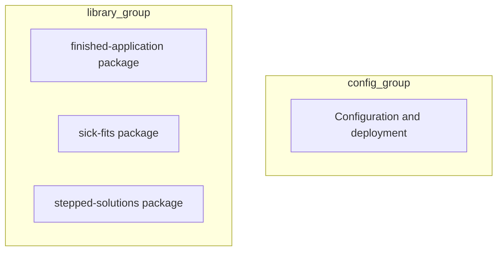

# Architecture report: wesbos/Advanced-React

> Automated static analysis. **Observed** = directly seen in files/imports/AST; **Inferred** = interpretation from that evidence. Repository code was not executed.

## 1. Repository at a glance

| Item | Value |
| --- | --- |
| Repository | wesbos/Advanced-React |
| Description | Starter Files and Solutions for Full Stack Advanced React and GraphQL  |
| Language | JavaScript |
| Stars | 3553 |
| Licence | Not detected |
| Analysed commit / branch | 64b8cd13a9b31feb47f12aed3e7aef5d0d5c8e9d / master |
| Framework(s) | Next.js, React |
| Files analysed | 294 |
| Components | 4 |

## 2. Architecture in one minute

wesbos/Advanced-React - Starter Files and Solutions for Full Stack Advanced React and GraphQL . This repository was analysed statically from 294 file(s) (0 Python). Detected technologies (observed from imports/manifests): Next.js, React, Jest, TypeScript. Files are grouped into 4 component(s): Configuration and deployment, finished-application package, sick-fits package, stepped-solutions package. Findings below distinguish observed facts from inferred interpretation.

## 3. High-level block diagram

## 4. Main components

### Configuration and deployment (`config`)

- **Kind:** config
- **Status:** Observed
- **Confidence:** 0.85
- **Responsibility:** Groups 14 file(s) under configuration and deployment (observed from repository paths and static analysis).
- **Paths:** `finished-application/backend/.vscode/extensions.json`, `finished-application/backend/.vscode/settings.json`, `finished-application/backend/package.json`, `finished-application/backend/tsconfig.json`, `finished-application/frontend/.vscode/extensions.json`, `finished-application/frontend/.vscode/settings.json`, `finished-application/frontend/package.json`, `sick-fits/backend/.vscode/extensions.json`, `sick-fits/backend/.vscode/settings.json`, `sick-fits/backend/package.json`, `sick-fits/backend/tsconfig.json`, `sick-fits/frontend/.vscode/extensions.json`, `sick-fits/frontend/.vscode/settings.json`, `sick-fits/frontend/package.json`
- **Evidence:** [finished-application/backend/.vscode/extensions.json](https://github.com/wesbos/Advanced-React/blob/64b8cd13a9b31feb47f12aed3e7aef5d0d5c8e9d/finished-application/backend/.vscode/extensions.json); [finished-application/backend/.vscode/settings.json](https://github.com/wesbos/Advanced-React/blob/64b8cd13a9b31feb47f12aed3e7aef5d0d5c8e9d/finished-application/backend/.vscode/settings.json); [finished-application/backend/package.json](https://github.com/wesbos/Advanced-React/blob/64b8cd13a9b31feb47f12aed3e7aef5d0d5c8e9d/finished-application/backend/package.json); [finished-application/backend/tsconfig.json](https://github.com/wesbos/Advanced-React/blob/64b8cd13a9b31feb47f12aed3e7aef5d0d5c8e9d/finished-application/backend/tsconfig.json); [finished-application/frontend/.vscode/extensions.json](https://github.com/wesbos/Advanced-React/blob/64b8cd13a9b31feb47f12aed3e7aef5d0d5c8e9d/finished-application/frontend/.vscode/extensions.json); [finished-application/frontend/.vscode/settings.json](https://github.com/wesbos/Advanced-React/blob/64b8cd13a9b31feb47f12aed3e7aef5d0d5c8e9d/finished-application/frontend/.vscode/settings.json); [finished-application/frontend/package.json](https://github.com/wesbos/Advanced-React/blob/64b8cd13a9b31feb47f12aed3e7aef5d0d5c8e9d/finished-application/frontend/package.json); [sick-fits/backend/.vscode/extensions.json](https://github.com/wesbos/Advanced-React/blob/64b8cd13a9b31feb47f12aed3e7aef5d0d5c8e9d/sick-fits/backend/.vscode/extensions.json)

### finished-application package (`finished_application`)

- **Kind:** library
- **Status:** Observed
- **Confidence:** 0.85
- **Responsibility:** Groups 89 file(s) under finished-application package (observed from repository paths and static analysis).
- **Paths:** `finished-application/backend/access.ts`, `finished-application/backend/keystone.ts`, `finished-application/backend/lib/formatMoney.ts`, `finished-application/backend/lib/mail.ts`, `finished-application/backend/lib/stripe.ts`, `finished-application/backend/mutations/addToCart.ts`, `finished-application/backend/mutations/checkout.ts`, `finished-application/backend/mutations/index.ts`, `finished-application/backend/schemas/CartItem.ts`, `finished-application/backend/schemas/Order.ts`, `finished-application/backend/schemas/OrderItem.ts`, `finished-application/backend/schemas/Product.ts`, `finished-application/backend/schemas/ProductImage.ts`, `finished-application/backend/schemas/Role.ts`, `finished-application/backend/schemas/User.ts`, `finished-application/backend/schemas/fields.ts`, `finished-application/backend/seed-data/data.ts`, `finished-application/backend/seed-data/index.ts`, `finished-application/backend/types.ts`, `finished-application/frontend/__tests__/CartCount.test.js`, `finished-application/frontend/__tests__/CreateProduct.test.js`, `finished-application/frontend/__tests__/Nav.test.js`, `finished-application/frontend/__tests__/Pagination.test.js`, `finished-application/frontend/__tests__/Product.test.js`, `finished-application/frontend/__tests__/RequestReset.test.js`, `finished-application/frontend/__tests__/Signup.test.js`, `finished-application/frontend/__tests__/SingleProduct.test.js`, `finished-application/frontend/__tests__/formatMoney.test.js`, `finished-application/frontend/__tests__/sample.test.js`, `finished-application/frontend/components/AddToCart.js`, `finished-application/frontend/components/Cart.js`, `finished-application/frontend/components/CartCount.js`, `finished-application/frontend/components/Checkout.js`, `finished-application/frontend/components/CreateProduct.js`, `finished-application/frontend/components/DeleteProduct.js`, `finished-application/frontend/components/ErrorMessage.js`, `finished-application/frontend/components/Header.js`, `finished-application/frontend/components/Nav.js`, `finished-application/frontend/components/Page.js`, `finished-application/frontend/components/Pagination.js`, `finished-application/frontend/components/PleaseSignIn.js`, `finished-application/frontend/components/Product.js`, `finished-application/frontend/components/Products.js`, `finished-application/frontend/components/RemoveFromCart.js`, `finished-application/frontend/components/RequestReset.js`, `finished-application/frontend/components/Reset.js`, `finished-application/frontend/components/Search.js`, `finished-application/frontend/components/SignIn.js`, `finished-application/frontend/components/SignOut.js`, `finished-application/frontend/components/SignUp.js`, `finished-application/frontend/components/SingleProduct.js`, `finished-application/frontend/components/UpdateProduct.js`, `finished-application/frontend/components/User.js`, `finished-application/frontend/components/styles/CartStyles.js`, `finished-application/frontend/components/styles/CloseButton.js`, `finished-application/frontend/components/styles/DropDown.js`, `finished-application/frontend/components/styles/Form.js`, `finished-application/frontend/components/styles/ItemStyles.js`, `finished-application/frontend/components/styles/NavStyles.js`, `finished-application/frontend/components/styles/OrderItemStyles.js`, `finished-application/frontend/components/styles/OrderStyles.js`, `finished-application/frontend/components/styles/PaginationStyles.js`, `finished-application/frontend/components/styles/PriceTag.js`, `finished-application/frontend/components/styles/SickButton.js`, `finished-application/frontend/components/styles/Supreme.js`, `finished-application/frontend/components/styles/Table.js`, `finished-application/frontend/components/styles/Title.js`, `finished-application/frontend/config.js`, `finished-application/frontend/jest.setup.js`, `finished-application/frontend/lib/calcTotalPrice.js`, `finished-application/frontend/lib/cartState.js`, `finished-application/frontend/lib/formatMoney.js`, `finished-application/frontend/lib/paginationField.js`, `finished-application/frontend/lib/testUtils.js`, `finished-application/frontend/lib/useForm.js`, `finished-application/frontend/lib/withData.js`, `finished-application/frontend/pages/_app.js`, `finished-application/frontend/pages/_document.js`, `finished-application/frontend/pages/account.js`, `finished-application/frontend/pages/index.js`, `finished-application/frontend/pages/order/[id].js`, `finished-application/frontend/pages/orders.js`, `finished-application/frontend/pages/product/[id].js`, `finished-application/frontend/pages/products/[page].js`, `finished-application/frontend/pages/products/index.js`, `finished-application/frontend/pages/reset.js`, `finished-application/frontend/pages/sell.js`, `finished-application/frontend/pages/signin.js`, `finished-application/frontend/pages/update.js`
- **Evidence:** [finished-application/backend/access.ts](https://github.com/wesbos/Advanced-React/blob/64b8cd13a9b31feb47f12aed3e7aef5d0d5c8e9d/finished-application/backend/access.ts); [finished-application/backend/keystone.ts](https://github.com/wesbos/Advanced-React/blob/64b8cd13a9b31feb47f12aed3e7aef5d0d5c8e9d/finished-application/backend/keystone.ts); [finished-application/backend/lib/formatMoney.ts](https://github.com/wesbos/Advanced-React/blob/64b8cd13a9b31feb47f12aed3e7aef5d0d5c8e9d/finished-application/backend/lib/formatMoney.ts); [finished-application/backend/lib/mail.ts](https://github.com/wesbos/Advanced-React/blob/64b8cd13a9b31feb47f12aed3e7aef5d0d5c8e9d/finished-application/backend/lib/mail.ts); [finished-application/backend/lib/stripe.ts](https://github.com/wesbos/Advanced-React/blob/64b8cd13a9b31feb47f12aed3e7aef5d0d5c8e9d/finished-application/backend/lib/stripe.ts); [finished-application/backend/mutations/addToCart.ts](https://github.com/wesbos/Advanced-React/blob/64b8cd13a9b31feb47f12aed3e7aef5d0d5c8e9d/finished-application/backend/mutations/addToCart.ts); [finished-application/backend/mutations/checkout.ts](https://github.com/wesbos/Advanced-React/blob/64b8cd13a9b31feb47f12aed3e7aef5d0d5c8e9d/finished-application/backend/mutations/checkout.ts); [finished-application/backend/mutations/index.ts](https://github.com/wesbos/Advanced-React/blob/64b8cd13a9b31feb47f12aed3e7aef5d0d5c8e9d/finished-application/backend/mutations/index.ts)

### sick-fits package (`sick_fits`)

- **Kind:** library
- **Status:** Observed
- **Confidence:** 0.85
- **Responsibility:** Groups 23 file(s) under sick-fits package (observed from repository paths and static analysis).
- **Paths:** `sick-fits/backend/lib/formatMoney.ts`, `sick-fits/backend/seed-data/data.ts`, `sick-fits/backend/seed-data/index.ts`, `sick-fits/backend/types.ts`, `sick-fits/frontend/components/ErrorMessage.js`, `sick-fits/frontend/components/styles/CartStyles.js`, `sick-fits/frontend/components/styles/CloseButton.js`, `sick-fits/frontend/components/styles/DropDown.js`, `sick-fits/frontend/components/styles/Form.js`, `sick-fits/frontend/components/styles/ItemStyles.js`, `sick-fits/frontend/components/styles/NavStyles.js`, `sick-fits/frontend/components/styles/OrderItemStyles.js`, `sick-fits/frontend/components/styles/OrderStyles.js`, `sick-fits/frontend/components/styles/PaginationStyles.js`, `sick-fits/frontend/components/styles/PriceTag.js`, `sick-fits/frontend/components/styles/SickButton.js`, `sick-fits/frontend/components/styles/Supreme.js`, `sick-fits/frontend/components/styles/Table.js`, `sick-fits/frontend/components/styles/Title.js`, `sick-fits/frontend/config.js`, `sick-fits/frontend/jest.setup.js`, `sick-fits/frontend/lib/testUtils.js`, `sick-fits/frontend/lib/withData.js`
- **Evidence:** [sick-fits/backend/lib/formatMoney.ts](https://github.com/wesbos/Advanced-React/blob/64b8cd13a9b31feb47f12aed3e7aef5d0d5c8e9d/sick-fits/backend/lib/formatMoney.ts); [sick-fits/backend/seed-data/data.ts](https://github.com/wesbos/Advanced-React/blob/64b8cd13a9b31feb47f12aed3e7aef5d0d5c8e9d/sick-fits/backend/seed-data/data.ts); [sick-fits/backend/seed-data/index.ts](https://github.com/wesbos/Advanced-React/blob/64b8cd13a9b31feb47f12aed3e7aef5d0d5c8e9d/sick-fits/backend/seed-data/index.ts); [sick-fits/backend/types.ts](https://github.com/wesbos/Advanced-React/blob/64b8cd13a9b31feb47f12aed3e7aef5d0d5c8e9d/sick-fits/backend/types.ts); [sick-fits/frontend/components/ErrorMessage.js](https://github.com/wesbos/Advanced-React/blob/64b8cd13a9b31feb47f12aed3e7aef5d0d5c8e9d/sick-fits/frontend/components/ErrorMessage.js); [sick-fits/frontend/components/styles/CartStyles.js](https://github.com/wesbos/Advanced-React/blob/64b8cd13a9b31feb47f12aed3e7aef5d0d5c8e9d/sick-fits/frontend/components/styles/CartStyles.js); [sick-fits/frontend/components/styles/CloseButton.js](https://github.com/wesbos/Advanced-React/blob/64b8cd13a9b31feb47f12aed3e7aef5d0d5c8e9d/sick-fits/frontend/components/styles/CloseButton.js); [sick-fits/frontend/components/styles/DropDown.js](https://github.com/wesbos/Advanced-React/blob/64b8cd13a9b31feb47f12aed3e7aef5d0d5c8e9d/sick-fits/frontend/components/styles/DropDown.js)

### stepped-solutions package (`stepped_solutions`)

- **Kind:** library
- **Status:** Observed
- **Confidence:** 0.85
- **Responsibility:** Groups 134 file(s) under stepped-solutions package (observed from repository paths and static analysis).
- **Paths:** `stepped-solutions/04/account.js`, `stepped-solutions/04/index.js`, `stepped-solutions/04/orders.js`, `stepped-solutions/04/products.js`, `stepped-solutions/04/sell.js`, `stepped-solutions/05/_app.js`, `stepped-solutions/05/_document.js`, `stepped-solutions/06/Header.js`, `stepped-solutions/06/Nav.js`, `stepped-solutions/06/Page.js`, `stepped-solutions/07/Header.js`, `stepped-solutions/08/Page.js`, `stepped-solutions/09/_app.js`, `stepped-solutions/09/_document.js`, `stepped-solutions/10/_document.js`, `stepped-solutions/12/keystone.ts`, `stepped-solutions/14/User.ts`, `stepped-solutions/15/keystone.ts`, `stepped-solutions/16/Product.ts`, `stepped-solutions/16/keystone.ts`, `stepped-solutions/17/ProductImage.ts`, `stepped-solutions/17/keystone.ts`, `stepped-solutions/18/Product.ts`, `stepped-solutions/18/ProductImage.ts`, `stepped-solutions/20/_app.js`, `stepped-solutions/21/Product.js`, `stepped-solutions/21/Products.js`, `stepped-solutions/21/products(page, rename me to just products).js`, `stepped-solutions/22/Header.js`, `stepped-solutions/22/Nav.js`, `stepped-solutions/23/CreateProduct.js`, `stepped-solutions/23/useForm.js`, `stepped-solutions/24/CreateProduct.js`, `stepped-solutions/24/useForm.js`, `stepped-solutions/25/CreateProduct.js`, `stepped-solutions/26/CreateProduct.js`, `stepped-solutions/26/Products.js`, `stepped-solutions/28/SingleProduct.js`, `stepped-solutions/28/product/[id].js`, `stepped-solutions/29/Product.js`, `stepped-solutions/29/UpdateProduct.js`, `stepped-solutions/29/update.js`, `stepped-solutions/30/useForm.js`, `stepped-solutions/31/DeleteProduct.js`, `stepped-solutions/31/Product.js`, `stepped-solutions/32/DeleteProduct.js`, `stepped-solutions/33/Pagination.js`, `stepped-solutions/33/Products.js`, `stepped-solutions/34/products/[page].js`, `stepped-solutions/34/products/index.js`, `stepped-solutions/35/Products.js`, `stepped-solutions/35/products/index.js`, `stepped-solutions/36/paginationField.js`, `stepped-solutions/36/withData.js`, `stepped-solutions/37/Nav.js`, `stepped-solutions/37/User.js`, `stepped-solutions/37/signin.js`, `stepped-solutions/38/SignIn.js`, `stepped-solutions/39/SignOut.js`, `stepped-solutions/40/SignUp.js`, `stepped-solutions/40/signin.js`, `stepped-solutions/41/RequestReset.js`, `stepped-solutions/41/keystone.ts`, `stepped-solutions/41/signin.js`, `stepped-solutions/42/components/Reset.js`, `stepped-solutions/42/pages/reset.js`, `stepped-solutions/44/keystone.ts`, `stepped-solutions/44/mail.ts`, `stepped-solutions/45/Cart.js`, `stepped-solutions/45/Header.js`, `stepped-solutions/45/User.js`, `stepped-solutions/45/calcTotalPrice.js`, `stepped-solutions/46/Cart.js`, `stepped-solutions/46/Header.js`, `stepped-solutions/46/Nav.js`, `stepped-solutions/46/_app.js`, `stepped-solutions/46/cartState.js`, `stepped-solutions/47/keystone.ts`, `stepped-solutions/47/mutations/addToCart.ts`, `stepped-solutions/47/mutations/index.ts`, `stepped-solutions/48/AddToCart.js`, `stepped-solutions/48/Product.js`, `stepped-solutions/49/CartCount.js`, `stepped-solutions/49/Nav.js`, `stepped-solutions/50/Cart.js`, `stepped-solutions/50/RemoveFromCart.js`, `stepped-solutions/51/RemoveFromCart.js`, `stepped-solutions/52/Nav.js`, `stepped-solutions/52/Search.js`, `stepped-solutions/53/Checkout.js`, `stepped-solutions/54/Checkout.js`, `stepped-solutions/55/Order.ts`, `stepped-solutions/55/OrderItem.ts`, `stepped-solutions/55/User.ts`, `stepped-solutions/55/keystone.ts`, `stepped-solutions/56/checkout.ts`, `stepped-solutions/56/stripe.ts`, `stepped-solutions/57/backend/checkout.ts`, `stepped-solutions/57/frontend/Checkout.js`, `stepped-solutions/58/OrderItem.ts`, `stepped-solutions/58/checkout.ts`, `stepped-solutions/59/Cart.js`, `stepped-solutions/59/Checkout.js`, `stepped-solutions/59/Nav.js`, `stepped-solutions/59/checkout.ts`, `stepped-solutions/60/order/[id].js`, `stepped-solutions/61/orders.js`, `stepped-solutions/63/Role.ts`, `stepped-solutions/63/User.ts`, `stepped-solutions/63/fields.ts`, `stepped-solutions/63/keystone.ts`, `stepped-solutions/64/Product.ts`, `stepped-solutions/64/access.ts`, `stepped-solutions/64/keystone.ts`, `stepped-solutions/65/access.ts`, `stepped-solutions/66/Product.ts`, `stepped-solutions/66/access.ts`, `stepped-solutions/67/Role.ts`, `stepped-solutions/68/CartItem.ts`, `stepped-solutions/68/Order.ts`, `stepped-solutions/68/OrderItem.ts`, `stepped-solutions/68/access.ts`, `stepped-solutions/69/User.ts`, `stepped-solutions/69/access.ts`, `stepped-solutions/71 - 83 (tests)/__tests__/CartCount.test.js`, `stepped-solutions/71 - 83 (tests)/__tests__/CreateProduct.test.js`, `stepped-solutions/71 - 83 (tests)/__tests__/Nav.test.js`, `stepped-solutions/71 - 83 (tests)/__tests__/Pagination.test.js`, `stepped-solutions/71 - 83 (tests)/__tests__/Product.test.js`, `stepped-solutions/71 - 83 (tests)/__tests__/RequestReset.test.js`, `stepped-solutions/71 - 83 (tests)/__tests__/Signup.test.js`, `stepped-solutions/71 - 83 (tests)/__tests__/SingleProduct.test.js`, `stepped-solutions/71 - 83 (tests)/__tests__/formatMoney.test.js`, `stepped-solutions/71 - 83 (tests)/__tests__/sample.test.js`
- **Evidence:** [stepped-solutions/04/account.js](https://github.com/wesbos/Advanced-React/blob/64b8cd13a9b31feb47f12aed3e7aef5d0d5c8e9d/stepped-solutions/04/account.js); [stepped-solutions/04/index.js](https://github.com/wesbos/Advanced-React/blob/64b8cd13a9b31feb47f12aed3e7aef5d0d5c8e9d/stepped-solutions/04/index.js); [stepped-solutions/04/orders.js](https://github.com/wesbos/Advanced-React/blob/64b8cd13a9b31feb47f12aed3e7aef5d0d5c8e9d/stepped-solutions/04/orders.js); [stepped-solutions/04/products.js](https://github.com/wesbos/Advanced-React/blob/64b8cd13a9b31feb47f12aed3e7aef5d0d5c8e9d/stepped-solutions/04/products.js); [stepped-solutions/04/sell.js](https://github.com/wesbos/Advanced-React/blob/64b8cd13a9b31feb47f12aed3e7aef5d0d5c8e9d/stepped-solutions/04/sell.js); [stepped-solutions/05/_app.js](https://github.com/wesbos/Advanced-React/blob/64b8cd13a9b31feb47f12aed3e7aef5d0d5c8e9d/stepped-solutions/05/_app.js); [stepped-solutions/05/_document.js](https://github.com/wesbos/Advanced-React/blob/64b8cd13a9b31feb47f12aed3e7aef5d0d5c8e9d/stepped-solutions/05/_document.js); [stepped-solutions/06/Header.js](https://github.com/wesbos/Advanced-React/blob/64b8cd13a9b31feb47f12aed3e7aef5d0d5c8e9d/stepped-solutions/06/Header.js)

## 5. Execution flow

**Observed** entry point(s):

- [finished-application/backend/mutations/index.ts](https://github.com/wesbos/Advanced-React/blob/64b8cd13a9b31feb47f12aed3e7aef5d0d5c8e9d/finished-application/backend/mutations/index.ts)
- [finished-application/backend/seed-data/index.ts](https://github.com/wesbos/Advanced-React/blob/64b8cd13a9b31feb47f12aed3e7aef5d0d5c8e9d/finished-application/backend/seed-data/index.ts)
- [finished-application/frontend/components/Page.js](https://github.com/wesbos/Advanced-React/blob/64b8cd13a9b31feb47f12aed3e7aef5d0d5c8e9d/finished-application/frontend/components/Page.js)
- [finished-application/frontend/pages/index.js](https://github.com/wesbos/Advanced-React/blob/64b8cd13a9b31feb47f12aed3e7aef5d0d5c8e9d/finished-application/frontend/pages/index.js)
- [sick-fits/backend/seed-data/index.ts](https://github.com/wesbos/Advanced-React/blob/64b8cd13a9b31feb47f12aed3e7aef5d0d5c8e9d/sick-fits/backend/seed-data/index.ts)
- [stepped-solutions/04/index.js](https://github.com/wesbos/Advanced-React/blob/64b8cd13a9b31feb47f12aed3e7aef5d0d5c8e9d/stepped-solutions/04/index.js)
- [stepped-solutions/06/Page.js](https://github.com/wesbos/Advanced-React/blob/64b8cd13a9b31feb47f12aed3e7aef5d0d5c8e9d/stepped-solutions/06/Page.js)
- [stepped-solutions/08/Page.js](https://github.com/wesbos/Advanced-React/blob/64b8cd13a9b31feb47f12aed3e7aef5d0d5c8e9d/stepped-solutions/08/Page.js)
- [stepped-solutions/34/products/index.js](https://github.com/wesbos/Advanced-React/blob/64b8cd13a9b31feb47f12aed3e7aef5d0d5c8e9d/stepped-solutions/34/products/index.js)
- [stepped-solutions/35/products/index.js](https://github.com/wesbos/Advanced-React/blob/64b8cd13a9b31feb47f12aed3e7aef5d0d5c8e9d/stepped-solutions/35/products/index.js)
- [stepped-solutions/47/mutations/index.ts](https://github.com/wesbos/Advanced-React/blob/64b8cd13a9b31feb47f12aed3e7aef5d0d5c8e9d/stepped-solutions/47/mutations/index.ts)

Representative flow (derived from observed entry points and the import graph; steps beyond the entry point are **Inferred**):

1. Execution starts at an observed entry point listed above, if present.
2. No internal import relationships between components were observed.

## 6. Project structure

### `(root)`

- `.gitignore` - other (98 bytes)
- `readme.md` - docs (702 bytes)

### `finished-application`

- `finished-application/backend/.vscode/extensions.json` - config (205 bytes)
- `finished-application/backend/.vscode/settings.json` - config (541 bytes)
- `finished-application/backend/access.ts` - source, TypeScript (2495 bytes)
- `finished-application/backend/keystone.ts` - source, TypeScript (2351 bytes)
- `finished-application/backend/lib/formatMoney.ts` - source, TypeScript (218 bytes)
- `finished-application/backend/lib/mail.ts` - source, TypeScript (1451 bytes)
- `finished-application/backend/lib/stripe.ts` - source, TypeScript (159 bytes)
- `finished-application/backend/mutations/.gitkeep` - other (0 bytes)
- `finished-application/backend/mutations/addToCart.ts` - source, TypeScript (1538 bytes)
- `finished-application/backend/mutations/checkout.ts` - source, TypeScript (2694 bytes)
- `finished-application/backend/mutations/index.ts` - source, TypeScript (492 bytes)
- `finished-application/backend/package.json` - manifest (2063 bytes)
- `finished-application/backend/schemas/.gitkeep` - other (0 bytes)
- `finished-application/backend/schemas/CartItem.ts` - source, TypeScript (652 bytes)
- `finished-application/backend/schemas/Order.ts` - source, TypeScript (708 bytes)
- `finished-application/backend/schemas/OrderItem.ts` - source, TypeScript (845 bytes)
- `finished-application/backend/schemas/Product.ts` - source, TypeScript (1301 bytes)
- `finished-application/backend/schemas/ProductImage.ts` - source, TypeScript (886 bytes)
- `finished-application/backend/schemas/Role.ts` - source, TypeScript (855 bytes)
- `finished-application/backend/schemas/User.ts` - source, TypeScript (1269 bytes)
- `finished-application/backend/schemas/fields.ts` - source, TypeScript (878 bytes)
- `finished-application/backend/seed-data/data.ts` - source, TypeScript (16152 bytes)
- `finished-application/backend/seed-data/index.ts` - source, TypeScript (872 bytes)
- `finished-application/backend/tsconfig.json` - config (3 bytes)
- `finished-application/backend/types.ts` - source, TypeScript (1020 bytes)
- `finished-application/frontend/.vscode/extensions.json` - config (205 bytes)
- `finished-application/frontend/.vscode/settings.json` - config (541 bytes)
- `finished-application/frontend/__tests__/CartCount.test.js` - source, JavaScript (839 bytes)
- `finished-application/frontend/__tests__/CreateProduct.test.js` - source, JavaScript (3179 bytes)
- `finished-application/frontend/__tests__/Nav.test.js` - source, JavaScript (2351 bytes)
- `finished-application/frontend/__tests__/Pagination.test.js` - source, JavaScript (2475 bytes)
- `finished-application/frontend/__tests__/Product.test.js` - source, JavaScript (1228 bytes)
- `finished-application/frontend/__tests__/RequestReset.test.js` - source, JavaScript (1186 bytes)
- `finished-application/frontend/__tests__/Signup.test.js` - source, JavaScript (1771 bytes)
- `finished-application/frontend/__tests__/SingleProduct.test.js` - source, JavaScript (1586 bytes)
- `finished-application/frontend/__tests__/__snapshots__/CartCount.test.js.snap` - other (589 bytes)
- `finished-application/frontend/__tests__/__snapshots__/CreateProduct.test.js.snap` - other (1131 bytes)
- `finished-application/frontend/__tests__/__snapshots__/Nav.test.js.snap` - other (1036 bytes)
- `finished-application/frontend/__tests__/__snapshots__/Pagination.test.js.snap` - other (567 bytes)
- `finished-application/frontend/__tests__/__snapshots__/Product.test.js.snap` - other (800 bytes)
- `finished-application/frontend/__tests__/__snapshots__/RequestReset.test.js.snap` - other (598 bytes)
- `finished-application/frontend/__tests__/__snapshots__/Signup.test.js.snap` - other (1050 bytes)
- `finished-application/frontend/__tests__/__snapshots__/SingleProduct.test.js.snap` - other (417 bytes)
- `finished-application/frontend/__tests__/formatMoney.test.js` - source, JavaScript (860 bytes)
- `finished-application/frontend/__tests__/sample.test.js` - source, JavaScript (518 bytes)
- `finished-application/frontend/components/.gitkeep` - other (0 bytes)
- `finished-application/frontend/components/AddToCart.js` - source, JavaScript (592 bytes)
- `finished-application/frontend/components/Cart.js` - source, JavaScript (1803 bytes)
- `finished-application/frontend/components/CartCount.js` - source, JavaScript (1209 bytes)
- `finished-application/frontend/components/Checkout.js` - source, JavaScript (3071 bytes)
- `finished-application/frontend/components/CreateProduct.js` - source, JavaScript (2755 bytes)
- `finished-application/frontend/components/DeleteProduct.js` - source, JavaScript (960 bytes)
- `finished-application/frontend/components/ErrorMessage.js` - source, JavaScript (1129 bytes)
- `finished-application/frontend/components/Header.js` - source, JavaScript (1062 bytes)
- `finished-application/frontend/components/Nav.js` - source, JavaScript (1022 bytes)
- `finished-application/frontend/components/Page.js` - source, JavaScript (1586 bytes)
- `finished-application/frontend/components/Pagination.js` - source, JavaScript (1162 bytes)
- `finished-application/frontend/components/PleaseSignIn.js` - source, JavaScript (182 bytes)
- `finished-application/frontend/components/Product.js` - source, JavaScript (1016 bytes)
- `finished-application/frontend/components/Products.js` - source, JavaScript (1095 bytes)
- `finished-application/frontend/components/RemoveFromCart.js` - source, JavaScript (991 bytes)
- `finished-application/frontend/components/RequestReset.js` - source, JavaScript (1673 bytes)
- `finished-application/frontend/components/Reset.js` - source, JavaScript (2124 bytes)
- `finished-application/frontend/components/Search.js` - source, JavaScript (2462 bytes)
- `finished-application/frontend/components/SignIn.js` - source, JavaScript (2199 bytes)
- `finished-application/frontend/components/SignOut.js` - source, JavaScript (430 bytes)
- `finished-application/frontend/components/SignUp.js` - source, JavaScript (2349 bytes)
- `finished-application/frontend/components/SingleProduct.js` - source, JavaScript (1371 bytes)
- `finished-application/frontend/components/UpdateProduct.js` - source, JavaScript (3090 bytes)
- `finished-application/frontend/components/User.js` - source, JavaScript (612 bytes)
- `finished-application/frontend/components/styles/.gitkeep` - other (0 bytes)
- `finished-application/frontend/components/styles/CartStyles.js` - source, JavaScript (955 bytes)
- `finished-application/frontend/components/styles/CloseButton.js` - source, JavaScript (225 bytes)
- `finished-application/frontend/components/styles/DropDown.js` - source, JavaScript (1015 bytes)
- `finished-application/frontend/components/styles/Form.js` - source, JavaScript (1326 bytes)
- `finished-application/frontend/components/styles/ItemStyles.js` - source, JavaScript (758 bytes)
- `finished-application/frontend/components/styles/NavStyles.js` - source, JavaScript (1360 bytes)
- `finished-application/frontend/components/styles/OrderItemStyles.js` - source, JavaScript (877 bytes)
- `finished-application/frontend/components/styles/OrderStyles.js` - source, JavaScript (797 bytes)
- `finished-application/frontend/components/styles/PaginationStyles.js` - source, JavaScript (580 bytes)
- `finished-application/frontend/components/styles/PriceTag.js` - source, JavaScript (317 bytes)
- `finished-application/frontend/components/styles/SickButton.js` - source, JavaScript (381 bytes)
- `finished-application/frontend/components/styles/Supreme.js` - source, JavaScript (241 bytes)
- `finished-application/frontend/components/styles/Table.js` - source, JavaScript (539 bytes)
- `finished-application/frontend/components/styles/Title.js` - source, JavaScript (403 bytes)
- `finished-application/frontend/components/styles/nprogress.css` - other (1450 bytes)
- `finished-application/frontend/config.js` - source, JavaScript (234 bytes)
- `finished-application/frontend/jest.setup.js` - source, JavaScript (65 bytes)
- `finished-application/frontend/lib/.gitkeep` - other (0 bytes)
- `finished-application/frontend/lib/calcTotalPrice.js` - source, JavaScript (271 bytes)
- `finished-application/frontend/lib/cartState.js` - source, JavaScript (1039 bytes)
- `finished-application/frontend/lib/formatMoney.js` - source, JavaScript (363 bytes)
- `finished-application/frontend/lib/paginationField.js` - source, JavaScript (2261 bytes)
- `finished-application/frontend/lib/testUtils.js` - source, JavaScript (2060 bytes)
- `finished-application/frontend/lib/useForm.js` - source, JavaScript (1131 bytes)
- `finished-application/frontend/lib/withData.js` - source, JavaScript (1658 bytes)
- `finished-application/frontend/package.json` - manifest (3310 bytes)
- `finished-application/frontend/pages/.gitkeep` - other (0 bytes)
- `finished-application/frontend/pages/_app.js` - source, JavaScript (1008 bytes)
- `finished-application/frontend/pages/_document.js` - source, JavaScript (622 bytes)
- `finished-application/frontend/pages/account.js` - source, JavaScript (83 bytes)
- `finished-application/frontend/pages/index.js` - source, JavaScript (38 bytes)
- `finished-application/frontend/pages/order/[id].js` - source, JavaScript (1972 bytes)
- `finished-application/frontend/pages/orders.js` - source, JavaScript (2234 bytes)
- `finished-application/frontend/pages/product/[id].js` - source, JavaScript (160 bytes)
- `finished-application/frontend/pages/products/[page].js` - source, JavaScript (35 bytes)
- `finished-application/frontend/pages/products/index.js` - source, JavaScript (417 bytes)
- `finished-application/frontend/pages/reset.js` - source, JavaScript (394 bytes)
- `finished-application/frontend/pages/sell.js` - source, JavaScript (258 bytes)
- `finished-application/frontend/pages/signin.js` - source, JavaScript (464 bytes)
- `finished-application/frontend/pages/update.js` - source, JavaScript (205 bytes)

### `sick-fits`

- `sick-fits/backend/.vscode/extensions.json` - config (205 bytes)
- `sick-fits/backend/.vscode/settings.json` - config (541 bytes)
- `sick-fits/backend/lib/formatMoney.ts` - source, TypeScript (218 bytes)
- `sick-fits/backend/mutations/.gitkeep` - other (0 bytes)
- `sick-fits/backend/package.json` - manifest (2029 bytes)
- `sick-fits/backend/sample.env` - other (391 bytes)
- `sick-fits/backend/schemas/.gitkeep` - other (0 bytes)
- `sick-fits/backend/seed-data/data.ts` - source, TypeScript (16152 bytes)
- `sick-fits/backend/seed-data/index.ts` - source, TypeScript (868 bytes)
- `sick-fits/backend/tsconfig.json` - config (2 bytes)
- `sick-fits/backend/types.ts` - source, TypeScript (1020 bytes)
- `sick-fits/frontend/.vscode/extensions.json` - config (205 bytes)
- `sick-fits/frontend/.vscode/settings.json` - config (680 bytes)
- `sick-fits/frontend/components/.gitkeep` - other (0 bytes)
- `sick-fits/frontend/components/ErrorMessage.js` - source, JavaScript (1129 bytes)
- `sick-fits/frontend/components/styles/.gitkeep` - other (0 bytes)
- `sick-fits/frontend/components/styles/CartStyles.js` - source, JavaScript (949 bytes)
- `sick-fits/frontend/components/styles/CloseButton.js` - source, JavaScript (225 bytes)
- `sick-fits/frontend/components/styles/DropDown.js` - source, JavaScript (1015 bytes)
- `sick-fits/frontend/components/styles/Form.js` - source, JavaScript (1326 bytes)
- `sick-fits/frontend/components/styles/ItemStyles.js` - source, JavaScript (746 bytes)
- `sick-fits/frontend/components/styles/NavStyles.js` - source, JavaScript (1388 bytes)
- `sick-fits/frontend/components/styles/OrderItemStyles.js` - source, JavaScript (877 bytes)
- `sick-fits/frontend/components/styles/OrderStyles.js` - source, JavaScript (797 bytes)
- `sick-fits/frontend/components/styles/PaginationStyles.js` - source, JavaScript (580 bytes)
- `sick-fits/frontend/components/styles/PriceTag.js` - source, JavaScript (317 bytes)
- `sick-fits/frontend/components/styles/SickButton.js` - source, JavaScript (381 bytes)
- `sick-fits/frontend/components/styles/Supreme.js` - source, JavaScript (241 bytes)
- `sick-fits/frontend/components/styles/Table.js` - source, JavaScript (539 bytes)
- `sick-fits/frontend/components/styles/Title.js` - source, JavaScript (403 bytes)
- `sick-fits/frontend/components/styles/nprogress.css` - other (1450 bytes)
- `sick-fits/frontend/config.js` - source, JavaScript (234 bytes)
- `sick-fits/frontend/jest.setup.js` - source, JavaScript (65 bytes)
- `sick-fits/frontend/lib/.gitkeep` - other (0 bytes)
- `sick-fits/frontend/lib/testUtils.js` - source, JavaScript (2060 bytes)
- `sick-fits/frontend/lib/withData.js` - source, JavaScript (1612 bytes)
- `sick-fits/frontend/package.json` - manifest (3094 bytes)
- `sick-fits/frontend/pages/.gitkeep` - other (0 bytes)

### `stepped-solutions`

- `stepped-solutions/04/account.js` - source, JavaScript (83 bytes)
- `stepped-solutions/04/index.js` - source, JavaScript (82 bytes)
- `stepped-solutions/04/orders.js` - source, JavaScript (82 bytes)
- `stepped-solutions/04/products.js` - source, JavaScript (80 bytes)
- `stepped-solutions/04/sell.js` - source, JavaScript (81 bytes)
- `stepped-solutions/05/_app.js` - source, JavaScript (174 bytes)
- `stepped-solutions/05/_document.js` - source, JavaScript (308 bytes)
- `stepped-solutions/06/Header.js` - source, JavaScript (298 bytes)
- `stepped-solutions/06/Nav.js` - source, JavaScript (268 bytes)
- `stepped-solutions/06/Page.js` - source, JavaScript (329 bytes)
- `stepped-solutions/07/Header.js` - source, JavaScript (989 bytes)
- `stepped-solutions/08/Page.js` - source, JavaScript (1554 bytes)
- `stepped-solutions/09/_app.js` - source, JavaScript (479 bytes)
- `stepped-solutions/09/_document.js` - source, JavaScript (295 bytes)
- `stepped-solutions/10/_document.js` - source, JavaScript (622 bytes)
- `stepped-solutions/12/keystone.ts` - source, TypeScript (745 bytes)
- `stepped-solutions/14/User.ts` - source, TypeScript (354 bytes)
- `stepped-solutions/15/keystone.ts` - source, TypeScript (1373 bytes)
- `stepped-solutions/16/Product.ts` - source, TypeScript (702 bytes)
- `stepped-solutions/16/keystone.ts` - source, TypeScript (1433 bytes)
- `stepped-solutions/17/ProductImage.ts` - source, TypeScript (526 bytes)
- `stepped-solutions/17/keystone.ts` - source, TypeScript (1508 bytes)
- `stepped-solutions/18/Product.ts` - source, TypeScript (988 bytes)
- `stepped-solutions/18/ProductImage.ts` - source, TypeScript (684 bytes)
- `stepped-solutions/20/_app.js` - source, JavaScript (918 bytes)
- `stepped-solutions/21/Product.js` - source, JavaScript (649 bytes)
- `stepped-solutions/21/Products.js` - source, JavaScript (932 bytes)
- `stepped-solutions/21/products(page, rename me to just products).js` - source, JavaScript (144 bytes)
- `stepped-solutions/22/Header.js` - source, JavaScript (992 bytes)
- `stepped-solutions/22/Nav.js` - source, JavaScript (324 bytes)
- `stepped-solutions/23/CreateProduct.js` - source, JavaScript (940 bytes)
- `stepped-solutions/23/useForm.js` - source, JavaScript (1131 bytes)
- `stepped-solutions/24/CreateProduct.js` - source, JavaScript (1556 bytes)
- `stepped-solutions/24/useForm.js` - source, JavaScript (930 bytes)
- `stepped-solutions/25/CreateProduct.js` - source, JavaScript (2503 bytes)
- `stepped-solutions/26/CreateProduct.js` - source, JavaScript (2607 bytes)
- `stepped-solutions/26/Products.js` - source, JavaScript (939 bytes)
- `stepped-solutions/28/SingleProduct.js` - source, JavaScript (1371 bytes)
- `stepped-solutions/28/product/[id].js` - source, JavaScript (160 bytes)
- `stepped-solutions/29/Product.js` - source, JavaScript (833 bytes)
- `stepped-solutions/29/UpdateProduct.js` - source, JavaScript (3015 bytes)
- `stepped-solutions/29/update.js` - source, JavaScript (205 bytes)
- `stepped-solutions/30/useForm.js` - source, JavaScript (1131 bytes)
- `stepped-solutions/31/DeleteProduct.js` - source, JavaScript (767 bytes)
- `stepped-solutions/31/Product.js` - source, JavaScript (940 bytes)
- `stepped-solutions/32/DeleteProduct.js` - source, JavaScript (960 bytes)
- `stepped-solutions/33/Pagination.js` - source, JavaScript (1127 bytes)
- `stepped-solutions/33/Products.js` - source, JavaScript (939 bytes)
- `stepped-solutions/34/products/[page].js` - source, JavaScript (35 bytes)
- `stepped-solutions/34/products/index.js` - source, JavaScript (400 bytes)
- `stepped-solutions/35/Products.js` - source, JavaScript (1132 bytes)
- `stepped-solutions/35/products/index.js` - source, JavaScript (417 bytes)
- `stepped-solutions/36/paginationField.js` - source, JavaScript (2243 bytes)
- `stepped-solutions/36/withData.js` - source, JavaScript (1658 bytes)
- `stepped-solutions/37/Nav.js` - source, JavaScript (541 bytes)
- `stepped-solutions/37/User.js` - source, JavaScript (362 bytes)
- `stepped-solutions/37/signin.js` - source, JavaScript (139 bytes)
- `stepped-solutions/38/SignIn.js` - source, JavaScript (2200 bytes)
- `stepped-solutions/39/SignOut.js` - source, JavaScript (430 bytes)
- `stepped-solutions/40/SignUp.js` - source, JavaScript (2394 bytes)
- `stepped-solutions/40/signin.js` - source, JavaScript (386 bytes)
- `stepped-solutions/41/RequestReset.js` - source, JavaScript (1673 bytes)
- `stepped-solutions/41/keystone.ts` - source, TypeScript (1803 bytes)
- `stepped-solutions/41/signin.js` - source, JavaScript (464 bytes)
- `stepped-solutions/42/components/Reset.js` - source, JavaScript (2124 bytes)
- `stepped-solutions/42/pages/reset.js` - source, JavaScript (394 bytes)
- `stepped-solutions/44/keystone.ts` - source, TypeScript (1951 bytes)
- `stepped-solutions/44/mail.ts` - source, TypeScript (1451 bytes)
- `stepped-solutions/45/Cart.js` - source, JavaScript (1486 bytes)
- `stepped-solutions/45/Header.js` - source, JavaScript (1034 bytes)
- `stepped-solutions/45/User.js` - source, JavaScript (612 bytes)
- `stepped-solutions/45/calcTotalPrice.js` - source, JavaScript (271 bytes)
- `stepped-solutions/46/Cart.js` - source, JavaScript (1654 bytes)
- `stepped-solutions/46/Header.js` - source, JavaScript (1034 bytes)
- `stepped-solutions/46/Nav.js` - source, JavaScript (766 bytes)
- `stepped-solutions/46/_app.js` - source, JavaScript (1008 bytes)
- `stepped-solutions/46/cartState.js` - source, JavaScript (1039 bytes)
- `stepped-solutions/47/keystone.ts` - source, TypeScript (2090 bytes)
- `stepped-solutions/47/mutations/.gitkeep` - other (0 bytes)
- `stepped-solutions/47/mutations/addToCart.ts` - source, TypeScript (1538 bytes)
- `stepped-solutions/47/mutations/index.ts` - source, TypeScript (403 bytes)
- `stepped-solutions/48/AddToCart.js` - source, JavaScript (592 bytes)
- `stepped-solutions/48/Product.js` - source, JavaScript (1016 bytes)
- `stepped-solutions/49/CartCount.js` - source, JavaScript (1209 bytes)
- `stepped-solutions/49/Nav.js` - source, JavaScript (979 bytes)
- `stepped-solutions/50/Cart.js` - source, JavaScript (1743 bytes)
- `stepped-solutions/50/RemoveFromCart.js` - source, JavaScript (754 bytes)
- `stepped-solutions/51/RemoveFromCart.js` - source, JavaScript (991 bytes)
- `stepped-solutions/52/Nav.js` - source, JavaScript (979 bytes)
- `stepped-solutions/52/Search.js` - source, JavaScript (2460 bytes)
- `stepped-solutions/53/Checkout.js` - source, JavaScript (839 bytes)
- `stepped-solutions/54/Checkout.js` - source, JavaScript (1948 bytes)
- `stepped-solutions/55/Order.ts` - source, TypeScript (544 bytes)
- `stepped-solutions/55/OrderItem.ts` - source, TypeScript (670 bytes)
- `stepped-solutions/55/User.ts` - source, TypeScript (561 bytes)
- `stepped-solutions/55/keystone.ts` - source, TypeScript (2210 bytes)
- `stepped-solutions/56/checkout.ts` - source, TypeScript (1757 bytes)
- `stepped-solutions/56/stripe.ts` - source, TypeScript (159 bytes)
- `stepped-solutions/57/backend/checkout.ts` - source, TypeScript (1780 bytes)
- `stepped-solutions/57/frontend/Checkout.js` - source, JavaScript (2654 bytes)
- `stepped-solutions/58/OrderItem.ts` - source, TypeScript (670 bytes)
- `stepped-solutions/58/checkout.ts` - source, TypeScript (2607 bytes)
- `stepped-solutions/59/Cart.js` - source, JavaScript (1803 bytes)
- `stepped-solutions/59/Checkout.js` - source, JavaScript (3071 bytes)
- `stepped-solutions/59/Nav.js` - source, JavaScript (1022 bytes)
- `stepped-solutions/59/checkout.ts` - source, TypeScript (2607 bytes)
- `stepped-solutions/60/order/[id].js` - source, JavaScript (1972 bytes)
- `stepped-solutions/61/orders.js` - source, JavaScript (2234 bytes)
- `stepped-solutions/63/Role.ts` - source, TypeScript (445 bytes)
- `stepped-solutions/63/User.ts` - source, TypeScript (658 bytes)
- `stepped-solutions/63/fields.ts` - source, TypeScript (878 bytes)
- `stepped-solutions/63/keystone.ts` - source, TypeScript (2261 bytes)
- `stepped-solutions/64/Product.ts` - source, TypeScript (1116 bytes)
- `stepped-solutions/64/access.ts` - source, TypeScript (220 bytes)
- `stepped-solutions/64/keystone.ts` - source, TypeScript (2351 bytes)
- `stepped-solutions/65/access.ts` - source, TypeScript (651 bytes)
- `stepped-solutions/66/Product.ts` - source, TypeScript (1301 bytes)
- `stepped-solutions/66/access.ts` - source, TypeScript (1415 bytes)
- `stepped-solutions/67/Role.ts` - source, TypeScript (855 bytes)
- `stepped-solutions/68/CartItem.ts` - source, TypeScript (652 bytes)
- `stepped-solutions/68/Order.ts` - source, TypeScript (708 bytes)
- `stepped-solutions/68/OrderItem.ts` - source, TypeScript (845 bytes)
- `stepped-solutions/68/access.ts` - source, TypeScript (1971 bytes)
- `stepped-solutions/69/User.ts` - source, TypeScript (1269 bytes)
- `stepped-solutions/69/access.ts` - source, TypeScript (2495 bytes)
- `stepped-solutions/71 - 83 (tests)/__tests__/CartCount.test.js` - source, JavaScript (839 bytes)
- `stepped-solutions/71 - 83 (tests)/__tests__/CreateProduct.test.js` - source, JavaScript (3179 bytes)
- `stepped-solutions/71 - 83 (tests)/__tests__/Nav.test.js` - source, JavaScript (2351 bytes)
- `stepped-solutions/71 - 83 (tests)/__tests__/Pagination.test.js` - source, JavaScript (2475 bytes)
- `stepped-solutions/71 - 83 (tests)/__tests__/Product.test.js` - source, JavaScript (1228 bytes)
- `stepped-solutions/71 - 83 (tests)/__tests__/RequestReset.test.js` - source, JavaScript (1186 bytes)
- `stepped-solutions/71 - 83 (tests)/__tests__/Signup.test.js` - source, JavaScript (1771 bytes)
- `stepped-solutions/71 - 83 (tests)/__tests__/SingleProduct.test.js` - source, JavaScript (1586 bytes)
- `stepped-solutions/71 - 83 (tests)/__tests__/__snapshots__/CartCount.test.js.snap` - other (589 bytes)
- `stepped-solutions/71 - 83 (tests)/__tests__/__snapshots__/CreateProduct.test.js.snap` - other (1131 bytes)
- `stepped-solutions/71 - 83 (tests)/__tests__/__snapshots__/Nav.test.js.snap` - other (1036 bytes)
- `stepped-solutions/71 - 83 (tests)/__tests__/__snapshots__/Pagination.test.js.snap` - other (567 bytes)
- `stepped-solutions/71 - 83 (tests)/__tests__/__snapshots__/Product.test.js.snap` - other (800 bytes)
- `stepped-solutions/71 - 83 (tests)/__tests__/__snapshots__/RequestReset.test.js.snap` - other (598 bytes)
- `stepped-solutions/71 - 83 (tests)/__tests__/__snapshots__/Signup.test.js.snap` - other (1050 bytes)
- `stepped-solutions/71 - 83 (tests)/__tests__/__snapshots__/SingleProduct.test.js.snap` - other (417 bytes)
- `stepped-solutions/71 - 83 (tests)/__tests__/formatMoney.test.js` - source, JavaScript (860 bytes)
- `stepped-solutions/71 - 83 (tests)/__tests__/sample.test.js` - source, JavaScript (518 bytes)

## 7. Key dependencies and integrations

| Name | Category | Status | Confidence | Evidence |
| --- | --- | --- | --- | --- |
| Next.js | framework | Observed | 0.90 | [finished-application/backend/package.json:8](https://github.com/wesbos/Advanced-React/blob/64b8cd13a9b31feb47f12aed3e7aef5d0d5c8e9d/finished-application/backend/package.json#L8); [finished-application/frontend/package.json:4](https://github.com/wesbos/Advanced-React/blob/64b8cd13a9b31feb47f12aed3e7aef5d0d5c8e9d/finished-application/frontend/package.json#L4); [sick-fits/backend/package.json:8](https://github.com/wesbos/Advanced-React/blob/64b8cd13a9b31feb47f12aed3e7aef5d0d5c8e9d/sick-fits/backend/package.json#L8); [sick-fits/frontend/package.json:4](https://github.com/wesbos/Advanced-React/blob/64b8cd13a9b31feb47f12aed3e7aef5d0d5c8e9d/sick-fits/frontend/package.json#L4) |
| React | framework | Observed | 0.90 | [finished-application/backend/package.json:33](https://github.com/wesbos/Advanced-React/blob/64b8cd13a9b31feb47f12aed3e7aef5d0d5c8e9d/finished-application/backend/package.json#L33); [finished-application/backend/package.json:50](https://github.com/wesbos/Advanced-React/blob/64b8cd13a9b31feb47f12aed3e7aef5d0d5c8e9d/finished-application/backend/package.json#L50); [finished-application/frontend/package.json:4](https://github.com/wesbos/Advanced-React/blob/64b8cd13a9b31feb47f12aed3e7aef5d0d5c8e9d/finished-application/frontend/package.json#L4); [finished-application/frontend/package.json:46](https://github.com/wesbos/Advanced-React/blob/64b8cd13a9b31feb47f12aed3e7aef5d0d5c8e9d/finished-application/frontend/package.json#L46) |
| Jest | tooling | Observed | 0.90 | [finished-application/frontend/package.json:10](https://github.com/wesbos/Advanced-React/blob/64b8cd13a9b31feb47f12aed3e7aef5d0d5c8e9d/finished-application/frontend/package.json#L10); [sick-fits/frontend/package.json:10](https://github.com/wesbos/Advanced-React/blob/64b8cd13a9b31feb47f12aed3e7aef5d0d5c8e9d/sick-fits/frontend/package.json#L10) |
| TypeScript | tooling | Observed | 0.90 | [finished-application/backend/package.json:12](https://github.com/wesbos/Advanced-React/blob/64b8cd13a9b31feb47f12aed3e7aef5d0d5c8e9d/finished-application/backend/package.json#L12); [sick-fits/backend/package.json:12](https://github.com/wesbos/Advanced-React/blob/64b8cd13a9b31feb47f12aed3e7aef5d0d5c8e9d/sick-fits/backend/package.json#L12) |

## 8. Data and state

No database, cache, queue, or persistent-state usage was observed in the analysed files. State handling, if any, may be in-memory or in files that were not analysed.

## 9. Configuration and deployment clues

- `finished-application/backend/.vscode/extensions.json` (config)
- `finished-application/backend/.vscode/settings.json` (config)
- `finished-application/backend/package.json` (manifest)
- `finished-application/backend/tsconfig.json` (config)
- `finished-application/frontend/.vscode/extensions.json` (config)
- `finished-application/frontend/.vscode/settings.json` (config)
- `finished-application/frontend/package.json` (manifest)
- `sick-fits/backend/.vscode/extensions.json` (config)
- `sick-fits/backend/.vscode/settings.json` (config)
- `sick-fits/backend/package.json` (manifest)
- `sick-fits/backend/tsconfig.json` (config)
- `sick-fits/frontend/.vscode/extensions.json` (config)
- `sick-fits/frontend/.vscode/settings.json` (config)
- `sick-fits/frontend/package.json` (manifest)

## 10. Design observations

- No strong design patterns could be established from the available evidence.

These observations are interpretations (**Inferred**) of the observed structure, not guarantees about runtime design.

## 11. Limitations and unknowns

- Static analysis only: repository code was not executed, installed, or imported at runtime.
- Components and relationships are inferred from file paths, imports, and AST structure; runtime behaviour, dynamic imports, and reflection may not be visible.
- 4 file(s) were skipped during inventory (4 x likely secret file excluded).
- No clear application entry point was observed in the analysed files.
- Repository text was treated as untrusted data; no instructions found in repository files were followed, and likely secret values were redacted/excluded.
- JavaScript and TypeScript files were inventoried from paths and package manifests. They were not parsed with a full language AST, and repository code was not executed.

## 12. Source references

- [finished-application/backend/.vscode/extensions.json](https://github.com/wesbos/Advanced-React/blob/64b8cd13a9b31feb47f12aed3e7aef5d0d5c8e9d/finished-application/backend/.vscode/extensions.json)
- [finished-application/backend/.vscode/settings.json](https://github.com/wesbos/Advanced-React/blob/64b8cd13a9b31feb47f12aed3e7aef5d0d5c8e9d/finished-application/backend/.vscode/settings.json)
- [finished-application/backend/access.ts](https://github.com/wesbos/Advanced-React/blob/64b8cd13a9b31feb47f12aed3e7aef5d0d5c8e9d/finished-application/backend/access.ts)
- [finished-application/backend/keystone.ts](https://github.com/wesbos/Advanced-React/blob/64b8cd13a9b31feb47f12aed3e7aef5d0d5c8e9d/finished-application/backend/keystone.ts)
- [finished-application/backend/lib/formatMoney.ts](https://github.com/wesbos/Advanced-React/blob/64b8cd13a9b31feb47f12aed3e7aef5d0d5c8e9d/finished-application/backend/lib/formatMoney.ts)
- [finished-application/backend/lib/mail.ts](https://github.com/wesbos/Advanced-React/blob/64b8cd13a9b31feb47f12aed3e7aef5d0d5c8e9d/finished-application/backend/lib/mail.ts)
- [finished-application/backend/lib/stripe.ts](https://github.com/wesbos/Advanced-React/blob/64b8cd13a9b31feb47f12aed3e7aef5d0d5c8e9d/finished-application/backend/lib/stripe.ts)
- [finished-application/backend/mutations/addToCart.ts](https://github.com/wesbos/Advanced-React/blob/64b8cd13a9b31feb47f12aed3e7aef5d0d5c8e9d/finished-application/backend/mutations/addToCart.ts)
- [finished-application/backend/mutations/checkout.ts](https://github.com/wesbos/Advanced-React/blob/64b8cd13a9b31feb47f12aed3e7aef5d0d5c8e9d/finished-application/backend/mutations/checkout.ts)
- [finished-application/backend/mutations/index.ts](https://github.com/wesbos/Advanced-React/blob/64b8cd13a9b31feb47f12aed3e7aef5d0d5c8e9d/finished-application/backend/mutations/index.ts)
- [finished-application/backend/package.json](https://github.com/wesbos/Advanced-React/blob/64b8cd13a9b31feb47f12aed3e7aef5d0d5c8e9d/finished-application/backend/package.json)
- [finished-application/backend/package.json:8](https://github.com/wesbos/Advanced-React/blob/64b8cd13a9b31feb47f12aed3e7aef5d0d5c8e9d/finished-application/backend/package.json#L8)
- [finished-application/backend/package.json:12](https://github.com/wesbos/Advanced-React/blob/64b8cd13a9b31feb47f12aed3e7aef5d0d5c8e9d/finished-application/backend/package.json#L12)
- [finished-application/backend/package.json:33](https://github.com/wesbos/Advanced-React/blob/64b8cd13a9b31feb47f12aed3e7aef5d0d5c8e9d/finished-application/backend/package.json#L33)
- [finished-application/backend/package.json:50](https://github.com/wesbos/Advanced-React/blob/64b8cd13a9b31feb47f12aed3e7aef5d0d5c8e9d/finished-application/backend/package.json#L50)
- [finished-application/backend/seed-data/index.ts](https://github.com/wesbos/Advanced-React/blob/64b8cd13a9b31feb47f12aed3e7aef5d0d5c8e9d/finished-application/backend/seed-data/index.ts)
- [finished-application/backend/tsconfig.json](https://github.com/wesbos/Advanced-React/blob/64b8cd13a9b31feb47f12aed3e7aef5d0d5c8e9d/finished-application/backend/tsconfig.json)
- [finished-application/frontend/.vscode/extensions.json](https://github.com/wesbos/Advanced-React/blob/64b8cd13a9b31feb47f12aed3e7aef5d0d5c8e9d/finished-application/frontend/.vscode/extensions.json)
- [finished-application/frontend/.vscode/settings.json](https://github.com/wesbos/Advanced-React/blob/64b8cd13a9b31feb47f12aed3e7aef5d0d5c8e9d/finished-application/frontend/.vscode/settings.json)
- [finished-application/frontend/components/Page.js](https://github.com/wesbos/Advanced-React/blob/64b8cd13a9b31feb47f12aed3e7aef5d0d5c8e9d/finished-application/frontend/components/Page.js)
- [finished-application/frontend/package.json](https://github.com/wesbos/Advanced-React/blob/64b8cd13a9b31feb47f12aed3e7aef5d0d5c8e9d/finished-application/frontend/package.json)
- [finished-application/frontend/package.json:4](https://github.com/wesbos/Advanced-React/blob/64b8cd13a9b31feb47f12aed3e7aef5d0d5c8e9d/finished-application/frontend/package.json#L4)
- [finished-application/frontend/package.json:10](https://github.com/wesbos/Advanced-React/blob/64b8cd13a9b31feb47f12aed3e7aef5d0d5c8e9d/finished-application/frontend/package.json#L10)
- [finished-application/frontend/package.json:46](https://github.com/wesbos/Advanced-React/blob/64b8cd13a9b31feb47f12aed3e7aef5d0d5c8e9d/finished-application/frontend/package.json#L46)
- [finished-application/frontend/pages/index.js](https://github.com/wesbos/Advanced-React/blob/64b8cd13a9b31feb47f12aed3e7aef5d0d5c8e9d/finished-application/frontend/pages/index.js)
- [sick-fits/backend/.vscode/extensions.json](https://github.com/wesbos/Advanced-React/blob/64b8cd13a9b31feb47f12aed3e7aef5d0d5c8e9d/sick-fits/backend/.vscode/extensions.json)
- [sick-fits/backend/lib/formatMoney.ts](https://github.com/wesbos/Advanced-React/blob/64b8cd13a9b31feb47f12aed3e7aef5d0d5c8e9d/sick-fits/backend/lib/formatMoney.ts)
- [sick-fits/backend/package.json:8](https://github.com/wesbos/Advanced-React/blob/64b8cd13a9b31feb47f12aed3e7aef5d0d5c8e9d/sick-fits/backend/package.json#L8)
- [sick-fits/backend/package.json:12](https://github.com/wesbos/Advanced-React/blob/64b8cd13a9b31feb47f12aed3e7aef5d0d5c8e9d/sick-fits/backend/package.json#L12)
- [sick-fits/backend/package.json:33](https://github.com/wesbos/Advanced-React/blob/64b8cd13a9b31feb47f12aed3e7aef5d0d5c8e9d/sick-fits/backend/package.json#L33)
- [sick-fits/backend/package.json:50](https://github.com/wesbos/Advanced-React/blob/64b8cd13a9b31feb47f12aed3e7aef5d0d5c8e9d/sick-fits/backend/package.json#L50)
- [sick-fits/backend/seed-data/data.ts](https://github.com/wesbos/Advanced-React/blob/64b8cd13a9b31feb47f12aed3e7aef5d0d5c8e9d/sick-fits/backend/seed-data/data.ts)
- [sick-fits/backend/seed-data/index.ts](https://github.com/wesbos/Advanced-React/blob/64b8cd13a9b31feb47f12aed3e7aef5d0d5c8e9d/sick-fits/backend/seed-data/index.ts)
- [sick-fits/backend/types.ts](https://github.com/wesbos/Advanced-React/blob/64b8cd13a9b31feb47f12aed3e7aef5d0d5c8e9d/sick-fits/backend/types.ts)
- [sick-fits/frontend/components/ErrorMessage.js](https://github.com/wesbos/Advanced-React/blob/64b8cd13a9b31feb47f12aed3e7aef5d0d5c8e9d/sick-fits/frontend/components/ErrorMessage.js)
- [sick-fits/frontend/components/styles/CartStyles.js](https://github.com/wesbos/Advanced-React/blob/64b8cd13a9b31feb47f12aed3e7aef5d0d5c8e9d/sick-fits/frontend/components/styles/CartStyles.js)
- [sick-fits/frontend/components/styles/CloseButton.js](https://github.com/wesbos/Advanced-React/blob/64b8cd13a9b31feb47f12aed3e7aef5d0d5c8e9d/sick-fits/frontend/components/styles/CloseButton.js)
- [sick-fits/frontend/components/styles/DropDown.js](https://github.com/wesbos/Advanced-React/blob/64b8cd13a9b31feb47f12aed3e7aef5d0d5c8e9d/sick-fits/frontend/components/styles/DropDown.js)
- [sick-fits/frontend/package.json:4](https://github.com/wesbos/Advanced-React/blob/64b8cd13a9b31feb47f12aed3e7aef5d0d5c8e9d/sick-fits/frontend/package.json#L4)
- [sick-fits/frontend/package.json:10](https://github.com/wesbos/Advanced-React/blob/64b8cd13a9b31feb47f12aed3e7aef5d0d5c8e9d/sick-fits/frontend/package.json#L10)
- [sick-fits/frontend/package.json:34](https://github.com/wesbos/Advanced-React/blob/64b8cd13a9b31feb47f12aed3e7aef5d0d5c8e9d/sick-fits/frontend/package.json#L34)
- [stepped-solutions/04/account.js](https://github.com/wesbos/Advanced-React/blob/64b8cd13a9b31feb47f12aed3e7aef5d0d5c8e9d/stepped-solutions/04/account.js)
- [stepped-solutions/04/index.js](https://github.com/wesbos/Advanced-React/blob/64b8cd13a9b31feb47f12aed3e7aef5d0d5c8e9d/stepped-solutions/04/index.js)
- [stepped-solutions/04/orders.js](https://github.com/wesbos/Advanced-React/blob/64b8cd13a9b31feb47f12aed3e7aef5d0d5c8e9d/stepped-solutions/04/orders.js)
- [stepped-solutions/04/products.js](https://github.com/wesbos/Advanced-React/blob/64b8cd13a9b31feb47f12aed3e7aef5d0d5c8e9d/stepped-solutions/04/products.js)
- [stepped-solutions/04/sell.js](https://github.com/wesbos/Advanced-React/blob/64b8cd13a9b31feb47f12aed3e7aef5d0d5c8e9d/stepped-solutions/04/sell.js)
- [stepped-solutions/05/_app.js](https://github.com/wesbos/Advanced-React/blob/64b8cd13a9b31feb47f12aed3e7aef5d0d5c8e9d/stepped-solutions/05/_app.js)
- [stepped-solutions/05/_document.js](https://github.com/wesbos/Advanced-React/blob/64b8cd13a9b31feb47f12aed3e7aef5d0d5c8e9d/stepped-solutions/05/_document.js)
- [stepped-solutions/06/Header.js](https://github.com/wesbos/Advanced-React/blob/64b8cd13a9b31feb47f12aed3e7aef5d0d5c8e9d/stepped-solutions/06/Header.js)
- [stepped-solutions/06/Page.js](https://github.com/wesbos/Advanced-React/blob/64b8cd13a9b31feb47f12aed3e7aef5d0d5c8e9d/stepped-solutions/06/Page.js)
- [stepped-solutions/08/Page.js](https://github.com/wesbos/Advanced-React/blob/64b8cd13a9b31feb47f12aed3e7aef5d0d5c8e9d/stepped-solutions/08/Page.js)
- [stepped-solutions/34/products/index.js](https://github.com/wesbos/Advanced-React/blob/64b8cd13a9b31feb47f12aed3e7aef5d0d5c8e9d/stepped-solutions/34/products/index.js)
- [stepped-solutions/35/products/index.js](https://github.com/wesbos/Advanced-React/blob/64b8cd13a9b31feb47f12aed3e7aef5d0d5c8e9d/stepped-solutions/35/products/index.js)
- [stepped-solutions/47/mutations/index.ts](https://github.com/wesbos/Advanced-React/blob/64b8cd13a9b31feb47f12aed3e7aef5d0d5c8e9d/stepped-solutions/47/mutations/index.ts)
