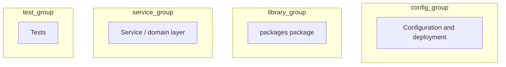

# Architecture report: wevm/wagmi

> Automated static analysis. **Observed** = directly seen in files/imports/AST; **Inferred** = interpretation from that evidence. Repository code was not executed.

## 1. Repository at a glance

| Item | Value |
| --- | --- |
| Repository | wevm/wagmi |
| Description | Reactive primitives for Ethereum apps |
| Language | TypeScript |
| Stars | 6776 |
| Licence | MIT |
| Analysed commit / branch | b148425e51be6b9bfc750568918f5dd0bf8f94ca / main |
| Framework(s) | Next.js, React, Vue |
| Files analysed | 800 |
| Components | 4 |

## 2. Architecture in one minute

wevm/wagmi - Reactive primitives for Ethereum apps. This repository was analysed statically from 800 file(s) (0 Python). Detected technologies (observed from imports/manifests): GitHub Actions, Next.js, React, Vue, Docker, TypeScript. Files are grouped into 4 component(s): Configuration and deployment, packages package, Service / domain layer, Tests. Findings below distinguish observed facts from inferred interpretation.

## 3. High-level block diagram

## 4. Main components

### Configuration and deployment (`config`)

- **Kind:** config
- **Status:** Observed
- **Confidence:** 0.85
- **Responsibility:** Groups 34 file(s) under configuration and deployment (observed from repository paths and static analysis).
- **Paths:** `FUNDING.json`, `biome.json`, `package.json`, `packages/cli/package.json`, `packages/cli/src/plugins/__fixtures__/foundry/foundry.toml`, `packages/cli/src/plugins/__fixtures__/hardhat/package.json`, `packages/cli/tsconfig.build.json`, `packages/cli/tsconfig.json`, `packages/connectors/package.json`, `packages/connectors/tsconfig.build.json`, `packages/connectors/tsconfig.json`, `packages/core/package.json`, `packages/core/tsconfig.build.json`, `packages/core/tsconfig.json`, `packages/create-wagmi/package.json`, `packages/create-wagmi/templates/next/package.json`, `packages/create-wagmi/templates/next/tsconfig.json`, `packages/create-wagmi/templates/nuxt/package.json`, `packages/create-wagmi/templates/nuxt/server/tsconfig.json`, `packages/create-wagmi/templates/nuxt/tsconfig.json`, `packages/create-wagmi/templates/vite-react/package.json`, `packages/create-wagmi/templates/vite-react/tsconfig.json`, `packages/create-wagmi/templates/vite-react/tsconfig.node.json`, `packages/create-wagmi/templates/vite-vanilla/package.json`, `packages/create-wagmi/templates/vite-vanilla/tsconfig.json`, `packages/create-wagmi/templates/vite-vue/package.json`, `packages/create-wagmi/templates/vite-vue/tsconfig.json`, `packages/create-wagmi/templates/vite-vue/tsconfig.node.json`, `packages/create-wagmi/tsconfig.build.json`, `packages/create-wagmi/tsconfig.json`, `packages/engine-tests/next/tsconfig.json`, `packages/engine-tests/package.json`, `packages/engine-tests/tsconfig.json`, `packages/react/package.json`
- **Evidence:** [FUNDING.json](https://github.com/wevm/wagmi/blob/b148425e51be6b9bfc750568918f5dd0bf8f94ca/FUNDING.json); [biome.json](https://github.com/wevm/wagmi/blob/b148425e51be6b9bfc750568918f5dd0bf8f94ca/biome.json); [package.json](https://github.com/wevm/wagmi/blob/b148425e51be6b9bfc750568918f5dd0bf8f94ca/package.json); [packages/cli/package.json](https://github.com/wevm/wagmi/blob/b148425e51be6b9bfc750568918f5dd0bf8f94ca/packages/cli/package.json); [packages/cli/src/plugins/__fixtures__/foundry/foundry.toml](https://github.com/wevm/wagmi/blob/b148425e51be6b9bfc750568918f5dd0bf8f94ca/packages/cli/src/plugins/__fixtures__/foundry/foundry.toml); [packages/cli/src/plugins/__fixtures__/hardhat/package.json](https://github.com/wevm/wagmi/blob/b148425e51be6b9bfc750568918f5dd0bf8f94ca/packages/cli/src/plugins/__fixtures__/hardhat/package.json); [packages/cli/tsconfig.build.json](https://github.com/wevm/wagmi/blob/b148425e51be6b9bfc750568918f5dd0bf8f94ca/packages/cli/tsconfig.build.json); [packages/cli/tsconfig.json](https://github.com/wevm/wagmi/blob/b148425e51be6b9bfc750568918f5dd0bf8f94ca/packages/cli/tsconfig.json)

### packages package (`packages`)

- **Kind:** library
- **Status:** Observed
- **Confidence:** 0.85
- **Responsibility:** Groups 273 file(s) under packages package (observed from repository paths and static analysis).
- **Paths:** `packages/cli/src/cli.ts`, `packages/cli/src/commands/generate.test.ts`, `packages/cli/src/commands/generate.ts`, `packages/cli/src/commands/init.test.ts`, `packages/cli/src/commands/init.ts`, `packages/cli/src/config.test.ts`, `packages/cli/src/config.ts`, `packages/cli/src/errors.ts`, `packages/cli/src/exports/config.test.ts`, `packages/cli/src/exports/config.ts`, `packages/cli/src/exports/index.test-d.ts`, `packages/cli/src/exports/index.test.ts`, `packages/cli/src/exports/index.ts`, `packages/cli/src/exports/plugins.test.ts`, `packages/cli/src/exports/plugins.ts`, `packages/cli/src/logger.test.ts`, `packages/cli/src/logger.ts`, `packages/cli/src/plugins/__fixtures__/hardhat/hardhat.config.js`, `packages/cli/src/plugins/actions.test.ts`, `packages/cli/src/plugins/actions.ts`, `packages/cli/src/plugins/blockExplorer.test.ts`, `packages/cli/src/plugins/blockExplorer.ts`, `packages/cli/src/plugins/etherscan.test.ts`, `packages/cli/src/plugins/etherscan.ts`, `packages/cli/src/plugins/fetch.test.ts`, `packages/cli/src/plugins/fetch.ts`, `packages/cli/src/plugins/foundry.test.ts`, `packages/cli/src/plugins/foundry.ts`, `packages/cli/src/plugins/hardhat.test.ts`, `packages/cli/src/plugins/hardhat.ts`, `packages/cli/src/plugins/react.test.ts`, `packages/cli/src/plugins/react.ts`, `packages/cli/src/plugins/sourcify.test.ts`, `packages/cli/src/plugins/sourcify.ts`, `packages/cli/src/types.ts`, `packages/cli/src/utils/findConfig.test.ts`, `packages/cli/src/utils/findConfig.ts`, `packages/cli/src/utils/format.test.ts`, `packages/cli/src/utils/format.ts`, `packages/cli/src/utils/getAddressDocString.test.ts`, `packages/cli/src/utils/getAddressDocString.ts`, `packages/cli/src/utils/getIsUsingTypeScript.test.ts`, `packages/cli/src/utils/getIsUsingTypeScript.ts`, `packages/cli/src/utils/loadEnv.test.ts`, `packages/cli/src/utils/loadEnv.ts`, `packages/cli/src/utils/packages.test.ts`, `packages/cli/src/utils/packages.ts`, `packages/cli/src/utils/resolveConfig.test.ts`, `packages/cli/src/utils/resolveConfig.ts`, `packages/cli/src/version.ts`, `packages/connectors/src/baseAccount.test.ts`, `packages/connectors/src/baseAccount.ts`, `packages/connectors/src/coinbaseWallet.test.ts`, `packages/connectors/src/coinbaseWallet.ts`, `packages/connectors/src/exports/index.test.ts`, `packages/connectors/src/exports/index.ts`, `packages/connectors/src/metaMask.test.ts`, `packages/connectors/src/metaMask.ts`, `packages/connectors/src/safe.test.ts`, `packages/connectors/src/safe.ts`, `packages/connectors/src/version.ts`, `packages/connectors/src/walletConnect.test.ts`, `packages/connectors/src/walletConnect.ts`, `packages/create-wagmi/src/cli.test.ts`, `packages/create-wagmi/src/cli.ts`, `packages/create-wagmi/src/frameworks.ts`, `packages/create-wagmi/src/index.test-d.ts`, `packages/create-wagmi/src/utils.ts`, `packages/create-wagmi/src/version.ts`, `packages/create-wagmi/templates/next/next-env.d.ts`, `packages/create-wagmi/templates/next/next.config.ts`, `packages/create-wagmi/templates/next/src/app/layout.tsx`, `packages/create-wagmi/templates/next/src/app/page.tsx`, `packages/create-wagmi/templates/next/src/app/providers.tsx`, `packages/create-wagmi/templates/next/src/wagmi.ts`, `packages/create-wagmi/templates/nuxt/app.vue`, `packages/create-wagmi/templates/nuxt/components/Connect.vue`, `packages/create-wagmi/templates/nuxt/components/Connection.vue`, `packages/create-wagmi/templates/nuxt/nuxt.config.ts`, `packages/create-wagmi/templates/nuxt/plugins/wagmi.ts`, `packages/create-wagmi/templates/nuxt/wagmi.ts`, `packages/create-wagmi/templates/vite-react/src/App.tsx`, `packages/create-wagmi/templates/vite-react/src/main.tsx`, `packages/create-wagmi/templates/vite-react/src/vite-env.d.ts`, `packages/create-wagmi/templates/vite-react/src/wagmi.ts`, `packages/create-wagmi/templates/vite-react/vite.config.ts`, `packages/create-wagmi/templates/vite-vanilla/src/main.ts`, `packages/create-wagmi/templates/vite-vanilla/src/vite-env.d.ts`, `packages/create-wagmi/templates/vite-vanilla/src/wagmi.ts`, `packages/create-wagmi/templates/vite-vue/src/App.vue`, `packages/create-wagmi/templates/vite-vue/src/components/Connect.vue`, `packages/create-wagmi/templates/vite-vue/src/components/Connection.vue`, `packages/create-wagmi/templates/vite-vue/src/main.ts`, `packages/create-wagmi/templates/vite-vue/src/vite-env.d.ts`, `packages/create-wagmi/templates/vite-vue/src/wagmi.ts`, `packages/create-wagmi/templates/vite-vue/vite.config.ts`, `packages/engine-tests/next/app/layout.tsx`, `packages/engine-tests/next/app/page.tsx`, `packages/engine-tests/test.ts`, `packages/engine-tests/vite/src.ts`, `packages/react/src/context.test.tsx`, `packages/react/src/context.ts`, `packages/react/src/errors/base.test.ts`, `packages/react/src/errors/base.ts`, `packages/react/src/errors/context.test.ts`, `packages/react/src/errors/context.ts`, `packages/react/src/exports/actions.test.ts`, `packages/react/src/exports/actions.ts`, `packages/react/src/exports/chains.ts`, `packages/react/src/exports/codegen.test.ts`, `packages/react/src/exports/codegen.ts`, `packages/react/src/exports/connectors.test.ts`, `packages/react/src/exports/connectors.ts`, `packages/react/src/exports/index.test.ts`, `packages/react/src/exports/index.ts`, `packages/react/src/exports/query.test.ts`, `packages/react/src/exports/query.ts`, `packages/react/src/exports/tempo.test.ts`, `packages/react/src/exports/tempo.ts`, `packages/react/src/hooks/codegen/createUseReadContract.test-d.ts`, `packages/react/src/hooks/codegen/createUseReadContract.test.ts`, `packages/react/src/hooks/codegen/createUseReadContract.ts`, `packages/react/src/hooks/codegen/createUseSimulateContract.test-d.ts`, `packages/react/src/hooks/codegen/createUseSimulateContract.test.ts`, `packages/react/src/hooks/codegen/createUseSimulateContract.ts`, `packages/react/src/hooks/codegen/createUseWatchContractEvent.test-d.ts`, `packages/react/src/hooks/codegen/createUseWatchContractEvent.test.ts`, `packages/react/src/hooks/codegen/createUseWatchContractEvent.ts`, `packages/react/src/hooks/codegen/createUseWriteContract.test-d.ts`, `packages/react/src/hooks/codegen/createUseWriteContract.test.ts`, `packages/react/src/hooks/codegen/createUseWriteContract.ts`, `packages/react/src/hooks/useBalance.test-d.ts`, `packages/react/src/hooks/useBalance.test.ts`, `packages/react/src/hooks/useBalance.ts`, `packages/react/src/hooks/useBlobBaseFee.test.ts`, `packages/react/src/hooks/useBlobBaseFee.ts`, `packages/react/src/hooks/useBlock.test-d.ts`, `packages/react/src/hooks/useBlock.test.ts`, `packages/react/src/hooks/useBlock.ts`, `packages/react/src/hooks/useBlockNumber.test-d.ts`, `packages/react/src/hooks/useBlockNumber.test.ts`, `packages/react/src/hooks/useBlockNumber.ts`, `packages/react/src/hooks/useBlockTransactionCount.test-d.ts`, `packages/react/src/hooks/useBlockTransactionCount.test.ts`, `packages/react/src/hooks/useBlockTransactionCount.ts`, `packages/react/src/hooks/useBytecode.test-d.ts`, `packages/react/src/hooks/useBytecode.test.ts`, `packages/react/src/hooks/useBytecode.ts`, `packages/react/src/hooks/useCall.test-d.ts`, `packages/react/src/hooks/useCall.test.ts`, `packages/react/src/hooks/useCall.ts`, `packages/react/src/hooks/useCallsStatus.test.ts`, `packages/react/src/hooks/useCallsStatus.ts`, `packages/react/src/hooks/useCapabilities.test.ts`, `packages/react/src/hooks/useCapabilities.ts`, `packages/react/src/hooks/useChainId.test-d.ts`, `packages/react/src/hooks/useChainId.test.ts`, `packages/react/src/hooks/useChainId.ts`, `packages/react/src/hooks/useChains.test.ts`, `packages/react/src/hooks/useChains.ts`, `packages/react/src/hooks/useClient.test-d.ts`, `packages/react/src/hooks/useClient.test.ts`, `packages/react/src/hooks/useClient.ts`, `packages/react/src/hooks/useConfig.test-d.ts`, `packages/react/src/hooks/useConfig.test.ts`, `packages/react/src/hooks/useConfig.ts`, `packages/react/src/hooks/useConnect.test-d.ts`, `packages/react/src/hooks/useConnect.test.ts`, `packages/react/src/hooks/useConnect.ts`, `packages/react/src/hooks/useConnection.test-d.ts`, `packages/react/src/hooks/useConnection.test.ts`, `packages/react/src/hooks/useConnection.ts`, `packages/react/src/hooks/useConnectionEffect.test.ts`, `packages/react/src/hooks/useConnectionEffect.ts`, `packages/react/src/hooks/useConnections.test.ts`, `packages/react/src/hooks/useConnections.ts`, `packages/react/src/hooks/useConnectorClient.test-d.ts`, `packages/react/src/hooks/useConnectorClient.test.tsx`, `packages/react/src/hooks/useConnectorClient.ts`, `packages/react/src/hooks/useConnectors.test.ts`, `packages/react/src/hooks/useConnectors.ts`, `packages/react/src/hooks/useContractEvents.test-d.ts`, `packages/react/src/hooks/useContractEvents.test.ts`, `packages/react/src/hooks/useContractEvents.ts`, `packages/react/src/hooks/useDeployContract.test-d.ts`, `packages/react/src/hooks/useDeployContract.test.ts`, `packages/react/src/hooks/useDeployContract.ts`, `packages/react/src/hooks/useDisconnect.test-d.ts`, `packages/react/src/hooks/useDisconnect.test.ts`, `packages/react/src/hooks/useDisconnect.ts`, `packages/react/src/hooks/useEnsAddress.test.ts`, `packages/react/src/hooks/useEnsAddress.ts`, `packages/react/src/hooks/useEnsAvatar.test.ts`, `packages/react/src/hooks/useEnsAvatar.ts`, `packages/react/src/hooks/useEnsName.test.ts`, `packages/react/src/hooks/useEnsName.ts`, `packages/react/src/hooks/useEnsResolver.test.ts`, `packages/react/src/hooks/useEnsResolver.ts`, `packages/react/src/hooks/useEnsText.test.ts`, `packages/react/src/hooks/useEnsText.ts`, `packages/react/src/hooks/useEstimateFeesPerGas.test-d.ts`, `packages/react/src/hooks/useEstimateFeesPerGas.test.ts`, `packages/react/src/hooks/useEstimateFeesPerGas.ts`, `packages/react/src/hooks/useEstimateGas.test-d.ts`, `packages/react/src/hooks/useEstimateGas.test.ts`, `packages/react/src/hooks/useEstimateGas.ts`, `packages/react/src/hooks/useEstimateMaxPriorityFeePerGas.test-d.ts`, `packages/react/src/hooks/useEstimateMaxPriorityFeePerGas.test.ts`, `packages/react/src/hooks/useEstimateMaxPriorityFeePerGas.ts`, `packages/react/src/hooks/useFeeHistory.test-d.ts`, `packages/react/src/hooks/useFeeHistory.test.ts`, `packages/react/src/hooks/useFeeHistory.ts`, `packages/react/src/hooks/useGasPrice.test-d.ts`, `packages/react/src/hooks/useGasPrice.test.ts`, `packages/react/src/hooks/useGasPrice.ts`, `packages/react/src/hooks/useInfiniteReadContracts.test-d.ts`, `packages/react/src/hooks/useInfiniteReadContracts.test.ts`, `packages/react/src/hooks/useInfiniteReadContracts.ts`, `packages/react/src/hooks/usePrepareTransactionRequest.test-d.ts`, `packages/react/src/hooks/usePrepareTransactionRequest.test.ts`, `packages/react/src/hooks/usePrepareTransactionRequest.ts`, `packages/react/src/hooks/useProof.test-d.ts`, `packages/react/src/hooks/useProof.test.ts`, `packages/react/src/hooks/useProof.ts`, `packages/react/src/hooks/usePublicClient.test-d.ts`, `packages/react/src/hooks/usePublicClient.test.ts`, `packages/react/src/hooks/usePublicClient.ts`, `packages/react/src/hooks/useReadContract.test-d.ts`, `packages/react/src/hooks/useReadContract.test.ts`, `packages/react/src/hooks/useReadContract.ts`, `packages/react/src/hooks/useReadContracts.test-d.ts`, `packages/react/src/hooks/useReadContracts.test.ts`, `packages/react/src/hooks/useReadContracts.ts`, `packages/react/src/hooks/useReconnect.test-d.ts`, `packages/react/src/hooks/useReconnect.test.ts`, `packages/react/src/hooks/useReconnect.ts`, `packages/react/src/hooks/useSendCalls.test.ts`, `packages/react/src/hooks/useSendCalls.ts`, `packages/react/src/hooks/useSendCallsSync.test.ts`, `packages/react/src/hooks/useSendCallsSync.ts`, `packages/react/src/hooks/useSendTransaction.test-d.ts`, `packages/react/src/hooks/useSendTransaction.test.ts`, `packages/react/src/hooks/useSendTransaction.ts`, `packages/react/src/hooks/useSendTransactionSync.test-d.ts`, `packages/react/src/hooks/useSendTransactionSync.test.ts`, `packages/react/src/hooks/useSendTransactionSync.ts`, `packages/react/src/hooks/useShowCallsStatus.test.ts`, `packages/react/src/hooks/useShowCallsStatus.ts`, `packages/react/src/hooks/useSignMessage.test-d.ts`, `packages/react/src/hooks/useSignMessage.test.ts`, `packages/react/src/hooks/useSignMessage.ts`, `packages/react/src/hooks/useSignTransaction.test-d.ts`, `packages/react/src/hooks/useSignTransaction.test.ts`, `packages/react/src/hooks/useSignTransaction.ts`, `packages/react/src/hooks/useSignTypedData.test-d.ts`, `packages/react/src/hooks/useSignTypedData.test.ts`, `packages/react/src/hooks/useSignTypedData.ts`, `packages/react/src/hooks/useSimulateContract.test-d.ts`, `packages/react/src/hooks/useSimulateContract.test.ts`, `packages/react/src/hooks/useSimulateContract.ts`, `packages/react/src/hooks/useStorageAt.test-d.ts`, `packages/react/src/hooks/useStorageAt.test.ts`, `packages/react/src/hooks/useStorageAt.ts`, `packages/react/src/hooks/useSwitchChain.test-d.ts`, `packages/react/src/hooks/useSwitchChain.test.ts`, `packages/react/src/hooks/useSwitchChain.ts`, `packages/react/src/hooks/useSwitchConnection.test-d.ts`, `packages/react/src/hooks/useSwitchConnection.test.ts`, `packages/react/src/hooks/useSwitchConnection.ts`, `packages/react/src/hooks/useSyncExternalStoreWithTracked.test.tsx`, `packages/react/src/hooks/useSyncExternalStoreWithTracked.ts`, `packages/react/src/hooks/useTransaction.test-d.ts`, `packages/react/src/hooks/useTransaction.test.ts`
- **Evidence:** [packages/cli/src/cli.ts](https://github.com/wevm/wagmi/blob/b148425e51be6b9bfc750568918f5dd0bf8f94ca/packages/cli/src/cli.ts); [packages/cli/src/commands/generate.test.ts](https://github.com/wevm/wagmi/blob/b148425e51be6b9bfc750568918f5dd0bf8f94ca/packages/cli/src/commands/generate.test.ts); [packages/cli/src/commands/generate.ts](https://github.com/wevm/wagmi/blob/b148425e51be6b9bfc750568918f5dd0bf8f94ca/packages/cli/src/commands/generate.ts); [packages/cli/src/commands/init.test.ts](https://github.com/wevm/wagmi/blob/b148425e51be6b9bfc750568918f5dd0bf8f94ca/packages/cli/src/commands/init.test.ts); [packages/cli/src/commands/init.ts](https://github.com/wevm/wagmi/blob/b148425e51be6b9bfc750568918f5dd0bf8f94ca/packages/cli/src/commands/init.ts); [packages/cli/src/config.test.ts](https://github.com/wevm/wagmi/blob/b148425e51be6b9bfc750568918f5dd0bf8f94ca/packages/cli/src/config.test.ts); [packages/cli/src/config.ts](https://github.com/wevm/wagmi/blob/b148425e51be6b9bfc750568918f5dd0bf8f94ca/packages/cli/src/config.ts); [packages/cli/src/errors.ts](https://github.com/wevm/wagmi/blob/b148425e51be6b9bfc750568918f5dd0bf8f94ca/packages/cli/src/errors.ts)

### Service / domain layer (`service_layer`)

- **Kind:** service
- **Status:** Observed
- **Confidence:** 0.85
- **Responsibility:** Groups 413 file(s) under service / domain layer (observed from repository paths and static analysis).
- **Paths:** `packages/core/src/actions/call.test.ts`, `packages/core/src/actions/call.ts`, `packages/core/src/actions/codegen/createReadContract.test-d.ts`, `packages/core/src/actions/codegen/createReadContract.test.ts`, `packages/core/src/actions/codegen/createReadContract.ts`, `packages/core/src/actions/codegen/createSimulateContract.test-d.ts`, `packages/core/src/actions/codegen/createSimulateContract.test.ts`, `packages/core/src/actions/codegen/createSimulateContract.ts`, `packages/core/src/actions/codegen/createWatchContractEvent.test-d.ts`, `packages/core/src/actions/codegen/createWatchContractEvent.test.ts`, `packages/core/src/actions/codegen/createWatchContractEvent.ts`, `packages/core/src/actions/codegen/createWriteContract.test-d.ts`, `packages/core/src/actions/codegen/createWriteContract.test.ts`, `packages/core/src/actions/codegen/createWriteContract.ts`, `packages/core/src/actions/connect.test-d.ts`, `packages/core/src/actions/connect.test.ts`, `packages/core/src/actions/connect.ts`, `packages/core/src/actions/deployContract.test-d.ts`, `packages/core/src/actions/deployContract.test.ts`, `packages/core/src/actions/deployContract.ts`, `packages/core/src/actions/disconnect.test.ts`, `packages/core/src/actions/disconnect.ts`, `packages/core/src/actions/estimateFeesPerGas.test-d.ts`, `packages/core/src/actions/estimateFeesPerGas.test.ts`, `packages/core/src/actions/estimateFeesPerGas.ts`, `packages/core/src/actions/estimateGas.test-d.ts`, `packages/core/src/actions/estimateGas.test.ts`, `packages/core/src/actions/estimateGas.ts`, `packages/core/src/actions/estimateMaxPriorityFeePerGas.test.ts`, `packages/core/src/actions/estimateMaxPriorityFeePerGas.ts`, `packages/core/src/actions/getBalance.test.ts`, `packages/core/src/actions/getBalance.ts`, `packages/core/src/actions/getBlobBaseFee.test.ts`, `packages/core/src/actions/getBlobBaseFee.ts`, `packages/core/src/actions/getBlock.test-d.ts`, `packages/core/src/actions/getBlock.test.ts`, `packages/core/src/actions/getBlock.ts`, `packages/core/src/actions/getBlockNumber.test.ts`, `packages/core/src/actions/getBlockNumber.ts`, `packages/core/src/actions/getBlockTransactionCount.test.ts`, `packages/core/src/actions/getBlockTransactionCount.ts`, `packages/core/src/actions/getBytecode.test.ts`, `packages/core/src/actions/getBytecode.ts`, `packages/core/src/actions/getCallsStatus.test.ts`, `packages/core/src/actions/getCallsStatus.ts`, `packages/core/src/actions/getCapabilities.test.ts`, `packages/core/src/actions/getCapabilities.ts`, `packages/core/src/actions/getChainId.test.ts`, `packages/core/src/actions/getChainId.ts`, `packages/core/src/actions/getChains.test-d.ts`, `packages/core/src/actions/getChains.test.ts`, `packages/core/src/actions/getChains.ts`, `packages/core/src/actions/getClient.test-d.ts`, `packages/core/src/actions/getClient.test.ts`, `packages/core/src/actions/getClient.ts`, `packages/core/src/actions/getConnection.test-d.ts`, `packages/core/src/actions/getConnection.test.ts`, `packages/core/src/actions/getConnection.ts`, `packages/core/src/actions/getConnections.test.ts`, `packages/core/src/actions/getConnections.ts`, `packages/core/src/actions/getConnectorClient.test-d.ts`, `packages/core/src/actions/getConnectorClient.test.ts`, `packages/core/src/actions/getConnectorClient.ts`, `packages/core/src/actions/getConnectors.test.ts`, `packages/core/src/actions/getConnectors.ts`, `packages/core/src/actions/getContractEvents.test-d.ts`, `packages/core/src/actions/getContractEvents.test.ts`, `packages/core/src/actions/getContractEvents.ts`, `packages/core/src/actions/getEnsAddress.test.ts`, `packages/core/src/actions/getEnsAddress.ts`, `packages/core/src/actions/getEnsAvatar.test.ts`, `packages/core/src/actions/getEnsAvatar.ts`, `packages/core/src/actions/getEnsName.test.ts`, `packages/core/src/actions/getEnsName.ts`, `packages/core/src/actions/getEnsResolver.test.ts`, `packages/core/src/actions/getEnsResolver.ts`, `packages/core/src/actions/getEnsText.test.ts`, `packages/core/src/actions/getEnsText.ts`, `packages/core/src/actions/getFeeHistory.test.ts`, `packages/core/src/actions/getFeeHistory.ts`, `packages/core/src/actions/getGasPrice.test.ts`, `packages/core/src/actions/getGasPrice.ts`, `packages/core/src/actions/getProof.test.ts`, `packages/core/src/actions/getProof.ts`, `packages/core/src/actions/getPublicClient.test-d.ts`, `packages/core/src/actions/getPublicClient.test.ts`, `packages/core/src/actions/getPublicClient.ts`, `packages/core/src/actions/getStorageAt.test.ts`, `packages/core/src/actions/getStorageAt.ts`, `packages/core/src/actions/getTransaction.test-d.ts`, `packages/core/src/actions/getTransaction.test.ts`, `packages/core/src/actions/getTransaction.ts`, `packages/core/src/actions/getTransactionConfirmations.test-d.ts`, `packages/core/src/actions/getTransactionConfirmations.test.ts`, `packages/core/src/actions/getTransactionConfirmations.ts`, `packages/core/src/actions/getTransactionCount.test.ts`, `packages/core/src/actions/getTransactionCount.ts`, `packages/core/src/actions/getTransactionReceipt.test-d.ts`, `packages/core/src/actions/getTransactionReceipt.test.ts`, `packages/core/src/actions/getTransactionReceipt.ts`, `packages/core/src/actions/getWalletClient.test-d.ts`, `packages/core/src/actions/getWalletClient.test.ts`, `packages/core/src/actions/getWalletClient.ts`, `packages/core/src/actions/multicall.bench-d.ts`, `packages/core/src/actions/multicall.test-d.ts`, `packages/core/src/actions/multicall.test.ts`, `packages/core/src/actions/multicall.ts`, `packages/core/src/actions/prepareTransactionRequest.test-d.ts`, `packages/core/src/actions/prepareTransactionRequest.test.ts`, `packages/core/src/actions/prepareTransactionRequest.ts`, `packages/core/src/actions/readContract.bench-d.ts`, `packages/core/src/actions/readContract.test-d.ts`, `packages/core/src/actions/readContract.test.ts`, `packages/core/src/actions/readContract.ts`, `packages/core/src/actions/readContracts.test-d.ts`, `packages/core/src/actions/readContracts.test.ts`, `packages/core/src/actions/readContracts.ts`, `packages/core/src/actions/reconnect.test.ts`, `packages/core/src/actions/reconnect.ts`, `packages/core/src/actions/sendCalls.test.ts`, `packages/core/src/actions/sendCalls.ts`, `packages/core/src/actions/sendCallsSync.test.ts`, `packages/core/src/actions/sendCallsSync.ts`, `packages/core/src/actions/sendTransaction.test-d.ts`, `packages/core/src/actions/sendTransaction.test.ts`, `packages/core/src/actions/sendTransaction.ts`, `packages/core/src/actions/sendTransactionSync.test-d.ts`, `packages/core/src/actions/sendTransactionSync.test.ts`, `packages/core/src/actions/sendTransactionSync.ts`, `packages/core/src/actions/showCallsStatus.test.ts`, `packages/core/src/actions/showCallsStatus.ts`, `packages/core/src/actions/signMessage.test.ts`, `packages/core/src/actions/signMessage.ts`, `packages/core/src/actions/signTransaction.test-d.ts`, `packages/core/src/actions/signTransaction.test.ts`, `packages/core/src/actions/signTransaction.ts`, `packages/core/src/actions/signTypedData.test-d.ts`, `packages/core/src/actions/signTypedData.test.ts`, `packages/core/src/actions/signTypedData.ts`, `packages/core/src/actions/simulateContract.test-d.ts`, `packages/core/src/actions/simulateContract.test.ts`, `packages/core/src/actions/simulateContract.ts`, `packages/core/src/actions/switchChain.test.ts`, `packages/core/src/actions/switchChain.ts`, `packages/core/src/actions/switchConnection.test.ts`, `packages/core/src/actions/switchConnection.ts`, `packages/core/src/actions/verifyMessage.test.ts`, `packages/core/src/actions/verifyMessage.ts`, `packages/core/src/actions/verifyTypedData.test-d.ts`, `packages/core/src/actions/verifyTypedData.test.ts`, `packages/core/src/actions/verifyTypedData.ts`, `packages/core/src/actions/waitForCallsStatus.test.ts`, `packages/core/src/actions/waitForCallsStatus.ts`, `packages/core/src/actions/waitForTransactionReceipt.test-d.ts`, `packages/core/src/actions/waitForTransactionReceipt.test.ts`, `packages/core/src/actions/waitForTransactionReceipt.ts`, `packages/core/src/actions/watchAsset.test.ts`, `packages/core/src/actions/watchAsset.ts`, `packages/core/src/actions/watchBlockNumber.test-d.ts`, `packages/core/src/actions/watchBlockNumber.test.ts`, `packages/core/src/actions/watchBlockNumber.ts`, `packages/core/src/actions/watchBlocks.test-d.ts`, `packages/core/src/actions/watchBlocks.test.ts`, `packages/core/src/actions/watchBlocks.ts`, `packages/core/src/actions/watchChainId.test.ts`, `packages/core/src/actions/watchChainId.ts`, `packages/core/src/actions/watchChains.test.ts`, `packages/core/src/actions/watchChains.ts`, `packages/core/src/actions/watchClient.test-d.ts`, `packages/core/src/actions/watchClient.test.ts`, `packages/core/src/actions/watchClient.ts`, `packages/core/src/actions/watchConnection.test.ts`, `packages/core/src/actions/watchConnection.ts`, `packages/core/src/actions/watchConnections.test.ts`, `packages/core/src/actions/watchConnections.ts`, `packages/core/src/actions/watchConnectors.test.ts`, `packages/core/src/actions/watchConnectors.ts`, `packages/core/src/actions/watchContractEvent.test-d.ts`, `packages/core/src/actions/watchContractEvent.test.ts`, `packages/core/src/actions/watchContractEvent.ts`, `packages/core/src/actions/watchPendingTransactions.test-d.ts`, `packages/core/src/actions/watchPendingTransactions.test.ts`, `packages/core/src/actions/watchPendingTransactions.ts`, `packages/core/src/actions/watchPublicClient.test-d.ts`, `packages/core/src/actions/watchPublicClient.test.ts`, `packages/core/src/actions/watchPublicClient.ts`, `packages/core/src/actions/writeContract.bench-d.ts`, `packages/core/src/actions/writeContract.test-d.ts`, `packages/core/src/actions/writeContract.ts`, `packages/core/src/actions/writeContractSync.test-d.ts`, `packages/core/src/actions/writeContractSync.test.ts`, `packages/core/src/actions/writeContractSync.ts`, `packages/core/src/connectors/createConnector.test.ts`, `packages/core/src/connectors/createConnector.ts`, `packages/core/src/connectors/injected.test.ts`, `packages/core/src/connectors/injected.ts`, `packages/core/src/connectors/mock.test.ts`, `packages/core/src/connectors/mock.ts`, `packages/core/src/createConfig.test-d.ts`, `packages/core/src/createConfig.test.ts`, `packages/core/src/createConfig.ts`, `packages/core/src/createEmitter.test.ts`, `packages/core/src/createEmitter.ts`, `packages/core/src/createStorage.test-d.ts`, `packages/core/src/createStorage.test.ts`, `packages/core/src/createStorage.ts`, `packages/core/src/errors/base.test.ts`, `packages/core/src/errors/base.ts`, `packages/core/src/errors/config.test.ts`, `packages/core/src/errors/config.ts`, `packages/core/src/errors/connector.test.ts`, `packages/core/src/errors/connector.ts`, `packages/core/src/exports/actions.test.ts`, `packages/core/src/exports/actions.ts`, `packages/core/src/exports/chains.ts`, `packages/core/src/exports/codegen.test.ts`, `packages/core/src/exports/codegen.ts`, `packages/core/src/exports/index.test.ts`, `packages/core/src/exports/index.ts`, `packages/core/src/exports/internal.test.ts`, `packages/core/src/exports/internal.ts`, `packages/core/src/exports/query.test.ts`, `packages/core/src/exports/query.ts`, `packages/core/src/exports/tempo.test.ts`, `packages/core/src/exports/tempo.ts`, `packages/core/src/hydrate.test.ts`, `packages/core/src/hydrate.ts`, `packages/core/src/query/call.test.ts`, `packages/core/src/query/call.ts`, `packages/core/src/query/connect.test-d.ts`, `packages/core/src/query/connect.test.ts`, `packages/core/src/query/connect.ts`, `packages/core/src/query/deployContract.test.ts`, `packages/core/src/query/deployContract.ts`, `packages/core/src/query/disconnect.test.ts`, `packages/core/src/query/disconnect.ts`, `packages/core/src/query/estimateFeesPerGas.test-d.ts`, `packages/core/src/query/estimateFeesPerGas.test.ts`, `packages/core/src/query/estimateFeesPerGas.ts`, `packages/core/src/query/estimateGas.test-d.ts`, `packages/core/src/query/estimateGas.test.ts`, `packages/core/src/query/estimateGas.ts`, `packages/core/src/query/estimateMaxPriorityFeePerGas.test.ts`, `packages/core/src/query/estimateMaxPriorityFeePerGas.ts`, `packages/core/src/query/getBalance.test.ts`, `packages/core/src/query/getBalance.ts`, `packages/core/src/query/getBlobBaseFee.test.ts`, `packages/core/src/query/getBlobBaseFee.ts`, `packages/core/src/query/getBlock.test-d.ts`, `packages/core/src/query/getBlock.test.ts`, `packages/core/src/query/getBlock.ts`, `packages/core/src/query/getBlockNumber.test.ts`, `packages/core/src/query/getBlockNumber.ts`, `packages/core/src/query/getBlockTransactionCount.test.ts`, `packages/core/src/query/getBlockTransactionCount.ts`, `packages/core/src/query/getBytecode.test.ts`, `packages/core/src/query/getBytecode.ts`, `packages/core/src/query/getCallsStatus.test.ts`, `packages/core/src/query/getCallsStatus.ts`, `packages/core/src/query/getCapabilities.test.ts`, `packages/core/src/query/getCapabilities.ts`, `packages/core/src/query/getConnectorClient.test-d.ts`, `packages/core/src/query/getConnectorClient.test.ts`, `packages/core/src/query/getConnectorClient.ts`, `packages/core/src/query/getContractEvents.test-d.ts`, `packages/core/src/query/getContractEvents.test.ts`, `packages/core/src/query/getContractEvents.ts`, `packages/core/src/query/getEnsAddress.test.ts`, `packages/core/src/query/getEnsAddress.ts`, `packages/core/src/query/getEnsAvatar.test.ts`, `packages/core/src/query/getEnsAvatar.ts`, `packages/core/src/query/getEnsName.test.ts`, `packages/core/src/query/getEnsName.ts`, `packages/core/src/query/getEnsResolver.test.ts`, `packages/core/src/query/getEnsResolver.ts`, `packages/core/src/query/getEnsText.test.ts`, `packages/core/src/query/getEnsText.ts`, `packages/core/src/query/getFeeHistory.test.ts`, `packages/core/src/query/getFeeHistory.ts`, `packages/core/src/query/getGasPrice.test.ts`, `packages/core/src/query/getGasPrice.ts`, `packages/core/src/query/getProof.test.ts`, `packages/core/src/query/getProof.ts`, `packages/core/src/query/getStorageAt.test.ts`, `packages/core/src/query/getStorageAt.ts`, `packages/core/src/query/getTransaction.test-d.ts`, `packages/core/src/query/getTransaction.test.ts`, `packages/core/src/query/getTransaction.ts`, `packages/core/src/query/getTransactionConfirmations.test-d.ts`, `packages/core/src/query/getTransactionConfirmations.test.ts`, `packages/core/src/query/getTransactionConfirmations.ts`, `packages/core/src/query/getTransactionCount.test.ts`, `packages/core/src/query/getTransactionCount.ts`, `packages/core/src/query/getTransactionReceipt.test-d.ts`, `packages/core/src/query/getTransactionReceipt.test.ts`, `packages/core/src/query/getTransactionReceipt.ts`, `packages/core/src/query/getWalletClient.test-d.ts`, `packages/core/src/query/getWalletClient.test.ts`, `packages/core/src/query/getWalletClient.ts`, `packages/core/src/query/infiniteReadContracts.test-d.ts`, `packages/core/src/query/infiniteReadContracts.test.ts`, `packages/core/src/query/infiniteReadContracts.ts`, `packages/core/src/query/prepareTransactionRequest.test-d.ts`, `packages/core/src/query/prepareTransactionRequest.test.ts`, `packages/core/src/query/prepareTransactionRequest.ts`, `packages/core/src/query/readContract.test-d.ts`, `packages/core/src/query/readContract.test.ts`, `packages/core/src/query/readContract.ts`, `packages/core/src/query/readContracts.test-d.ts`, `packages/core/src/query/readContracts.test.ts`, `packages/core/src/query/readContracts.ts`, `packages/core/src/query/reconnect.test.ts`, `packages/core/src/query/reconnect.ts`, `packages/core/src/query/sendCalls.test.ts`, `packages/core/src/query/sendCalls.ts`, `packages/core/src/query/sendCallsSync.test.ts`, `packages/core/src/query/sendCallsSync.ts`, `packages/core/src/query/sendTransaction.test.ts`, `packages/core/src/query/sendTransaction.ts`, `packages/core/src/query/sendTransactionSync.test.ts`, `packages/core/src/query/sendTransactionSync.ts`, `packages/core/src/query/showCallsStatus.test.ts`, `packages/core/src/query/showCallsStatus.ts`, `packages/core/src/query/signMessage.test.ts`, `packages/core/src/query/signMessage.ts`, `packages/core/src/query/signTransaction.test.ts`, `packages/core/src/query/signTransaction.ts`, `packages/core/src/query/signTypedData.test.ts`, `packages/core/src/query/signTypedData.ts`, `packages/core/src/query/simulateContract.test-d.ts`, `packages/core/src/query/simulateContract.test.ts`, `packages/core/src/query/simulateContract.ts`, `packages/core/src/query/switchChain.test.ts`, `packages/core/src/query/switchChain.ts`, `packages/core/src/query/switchConnection.test.ts`, `packages/core/src/query/switchConnection.ts`, `packages/core/src/query/types.ts`, `packages/core/src/query/utils.test.ts`, `packages/core/src/query/utils.ts`, `packages/core/src/query/verifyMessage.test.ts`, `packages/core/src/query/verifyMessage.ts`, `packages/core/src/query/verifyTypedData.test-d.ts`, `packages/core/src/query/verifyTypedData.test.ts`, `packages/core/src/query/verifyTypedData.ts`, `packages/core/src/query/waitForCallsStatus.test.ts`, `packages/core/src/query/waitForCallsStatus.ts`, `packages/core/src/query/waitForTransactionReceipt.test-d.ts`, `packages/core/src/query/waitForTransactionReceipt.test.ts`, `packages/core/src/query/waitForTransactionReceipt.ts`, `packages/core/src/query/watchAsset.test.ts`, `packages/core/src/query/watchAsset.ts`, `packages/core/src/query/writeContract.test-d.ts`, `packages/core/src/query/writeContract.test.ts`, `packages/core/src/query/writeContract.ts`, `packages/core/src/query/writeContractSync.ts`, `packages/core/src/tempo/Connectors.test.ts`, `packages/core/src/tempo/Connectors.ts`, `packages/core/src/tempo/actions/amm.test-d.ts`, `packages/core/src/tempo/actions/amm.test.ts`, `packages/core/src/tempo/actions/amm.ts`, `packages/core/src/tempo/actions/dex.test-d.ts`, `packages/core/src/tempo/actions/dex.test.ts`, `packages/core/src/tempo/actions/dex.ts`, `packages/core/src/tempo/actions/faucet.ts`, `packages/core/src/tempo/actions/fee.test-d.ts`, `packages/core/src/tempo/actions/fee.test.ts`, `packages/core/src/tempo/actions/fee.ts`, `packages/core/src/tempo/actions/index.ts`, `packages/core/src/tempo/actions/nonce.test.ts`, `packages/core/src/tempo/actions/nonce.ts`, `packages/core/src/tempo/actions/policy.test-d.ts`, `packages/core/src/tempo/actions/policy.test.ts`, `packages/core/src/tempo/actions/policy.ts`, `packages/core/src/tempo/actions/reward.test-d.ts`, `packages/core/src/tempo/actions/reward.ts`, `packages/core/src/tempo/actions/token.test-d.ts`, `packages/core/src/tempo/actions/token.test.ts`, `packages/core/src/tempo/actions/token.ts`, `packages/core/src/tempo/actions/utils.test-d.ts`, `packages/core/src/tempo/actions/utils.ts`, `packages/core/src/tempo/actions/wallet.test.ts`, `packages/core/src/tempo/actions/wallet.ts`, `packages/core/src/tempo/actions/zone.test-d.ts`, `packages/core/src/tempo/actions/zone.test.ts`, `packages/core/src/tempo/actions/zone.ts`, `packages/core/src/tempo/tempoWallet.test.ts`, `packages/core/src/transports/connector.test.ts`, `packages/core/src/transports/connector.ts`, `packages/core/src/transports/fallback.test.ts`, `packages/core/src/transports/fallback.ts`, `packages/core/src/types/chain.test-d.ts`, `packages/core/src/types/chain.ts`, `packages/core/src/types/properties.ts`, `packages/core/src/types/query.ts`, `packages/core/src/types/register.ts`, `packages/core/src/types/utils.test-d.ts`, `packages/core/src/types/utils.ts`, `packages/core/src/utils/cookie.test.ts`, `packages/core/src/utils/cookie.ts`, `packages/core/src/utils/deepEqual.test.ts`, `packages/core/src/utils/deepEqual.ts`, `packages/core/src/utils/deserialize.test.ts`, `packages/core/src/utils/deserialize.ts`, `packages/core/src/utils/extractRpcUrls.test.ts`, `packages/core/src/utils/extractRpcUrls.ts`, `packages/core/src/utils/getAction.test.ts`, `packages/core/src/utils/getAction.ts`, `packages/core/src/utils/getVersion.test.ts`, `packages/core/src/utils/getVersion.ts`, `packages/core/src/utils/serialize.test.ts`, `packages/core/src/utils/serialize.ts`, `packages/core/src/utils/uid.ts`, `packages/core/src/version.ts`
- **Evidence:** [packages/core/src/actions/call.test.ts](https://github.com/wevm/wagmi/blob/b148425e51be6b9bfc750568918f5dd0bf8f94ca/packages/core/src/actions/call.test.ts); [packages/core/src/actions/call.ts](https://github.com/wevm/wagmi/blob/b148425e51be6b9bfc750568918f5dd0bf8f94ca/packages/core/src/actions/call.ts); [packages/core/src/actions/codegen/createReadContract.test-d.ts](https://github.com/wevm/wagmi/blob/b148425e51be6b9bfc750568918f5dd0bf8f94ca/packages/core/src/actions/codegen/createReadContract.test-d.ts); [packages/core/src/actions/codegen/createReadContract.test.ts](https://github.com/wevm/wagmi/blob/b148425e51be6b9bfc750568918f5dd0bf8f94ca/packages/core/src/actions/codegen/createReadContract.test.ts); [packages/core/src/actions/codegen/createReadContract.ts](https://github.com/wevm/wagmi/blob/b148425e51be6b9bfc750568918f5dd0bf8f94ca/packages/core/src/actions/codegen/createReadContract.ts); [packages/core/src/actions/codegen/createSimulateContract.test-d.ts](https://github.com/wevm/wagmi/blob/b148425e51be6b9bfc750568918f5dd0bf8f94ca/packages/core/src/actions/codegen/createSimulateContract.test-d.ts); [packages/core/src/actions/codegen/createSimulateContract.test.ts](https://github.com/wevm/wagmi/blob/b148425e51be6b9bfc750568918f5dd0bf8f94ca/packages/core/src/actions/codegen/createSimulateContract.test.ts); [packages/core/src/actions/codegen/createSimulateContract.ts](https://github.com/wevm/wagmi/blob/b148425e51be6b9bfc750568918f5dd0bf8f94ca/packages/core/src/actions/codegen/createSimulateContract.ts)

### Tests (`tests`)

- **Kind:** test
- **Status:** Observed
- **Confidence:** 0.85
- **Responsibility:** Groups 4 file(s) under tests (observed from repository paths and static analysis).
- **Paths:** `packages/cli/test/constants.ts`, `packages/cli/test/setup.ts`, `packages/cli/test/utils.ts`, `packages/core/test/setup.ts`
- **Evidence:** [packages/cli/test/constants.ts](https://github.com/wevm/wagmi/blob/b148425e51be6b9bfc750568918f5dd0bf8f94ca/packages/cli/test/constants.ts); [packages/cli/test/setup.ts](https://github.com/wevm/wagmi/blob/b148425e51be6b9bfc750568918f5dd0bf8f94ca/packages/cli/test/setup.ts); [packages/cli/test/utils.ts](https://github.com/wevm/wagmi/blob/b148425e51be6b9bfc750568918f5dd0bf8f94ca/packages/cli/test/utils.ts); [packages/core/test/setup.ts](https://github.com/wevm/wagmi/blob/b148425e51be6b9bfc750568918f5dd0bf8f94ca/packages/core/test/setup.ts)

## 5. Execution flow

No entry point was observed; the startup flow below is therefore limited.

Representative flow (derived from observed entry points and the import graph; steps beyond the entry point are **Inferred**):

1. Execution starts at an observed entry point listed above, if present.
2. No internal import relationships between components were observed.

## 6. Project structure

### `(root)`

- `.gitignore` - other (2690 bytes)
- `FUNDING.json` - config (213 bytes)
- `LICENSE` - docs (1074 bytes)
- `biome.json` - config (3067 bytes)
- `package.json` - manifest (6154 bytes)

### `.agents`

- `.agents/README.md` - docs (4 bytes)
- `.agents/skills/wagmi-development/SKILL.md` - docs (15392 bytes)

### `.changeset`

- `.changeset/README.md` - docs (510 bytes)
- `.changeset/config.json` - config (427 bytes)
- `.changeset/quiet-foxes-inject.md` - docs (215 bytes)
- `.changeset/wallet-initiated-connect-listener.md` - docs (222 bytes)

### `.github`

- `.github/CODEOWNERS` - other (297 bytes)
- `.github/CONTRIBUTING.md` - docs (72 bytes)
- `.github/DISCUSSION_TEMPLATE/connector-request.yml` - config (3464 bytes)
- `.github/ISSUE_TEMPLATE/bug_report.yml` - config (3307 bytes)
- `.github/ISSUE_TEMPLATE/config.yml` - config (528 bytes)
- `.github/ISSUE_TEMPLATE/docs_issue.yml` - config (966 bytes)
- `.github/README.md` - docs (10251 bytes)
- `.github/SECURITY.md` - docs (95 bytes)
- `.github/dependabot.yml` - config (313 bytes)
- `.github/logo-dark.svg` - other (2186 bytes)
- `.github/logo-light.svg` - other (2186 bytes)
- `.github/pull_request_template.md` - docs (807 bytes)
- `.github/workflows/changesets.yml` - ci, YAML (3977 bytes)
- `.github/workflows/issue-labeled.yml` - ci, YAML (947 bytes)
- `.github/workflows/lock-issue.yml` - ci, YAML (713 bytes)
- `.github/workflows/pull-request.yml` - ci, YAML (1759 bytes)
- `.github/workflows/scorecard.yml` - ci, YAML (1814 bytes)
- `.github/workflows/verify.yml` - ci, YAML (8224 bytes)

### `.vscode`

- `.vscode/extensions.json` - config (104 bytes)
- `.vscode/settings.json` - config (505 bytes)
- `.vscode/workspace.code-workspace` - other (221 bytes)

### `packages`

- `packages/cli/CHANGELOG.md` - docs (22545 bytes)
- `packages/cli/README.md` - docs (193 bytes)
- `packages/cli/package.json` - manifest (2698 bytes)
- `packages/cli/src/cli.ts` - source, TypeScript (1562 bytes)
- `packages/cli/src/commands/generate.test.ts` - source, TypeScript (10986 bytes)
- `packages/cli/src/commands/generate.ts` - source, TypeScript (12794 bytes)
- `packages/cli/src/commands/init.test.ts` - source, TypeScript (4719 bytes)
- `packages/cli/src/commands/init.ts` - source, TypeScript (2586 bytes)
- `packages/cli/src/config.test.ts` - source, TypeScript (838 bytes)
- `packages/cli/src/config.ts` - source, TypeScript (3214 bytes)
- `packages/cli/src/errors.ts` - source, TypeScript (1447 bytes)
- `packages/cli/src/exports/config.test.ts` - source, TypeScript (223 bytes)
- `packages/cli/src/exports/config.ts` - source, TypeScript (213 bytes)
- `packages/cli/src/exports/index.test-d.ts` - source, TypeScript (167 bytes)
- `packages/cli/src/exports/index.test.ts` - source, TypeScript (249 bytes)
- `packages/cli/src/exports/index.ts` - source, TypeScript (359 bytes)
- `packages/cli/src/exports/plugins.test.ts` - source, TypeScript (384 bytes)
- `packages/cli/src/exports/plugins.ts` - source, TypeScript (698 bytes)
- `packages/cli/src/logger.test.ts` - source, TypeScript (747 bytes)
- `packages/cli/src/logger.ts` - source, TypeScript (878 bytes)
- `packages/cli/src/plugins/__fixtures__/foundry/.gitignore` - other (142 bytes)
- `packages/cli/src/plugins/__fixtures__/foundry/foundry.toml` - config (186 bytes)
- `packages/cli/src/plugins/__fixtures__/foundry/src/Counter.sol` - other (240 bytes)
- `packages/cli/src/plugins/__fixtures__/foundry/src/Foo.sol` - other (170 bytes)
- `packages/cli/src/plugins/__fixtures__/hardhat/.gitignore` - other (99 bytes)
- `packages/cli/src/plugins/__fixtures__/hardhat/contracts/Counter.sol` - other (240 bytes)
- `packages/cli/src/plugins/__fixtures__/hardhat/contracts/Foo.sol` - other (169 bytes)
- `packages/cli/src/plugins/__fixtures__/hardhat/hardhat.config.js` - source, JavaScript (102 bytes)
- `packages/cli/src/plugins/__fixtures__/hardhat/package.json` - manifest (123 bytes)
- `packages/cli/src/plugins/__snapshots__/blockExplorer.test.ts.snap` - other (16677 bytes)
- `packages/cli/src/plugins/__snapshots__/etherscan.test.ts.snap` - other (27819 bytes)
- `packages/cli/src/plugins/__snapshots__/fetch.test.ts.snap` - other (8317 bytes)
- `packages/cli/src/plugins/__snapshots__/routescan.test.ts.snap` - other (27819 bytes)
- `packages/cli/src/plugins/__snapshots__/sourcify.test.ts.snap` - other (4420 bytes)
- `packages/cli/src/plugins/actions.test.ts` - source, TypeScript (15960 bytes)
- `packages/cli/src/plugins/actions.ts` - source, TypeScript (10085 bytes)
- `packages/cli/src/plugins/blockExplorer.test.ts` - source, TypeScript (1328 bytes)
- `packages/cli/src/plugins/blockExplorer.ts` - source, TypeScript (2889 bytes)
- `packages/cli/src/plugins/etherscan.test.ts` - source, TypeScript (2973 bytes)
- `packages/cli/src/plugins/etherscan.ts` - source, TypeScript (7971 bytes)
- `packages/cli/src/plugins/fetch.test.ts` - source, TypeScript (4469 bytes)
- `packages/cli/src/plugins/fetch.ts` - source, TypeScript (3732 bytes)
- `packages/cli/src/plugins/foundry.test.ts` - source, TypeScript (10693 bytes)
- `packages/cli/src/plugins/foundry.ts` - source, TypeScript (10447 bytes)
- `packages/cli/src/plugins/hardhat.test.ts` - source, TypeScript (2443 bytes)
- `packages/cli/src/plugins/hardhat.ts` - source, TypeScript (7712 bytes)
- `packages/cli/src/plugins/react.test.ts` - source, TypeScript (17207 bytes)
- `packages/cli/src/plugins/react.ts` - source, TypeScript (10352 bytes)
- `packages/cli/src/plugins/sourcify.test.ts` - source, TypeScript (2428 bytes)
- `packages/cli/src/plugins/sourcify.ts` - source, TypeScript (9564 bytes)
- `packages/cli/src/types.ts` - source, TypeScript (272 bytes)
- `packages/cli/src/utils/findConfig.test.ts` - source, TypeScript (1120 bytes)
- `packages/cli/src/utils/findConfig.ts` - source, TypeScript (946 bytes)
- `packages/cli/src/utils/format.test.ts` - source, TypeScript (245 bytes)
- `packages/cli/src/utils/format.ts` - source, TypeScript (394 bytes)
- `packages/cli/src/utils/getAddressDocString.test.ts` - source, TypeScript (1575 bytes)
- `packages/cli/src/utils/getAddressDocString.ts` - source, TypeScript (1671 bytes)
- `packages/cli/src/utils/getIsUsingTypeScript.test.ts` - source, TypeScript (981 bytes)
- `packages/cli/src/utils/getIsUsingTypeScript.ts` - source, TypeScript (798 bytes)
- `packages/cli/src/utils/loadEnv.test.ts` - source, TypeScript (1617 bytes)
- `packages/cli/src/utils/loadEnv.ts` - source, TypeScript (2347 bytes)
- `packages/cli/src/utils/packages.test.ts` - source, TypeScript (539 bytes)
- `packages/cli/src/utils/packages.ts` - source, TypeScript (3900 bytes)
- `packages/cli/src/utils/resolveConfig.test.ts` - source, TypeScript (2060 bytes)
- `packages/cli/src/utils/resolveConfig.ts` - source, TypeScript (640 bytes)
- `packages/cli/src/version.ts` - source, TypeScript (32 bytes)
- `packages/cli/test/constants.ts` - test, TypeScript (1749 bytes)
- `packages/cli/test/setup.ts` - test, TypeScript (1422 bytes)
- `packages/cli/test/utils.ts` - test, TypeScript (19328 bytes)
- `packages/cli/tsconfig.build.json` - config (189 bytes)
- `packages/cli/tsconfig.json` - config (123 bytes)
- `packages/connectors/CHANGELOG.md` - docs (86310 bytes)
- `packages/connectors/README.md` - docs (215 bytes)
- `packages/connectors/package.json` - manifest (2662 bytes)
- `packages/connectors/src/baseAccount.test.ts` - source, TypeScript (321 bytes)
- `packages/connectors/src/baseAccount.ts` - source, TypeScript (10745 bytes)
- `packages/connectors/src/coinbaseWallet.test.ts` - source, TypeScript (547 bytes)
- `packages/connectors/src/coinbaseWallet.ts` - source, TypeScript (8387 bytes)
- `packages/connectors/src/exports/index.test.ts` - source, TypeScript (353 bytes)
- `packages/connectors/src/exports/index.ts` - source, TypeScript (656 bytes)
- `packages/connectors/src/metaMask.test.ts` - source, TypeScript (5200 bytes)
- `packages/connectors/src/metaMask.ts` - source, TypeScript (13658 bytes)
- `packages/connectors/src/safe.test.ts` - source, TypeScript (858 bytes)
- `packages/connectors/src/safe.ts` - source, TypeScript (5493 bytes)
- `packages/connectors/src/version.ts` - source, TypeScript (31 bytes)
- `packages/connectors/src/walletConnect.test.ts` - source, TypeScript (1551 bytes)
- `packages/connectors/src/walletConnect.ts` - source, TypeScript (18293 bytes)
- `packages/connectors/tsconfig.build.json` - config (181 bytes)
- `packages/connectors/tsconfig.json` - config (88 bytes)
- `packages/core/CHANGELOG.md` - docs (161430 bytes)
- `packages/core/README.md` - docs (187 bytes)
- `packages/core/package.json` - manifest (3196 bytes)
- `packages/core/src/actions/call.test.ts` - source, TypeScript (4444 bytes)
- `packages/core/src/actions/call.ts` - source, TypeScript (874 bytes)
- `packages/core/src/actions/codegen/createReadContract.test-d.ts` - source, TypeScript (3010 bytes)
- `packages/core/src/actions/codegen/createReadContract.test.ts` - source, TypeScript (1372 bytes)
- `packages/core/src/actions/codegen/createReadContract.ts` - source, TypeScript (3088 bytes)
- `packages/core/src/actions/codegen/createSimulateContract.test-d.ts` - source, TypeScript (5550 bytes)
- `packages/core/src/actions/codegen/createSimulateContract.test.ts` - source, TypeScript (3721 bytes)
- `packages/core/src/actions/codegen/createSimulateContract.ts` - source, TypeScript (3728 bytes)
- `packages/core/src/actions/codegen/createWatchContractEvent.test-d.ts` - source, TypeScript (2670 bytes)
- `packages/core/src/actions/codegen/createWatchContractEvent.test.ts` - source, TypeScript (1083 bytes)
- `packages/core/src/actions/codegen/createWatchContractEvent.ts` - source, TypeScript (2941 bytes)
- `packages/core/src/actions/codegen/createWriteContract.test-d.ts` - source, TypeScript (2437 bytes)
- `packages/core/src/actions/codegen/createWriteContract.test.ts` - source, TypeScript (267 bytes)
- `packages/core/src/actions/codegen/createWriteContract.ts` - source, TypeScript (3808 bytes)
- `packages/core/src/actions/connect.test-d.ts` - source, TypeScript (2401 bytes)
- `packages/core/src/actions/connect.test.ts` - source, TypeScript (2522 bytes)
- `packages/core/src/actions/connect.ts` - source, TypeScript (5239 bytes)
- `packages/core/src/actions/deployContract.test-d.ts` - source, TypeScript (3446 bytes)
- `packages/core/src/actions/deployContract.test.ts` - source, TypeScript (39390 bytes)
- `packages/core/src/actions/deployContract.ts` - source, TypeScript (2746 bytes)
- `packages/core/src/actions/disconnect.test.ts` - source, TypeScript (1161 bytes)
- `packages/core/src/actions/disconnect.ts` - source, TypeScript (2099 bytes)
- `packages/core/src/actions/estimateFeesPerGas.test-d.ts` - source, TypeScript (965 bytes)
- `packages/core/src/actions/estimateFeesPerGas.test.ts` - source, TypeScript (362 bytes)
- `packages/core/src/actions/estimateFeesPerGas.ts` - source, TypeScript (1740 bytes)
- `packages/core/src/actions/estimateGas.test-d.ts` - source, TypeScript (1442 bytes)
- `packages/core/src/actions/estimateGas.test.ts` - source, TypeScript (1308 bytes)
- `packages/core/src/actions/estimateGas.ts` - source, TypeScript (2304 bytes)
- `packages/core/src/actions/estimateMaxPriorityFeePerGas.test.ts` - source, TypeScript (448 bytes)
- `packages/core/src/actions/estimateMaxPriorityFeePerGas.ts` - source, TypeScript (1795 bytes)
- `packages/core/src/actions/getBalance.test.ts` - source, TypeScript (1983 bytes)
- `packages/core/src/actions/getBalance.ts` - source, TypeScript (1381 bytes)
- `packages/core/src/actions/getBlobBaseFee.test.ts` - source, TypeScript (390 bytes)
- `packages/core/src/actions/getBlobBaseFee.ts` - source, TypeScript (1258 bytes)
- `packages/core/src/actions/getBlock.test-d.ts` - source, TypeScript (1213 bytes)
- `packages/core/src/actions/getBlock.test.ts` - source, TypeScript (5848 bytes)
- `packages/core/src/actions/getBlock.ts` - source, TypeScript (2320 bytes)
- `packages/core/src/actions/getBlockNumber.test.ts` - source, TypeScript (225 bytes)
- `packages/core/src/actions/getBlockNumber.ts` - source, TypeScript (1367 bytes)
- `packages/core/src/actions/getBlockTransactionCount.test.ts` - source, TypeScript (1511 bytes)
- `packages/core/src/actions/getBlockTransactionCount.ts` - source, TypeScript (1602 bytes)
- `packages/core/src/actions/getBytecode.test.ts` - source, TypeScript (1030 bytes)
- `packages/core/src/actions/getBytecode.ts` - source, TypeScript (1110 bytes)
- `packages/core/src/actions/getCallsStatus.test.ts` - source, TypeScript (1708 bytes)
- `packages/core/src/actions/getCallsStatus.ts` - source, TypeScript (1144 bytes)
- `packages/core/src/actions/getCapabilities.test.ts` - source, TypeScript (1501 bytes)
- `packages/core/src/actions/getCapabilities.ts` - source, TypeScript (1527 bytes)
- `packages/core/src/actions/getChainId.test.ts` - source, TypeScript (338 bytes)
- `packages/core/src/actions/getChainId.ts` - source, TypeScript (338 bytes)
- `packages/core/src/actions/getChains.test-d.ts` - source, TypeScript (335 bytes)
- `packages/core/src/actions/getChains.test.ts` - source, TypeScript (399 bytes)
- `packages/core/src/actions/getChains.ts` - source, TypeScript (630 bytes)
- `packages/core/src/actions/getClient.test-d.ts` - source, TypeScript (837 bytes)
- `packages/core/src/actions/getClient.test.ts` - source, TypeScript (349 bytes)
- `packages/core/src/actions/getClient.ts` - source, TypeScript (1548 bytes)
- `packages/core/src/actions/getConnection.test-d.ts` - source, TypeScript (1884 bytes)
- `packages/core/src/actions/getConnection.test.ts` - source, TypeScript (1024 bytes)
- `packages/core/src/actions/getConnection.ts` - source, TypeScript (3306 bytes)
- `packages/core/src/actions/getConnections.test.ts` - source, TypeScript (511 bytes)
- `packages/core/src/actions/getConnections.ts` - source, TypeScript (669 bytes)
- `packages/core/src/actions/getConnectorClient.test-d.ts` - source, TypeScript (711 bytes)
- `packages/core/src/actions/getConnectorClient.test.ts` - source, TypeScript (4156 bytes)
- `packages/core/src/actions/getConnectorClient.ts` - source, TypeScript (4944 bytes)
- `packages/core/src/actions/getConnectors.test.ts` - source, TypeScript (273 bytes)
- `packages/core/src/actions/getConnectors.ts` - source, TypeScript (658 bytes)
- `packages/core/src/actions/getContractEvents.test-d.ts` - source, TypeScript (2540 bytes)
- `packages/core/src/actions/getContractEvents.test.ts` - source, TypeScript (2724 bytes)
- `packages/core/src/actions/getContractEvents.ts` - source, TypeScript (2635 bytes)
- `packages/core/src/actions/getEnsAddress.test.ts` - source, TypeScript (318 bytes)
- `packages/core/src/actions/getEnsAddress.ts` - source, TypeScript (1144 bytes)
- `packages/core/src/actions/getEnsAvatar.test.ts` - source, TypeScript (303 bytes)
- `packages/core/src/actions/getEnsAvatar.ts` - source, TypeScript (1124 bytes)
- `packages/core/src/actions/getEnsName.test.ts` - source, TypeScript (314 bytes)
- `packages/core/src/actions/getEnsName.ts` - source, TypeScript (1084 bytes)
- `packages/core/src/actions/getEnsResolver.test.ts` - source, TypeScript (332 bytes)
- `packages/core/src/actions/getEnsResolver.ts` - source, TypeScript (1164 bytes)
- `packages/core/src/actions/getEnsText.test.ts` - source, TypeScript (303 bytes)
- `packages/core/src/actions/getEnsText.ts` - source, TypeScript (1084 bytes)
- `packages/core/src/actions/getFeeHistory.test.ts` - source, TypeScript (1950 bytes)
- `packages/core/src/actions/getFeeHistory.ts` - source, TypeScript (1342 bytes)
- `packages/core/src/actions/getGasPrice.test.ts` - source, TypeScript (628 bytes)
- `packages/core/src/actions/getGasPrice.ts` - source, TypeScript (1207 bytes)
- `packages/core/src/actions/getProof.test.ts` - source, TypeScript (1252 bytes)
- `packages/core/src/actions/getProof.ts` - source, TypeScript (1050 bytes)
- `packages/core/src/actions/getPublicClient.test-d.ts` - source, TypeScript (867 bytes)
- `packages/core/src/actions/getPublicClient.test.ts` - source, TypeScript (373 bytes)
- `packages/core/src/actions/getPublicClient.ts` - source, TypeScript (1670 bytes)
- `packages/core/src/actions/getStorageAt.test.ts` - source, TypeScript (1446 bytes)
- `packages/core/src/actions/getStorageAt.ts` - source, TypeScript (1130 bytes)
- `packages/core/src/actions/getTransaction.test-d.ts` - source, TypeScript (941 bytes)
- `packages/core/src/actions/getTransaction.test.ts` - source, TypeScript (1387 bytes)
- `packages/core/src/actions/getTransaction.ts` - source, TypeScript (1886 bytes)
- `packages/core/src/actions/getTransactionConfirmations.test-d.ts` - source, TypeScript (1900 bytes)
- `packages/core/src/actions/getTransactionConfirmations.test.ts` - source, TypeScript (774 bytes)
- `packages/core/src/actions/getTransactionConfirmations.ts` - source, TypeScript (1890 bytes)
- `packages/core/src/actions/getTransactionCount.test.ts` - source, TypeScript (1725 bytes)
- `packages/core/src/actions/getTransactionCount.ts` - source, TypeScript (1402 bytes)
- `packages/core/src/actions/getTransactionReceipt.test-d.ts` - source, TypeScript (1357 bytes)
- `packages/core/src/actions/getTransactionReceipt.test.ts` - source, TypeScript (1576 bytes)
- `packages/core/src/actions/getTransactionReceipt.ts` - source, TypeScript (2051 bytes)
- `packages/core/src/actions/getWalletClient.test-d.ts` - source, TypeScript (846 bytes)
- `packages/core/src/actions/getWalletClient.test.ts` - source, TypeScript (674 bytes)
- `packages/core/src/actions/getWalletClient.ts` - source, TypeScript (1478 bytes)
- `packages/core/src/actions/multicall.bench-d.ts` - source, TypeScript (1604 bytes)
- `packages/core/src/actions/multicall.test-d.ts` - source, TypeScript (2401 bytes)
- `packages/core/src/actions/multicall.test.ts` - source, TypeScript (981 bytes)
- `packages/core/src/actions/multicall.ts` - source, TypeScript (1588 bytes)
- `packages/core/src/actions/prepareTransactionRequest.test-d.ts` - source, TypeScript (2565 bytes)
- `packages/core/src/actions/prepareTransactionRequest.test.ts` - source, TypeScript (3250 bytes)
- `packages/core/src/actions/prepareTransactionRequest.ts` - source, TypeScript (4715 bytes)
- `packages/core/src/actions/readContract.bench-d.ts` - source, TypeScript (1546 bytes)
- `packages/core/src/actions/readContract.test-d.ts` - source, TypeScript (1640 bytes)
- `packages/core/src/actions/readContract.test.ts` - source, TypeScript (1052 bytes)
- `packages/core/src/actions/readContract.ts` - source, TypeScript (2088 bytes)
- `packages/core/src/actions/readContracts.test-d.ts` - source, TypeScript (2526 bytes)
- `packages/core/src/actions/readContracts.test.ts` - source, TypeScript (17897 bytes)
- `packages/core/src/actions/readContracts.ts` - source, TypeScript (3544 bytes)
- `packages/core/src/actions/reconnect.test.ts` - source, TypeScript (5476 bytes)
- `packages/core/src/actions/reconnect.ts` - source, TypeScript (4270 bytes)
- `packages/core/src/actions/sendCalls.test.ts` - source, TypeScript (2739 bytes)
- `packages/core/src/actions/sendCalls.ts` - source, TypeScript (2215 bytes)
- `packages/core/src/actions/sendCallsSync.test.ts` - source, TypeScript (2298 bytes)
- `packages/core/src/actions/sendCallsSync.ts` - source, TypeScript (2295 bytes)
- `packages/core/src/actions/sendTransaction.test-d.ts` - source, TypeScript (2682 bytes)
- `packages/core/src/actions/sendTransaction.test.ts` - source, TypeScript (3591 bytes)
- `packages/core/src/actions/sendTransaction.ts` - source, TypeScript (2741 bytes)
- `packages/core/src/actions/sendTransactionSync.test-d.ts` - source, TypeScript (2738 bytes)
- `packages/core/src/actions/sendTransactionSync.test.ts` - source, TypeScript (3363 bytes)
- `packages/core/src/actions/sendTransactionSync.ts` - source, TypeScript (2846 bytes)
- `packages/core/src/actions/showCallsStatus.test.ts` - source, TypeScript (874 bytes)
- `packages/core/src/actions/showCallsStatus.ts` - source, TypeScript (1060 bytes)
- `packages/core/src/actions/signMessage.test.ts` - source, TypeScript (1919 bytes)
- `packages/core/src/actions/signMessage.ts` - source, TypeScript (1621 bytes)
- `packages/core/src/actions/signTransaction.test-d.ts` - source, TypeScript (4882 bytes)
- `packages/core/src/actions/signTransaction.test.ts` - source, TypeScript (2460 bytes)
- `packages/core/src/actions/signTransaction.ts` - source, TypeScript (3731 bytes)
- `packages/core/src/actions/signTypedData.test-d.ts` - source, TypeScript (631 bytes)
- `packages/core/src/actions/signTypedData.test.ts` - source, TypeScript (2405 bytes)
- `packages/core/src/actions/signTypedData.ts` - source, TypeScript (2093 bytes)
- `packages/core/src/actions/simulateContract.test-d.ts` - source, TypeScript (5214 bytes)
- `packages/core/src/actions/simulateContract.test.ts` - source, TypeScript (2130 bytes)
- `packages/core/src/actions/simulateContract.ts` - source, TypeScript (4500 bytes)
- `packages/core/src/actions/switchChain.test.ts` - source, TypeScript (2296 bytes)
- `packages/core/src/actions/switchChain.ts` - source, TypeScript (2545 bytes)
- `packages/core/src/actions/switchConnection.test.ts` - source, TypeScript (1006 bytes)
- `packages/core/src/actions/switchConnection.ts` - source, TypeScript (1302 bytes)
- `packages/core/src/actions/verifyMessage.test.ts` - source, TypeScript (2213 bytes)
- `packages/core/src/actions/verifyMessage.ts` - source, TypeScript (1150 bytes)
- `packages/core/src/actions/verifyTypedData.test-d.ts` - source, TypeScript (441 bytes)
- `packages/core/src/actions/verifyTypedData.test.ts` - source, TypeScript (1245 bytes)
- `packages/core/src/actions/verifyTypedData.ts` - source, TypeScript (1596 bytes)
- `packages/core/src/actions/waitForCallsStatus.test.ts` - source, TypeScript (1813 bytes)
- `packages/core/src/actions/waitForCallsStatus.ts` - source, TypeScript (1117 bytes)
- `packages/core/src/actions/waitForTransactionReceipt.test-d.ts` - source, TypeScript (1373 bytes)
- `packages/core/src/actions/waitForTransactionReceipt.test.ts` - source, TypeScript (4107 bytes)
- `packages/core/src/actions/waitForTransactionReceipt.ts` - source, TypeScript (3326 bytes)
- `packages/core/src/actions/watchAsset.test.ts` - source, TypeScript (609 bytes)
- `packages/core/src/actions/watchAsset.ts` - source, TypeScript (1354 bytes)
- `packages/core/src/actions/watchBlockNumber.test-d.ts` - source, TypeScript (1453 bytes)
- `packages/core/src/actions/watchBlockNumber.test.ts` - source, TypeScript (675 bytes)
- `packages/core/src/actions/watchBlockNumber.ts` - source, TypeScript (2581 bytes)
- `packages/core/src/actions/watchBlocks.test-d.ts` - source, TypeScript (1349 bytes)
- `packages/core/src/actions/watchBlocks.test.ts` - source, TypeScript (650 bytes)
- `packages/core/src/actions/watchBlocks.ts` - source, TypeScript (2853 bytes)
- `packages/core/src/actions/watchChainId.test.ts` - source, TypeScript (603 bytes)
- `packages/core/src/actions/watchChainId.ts` - source, TypeScript (642 bytes)
- `packages/core/src/actions/watchChains.test.ts` - source, TypeScript (746 bytes)
- `packages/core/src/actions/watchChains.ts` - source, TypeScript (1036 bytes)
- `packages/core/src/actions/watchClient.test-d.ts` - source, TypeScript (382 bytes)
- `packages/core/src/actions/watchClient.test.ts` - source, TypeScript (537 bytes)
- `packages/core/src/actions/watchClient.ts` - source, TypeScript (953 bytes)
- `packages/core/src/actions/watchConnection.test.ts` - source, TypeScript (980 bytes)
- `packages/core/src/actions/watchConnection.ts` - source, TypeScript (1073 bytes)
- `packages/core/src/actions/watchConnections.test.ts` - source, TypeScript (716 bytes)
- `packages/core/src/actions/watchConnections.ts` - source, TypeScript (720 bytes)
- `packages/core/src/actions/watchConnectors.test.ts` - source, TypeScript (737 bytes)
- `packages/core/src/actions/watchConnectors.ts` - source, TypeScript (759 bytes)
- `packages/core/src/actions/watchContractEvent.test-d.ts` - source, TypeScript (3272 bytes)
- `packages/core/src/actions/watchContractEvent.test.ts` - source, TypeScript (2822 bytes)
- `packages/core/src/actions/watchContractEvent.ts` - source, TypeScript (3010 bytes)
- `packages/core/src/actions/watchPendingTransactions.test-d.ts` - source, TypeScript (1437 bytes)
- `packages/core/src/actions/watchPendingTransactions.test.ts` - source, TypeScript (1195 bytes)
- `packages/core/src/actions/watchPendingTransactions.ts` - source, TypeScript (2649 bytes)
- `packages/core/src/actions/watchPublicClient.test-d.ts` - source, TypeScript (400 bytes)
- `packages/core/src/actions/watchPublicClient.test.ts` - source, TypeScript (555 bytes)
- `packages/core/src/actions/watchPublicClient.ts` - source, TypeScript (1042 bytes)
- `packages/core/src/actions/writeContract.bench-d.ts` - source, TypeScript (1560 bytes)
- `packages/core/src/actions/writeContract.test-d.ts` - source, TypeScript (5139 bytes)
- `packages/core/src/actions/writeContract.ts` - source, TypeScript (3494 bytes)
- `packages/core/src/actions/writeContractSync.test-d.ts` - source, TypeScript (1581 bytes)
- `packages/core/src/actions/writeContractSync.test.ts` - source, TypeScript (2017 bytes)
- `packages/core/src/actions/writeContractSync.ts` - source, TypeScript (3295 bytes)
- `packages/core/src/connectors/createConnector.test.ts` - source, TypeScript (664 bytes)
- `packages/core/src/connectors/createConnector.ts` - source, TypeScript (3338 bytes)
- `packages/core/src/connectors/injected.test.ts` - source, TypeScript (3095 bytes)
- `packages/core/src/connectors/injected.ts` - source, TypeScript (23791 bytes)
- `packages/core/src/connectors/mock.test.ts` - source, TypeScript (4027 bytes)
- `packages/core/src/connectors/mock.ts` - source, TypeScript (10833 bytes)
- `packages/core/src/createConfig.test-d.ts` - source, TypeScript (3075 bytes)
- `packages/core/src/createConfig.test.ts` - source, TypeScript (17302 bytes)
- `packages/core/src/createConfig.ts` - source, TypeScript (22778 bytes)
- `packages/core/src/createEmitter.test.ts` - source, TypeScript (515 bytes)
- `packages/core/src/createEmitter.ts` - source, TypeScript (1792 bytes)
- `packages/core/src/createStorage.test-d.ts` - source, TypeScript (2017 bytes)
- `packages/core/src/createStorage.test.ts` - source, TypeScript (1308 bytes)
- `packages/core/src/createStorage.ts` - source, TypeScript (3481 bytes)
- `packages/core/src/errors/base.test.ts` - source, TypeScript (3636 bytes)
- `packages/core/src/errors/base.ts` - source, TypeScript (2090 bytes)
- `packages/core/src/errors/config.test.ts` - source, TypeScript (2359 bytes)
- `packages/core/src/errors/config.ts` - source, TypeScript (3217 bytes)
- `packages/core/src/errors/connector.test.ts` - source, TypeScript (609 bytes)
- `packages/core/src/errors/connector.ts` - source, TypeScript (722 bytes)
- `packages/core/src/exports/actions.test.ts` - source, TypeScript (1881 bytes)
- `packages/core/src/exports/actions.ts` - source, TypeScript (11577 bytes)
- `packages/core/src/exports/chains.ts` - source, TypeScript (337 bytes)
- `packages/core/src/exports/codegen.test.ts` - source, TypeScript (302 bytes)
- `packages/core/src/exports/codegen.ts` - source, TypeScript (731 bytes)
- `packages/core/src/exports/index.test.ts` - source, TypeScript (2713 bytes)
- `packages/core/src/exports/index.ts` - source, TypeScript (15913 bytes)
- `packages/core/src/exports/internal.test.ts` - source, TypeScript (275 bytes)
- `packages/core/src/exports/internal.ts` - source, TypeScript (1561 bytes)
- `packages/core/src/exports/query.test.ts` - source, TypeScript (3502 bytes)
- `packages/core/src/exports/query.ts` - source, TypeScript (15473 bytes)
- `packages/core/src/exports/tempo.test.ts` - source, TypeScript (258 bytes)
- `packages/core/src/exports/tempo.ts` - source, TypeScript (543 bytes)
- `packages/core/src/hydrate.test.ts` - source, TypeScript (2837 bytes)
- `packages/core/src/hydrate.ts` - source, TypeScript (2190 bytes)
- `packages/core/src/query/AGENTS.md` - docs (4711 bytes)
- `packages/core/src/query/call.test.ts` - source, TypeScript (6747 bytes)
- `packages/core/src/query/call.ts` - source, TypeScript (1706 bytes)
- `packages/core/src/query/connect.test-d.ts` - source, TypeScript (2341 bytes)
- `packages/core/src/query/connect.test.ts` - source, TypeScript (323 bytes)
- `packages/core/src/query/connect.ts` - source, TypeScript (2850 bytes)
- `packages/core/src/query/deployContract.test.ts` - source, TypeScript (351 bytes)
- `packages/core/src/query/deployContract.ts` - source, TypeScript (2592 bytes)
- `packages/core/src/query/disconnect.test.ts` - source, TypeScript (335 bytes)
- `packages/core/src/query/disconnect.ts` - source, TypeScript (1376 bytes)
- `packages/core/src/query/estimateFeesPerGas.test-d.ts` - source, TypeScript (1175 bytes)
- `packages/core/src/query/estimateFeesPerGas.test.ts` - source, TypeScript (677 bytes)
- `packages/core/src/query/estimateFeesPerGas.ts` - source, TypeScript (2443 bytes)
- `packages/core/src/query/estimateGas.test-d.ts` - source, TypeScript (1633 bytes)
- `packages/core/src/query/estimateGas.test.ts` - source, TypeScript (614 bytes)
- `packages/core/src/query/estimateGas.ts` - source, TypeScript (2671 bytes)
- `packages/core/src/query/estimateMaxPriorityFeePerGas.test.ts` - source, TypeScript (757 bytes)
- `packages/core/src/query/estimateMaxPriorityFeePerGas.ts` - source, TypeScript (2398 bytes)
- `packages/core/src/query/getBalance.test.ts` - source, TypeScript (873 bytes)
- `packages/core/src/query/getBalance.ts` - source, TypeScript (2104 bytes)
- `packages/core/src/query/getBlobBaseFee.test.ts` - source, TypeScript (348 bytes)
- `packages/core/src/query/getBlobBaseFee.ts` - source, TypeScript (2320 bytes)
- `packages/core/src/query/getBlock.test-d.ts` - source, TypeScript (1355 bytes)
- `packages/core/src/query/getBlock.test.ts` - source, TypeScript (611 bytes)
- `packages/core/src/query/getBlock.ts` - source, TypeScript (3506 bytes)
- `packages/core/src/query/getBlockNumber.test.ts` - source, TypeScript (707 bytes)
- `packages/core/src/query/getBlockNumber.ts` - source, TypeScript (2335 bytes)
- `packages/core/src/query/getBlockTransactionCount.test.ts` - source, TypeScript (1076 bytes)
- `packages/core/src/query/getBlockTransactionCount.ts` - source, TypeScript (2709 bytes)
- `packages/core/src/query/getBytecode.test.ts` - source, TypeScript (1824 bytes)
- `packages/core/src/query/getBytecode.ts` - source, TypeScript (2123 bytes)
- `packages/core/src/query/getCallsStatus.test.ts` - source, TypeScript (517 bytes)
- `packages/core/src/query/getCallsStatus.ts` - source, TypeScript (1997 bytes)
- `packages/core/src/query/getCapabilities.test.ts` - source, TypeScript (776 bytes)
- `packages/core/src/query/getCapabilities.ts` - source, TypeScript (3043 bytes)
- `packages/core/src/query/getConnectorClient.test-d.ts` - source, TypeScript (860 bytes)
- `packages/core/src/query/getConnectorClient.test.ts` - source, TypeScript (815 bytes)
- `packages/core/src/query/getConnectorClient.ts` - source, TypeScript (3043 bytes)
- `packages/core/src/query/getContractEvents.test-d.ts` - source, TypeScript (661 bytes)
- `packages/core/src/query/getContractEvents.test.ts` - source, TypeScript (755 bytes)
- `packages/core/src/query/getContractEvents.ts` - source, TypeScript (5718 bytes)
- `packages/core/src/query/getEnsAddress.test.ts` - source, TypeScript (689 bytes)
- `packages/core/src/query/getEnsAddress.ts` - source, TypeScript (2080 bytes)
- `packages/core/src/query/getEnsAvatar.test.ts` - source, TypeScript (683 bytes)
- `packages/core/src/query/getEnsAvatar.ts` - source, TypeScript (2049 bytes)
- `packages/core/src/query/getEnsName.test.ts` - source, TypeScript (671 bytes)
- `packages/core/src/query/getEnsName.ts` - source, TypeScript (2002 bytes)
- `packages/core/src/query/getEnsResolver.test.ts` - source, TypeScript (695 bytes)
- `packages/core/src/query/getEnsResolver.ts` - source, TypeScript (2115 bytes)
- `packages/core/src/query/getEnsText.test.ts` - source, TypeScript (931 bytes)
- `packages/core/src/query/getEnsText.ts` - source, TypeScript (2103 bytes)
- `packages/core/src/query/getFeeHistory.test.ts` - source, TypeScript (2768 bytes)
- `packages/core/src/query/getFeeHistory.ts` - source, TypeScript (2748 bytes)
- `packages/core/src/query/getGasPrice.test.ts` - source, TypeScript (629 bytes)
- `packages/core/src/query/getGasPrice.ts` - source, TypeScript (2221 bytes)
- `packages/core/src/query/getProof.test.ts` - source, TypeScript (2785 bytes)
- `packages/core/src/query/getProof.ts` - source, TypeScript (2139 bytes)
- `packages/core/src/query/getStorageAt.test.ts` - source, TypeScript (2006 bytes)
- `packages/core/src/query/getStorageAt.ts` - source, TypeScript (2216 bytes)
- `packages/core/src/query/getTransaction.test-d.ts` - source, TypeScript (1097 bytes)
- `packages/core/src/query/getTransaction.test.ts` - source, TypeScript (1326 bytes)
- `packages/core/src/query/getTransaction.ts` - source, TypeScript (3264 bytes)
- `packages/core/src/query/getTransactionConfirmations.test-d.ts` - source, TypeScript (1960 bytes)
- `packages/core/src/query/getTransactionConfirmations.test.ts` - source, TypeScript (1149 bytes)
- `packages/core/src/query/getTransactionConfirmations.ts` - source, TypeScript (3400 bytes)
- `packages/core/src/query/getTransactionCount.test.ts` - source, TypeScript (1808 bytes)
- `packages/core/src/query/getTransactionCount.ts` - source, TypeScript (2390 bytes)
- `packages/core/src/query/getTransactionReceipt.test-d.ts` - source, TypeScript (1551 bytes)
- `packages/core/src/query/getTransactionReceipt.test.ts` - source, TypeScript (1122 bytes)
- `packages/core/src/query/getTransactionReceipt.ts` - source, TypeScript (3022 bytes)
- `packages/core/src/query/getWalletClient.test-d.ts` - source, TypeScript (848 bytes)
- `packages/core/src/query/getWalletClient.test.ts` - source, TypeScript (797 bytes)
- `packages/core/src/query/getWalletClient.ts` - source, TypeScript (2920 bytes)
- `packages/core/src/query/infiniteReadContracts.test-d.ts` - source, TypeScript (5802 bytes)
- `packages/core/src/query/infiniteReadContracts.test.ts` - source, TypeScript (1459 bytes)
- `packages/core/src/query/infiniteReadContracts.ts` - source, TypeScript (3695 bytes)
- `packages/core/src/query/prepareTransactionRequest.test-d.ts` - source, TypeScript (2307 bytes)
- `packages/core/src/query/prepareTransactionRequest.test.ts` - source, TypeScript (6695 bytes)
- `packages/core/src/query/prepareTransactionRequest.ts` - source, TypeScript (4811 bytes)
- `packages/core/src/query/readContract.test-d.ts` - source, TypeScript (2302 bytes)
- `packages/core/src/query/readContract.test.ts` - source, TypeScript (650 bytes)
- `packages/core/src/query/readContract.ts` - source, TypeScript (4520 bytes)
- `packages/core/src/query/readContracts.test-d.ts` - source, TypeScript (2920 bytes)
- `packages/core/src/query/readContracts.test.ts` - source, TypeScript (1341 bytes)
- `packages/core/src/query/readContracts.ts` - source, TypeScript (4141 bytes)
- `packages/core/src/query/reconnect.test.ts` - source, TypeScript (331 bytes)
- `packages/core/src/query/reconnect.ts` - source, TypeScript (1370 bytes)
- `packages/core/src/query/sendCalls.test.ts` - source, TypeScript (331 bytes)
- `packages/core/src/query/sendCalls.ts` - source, TypeScript (2317 bytes)
- `packages/core/src/query/sendCallsSync.test.ts` - source, TypeScript (347 bytes)
- `packages/core/src/query/sendCallsSync.ts` - source, TypeScript (2466 bytes)
- `packages/core/src/query/sendTransaction.test.ts` - source, TypeScript (355 bytes)
- `packages/core/src/query/sendTransaction.ts` - source, TypeScript (2351 bytes)
- `packages/core/src/query/sendTransactionSync.test.ts` - source, TypeScript (371 bytes)
- `packages/core/src/query/sendTransactionSync.ts` - source, TypeScript (2492 bytes)
- `packages/core/src/query/showCallsStatus.test.ts` - source, TypeScript (355 bytes)
- `packages/core/src/query/showCallsStatus.ts` - source, TypeScript (1875 bytes)
- `packages/core/src/query/signMessage.test.ts` - source, TypeScript (339 bytes)
- `packages/core/src/query/signMessage.ts` - source, TypeScript (1418 bytes)
- `packages/core/src/query/signTransaction.test.ts` - source, TypeScript (355 bytes)
- `packages/core/src/query/signTransaction.ts` - source, TypeScript (3920 bytes)
- `packages/core/src/query/signTypedData.test.ts` - source, TypeScript (347 bytes)
- `packages/core/src/query/signTypedData.ts` - source, TypeScript (2646 bytes)
- `packages/core/src/query/simulateContract.test-d.ts` - source, TypeScript (4337 bytes)
- `packages/core/src/query/simulateContract.test.ts` - source, TypeScript (1648 bytes)
- `packages/core/src/query/simulateContract.ts` - source, TypeScript (5445 bytes)
- `packages/core/src/query/switchChain.test.ts` - source, TypeScript (339 bytes)
- `packages/core/src/query/switchChain.ts` - source, TypeScript (2442 bytes)
- `packages/core/src/query/switchConnection.test.ts` - source, TypeScript (359 bytes)
- `packages/core/src/query/switchConnection.ts` - source, TypeScript (1806 bytes)
- `packages/core/src/query/types.ts` - source, TypeScript (2012 bytes)
- `packages/core/src/query/utils.test.ts` - source, TypeScript (827 bytes)
- `packages/core/src/query/utils.ts` - source, TypeScript (3211 bytes)
- `packages/core/src/query/verifyMessage.test.ts` - source, TypeScript (3482 bytes)
- `packages/core/src/query/verifyMessage.ts` - source, TypeScript (2494 bytes)
- `packages/core/src/query/verifyTypedData.test-d.ts` - source, TypeScript (477 bytes)
- `packages/core/src/query/verifyTypedData.test.ts` - source, TypeScript (8157 bytes)
- `packages/core/src/query/verifyTypedData.ts` - source, TypeScript (3650 bytes)
- `packages/core/src/query/waitForCallsStatus.test.ts` - source, TypeScript (529 bytes)
- `packages/core/src/query/waitForCallsStatus.ts` - source, TypeScript (2318 bytes)
- `packages/core/src/query/waitForTransactionReceipt.test-d.ts` - source, TypeScript (1574 bytes)
- `packages/core/src/query/waitForTransactionReceipt.test.ts` - source, TypeScript (432 bytes)
- `packages/core/src/query/waitForTransactionReceipt.ts` - source, TypeScript (3260 bytes)
- `packages/core/src/query/watchAsset.test.ts` - source, TypeScript (335 bytes)
- `packages/core/src/query/watchAsset.ts` - source, TypeScript (1388 bytes)
- `packages/core/src/query/writeContract.test-d.ts` - source, TypeScript (3242 bytes)
- `packages/core/src/query/writeContract.test.ts` - source, TypeScript (347 bytes)
- `packages/core/src/query/writeContract.ts` - source, TypeScript (3645 bytes)
- `packages/core/src/query/writeContractSync.ts` - source, TypeScript (3377 bytes)
- `packages/core/src/tempo/AGENTS.md` - docs (9610 bytes)
- `packages/core/src/tempo/Connectors.test.ts` - source, TypeScript (5034 bytes)
- `packages/core/src/tempo/Connectors.ts` - source, TypeScript (13858 bytes)
- `packages/core/src/tempo/actions/amm.test-d.ts` - source, TypeScript (1004 bytes)
- `packages/core/src/tempo/actions/amm.test.ts` - source, TypeScript (6068 bytes)
- `packages/core/src/tempo/actions/amm.ts` - source, TypeScript (17798 bytes)
- `packages/core/src/tempo/actions/dex.test-d.ts` - source, TypeScript (924 bytes)
- `packages/core/src/tempo/actions/dex.test.ts` - source, TypeScript (44370 bytes)
- `packages/core/src/tempo/actions/dex.ts` - source, TypeScript (45365 bytes)
- `packages/core/src/tempo/actions/faucet.ts` - source, TypeScript (2723 bytes)
- `packages/core/src/tempo/actions/fee.test-d.ts` - source, TypeScript (730 bytes)
- `packages/core/src/tempo/actions/fee.test.ts` - source, TypeScript (1609 bytes)
- `packages/core/src/tempo/actions/fee.ts` - source, TypeScript (7317 bytes)
- `packages/core/src/tempo/actions/index.ts` - source, TypeScript (475 bytes)
- `packages/core/src/tempo/actions/nonce.test.ts` - source, TypeScript (1643 bytes)
- `packages/core/src/tempo/actions/nonce.ts` - source, TypeScript (4331 bytes)
- `packages/core/src/tempo/actions/policy.test-d.ts` - source, TypeScript (677 bytes)
- `packages/core/src/tempo/actions/policy.test.ts` - source, TypeScript (12904 bytes)
- `packages/core/src/tempo/actions/policy.ts` - source, TypeScript (22184 bytes)
- `packages/core/src/tempo/actions/reward.test-d.ts` - source, TypeScript (721 bytes)
- `packages/core/src/tempo/actions/reward.ts` - source, TypeScript (17836 bytes)
- `packages/core/src/tempo/actions/token.test-d.ts` - source, TypeScript (868 bytes)
- `packages/core/src/tempo/actions/token.test.ts` - source, TypeScript (34646 bytes)
- `packages/core/src/tempo/actions/token.ts` - source, TypeScript (70644 bytes)
- `packages/core/src/tempo/actions/utils.test-d.ts` - source, TypeScript (1384 bytes)
- `packages/core/src/tempo/actions/utils.ts` - source, TypeScript (2201 bytes)
- `packages/core/src/tempo/actions/wallet.test.ts` - source, TypeScript (3845 bytes)
- `packages/core/src/tempo/actions/wallet.ts` - source, TypeScript (5168 bytes)
- `packages/core/src/tempo/actions/zone.test-d.ts` - source, TypeScript (3849 bytes)
- `packages/core/src/tempo/actions/zone.test.ts` - source, TypeScript (9480 bytes)
- `packages/core/src/tempo/actions/zone.ts` - source, TypeScript (35027 bytes)
- `packages/core/src/tempo/tempoWallet.test.ts` - source, TypeScript (891 bytes)
- `packages/core/src/transports/connector.test.ts` - source, TypeScript (2748 bytes)
- `packages/core/src/transports/connector.ts` - source, TypeScript (2683 bytes)
- `packages/core/src/transports/fallback.test.ts` - source, TypeScript (1624 bytes)
- `packages/core/src/transports/fallback.ts` - source, TypeScript (253 bytes)
- `packages/core/src/types/chain.test-d.ts` - source, TypeScript (1044 bytes)
- `packages/core/src/types/chain.ts` - source, TypeScript (1262 bytes)
- `packages/core/src/types/properties.ts` - source, TypeScript (776 bytes)
- `packages/core/src/types/query.ts` - source, TypeScript (1282 bytes)
- `packages/core/src/types/register.ts` - source, TypeScript (263 bytes)
- `packages/core/src/types/utils.test-d.ts` - source, TypeScript (942 bytes)
- `packages/core/src/types/utils.ts` - source, TypeScript (3838 bytes)
- `packages/core/src/utils/cookie.test.ts` - source, TypeScript (2249 bytes)
- `packages/core/src/utils/cookie.ts` - source, TypeScript (1297 bytes)
- `packages/core/src/utils/deepEqual.test.ts` - source, TypeScript (1061 bytes)
- `packages/core/src/utils/deepEqual.ts` - source, TypeScript (1277 bytes)
- `packages/core/src/utils/deserialize.test.ts` - source, TypeScript (2481 bytes)
- `packages/core/src/utils/deserialize.ts` - source, TypeScript (369 bytes)
- `packages/core/src/utils/extractRpcUrls.test.ts` - source, TypeScript (1982 bytes)
- `packages/core/src/utils/extractRpcUrls.ts` - source, TypeScript (603 bytes)
- `packages/core/src/utils/getAction.test.ts` - source, TypeScript (1337 bytes)
- `packages/core/src/utils/getAction.ts` - source, TypeScript (1444 bytes)
- `packages/core/src/utils/getVersion.test.ts` - source, TypeScript (180 bytes)
- `packages/core/src/utils/getVersion.ts` - source, TypeScript (98 bytes)
- `packages/core/src/utils/serialize.test.ts` - source, TypeScript (7202 bytes)
- `packages/core/src/utils/serialize.ts` - source, TypeScript (3341 bytes)
- `packages/core/src/utils/uid.ts` - source, TypeScript (341 bytes)
- `packages/core/src/version.ts` - source, TypeScript (31 bytes)
- `packages/core/test/setup.ts` - test, TypeScript (99 bytes)
- `packages/core/tsconfig.build.json` - config (204 bytes)
- `packages/core/tsconfig.json` - config (162 bytes)
- `packages/create-wagmi/CHANGELOG.md` - docs (8321 bytes)
- `packages/create-wagmi/README.md` - docs (302 bytes)
- `packages/create-wagmi/package.json` - manifest (1412 bytes)
- `packages/create-wagmi/src/cli.test.ts` - source, TypeScript (4660 bytes)
- `packages/create-wagmi/src/cli.ts` - source, TypeScript (8291 bytes)
- `packages/create-wagmi/src/frameworks.ts` - source, TypeScript (1104 bytes)
- `packages/create-wagmi/src/index.test-d.ts` - source, TypeScript (167 bytes)
- `packages/create-wagmi/src/utils.ts` - source, TypeScript (2279 bytes)
- `packages/create-wagmi/src/version.ts` - source, TypeScript (32 bytes)
- `packages/create-wagmi/templates/next/README.md` - docs (147 bytes)
- `packages/create-wagmi/templates/next/_env.local` - other (26 bytes)
- `packages/create-wagmi/templates/next/_gitignore` - other (368 bytes)
- `packages/create-wagmi/templates/next/_npmrc` - other (23 bytes)
- `packages/create-wagmi/templates/next/next-env.d.ts` - source, TypeScript (201 bytes)
- `packages/create-wagmi/templates/next/next.config.ts` - source, TypeScript (101 bytes)
- `packages/create-wagmi/templates/next/package.json` - manifest (553 bytes)
- `packages/create-wagmi/templates/next/src/app/globals.css` - other (495 bytes)
- `packages/create-wagmi/templates/next/src/app/layout.tsx` - source, TypeScript (815 bytes)
- `packages/create-wagmi/templates/next/src/app/page.tsx` - source, TypeScript (1106 bytes)
- `packages/create-wagmi/templates/next/src/app/providers.tsx` - source, TypeScript (626 bytes)
- `packages/create-wagmi/templates/next/src/wagmi.ts` - source, TypeScript (474 bytes)
- `packages/create-wagmi/templates/next/tsconfig.json` - config (651 bytes)
- `packages/create-wagmi/templates/nuxt/_env.local` - other (27 bytes)
- `packages/create-wagmi/templates/nuxt/_gitignore` - other (193 bytes)
- `packages/create-wagmi/templates/nuxt/_npmrc` - other (25 bytes)
- `packages/create-wagmi/templates/nuxt/app.vue` - source, Vue (567 bytes)
- `packages/create-wagmi/templates/nuxt/components/Connect.vue` - source, Vue (474 bytes)
- `packages/create-wagmi/templates/nuxt/components/Connection.vue` - source, Vue (459 bytes)
- `packages/create-wagmi/templates/nuxt/nuxt.config.ts` - source, TypeScript (203 bytes)
- `packages/create-wagmi/templates/nuxt/package.json` - manifest (512 bytes)
- `packages/create-wagmi/templates/nuxt/plugins/wagmi.ts` - source, TypeScript (340 bytes)
- `packages/create-wagmi/templates/nuxt/server/tsconfig.json` - config (49 bytes)
- `packages/create-wagmi/templates/nuxt/tsconfig.json` - config (94 bytes)
- `packages/create-wagmi/templates/nuxt/wagmi.ts` - source, TypeScript (482 bytes)
- `packages/create-wagmi/templates/vite-react/README.md` - docs (144 bytes)
- `packages/create-wagmi/templates/vite-react/_gitignore` - other (253 bytes)
- `packages/create-wagmi/templates/vite-react/_npmrc` - other (23 bytes)
- `packages/create-wagmi/templates/vite-react/index.html` - other (299 bytes)
- `packages/create-wagmi/templates/vite-react/package.json` - manifest (542 bytes)
- `packages/create-wagmi/templates/vite-react/src/App.tsx` - source, TypeScript (1092 bytes)
- `packages/create-wagmi/templates/vite-react/src/index.css` - other (495 bytes)
- `packages/create-wagmi/templates/vite-react/src/main.tsx` - source, TypeScript (563 bytes)
- `packages/create-wagmi/templates/vite-react/src/vite-env.d.ts` - source, TypeScript (38 bytes)
- `packages/create-wagmi/templates/vite-react/src/wagmi.ts` - source, TypeScript (316 bytes)
- `packages/create-wagmi/templates/vite-react/tsconfig.json` - config (605 bytes)
- `packages/create-wagmi/templates/vite-react/tsconfig.node.json` - config (213 bytes)
- `packages/create-wagmi/templates/vite-react/vite.config.ts` - source, TypeScript (163 bytes)
- `packages/create-wagmi/templates/vite-vanilla/_gitignore` - other (253 bytes)
- `packages/create-wagmi/templates/vite-vanilla/_npmrc` - other (23 bytes)
- `packages/create-wagmi/templates/vite-vanilla/index.html` - other (297 bytes)
- `packages/create-wagmi/templates/vite-vanilla/package.json` - manifest (450 bytes)
- `packages/create-wagmi/templates/vite-vanilla/src/main.ts` - source, TypeScript (2487 bytes)
- `packages/create-wagmi/templates/vite-vanilla/src/style.css` - other (495 bytes)
- `packages/create-wagmi/templates/vite-vanilla/src/vite-env.d.ts` - source, TypeScript (38 bytes)
- `packages/create-wagmi/templates/vite-vanilla/src/wagmi.ts` - source, TypeScript (247 bytes)
- `packages/create-wagmi/templates/vite-vanilla/tsconfig.json` - config (527 bytes)
- `packages/create-wagmi/templates/vite-vue/README.md` - docs (144 bytes)
- `packages/create-wagmi/templates/vite-vue/_gitignore` - other (253 bytes)
- `packages/create-wagmi/templates/vite-vue/_npmrc` - other (23 bytes)
- `packages/create-wagmi/templates/vite-vue/index.html` - other (297 bytes)
- `packages/create-wagmi/templates/vite-vue/package.json` - manifest (427 bytes)
- `packages/create-wagmi/templates/vite-vue/src/App.vue` - source, Vue (374 bytes)
- `packages/create-wagmi/templates/vite-vue/src/components/Connect.vue` - source, Vue (474 bytes)
- `packages/create-wagmi/templates/vite-vue/src/components/Connection.vue` - source, Vue (459 bytes)
- `packages/create-wagmi/templates/vite-vue/src/main.ts` - source, TypeScript (414 bytes)
- `packages/create-wagmi/templates/vite-vue/src/style.css` - other (495 bytes)
- `packages/create-wagmi/templates/vite-vue/src/vite-env.d.ts` - source, TypeScript (38 bytes)
- `packages/create-wagmi/templates/vite-vue/src/wagmi.ts` - source, TypeScript (463 bytes)
- `packages/create-wagmi/templates/vite-vue/tsconfig.json` - config (644 bytes)
- `packages/create-wagmi/templates/vite-vue/tsconfig.node.json` - config (233 bytes)
- `packages/create-wagmi/templates/vite-vue/vite.config.ts` - source, TypeScript (157 bytes)
- `packages/create-wagmi/tsconfig.build.json` - config (159 bytes)
- `packages/create-wagmi/tsconfig.json` - config (88 bytes)
- `packages/engine-tests/next/.gitignore` - other (14 bytes)
- `packages/engine-tests/next/app/layout.tsx` - source, TypeScript (191 bytes)
- `packages/engine-tests/next/app/page.tsx` - source, TypeScript (354 bytes)
- `packages/engine-tests/next/tsconfig.json` - config (260 bytes)
- `packages/engine-tests/package.json` - manifest (483 bytes)
- `packages/engine-tests/test.ts` - source, TypeScript (2365 bytes)
- `packages/engine-tests/tsconfig.json` - config (378 bytes)
- `packages/engine-tests/vite/index.html` - other (297 bytes)
- `packages/engine-tests/vite/src.ts` - source, TypeScript (353 bytes)
- `packages/react/README.md` - docs (191 bytes)
- `packages/react/package.json` - manifest (3313 bytes)
- `packages/react/src/context.test.tsx` - source, TypeScript (4692 bytes)
- `packages/react/src/context.ts` - source, TypeScript (704 bytes)
- `packages/react/src/errors/base.test.ts` - source, TypeScript (3522 bytes)
- `packages/react/src/errors/base.ts` - source, TypeScript (372 bytes)
- `packages/react/src/errors/context.test.ts` - source, TypeScript (385 bytes)
- `packages/react/src/errors/context.ts` - source, TypeScript (394 bytes)
- `packages/react/src/exports/actions.test.ts` - source, TypeScript (1881 bytes)
- `packages/react/src/exports/actions.ts` - source, TypeScript (353 bytes)
- `packages/react/src/exports/chains.ts` - source, TypeScript (337 bytes)
- `packages/react/src/exports/codegen.test.ts` - source, TypeScript (437 bytes)
- `packages/react/src/exports/codegen.ts` - source, TypeScript (1232 bytes)
- `packages/react/src/exports/connectors.test.ts` - source, TypeScript (358 bytes)
- `packages/react/src/exports/connectors.ts` - source, TypeScript (349 bytes)
- `packages/react/src/exports/index.test.ts` - source, TypeScript (2759 bytes)
- `packages/react/src/exports/index.ts` - source, TypeScript (12779 bytes)
- `packages/react/src/exports/query.test.ts` - source, TypeScript (3567 bytes)
- `packages/react/src/exports/query.ts` - source, TypeScript (617 bytes)
- `packages/react/src/exports/tempo.test.ts` - source, TypeScript (273 bytes)
- `packages/react/src/exports/tempo.ts` - source, TypeScript (562 bytes)
- `packages/react/src/hooks/AGENTS.md` - docs (3588 bytes)
- `packages/react/src/hooks/codegen/createUseReadContract.test-d.ts` - source, TypeScript (4950 bytes)
- `packages/react/src/hooks/codegen/createUseReadContract.test.ts` - source, TypeScript (8198 bytes)
- `packages/react/src/hooks/codegen/createUseReadContract.ts` - source, TypeScript (3861 bytes)
- `packages/react/src/hooks/codegen/createUseSimulateContract.test-d.ts` - source, TypeScript (4991 bytes)
- `packages/react/src/hooks/codegen/createUseSimulateContract.test.ts` - source, TypeScript (6811 bytes)
- `packages/react/src/hooks/codegen/createUseSimulateContract.ts` - source, TypeScript (4010 bytes)
- `packages/react/src/hooks/codegen/createUseWatchContractEvent.test-d.ts` - source, TypeScript (2611 bytes)
- `packages/react/src/hooks/codegen/createUseWatchContractEvent.test.ts` - source, TypeScript (1112 bytes)
- `packages/react/src/hooks/codegen/createUseWatchContractEvent.ts` - source, TypeScript (3189 bytes)
- `packages/react/src/hooks/codegen/createUseWriteContract.test-d.ts` - source, TypeScript (3415 bytes)
- `packages/react/src/hooks/codegen/createUseWriteContract.test.ts` - source, TypeScript (1075 bytes)
- `packages/react/src/hooks/codegen/createUseWriteContract.ts` - source, TypeScript (10418 bytes)
- `packages/react/src/hooks/useBalance.test-d.ts` - source, TypeScript (298 bytes)
- `packages/react/src/hooks/useBalance.test.ts` - source, TypeScript (5406 bytes)
- `packages/react/src/hooks/useBalance.ts` - source, TypeScript (1223 bytes)
- `packages/react/src/hooks/useBlobBaseFee.test.ts` - source, TypeScript (423 bytes)
- `packages/react/src/hooks/useBlobBaseFee.ts` - source, TypeScript (1490 bytes)
- `packages/react/src/hooks/useBlock.test-d.ts` - source, TypeScript (1080 bytes)
- `packages/react/src/hooks/useBlock.test.ts` - source, TypeScript (2736 bytes)
- `packages/react/src/hooks/useBlock.ts` - source, TypeScript (3267 bytes)
- `packages/react/src/hooks/useBlockNumber.test-d.ts` - source, TypeScript (1183 bytes)
- `packages/react/src/hooks/useBlockNumber.test.ts` - source, TypeScript (1835 bytes)
- `packages/react/src/hooks/useBlockNumber.ts` - source, TypeScript (2501 bytes)
- `packages/react/src/hooks/useBlockTransactionCount.test-d.ts` - source, TypeScript (333 bytes)
- `packages/react/src/hooks/useBlockTransactionCount.test.ts` - source, TypeScript (5998 bytes)
- `packages/react/src/hooks/useBlockTransactionCount.ts` - source, TypeScript (1683 bytes)
- `packages/react/src/hooks/useBytecode.test-d.ts` - source, TypeScript (322 bytes)
- `packages/react/src/hooks/useBytecode.test.ts` - source, TypeScript (7379 bytes)
- `packages/react/src/hooks/useBytecode.ts` - source, TypeScript (1246 bytes)
- `packages/react/src/hooks/useCall.test-d.ts` - source, TypeScript (332 bytes)
- `packages/react/src/hooks/useCall.test.ts` - source, TypeScript (6279 bytes)
- `packages/react/src/hooks/useCall.ts` - source, TypeScript (1149 bytes)
- `packages/react/src/hooks/useCallsStatus.test.ts` - source, TypeScript (2531 bytes)
- `packages/react/src/hooks/useCallsStatus.ts` - source, TypeScript (1302 bytes)
- `packages/react/src/hooks/useCapabilities.test.ts` - source, TypeScript (2956 bytes)
- `packages/react/src/hooks/useCapabilities.ts` - source, TypeScript (1749 bytes)
- `packages/react/src/hooks/useChainId.test-d.ts` - source, TypeScript (368 bytes)
- `packages/react/src/hooks/useChainId.test.ts` - source, TypeScript (720 bytes)
- `packages/react/src/hooks/useChainId.ts` - source, TypeScript (890 bytes)
- `packages/react/src/hooks/useChains.test.ts` - source, TypeScript (1929 bytes)
- `packages/react/src/hooks/useChains.ts` - source, TypeScript (913 bytes)
- `packages/react/src/hooks/useClient.test-d.ts` - source, TypeScript (1155 bytes)
- `packages/react/src/hooks/useClient.test.ts` - source, TypeScript (913 bytes)
- `packages/react/src/hooks/useClient.ts` - source, TypeScript (1520 bytes)
- `packages/react/src/hooks/useConfig.test-d.ts` - source, TypeScript (466 bytes)
- `packages/react/src/hooks/useConfig.test.ts` - source, TypeScript (850 bytes)
- `packages/react/src/hooks/useConfig.ts` - source, TypeScript (890 bytes)
- `packages/react/src/hooks/useConnect.test-d.ts` - source, TypeScript (6695 bytes)
- `packages/react/src/hooks/useConnect.test.ts` - source, TypeScript (1127 bytes)
- `packages/react/src/hooks/useConnect.ts` - source, TypeScript (2467 bytes)
- `packages/react/src/hooks/useConnection.test-d.ts` - source, TypeScript (1757 bytes)
- `packages/react/src/hooks/useConnection.test.ts` - source, TypeScript (923 bytes)
- `packages/react/src/hooks/useConnection.ts` - source, TypeScript (955 bytes)
- `packages/react/src/hooks/useConnectionEffect.test.ts` - source, TypeScript (2587 bytes)
- `packages/react/src/hooks/useConnectionEffect.ts` - source, TypeScript (1820 bytes)
- `packages/react/src/hooks/useConnections.test.ts` - source, TypeScript (756 bytes)
- `packages/react/src/hooks/useConnections.ts` - source, TypeScript (750 bytes)
- `packages/react/src/hooks/useConnectorClient.test-d.ts` - source, TypeScript (428 bytes)
- `packages/react/src/hooks/useConnectorClient.test.tsx` - source, TypeScript (7977 bytes)
- `packages/react/src/hooks/useConnectorClient.ts` - source, TypeScript (2692 bytes)
- `packages/react/src/hooks/useConnectors.test.ts` - source, TypeScript (948 bytes)
- `packages/react/src/hooks/useConnectors.ts` - source, TypeScript (934 bytes)
- `packages/react/src/hooks/useContractEvents.test-d.ts` - source, TypeScript (2667 bytes)
- `packages/react/src/hooks/useContractEvents.test.ts` - source, TypeScript (2349 bytes)
- `packages/react/src/hooks/useContractEvents.ts` - source, TypeScript (3010 bytes)
- `packages/react/src/hooks/useDeployContract.test-d.ts` - source, TypeScript (3544 bytes)
- `packages/react/src/hooks/useDeployContract.test.ts` - source, TypeScript (766 bytes)
- `packages/react/src/hooks/useDeployContract.ts` - source, TypeScript (1991 bytes)
- `packages/react/src/hooks/useDisconnect.test-d.ts` - source, TypeScript (3230 bytes)
- `packages/react/src/hooks/useDisconnect.test.ts` - source, TypeScript (953 bytes)
- `packages/react/src/hooks/useDisconnect.ts` - source, TypeScript (1857 bytes)
- `packages/react/src/hooks/useEnsAddress.test.ts` - source, TypeScript (1251 bytes)
- `packages/react/src/hooks/useEnsAddress.ts` - source, TypeScript (1278 bytes)
- `packages/react/src/hooks/useEnsAvatar.test.ts` - source, TypeScript (1228 bytes)
- `packages/react/src/hooks/useEnsAvatar.ts` - source, TypeScript (1262 bytes)
- `packages/react/src/hooks/useEnsName.test.ts` - source, TypeScript (1279 bytes)
- `packages/react/src/hooks/useEnsName.ts` - source, TypeScript (1223 bytes)
- `packages/react/src/hooks/useEnsResolver.test.ts` - source, TypeScript (1255 bytes)
- `packages/react/src/hooks/useEnsResolver.ts` - source, TypeScript (1294 bytes)
- `packages/react/src/hooks/useEnsText.test.ts` - source, TypeScript (3686 bytes)
- `packages/react/src/hooks/useEnsText.ts` - source, TypeScript (1223 bytes)
- `packages/react/src/hooks/useEstimateFeesPerGas.test-d.ts` - source, TypeScript (835 bytes)
- `packages/react/src/hooks/useEstimateFeesPerGas.test.ts` - source, TypeScript (491 bytes)
- `packages/react/src/hooks/useEstimateFeesPerGas.ts` - source, TypeScript (1595 bytes)
- `packages/react/src/hooks/useEstimateGas.test-d.ts` - source, TypeScript (314 bytes)
- `packages/react/src/hooks/useEstimateGas.test.ts` - source, TypeScript (3657 bytes)
- `packages/react/src/hooks/useEstimateGas.ts` - source, TypeScript (1708 bytes)
- `packages/react/src/hooks/useEstimateMaxPriorityFeePerGas.test-d.ts` - source, TypeScript (364 bytes)
- `packages/react/src/hooks/useEstimateMaxPriorityFeePerGas.test.ts` - source, TypeScript (2450 bytes)
- `packages/react/src/hooks/useEstimateMaxPriorityFeePerGas.ts` - source, TypeScript (1559 bytes)
- `packages/react/src/hooks/useFeeHistory.test-d.ts` - source, TypeScript (315 bytes)
- `packages/react/src/hooks/useFeeHistory.test.ts` - source, TypeScript (11828 bytes)
- `packages/react/src/hooks/useFeeHistory.ts` - source, TypeScript (1474 bytes)
- `packages/react/src/hooks/useGasPrice.test-d.ts` - source, TypeScript (306 bytes)
- `packages/react/src/hooks/useGasPrice.test.ts` - source, TypeScript (2610 bytes)
- `packages/react/src/hooks/useGasPrice.ts` - source, TypeScript (1442 bytes)
- `packages/react/src/hooks/useInfiniteReadContracts.test-d.ts` - source, TypeScript (1352 bytes)
- `packages/react/src/hooks/useInfiniteReadContracts.test.ts` - source, TypeScript (2791 bytes)
- `packages/react/src/hooks/useInfiniteReadContracts.ts` - source, TypeScript (2858 bytes)
- `packages/react/src/hooks/usePrepareTransactionRequest.test-d.ts` - source, TypeScript (1007 bytes)
- `packages/react/src/hooks/usePrepareTransactionRequest.test.ts` - source, TypeScript (2208 bytes)
- `packages/react/src/hooks/usePrepareTransactionRequest.ts` - source, TypeScript (2866 bytes)
- `packages/react/src/hooks/useProof.test-d.ts` - source, TypeScript (343 bytes)
- `packages/react/src/hooks/useProof.test.ts` - source, TypeScript (5231 bytes)
- `packages/react/src/hooks/useProof.ts` - source, TypeScript (1195 bytes)
- `packages/react/src/hooks/usePublicClient.test-d.ts` - source, TypeScript (1191 bytes)
- `packages/react/src/hooks/usePublicClient.test.ts` - source, TypeScript (951 bytes)
- `packages/react/src/hooks/usePublicClient.ts` - source, TypeScript (1614 bytes)
- `packages/react/src/hooks/useReadContract.test-d.ts` - source, TypeScript (2224 bytes)
- `packages/react/src/hooks/useReadContract.test.ts` - source, TypeScript (5301 bytes)
- `packages/react/src/hooks/useReadContract.ts` - source, TypeScript (2402 bytes)
- `packages/react/src/hooks/useReadContracts.test-d.ts` - source, TypeScript (1921 bytes)
- `packages/react/src/hooks/useReadContracts.test.ts` - source, TypeScript (10378 bytes)
- `packages/react/src/hooks/useReadContracts.ts` - source, TypeScript (2349 bytes)
- `packages/react/src/hooks/useReconnect.test-d.ts` - source, TypeScript (4555 bytes)
- `packages/react/src/hooks/useReconnect.test.ts` - source, TypeScript (2219 bytes)
- `packages/react/src/hooks/useReconnect.ts` - source, TypeScript (1712 bytes)
- `packages/react/src/hooks/useSendCalls.test.ts` - source, TypeScript (958 bytes)
- `packages/react/src/hooks/useSendCalls.ts` - source, TypeScript (1849 bytes)
- `packages/react/src/hooks/useSendCallsSync.test.ts` - source, TypeScript (1032 bytes)
- `packages/react/src/hooks/useSendCallsSync.ts` - source, TypeScript (1964 bytes)
- `packages/react/src/hooks/useSendTransaction.test-d.ts` - source, TypeScript (3692 bytes)
- `packages/react/src/hooks/useSendTransaction.test.ts` - source, TypeScript (770 bytes)
- `packages/react/src/hooks/useSendTransaction.ts` - source, TypeScript (2018 bytes)
- `packages/react/src/hooks/useSendTransactionSync.test-d.ts` - source, TypeScript (2663 bytes)
- `packages/react/src/hooks/useSendTransactionSync.test.ts` - source, TypeScript (913 bytes)
- `packages/react/src/hooks/useSendTransactionSync.ts` - source, TypeScript (2130 bytes)
- `packages/react/src/hooks/useShowCallsStatus.test.ts` - source, TypeScript (934 bytes)
- `packages/react/src/hooks/useShowCallsStatus.ts` - source, TypeScript (1847 bytes)
- `packages/react/src/hooks/useSignMessage.test-d.ts` - source, TypeScript (2658 bytes)
- `packages/react/src/hooks/useSignMessage.test.ts` - source, TypeScript (1332 bytes)
- `packages/react/src/hooks/useSignMessage.ts` - source, TypeScript (1632 bytes)
- `packages/react/src/hooks/useSignTransaction.test-d.ts` - source, TypeScript (6152 bytes)
- `packages/react/src/hooks/useSignTransaction.test.ts` - source, TypeScript (773 bytes)
- `packages/react/src/hooks/useSignTransaction.ts` - source, TypeScript (3295 bytes)
- `packages/react/src/hooks/useSignTypedData.test-d.ts` - source, TypeScript (3420 bytes)
- `packages/react/src/hooks/useSignTypedData.test.ts` - source, TypeScript (1659 bytes)
- `packages/react/src/hooks/useSignTypedData.ts` - source, TypeScript (1686 bytes)
- `packages/react/src/hooks/useSimulateContract.test-d.ts` - source, TypeScript (3860 bytes)
- `packages/react/src/hooks/useSimulateContract.test.ts` - source, TypeScript (3022 bytes)
- `packages/react/src/hooks/useSimulateContract.ts` - source, TypeScript (3106 bytes)
- `packages/react/src/hooks/useStorageAt.test-d.ts` - source, TypeScript (325 bytes)
- `packages/react/src/hooks/useStorageAt.test.ts` - source, TypeScript (7861 bytes)
- `packages/react/src/hooks/useStorageAt.ts` - source, TypeScript (1262 bytes)
- `packages/react/src/hooks/useSwitchChain.test-d.ts` - source, TypeScript (4364 bytes)
- `packages/react/src/hooks/useSwitchChain.test.ts` - source, TypeScript (1303 bytes)
- `packages/react/src/hooks/useSwitchChain.ts` - source, TypeScript (2135 bytes)
- `packages/react/src/hooks/useSwitchConnection.test-d.ts` - source, TypeScript (3270 bytes)
- `packages/react/src/hooks/useSwitchConnection.test.ts` - source, TypeScript (1481 bytes)
- `packages/react/src/hooks/useSwitchConnection.ts` - source, TypeScript (2615 bytes)
- `packages/react/src/hooks/useSyncExternalStoreWithTracked.test.tsx` - source, TypeScript (5734 bytes)
- `packages/react/src/hooks/useSyncExternalStoreWithTracked.ts` - source, TypeScript (1890 bytes)
- `packages/react/src/hooks/useTransaction.test-d.ts` - source, TypeScript (310 bytes)
- `packages/react/src/hooks/useTransaction.test.ts` - source, TypeScript (2346 bytes)

## 7. Key dependencies and integrations

| Name | Category | Status | Confidence | Evidence |
| --- | --- | --- | --- | --- |
| GitHub Actions | ci | Observed | 0.90 | [.github/workflows/changesets.yml](https://github.com/wevm/wagmi/blob/b148425e51be6b9bfc750568918f5dd0bf8f94ca/.github/workflows/changesets.yml); [.github/workflows/issue-labeled.yml](https://github.com/wevm/wagmi/blob/b148425e51be6b9bfc750568918f5dd0bf8f94ca/.github/workflows/issue-labeled.yml); [.github/workflows/lock-issue.yml](https://github.com/wevm/wagmi/blob/b148425e51be6b9bfc750568918f5dd0bf8f94ca/.github/workflows/lock-issue.yml); [.github/workflows/pull-request.yml](https://github.com/wevm/wagmi/blob/b148425e51be6b9bfc750568918f5dd0bf8f94ca/.github/workflows/pull-request.yml) |
| Next.js | framework | Observed | 0.90 | [packages/create-wagmi/templates/next/package.json:2](https://github.com/wevm/wagmi/blob/b148425e51be6b9bfc750568918f5dd0bf8f94ca/packages/create-wagmi/templates/next/package.json#L2); [packages/engine-tests/package.json:6](https://github.com/wevm/wagmi/blob/b148425e51be6b9bfc750568918f5dd0bf8f94ca/packages/engine-tests/package.json#L6) |
| React | framework | Observed | 0.90 | [package.json:19](https://github.com/wevm/wagmi/blob/b148425e51be6b9bfc750568918f5dd0bf8f94ca/package.json#L19); [package.json:62](https://github.com/wevm/wagmi/blob/b148425e51be6b9bfc750568918f5dd0bf8f94ca/package.json#L62); [packages/create-wagmi/templates/next/package.json:12](https://github.com/wevm/wagmi/blob/b148425e51be6b9bfc750568918f5dd0bf8f94ca/packages/create-wagmi/templates/next/package.json#L12); [packages/create-wagmi/templates/next/package.json:15](https://github.com/wevm/wagmi/blob/b148425e51be6b9bfc750568918f5dd0bf8f94ca/packages/create-wagmi/templates/next/package.json#L15) |
| Vue | framework | Observed | 0.90 | [packages/create-wagmi/templates/nuxt/package.json:13](https://github.com/wevm/wagmi/blob/b148425e51be6b9bfc750568918f5dd0bf8f94ca/packages/create-wagmi/templates/nuxt/package.json#L13); [packages/create-wagmi/templates/vite-vue/package.json:2](https://github.com/wevm/wagmi/blob/b148425e51be6b9bfc750568918f5dd0bf8f94ca/packages/create-wagmi/templates/vite-vue/package.json#L2) |
| Docker | tooling | Observed | 0.70 | [.github/workflows/verify.yml:207](https://github.com/wevm/wagmi/blob/b148425e51be6b9bfc750568918f5dd0bf8f94ca/.github/workflows/verify.yml#L207) |
| TypeScript | tooling | Observed | 0.90 | [package.json:14](https://github.com/wevm/wagmi/blob/b148425e51be6b9bfc750568918f5dd0bf8f94ca/package.json#L14); [packages/cli/package.json:62](https://github.com/wevm/wagmi/blob/b148425e51be6b9bfc750568918f5dd0bf8f94ca/packages/cli/package.json#L62); [packages/connectors/package.json:46](https://github.com/wevm/wagmi/blob/b148425e51be6b9bfc750568918f5dd0bf8f94ca/packages/connectors/package.json#L46); [packages/core/package.json:91](https://github.com/wevm/wagmi/blob/b148425e51be6b9bfc750568918f5dd0bf8f94ca/packages/core/package.json#L91) |
| Vite | tooling | Observed | 0.90 | [package.json:7](https://github.com/wevm/wagmi/blob/b148425e51be6b9bfc750568918f5dd0bf8f94ca/package.json#L7); [packages/create-wagmi/templates/vite-react/package.json:2](https://github.com/wevm/wagmi/blob/b148425e51be6b9bfc750568918f5dd0bf8f94ca/packages/create-wagmi/templates/vite-react/package.json#L2); [packages/create-wagmi/templates/vite-vanilla/package.json:6](https://github.com/wevm/wagmi/blob/b148425e51be6b9bfc750568918f5dd0bf8f94ca/packages/create-wagmi/templates/vite-vanilla/package.json#L6); [packages/create-wagmi/templates/vite-vue/package.json:2](https://github.com/wevm/wagmi/blob/b148425e51be6b9bfc750568918f5dd0bf8f94ca/packages/create-wagmi/templates/vite-vue/package.json#L2) |
| Vitest | tooling | Observed | 0.85 | [package.json:7](https://github.com/wevm/wagmi/blob/b148425e51be6b9bfc750568918f5dd0bf8f94ca/package.json#L7) |

## 8. Data and state

No database, cache, queue, or persistent-state usage was observed in the analysed files. State handling, if any, may be in-memory or in files that were not analysed.

## 9. Configuration and deployment clues

- `.changeset/config.json` (config)
- `.github/DISCUSSION_TEMPLATE/connector-request.yml` (config)
- `.github/ISSUE_TEMPLATE/bug_report.yml` (config)
- `.github/ISSUE_TEMPLATE/config.yml` (config)
- `.github/ISSUE_TEMPLATE/docs_issue.yml` (config)
- `.github/dependabot.yml` (config)
- `.github/workflows/changesets.yml` (ci)
- `.github/workflows/issue-labeled.yml` (ci)
- `.github/workflows/lock-issue.yml` (ci)
- `.github/workflows/pull-request.yml` (ci)
- `.github/workflows/scorecard.yml` (ci)
- `.github/workflows/verify.yml` (ci)
- `.vscode/extensions.json` (config)
- `.vscode/settings.json` (config)
- `FUNDING.json` (config)
- `biome.json` (config)
- `package.json` (manifest)
- `packages/cli/package.json` (manifest)
- `packages/cli/src/plugins/__fixtures__/foundry/foundry.toml` (config)
- `packages/cli/src/plugins/__fixtures__/hardhat/package.json` (manifest)
- `packages/cli/tsconfig.build.json` (config)
- `packages/cli/tsconfig.json` (config)
- `packages/connectors/package.json` (manifest)
- `packages/connectors/tsconfig.build.json` (config)
- `packages/connectors/tsconfig.json` (config)
- `packages/core/package.json` (manifest)
- `packages/core/tsconfig.build.json` (config)
- `packages/core/tsconfig.json` (config)
- `packages/create-wagmi/package.json` (manifest)
- `packages/create-wagmi/templates/next/package.json` (manifest)
- `packages/create-wagmi/templates/next/tsconfig.json` (config)
- `packages/create-wagmi/templates/nuxt/package.json` (manifest)
- `packages/create-wagmi/templates/nuxt/server/tsconfig.json` (config)
- `packages/create-wagmi/templates/nuxt/tsconfig.json` (config)
- `packages/create-wagmi/templates/vite-react/package.json` (manifest)
- `packages/create-wagmi/templates/vite-react/tsconfig.json` (config)
- `packages/create-wagmi/templates/vite-react/tsconfig.node.json` (config)
- `packages/create-wagmi/templates/vite-vanilla/package.json` (manifest)
- `packages/create-wagmi/templates/vite-vanilla/tsconfig.json` (config)
- `packages/create-wagmi/templates/vite-vue/package.json` (manifest)
- `packages/create-wagmi/templates/vite-vue/tsconfig.json` (config)
- `packages/create-wagmi/templates/vite-vue/tsconfig.node.json` (config)
- `packages/create-wagmi/tsconfig.build.json` (config)
- `packages/create-wagmi/tsconfig.json` (config)
- `packages/engine-tests/next/tsconfig.json` (config)
- `packages/engine-tests/package.json` (manifest)
- `packages/engine-tests/tsconfig.json` (config)
- `packages/react/package.json` (manifest)

## 10. Design observations

- Service/domain code is distinct from entry and data code, suggesting layered separation (Inferred).
- Tests are present alongside source code (Observed from test file paths).

These observations are interpretations (**Inferred**) of the observed structure, not guarantees about runtime design.

## 11. Limitations and unknowns

- Static analysis only: repository code was not executed, installed, or imported at runtime.
- Components and relationships are inferred from file paths, imports, and AST structure; runtime behaviour, dynamic imports, and reflection may not be visible.
- No clear application entry point was observed in the analysed files.
- Repository text was treated as untrusted data; no instructions found in repository files were followed, and likely secret values were redacted/excluded.
- JavaScript and TypeScript files were inventoried from paths and package manifests. They were not parsed with a full language AST, and repository code was not executed.

## 12. Source references

- [.github/workflows/changesets.yml](https://github.com/wevm/wagmi/blob/b148425e51be6b9bfc750568918f5dd0bf8f94ca/.github/workflows/changesets.yml)
- [.github/workflows/issue-labeled.yml](https://github.com/wevm/wagmi/blob/b148425e51be6b9bfc750568918f5dd0bf8f94ca/.github/workflows/issue-labeled.yml)
- [.github/workflows/lock-issue.yml](https://github.com/wevm/wagmi/blob/b148425e51be6b9bfc750568918f5dd0bf8f94ca/.github/workflows/lock-issue.yml)
- [.github/workflows/pull-request.yml](https://github.com/wevm/wagmi/blob/b148425e51be6b9bfc750568918f5dd0bf8f94ca/.github/workflows/pull-request.yml)
- [.github/workflows/scorecard.yml](https://github.com/wevm/wagmi/blob/b148425e51be6b9bfc750568918f5dd0bf8f94ca/.github/workflows/scorecard.yml)
- [.github/workflows/verify.yml](https://github.com/wevm/wagmi/blob/b148425e51be6b9bfc750568918f5dd0bf8f94ca/.github/workflows/verify.yml)
- [.github/workflows/verify.yml:207](https://github.com/wevm/wagmi/blob/b148425e51be6b9bfc750568918f5dd0bf8f94ca/.github/workflows/verify.yml#L207)
- [FUNDING.json](https://github.com/wevm/wagmi/blob/b148425e51be6b9bfc750568918f5dd0bf8f94ca/FUNDING.json)
- [biome.json](https://github.com/wevm/wagmi/blob/b148425e51be6b9bfc750568918f5dd0bf8f94ca/biome.json)
- [package.json](https://github.com/wevm/wagmi/blob/b148425e51be6b9bfc750568918f5dd0bf8f94ca/package.json)
- [package.json:7](https://github.com/wevm/wagmi/blob/b148425e51be6b9bfc750568918f5dd0bf8f94ca/package.json#L7)
- [package.json:14](https://github.com/wevm/wagmi/blob/b148425e51be6b9bfc750568918f5dd0bf8f94ca/package.json#L14)
- [package.json:19](https://github.com/wevm/wagmi/blob/b148425e51be6b9bfc750568918f5dd0bf8f94ca/package.json#L19)
- [package.json:62](https://github.com/wevm/wagmi/blob/b148425e51be6b9bfc750568918f5dd0bf8f94ca/package.json#L62)
- [packages/cli/package.json](https://github.com/wevm/wagmi/blob/b148425e51be6b9bfc750568918f5dd0bf8f94ca/packages/cli/package.json)
- [packages/cli/package.json:62](https://github.com/wevm/wagmi/blob/b148425e51be6b9bfc750568918f5dd0bf8f94ca/packages/cli/package.json#L62)
- [packages/cli/src/cli.ts](https://github.com/wevm/wagmi/blob/b148425e51be6b9bfc750568918f5dd0bf8f94ca/packages/cli/src/cli.ts)
- [packages/cli/src/commands/generate.test.ts](https://github.com/wevm/wagmi/blob/b148425e51be6b9bfc750568918f5dd0bf8f94ca/packages/cli/src/commands/generate.test.ts)
- [packages/cli/src/commands/generate.ts](https://github.com/wevm/wagmi/blob/b148425e51be6b9bfc750568918f5dd0bf8f94ca/packages/cli/src/commands/generate.ts)
- [packages/cli/src/commands/init.test.ts](https://github.com/wevm/wagmi/blob/b148425e51be6b9bfc750568918f5dd0bf8f94ca/packages/cli/src/commands/init.test.ts)
- [packages/cli/src/commands/init.ts](https://github.com/wevm/wagmi/blob/b148425e51be6b9bfc750568918f5dd0bf8f94ca/packages/cli/src/commands/init.ts)
- [packages/cli/src/config.test.ts](https://github.com/wevm/wagmi/blob/b148425e51be6b9bfc750568918f5dd0bf8f94ca/packages/cli/src/config.test.ts)
- [packages/cli/src/config.ts](https://github.com/wevm/wagmi/blob/b148425e51be6b9bfc750568918f5dd0bf8f94ca/packages/cli/src/config.ts)
- [packages/cli/src/errors.ts](https://github.com/wevm/wagmi/blob/b148425e51be6b9bfc750568918f5dd0bf8f94ca/packages/cli/src/errors.ts)
- [packages/cli/src/plugins/__fixtures__/foundry/foundry.toml](https://github.com/wevm/wagmi/blob/b148425e51be6b9bfc750568918f5dd0bf8f94ca/packages/cli/src/plugins/__fixtures__/foundry/foundry.toml)
- [packages/cli/src/plugins/__fixtures__/hardhat/package.json](https://github.com/wevm/wagmi/blob/b148425e51be6b9bfc750568918f5dd0bf8f94ca/packages/cli/src/plugins/__fixtures__/hardhat/package.json)
- [packages/cli/test/constants.ts](https://github.com/wevm/wagmi/blob/b148425e51be6b9bfc750568918f5dd0bf8f94ca/packages/cli/test/constants.ts)
- [packages/cli/test/setup.ts](https://github.com/wevm/wagmi/blob/b148425e51be6b9bfc750568918f5dd0bf8f94ca/packages/cli/test/setup.ts)
- [packages/cli/test/utils.ts](https://github.com/wevm/wagmi/blob/b148425e51be6b9bfc750568918f5dd0bf8f94ca/packages/cli/test/utils.ts)
- [packages/cli/tsconfig.build.json](https://github.com/wevm/wagmi/blob/b148425e51be6b9bfc750568918f5dd0bf8f94ca/packages/cli/tsconfig.build.json)
- [packages/cli/tsconfig.json](https://github.com/wevm/wagmi/blob/b148425e51be6b9bfc750568918f5dd0bf8f94ca/packages/cli/tsconfig.json)
- [packages/connectors/package.json:46](https://github.com/wevm/wagmi/blob/b148425e51be6b9bfc750568918f5dd0bf8f94ca/packages/connectors/package.json#L46)
- [packages/core/package.json:91](https://github.com/wevm/wagmi/blob/b148425e51be6b9bfc750568918f5dd0bf8f94ca/packages/core/package.json#L91)
- [packages/core/src/actions/call.test.ts](https://github.com/wevm/wagmi/blob/b148425e51be6b9bfc750568918f5dd0bf8f94ca/packages/core/src/actions/call.test.ts)
- [packages/core/src/actions/call.ts](https://github.com/wevm/wagmi/blob/b148425e51be6b9bfc750568918f5dd0bf8f94ca/packages/core/src/actions/call.ts)
- [packages/core/src/actions/codegen/createReadContract.test-d.ts](https://github.com/wevm/wagmi/blob/b148425e51be6b9bfc750568918f5dd0bf8f94ca/packages/core/src/actions/codegen/createReadContract.test-d.ts)
- [packages/core/src/actions/codegen/createReadContract.test.ts](https://github.com/wevm/wagmi/blob/b148425e51be6b9bfc750568918f5dd0bf8f94ca/packages/core/src/actions/codegen/createReadContract.test.ts)
- [packages/core/src/actions/codegen/createReadContract.ts](https://github.com/wevm/wagmi/blob/b148425e51be6b9bfc750568918f5dd0bf8f94ca/packages/core/src/actions/codegen/createReadContract.ts)
- [packages/core/src/actions/codegen/createSimulateContract.test-d.ts](https://github.com/wevm/wagmi/blob/b148425e51be6b9bfc750568918f5dd0bf8f94ca/packages/core/src/actions/codegen/createSimulateContract.test-d.ts)
- [packages/core/src/actions/codegen/createSimulateContract.test.ts](https://github.com/wevm/wagmi/blob/b148425e51be6b9bfc750568918f5dd0bf8f94ca/packages/core/src/actions/codegen/createSimulateContract.test.ts)
- [packages/core/src/actions/codegen/createSimulateContract.ts](https://github.com/wevm/wagmi/blob/b148425e51be6b9bfc750568918f5dd0bf8f94ca/packages/core/src/actions/codegen/createSimulateContract.ts)
- [packages/core/test/setup.ts](https://github.com/wevm/wagmi/blob/b148425e51be6b9bfc750568918f5dd0bf8f94ca/packages/core/test/setup.ts)
- [packages/create-wagmi/templates/next/package.json:2](https://github.com/wevm/wagmi/blob/b148425e51be6b9bfc750568918f5dd0bf8f94ca/packages/create-wagmi/templates/next/package.json#L2)
- [packages/create-wagmi/templates/next/package.json:12](https://github.com/wevm/wagmi/blob/b148425e51be6b9bfc750568918f5dd0bf8f94ca/packages/create-wagmi/templates/next/package.json#L12)
- [packages/create-wagmi/templates/next/package.json:15](https://github.com/wevm/wagmi/blob/b148425e51be6b9bfc750568918f5dd0bf8f94ca/packages/create-wagmi/templates/next/package.json#L15)
- [packages/create-wagmi/templates/next/package.json:24](https://github.com/wevm/wagmi/blob/b148425e51be6b9bfc750568918f5dd0bf8f94ca/packages/create-wagmi/templates/next/package.json#L24)
- [packages/create-wagmi/templates/nuxt/package.json:13](https://github.com/wevm/wagmi/blob/b148425e51be6b9bfc750568918f5dd0bf8f94ca/packages/create-wagmi/templates/nuxt/package.json#L13)
- [packages/create-wagmi/templates/nuxt/package.json:21](https://github.com/wevm/wagmi/blob/b148425e51be6b9bfc750568918f5dd0bf8f94ca/packages/create-wagmi/templates/nuxt/package.json#L21)
- [packages/create-wagmi/templates/vite-react/package.json:2](https://github.com/wevm/wagmi/blob/b148425e51be6b9bfc750568918f5dd0bf8f94ca/packages/create-wagmi/templates/vite-react/package.json#L2)
- [packages/create-wagmi/templates/vite-react/package.json:11](https://github.com/wevm/wagmi/blob/b148425e51be6b9bfc750568918f5dd0bf8f94ca/packages/create-wagmi/templates/vite-react/package.json#L11)
- [packages/create-wagmi/templates/vite-react/package.json:13](https://github.com/wevm/wagmi/blob/b148425e51be6b9bfc750568918f5dd0bf8f94ca/packages/create-wagmi/templates/vite-react/package.json#L13)
- [packages/create-wagmi/templates/vite-react/package.json:22](https://github.com/wevm/wagmi/blob/b148425e51be6b9bfc750568918f5dd0bf8f94ca/packages/create-wagmi/templates/vite-react/package.json#L22)
- [packages/create-wagmi/templates/vite-vanilla/package.json:6](https://github.com/wevm/wagmi/blob/b148425e51be6b9bfc750568918f5dd0bf8f94ca/packages/create-wagmi/templates/vite-vanilla/package.json#L6)
- [packages/create-wagmi/templates/vite-vanilla/package.json:13](https://github.com/wevm/wagmi/blob/b148425e51be6b9bfc750568918f5dd0bf8f94ca/packages/create-wagmi/templates/vite-vanilla/package.json#L13)
- [packages/create-wagmi/templates/vite-vanilla/package.json:14](https://github.com/wevm/wagmi/blob/b148425e51be6b9bfc750568918f5dd0bf8f94ca/packages/create-wagmi/templates/vite-vanilla/package.json#L14)
- [packages/create-wagmi/templates/vite-vanilla/package.json:19](https://github.com/wevm/wagmi/blob/b148425e51be6b9bfc750568918f5dd0bf8f94ca/packages/create-wagmi/templates/vite-vanilla/package.json#L19)
- [packages/create-wagmi/templates/vite-vue/package.json:2](https://github.com/wevm/wagmi/blob/b148425e51be6b9bfc750568918f5dd0bf8f94ca/packages/create-wagmi/templates/vite-vue/package.json#L2)
- [packages/engine-tests/package.json:6](https://github.com/wevm/wagmi/blob/b148425e51be6b9bfc750568918f5dd0bf8f94ca/packages/engine-tests/package.json#L6)
