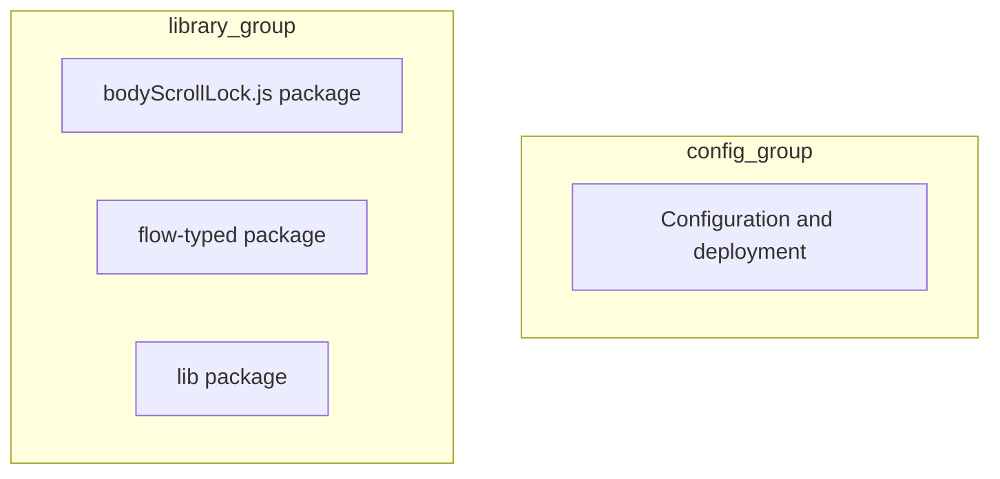

# Architecture report: willmcpo/body-scroll-lock

> Automated static analysis. **Observed** = directly seen in files/imports/AST; **Inferred** = interpretation from that evidence. Repository code was not executed.

## 1. Repository at a glance

| Item | Value |
| --- | --- |
| Repository | willmcpo/body-scroll-lock |
| Description | Body scroll locking that just works with everything 😏 |
| Language | JavaScript |
| Stars | 4090 |
| Licence | MIT |
| Analysed commit / branch | 79c4cf2c956eb7d5cf8d54a03d12751bc6ac8aa3 / master |
| Framework(s) | None detected |
| Files analysed | 31 |
| Components | 4 |

## 2. Architecture in one minute

willmcpo/body-scroll-lock - Body scroll locking that just works with everything 😏. This repository was analysed statically from 31 file(s) (0 Python). Detected technologies (observed from imports/manifests): Jest. Files are grouped into 4 component(s): bodyScrollLock.js package, Configuration and deployment, flow-typed package, lib package. Findings below distinguish observed facts from inferred interpretation.

## 3. High-level block diagram

## 4. Main components

### bodyScrollLock.js package (`bodyscrolllock_js`)

- **Kind:** library
- **Status:** Observed
- **Confidence:** 0.85
- **Responsibility:** Groups 1 file(s) under bodyscrolllock.js package (observed from repository paths and static analysis).
- **Paths:** `src/bodyScrollLock.js`
- **Evidence:** [src/bodyScrollLock.js](https://github.com/willmcpo/body-scroll-lock/blob/79c4cf2c956eb7d5cf8d54a03d12751bc6ac8aa3/src/bodyScrollLock.js)

### Configuration and deployment (`config`)

- **Kind:** config
- **Status:** Observed
- **Confidence:** 0.85
- **Responsibility:** Groups 1 file(s) under configuration and deployment (observed from repository paths and static analysis).
- **Paths:** `package.json`
- **Evidence:** [package.json](https://github.com/willmcpo/body-scroll-lock/blob/79c4cf2c956eb7d5cf8d54a03d12751bc6ac8aa3/package.json)

### flow-typed package (`flow_typed`)

- **Kind:** library
- **Status:** Observed
- **Confidence:** 0.85
- **Responsibility:** Groups 1 file(s) under flow-typed package (observed from repository paths and static analysis).
- **Paths:** `flow-typed/globals.js`
- **Evidence:** [flow-typed/globals.js](https://github.com/willmcpo/body-scroll-lock/blob/79c4cf2c956eb7d5cf8d54a03d12751bc6ac8aa3/flow-typed/globals.js)

### lib package (`lib`)

- **Kind:** library
- **Status:** Observed
- **Confidence:** 0.85
- **Responsibility:** Groups 3 file(s) under lib package (observed from repository paths and static analysis).
- **Paths:** `lib/bodyScrollLock.es6.js`, `lib/bodyScrollLock.esm.js`, `lib/bodyScrollLock.js`
- **Evidence:** [lib/bodyScrollLock.es6.js](https://github.com/willmcpo/body-scroll-lock/blob/79c4cf2c956eb7d5cf8d54a03d12751bc6ac8aa3/lib/bodyScrollLock.es6.js); [lib/bodyScrollLock.esm.js](https://github.com/willmcpo/body-scroll-lock/blob/79c4cf2c956eb7d5cf8d54a03d12751bc6ac8aa3/lib/bodyScrollLock.esm.js); [lib/bodyScrollLock.js](https://github.com/willmcpo/body-scroll-lock/blob/79c4cf2c956eb7d5cf8d54a03d12751bc6ac8aa3/lib/bodyScrollLock.js)

## 5. Execution flow

No entry point was observed; the startup flow below is therefore limited.

Representative flow (derived from observed entry points and the import graph; steps beyond the entry point are **Inferred**):

1. Execution starts at an observed entry point listed above, if present.
2. No internal import relationships between components were observed.

## 6. Project structure

### `(root)`

- `.babelrc` - other (425 bytes)
- `.editorconfig` - config (196 bytes)
- `.eslintrc` - other (343 bytes)
- `.flowconfig` - other (206 bytes)
- `.gitignore` - other (54 bytes)
- `.npmignore` - other (130 bytes)
- `.prettierignore` - other (31 bytes)
- `.prettierrc` - other (106 bytes)
- `LICENSE` - docs (1064 bytes)
- `README.md` - docs (11407 bytes)
- `package.json` - manifest (2493 bytes)

### `.circleci`

- `.circleci/config.yml` - ci, YAML (969 bytes)

### `examples`

- `examples/modal/.gitignore` - other (8 bytes)
- `examples/modal/README.md` - docs (61 bytes)
- `examples/modal/bundle.js` - source, JavaScript (12003 bytes)
- `examples/modal/index.html` - other (44014 bytes)
- `examples/modal/main.js` - source, JavaScript (1014 bytes)
- `examples/modal/now.json` - config (56 bytes)
- `examples/modal/package.json` - manifest (336 bytes)
- `examples/vanilla/.gitignore` - other (8 bytes)
- `examples/vanilla/README.md` - docs (61 bytes)
- `examples/vanilla/bundle.js` - source, JavaScript (11939 bytes)
- `examples/vanilla/index.html` - other (52816 bytes)
- `examples/vanilla/main.js` - source, JavaScript (950 bytes)
- `examples/vanilla/now.json` - config (50 bytes)
- `examples/vanilla/package.json` - manifest (312 bytes)

### `flow-typed`

- `flow-typed/globals.js` - source, JavaScript (27 bytes)

### `lib`

- `lib/bodyScrollLock.es6.js` - source, JavaScript (8393 bytes)
- `lib/bodyScrollLock.esm.js` - source, JavaScript (9225 bytes)
- `lib/bodyScrollLock.js` - source, JavaScript (10223 bytes)

### `src`

- `src/bodyScrollLock.js` - source, JavaScript (8928 bytes)

## 7. Key dependencies and integrations

| Name | Category | Status | Confidence | Evidence |
| --- | --- | --- | --- | --- |
| Jest | tooling | Observed | 0.85 | [package.json:52](https://github.com/willmcpo/body-scroll-lock/blob/79c4cf2c956eb7d5cf8d54a03d12751bc6ac8aa3/package.json#L52) |

## 8. Data and state

No database, cache, queue, or persistent-state usage was observed in the analysed files. State handling, if any, may be in-memory or in files that were not analysed.

## 9. Configuration and deployment clues

- `.circleci/config.yml` (ci)
- `.editorconfig` (config)
- `examples/modal/now.json` (config)
- `examples/modal/package.json` (manifest)
- `examples/vanilla/now.json` (config)
- `examples/vanilla/package.json` (manifest)
- `package.json` (manifest)

## 10. Design observations

- No strong design patterns could be established from the available evidence.

These observations are interpretations (**Inferred**) of the observed structure, not guarantees about runtime design.

## 11. Limitations and unknowns

- Static analysis only: repository code was not executed, installed, or imported at runtime.
- Components and relationships are inferred from file paths, imports, and AST structure; runtime behaviour, dynamic imports, and reflection may not be visible.
- 2 file(s) were skipped during inventory (2 x lockfile excluded).
- No clear application entry point was observed in the analysed files.
- Repository text was treated as untrusted data; no instructions found in repository files were followed, and likely secret values were redacted/excluded.
- JavaScript and TypeScript files were inventoried from paths and package manifests. They were not parsed with a full language AST, and repository code was not executed.

## 12. Source references

- [flow-typed/globals.js](https://github.com/willmcpo/body-scroll-lock/blob/79c4cf2c956eb7d5cf8d54a03d12751bc6ac8aa3/flow-typed/globals.js)
- [lib/bodyScrollLock.es6.js](https://github.com/willmcpo/body-scroll-lock/blob/79c4cf2c956eb7d5cf8d54a03d12751bc6ac8aa3/lib/bodyScrollLock.es6.js)
- [lib/bodyScrollLock.esm.js](https://github.com/willmcpo/body-scroll-lock/blob/79c4cf2c956eb7d5cf8d54a03d12751bc6ac8aa3/lib/bodyScrollLock.esm.js)
- [lib/bodyScrollLock.js](https://github.com/willmcpo/body-scroll-lock/blob/79c4cf2c956eb7d5cf8d54a03d12751bc6ac8aa3/lib/bodyScrollLock.js)
- [package.json](https://github.com/willmcpo/body-scroll-lock/blob/79c4cf2c956eb7d5cf8d54a03d12751bc6ac8aa3/package.json)
- [package.json:52](https://github.com/willmcpo/body-scroll-lock/blob/79c4cf2c956eb7d5cf8d54a03d12751bc6ac8aa3/package.json#L52)
- [src/bodyScrollLock.js](https://github.com/willmcpo/body-scroll-lock/blob/79c4cf2c956eb7d5cf8d54a03d12751bc6ac8aa3/src/bodyScrollLock.js)
