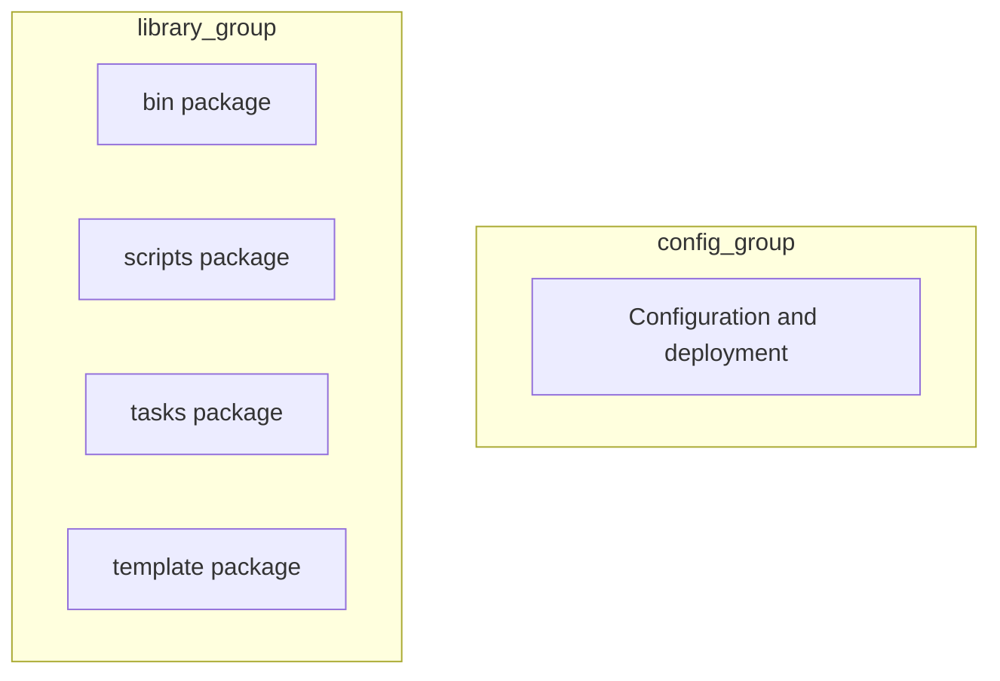

# Architecture report: wmonk/create-react-app-typescript

> Automated static analysis. **Observed** = directly seen in files/imports/AST; **Inferred** = interpretation from that evidence. Repository code was not executed.

## 1. Repository at a glance

| Item | Value |
| --- | --- |
| Repository | wmonk/create-react-app-typescript |
| Description | DEPRECATED: Create React apps using typescript with no build configuration. |
| Language | JavaScript |
| Stars | 3676 |
| Licence | Not detected |
| Analysed commit / branch | ef987c15acad6468a35ddb0a24ba22add819207e / master |
| Framework(s) | React |
| Files analysed | 46 |
| Components | 5 |

## 2. Architecture in one minute

wmonk/create-react-app-typescript - DEPRECATED: Create React apps using typescript with no build configuration.. This repository was analysed statically from 46 file(s) (0 Python). Detected technologies (observed from imports/manifests): React, Jest, TypeScript, webpack. Files are grouped into 5 component(s): bin package, Configuration and deployment, scripts package, tasks package, template package. Findings below distinguish observed facts from inferred interpretation.

## 3. High-level block diagram

## 4. Main components

### bin package (`bin`)

- **Kind:** library
- **Status:** Observed
- **Confidence:** 0.85
- **Responsibility:** Groups 1 file(s) under bin package (observed from repository paths and static analysis).
- **Paths:** `bin/react-scripts-ts.js`
- **Evidence:** [bin/react-scripts-ts.js](https://github.com/wmonk/create-react-app-typescript/blob/ef987c15acad6468a35ddb0a24ba22add819207e/bin/react-scripts-ts.js)

### Configuration and deployment (`config`)

- **Kind:** config
- **Status:** Observed
- **Confidence:** 0.85
- **Responsibility:** Groups 17 file(s) under configuration and deployment (observed from repository paths and static analysis).
- **Paths:** `config/env.js`, `config/jest/babelTransform.js`, `config/jest/cssTransform.js`, `config/jest/fileTransform.js`, `config/jest/typescriptTransform.js`, `config/paths.js`, `config/polyfills.js`, `config/webpack.config.dev.js`, `config/webpack.config.prod.js`, `config/webpackDevServer.config.js`, `package.json`, `tasks/verdaccio.yaml`, `template/public/manifest.json`, `template/tsconfig.json`, `template/tsconfig.prod.json`, `template/tsconfig.test.json`, `template/tslint.json`
- **Evidence:** [config/env.js](https://github.com/wmonk/create-react-app-typescript/blob/ef987c15acad6468a35ddb0a24ba22add819207e/config/env.js); [config/jest/babelTransform.js](https://github.com/wmonk/create-react-app-typescript/blob/ef987c15acad6468a35ddb0a24ba22add819207e/config/jest/babelTransform.js); [config/jest/cssTransform.js](https://github.com/wmonk/create-react-app-typescript/blob/ef987c15acad6468a35ddb0a24ba22add819207e/config/jest/cssTransform.js); [config/jest/fileTransform.js](https://github.com/wmonk/create-react-app-typescript/blob/ef987c15acad6468a35ddb0a24ba22add819207e/config/jest/fileTransform.js); [config/jest/typescriptTransform.js](https://github.com/wmonk/create-react-app-typescript/blob/ef987c15acad6468a35ddb0a24ba22add819207e/config/jest/typescriptTransform.js); [config/paths.js](https://github.com/wmonk/create-react-app-typescript/blob/ef987c15acad6468a35ddb0a24ba22add819207e/config/paths.js); [config/polyfills.js](https://github.com/wmonk/create-react-app-typescript/blob/ef987c15acad6468a35ddb0a24ba22add819207e/config/polyfills.js); [config/webpack.config.dev.js](https://github.com/wmonk/create-react-app-typescript/blob/ef987c15acad6468a35ddb0a24ba22add819207e/config/webpack.config.dev.js)

### scripts package (`scripts`)

- **Kind:** library
- **Status:** Observed
- **Confidence:** 0.85
- **Responsibility:** Groups 6 file(s) under scripts package (observed from repository paths and static analysis).
- **Paths:** `scripts/build.js`, `scripts/eject.js`, `scripts/init.js`, `scripts/start.js`, `scripts/test.js`, `scripts/utils/createJestConfig.js`
- **Evidence:** [scripts/build.js](https://github.com/wmonk/create-react-app-typescript/blob/ef987c15acad6468a35ddb0a24ba22add819207e/scripts/build.js); [scripts/eject.js](https://github.com/wmonk/create-react-app-typescript/blob/ef987c15acad6468a35ddb0a24ba22add819207e/scripts/eject.js); [scripts/init.js](https://github.com/wmonk/create-react-app-typescript/blob/ef987c15acad6468a35ddb0a24ba22add819207e/scripts/init.js); [scripts/start.js](https://github.com/wmonk/create-react-app-typescript/blob/ef987c15acad6468a35ddb0a24ba22add819207e/scripts/start.js); [scripts/test.js](https://github.com/wmonk/create-react-app-typescript/blob/ef987c15acad6468a35ddb0a24ba22add819207e/scripts/test.js); [scripts/utils/createJestConfig.js](https://github.com/wmonk/create-react-app-typescript/blob/ef987c15acad6468a35ddb0a24ba22add819207e/scripts/utils/createJestConfig.js)

### tasks package (`tasks`)

- **Kind:** library
- **Status:** Observed
- **Confidence:** 0.85
- **Responsibility:** Groups 2 file(s) under tasks package (observed from repository paths and static analysis).
- **Paths:** `tasks/e2e-simple.sh`, `tasks/publish.sh`
- **Evidence:** [tasks/e2e-simple.sh](https://github.com/wmonk/create-react-app-typescript/blob/ef987c15acad6468a35ddb0a24ba22add819207e/tasks/e2e-simple.sh); [tasks/publish.sh](https://github.com/wmonk/create-react-app-typescript/blob/ef987c15acad6468a35ddb0a24ba22add819207e/tasks/publish.sh)

### template package (`template`)

- **Kind:** library
- **Status:** Observed
- **Confidence:** 0.85
- **Responsibility:** Groups 5 file(s) under template package (observed from repository paths and static analysis).
- **Paths:** `template/images.d.ts`, `template/src/App.test.tsx`, `template/src/App.tsx`, `template/src/index.tsx`, `template/src/registerServiceWorker.ts`
- **Evidence:** [template/images.d.ts](https://github.com/wmonk/create-react-app-typescript/blob/ef987c15acad6468a35ddb0a24ba22add819207e/template/images.d.ts); [template/src/App.test.tsx](https://github.com/wmonk/create-react-app-typescript/blob/ef987c15acad6468a35ddb0a24ba22add819207e/template/src/App.test.tsx); [template/src/App.tsx](https://github.com/wmonk/create-react-app-typescript/blob/ef987c15acad6468a35ddb0a24ba22add819207e/template/src/App.tsx); [template/src/index.tsx](https://github.com/wmonk/create-react-app-typescript/blob/ef987c15acad6468a35ddb0a24ba22add819207e/template/src/index.tsx); [template/src/registerServiceWorker.ts](https://github.com/wmonk/create-react-app-typescript/blob/ef987c15acad6468a35ddb0a24ba22add819207e/template/src/registerServiceWorker.ts)

## 5. Execution flow

**Observed** entry point(s):

- [bin/react-scripts-ts.js](https://github.com/wmonk/create-react-app-typescript/blob/ef987c15acad6468a35ddb0a24ba22add819207e/bin/react-scripts-ts.js)
- [template/src/App.tsx](https://github.com/wmonk/create-react-app-typescript/blob/ef987c15acad6468a35ddb0a24ba22add819207e/template/src/App.tsx)
- [template/src/index.tsx](https://github.com/wmonk/create-react-app-typescript/blob/ef987c15acad6468a35ddb0a24ba22add819207e/template/src/index.tsx)

Representative flow (derived from observed entry points and the import graph; steps beyond the entry point are **Inferred**):

1. Execution starts at an observed entry point listed above, if present.
2. No internal import relationships between components were observed.

## 6. Project structure

### `(root)`

- `.eslintignore` - other (92 bytes)
- `.eslintrc` - other (276 bytes)
- `.gitignore` - other (183 bytes)
- `.travis.yml` - ci, YAML (136 bytes)
- `.yarnrc` - other (77 bytes)
- `README.md` - docs (7967 bytes)
- `eslintrc` - other (29 bytes)
- `package.json` - manifest (1926 bytes)

### `.github`

- `.github/ISSUE_TEMPLATE.md` - docs (4645 bytes)
- `.github/PULL_REQUEST_TEMPLATE.md` - docs (197 bytes)

### `bin`

- `bin/react-scripts-ts.js` - source, JavaScript (1618 bytes)

### `config`

- `config/env.js` - source, JavaScript (3764 bytes)
- `config/jest/babelTransform.js` - source, JavaScript (390 bytes)
- `config/jest/cssTransform.js` - source, JavaScript (547 bytes)
- `config/jest/fileTransform.js` - source, JavaScript (538 bytes)
- `config/jest/typescriptTransform.js` - source, JavaScript (171 bytes)
- `config/paths.js` - source, JavaScript (4886 bytes)
- `config/polyfills.js` - source, JavaScript (1089 bytes)
- `config/webpack.config.dev.js` - source, JavaScript (13510 bytes)
- `config/webpack.config.prod.js` - source, JavaScript (17673 bytes)
- `config/webpackDevServer.config.js` - source, JavaScript (5593 bytes)

### `scripts`

- `scripts/build.js` - source, JavaScript (5146 bytes)
- `scripts/eject.js` - source, JavaScript (8345 bytes)
- `scripts/init.js` - source, JavaScript (6322 bytes)
- `scripts/start.js` - source, JavaScript (3750 bytes)
- `scripts/test.js` - source, JavaScript (2843 bytes)
- `scripts/utils/createJestConfig.js` - source, JavaScript (3546 bytes)

### `tasks`

- `tasks/e2e-simple.sh` - source, Shell (7775 bytes)
- `tasks/publish.sh` - source, Shell (1098 bytes)
- `tasks/verdaccio.yaml` - config (1288 bytes)

### `template`

- `template/README.md` - docs (119156 bytes)
- `template/gitignore` - other (285 bytes)
- `template/images.d.ts` - source, TypeScript (163 bytes)
- `template/public/index.html` - other (1590 bytes)
- `template/public/manifest.json` - config (317 bytes)
- `template/src/App.css` - other (377 bytes)
- `template/src/App.test.tsx` - source, TypeScript (258 bytes)
- `template/src/App.tsx` - source, TypeScript (529 bytes)
- `template/src/index.css` - other (63 bytes)
- `template/src/index.tsx` - source, TypeScript (285 bytes)
- `template/src/logo.svg` - other (2671 bytes)
- `template/src/registerServiceWorker.ts` - source, TypeScript (4534 bytes)
- `template/tsconfig.json` - config (672 bytes)
- `template/tsconfig.prod.json` - config (34 bytes)
- `template/tsconfig.test.json` - config (87 bytes)
- `template/tslint.json` - config (219 bytes)

## 7. Key dependencies and integrations

| Name | Category | Status | Confidence | Evidence |
| --- | --- | --- | --- | --- |
| React | framework | Observed | 0.90 | [package.json:2](https://github.com/wmonk/create-react-app-typescript/blob/ef987c15acad6468a35ddb0a24ba22add819207e/package.json#L2); [package.json:64](https://github.com/wmonk/create-react-app-typescript/blob/ef987c15acad6468a35ddb0a24ba22add819207e/package.json#L64) |
| Jest | tooling | Observed | 0.85 | [package.json:25](https://github.com/wmonk/create-react-app-typescript/blob/ef987c15acad6468a35ddb0a24ba22add819207e/package.json#L25) |
| TypeScript | tooling | Observed | 0.90 | [package.json:4](https://github.com/wmonk/create-react-app-typescript/blob/ef987c15acad6468a35ddb0a24ba22add819207e/package.json#L4) |
| webpack | tooling | Observed | 0.85 | [package.json:28](https://github.com/wmonk/create-react-app-typescript/blob/ef987c15acad6468a35ddb0a24ba22add819207e/package.json#L28) |

## 8. Data and state

No database, cache, queue, or persistent-state usage was observed in the analysed files. State handling, if any, may be in-memory or in files that were not analysed.

## 9. Configuration and deployment clues

- `.travis.yml` (ci)
- `package.json` (manifest)
- `tasks/verdaccio.yaml` (config)
- `template/public/manifest.json` (config)
- `template/tsconfig.json` (config)
- `template/tsconfig.prod.json` (config)
- `template/tsconfig.test.json` (config)
- `template/tslint.json` (config)

## 10. Design observations

- No strong design patterns could be established from the available evidence.

These observations are interpretations (**Inferred**) of the observed structure, not guarantees about runtime design.

## 11. Limitations and unknowns

- Static analysis only: repository code was not executed, installed, or imported at runtime.
- Components and relationships are inferred from file paths, imports, and AST structure; runtime behaviour, dynamic imports, and reflection may not be visible.
- No clear application entry point was observed in the analysed files.
- Repository text was treated as untrusted data; no instructions found in repository files were followed, and likely secret values were redacted/excluded.
- JavaScript and TypeScript files were inventoried from paths and package manifests. They were not parsed with a full language AST, and repository code was not executed.
- The GitHub repository was marked archived at selection time.

## 12. Source references

- [bin/react-scripts-ts.js](https://github.com/wmonk/create-react-app-typescript/blob/ef987c15acad6468a35ddb0a24ba22add819207e/bin/react-scripts-ts.js)
- [config/env.js](https://github.com/wmonk/create-react-app-typescript/blob/ef987c15acad6468a35ddb0a24ba22add819207e/config/env.js)
- [config/jest/babelTransform.js](https://github.com/wmonk/create-react-app-typescript/blob/ef987c15acad6468a35ddb0a24ba22add819207e/config/jest/babelTransform.js)
- [config/jest/cssTransform.js](https://github.com/wmonk/create-react-app-typescript/blob/ef987c15acad6468a35ddb0a24ba22add819207e/config/jest/cssTransform.js)
- [config/jest/fileTransform.js](https://github.com/wmonk/create-react-app-typescript/blob/ef987c15acad6468a35ddb0a24ba22add819207e/config/jest/fileTransform.js)
- [config/jest/typescriptTransform.js](https://github.com/wmonk/create-react-app-typescript/blob/ef987c15acad6468a35ddb0a24ba22add819207e/config/jest/typescriptTransform.js)
- [config/paths.js](https://github.com/wmonk/create-react-app-typescript/blob/ef987c15acad6468a35ddb0a24ba22add819207e/config/paths.js)
- [config/polyfills.js](https://github.com/wmonk/create-react-app-typescript/blob/ef987c15acad6468a35ddb0a24ba22add819207e/config/polyfills.js)
- [config/webpack.config.dev.js](https://github.com/wmonk/create-react-app-typescript/blob/ef987c15acad6468a35ddb0a24ba22add819207e/config/webpack.config.dev.js)
- [package.json:2](https://github.com/wmonk/create-react-app-typescript/blob/ef987c15acad6468a35ddb0a24ba22add819207e/package.json#L2)
- [package.json:4](https://github.com/wmonk/create-react-app-typescript/blob/ef987c15acad6468a35ddb0a24ba22add819207e/package.json#L4)
- [package.json:25](https://github.com/wmonk/create-react-app-typescript/blob/ef987c15acad6468a35ddb0a24ba22add819207e/package.json#L25)
- [package.json:28](https://github.com/wmonk/create-react-app-typescript/blob/ef987c15acad6468a35ddb0a24ba22add819207e/package.json#L28)
- [package.json:64](https://github.com/wmonk/create-react-app-typescript/blob/ef987c15acad6468a35ddb0a24ba22add819207e/package.json#L64)
- [scripts/build.js](https://github.com/wmonk/create-react-app-typescript/blob/ef987c15acad6468a35ddb0a24ba22add819207e/scripts/build.js)
- [scripts/eject.js](https://github.com/wmonk/create-react-app-typescript/blob/ef987c15acad6468a35ddb0a24ba22add819207e/scripts/eject.js)
- [scripts/init.js](https://github.com/wmonk/create-react-app-typescript/blob/ef987c15acad6468a35ddb0a24ba22add819207e/scripts/init.js)
- [scripts/start.js](https://github.com/wmonk/create-react-app-typescript/blob/ef987c15acad6468a35ddb0a24ba22add819207e/scripts/start.js)
- [scripts/test.js](https://github.com/wmonk/create-react-app-typescript/blob/ef987c15acad6468a35ddb0a24ba22add819207e/scripts/test.js)
- [scripts/utils/createJestConfig.js](https://github.com/wmonk/create-react-app-typescript/blob/ef987c15acad6468a35ddb0a24ba22add819207e/scripts/utils/createJestConfig.js)
- [tasks/e2e-simple.sh](https://github.com/wmonk/create-react-app-typescript/blob/ef987c15acad6468a35ddb0a24ba22add819207e/tasks/e2e-simple.sh)
- [tasks/publish.sh](https://github.com/wmonk/create-react-app-typescript/blob/ef987c15acad6468a35ddb0a24ba22add819207e/tasks/publish.sh)
- [template/images.d.ts](https://github.com/wmonk/create-react-app-typescript/blob/ef987c15acad6468a35ddb0a24ba22add819207e/template/images.d.ts)
- [template/src/App.test.tsx](https://github.com/wmonk/create-react-app-typescript/blob/ef987c15acad6468a35ddb0a24ba22add819207e/template/src/App.test.tsx)
- [template/src/App.tsx](https://github.com/wmonk/create-react-app-typescript/blob/ef987c15acad6468a35ddb0a24ba22add819207e/template/src/App.tsx)
- [template/src/index.tsx](https://github.com/wmonk/create-react-app-typescript/blob/ef987c15acad6468a35ddb0a24ba22add819207e/template/src/index.tsx)
- [template/src/registerServiceWorker.ts](https://github.com/wmonk/create-react-app-typescript/blob/ef987c15acad6468a35ddb0a24ba22add819207e/template/src/registerServiceWorker.ts)
