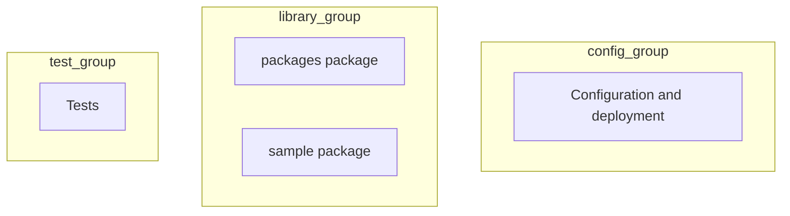

# Architecture report: wojtekmaj/react-calendar

> Automated static analysis. **Observed** = directly seen in files/imports/AST; **Inferred** = interpretation from that evidence. Repository code was not executed.

## 1. Repository at a glance

| Item | Value |
| --- | --- |
| Repository | wojtekmaj/react-calendar |
| Description | Ultimate calendar for your React app. |
| Language | TypeScript |
| Stars | 3789 |
| Licence | MIT |
| Analysed commit / branch | 80319ee35958e755fbee08e995f7d923e7f1255e / main |
| Framework(s) | React |
| Files analysed | 92 |
| Components | 4 |

## 2. Architecture in one minute

wojtekmaj/react-calendar - Ultimate calendar for your React app.. This repository was analysed statically from 92 file(s) (0 Python). Detected technologies (observed from imports/manifests): GitHub Actions, React, TypeScript, Vite, Vitest. Files are grouped into 4 component(s): Configuration and deployment, packages package, sample package, Tests. Findings below distinguish observed facts from inferred interpretation.

## 3. High-level block diagram

## 4. Main components

### Configuration and deployment (`config`)

- **Kind:** config
- **Status:** Observed
- **Confidence:** 0.85
- **Responsibility:** Groups 7 file(s) under configuration and deployment (observed from repository paths and static analysis).
- **Paths:** `biome.json`, `package.json`, `packages/react-calendar/package.json`, `packages/react-calendar/tsconfig.build.json`, `packages/react-calendar/tsconfig.json`, `sample/package.json`, `sample/tsconfig.json`
- **Evidence:** [biome.json](https://github.com/wojtekmaj/react-calendar/blob/80319ee35958e755fbee08e995f7d923e7f1255e/biome.json); [package.json](https://github.com/wojtekmaj/react-calendar/blob/80319ee35958e755fbee08e995f7d923e7f1255e/package.json); [packages/react-calendar/package.json](https://github.com/wojtekmaj/react-calendar/blob/80319ee35958e755fbee08e995f7d923e7f1255e/packages/react-calendar/package.json); [packages/react-calendar/tsconfig.build.json](https://github.com/wojtekmaj/react-calendar/blob/80319ee35958e755fbee08e995f7d923e7f1255e/packages/react-calendar/tsconfig.build.json); [packages/react-calendar/tsconfig.json](https://github.com/wojtekmaj/react-calendar/blob/80319ee35958e755fbee08e995f7d923e7f1255e/packages/react-calendar/tsconfig.json); [sample/package.json](https://github.com/wojtekmaj/react-calendar/blob/80319ee35958e755fbee08e995f7d923e7f1255e/sample/package.json); [sample/tsconfig.json](https://github.com/wojtekmaj/react-calendar/blob/80319ee35958e755fbee08e995f7d923e7f1255e/sample/tsconfig.json)

### packages package (`packages`)

- **Kind:** library
- **Status:** Observed
- **Confidence:** 0.85
- **Responsibility:** Groups 45 file(s) under packages package (observed from repository paths and static analysis).
- **Paths:** `packages/react-calendar/src/Calendar.spec.tsx`, `packages/react-calendar/src/Calendar.tsx`, `packages/react-calendar/src/Calendar/Navigation.spec.tsx`, `packages/react-calendar/src/Calendar/Navigation.tsx`, `packages/react-calendar/src/CenturyView.spec.tsx`, `packages/react-calendar/src/CenturyView.tsx`, `packages/react-calendar/src/CenturyView/Decade.spec.tsx`, `packages/react-calendar/src/CenturyView/Decade.tsx`, `packages/react-calendar/src/CenturyView/Decades.tsx`, `packages/react-calendar/src/DecadeView.spec.tsx`, `packages/react-calendar/src/DecadeView.tsx`, `packages/react-calendar/src/DecadeView/Year.spec.tsx`, `packages/react-calendar/src/DecadeView/Year.tsx`, `packages/react-calendar/src/DecadeView/Years.tsx`, `packages/react-calendar/src/Flex.spec.tsx`, `packages/react-calendar/src/Flex.tsx`, `packages/react-calendar/src/MonthView.spec.tsx`, `packages/react-calendar/src/MonthView.tsx`, `packages/react-calendar/src/MonthView/Day.spec.tsx`, `packages/react-calendar/src/MonthView/Day.tsx`, `packages/react-calendar/src/MonthView/Days.tsx`, `packages/react-calendar/src/MonthView/WeekNumber.spec.tsx`, `packages/react-calendar/src/MonthView/WeekNumber.tsx`, `packages/react-calendar/src/MonthView/WeekNumbers.spec.tsx`, `packages/react-calendar/src/MonthView/WeekNumbers.tsx`, `packages/react-calendar/src/MonthView/Weekdays.spec.tsx`, `packages/react-calendar/src/MonthView/Weekdays.tsx`, `packages/react-calendar/src/Tile.spec.tsx`, `packages/react-calendar/src/Tile.tsx`, `packages/react-calendar/src/TileGroup.tsx`, `packages/react-calendar/src/YearView.spec.tsx`, `packages/react-calendar/src/YearView.tsx`, `packages/react-calendar/src/YearView/Month.spec.tsx`, `packages/react-calendar/src/YearView/Month.tsx`, `packages/react-calendar/src/YearView/Months.tsx`, `packages/react-calendar/src/index.ts`, `packages/react-calendar/src/shared/const.ts`, `packages/react-calendar/src/shared/dateFormatter.spec.ts`, `packages/react-calendar/src/shared/dateFormatter.ts`, `packages/react-calendar/src/shared/dates.spec.ts`, `packages/react-calendar/src/shared/dates.ts`, `packages/react-calendar/src/shared/types.ts`, `packages/react-calendar/src/shared/utils.spec.ts`, `packages/react-calendar/src/shared/utils.ts`, `packages/react-calendar/vitest.config.ts`
- **Evidence:** [packages/react-calendar/src/Calendar.spec.tsx](https://github.com/wojtekmaj/react-calendar/blob/80319ee35958e755fbee08e995f7d923e7f1255e/packages/react-calendar/src/Calendar.spec.tsx); [packages/react-calendar/src/Calendar.tsx](https://github.com/wojtekmaj/react-calendar/blob/80319ee35958e755fbee08e995f7d923e7f1255e/packages/react-calendar/src/Calendar.tsx); [packages/react-calendar/src/Calendar/Navigation.spec.tsx](https://github.com/wojtekmaj/react-calendar/blob/80319ee35958e755fbee08e995f7d923e7f1255e/packages/react-calendar/src/Calendar/Navigation.spec.tsx); [packages/react-calendar/src/Calendar/Navigation.tsx](https://github.com/wojtekmaj/react-calendar/blob/80319ee35958e755fbee08e995f7d923e7f1255e/packages/react-calendar/src/Calendar/Navigation.tsx); [packages/react-calendar/src/CenturyView.spec.tsx](https://github.com/wojtekmaj/react-calendar/blob/80319ee35958e755fbee08e995f7d923e7f1255e/packages/react-calendar/src/CenturyView.spec.tsx); [packages/react-calendar/src/CenturyView.tsx](https://github.com/wojtekmaj/react-calendar/blob/80319ee35958e755fbee08e995f7d923e7f1255e/packages/react-calendar/src/CenturyView.tsx); [packages/react-calendar/src/CenturyView/Decade.spec.tsx](https://github.com/wojtekmaj/react-calendar/blob/80319ee35958e755fbee08e995f7d923e7f1255e/packages/react-calendar/src/CenturyView/Decade.spec.tsx); [packages/react-calendar/src/CenturyView/Decade.tsx](https://github.com/wojtekmaj/react-calendar/blob/80319ee35958e755fbee08e995f7d923e7f1255e/packages/react-calendar/src/CenturyView/Decade.tsx)

### sample package (`sample`)

- **Kind:** library
- **Status:** Observed
- **Confidence:** 0.85
- **Responsibility:** Groups 3 file(s) under sample package (observed from repository paths and static analysis).
- **Paths:** `sample/Sample.tsx`, `sample/index.tsx`, `sample/vite.config.ts`
- **Evidence:** [sample/Sample.tsx](https://github.com/wojtekmaj/react-calendar/blob/80319ee35958e755fbee08e995f7d923e7f1255e/sample/Sample.tsx); [sample/index.tsx](https://github.com/wojtekmaj/react-calendar/blob/80319ee35958e755fbee08e995f7d923e7f1255e/sample/index.tsx); [sample/vite.config.ts](https://github.com/wojtekmaj/react-calendar/blob/80319ee35958e755fbee08e995f7d923e7f1255e/sample/vite.config.ts)

### Tests (`tests`)

- **Kind:** test
- **Status:** Observed
- **Confidence:** 0.85
- **Responsibility:** Groups 17 file(s) under tests (observed from repository paths and static analysis).
- **Paths:** `test/.gitignore`, `test/DateBoundariesOptions.tsx`, `test/LocaleOptions.tsx`, `test/MaxDetailOptions.tsx`, `test/MinDetailOptions.tsx`, `test/Test.css`, `test/Test.tsx`, `test/ValueOptions.tsx`, `test/ViewOptions.tsx`, `test/global.d.ts`, `test/index.html`, `test/index.tsx`, `test/package.json`, `test/shared/dateFormatter.ts`, `test/shared/types.ts`, `test/tsconfig.json`, `test/vite.config.ts`
- **Evidence:** [test/.gitignore](https://github.com/wojtekmaj/react-calendar/blob/80319ee35958e755fbee08e995f7d923e7f1255e/test/.gitignore); [test/DateBoundariesOptions.tsx](https://github.com/wojtekmaj/react-calendar/blob/80319ee35958e755fbee08e995f7d923e7f1255e/test/DateBoundariesOptions.tsx); [test/LocaleOptions.tsx](https://github.com/wojtekmaj/react-calendar/blob/80319ee35958e755fbee08e995f7d923e7f1255e/test/LocaleOptions.tsx); [test/MaxDetailOptions.tsx](https://github.com/wojtekmaj/react-calendar/blob/80319ee35958e755fbee08e995f7d923e7f1255e/test/MaxDetailOptions.tsx); [test/MinDetailOptions.tsx](https://github.com/wojtekmaj/react-calendar/blob/80319ee35958e755fbee08e995f7d923e7f1255e/test/MinDetailOptions.tsx); [test/Test.css](https://github.com/wojtekmaj/react-calendar/blob/80319ee35958e755fbee08e995f7d923e7f1255e/test/Test.css); [test/Test.tsx](https://github.com/wojtekmaj/react-calendar/blob/80319ee35958e755fbee08e995f7d923e7f1255e/test/Test.tsx); [test/ValueOptions.tsx](https://github.com/wojtekmaj/react-calendar/blob/80319ee35958e755fbee08e995f7d923e7f1255e/test/ValueOptions.tsx)

## 5. Execution flow

**Observed** entry point(s):

- [packages/react-calendar/src/index.ts](https://github.com/wojtekmaj/react-calendar/blob/80319ee35958e755fbee08e995f7d923e7f1255e/packages/react-calendar/src/index.ts)
- [sample/index.tsx](https://github.com/wojtekmaj/react-calendar/blob/80319ee35958e755fbee08e995f7d923e7f1255e/sample/index.tsx)

Representative flow (derived from observed entry points and the import graph; steps beyond the entry point are **Inferred**):

1. Execution starts at an observed entry point listed above, if present.
2. No internal import relationships between components were observed.

## 6. Project structure

### `(root)`

- `.gitattributes` - other (73 bytes)
- `.gitignore` - other (413 bytes)
- `.yarnrc.yml` - config (101 bytes)
- `LICENSE` - docs (1076 bytes)
- `biome.json` - config (2633 bytes)
- `package.json` - manifest (729 bytes)

### `.github`

- `.github/FUNDING.yml` - config (50 bytes)
- `.github/ISSUE_TEMPLATE/Bug_report.yml` - config (1733 bytes)
- `.github/ISSUE_TEMPLATE/Feature_request.yml` - config (1110 bytes)
- `.github/ISSUE_TEMPLATE/config.yml` - config (350 bytes)
- `.github/workflows/ci.yml` - ci, YAML (2706 bytes)
- `.github/workflows/close-stale-issues.yml` - ci, YAML (832 bytes)
- `.github/workflows/publish.yml` - ci, YAML (1050 bytes)

### `.husky`

- `.husky/pre-commit` - other (54 bytes)

### `.vscode`

- `.vscode/extensions.json` - config (145 bytes)
- `.vscode/settings.json` - config (128 bytes)

### `packages`

- `packages/react-calendar/LICENSE` - docs (1076 bytes)
- `packages/react-calendar/README.md` - docs (54533 bytes)
- `packages/react-calendar/package.json` - manifest (2342 bytes)
- `packages/react-calendar/src/Calendar.css` - other (3209 bytes)
- `packages/react-calendar/src/Calendar.spec.tsx` - source, TypeScript (40244 bytes)
- `packages/react-calendar/src/Calendar.tsx` - source, TypeScript (34102 bytes)
- `packages/react-calendar/src/Calendar/Navigation.spec.tsx` - source, TypeScript (18732 bytes)
- `packages/react-calendar/src/Calendar/Navigation.tsx` - source, TypeScript (9768 bytes)
- `packages/react-calendar/src/CenturyView.spec.tsx` - source, TypeScript (3916 bytes)
- `packages/react-calendar/src/CenturyView.tsx` - source, TypeScript (383 bytes)
- `packages/react-calendar/src/CenturyView/Decade.spec.tsx` - source, TypeScript (5648 bytes)
- `packages/react-calendar/src/CenturyView/Decade.tsx` - source, TypeScript (1481 bytes)
- `packages/react-calendar/src/CenturyView/Decades.tsx` - source, TypeScript (1579 bytes)
- `packages/react-calendar/src/DecadeView.spec.tsx` - source, TypeScript (3718 bytes)
- `packages/react-calendar/src/DecadeView.tsx` - source, TypeScript (365 bytes)
- `packages/react-calendar/src/DecadeView/Year.spec.tsx` - source, TypeScript (5556 bytes)
- `packages/react-calendar/src/DecadeView/Year.tsx` - source, TypeScript (1386 bytes)
- `packages/react-calendar/src/DecadeView/Years.tsx` - source, TypeScript (1528 bytes)
- `packages/react-calendar/src/Flex.spec.tsx` - source, TypeScript (2056 bytes)
- `packages/react-calendar/src/Flex.tsx` - source, TypeScript (1343 bytes)
- `packages/react-calendar/src/MonthView.spec.tsx` - source, TypeScript (7452 bytes)
- `packages/react-calendar/src/MonthView.tsx` - source, TypeScript (2970 bytes)
- `packages/react-calendar/src/MonthView/Day.spec.tsx` - source, TypeScript (6922 bytes)
- `packages/react-calendar/src/MonthView/Day.tsx` - source, TypeScript (2358 bytes)
- `packages/react-calendar/src/MonthView/Days.tsx` - source, TypeScript (3932 bytes)
- `packages/react-calendar/src/MonthView/WeekNumber.spec.tsx` - source, TypeScript (1092 bytes)
- `packages/react-calendar/src/MonthView/WeekNumber.tsx` - source, TypeScript (1207 bytes)
- `packages/react-calendar/src/MonthView/WeekNumbers.spec.tsx` - source, TypeScript (4544 bytes)
- `packages/react-calendar/src/MonthView/WeekNumbers.tsx` - source, TypeScript (2998 bytes)
- `packages/react-calendar/src/MonthView/Weekdays.spec.tsx` - source, TypeScript (2160 bytes)
- `packages/react-calendar/src/MonthView/Weekdays.tsx` - source, TypeScript (3069 bytes)
- `packages/react-calendar/src/Tile.spec.tsx` - source, TypeScript (6520 bytes)
- `packages/react-calendar/src/Tile.tsx` - source, TypeScript (4133 bytes)
- `packages/react-calendar/src/TileGroup.tsx` - source, TypeScript (1141 bytes)
- `packages/react-calendar/src/YearView.spec.tsx` - source, TypeScript (3814 bytes)
- `packages/react-calendar/src/YearView.tsx` - source, TypeScript (359 bytes)
- `packages/react-calendar/src/YearView/Month.spec.tsx` - source, TypeScript (6190 bytes)
- `packages/react-calendar/src/YearView/Month.tsx` - source, TypeScript (1442 bytes)
- `packages/react-calendar/src/YearView/Months.tsx` - source, TypeScript (1331 bytes)
- `packages/react-calendar/src/index.ts` - source, TypeScript (614 bytes)
- `packages/react-calendar/src/shared/const.ts` - source, TypeScript (911 bytes)
- `packages/react-calendar/src/shared/dateFormatter.spec.ts` - source, TypeScript (1585 bytes)
- `packages/react-calendar/src/shared/dateFormatter.ts` - source, TypeScript (3272 bytes)
- `packages/react-calendar/src/shared/dates.spec.ts` - source, TypeScript (26449 bytes)
- `packages/react-calendar/src/shared/dates.ts` - source, TypeScript (11875 bytes)
- `packages/react-calendar/src/shared/types.ts` - source, TypeScript (1583 bytes)
- `packages/react-calendar/src/shared/utils.spec.ts` - source, TypeScript (11887 bytes)
- `packages/react-calendar/src/shared/utils.ts` - source, TypeScript (3768 bytes)
- `packages/react-calendar/tsconfig.build.json` - config (205 bytes)
- `packages/react-calendar/tsconfig.json` - config (416 bytes)
- `packages/react-calendar/vitest.config.ts` - source, TypeScript (404 bytes)

### `sample`

- `sample/.gitignore` - other (18 bytes)
- `sample/Sample.css` - other (773 bytes)
- `sample/Sample.tsx` - source, TypeScript (650 bytes)
- `sample/index.html` - other (314 bytes)
- `sample/index.tsx` - source, TypeScript (233 bytes)
- `sample/package.json` - manifest (616 bytes)
- `sample/tsconfig.json` - config (283 bytes)
- `sample/vite.config.ts` - source, TypeScript (150 bytes)

### `test`

- `test/.gitignore` - test (18 bytes)
- `test/DateBoundariesOptions.tsx` - test, TypeScript (1641 bytes)
- `test/LocaleOptions.tsx` - test, TypeScript (2766 bytes)
- `test/MaxDetailOptions.tsx` - test, TypeScript (1157 bytes)
- `test/MinDetailOptions.tsx` - test, TypeScript (1157 bytes)
- `test/Test.css` - test (3181 bytes)
- `test/Test.tsx` - test, TypeScript (7557 bytes)
- `test/ValueOptions.tsx` - test, TypeScript (3067 bytes)
- `test/ViewOptions.tsx` - test, TypeScript (4170 bytes)
- `test/global.d.ts` - test, TypeScript (24 bytes)
- `test/index.html` - test (312 bytes)
- `test/index.tsx` - test, TypeScript (301 bytes)
- `test/package.json` - test (844 bytes)
- `test/shared/dateFormatter.ts` - test, TypeScript (1650 bytes)
- `test/shared/types.ts` - test, TypeScript (291 bytes)
- `test/tsconfig.json` - test (283 bytes)
- `test/vite.config.ts` - test, TypeScript (150 bytes)

## 7. Key dependencies and integrations

| Name | Category | Status | Confidence | Evidence |
| --- | --- | --- | --- | --- |
| GitHub Actions | ci | Observed | 0.90 | [.github/workflows/ci.yml](https://github.com/wojtekmaj/react-calendar/blob/80319ee35958e755fbee08e995f7d923e7f1255e/.github/workflows/ci.yml); [.github/workflows/close-stale-issues.yml](https://github.com/wojtekmaj/react-calendar/blob/80319ee35958e755fbee08e995f7d923e7f1255e/.github/workflows/close-stale-issues.yml); [.github/workflows/publish.yml](https://github.com/wojtekmaj/react-calendar/blob/80319ee35958e755fbee08e995f7d923e7f1255e/.github/workflows/publish.yml) |
| React | framework | Observed | 0.90 | [packages/react-calendar/package.json:2](https://github.com/wojtekmaj/react-calendar/blob/80319ee35958e755fbee08e995f7d923e7f1255e/packages/react-calendar/package.json#L2); [packages/react-calendar/package.json:51](https://github.com/wojtekmaj/react-calendar/blob/80319ee35958e755fbee08e995f7d923e7f1255e/packages/react-calendar/package.json#L51); [sample/package.json:2](https://github.com/wojtekmaj/react-calendar/blob/80319ee35958e755fbee08e995f7d923e7f1255e/sample/package.json#L2); [sample/package.json:20](https://github.com/wojtekmaj/react-calendar/blob/80319ee35958e755fbee08e995f7d923e7f1255e/sample/package.json#L20) |
| TypeScript | tooling | Observed | 0.90 | [packages/react-calendar/package.json:58](https://github.com/wojtekmaj/react-calendar/blob/80319ee35958e755fbee08e995f7d923e7f1255e/packages/react-calendar/package.json#L58); [sample/package.json:24](https://github.com/wojtekmaj/react-calendar/blob/80319ee35958e755fbee08e995f7d923e7f1255e/sample/package.json#L24); [test/package.json:32](https://github.com/wojtekmaj/react-calendar/blob/80319ee35958e755fbee08e995f7d923e7f1255e/test/package.json#L32) |
| Vite | tooling | Observed | 0.90 | [sample/package.json:8](https://github.com/wojtekmaj/react-calendar/blob/80319ee35958e755fbee08e995f7d923e7f1255e/sample/package.json#L8); [test/package.json:8](https://github.com/wojtekmaj/react-calendar/blob/80319ee35958e755fbee08e995f7d923e7f1255e/test/package.json#L8) |
| Vitest | tooling | Observed | 0.85 | [packages/react-calendar/package.json:26](https://github.com/wojtekmaj/react-calendar/blob/80319ee35958e755fbee08e995f7d923e7f1255e/packages/react-calendar/package.json#L26) |

## 8. Data and state

No database, cache, queue, or persistent-state usage was observed in the analysed files. State handling, if any, may be in-memory or in files that were not analysed.

## 9. Configuration and deployment clues

- `.github/FUNDING.yml` (config)
- `.github/ISSUE_TEMPLATE/Bug_report.yml` (config)
- `.github/ISSUE_TEMPLATE/Feature_request.yml` (config)
- `.github/ISSUE_TEMPLATE/config.yml` (config)
- `.github/workflows/ci.yml` (ci)
- `.github/workflows/close-stale-issues.yml` (ci)
- `.github/workflows/publish.yml` (ci)
- `.vscode/extensions.json` (config)
- `.vscode/settings.json` (config)
- `.yarnrc.yml` (config)
- `biome.json` (config)
- `package.json` (manifest)
- `packages/react-calendar/package.json` (manifest)
- `packages/react-calendar/tsconfig.build.json` (config)
- `packages/react-calendar/tsconfig.json` (config)
- `sample/package.json` (manifest)
- `sample/tsconfig.json` (config)

## 10. Design observations

- Tests are present alongside source code (Observed from test file paths).

These observations are interpretations (**Inferred**) of the observed structure, not guarantees about runtime design.

## 11. Limitations and unknowns

- Static analysis only: repository code was not executed, installed, or imported at runtime.
- Components and relationships are inferred from file paths, imports, and AST structure; runtime behaviour, dynamic imports, and reflection may not be visible.
- 2 file(s) were skipped during inventory (2 x lockfile excluded).
- No clear application entry point was observed in the analysed files.
- Repository text was treated as untrusted data; no instructions found in repository files were followed, and likely secret values were redacted/excluded.
- JavaScript and TypeScript files were inventoried from paths and package manifests. They were not parsed with a full language AST, and repository code was not executed.

## 12. Source references

- [.github/workflows/ci.yml](https://github.com/wojtekmaj/react-calendar/blob/80319ee35958e755fbee08e995f7d923e7f1255e/.github/workflows/ci.yml)
- [.github/workflows/close-stale-issues.yml](https://github.com/wojtekmaj/react-calendar/blob/80319ee35958e755fbee08e995f7d923e7f1255e/.github/workflows/close-stale-issues.yml)
- [.github/workflows/publish.yml](https://github.com/wojtekmaj/react-calendar/blob/80319ee35958e755fbee08e995f7d923e7f1255e/.github/workflows/publish.yml)
- [biome.json](https://github.com/wojtekmaj/react-calendar/blob/80319ee35958e755fbee08e995f7d923e7f1255e/biome.json)
- [package.json](https://github.com/wojtekmaj/react-calendar/blob/80319ee35958e755fbee08e995f7d923e7f1255e/package.json)
- [packages/react-calendar/package.json](https://github.com/wojtekmaj/react-calendar/blob/80319ee35958e755fbee08e995f7d923e7f1255e/packages/react-calendar/package.json)
- [packages/react-calendar/package.json:2](https://github.com/wojtekmaj/react-calendar/blob/80319ee35958e755fbee08e995f7d923e7f1255e/packages/react-calendar/package.json#L2)
- [packages/react-calendar/package.json:26](https://github.com/wojtekmaj/react-calendar/blob/80319ee35958e755fbee08e995f7d923e7f1255e/packages/react-calendar/package.json#L26)
- [packages/react-calendar/package.json:51](https://github.com/wojtekmaj/react-calendar/blob/80319ee35958e755fbee08e995f7d923e7f1255e/packages/react-calendar/package.json#L51)
- [packages/react-calendar/package.json:58](https://github.com/wojtekmaj/react-calendar/blob/80319ee35958e755fbee08e995f7d923e7f1255e/packages/react-calendar/package.json#L58)
- [packages/react-calendar/src/Calendar.spec.tsx](https://github.com/wojtekmaj/react-calendar/blob/80319ee35958e755fbee08e995f7d923e7f1255e/packages/react-calendar/src/Calendar.spec.tsx)
- [packages/react-calendar/src/Calendar.tsx](https://github.com/wojtekmaj/react-calendar/blob/80319ee35958e755fbee08e995f7d923e7f1255e/packages/react-calendar/src/Calendar.tsx)
- [packages/react-calendar/src/Calendar/Navigation.spec.tsx](https://github.com/wojtekmaj/react-calendar/blob/80319ee35958e755fbee08e995f7d923e7f1255e/packages/react-calendar/src/Calendar/Navigation.spec.tsx)
- [packages/react-calendar/src/Calendar/Navigation.tsx](https://github.com/wojtekmaj/react-calendar/blob/80319ee35958e755fbee08e995f7d923e7f1255e/packages/react-calendar/src/Calendar/Navigation.tsx)
- [packages/react-calendar/src/CenturyView.spec.tsx](https://github.com/wojtekmaj/react-calendar/blob/80319ee35958e755fbee08e995f7d923e7f1255e/packages/react-calendar/src/CenturyView.spec.tsx)
- [packages/react-calendar/src/CenturyView.tsx](https://github.com/wojtekmaj/react-calendar/blob/80319ee35958e755fbee08e995f7d923e7f1255e/packages/react-calendar/src/CenturyView.tsx)
- [packages/react-calendar/src/CenturyView/Decade.spec.tsx](https://github.com/wojtekmaj/react-calendar/blob/80319ee35958e755fbee08e995f7d923e7f1255e/packages/react-calendar/src/CenturyView/Decade.spec.tsx)
- [packages/react-calendar/src/CenturyView/Decade.tsx](https://github.com/wojtekmaj/react-calendar/blob/80319ee35958e755fbee08e995f7d923e7f1255e/packages/react-calendar/src/CenturyView/Decade.tsx)
- [packages/react-calendar/src/index.ts](https://github.com/wojtekmaj/react-calendar/blob/80319ee35958e755fbee08e995f7d923e7f1255e/packages/react-calendar/src/index.ts)
- [packages/react-calendar/tsconfig.build.json](https://github.com/wojtekmaj/react-calendar/blob/80319ee35958e755fbee08e995f7d923e7f1255e/packages/react-calendar/tsconfig.build.json)
- [packages/react-calendar/tsconfig.json](https://github.com/wojtekmaj/react-calendar/blob/80319ee35958e755fbee08e995f7d923e7f1255e/packages/react-calendar/tsconfig.json)
- [sample/Sample.tsx](https://github.com/wojtekmaj/react-calendar/blob/80319ee35958e755fbee08e995f7d923e7f1255e/sample/Sample.tsx)
- [sample/index.tsx](https://github.com/wojtekmaj/react-calendar/blob/80319ee35958e755fbee08e995f7d923e7f1255e/sample/index.tsx)
- [sample/package.json](https://github.com/wojtekmaj/react-calendar/blob/80319ee35958e755fbee08e995f7d923e7f1255e/sample/package.json)
- [sample/package.json:2](https://github.com/wojtekmaj/react-calendar/blob/80319ee35958e755fbee08e995f7d923e7f1255e/sample/package.json#L2)
- [sample/package.json:8](https://github.com/wojtekmaj/react-calendar/blob/80319ee35958e755fbee08e995f7d923e7f1255e/sample/package.json#L8)
- [sample/package.json:20](https://github.com/wojtekmaj/react-calendar/blob/80319ee35958e755fbee08e995f7d923e7f1255e/sample/package.json#L20)
- [sample/package.json:24](https://github.com/wojtekmaj/react-calendar/blob/80319ee35958e755fbee08e995f7d923e7f1255e/sample/package.json#L24)
- [sample/tsconfig.json](https://github.com/wojtekmaj/react-calendar/blob/80319ee35958e755fbee08e995f7d923e7f1255e/sample/tsconfig.json)
- [sample/vite.config.ts](https://github.com/wojtekmaj/react-calendar/blob/80319ee35958e755fbee08e995f7d923e7f1255e/sample/vite.config.ts)
- [test/.gitignore](https://github.com/wojtekmaj/react-calendar/blob/80319ee35958e755fbee08e995f7d923e7f1255e/test/.gitignore)
- [test/DateBoundariesOptions.tsx](https://github.com/wojtekmaj/react-calendar/blob/80319ee35958e755fbee08e995f7d923e7f1255e/test/DateBoundariesOptions.tsx)
- [test/LocaleOptions.tsx](https://github.com/wojtekmaj/react-calendar/blob/80319ee35958e755fbee08e995f7d923e7f1255e/test/LocaleOptions.tsx)
- [test/MaxDetailOptions.tsx](https://github.com/wojtekmaj/react-calendar/blob/80319ee35958e755fbee08e995f7d923e7f1255e/test/MaxDetailOptions.tsx)
- [test/MinDetailOptions.tsx](https://github.com/wojtekmaj/react-calendar/blob/80319ee35958e755fbee08e995f7d923e7f1255e/test/MinDetailOptions.tsx)
- [test/Test.css](https://github.com/wojtekmaj/react-calendar/blob/80319ee35958e755fbee08e995f7d923e7f1255e/test/Test.css)
- [test/Test.tsx](https://github.com/wojtekmaj/react-calendar/blob/80319ee35958e755fbee08e995f7d923e7f1255e/test/Test.tsx)
- [test/ValueOptions.tsx](https://github.com/wojtekmaj/react-calendar/blob/80319ee35958e755fbee08e995f7d923e7f1255e/test/ValueOptions.tsx)
- [test/package.json:4](https://github.com/wojtekmaj/react-calendar/blob/80319ee35958e755fbee08e995f7d923e7f1255e/test/package.json#L4)
- [test/package.json:8](https://github.com/wojtekmaj/react-calendar/blob/80319ee35958e755fbee08e995f7d923e7f1255e/test/package.json#L8)
- [test/package.json:26](https://github.com/wojtekmaj/react-calendar/blob/80319ee35958e755fbee08e995f7d923e7f1255e/test/package.json#L26)
- [test/package.json:32](https://github.com/wojtekmaj/react-calendar/blob/80319ee35958e755fbee08e995f7d923e7f1255e/test/package.json#L32)
