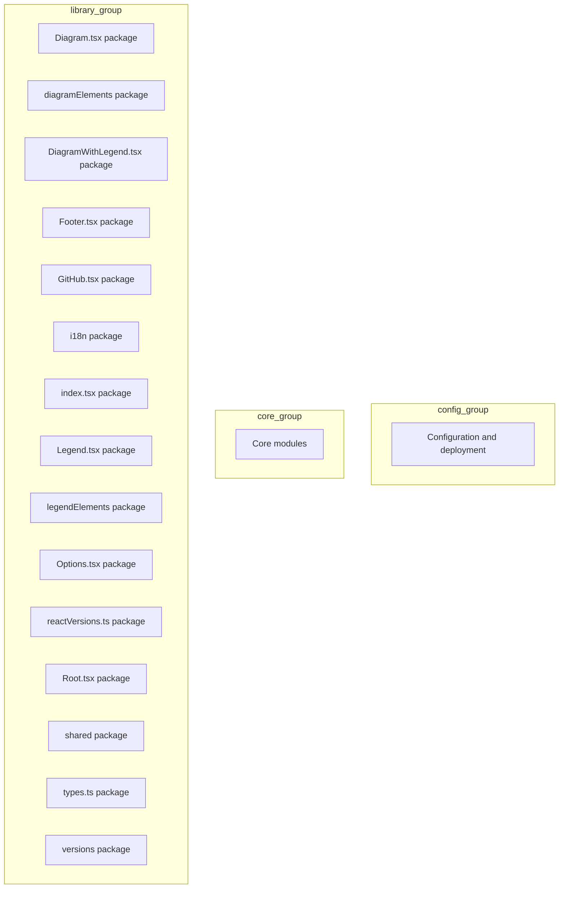

# Architecture report: wojtekmaj/react-lifecycle-methods-diagram

> Automated static analysis. **Observed** = directly seen in files/imports/AST; **Inferred** = interpretation from that evidence. Repository code was not executed.

## 1. Repository at a glance

| Item | Value |
| --- | --- |
| Repository | wojtekmaj/react-lifecycle-methods-diagram |
| Description | Interactive React Lifecycle Methods diagram. |
| Language | TypeScript |
| Stars | 3930 |
| Licence | MIT |
| Analysed commit / branch | e2ce0072a6c77e56c77b85be08debd1d560c157a / main |
| Framework(s) | React |
| Files analysed | 91 |
| Components | 17 |

## 2. Architecture in one minute

wojtekmaj/react-lifecycle-methods-diagram - Interactive React Lifecycle Methods diagram.. This repository was analysed statically from 91 file(s) (0 Python). Detected technologies (observed from imports/manifests): GitHub Actions, React, TypeScript, Vite. Files are grouped into 17 component(s): Configuration and deployment, Core modules, Diagram.tsx package, diagramElements package, DiagramWithLegend.tsx package, Footer.tsx package, GitHub.tsx package, i18n package. Findings below distinguish observed facts from inferred interpretation.

## 3. High-level block diagram

## 4. Main components

### Configuration and deployment (`config`)

- **Kind:** config
- **Status:** Observed
- **Confidence:** 0.85
- **Responsibility:** Groups 35 file(s) under configuration and deployment (observed from repository paths and static analysis).
- **Paths:** `biome.json`, `package.json`, `src/i18n/json/ar-AE.json`, `src/i18n/json/az-AZ.json`, `src/i18n/json/be-BY.json`, `src/i18n/json/bn-BD.json`, `src/i18n/json/de-DE.json`, `src/i18n/json/es-ES.json`, `src/i18n/json/fa-IR.json`, `src/i18n/json/fr-FR.json`, `src/i18n/json/hi-IN.json`, `src/i18n/json/hu-HU.json`, `src/i18n/json/hy-AM.json`, `src/i18n/json/id-ID.json`, `src/i18n/json/it-IT.json`, `src/i18n/json/ja-JP.json`, `src/i18n/json/kk-KZ.json`, `src/i18n/json/ko-KR.json`, `src/i18n/json/pl-PL.json`, `src/i18n/json/pt-BR.json`, `src/i18n/json/pt-PT.json`, `src/i18n/json/ro-RO.json`, `src/i18n/json/ru-RU.json`, `src/i18n/json/sq-AL.json`, `src/i18n/json/sv-SE.json`, `src/i18n/json/th-TH.json`, `src/i18n/json/tr-TR.json`, `src/i18n/json/uk-UA.json`, `src/i18n/json/ur.json`, `src/i18n/json/uz.json`, `src/i18n/json/vi-VN.json`, `src/i18n/json/zh-Hans.json`, `src/i18n/json/zh-Hant.json`, `src/i18n/languages.json`, `tsconfig.json`
- **Evidence:** [biome.json](https://github.com/wojtekmaj/react-lifecycle-methods-diagram/blob/e2ce0072a6c77e56c77b85be08debd1d560c157a/biome.json); [package.json](https://github.com/wojtekmaj/react-lifecycle-methods-diagram/blob/e2ce0072a6c77e56c77b85be08debd1d560c157a/package.json); [src/i18n/json/ar-AE.json](https://github.com/wojtekmaj/react-lifecycle-methods-diagram/blob/e2ce0072a6c77e56c77b85be08debd1d560c157a/src/i18n/json/ar-AE.json); [src/i18n/json/az-AZ.json](https://github.com/wojtekmaj/react-lifecycle-methods-diagram/blob/e2ce0072a6c77e56c77b85be08debd1d560c157a/src/i18n/json/az-AZ.json); [src/i18n/json/be-BY.json](https://github.com/wojtekmaj/react-lifecycle-methods-diagram/blob/e2ce0072a6c77e56c77b85be08debd1d560c157a/src/i18n/json/be-BY.json); [src/i18n/json/bn-BD.json](https://github.com/wojtekmaj/react-lifecycle-methods-diagram/blob/e2ce0072a6c77e56c77b85be08debd1d560c157a/src/i18n/json/bn-BD.json); [src/i18n/json/de-DE.json](https://github.com/wojtekmaj/react-lifecycle-methods-diagram/blob/e2ce0072a6c77e56c77b85be08debd1d560c157a/src/i18n/json/de-DE.json); [src/i18n/json/es-ES.json](https://github.com/wojtekmaj/react-lifecycle-methods-diagram/blob/e2ce0072a6c77e56c77b85be08debd1d560c157a/src/i18n/json/es-ES.json)

### Core modules (`core`)

- **Kind:** core
- **Status:** Observed
- **Confidence:** 0.85
- **Responsibility:** Groups 2 file(s) under core modules (observed from repository paths and static analysis).
- **Paths:** `global.d.ts`, `vite.config.ts`
- **Evidence:** [global.d.ts](https://github.com/wojtekmaj/react-lifecycle-methods-diagram/blob/e2ce0072a6c77e56c77b85be08debd1d560c157a/global.d.ts); [vite.config.ts](https://github.com/wojtekmaj/react-lifecycle-methods-diagram/blob/e2ce0072a6c77e56c77b85be08debd1d560c157a/vite.config.ts)

### Diagram.tsx package (`diagram_tsx`)

- **Kind:** library
- **Status:** Observed
- **Confidence:** 0.85
- **Responsibility:** Groups 1 file(s) under diagram.tsx package (observed from repository paths and static analysis).
- **Paths:** `src/Diagram.tsx`
- **Evidence:** [src/Diagram.tsx](https://github.com/wojtekmaj/react-lifecycle-methods-diagram/blob/e2ce0072a6c77e56c77b85be08debd1d560c157a/src/Diagram.tsx)

### diagramElements package (`diagramelements`)

- **Kind:** library
- **Status:** Observed
- **Confidence:** 0.85
- **Responsibility:** Groups 6 file(s) under diagramelements package (observed from repository paths and static analysis).
- **Paths:** `src/diagramElements/Arrow.tsx`, `src/diagramElements/DocLink.tsx`, `src/diagramElements/Initiator.tsx`, `src/diagramElements/Method.tsx`, `src/diagramElements/Section.tsx`, `src/diagramElements/Subsection.tsx`
- **Evidence:** [src/diagramElements/Arrow.tsx](https://github.com/wojtekmaj/react-lifecycle-methods-diagram/blob/e2ce0072a6c77e56c77b85be08debd1d560c157a/src/diagramElements/Arrow.tsx); [src/diagramElements/DocLink.tsx](https://github.com/wojtekmaj/react-lifecycle-methods-diagram/blob/e2ce0072a6c77e56c77b85be08debd1d560c157a/src/diagramElements/DocLink.tsx); [src/diagramElements/Initiator.tsx](https://github.com/wojtekmaj/react-lifecycle-methods-diagram/blob/e2ce0072a6c77e56c77b85be08debd1d560c157a/src/diagramElements/Initiator.tsx); [src/diagramElements/Method.tsx](https://github.com/wojtekmaj/react-lifecycle-methods-diagram/blob/e2ce0072a6c77e56c77b85be08debd1d560c157a/src/diagramElements/Method.tsx); [src/diagramElements/Section.tsx](https://github.com/wojtekmaj/react-lifecycle-methods-diagram/blob/e2ce0072a6c77e56c77b85be08debd1d560c157a/src/diagramElements/Section.tsx); [src/diagramElements/Subsection.tsx](https://github.com/wojtekmaj/react-lifecycle-methods-diagram/blob/e2ce0072a6c77e56c77b85be08debd1d560c157a/src/diagramElements/Subsection.tsx)

### DiagramWithLegend.tsx package (`diagramwithlegend_tsx`)

- **Kind:** library
- **Status:** Observed
- **Confidence:** 0.85
- **Responsibility:** Groups 1 file(s) under diagramwithlegend.tsx package (observed from repository paths and static analysis).
- **Paths:** `src/DiagramWithLegend.tsx`
- **Evidence:** [src/DiagramWithLegend.tsx](https://github.com/wojtekmaj/react-lifecycle-methods-diagram/blob/e2ce0072a6c77e56c77b85be08debd1d560c157a/src/DiagramWithLegend.tsx)

### Footer.tsx package (`footer_tsx`)

- **Kind:** library
- **Status:** Observed
- **Confidence:** 0.85
- **Responsibility:** Groups 1 file(s) under footer.tsx package (observed from repository paths and static analysis).
- **Paths:** `src/Footer.tsx`
- **Evidence:** [src/Footer.tsx](https://github.com/wojtekmaj/react-lifecycle-methods-diagram/blob/e2ce0072a6c77e56c77b85be08debd1d560c157a/src/Footer.tsx)

### GitHub.tsx package (`github_tsx`)

- **Kind:** library
- **Status:** Observed
- **Confidence:** 0.85
- **Responsibility:** Groups 1 file(s) under github.tsx package (observed from repository paths and static analysis).
- **Paths:** `src/GitHub.tsx`
- **Evidence:** [src/GitHub.tsx](https://github.com/wojtekmaj/react-lifecycle-methods-diagram/blob/e2ce0072a6c77e56c77b85be08debd1d560c157a/src/GitHub.tsx)

### i18n package (`i18n`)

- **Kind:** library
- **Status:** Observed
- **Confidence:** 0.85
- **Responsibility:** Groups 1 file(s) under i18n package (observed from repository paths and static analysis).
- **Paths:** `src/i18n/i18n.ts`
- **Evidence:** [src/i18n/i18n.ts](https://github.com/wojtekmaj/react-lifecycle-methods-diagram/blob/e2ce0072a6c77e56c77b85be08debd1d560c157a/src/i18n/i18n.ts)

### index.tsx package (`index_tsx`)

- **Kind:** library
- **Status:** Observed
- **Confidence:** 0.85
- **Responsibility:** Groups 1 file(s) under index.tsx package (observed from repository paths and static analysis).
- **Paths:** `src/index.tsx`
- **Evidence:** [src/index.tsx](https://github.com/wojtekmaj/react-lifecycle-methods-diagram/blob/e2ce0072a6c77e56c77b85be08debd1d560c157a/src/index.tsx)

### Legend.tsx package (`legend_tsx`)

- **Kind:** library
- **Status:** Observed
- **Confidence:** 0.85
- **Responsibility:** Groups 1 file(s) under legend.tsx package (observed from repository paths and static analysis).
- **Paths:** `src/Legend.tsx`
- **Evidence:** [src/Legend.tsx](https://github.com/wojtekmaj/react-lifecycle-methods-diagram/blob/e2ce0072a6c77e56c77b85be08debd1d560c157a/src/Legend.tsx)

### legendElements package (`legendelements`)

- **Kind:** library
- **Status:** Observed
- **Confidence:** 0.85
- **Responsibility:** Groups 1 file(s) under legendelements package (observed from repository paths and static analysis).
- **Paths:** `src/legendElements/Phase.tsx`
- **Evidence:** [src/legendElements/Phase.tsx](https://github.com/wojtekmaj/react-lifecycle-methods-diagram/blob/e2ce0072a6c77e56c77b85be08debd1d560c157a/src/legendElements/Phase.tsx)

### Options.tsx package (`options_tsx`)

- **Kind:** library
- **Status:** Observed
- **Confidence:** 0.85
- **Responsibility:** Groups 1 file(s) under options.tsx package (observed from repository paths and static analysis).
- **Paths:** `src/Options.tsx`
- **Evidence:** [src/Options.tsx](https://github.com/wojtekmaj/react-lifecycle-methods-diagram/blob/e2ce0072a6c77e56c77b85be08debd1d560c157a/src/Options.tsx)

### reactVersions.ts package (`reactversions_ts`)

- **Kind:** library
- **Status:** Observed
- **Confidence:** 0.85
- **Responsibility:** Groups 1 file(s) under reactversions.ts package (observed from repository paths and static analysis).
- **Paths:** `src/reactVersions.ts`
- **Evidence:** [src/reactVersions.ts](https://github.com/wojtekmaj/react-lifecycle-methods-diagram/blob/e2ce0072a6c77e56c77b85be08debd1d560c157a/src/reactVersions.ts)

### Root.tsx package (`root_tsx`)

- **Kind:** library
- **Status:** Observed
- **Confidence:** 0.85
- **Responsibility:** Groups 1 file(s) under root.tsx package (observed from repository paths and static analysis).
- **Paths:** `src/Root.tsx`
- **Evidence:** [src/Root.tsx](https://github.com/wojtekmaj/react-lifecycle-methods-diagram/blob/e2ce0072a6c77e56c77b85be08debd1d560c157a/src/Root.tsx)

### shared package (`shared`)

- **Kind:** library
- **Status:** Observed
- **Confidence:** 0.85
- **Responsibility:** Groups 1 file(s) under shared package (observed from repository paths and static analysis).
- **Paths:** `src/shared/utils.ts`
- **Evidence:** [src/shared/utils.ts](https://github.com/wojtekmaj/react-lifecycle-methods-diagram/blob/e2ce0072a6c77e56c77b85be08debd1d560c157a/src/shared/utils.ts)

### types.ts package (`types_ts`)

- **Kind:** library
- **Status:** Observed
- **Confidence:** 0.85
- **Responsibility:** Groups 1 file(s) under types.ts package (observed from repository paths and static analysis).
- **Paths:** `src/types.ts`
- **Evidence:** [src/types.ts](https://github.com/wojtekmaj/react-lifecycle-methods-diagram/blob/e2ce0072a6c77e56c77b85be08debd1d560c157a/src/types.ts)

### versions package (`versions`)

- **Kind:** library
- **Status:** Observed
- **Confidence:** 0.85
- **Responsibility:** Groups 8 file(s) under versions package (observed from repository paths and static analysis).
- **Paths:** `src/versions/16.3/Mounting.tsx`, `src/versions/16.3/Unmounting.tsx`, `src/versions/16.3/Updating.tsx`, `src/versions/16.3/index.ts`, `src/versions/16.4/Mounting.tsx`, `src/versions/16.4/Unmounting.tsx`, `src/versions/16.4/Updating.tsx`, `src/versions/16.4/index.ts`
- **Evidence:** [src/versions/16.3/Mounting.tsx](https://github.com/wojtekmaj/react-lifecycle-methods-diagram/blob/e2ce0072a6c77e56c77b85be08debd1d560c157a/src/versions/16.3/Mounting.tsx); [src/versions/16.3/Unmounting.tsx](https://github.com/wojtekmaj/react-lifecycle-methods-diagram/blob/e2ce0072a6c77e56c77b85be08debd1d560c157a/src/versions/16.3/Unmounting.tsx); [src/versions/16.3/Updating.tsx](https://github.com/wojtekmaj/react-lifecycle-methods-diagram/blob/e2ce0072a6c77e56c77b85be08debd1d560c157a/src/versions/16.3/Updating.tsx); [src/versions/16.3/index.ts](https://github.com/wojtekmaj/react-lifecycle-methods-diagram/blob/e2ce0072a6c77e56c77b85be08debd1d560c157a/src/versions/16.3/index.ts); [src/versions/16.4/Mounting.tsx](https://github.com/wojtekmaj/react-lifecycle-methods-diagram/blob/e2ce0072a6c77e56c77b85be08debd1d560c157a/src/versions/16.4/Mounting.tsx); [src/versions/16.4/Unmounting.tsx](https://github.com/wojtekmaj/react-lifecycle-methods-diagram/blob/e2ce0072a6c77e56c77b85be08debd1d560c157a/src/versions/16.4/Unmounting.tsx); [src/versions/16.4/Updating.tsx](https://github.com/wojtekmaj/react-lifecycle-methods-diagram/blob/e2ce0072a6c77e56c77b85be08debd1d560c157a/src/versions/16.4/Updating.tsx); [src/versions/16.4/index.ts](https://github.com/wojtekmaj/react-lifecycle-methods-diagram/blob/e2ce0072a6c77e56c77b85be08debd1d560c157a/src/versions/16.4/index.ts)

## 5. Execution flow

**Observed** entry point(s):

- [src/index.tsx](https://github.com/wojtekmaj/react-lifecycle-methods-diagram/blob/e2ce0072a6c77e56c77b85be08debd1d560c157a/src/index.tsx)
- [src/versions/16.3/index.ts](https://github.com/wojtekmaj/react-lifecycle-methods-diagram/blob/e2ce0072a6c77e56c77b85be08debd1d560c157a/src/versions/16.3/index.ts)
- [src/versions/16.4/index.ts](https://github.com/wojtekmaj/react-lifecycle-methods-diagram/blob/e2ce0072a6c77e56c77b85be08debd1d560c157a/src/versions/16.4/index.ts)

Representative flow (derived from observed entry points and the import graph; steps beyond the entry point are **Inferred**):

1. Execution starts at an observed entry point listed above, if present.
2. No internal import relationships between components were observed.

## 6. Project structure

### `(root)`

- `.browserslistrc` - other (92 bytes)
- `.gitattributes` - other (73 bytes)
- `.gitignore` - other (389 bytes)
- `.yarnrc.yml` - config (101 bytes)
- `LICENSE` - docs (1076 bytes)
- `README.md` - docs (2872 bytes)
- `biome.json` - config (3059 bytes)
- `global.d.ts` - source, TypeScript (31 bytes)
- `index.html` - other (878 bytes)
- `package.json` - manifest (1354 bytes)
- `tsconfig.json` - config (479 bytes)
- `vite.config.ts` - source, TypeScript (266 bytes)

### `.github`

- `.github/FUNDING.yml` - config (67 bytes)
- `.github/workflows/ci.yml` - ci, YAML (1552 bytes)
- `.github/workflows/deploy.yml` - ci, YAML (1711 bytes)

### `.husky`

- `.husky/pre-commit` - other (54 bytes)

### `.vscode`

- `.vscode/extensions.json` - config (145 bytes)
- `.vscode/settings.json` - config (128 bytes)

### `.yarn`

- `.yarn/plugins/@yarnpkg/plugin-nolyfill.cjs` - source, JavaScript (3202 bytes)

### `public`

- `public/.htaccess` - other (42 bytes)

### `src`

- `src/Diagram.tsx` - source, TypeScript (1000 bytes)
- `src/DiagramWithLegend.module.css` - other (234 bytes)
- `src/DiagramWithLegend.tsx` - source, TypeScript (526 bytes)
- `src/Footer.module.css` - other (108 bytes)
- `src/Footer.tsx` - source, TypeScript (200 bytes)
- `src/GitHub.tsx` - source, TypeScript (1082 bytes)
- `src/Legend.module.css` - other (34 bytes)
- `src/Legend.tsx` - source, TypeScript (884 bytes)
- `src/Options.module.css` - other (528 bytes)
- `src/Options.tsx` - source, TypeScript (3650 bytes)
- `src/Root.tsx` - source, TypeScript (2547 bytes)
- `src/diagramElements/Arrow.module.css` - other (1018 bytes)
- `src/diagramElements/Arrow.tsx` - source, TypeScript (788 bytes)
- `src/diagramElements/DocLink.tsx` - source, TypeScript (1383 bytes)
- `src/diagramElements/Initiator.module.css` - other (459 bytes)
- `src/diagramElements/Initiator.tsx` - source, TypeScript (742 bytes)
- `src/diagramElements/Method.module.css` - other (1923 bytes)
- `src/diagramElements/Method.tsx` - source, TypeScript (1189 bytes)
- `src/diagramElements/Section.module.css` - other (689 bytes)
- `src/diagramElements/Section.tsx` - source, TypeScript (1752 bytes)
- `src/diagramElements/Subsection.tsx` - source, TypeScript (2952 bytes)
- `src/global.css` - other (944 bytes)
- `src/i18n/README.md` - docs (1105 bytes)
- `src/i18n/i18n.ts` - source, TypeScript (2190 bytes)
- `src/i18n/json/ar-AE.json` - config (1510 bytes)
- `src/i18n/json/az-AZ.json` - config (1286 bytes)
- `src/i18n/json/be-BY.json` - config (1619 bytes)
- `src/i18n/json/bn-BD.json` - config (1863 bytes)
- `src/i18n/json/de-DE.json` - config (1088 bytes)
- `src/i18n/json/es-ES.json` - config (1080 bytes)
- `src/i18n/json/fa-IR.json` - config (1545 bytes)
- `src/i18n/json/fr-FR.json` - config (1253 bytes)
- `src/i18n/json/hi-IN.json` - config (1933 bytes)
- `src/i18n/json/hu-HU.json` - config (1268 bytes)
- `src/i18n/json/hy-AM.json` - config (1569 bytes)
- `src/i18n/json/id-ID.json` - config (1144 bytes)
- `src/i18n/json/it-IT.json` - config (1189 bytes)
- `src/i18n/json/ja-JP.json` - config (1338 bytes)
- `src/i18n/json/kk-KZ.json` - config (1267 bytes)
- `src/i18n/json/ko-KR.json` - config (1292 bytes)
- `src/i18n/json/pl-PL.json` - config (1234 bytes)
- `src/i18n/json/pt-BR.json` - config (1062 bytes)
- `src/i18n/json/pt-PT.json` - config (1075 bytes)
- `src/i18n/json/ro-RO.json` - config (1231 bytes)
- `src/i18n/json/ru-RU.json` - config (1666 bytes)
- `src/i18n/json/sq-AL.json` - config (1256 bytes)
- `src/i18n/json/sv-SE.json` - config (986 bytes)
- `src/i18n/json/th-TH.json` - config (1711 bytes)
- `src/i18n/json/tr-TR.json` - config (1236 bytes)
- `src/i18n/json/uk-UA.json` - config (1601 bytes)
- `src/i18n/json/ur.json` - config (1505 bytes)
- `src/i18n/json/uz.json` - config (1276 bytes)
- `src/i18n/json/vi-VN.json` - config (1326 bytes)
- `src/i18n/json/zh-Hans.json` - config (1022 bytes)
- `src/i18n/json/zh-Hant.json` - config (1018 bytes)
- `src/i18n/languages.json` - config (2918 bytes)
- `src/index.tsx` - source, TypeScript (603 bytes)
- `src/legendElements/Phase.module.css` - other (306 bytes)
- `src/legendElements/Phase.tsx` - source, TypeScript (571 bytes)
- `src/reactVersions.ts` - source, TypeScript (65 bytes)
- `src/shared/utils.ts` - source, TypeScript (1238 bytes)
- `src/types.ts` - source, TypeScript (44 bytes)
- `src/versions/16.3/Mounting.tsx` - source, TypeScript (1697 bytes)
- `src/versions/16.3/Unmounting.tsx` - source, TypeScript (550 bytes)
- `src/versions/16.3/Updating.tsx` - source, TypeScript (5818 bytes)
- `src/versions/16.3/index.ts` - source, TypeScript (162 bytes)
- `src/versions/16.4/Mounting.tsx` - source, TypeScript (1676 bytes)
- `src/versions/16.4/Unmounting.tsx` - source, TypeScript (76 bytes)
- `src/versions/16.4/Updating.tsx` - source, TypeScript (6252 bytes)
- `src/versions/16.4/index.ts` - source, TypeScript (162 bytes)
- `src/versions/README.md` - docs (496 bytes)

## 7. Key dependencies and integrations

| Name | Category | Status | Confidence | Evidence |
| --- | --- | --- | --- | --- |
| GitHub Actions | ci | Observed | 0.90 | [.github/workflows/ci.yml](https://github.com/wojtekmaj/react-lifecycle-methods-diagram/blob/e2ce0072a6c77e56c77b85be08debd1d560c157a/.github/workflows/ci.yml); [.github/workflows/deploy.yml](https://github.com/wojtekmaj/react-lifecycle-methods-diagram/blob/e2ce0072a6c77e56c77b85be08debd1d560c157a/.github/workflows/deploy.yml) |
| React | framework | Observed | 0.90 | [package.json:2](https://github.com/wojtekmaj/react-lifecycle-methods-diagram/blob/e2ce0072a6c77e56c77b85be08debd1d560c157a/package.json#L2); [package.json:28](https://github.com/wojtekmaj/react-lifecycle-methods-diagram/blob/e2ce0072a6c77e56c77b85be08debd1d560c157a/package.json#L28) |
| TypeScript | tooling | Observed | 0.85 | [package.json:37](https://github.com/wojtekmaj/react-lifecycle-methods-diagram/blob/e2ce0072a6c77e56c77b85be08debd1d560c157a/package.json#L37) |
| Vite | tooling | Observed | 0.85 | [package.json:7](https://github.com/wojtekmaj/react-lifecycle-methods-diagram/blob/e2ce0072a6c77e56c77b85be08debd1d560c157a/package.json#L7) |

## 8. Data and state

No database, cache, queue, or persistent-state usage was observed in the analysed files. State handling, if any, may be in-memory or in files that were not analysed.

## 9. Configuration and deployment clues

- `.github/FUNDING.yml` (config)
- `.github/workflows/ci.yml` (ci)
- `.github/workflows/deploy.yml` (ci)
- `.vscode/extensions.json` (config)
- `.vscode/settings.json` (config)
- `.yarnrc.yml` (config)
- `biome.json` (config)
- `package.json` (manifest)
- `src/i18n/json/ar-AE.json` (config)
- `src/i18n/json/az-AZ.json` (config)
- `src/i18n/json/be-BY.json` (config)
- `src/i18n/json/bn-BD.json` (config)
- `src/i18n/json/de-DE.json` (config)
- `src/i18n/json/es-ES.json` (config)
- `src/i18n/json/fa-IR.json` (config)
- `src/i18n/json/fr-FR.json` (config)
- `src/i18n/json/hi-IN.json` (config)
- `src/i18n/json/hu-HU.json` (config)
- `src/i18n/json/hy-AM.json` (config)
- `src/i18n/json/id-ID.json` (config)
- `src/i18n/json/it-IT.json` (config)
- `src/i18n/json/ja-JP.json` (config)
- `src/i18n/json/kk-KZ.json` (config)
- `src/i18n/json/ko-KR.json` (config)
- `src/i18n/json/pl-PL.json` (config)
- `src/i18n/json/pt-BR.json` (config)
- `src/i18n/json/pt-PT.json` (config)
- `src/i18n/json/ro-RO.json` (config)
- `src/i18n/json/ru-RU.json` (config)
- `src/i18n/json/sq-AL.json` (config)
- `src/i18n/json/sv-SE.json` (config)
- `src/i18n/json/th-TH.json` (config)
- `src/i18n/json/tr-TR.json` (config)
- `src/i18n/json/uk-UA.json` (config)
- `src/i18n/json/ur.json` (config)
- `src/i18n/json/uz.json` (config)
- `src/i18n/json/vi-VN.json` (config)
- `src/i18n/json/zh-Hans.json` (config)
- `src/i18n/json/zh-Hant.json` (config)
- `src/i18n/languages.json` (config)
- `tsconfig.json` (config)

## 10. Design observations

- No strong design patterns could be established from the available evidence.

These observations are interpretations (**Inferred**) of the observed structure, not guarantees about runtime design.

## 11. Limitations and unknowns

- Static analysis only: repository code was not executed, installed, or imported at runtime.
- Components and relationships are inferred from file paths, imports, and AST structure; runtime behaviour, dynamic imports, and reflection may not be visible.
- 1 file(s) were skipped during inventory (1 x lockfile excluded).
- No clear application entry point was observed in the analysed files.
- Repository text was treated as untrusted data; no instructions found in repository files were followed, and likely secret values were redacted/excluded.
- JavaScript and TypeScript files were inventoried from paths and package manifests. They were not parsed with a full language AST, and repository code was not executed.

## 12. Source references

- [.github/workflows/ci.yml](https://github.com/wojtekmaj/react-lifecycle-methods-diagram/blob/e2ce0072a6c77e56c77b85be08debd1d560c157a/.github/workflows/ci.yml)
- [.github/workflows/deploy.yml](https://github.com/wojtekmaj/react-lifecycle-methods-diagram/blob/e2ce0072a6c77e56c77b85be08debd1d560c157a/.github/workflows/deploy.yml)
- [biome.json](https://github.com/wojtekmaj/react-lifecycle-methods-diagram/blob/e2ce0072a6c77e56c77b85be08debd1d560c157a/biome.json)
- [global.d.ts](https://github.com/wojtekmaj/react-lifecycle-methods-diagram/blob/e2ce0072a6c77e56c77b85be08debd1d560c157a/global.d.ts)
- [package.json](https://github.com/wojtekmaj/react-lifecycle-methods-diagram/blob/e2ce0072a6c77e56c77b85be08debd1d560c157a/package.json)
- [package.json:2](https://github.com/wojtekmaj/react-lifecycle-methods-diagram/blob/e2ce0072a6c77e56c77b85be08debd1d560c157a/package.json#L2)
- [package.json:7](https://github.com/wojtekmaj/react-lifecycle-methods-diagram/blob/e2ce0072a6c77e56c77b85be08debd1d560c157a/package.json#L7)
- [package.json:28](https://github.com/wojtekmaj/react-lifecycle-methods-diagram/blob/e2ce0072a6c77e56c77b85be08debd1d560c157a/package.json#L28)
- [package.json:37](https://github.com/wojtekmaj/react-lifecycle-methods-diagram/blob/e2ce0072a6c77e56c77b85be08debd1d560c157a/package.json#L37)
- [src/Diagram.tsx](https://github.com/wojtekmaj/react-lifecycle-methods-diagram/blob/e2ce0072a6c77e56c77b85be08debd1d560c157a/src/Diagram.tsx)
- [src/DiagramWithLegend.tsx](https://github.com/wojtekmaj/react-lifecycle-methods-diagram/blob/e2ce0072a6c77e56c77b85be08debd1d560c157a/src/DiagramWithLegend.tsx)
- [src/Footer.tsx](https://github.com/wojtekmaj/react-lifecycle-methods-diagram/blob/e2ce0072a6c77e56c77b85be08debd1d560c157a/src/Footer.tsx)
- [src/GitHub.tsx](https://github.com/wojtekmaj/react-lifecycle-methods-diagram/blob/e2ce0072a6c77e56c77b85be08debd1d560c157a/src/GitHub.tsx)
- [src/Legend.tsx](https://github.com/wojtekmaj/react-lifecycle-methods-diagram/blob/e2ce0072a6c77e56c77b85be08debd1d560c157a/src/Legend.tsx)
- [src/Options.tsx](https://github.com/wojtekmaj/react-lifecycle-methods-diagram/blob/e2ce0072a6c77e56c77b85be08debd1d560c157a/src/Options.tsx)
- [src/Root.tsx](https://github.com/wojtekmaj/react-lifecycle-methods-diagram/blob/e2ce0072a6c77e56c77b85be08debd1d560c157a/src/Root.tsx)
- [src/diagramElements/Arrow.tsx](https://github.com/wojtekmaj/react-lifecycle-methods-diagram/blob/e2ce0072a6c77e56c77b85be08debd1d560c157a/src/diagramElements/Arrow.tsx)
- [src/diagramElements/DocLink.tsx](https://github.com/wojtekmaj/react-lifecycle-methods-diagram/blob/e2ce0072a6c77e56c77b85be08debd1d560c157a/src/diagramElements/DocLink.tsx)
- [src/diagramElements/Initiator.tsx](https://github.com/wojtekmaj/react-lifecycle-methods-diagram/blob/e2ce0072a6c77e56c77b85be08debd1d560c157a/src/diagramElements/Initiator.tsx)
- [src/diagramElements/Method.tsx](https://github.com/wojtekmaj/react-lifecycle-methods-diagram/blob/e2ce0072a6c77e56c77b85be08debd1d560c157a/src/diagramElements/Method.tsx)
- [src/diagramElements/Section.tsx](https://github.com/wojtekmaj/react-lifecycle-methods-diagram/blob/e2ce0072a6c77e56c77b85be08debd1d560c157a/src/diagramElements/Section.tsx)
- [src/diagramElements/Subsection.tsx](https://github.com/wojtekmaj/react-lifecycle-methods-diagram/blob/e2ce0072a6c77e56c77b85be08debd1d560c157a/src/diagramElements/Subsection.tsx)
- [src/i18n/i18n.ts](https://github.com/wojtekmaj/react-lifecycle-methods-diagram/blob/e2ce0072a6c77e56c77b85be08debd1d560c157a/src/i18n/i18n.ts)
- [src/i18n/json/ar-AE.json](https://github.com/wojtekmaj/react-lifecycle-methods-diagram/blob/e2ce0072a6c77e56c77b85be08debd1d560c157a/src/i18n/json/ar-AE.json)
- [src/i18n/json/az-AZ.json](https://github.com/wojtekmaj/react-lifecycle-methods-diagram/blob/e2ce0072a6c77e56c77b85be08debd1d560c157a/src/i18n/json/az-AZ.json)
- [src/i18n/json/be-BY.json](https://github.com/wojtekmaj/react-lifecycle-methods-diagram/blob/e2ce0072a6c77e56c77b85be08debd1d560c157a/src/i18n/json/be-BY.json)
- [src/i18n/json/bn-BD.json](https://github.com/wojtekmaj/react-lifecycle-methods-diagram/blob/e2ce0072a6c77e56c77b85be08debd1d560c157a/src/i18n/json/bn-BD.json)
- [src/i18n/json/de-DE.json](https://github.com/wojtekmaj/react-lifecycle-methods-diagram/blob/e2ce0072a6c77e56c77b85be08debd1d560c157a/src/i18n/json/de-DE.json)
- [src/i18n/json/es-ES.json](https://github.com/wojtekmaj/react-lifecycle-methods-diagram/blob/e2ce0072a6c77e56c77b85be08debd1d560c157a/src/i18n/json/es-ES.json)
- [src/index.tsx](https://github.com/wojtekmaj/react-lifecycle-methods-diagram/blob/e2ce0072a6c77e56c77b85be08debd1d560c157a/src/index.tsx)
- [src/legendElements/Phase.tsx](https://github.com/wojtekmaj/react-lifecycle-methods-diagram/blob/e2ce0072a6c77e56c77b85be08debd1d560c157a/src/legendElements/Phase.tsx)
- [src/reactVersions.ts](https://github.com/wojtekmaj/react-lifecycle-methods-diagram/blob/e2ce0072a6c77e56c77b85be08debd1d560c157a/src/reactVersions.ts)
- [src/shared/utils.ts](https://github.com/wojtekmaj/react-lifecycle-methods-diagram/blob/e2ce0072a6c77e56c77b85be08debd1d560c157a/src/shared/utils.ts)
- [src/types.ts](https://github.com/wojtekmaj/react-lifecycle-methods-diagram/blob/e2ce0072a6c77e56c77b85be08debd1d560c157a/src/types.ts)
- [src/versions/16.3/Mounting.tsx](https://github.com/wojtekmaj/react-lifecycle-methods-diagram/blob/e2ce0072a6c77e56c77b85be08debd1d560c157a/src/versions/16.3/Mounting.tsx)
- [src/versions/16.3/Unmounting.tsx](https://github.com/wojtekmaj/react-lifecycle-methods-diagram/blob/e2ce0072a6c77e56c77b85be08debd1d560c157a/src/versions/16.3/Unmounting.tsx)
- [src/versions/16.3/Updating.tsx](https://github.com/wojtekmaj/react-lifecycle-methods-diagram/blob/e2ce0072a6c77e56c77b85be08debd1d560c157a/src/versions/16.3/Updating.tsx)
- [src/versions/16.3/index.ts](https://github.com/wojtekmaj/react-lifecycle-methods-diagram/blob/e2ce0072a6c77e56c77b85be08debd1d560c157a/src/versions/16.3/index.ts)
- [src/versions/16.4/Mounting.tsx](https://github.com/wojtekmaj/react-lifecycle-methods-diagram/blob/e2ce0072a6c77e56c77b85be08debd1d560c157a/src/versions/16.4/Mounting.tsx)
- [src/versions/16.4/Unmounting.tsx](https://github.com/wojtekmaj/react-lifecycle-methods-diagram/blob/e2ce0072a6c77e56c77b85be08debd1d560c157a/src/versions/16.4/Unmounting.tsx)
- [src/versions/16.4/Updating.tsx](https://github.com/wojtekmaj/react-lifecycle-methods-diagram/blob/e2ce0072a6c77e56c77b85be08debd1d560c157a/src/versions/16.4/Updating.tsx)
- [src/versions/16.4/index.ts](https://github.com/wojtekmaj/react-lifecycle-methods-diagram/blob/e2ce0072a6c77e56c77b85be08debd1d560c157a/src/versions/16.4/index.ts)
- [vite.config.ts](https://github.com/wojtekmaj/react-lifecycle-methods-diagram/blob/e2ce0072a6c77e56c77b85be08debd1d560c157a/vite.config.ts)
