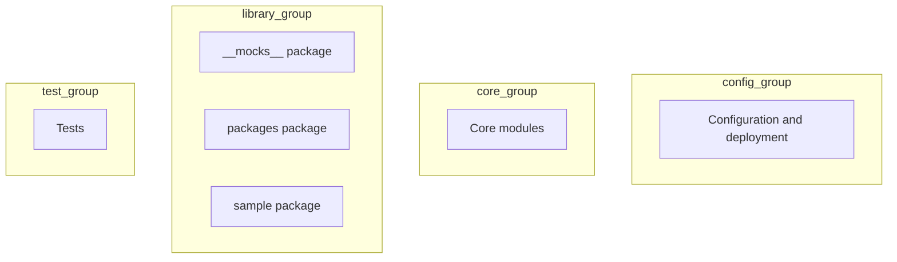

# Architecture report: wojtekmaj/react-pdf

> Automated static analysis. **Observed** = directly seen in files/imports/AST; **Inferred** = interpretation from that evidence. Repository code was not executed.

## 1. Repository at a glance

| Item | Value |
| --- | --- |
| Repository | wojtekmaj/react-pdf |
| Description | Display PDFs in your React app as easily as if they were images. |
| Language | TypeScript |
| Stars | 11200 |
| Licence | MIT |
| Analysed commit / branch | f435d0bdc1fa8bc9658aa3d9d2c9e1f8da5eb219 / main |
| Framework(s) | Next.js, React |
| Files analysed | 142 |
| Components | 6 |

## 2. Architecture in one minute

wojtekmaj/react-pdf - Display PDFs in your React app as easily as if they were images.. This repository was analysed statically from 142 file(s) (0 Python). Detected technologies (observed from imports/manifests): GitHub Actions, Next.js, React, TypeScript, Vite, Vitest. Files are grouped into 6 component(s): Configuration and deployment, Core modules, __mocks__ package, packages package, sample package, Tests. Findings below distinguish observed facts from inferred interpretation.

## 3. High-level block diagram

## 4. Main components

### Configuration and deployment (`config`)

- **Kind:** config
- **Status:** Observed
- **Confidence:** 0.85
- **Responsibility:** Groups 15 file(s) under configuration and deployment (observed from repository paths and static analysis).
- **Paths:** `biome.json`, `package.json`, `packages/react-pdf/package.json`, `packages/react-pdf/tsconfig.build.json`, `packages/react-pdf/tsconfig.json`, `sample/next-app/package.json`, `sample/next-app/tsconfig.json`, `sample/next-pages/package.json`, `sample/next-pages/tsconfig.json`, `sample/parcel2/package.json`, `sample/parcel2/tsconfig.json`, `sample/vite/package.json`, `sample/vite/tsconfig.json`, `sample/webpack5/package.json`, `sample/webpack5/tsconfig.json`
- **Evidence:** [biome.json](https://github.com/wojtekmaj/react-pdf/blob/f435d0bdc1fa8bc9658aa3d9d2c9e1f8da5eb219/biome.json); [package.json](https://github.com/wojtekmaj/react-pdf/blob/f435d0bdc1fa8bc9658aa3d9d2c9e1f8da5eb219/package.json); [packages/react-pdf/package.json](https://github.com/wojtekmaj/react-pdf/blob/f435d0bdc1fa8bc9658aa3d9d2c9e1f8da5eb219/packages/react-pdf/package.json); [packages/react-pdf/tsconfig.build.json](https://github.com/wojtekmaj/react-pdf/blob/f435d0bdc1fa8bc9658aa3d9d2c9e1f8da5eb219/packages/react-pdf/tsconfig.build.json); [packages/react-pdf/tsconfig.json](https://github.com/wojtekmaj/react-pdf/blob/f435d0bdc1fa8bc9658aa3d9d2c9e1f8da5eb219/packages/react-pdf/tsconfig.json); [sample/next-app/package.json](https://github.com/wojtekmaj/react-pdf/blob/f435d0bdc1fa8bc9658aa3d9d2c9e1f8da5eb219/sample/next-app/package.json); [sample/next-app/tsconfig.json](https://github.com/wojtekmaj/react-pdf/blob/f435d0bdc1fa8bc9658aa3d9d2c9e1f8da5eb219/sample/next-app/tsconfig.json); [sample/next-pages/package.json](https://github.com/wojtekmaj/react-pdf/blob/f435d0bdc1fa8bc9658aa3d9d2c9e1f8da5eb219/sample/next-pages/package.json)

### Core modules (`core`)

- **Kind:** core
- **Status:** Observed
- **Confidence:** 0.85
- **Responsibility:** Groups 1 file(s) under core modules (observed from repository paths and static analysis).
- **Paths:** `test-utils.ts`
- **Evidence:** [test-utils.ts](https://github.com/wojtekmaj/react-pdf/blob/f435d0bdc1fa8bc9658aa3d9d2c9e1f8da5eb219/test-utils.ts)

### __mocks__ package (`mocks`)

- **Kind:** library
- **Status:** Observed
- **Confidence:** 0.85
- **Responsibility:** Groups 3 file(s) under __mocks__ package (observed from repository paths and static analysis).
- **Paths:** `__mocks__/_failing_page.ts`, `__mocks__/_failing_pdf.ts`, `__mocks__/_silently_failing_pdf.ts`
- **Evidence:** [__mocks__/_failing_page.ts](https://github.com/wojtekmaj/react-pdf/blob/f435d0bdc1fa8bc9658aa3d9d2c9e1f8da5eb219/__mocks__/_failing_page.ts); [__mocks__/_failing_pdf.ts](https://github.com/wojtekmaj/react-pdf/blob/f435d0bdc1fa8bc9658aa3d9d2c9e1f8da5eb219/__mocks__/_failing_pdf.ts); [__mocks__/_silently_failing_pdf.ts](https://github.com/wojtekmaj/react-pdf/blob/f435d0bdc1fa8bc9658aa3d9d2c9e1f8da5eb219/__mocks__/_silently_failing_pdf.ts)

### packages package (`packages`)

- **Kind:** library
- **Status:** Observed
- **Confidence:** 0.85
- **Responsibility:** Groups 49 file(s) under packages package (observed from repository paths and static analysis).
- **Paths:** `packages/react-pdf/src/Document.spec.tsx`, `packages/react-pdf/src/Document.tsx`, `packages/react-pdf/src/DocumentContext.tsx`, `packages/react-pdf/src/LinkService.ts`, `packages/react-pdf/src/Message.tsx`, `packages/react-pdf/src/Outline.spec.tsx`, `packages/react-pdf/src/Outline.tsx`, `packages/react-pdf/src/OutlineContext.tsx`, `packages/react-pdf/src/OutlineItem.spec.tsx`, `packages/react-pdf/src/OutlineItem.tsx`, `packages/react-pdf/src/Page.spec.tsx`, `packages/react-pdf/src/Page.tsx`, `packages/react-pdf/src/Page/AnnotationLayer.spec.tsx`, `packages/react-pdf/src/Page/AnnotationLayer.tsx`, `packages/react-pdf/src/Page/Canvas.spec.tsx`, `packages/react-pdf/src/Page/Canvas.tsx`, `packages/react-pdf/src/Page/TextLayer.spec.tsx`, `packages/react-pdf/src/Page/TextLayer.tsx`, `packages/react-pdf/src/PageContext.tsx`, `packages/react-pdf/src/PasswordResponses.ts`, `packages/react-pdf/src/Ref.spec.ts`, `packages/react-pdf/src/Ref.ts`, `packages/react-pdf/src/StructTree.spec.tsx`, `packages/react-pdf/src/StructTree.tsx`, `packages/react-pdf/src/StructTreeItem.tsx`, `packages/react-pdf/src/Thumbnail.spec.tsx`, `packages/react-pdf/src/Thumbnail.tsx`, `packages/react-pdf/src/index.spec.ts`, `packages/react-pdf/src/index.test.ts`, `packages/react-pdf/src/index.ts`, `packages/react-pdf/src/pdf.worker.entry.ts`, `packages/react-pdf/src/shared/ResourceCache.ts`, `packages/react-pdf/src/shared/areDocumentInputsEqual.spec.ts`, `packages/react-pdf/src/shared/areDocumentInputsEqual.ts`, `packages/react-pdf/src/shared/constants.ts`, `packages/react-pdf/src/shared/hooks/useCachedValue.ts`, `packages/react-pdf/src/shared/hooks/useDocumentContext.ts`, `packages/react-pdf/src/shared/hooks/useErrorBoundaryReporter.ts`, `packages/react-pdf/src/shared/hooks/useOutlineContext.ts`, `packages/react-pdf/src/shared/hooks/usePageContext.ts`, `packages/react-pdf/src/shared/hooks/useResolver.ts`, `packages/react-pdf/src/shared/hooks/useResource.ts`, `packages/react-pdf/src/shared/hooks/useSuspenseResource.ts`, `packages/react-pdf/src/shared/structTreeUtils.ts`, `packages/react-pdf/src/shared/types.ts`, `packages/react-pdf/src/shared/utils.spec.ts`, `packages/react-pdf/src/shared/utils.ts`, `packages/react-pdf/vitest.config.ts`, `packages/react-pdf/vitest.setup.ts`
- **Evidence:** [packages/react-pdf/src/Document.spec.tsx](https://github.com/wojtekmaj/react-pdf/blob/f435d0bdc1fa8bc9658aa3d9d2c9e1f8da5eb219/packages/react-pdf/src/Document.spec.tsx); [packages/react-pdf/src/Document.tsx](https://github.com/wojtekmaj/react-pdf/blob/f435d0bdc1fa8bc9658aa3d9d2c9e1f8da5eb219/packages/react-pdf/src/Document.tsx); [packages/react-pdf/src/DocumentContext.tsx](https://github.com/wojtekmaj/react-pdf/blob/f435d0bdc1fa8bc9658aa3d9d2c9e1f8da5eb219/packages/react-pdf/src/DocumentContext.tsx); [packages/react-pdf/src/LinkService.ts](https://github.com/wojtekmaj/react-pdf/blob/f435d0bdc1fa8bc9658aa3d9d2c9e1f8da5eb219/packages/react-pdf/src/LinkService.ts); [packages/react-pdf/src/Message.tsx](https://github.com/wojtekmaj/react-pdf/blob/f435d0bdc1fa8bc9658aa3d9d2c9e1f8da5eb219/packages/react-pdf/src/Message.tsx); [packages/react-pdf/src/Outline.spec.tsx](https://github.com/wojtekmaj/react-pdf/blob/f435d0bdc1fa8bc9658aa3d9d2c9e1f8da5eb219/packages/react-pdf/src/Outline.spec.tsx); [packages/react-pdf/src/Outline.tsx](https://github.com/wojtekmaj/react-pdf/blob/f435d0bdc1fa8bc9658aa3d9d2c9e1f8da5eb219/packages/react-pdf/src/Outline.tsx); [packages/react-pdf/src/OutlineContext.tsx](https://github.com/wojtekmaj/react-pdf/blob/f435d0bdc1fa8bc9658aa3d9d2c9e1f8da5eb219/packages/react-pdf/src/OutlineContext.tsx)

### sample package (`sample`)

- **Kind:** library
- **Status:** Observed
- **Confidence:** 0.85
- **Responsibility:** Groups 22 file(s) under sample package (observed from repository paths and static analysis).
- **Paths:** `sample/next-app/app/Sample.tsx`, `sample/next-app/app/layout.tsx`, `sample/next-app/app/page.tsx`, `sample/next-app/next-env.d.ts`, `sample/next-app/next.config.ts`, `sample/next-pages/empty-module.ts`, `sample/next-pages/next-env.d.ts`, `sample/next-pages/next.config.ts`, `sample/next-pages/pages/Sample.tsx`, `sample/next-pages/pages/_app.tsx`, `sample/next-pages/pages/index.tsx`, `sample/parcel2/Sample.tsx`, `sample/parcel2/index.tsx`, `sample/parcel2/scripts/copy-cmaps.ts`, `sample/parcel2/scripts/copy-standard-fonts.ts`, `sample/parcel2/scripts/copy-wasm.ts`, `sample/vite/Sample.tsx`, `sample/vite/index.tsx`, `sample/vite/vite.config.ts`, `sample/webpack5/Sample.tsx`, `sample/webpack5/index.tsx`, `sample/webpack5/webpack.config.ts`
- **Evidence:** [sample/next-app/app/Sample.tsx](https://github.com/wojtekmaj/react-pdf/blob/f435d0bdc1fa8bc9658aa3d9d2c9e1f8da5eb219/sample/next-app/app/Sample.tsx); [sample/next-app/app/layout.tsx](https://github.com/wojtekmaj/react-pdf/blob/f435d0bdc1fa8bc9658aa3d9d2c9e1f8da5eb219/sample/next-app/app/layout.tsx); [sample/next-app/app/page.tsx](https://github.com/wojtekmaj/react-pdf/blob/f435d0bdc1fa8bc9658aa3d9d2c9e1f8da5eb219/sample/next-app/app/page.tsx); [sample/next-app/next-env.d.ts](https://github.com/wojtekmaj/react-pdf/blob/f435d0bdc1fa8bc9658aa3d9d2c9e1f8da5eb219/sample/next-app/next-env.d.ts); [sample/next-app/next.config.ts](https://github.com/wojtekmaj/react-pdf/blob/f435d0bdc1fa8bc9658aa3d9d2c9e1f8da5eb219/sample/next-app/next.config.ts); [sample/next-pages/empty-module.ts](https://github.com/wojtekmaj/react-pdf/blob/f435d0bdc1fa8bc9658aa3d9d2c9e1f8da5eb219/sample/next-pages/empty-module.ts); [sample/next-pages/next-env.d.ts](https://github.com/wojtekmaj/react-pdf/blob/f435d0bdc1fa8bc9658aa3d9d2c9e1f8da5eb219/sample/next-pages/next-env.d.ts); [sample/next-pages/next.config.ts](https://github.com/wojtekmaj/react-pdf/blob/f435d0bdc1fa8bc9658aa3d9d2c9e1f8da5eb219/sample/next-pages/next.config.ts)

### Tests (`tests`)

- **Kind:** test
- **Status:** Observed
- **Confidence:** 0.85
- **Responsibility:** Groups 18 file(s) under tests (observed from repository paths and static analysis).
- **Paths:** `test/.gitignore`, `test/AnnotationOptions.tsx`, `test/CustomRenderer.tsx`, `test/LayerOptions.tsx`, `test/LoadingOptions.tsx`, `test/PassingOptions.tsx`, `test/RenderingOptions.tsx`, `test/Test.css`, `test/Test.tsx`, `test/ViewOptions.tsx`, `test/global.d.ts`, `test/index.html`, `test/index.tsx`, `test/package.json`, `test/shared/types.ts`, `test/shared/utils.ts`, `test/tsconfig.json`, `test/vite.config.ts`
- **Evidence:** [test/.gitignore](https://github.com/wojtekmaj/react-pdf/blob/f435d0bdc1fa8bc9658aa3d9d2c9e1f8da5eb219/test/.gitignore); [test/AnnotationOptions.tsx](https://github.com/wojtekmaj/react-pdf/blob/f435d0bdc1fa8bc9658aa3d9d2c9e1f8da5eb219/test/AnnotationOptions.tsx); [test/CustomRenderer.tsx](https://github.com/wojtekmaj/react-pdf/blob/f435d0bdc1fa8bc9658aa3d9d2c9e1f8da5eb219/test/CustomRenderer.tsx); [test/LayerOptions.tsx](https://github.com/wojtekmaj/react-pdf/blob/f435d0bdc1fa8bc9658aa3d9d2c9e1f8da5eb219/test/LayerOptions.tsx); [test/LoadingOptions.tsx](https://github.com/wojtekmaj/react-pdf/blob/f435d0bdc1fa8bc9658aa3d9d2c9e1f8da5eb219/test/LoadingOptions.tsx); [test/PassingOptions.tsx](https://github.com/wojtekmaj/react-pdf/blob/f435d0bdc1fa8bc9658aa3d9d2c9e1f8da5eb219/test/PassingOptions.tsx); [test/RenderingOptions.tsx](https://github.com/wojtekmaj/react-pdf/blob/f435d0bdc1fa8bc9658aa3d9d2c9e1f8da5eb219/test/RenderingOptions.tsx); [test/Test.css](https://github.com/wojtekmaj/react-pdf/blob/f435d0bdc1fa8bc9658aa3d9d2c9e1f8da5eb219/test/Test.css)

## 5. Execution flow

**Observed** entry point(s):

- [packages/react-pdf/src/Page.tsx](https://github.com/wojtekmaj/react-pdf/blob/f435d0bdc1fa8bc9658aa3d9d2c9e1f8da5eb219/packages/react-pdf/src/Page.tsx)
- [packages/react-pdf/src/index.ts](https://github.com/wojtekmaj/react-pdf/blob/f435d0bdc1fa8bc9658aa3d9d2c9e1f8da5eb219/packages/react-pdf/src/index.ts)
- [sample/next-app/app/page.tsx](https://github.com/wojtekmaj/react-pdf/blob/f435d0bdc1fa8bc9658aa3d9d2c9e1f8da5eb219/sample/next-app/app/page.tsx)
- [sample/next-pages/pages/index.tsx](https://github.com/wojtekmaj/react-pdf/blob/f435d0bdc1fa8bc9658aa3d9d2c9e1f8da5eb219/sample/next-pages/pages/index.tsx)
- [sample/parcel2/index.tsx](https://github.com/wojtekmaj/react-pdf/blob/f435d0bdc1fa8bc9658aa3d9d2c9e1f8da5eb219/sample/parcel2/index.tsx)
- [sample/vite/index.tsx](https://github.com/wojtekmaj/react-pdf/blob/f435d0bdc1fa8bc9658aa3d9d2c9e1f8da5eb219/sample/vite/index.tsx)
- [sample/webpack5/index.tsx](https://github.com/wojtekmaj/react-pdf/blob/f435d0bdc1fa8bc9658aa3d9d2c9e1f8da5eb219/sample/webpack5/index.tsx)

Representative flow (derived from observed entry points and the import graph; steps beyond the entry point are **Inferred**):

1. Execution starts at an observed entry point listed above, if present.
2. No internal import relationships between components were observed.

## 6. Project structure

### `(root)`

- `.gitattributes` - other (73 bytes)
- `.gitignore` - other (413 bytes)
- `.mailmap` - other (264 bytes)
- `.yarnrc.yml` - config (427 bytes)
- `LICENSE` - docs (1076 bytes)
- `biome.json` - config (2633 bytes)
- `package.json` - manifest (690 bytes)
- `test-utils.ts` - source, TypeScript (3058 bytes)

### `.github`

- `.github/FUNDING.yml` - config (55 bytes)
- `.github/ISSUE_TEMPLATE/Bug_report.yml` - config (2266 bytes)
- `.github/ISSUE_TEMPLATE/Feature_request.yml` - config (1257 bytes)
- `.github/ISSUE_TEMPLATE/config.yml` - config (345 bytes)
- `.github/workflows/ci.yml` - ci, YAML (2753 bytes)
- `.github/workflows/close-stale-issues.yml` - ci, YAML (832 bytes)
- `.github/workflows/publish.yml` - ci, YAML (1040 bytes)

### `.husky`

- `.husky/pre-commit` - other (54 bytes)

### `.vscode`

- `.vscode/extensions.json` - config (145 bytes)
- `.vscode/settings.json` - config (128 bytes)

### `.yarn`

- `.yarn/plugins/@yarnpkg/plugin-nolyfill.cjs` - source, JavaScript (3314 bytes)

### `__mocks__`

- `__mocks__/_failing_page.ts` - source, TypeScript (767 bytes)
- `__mocks__/_failing_pdf.ts` - source, TypeScript (437 bytes)
- `__mocks__/_silently_failing_pdf.ts` - source, TypeScript (607 bytes)

### `packages`

- `packages/react-pdf/LICENSE` - docs (1076 bytes)
- `packages/react-pdf/README.md` - docs (75912 bytes)
- `packages/react-pdf/package.json` - manifest (2397 bytes)
- `packages/react-pdf/src/Document.spec.tsx` - source, TypeScript (39091 bytes)
- `packages/react-pdf/src/Document.tsx` - source, TypeScript (19025 bytes)
- `packages/react-pdf/src/DocumentContext.tsx` - source, TypeScript (255 bytes)
- `packages/react-pdf/src/LinkService.ts` - source, TypeScript (5407 bytes)
- `packages/react-pdf/src/Message.tsx` - source, TypeScript (280 bytes)
- `packages/react-pdf/src/Outline.spec.tsx` - source, TypeScript (8067 bytes)
- `packages/react-pdf/src/Outline.tsx` - source, TypeScript (5609 bytes)
- `packages/react-pdf/src/OutlineContext.tsx` - source, TypeScript (248 bytes)
- `packages/react-pdf/src/OutlineItem.spec.tsx` - source, TypeScript (4248 bytes)
- `packages/react-pdf/src/OutlineItem.tsx` - source, TypeScript (2996 bytes)
- `packages/react-pdf/src/Page.spec.tsx` - source, TypeScript (40123 bytes)
- `packages/react-pdf/src/Page.tsx` - source, TypeScript (20987 bytes)
- `packages/react-pdf/src/Page/AnnotationLayer.css` - other (9618 bytes)
- `packages/react-pdf/src/Page/AnnotationLayer.spec.tsx` - source, TypeScript (14918 bytes)
- `packages/react-pdf/src/Page/AnnotationLayer.tsx` - source, TypeScript (6338 bytes)
- `packages/react-pdf/src/Page/Canvas.spec.tsx` - source, TypeScript (5906 bytes)
- `packages/react-pdf/src/Page/Canvas.tsx` - source, TypeScript (4522 bytes)
- `packages/react-pdf/src/Page/TextLayer.css` - other (3804 bytes)
- `packages/react-pdf/src/Page/TextLayer.spec.tsx` - source, TypeScript (14845 bytes)
- `packages/react-pdf/src/Page/TextLayer.tsx` - source, TypeScript (8951 bytes)
- `packages/react-pdf/src/PageContext.tsx` - source, TypeScript (233 bytes)
- `packages/react-pdf/src/PasswordResponses.ts` - source, TypeScript (247 bytes)
- `packages/react-pdf/src/Ref.spec.ts` - source, TypeScript (490 bytes)
- `packages/react-pdf/src/Ref.ts` - source, TypeScript (293 bytes)
- `packages/react-pdf/src/StructTree.spec.tsx` - source, TypeScript (7957 bytes)
- `packages/react-pdf/src/StructTree.tsx` - source, TypeScript (2924 bytes)
- `packages/react-pdf/src/StructTreeItem.tsx` - source, TypeScript (1104 bytes)
- `packages/react-pdf/src/Thumbnail.spec.tsx` - source, TypeScript (24623 bytes)
- `packages/react-pdf/src/Thumbnail.tsx` - source, TypeScript (3517 bytes)
- `packages/react-pdf/src/index.spec.ts` - source, TypeScript (850 bytes)
- `packages/react-pdf/src/index.test.ts` - source, TypeScript (747 bytes)
- `packages/react-pdf/src/index.ts` - source, TypeScript (1165 bytes)
- `packages/react-pdf/src/pdf.worker.entry.ts` - source, TypeScript (418 bytes)
- `packages/react-pdf/src/shared/ResourceCache.ts` - source, TypeScript (3715 bytes)
- `packages/react-pdf/src/shared/areDocumentInputsEqual.spec.ts` - source, TypeScript (2066 bytes)
- `packages/react-pdf/src/shared/areDocumentInputsEqual.ts` - source, TypeScript (453 bytes)
- `packages/react-pdf/src/shared/constants.ts` - source, TypeScript (1360 bytes)
- `packages/react-pdf/src/shared/hooks/useCachedValue.ts` - source, TypeScript (412 bytes)
- `packages/react-pdf/src/shared/hooks/useDocumentContext.ts` - source, TypeScript (259 bytes)
- `packages/react-pdf/src/shared/hooks/useErrorBoundaryReporter.ts` - source, TypeScript (469 bytes)
- `packages/react-pdf/src/shared/hooks/useOutlineContext.ts` - source, TypeScript (253 bytes)
- `packages/react-pdf/src/shared/hooks/usePageContext.ts` - source, TypeScript (235 bytes)
- `packages/react-pdf/src/shared/hooks/useResolver.ts` - source, TypeScript (1116 bytes)
- `packages/react-pdf/src/shared/hooks/useResource.ts` - source, TypeScript (1995 bytes)
- `packages/react-pdf/src/shared/hooks/useSuspenseResource.ts` - source, TypeScript (1950 bytes)
- `packages/react-pdf/src/shared/structTreeUtils.ts` - source, TypeScript (2314 bytes)
- `packages/react-pdf/src/shared/types.ts` - source, TypeScript (5601 bytes)
- `packages/react-pdf/src/shared/utils.spec.ts` - source, TypeScript (1846 bytes)
- `packages/react-pdf/src/shared/utils.ts` - source, TypeScript (4966 bytes)
- `packages/react-pdf/tsconfig.build.json` - config (205 bytes)
- `packages/react-pdf/tsconfig.json` - config (440 bytes)
- `packages/react-pdf/vitest.config.ts` - source, TypeScript (540 bytes)
- `packages/react-pdf/vitest.setup.ts` - source, TypeScript (134 bytes)

### `sample`

- `sample/next-app/.gitignore` - other (24 bytes)
- `sample/next-app/app/Sample.css` - other (947 bytes)
- `sample/next-app/app/Sample.tsx` - source, TypeScript (2840 bytes)
- `sample/next-app/app/layout.tsx` - source, TypeScript (230 bytes)
- `sample/next-app/app/page.tsx` - source, TypeScript (178 bytes)
- `sample/next-app/next-env.d.ts` - source, TypeScript (247 bytes)
- `sample/next-app/next.config.ts` - source, TypeScript (104 bytes)
- `sample/next-app/package.json` - manifest (682 bytes)
- `sample/next-app/tsconfig.json` - config (610 bytes)
- `sample/next-pages/.gitignore` - other (24 bytes)
- `sample/next-pages/empty-module.ts` - source, TypeScript (11 bytes)
- `sample/next-pages/next-env.d.ts` - source, TypeScript (253 bytes)
- `sample/next-pages/next.config.ts` - source, TypeScript (393 bytes)
- `sample/next-pages/package.json` - manifest (683 bytes)
- `sample/next-pages/pages/Sample.css` - other (947 bytes)
- `sample/next-pages/pages/Sample.tsx` - source, TypeScript (2801 bytes)
- `sample/next-pages/pages/_app.tsx` - source, TypeScript (174 bytes)
- `sample/next-pages/pages/index.tsx` - source, TypeScript (163 bytes)
- `sample/next-pages/tsconfig.json` - config (583 bytes)
- `sample/parcel2/.gitignore` - other (32 bytes)
- `sample/parcel2/Sample.css` - other (947 bytes)
- `sample/parcel2/Sample.tsx` - source, TypeScript (2892 bytes)
- `sample/parcel2/index.html` - other (309 bytes)
- `sample/parcel2/index.tsx` - source, TypeScript (230 bytes)
- `sample/parcel2/package.json` - manifest (1006 bytes)
- `sample/parcel2/scripts/copy-cmaps.ts` - source, TypeScript (346 bytes)
- `sample/parcel2/scripts/copy-standard-fonts.ts` - source, TypeScript (387 bytes)
- `sample/parcel2/scripts/copy-wasm.ts` - source, TypeScript (342 bytes)
- `sample/parcel2/tsconfig.json` - config (283 bytes)
- `sample/vite/.gitignore` - other (18 bytes)
- `sample/vite/Sample.css` - other (947 bytes)
- `sample/vite/Sample.tsx` - source, TypeScript (2825 bytes)
- `sample/vite/index.html` - other (309 bytes)
- `sample/vite/index.tsx` - source, TypeScript (233 bytes)
- `sample/vite/package.json` - manifest (697 bytes)
- `sample/vite/tsconfig.json` - config (283 bytes)
- `sample/vite/vite.config.ts` - source, TypeScript (1047 bytes)
- `sample/webpack5/.babelrc` - other (224 bytes)
- `sample/webpack5/.gitignore` - other (18 bytes)
- `sample/webpack5/Sample.css` - other (947 bytes)
- `sample/webpack5/Sample.tsx` - source, TypeScript (2825 bytes)
- `sample/webpack5/index.html` - other (255 bytes)
- `sample/webpack5/index.tsx` - source, TypeScript (230 bytes)
- `sample/webpack5/package.json` - manifest (1076 bytes)
- `sample/webpack5/tsconfig.json` - config (427 bytes)
- `sample/webpack5/webpack.config.ts` - source, TypeScript (1929 bytes)

### `test`

- `test/.gitignore` - test (18 bytes)
- `test/AnnotationOptions.tsx` - test, TypeScript (1863 bytes)
- `test/CustomRenderer.tsx` - test, TypeScript (1486 bytes)
- `test/LayerOptions.tsx` - test, TypeScript (2639 bytes)
- `test/LoadingOptions.tsx` - test, TypeScript (2565 bytes)
- `test/PassingOptions.tsx` - test, TypeScript (2112 bytes)
- `test/RenderingOptions.tsx` - test, TypeScript (1102 bytes)
- `test/Test.css` - test (3054 bytes)
- `test/Test.tsx` - test, TypeScript (14305 bytes)
- `test/ViewOptions.tsx` - test, TypeScript (9069 bytes)
- `test/global.d.ts` - test, TypeScript (95 bytes)
- `test/index.html` - test (307 bytes)
- `test/index.tsx` - test, TypeScript (301 bytes)
- `test/package.json` - test (867 bytes)
- `test/shared/types.ts` - test, TypeScript (564 bytes)
- `test/shared/utils.ts` - test, TypeScript (2231 bytes)
- `test/tsconfig.json` - test (283 bytes)
- `test/vite.config.ts` - test, TypeScript (944 bytes)

## 7. Key dependencies and integrations

| Name | Category | Status | Confidence | Evidence |
| --- | --- | --- | --- | --- |
| GitHub Actions | ci | Observed | 0.90 | [.github/workflows/ci.yml](https://github.com/wojtekmaj/react-pdf/blob/f435d0bdc1fa8bc9658aa3d9d2c9e1f8da5eb219/.github/workflows/ci.yml); [.github/workflows/close-stale-issues.yml](https://github.com/wojtekmaj/react-pdf/blob/f435d0bdc1fa8bc9658aa3d9d2c9e1f8da5eb219/.github/workflows/close-stale-issues.yml); [.github/workflows/publish.yml](https://github.com/wojtekmaj/react-pdf/blob/f435d0bdc1fa8bc9658aa3d9d2c9e1f8da5eb219/.github/workflows/publish.yml) |
| Next.js | framework | Observed | 0.90 | [sample/next-app/package.json:2](https://github.com/wojtekmaj/react-pdf/blob/f435d0bdc1fa8bc9658aa3d9d2c9e1f8da5eb219/sample/next-app/package.json#L2); [sample/next-pages/package.json:2](https://github.com/wojtekmaj/react-pdf/blob/f435d0bdc1fa8bc9658aa3d9d2c9e1f8da5eb219/sample/next-pages/package.json#L2) |
| React | framework | Observed | 0.90 | [packages/react-pdf/package.json:2](https://github.com/wojtekmaj/react-pdf/blob/f435d0bdc1fa8bc9658aa3d9d2c9e1f8da5eb219/packages/react-pdf/package.json#L2); [packages/react-pdf/package.json:54](https://github.com/wojtekmaj/react-pdf/blob/f435d0bdc1fa8bc9658aa3d9d2c9e1f8da5eb219/packages/react-pdf/package.json#L54); [sample/next-app/package.json:2](https://github.com/wojtekmaj/react-pdf/blob/f435d0bdc1fa8bc9658aa3d9d2c9e1f8da5eb219/sample/next-app/package.json#L2); [sample/next-app/package.json:21](https://github.com/wojtekmaj/react-pdf/blob/f435d0bdc1fa8bc9658aa3d9d2c9e1f8da5eb219/sample/next-app/package.json#L21) |
| TypeScript | tooling | Observed | 0.90 | [packages/react-pdf/package.json:62](https://github.com/wojtekmaj/react-pdf/blob/f435d0bdc1fa8bc9658aa3d9d2c9e1f8da5eb219/packages/react-pdf/package.json#L62); [sample/parcel2/package.json:32](https://github.com/wojtekmaj/react-pdf/blob/f435d0bdc1fa8bc9658aa3d9d2c9e1f8da5eb219/sample/parcel2/package.json#L32); [sample/webpack5/package.json:26](https://github.com/wojtekmaj/react-pdf/blob/f435d0bdc1fa8bc9658aa3d9d2c9e1f8da5eb219/sample/webpack5/package.json#L26); [test/package.json:32](https://github.com/wojtekmaj/react-pdf/blob/f435d0bdc1fa8bc9658aa3d9d2c9e1f8da5eb219/test/package.json#L32) |
| Vite | tooling | Observed | 0.90 | [sample/vite/package.json:2](https://github.com/wojtekmaj/react-pdf/blob/f435d0bdc1fa8bc9658aa3d9d2c9e1f8da5eb219/sample/vite/package.json#L2); [test/package.json:8](https://github.com/wojtekmaj/react-pdf/blob/f435d0bdc1fa8bc9658aa3d9d2c9e1f8da5eb219/test/package.json#L8) |
| Vitest | tooling | Observed | 0.85 | [packages/react-pdf/package.json:26](https://github.com/wojtekmaj/react-pdf/blob/f435d0bdc1fa8bc9658aa3d9d2c9e1f8da5eb219/packages/react-pdf/package.json#L26) |
| webpack | tooling | Observed | 0.85 | [sample/webpack5/package.json:2](https://github.com/wojtekmaj/react-pdf/blob/f435d0bdc1fa8bc9658aa3d9d2c9e1f8da5eb219/sample/webpack5/package.json#L2) |

## 8. Data and state

No database, cache, queue, or persistent-state usage was observed in the analysed files. State handling, if any, may be in-memory or in files that were not analysed.

## 9. Configuration and deployment clues

- `.github/FUNDING.yml` (config)
- `.github/ISSUE_TEMPLATE/Bug_report.yml` (config)
- `.github/ISSUE_TEMPLATE/Feature_request.yml` (config)
- `.github/ISSUE_TEMPLATE/config.yml` (config)
- `.github/workflows/ci.yml` (ci)
- `.github/workflows/close-stale-issues.yml` (ci)
- `.github/workflows/publish.yml` (ci)
- `.vscode/extensions.json` (config)
- `.vscode/settings.json` (config)
- `.yarnrc.yml` (config)
- `biome.json` (config)
- `package.json` (manifest)
- `packages/react-pdf/package.json` (manifest)
- `packages/react-pdf/tsconfig.build.json` (config)
- `packages/react-pdf/tsconfig.json` (config)
- `sample/next-app/package.json` (manifest)
- `sample/next-app/tsconfig.json` (config)
- `sample/next-pages/package.json` (manifest)
- `sample/next-pages/tsconfig.json` (config)
- `sample/parcel2/package.json` (manifest)
- `sample/parcel2/tsconfig.json` (config)
- `sample/vite/package.json` (manifest)
- `sample/vite/tsconfig.json` (config)
- `sample/webpack5/package.json` (manifest)
- `sample/webpack5/tsconfig.json` (config)

## 10. Design observations

- Tests are present alongside source code (Observed from test file paths).

These observations are interpretations (**Inferred**) of the observed structure, not guarantees about runtime design.

## 11. Limitations and unknowns

- Static analysis only: repository code was not executed, installed, or imported at runtime.
- Components and relationships are inferred from file paths, imports, and AST structure; runtime behaviour, dynamic imports, and reflection may not be visible.
- 5 file(s) were skipped during inventory (5 x lockfile excluded).
- No clear application entry point was observed in the analysed files.
- Repository text was treated as untrusted data; no instructions found in repository files were followed, and likely secret values were redacted/excluded.
- JavaScript and TypeScript files were inventoried from paths and package manifests. They were not parsed with a full language AST, and repository code was not executed.

## 12. Source references

- [.github/workflows/ci.yml](https://github.com/wojtekmaj/react-pdf/blob/f435d0bdc1fa8bc9658aa3d9d2c9e1f8da5eb219/.github/workflows/ci.yml)
- [.github/workflows/close-stale-issues.yml](https://github.com/wojtekmaj/react-pdf/blob/f435d0bdc1fa8bc9658aa3d9d2c9e1f8da5eb219/.github/workflows/close-stale-issues.yml)
- [.github/workflows/publish.yml](https://github.com/wojtekmaj/react-pdf/blob/f435d0bdc1fa8bc9658aa3d9d2c9e1f8da5eb219/.github/workflows/publish.yml)
- [__mocks__/_failing_page.ts](https://github.com/wojtekmaj/react-pdf/blob/f435d0bdc1fa8bc9658aa3d9d2c9e1f8da5eb219/__mocks__/_failing_page.ts)
- [__mocks__/_failing_pdf.ts](https://github.com/wojtekmaj/react-pdf/blob/f435d0bdc1fa8bc9658aa3d9d2c9e1f8da5eb219/__mocks__/_failing_pdf.ts)
- [__mocks__/_silently_failing_pdf.ts](https://github.com/wojtekmaj/react-pdf/blob/f435d0bdc1fa8bc9658aa3d9d2c9e1f8da5eb219/__mocks__/_silently_failing_pdf.ts)
- [biome.json](https://github.com/wojtekmaj/react-pdf/blob/f435d0bdc1fa8bc9658aa3d9d2c9e1f8da5eb219/biome.json)
- [package.json](https://github.com/wojtekmaj/react-pdf/blob/f435d0bdc1fa8bc9658aa3d9d2c9e1f8da5eb219/package.json)
- [packages/react-pdf/package.json](https://github.com/wojtekmaj/react-pdf/blob/f435d0bdc1fa8bc9658aa3d9d2c9e1f8da5eb219/packages/react-pdf/package.json)
- [packages/react-pdf/package.json:2](https://github.com/wojtekmaj/react-pdf/blob/f435d0bdc1fa8bc9658aa3d9d2c9e1f8da5eb219/packages/react-pdf/package.json#L2)
- [packages/react-pdf/package.json:26](https://github.com/wojtekmaj/react-pdf/blob/f435d0bdc1fa8bc9658aa3d9d2c9e1f8da5eb219/packages/react-pdf/package.json#L26)
- [packages/react-pdf/package.json:54](https://github.com/wojtekmaj/react-pdf/blob/f435d0bdc1fa8bc9658aa3d9d2c9e1f8da5eb219/packages/react-pdf/package.json#L54)
- [packages/react-pdf/package.json:62](https://github.com/wojtekmaj/react-pdf/blob/f435d0bdc1fa8bc9658aa3d9d2c9e1f8da5eb219/packages/react-pdf/package.json#L62)
- [packages/react-pdf/src/Document.spec.tsx](https://github.com/wojtekmaj/react-pdf/blob/f435d0bdc1fa8bc9658aa3d9d2c9e1f8da5eb219/packages/react-pdf/src/Document.spec.tsx)
- [packages/react-pdf/src/Document.tsx](https://github.com/wojtekmaj/react-pdf/blob/f435d0bdc1fa8bc9658aa3d9d2c9e1f8da5eb219/packages/react-pdf/src/Document.tsx)
- [packages/react-pdf/src/DocumentContext.tsx](https://github.com/wojtekmaj/react-pdf/blob/f435d0bdc1fa8bc9658aa3d9d2c9e1f8da5eb219/packages/react-pdf/src/DocumentContext.tsx)
- [packages/react-pdf/src/LinkService.ts](https://github.com/wojtekmaj/react-pdf/blob/f435d0bdc1fa8bc9658aa3d9d2c9e1f8da5eb219/packages/react-pdf/src/LinkService.ts)
- [packages/react-pdf/src/Message.tsx](https://github.com/wojtekmaj/react-pdf/blob/f435d0bdc1fa8bc9658aa3d9d2c9e1f8da5eb219/packages/react-pdf/src/Message.tsx)
- [packages/react-pdf/src/Outline.spec.tsx](https://github.com/wojtekmaj/react-pdf/blob/f435d0bdc1fa8bc9658aa3d9d2c9e1f8da5eb219/packages/react-pdf/src/Outline.spec.tsx)
- [packages/react-pdf/src/Outline.tsx](https://github.com/wojtekmaj/react-pdf/blob/f435d0bdc1fa8bc9658aa3d9d2c9e1f8da5eb219/packages/react-pdf/src/Outline.tsx)
- [packages/react-pdf/src/OutlineContext.tsx](https://github.com/wojtekmaj/react-pdf/blob/f435d0bdc1fa8bc9658aa3d9d2c9e1f8da5eb219/packages/react-pdf/src/OutlineContext.tsx)
- [packages/react-pdf/src/Page.tsx](https://github.com/wojtekmaj/react-pdf/blob/f435d0bdc1fa8bc9658aa3d9d2c9e1f8da5eb219/packages/react-pdf/src/Page.tsx)
- [packages/react-pdf/src/index.ts](https://github.com/wojtekmaj/react-pdf/blob/f435d0bdc1fa8bc9658aa3d9d2c9e1f8da5eb219/packages/react-pdf/src/index.ts)
- [packages/react-pdf/tsconfig.build.json](https://github.com/wojtekmaj/react-pdf/blob/f435d0bdc1fa8bc9658aa3d9d2c9e1f8da5eb219/packages/react-pdf/tsconfig.build.json)
- [packages/react-pdf/tsconfig.json](https://github.com/wojtekmaj/react-pdf/blob/f435d0bdc1fa8bc9658aa3d9d2c9e1f8da5eb219/packages/react-pdf/tsconfig.json)
- [sample/next-app/app/Sample.tsx](https://github.com/wojtekmaj/react-pdf/blob/f435d0bdc1fa8bc9658aa3d9d2c9e1f8da5eb219/sample/next-app/app/Sample.tsx)
- [sample/next-app/app/layout.tsx](https://github.com/wojtekmaj/react-pdf/blob/f435d0bdc1fa8bc9658aa3d9d2c9e1f8da5eb219/sample/next-app/app/layout.tsx)
- [sample/next-app/app/page.tsx](https://github.com/wojtekmaj/react-pdf/blob/f435d0bdc1fa8bc9658aa3d9d2c9e1f8da5eb219/sample/next-app/app/page.tsx)
- [sample/next-app/next-env.d.ts](https://github.com/wojtekmaj/react-pdf/blob/f435d0bdc1fa8bc9658aa3d9d2c9e1f8da5eb219/sample/next-app/next-env.d.ts)
- [sample/next-app/next.config.ts](https://github.com/wojtekmaj/react-pdf/blob/f435d0bdc1fa8bc9658aa3d9d2c9e1f8da5eb219/sample/next-app/next.config.ts)
- [sample/next-app/package.json](https://github.com/wojtekmaj/react-pdf/blob/f435d0bdc1fa8bc9658aa3d9d2c9e1f8da5eb219/sample/next-app/package.json)
- [sample/next-app/package.json:2](https://github.com/wojtekmaj/react-pdf/blob/f435d0bdc1fa8bc9658aa3d9d2c9e1f8da5eb219/sample/next-app/package.json#L2)
- [sample/next-app/package.json:21](https://github.com/wojtekmaj/react-pdf/blob/f435d0bdc1fa8bc9658aa3d9d2c9e1f8da5eb219/sample/next-app/package.json#L21)
- [sample/next-app/tsconfig.json](https://github.com/wojtekmaj/react-pdf/blob/f435d0bdc1fa8bc9658aa3d9d2c9e1f8da5eb219/sample/next-app/tsconfig.json)
- [sample/next-pages/empty-module.ts](https://github.com/wojtekmaj/react-pdf/blob/f435d0bdc1fa8bc9658aa3d9d2c9e1f8da5eb219/sample/next-pages/empty-module.ts)
- [sample/next-pages/next-env.d.ts](https://github.com/wojtekmaj/react-pdf/blob/f435d0bdc1fa8bc9658aa3d9d2c9e1f8da5eb219/sample/next-pages/next-env.d.ts)
- [sample/next-pages/next.config.ts](https://github.com/wojtekmaj/react-pdf/blob/f435d0bdc1fa8bc9658aa3d9d2c9e1f8da5eb219/sample/next-pages/next.config.ts)
- [sample/next-pages/package.json](https://github.com/wojtekmaj/react-pdf/blob/f435d0bdc1fa8bc9658aa3d9d2c9e1f8da5eb219/sample/next-pages/package.json)
- [sample/next-pages/package.json:2](https://github.com/wojtekmaj/react-pdf/blob/f435d0bdc1fa8bc9658aa3d9d2c9e1f8da5eb219/sample/next-pages/package.json#L2)
- [sample/next-pages/package.json:21](https://github.com/wojtekmaj/react-pdf/blob/f435d0bdc1fa8bc9658aa3d9d2c9e1f8da5eb219/sample/next-pages/package.json#L21)
- [sample/next-pages/pages/index.tsx](https://github.com/wojtekmaj/react-pdf/blob/f435d0bdc1fa8bc9658aa3d9d2c9e1f8da5eb219/sample/next-pages/pages/index.tsx)
- [sample/parcel2/index.tsx](https://github.com/wojtekmaj/react-pdf/blob/f435d0bdc1fa8bc9658aa3d9d2c9e1f8da5eb219/sample/parcel2/index.tsx)
- [sample/parcel2/package.json:2](https://github.com/wojtekmaj/react-pdf/blob/f435d0bdc1fa8bc9658aa3d9d2c9e1f8da5eb219/sample/parcel2/package.json#L2)
- [sample/parcel2/package.json:23](https://github.com/wojtekmaj/react-pdf/blob/f435d0bdc1fa8bc9658aa3d9d2c9e1f8da5eb219/sample/parcel2/package.json#L23)
- [sample/parcel2/package.json:32](https://github.com/wojtekmaj/react-pdf/blob/f435d0bdc1fa8bc9658aa3d9d2c9e1f8da5eb219/sample/parcel2/package.json#L32)
- [sample/vite/index.tsx](https://github.com/wojtekmaj/react-pdf/blob/f435d0bdc1fa8bc9658aa3d9d2c9e1f8da5eb219/sample/vite/index.tsx)
- [sample/vite/package.json:2](https://github.com/wojtekmaj/react-pdf/blob/f435d0bdc1fa8bc9658aa3d9d2c9e1f8da5eb219/sample/vite/package.json#L2)
- [sample/webpack5/index.tsx](https://github.com/wojtekmaj/react-pdf/blob/f435d0bdc1fa8bc9658aa3d9d2c9e1f8da5eb219/sample/webpack5/index.tsx)
- [sample/webpack5/package.json:2](https://github.com/wojtekmaj/react-pdf/blob/f435d0bdc1fa8bc9658aa3d9d2c9e1f8da5eb219/sample/webpack5/package.json#L2)
- [sample/webpack5/package.json:26](https://github.com/wojtekmaj/react-pdf/blob/f435d0bdc1fa8bc9658aa3d9d2c9e1f8da5eb219/sample/webpack5/package.json#L26)
- [test-utils.ts](https://github.com/wojtekmaj/react-pdf/blob/f435d0bdc1fa8bc9658aa3d9d2c9e1f8da5eb219/test-utils.ts)
- [test/.gitignore](https://github.com/wojtekmaj/react-pdf/blob/f435d0bdc1fa8bc9658aa3d9d2c9e1f8da5eb219/test/.gitignore)
- [test/AnnotationOptions.tsx](https://github.com/wojtekmaj/react-pdf/blob/f435d0bdc1fa8bc9658aa3d9d2c9e1f8da5eb219/test/AnnotationOptions.tsx)
- [test/CustomRenderer.tsx](https://github.com/wojtekmaj/react-pdf/blob/f435d0bdc1fa8bc9658aa3d9d2c9e1f8da5eb219/test/CustomRenderer.tsx)
- [test/LayerOptions.tsx](https://github.com/wojtekmaj/react-pdf/blob/f435d0bdc1fa8bc9658aa3d9d2c9e1f8da5eb219/test/LayerOptions.tsx)
- [test/LoadingOptions.tsx](https://github.com/wojtekmaj/react-pdf/blob/f435d0bdc1fa8bc9658aa3d9d2c9e1f8da5eb219/test/LoadingOptions.tsx)
- [test/PassingOptions.tsx](https://github.com/wojtekmaj/react-pdf/blob/f435d0bdc1fa8bc9658aa3d9d2c9e1f8da5eb219/test/PassingOptions.tsx)
- [test/RenderingOptions.tsx](https://github.com/wojtekmaj/react-pdf/blob/f435d0bdc1fa8bc9658aa3d9d2c9e1f8da5eb219/test/RenderingOptions.tsx)
- [test/Test.css](https://github.com/wojtekmaj/react-pdf/blob/f435d0bdc1fa8bc9658aa3d9d2c9e1f8da5eb219/test/Test.css)
- [test/package.json:8](https://github.com/wojtekmaj/react-pdf/blob/f435d0bdc1fa8bc9658aa3d9d2c9e1f8da5eb219/test/package.json#L8)
- [test/package.json:32](https://github.com/wojtekmaj/react-pdf/blob/f435d0bdc1fa8bc9658aa3d9d2c9e1f8da5eb219/test/package.json#L32)
