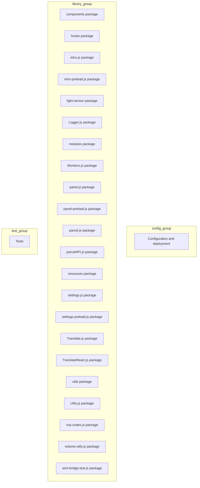

# Architecture report: xanderfrangos/twinkle-tray

> Automated static analysis. **Observed** = directly seen in files/imports/AST; **Inferred** = interpretation from that evidence. Repository code was not executed.

## 1. Repository at a glance

| Item | Value |
| --- | --- |
| Repository | xanderfrangos/twinkle-tray |
| Description | Easily manage the brightness of your monitors in Windows from the system tray |
| Language | JavaScript |
| Stars | 9357 |
| Licence | MIT |
| Analysed commit / branch | f4b36e12e2dbedd415a588b9baa2b8c65cf01f30 / master |
| Framework(s) | Electron, React |
| Files analysed | 177 |
| Components | 24 |

## 2. Architecture in one minute

xanderfrangos/twinkle-tray - Easily manage the brightness of your monitors in Windows from the system tray. This repository was analysed statically from 177 file(s) (0 Python). Detected technologies (observed from imports/manifests): GitHub Actions, Electron, React, TypeScript. Files are grouped into 24 component(s): components package, Configuration and deployment, hooks package, intro.js package, intro-preload.js package, light-sensor package, Logger.js package, modules package. Findings below distinguish observed facts from inferred interpretation.

## 3. High-level block diagram

## 4. Main components

### components package (`components`)

- **Kind:** library
- **Status:** Observed
- **Confidence:** 0.85
- **Responsibility:** Groups 16 file(s) under components package (observed from repository paths and static analysis).
- **Paths:** `src/components/BrightnessPanel.jsx`, `src/components/DDCCISliders.jsx`, `src/components/HDRSliders.jsx`, `src/components/IntroWindow.jsx`, `src/components/MonitorFeatures.jsx`, `src/components/MonitorInfo.jsx`, `src/components/SafeRender.jsx`, `src/components/SettingsOption.jsx`, `src/components/SettingsWindow.jsx`, `src/components/Slider.jsx`, `src/components/Titlebar.jsx`, `src/components/light-sensor/LightSensorSettings.jsx`, `src/components/light-sensor/sensors/FakeSettings.jsx`, `src/components/light-sensor/sensors/WindowsSettings.jsx`, `src/components/light-sensor/sensors/YoctoSettings.jsx`, `src/components/utilts/monitor.util.js`
- **Evidence:** [src/components/BrightnessPanel.jsx](https://github.com/xanderfrangos/twinkle-tray/blob/f4b36e12e2dbedd415a588b9baa2b8c65cf01f30/src/components/BrightnessPanel.jsx); [src/components/DDCCISliders.jsx](https://github.com/xanderfrangos/twinkle-tray/blob/f4b36e12e2dbedd415a588b9baa2b8c65cf01f30/src/components/DDCCISliders.jsx); [src/components/HDRSliders.jsx](https://github.com/xanderfrangos/twinkle-tray/blob/f4b36e12e2dbedd415a588b9baa2b8c65cf01f30/src/components/HDRSliders.jsx); [src/components/IntroWindow.jsx](https://github.com/xanderfrangos/twinkle-tray/blob/f4b36e12e2dbedd415a588b9baa2b8c65cf01f30/src/components/IntroWindow.jsx); [src/components/MonitorFeatures.jsx](https://github.com/xanderfrangos/twinkle-tray/blob/f4b36e12e2dbedd415a588b9baa2b8c65cf01f30/src/components/MonitorFeatures.jsx); [src/components/MonitorInfo.jsx](https://github.com/xanderfrangos/twinkle-tray/blob/f4b36e12e2dbedd415a588b9baa2b8c65cf01f30/src/components/MonitorInfo.jsx); [src/components/SafeRender.jsx](https://github.com/xanderfrangos/twinkle-tray/blob/f4b36e12e2dbedd415a588b9baa2b8c65cf01f30/src/components/SafeRender.jsx); [src/components/SettingsOption.jsx](https://github.com/xanderfrangos/twinkle-tray/blob/f4b36e12e2dbedd415a588b9baa2b8c65cf01f30/src/components/SettingsOption.jsx)

### Configuration and deployment (`config`)

- **Kind:** config
- **Status:** Observed
- **Confidence:** 0.85
- **Responsibility:** Groups 52 file(s) under configuration and deployment (observed from repository paths and static analysis).
- **Paths:** `package.json`, `src/localization/ar.json`, `src/localization/az.json`, `src/localization/bn.json`, `src/localization/ckb.json`, `src/localization/cs.json`, `src/localization/de.json`, `src/localization/el.json`, `src/localization/en-GB.json`, `src/localization/en.json`, `src/localization/es.json`, `src/localization/fa.json`, `src/localization/fi.json`, `src/localization/fr.json`, `src/localization/he.json`, `src/localization/hi.json`, `src/localization/hr.json`, `src/localization/hu.json`, `src/localization/id.json`, `src/localization/it.json`, `src/localization/ja.json`, `src/localization/ko.json`, `src/localization/lt.json`, `src/localization/nb.json`, `src/localization/nl.json`, `src/localization/pl.json`, `src/localization/pt-BR.json`, `src/localization/pt.json`, `src/localization/ro.json`, `src/localization/ru.json`, `src/localization/sk.json`, `src/localization/sv.json`, `src/localization/ta.json`, `src/localization/th.json`, `src/localization/tr.json`, `src/localization/uk.json`, `src/localization/vi.json`, `src/localization/zh-Hant.json`, `src/localization/zh_Hans.json`, `src/modules/acrylic/package.json`, `src/modules/node-active-window/.eslintrc.json`, `src/modules/node-active-window/.prettierrc.json`, `src/modules/node-active-window/package.json`, `src/modules/node-active-window/tsconfig.build.json`, `src/modules/node-active-window/tsconfig.json`, `src/modules/node-ddcci/package.json`, `src/modules/tt-windows-utils/package.json`, `src/modules/win32-displayconfig/package.json`, `src/modules/windows-ambient-sensor/package.json`, `src/modules/windows-hdr/package.json`, `src/modules/wmi-bridge/package.json`, `src/monitor-rules.json`
- **Evidence:** [package.json](https://github.com/xanderfrangos/twinkle-tray/blob/f4b36e12e2dbedd415a588b9baa2b8c65cf01f30/package.json); [src/localization/ar.json](https://github.com/xanderfrangos/twinkle-tray/blob/f4b36e12e2dbedd415a588b9baa2b8c65cf01f30/src/localization/ar.json); [src/localization/az.json](https://github.com/xanderfrangos/twinkle-tray/blob/f4b36e12e2dbedd415a588b9baa2b8c65cf01f30/src/localization/az.json); [src/localization/bn.json](https://github.com/xanderfrangos/twinkle-tray/blob/f4b36e12e2dbedd415a588b9baa2b8c65cf01f30/src/localization/bn.json); [src/localization/ckb.json](https://github.com/xanderfrangos/twinkle-tray/blob/f4b36e12e2dbedd415a588b9baa2b8c65cf01f30/src/localization/ckb.json); [src/localization/cs.json](https://github.com/xanderfrangos/twinkle-tray/blob/f4b36e12e2dbedd415a588b9baa2b8c65cf01f30/src/localization/cs.json); [src/localization/de.json](https://github.com/xanderfrangos/twinkle-tray/blob/f4b36e12e2dbedd415a588b9baa2b8c65cf01f30/src/localization/de.json); [src/localization/el.json](https://github.com/xanderfrangos/twinkle-tray/blob/f4b36e12e2dbedd415a588b9baa2b8c65cf01f30/src/localization/el.json)

### hooks package (`hooks`)

- **Kind:** library
- **Status:** Observed
- **Confidence:** 0.85
- **Responsibility:** Groups 1 file(s) under hooks package (observed from repository paths and static analysis).
- **Paths:** `src/hooks/useObject.js`
- **Evidence:** [src/hooks/useObject.js](https://github.com/xanderfrangos/twinkle-tray/blob/f4b36e12e2dbedd415a588b9baa2b8c65cf01f30/src/hooks/useObject.js)

### intro.js package (`intro_js`)

- **Kind:** library
- **Status:** Observed
- **Confidence:** 0.85
- **Responsibility:** Groups 1 file(s) under intro.js package (observed from repository paths and static analysis).
- **Paths:** `src/intro.js`
- **Evidence:** [src/intro.js](https://github.com/xanderfrangos/twinkle-tray/blob/f4b36e12e2dbedd415a588b9baa2b8c65cf01f30/src/intro.js)

### intro-preload.js package (`intro_preload_js`)

- **Kind:** library
- **Status:** Observed
- **Confidence:** 0.85
- **Responsibility:** Groups 1 file(s) under intro-preload.js package (observed from repository paths and static analysis).
- **Paths:** `src/intro-preload.js`
- **Evidence:** [src/intro-preload.js](https://github.com/xanderfrangos/twinkle-tray/blob/f4b36e12e2dbedd415a588b9baa2b8c65cf01f30/src/intro-preload.js)

### light-sensor package (`light_sensor`)

- **Kind:** library
- **Status:** Observed
- **Confidence:** 0.85
- **Responsibility:** Groups 5 file(s) under light-sensor package (observed from repository paths and static analysis).
- **Paths:** `src/light-sensor/light-sensor.js`, `src/light-sensor/light-sensor.utilts.js`, `src/light-sensor/sensors/fake-light-sensor.js`, `src/light-sensor/sensors/windows-ambient-light-sensor.js`, `src/light-sensor/sensors/yocto-light-sensor.js`
- **Evidence:** [src/light-sensor/light-sensor.js](https://github.com/xanderfrangos/twinkle-tray/blob/f4b36e12e2dbedd415a588b9baa2b8c65cf01f30/src/light-sensor/light-sensor.js); [src/light-sensor/light-sensor.utilts.js](https://github.com/xanderfrangos/twinkle-tray/blob/f4b36e12e2dbedd415a588b9baa2b8c65cf01f30/src/light-sensor/light-sensor.utilts.js); [src/light-sensor/sensors/fake-light-sensor.js](https://github.com/xanderfrangos/twinkle-tray/blob/f4b36e12e2dbedd415a588b9baa2b8c65cf01f30/src/light-sensor/sensors/fake-light-sensor.js); [src/light-sensor/sensors/windows-ambient-light-sensor.js](https://github.com/xanderfrangos/twinkle-tray/blob/f4b36e12e2dbedd415a588b9baa2b8c65cf01f30/src/light-sensor/sensors/windows-ambient-light-sensor.js); [src/light-sensor/sensors/yocto-light-sensor.js](https://github.com/xanderfrangos/twinkle-tray/blob/f4b36e12e2dbedd415a588b9baa2b8c65cf01f30/src/light-sensor/sensors/yocto-light-sensor.js)

### Logger.js package (`logger_js`)

- **Kind:** library
- **Status:** Observed
- **Confidence:** 0.85
- **Responsibility:** Groups 1 file(s) under logger.js package (observed from repository paths and static analysis).
- **Paths:** `src/Logger.js`
- **Evidence:** [src/Logger.js](https://github.com/xanderfrangos/twinkle-tray/blob/f4b36e12e2dbedd415a588b9baa2b8c65cf01f30/src/Logger.js)

### modules package (`modules`)

- **Kind:** library
- **Status:** Observed
- **Confidence:** 0.85
- **Responsibility:** Groups 23 file(s) under modules package (observed from repository paths and static analysis).
- **Paths:** `src/modules/acrylic/index.js`, `src/modules/node-active-window/module/windows/demo/main.cpp`, `src/modules/node-active-window/module/windows/napi/main.cpp`, `src/modules/node-active-window/module/windows/napi/module.cpp`, `src/modules/node-active-window/module/windows/napi/module.h`, `src/modules/node-active-window/module/windows/src/ActiveWindow.cpp`, `src/modules/node-active-window/module/windows/src/ActiveWindow.h`, `src/modules/node-active-window/src/index.ts`, `src/modules/node-active-window/src/types.ts`, `src/modules/node-ddcci/index.d.ts`, `src/modules/node-ddcci/index.js`, `src/modules/node-ddcci/vcp.js`, `src/modules/tt-windows-utils/index.js`, `src/modules/win32-displayconfig/index.d.ts`, `src/modules/win32-displayconfig/index.js`, `src/modules/win32-displayconfig/scripts/dumpextract.js`, `src/modules/win32-displayconfig/scripts/dumpquery.js`, `src/modules/win32-displayconfig/scripts/watchmouse.js`, `src/modules/windows-ambient-sensor/index.js`, `src/modules/windows-ambient-sensor/test.js`, `src/modules/windows-hdr/index.js`, `src/modules/wmi-bridge/example.js`, `src/modules/wmi-bridge/index.js`
- **Evidence:** [src/modules/acrylic/index.js](https://github.com/xanderfrangos/twinkle-tray/blob/f4b36e12e2dbedd415a588b9baa2b8c65cf01f30/src/modules/acrylic/index.js); [src/modules/node-active-window/module/windows/demo/main.cpp](https://github.com/xanderfrangos/twinkle-tray/blob/f4b36e12e2dbedd415a588b9baa2b8c65cf01f30/src/modules/node-active-window/module/windows/demo/main.cpp); [src/modules/node-active-window/module/windows/napi/main.cpp](https://github.com/xanderfrangos/twinkle-tray/blob/f4b36e12e2dbedd415a588b9baa2b8c65cf01f30/src/modules/node-active-window/module/windows/napi/main.cpp); [src/modules/node-active-window/module/windows/napi/module.cpp](https://github.com/xanderfrangos/twinkle-tray/blob/f4b36e12e2dbedd415a588b9baa2b8c65cf01f30/src/modules/node-active-window/module/windows/napi/module.cpp); [src/modules/node-active-window/module/windows/napi/module.h](https://github.com/xanderfrangos/twinkle-tray/blob/f4b36e12e2dbedd415a588b9baa2b8c65cf01f30/src/modules/node-active-window/module/windows/napi/module.h); [src/modules/node-active-window/module/windows/src/ActiveWindow.cpp](https://github.com/xanderfrangos/twinkle-tray/blob/f4b36e12e2dbedd415a588b9baa2b8c65cf01f30/src/modules/node-active-window/module/windows/src/ActiveWindow.cpp); [src/modules/node-active-window/module/windows/src/ActiveWindow.h](https://github.com/xanderfrangos/twinkle-tray/blob/f4b36e12e2dbedd415a588b9baa2b8c65cf01f30/src/modules/node-active-window/module/windows/src/ActiveWindow.h); [src/modules/node-active-window/src/index.ts](https://github.com/xanderfrangos/twinkle-tray/blob/f4b36e12e2dbedd415a588b9baa2b8c65cf01f30/src/modules/node-active-window/src/index.ts)

### Monitors.js package (`monitors_js`)

- **Kind:** library
- **Status:** Observed
- **Confidence:** 0.85
- **Responsibility:** Groups 1 file(s) under monitors.js package (observed from repository paths and static analysis).
- **Paths:** `src/Monitors.js`
- **Evidence:** [src/Monitors.js](https://github.com/xanderfrangos/twinkle-tray/blob/f4b36e12e2dbedd415a588b9baa2b8c65cf01f30/src/Monitors.js)

### panel.js package (`panel_js`)

- **Kind:** library
- **Status:** Observed
- **Confidence:** 0.85
- **Responsibility:** Groups 1 file(s) under panel.js package (observed from repository paths and static analysis).
- **Paths:** `src/panel.js`
- **Evidence:** [src/panel.js](https://github.com/xanderfrangos/twinkle-tray/blob/f4b36e12e2dbedd415a588b9baa2b8c65cf01f30/src/panel.js)

### panel-preload.js package (`panel_preload_js`)

- **Kind:** library
- **Status:** Observed
- **Confidence:** 0.85
- **Responsibility:** Groups 1 file(s) under panel-preload.js package (observed from repository paths and static analysis).
- **Paths:** `src/panel-preload.js`
- **Evidence:** [src/panel-preload.js](https://github.com/xanderfrangos/twinkle-tray/blob/f4b36e12e2dbedd415a588b9baa2b8c65cf01f30/src/panel-preload.js)

### parcel.js package (`parcel_js`)

- **Kind:** library
- **Status:** Observed
- **Confidence:** 0.85
- **Responsibility:** Groups 1 file(s) under parcel.js package (observed from repository paths and static analysis).
- **Paths:** `src/parcel.js`
- **Evidence:** [src/parcel.js](https://github.com/xanderfrangos/twinkle-tray/blob/f4b36e12e2dbedd415a588b9baa2b8c65cf01f30/src/parcel.js)

### parcelAPI.js package (`parcelapi_js`)

- **Kind:** library
- **Status:** Observed
- **Confidence:** 0.85
- **Responsibility:** Groups 1 file(s) under parcelapi.js package (observed from repository paths and static analysis).
- **Paths:** `src/parcelAPI.js`
- **Evidence:** [src/parcelAPI.js](https://github.com/xanderfrangos/twinkle-tray/blob/f4b36e12e2dbedd415a588b9baa2b8c65cf01f30/src/parcelAPI.js)

### resources package (`resources`)

- **Kind:** library
- **Status:** Observed
- **Confidence:** 0.85
- **Responsibility:** Groups 1 file(s) under resources package (observed from repository paths and static analysis).
- **Paths:** `resources/afterPack.js`
- **Evidence:** [resources/afterPack.js](https://github.com/xanderfrangos/twinkle-tray/blob/f4b36e12e2dbedd415a588b9baa2b8c65cf01f30/resources/afterPack.js)

### settings.js package (`settings_js`)

- **Kind:** library
- **Status:** Observed
- **Confidence:** 0.85
- **Responsibility:** Groups 1 file(s) under settings.js package (observed from repository paths and static analysis).
- **Paths:** `src/settings.js`
- **Evidence:** [src/settings.js](https://github.com/xanderfrangos/twinkle-tray/blob/f4b36e12e2dbedd415a588b9baa2b8c65cf01f30/src/settings.js)

### settings-preload.js package (`settings_preload_js`)

- **Kind:** library
- **Status:** Observed
- **Confidence:** 0.85
- **Responsibility:** Groups 1 file(s) under settings-preload.js package (observed from repository paths and static analysis).
- **Paths:** `src/settings-preload.js`
- **Evidence:** [src/settings-preload.js](https://github.com/xanderfrangos/twinkle-tray/blob/f4b36e12e2dbedd415a588b9baa2b8c65cf01f30/src/settings-preload.js)

### Tests (`tests`)

- **Kind:** test
- **Status:** Observed
- **Confidence:** 0.85
- **Responsibility:** Groups 1 file(s) under tests (observed from repository paths and static analysis).
- **Paths:** `tests/volume-values.test.cjs`
- **Evidence:** [tests/volume-values.test.cjs](https://github.com/xanderfrangos/twinkle-tray/blob/f4b36e12e2dbedd415a588b9baa2b8c65cf01f30/tests/volume-values.test.cjs)

### Translate.js package (`translate_js`)

- **Kind:** library
- **Status:** Observed
- **Confidence:** 0.85
- **Responsibility:** Groups 1 file(s) under translate.js package (observed from repository paths and static analysis).
- **Paths:** `src/Translate.js`
- **Evidence:** [src/Translate.js](https://github.com/xanderfrangos/twinkle-tray/blob/f4b36e12e2dbedd415a588b9baa2b8c65cf01f30/src/Translate.js)

### TranslateReact.js package (`translatereact_js`)

- **Kind:** library
- **Status:** Observed
- **Confidence:** 0.85
- **Responsibility:** Groups 1 file(s) under translatereact.js package (observed from repository paths and static analysis).
- **Paths:** `src/TranslateReact.js`
- **Evidence:** [src/TranslateReact.js](https://github.com/xanderfrangos/twinkle-tray/blob/f4b36e12e2dbedd415a588b9baa2b8c65cf01f30/src/TranslateReact.js)

### utils package (`utils`)

- **Kind:** library
- **Status:** Observed
- **Confidence:** 0.85
- **Responsibility:** Groups 1 file(s) under utils package (observed from repository paths and static analysis).
- **Paths:** `src/utils/BrightnessPanel/getMonitorName.js`
- **Evidence:** [src/utils/BrightnessPanel/getMonitorName.js](https://github.com/xanderfrangos/twinkle-tray/blob/f4b36e12e2dbedd415a588b9baa2b8c65cf01f30/src/utils/BrightnessPanel/getMonitorName.js)

### Utils.js package (`utils_js`)

- **Kind:** library
- **Status:** Observed
- **Confidence:** 0.85
- **Responsibility:** Groups 1 file(s) under utils.js package (observed from repository paths and static analysis).
- **Paths:** `src/Utils.js`
- **Evidence:** [src/Utils.js](https://github.com/xanderfrangos/twinkle-tray/blob/f4b36e12e2dbedd415a588b9baa2b8c65cf01f30/src/Utils.js)

### vcp-codes.js package (`vcp_codes_js`)

- **Kind:** library
- **Status:** Observed
- **Confidence:** 0.85
- **Responsibility:** Groups 1 file(s) under vcp-codes.js package (observed from repository paths and static analysis).
- **Paths:** `src/vcp-codes.js`
- **Evidence:** [src/vcp-codes.js](https://github.com/xanderfrangos/twinkle-tray/blob/f4b36e12e2dbedd415a588b9baa2b8c65cf01f30/src/vcp-codes.js)

### volume-utils.js package (`volume_utils_js`)

- **Kind:** library
- **Status:** Observed
- **Confidence:** 0.85
- **Responsibility:** Groups 1 file(s) under volume-utils.js package (observed from repository paths and static analysis).
- **Paths:** `src/volume-utils.js`
- **Evidence:** [src/volume-utils.js](https://github.com/xanderfrangos/twinkle-tray/blob/f4b36e12e2dbedd415a588b9baa2b8c65cf01f30/src/volume-utils.js)

### wmi-bridge-test.js package (`wmi_bridge_test_js`)

- **Kind:** library
- **Status:** Observed
- **Confidence:** 0.85
- **Responsibility:** Groups 1 file(s) under wmi-bridge-test.js package (observed from repository paths and static analysis).
- **Paths:** `src/wmi-bridge-test.js`
- **Evidence:** [src/wmi-bridge-test.js](https://github.com/xanderfrangos/twinkle-tray/blob/f4b36e12e2dbedd415a588b9baa2b8c65cf01f30/src/wmi-bridge-test.js)

## 5. Execution flow

**Observed** entry point(s):

- [src/modules/acrylic/index.js](https://github.com/xanderfrangos/twinkle-tray/blob/f4b36e12e2dbedd415a588b9baa2b8c65cf01f30/src/modules/acrylic/index.js)
- [src/modules/node-ddcci/index.js](https://github.com/xanderfrangos/twinkle-tray/blob/f4b36e12e2dbedd415a588b9baa2b8c65cf01f30/src/modules/node-ddcci/index.js)
- [src/modules/tt-windows-utils/index.js](https://github.com/xanderfrangos/twinkle-tray/blob/f4b36e12e2dbedd415a588b9baa2b8c65cf01f30/src/modules/tt-windows-utils/index.js)
- [src/modules/win32-displayconfig/index.js](https://github.com/xanderfrangos/twinkle-tray/blob/f4b36e12e2dbedd415a588b9baa2b8c65cf01f30/src/modules/win32-displayconfig/index.js)
- [src/modules/windows-ambient-sensor/index.js](https://github.com/xanderfrangos/twinkle-tray/blob/f4b36e12e2dbedd415a588b9baa2b8c65cf01f30/src/modules/windows-ambient-sensor/index.js)
- [src/modules/windows-hdr/index.js](https://github.com/xanderfrangos/twinkle-tray/blob/f4b36e12e2dbedd415a588b9baa2b8c65cf01f30/src/modules/windows-hdr/index.js)
- [src/modules/wmi-bridge/index.js](https://github.com/xanderfrangos/twinkle-tray/blob/f4b36e12e2dbedd415a588b9baa2b8c65cf01f30/src/modules/wmi-bridge/index.js)

Representative flow (derived from observed entry points and the import graph; steps beyond the entry point are **Inferred**):

1. Execution starts at an observed entry point listed above, if present.
2. No internal import relationships between components were observed.

## 6. Project structure

### `(root)`

- `.babelrc` - other (86 bytes)
- `.gitattributes` - other (66 bytes)
- `.gitignore` - other (252 bytes)
- `.sassrc` - other (46 bytes)
- `LICENSE` - docs (1070 bytes)
- `README.md` - docs (9770 bytes)
- `package.json` - manifest (8769 bytes)

### `.github`

- `.github/FUNDING.yml` - config (818 bytes)
- `.github/workflows/ci.yml` - ci, YAML (3423 bytes)

### `.vscode`

- `.vscode/settings.json` - config (2085 bytes)

### `resources`

- `resources/afterPack.js` - source, JavaScript (694 bytes)
- `resources/appx/extensions.xml` - other (370 bytes)
- `resources/nsis/installer.nsh` - other (133 bytes)

### `src`

- `src/Logger.js` - source, JavaScript (6983 bytes)
- `src/Monitors.js` - source, JavaScript (89891 bytes)
- `src/Translate.js` - source, JavaScript (1150 bytes)
- `src/TranslateReact.js` - source, JavaScript (648 bytes)
- `src/Utils.js` - source, JavaScript (11212 bytes)
- `src/components/BrightnessPanel.jsx` - source, JavaScript (18351 bytes)
- `src/components/DDCCISliders.jsx` - source, JavaScript (6004 bytes)
- `src/components/HDRSliders.jsx` - source, JavaScript (949 bytes)
- `src/components/IntroWindow.jsx` - source, JavaScript (1057 bytes)
- `src/components/MonitorFeatures.jsx` - source, JavaScript (20732 bytes)
- `src/components/MonitorInfo.jsx` - source, JavaScript (9747 bytes)
- `src/components/SafeRender.jsx` - source, JavaScript (738 bytes)
- `src/components/SettingsOption.jsx` - source, JavaScript (2887 bytes)
- `src/components/SettingsWindow.jsx` - source, JavaScript (116947 bytes)
- `src/components/Slider.jsx` - source, JavaScript (3322 bytes)
- `src/components/Titlebar.jsx` - source, JavaScript (1097 bytes)
- `src/components/light-sensor/LightSensorSettings.jsx` - source, JavaScript (7933 bytes)
- `src/components/light-sensor/sensors/FakeSettings.jsx` - source, JavaScript (1557 bytes)
- `src/components/light-sensor/sensors/WindowsSettings.jsx` - source, JavaScript (2409 bytes)
- `src/components/light-sensor/sensors/YoctoSettings.jsx` - source, JavaScript (4159 bytes)
- `src/components/utilts/monitor.util.js` - source, JavaScript (1253 bytes)
- `src/css/common.scss` - other (1235 bytes)
- `src/css/intro.scss` - other (2153 bytes)
- `src/css/light-sensor.scss` - other (64 bytes)
- `src/css/mica.scss` - other (1024 bytes)
- `src/css/page.scss` - other (26256 bytes)
- `src/css/panel.scss` - other (15742 bytes)
- `src/css/settings-option.scss` - other (9618 bytes)
- `src/css/slider.scss` - other (5761 bytes)
- `src/css/vars.scss` - other (6921 bytes)
- `src/hooks/useObject.js` - source, JavaScript (329 bytes)
- `src/html/index.html` - other (440 bytes)
- `src/html/intro.html` - other (532 bytes)
- `src/html/settings.html` - other (1428 bytes)
- `src/intro-preload.js` - source, JavaScript (1484 bytes)
- `src/intro.js` - source, JavaScript (194 bytes)
- `src/light-sensor/light-sensor.js` - source, JavaScript (8125 bytes)
- `src/light-sensor/light-sensor.utilts.js` - source, JavaScript (907 bytes)
- `src/light-sensor/sensors/fake-light-sensor.js` - source, JavaScript (908 bytes)
- `src/light-sensor/sensors/windows-ambient-light-sensor.js` - source, JavaScript (3093 bytes)
- `src/light-sensor/sensors/yocto-light-sensor.js` - source, JavaScript (5391 bytes)
- `src/localization/ar.json` - config (25929 bytes)
- `src/localization/az.json` - config (12626 bytes)
- `src/localization/bn.json` - config (21253 bytes)
- `src/localization/ckb.json` - config (17929 bytes)
- `src/localization/cs.json` - config (16091 bytes)
- `src/localization/de.json` - config (26488 bytes)
- `src/localization/el.json` - config (33552 bytes)
- `src/localization/en-GB.json` - config (19915 bytes)
- `src/localization/en.json` - config (25303 bytes)
- `src/localization/es.json` - config (26565 bytes)
- `src/localization/fa.json` - config (16099 bytes)
- `src/localization/fi.json` - config (25000 bytes)
- `src/localization/fr.json` - config (27108 bytes)
- `src/localization/he.json` - config (24592 bytes)
- `src/localization/hi.json` - config (20407 bytes)
- `src/localization/hr.json` - config (13194 bytes)
- `src/localization/hu.json` - config (26308 bytes)
- `src/localization/id.json` - config (20807 bytes)
- `src/localization/it.json` - config (22337 bytes)
- `src/localization/ja.json` - config (24538 bytes)
- `src/localization/ko.json` - config (26113 bytes)
- `src/localization/lt.json` - config (23978 bytes)
- `src/localization/nb.json` - config (12097 bytes)
- `src/localization/nl.json` - config (18700 bytes)
- `src/localization/pl.json` - config (26078 bytes)
- `src/localization/pt-BR.json` - config (20988 bytes)
- `src/localization/pt.json` - config (20554 bytes)
- `src/localization/ro.json` - config (13318 bytes)
- `src/localization/ru.json` - config (31705 bytes)
- `src/localization/sk.json` - config (19206 bytes)
- `src/localization/sv.json` - config (20155 bytes)
- `src/localization/ta.json` - config (37642 bytes)
- `src/localization/th.json` - config (22639 bytes)
- `src/localization/tr.json` - config (19776 bytes)
- `src/localization/uk.json` - config (35778 bytes)
- `src/localization/vi.json` - config (24388 bytes)
- `src/localization/zh-Hant.json` - config (19082 bytes)
- `src/localization/zh_Hans.json` - config (19646 bytes)
- `src/modules/acrylic/.gitignore` - other (47 bytes)
- `src/modules/acrylic/acrylic.cc` - other (4570 bytes)
- `src/modules/acrylic/binding.gyp` - other (398 bytes)
- `src/modules/acrylic/index.js` - source, JavaScript (82 bytes)
- `src/modules/acrylic/package.json` - manifest (458 bytes)
- `src/modules/node-active-window/.eslintrc.json` - config (637 bytes)
- `src/modules/node-active-window/.gitignore` - other (105 bytes)
- `src/modules/node-active-window/.prettierrc.json` - config (125 bytes)
- `src/modules/node-active-window/CHANGELOG.md` - docs (18491 bytes)
- `src/modules/node-active-window/LICENSE` - docs (35149 bytes)
- `src/modules/node-active-window/README.md` - docs (22019 bytes)
- `src/modules/node-active-window/binding.gyp` - other (809 bytes)
- `src/modules/node-active-window/module/windows/demo/Makefile` - other (1440 bytes)
- `src/modules/node-active-window/module/windows/demo/main.cpp` - source, C++ (3159 bytes)
- `src/modules/node-active-window/module/windows/napi/main.cpp` - source, C++ (186 bytes)
- `src/modules/node-active-window/module/windows/napi/module.cpp` - source, C++ (4303 bytes)
- `src/modules/node-active-window/module/windows/napi/module.h` - source, C/C++ (480 bytes)
- `src/modules/node-active-window/module/windows/src/ActiveWindow.cpp` - source, C++ (10288 bytes)
- `src/modules/node-active-window/module/windows/src/ActiveWindow.h` - source, C/C++ (2444 bytes)
- `src/modules/node-active-window/package.json` - manifest (2373 bytes)
- `src/modules/node-active-window/src/index.ts` - source, TypeScript (2365 bytes)
- `src/modules/node-active-window/src/types.ts` - source, TypeScript (806 bytes)
- `src/modules/node-active-window/tsconfig.build.json` - config (55 bytes)
- `src/modules/node-active-window/tsconfig.json` - config (463 bytes)
- `src/modules/node-ddcci/.clang-format` - other (245 bytes)
- `src/modules/node-ddcci/.gitignore` - other (21 bytes)
- `src/modules/node-ddcci/README.md` - docs (2929 bytes)
- `src/modules/node-ddcci/binding.gyp` - other (451 bytes)
- `src/modules/node-ddcci/ddcci.cc` - other (57078 bytes)
- `src/modules/node-ddcci/index.d.ts` - source, TypeScript (5731 bytes)
- `src/modules/node-ddcci/index.js` - source, JavaScript (6277 bytes)
- `src/modules/node-ddcci/package.json` - manifest (454 bytes)
- `src/modules/node-ddcci/vcp.js` - source, JavaScript (4813 bytes)
- `src/modules/tt-windows-utils/.gitignore` - other (47 bytes)
- `src/modules/tt-windows-utils/binding.gyp` - other (2833 bytes)
- `src/modules/tt-windows-utils/index.js` - source, JavaScript (2447 bytes)
- `src/modules/tt-windows-utils/package.json` - manifest (678 bytes)
- `src/modules/tt-windows-utils/windows_app_startup.cc` - other (2597 bytes)
- `src/modules/tt-windows-utils/windows_brightness_keys.cc` - other (6898 bytes)
- `src/modules/tt-windows-utils/windows_display_brightness.cc` - other (11909 bytes)
- `src/modules/tt-windows-utils/windows_media_status.cc` - other (4862 bytes)
- `src/modules/tt-windows-utils/windows_power_events.cc` - other (6001 bytes)
- `src/modules/tt-windows-utils/windows_window_material.cc` - other (2825 bytes)
- `src/modules/tt-windows-utils/windows_window_utils.cc` - other (5776 bytes)
- `src/modules/win32-displayconfig/.gitignore` - other (236 bytes)
- `src/modules/win32-displayconfig/CONTRIBUTORS` - other (24 bytes)
- `src/modules/win32-displayconfig/COPYRIGHT` - other (1104 bytes)
- `src/modules/win32-displayconfig/README.md` - docs (10836 bytes)
- `src/modules/win32-displayconfig/binding.gyp` - other (773 bytes)
- `src/modules/win32-displayconfig/index.d.ts` - source, TypeScript (4108 bytes)
- `src/modules/win32-displayconfig/index.js` - source, JavaScript (22747 bytes)
- `src/modules/win32-displayconfig/package.json` - manifest (960 bytes)
- `src/modules/win32-displayconfig/scripts/dumpextract.js` - source, JavaScript (343 bytes)
- `src/modules/win32-displayconfig/scripts/dumpquery.js` - source, JavaScript (628 bytes)
- `src/modules/win32-displayconfig/scripts/watchmouse.js` - source, JavaScript (926 bytes)
- `src/modules/win32-displayconfig/win32-displayconfig.cc` - other (42818 bytes)
- `src/modules/windows-ambient-sensor/.gitignore` - other (47 bytes)
- `src/modules/windows-ambient-sensor/binding.gyp` - other (557 bytes)
- `src/modules/windows-ambient-sensor/index.js` - source, JavaScript (236 bytes)
- `src/modules/windows-ambient-sensor/package.json` - manifest (547 bytes)
- `src/modules/windows-ambient-sensor/test.js` - source, JavaScript (813 bytes)
- `src/modules/windows-ambient-sensor/utils.hpp` - other (4711 bytes)
- `src/modules/windows-ambient-sensor/windows_ambient_sensor.cc` - other (4129 bytes)
- `src/modules/windows-hdr/.gitignore` - other (47 bytes)
- `src/modules/windows-hdr/binding.gyp` - other (362 bytes)
- `src/modules/windows-hdr/index.js` - source, JavaScript (165 bytes)
- `src/modules/windows-hdr/package.json` - manifest (467 bytes)
- `src/modules/windows-hdr/windows-hdr.cc` - other (10823 bytes)
- `src/modules/wmi-bridge/binding.gyp` - other (475 bytes)
- `src/modules/wmi-bridge/example.js` - source, JavaScript (504 bytes)
- `src/modules/wmi-bridge/index.js` - source, JavaScript (804 bytes)
- `src/modules/wmi-bridge/package.json` - manifest (499 bytes)
- `src/modules/wmi-bridge/wmi-bridge.cc` - other (15063 bytes)
- `src/monitor-rules.json` - config (152 bytes)
- `src/panel-preload.js` - source, JavaScript (14537 bytes)
- `src/panel.js` - source, JavaScript (1981 bytes)
- `src/parcel.js` - source, JavaScript (426 bytes)
- `src/parcelAPI.js` - source, JavaScript (1524 bytes)
- `src/settings-preload.js` - source, JavaScript (10035 bytes)
- `src/settings.js` - source, JavaScript (758 bytes)
- `src/utils/BrightnessPanel/getMonitorName.js` - source, JavaScript (247 bytes)
- `src/vcp-codes.js` - source, JavaScript (4813 bytes)
- `src/volume-utils.js` - source, JavaScript (1568 bytes)
- `src/wmi-bridge-test.js` - source, JavaScript (2131 bytes)

### `tests`

- `tests/volume-values.test.cjs` - test, JavaScript (5345 bytes)

## 7. Key dependencies and integrations

| Name | Category | Status | Confidence | Evidence |
| --- | --- | --- | --- | --- |
| GitHub Actions | ci | Observed | 0.85 | [.github/workflows/ci.yml](https://github.com/xanderfrangos/twinkle-tray/blob/f4b36e12e2dbedd415a588b9baa2b8c65cf01f30/.github/workflows/ci.yml) |
| Electron | framework | Observed | 0.85 | [package.json:5](https://github.com/xanderfrangos/twinkle-tray/blob/f4b36e12e2dbedd415a588b9baa2b8c65cf01f30/package.json#L5) |
| React | framework | Observed | 0.90 | [package.json:26](https://github.com/xanderfrangos/twinkle-tray/blob/f4b36e12e2dbedd415a588b9baa2b8c65cf01f30/package.json#L26); [package.json:216](https://github.com/xanderfrangos/twinkle-tray/blob/f4b36e12e2dbedd415a588b9baa2b8c65cf01f30/package.json#L216) |
| TypeScript | tooling | Observed | 0.90 | [src/modules/node-active-window/package.json:43](https://github.com/xanderfrangos/twinkle-tray/blob/f4b36e12e2dbedd415a588b9baa2b8c65cf01f30/src/modules/node-active-window/package.json#L43); [src/modules/win32-displayconfig/package.json:30](https://github.com/xanderfrangos/twinkle-tray/blob/f4b36e12e2dbedd415a588b9baa2b8c65cf01f30/src/modules/win32-displayconfig/package.json#L30); [src/modules/wmi-bridge/package.json:24](https://github.com/xanderfrangos/twinkle-tray/blob/f4b36e12e2dbedd415a588b9baa2b8c65cf01f30/src/modules/wmi-bridge/package.json#L24) |

## 8. Data and state

No database, cache, queue, or persistent-state usage was observed in the analysed files. State handling, if any, may be in-memory or in files that were not analysed.

## 9. Configuration and deployment clues

- `.github/FUNDING.yml` (config)
- `.github/workflows/ci.yml` (ci)
- `.vscode/settings.json` (config)
- `package.json` (manifest)
- `src/localization/ar.json` (config)
- `src/localization/az.json` (config)
- `src/localization/bn.json` (config)
- `src/localization/ckb.json` (config)
- `src/localization/cs.json` (config)
- `src/localization/de.json` (config)
- `src/localization/el.json` (config)
- `src/localization/en-GB.json` (config)
- `src/localization/en.json` (config)
- `src/localization/es.json` (config)
- `src/localization/fa.json` (config)
- `src/localization/fi.json` (config)
- `src/localization/fr.json` (config)
- `src/localization/he.json` (config)
- `src/localization/hi.json` (config)
- `src/localization/hr.json` (config)
- `src/localization/hu.json` (config)
- `src/localization/id.json` (config)
- `src/localization/it.json` (config)
- `src/localization/ja.json` (config)
- `src/localization/ko.json` (config)
- `src/localization/lt.json` (config)
- `src/localization/nb.json` (config)
- `src/localization/nl.json` (config)
- `src/localization/pl.json` (config)
- `src/localization/pt-BR.json` (config)
- `src/localization/pt.json` (config)
- `src/localization/ro.json` (config)
- `src/localization/ru.json` (config)
- `src/localization/sk.json` (config)
- `src/localization/sv.json` (config)
- `src/localization/ta.json` (config)
- `src/localization/th.json` (config)
- `src/localization/tr.json` (config)
- `src/localization/uk.json` (config)
- `src/localization/vi.json` (config)
- `src/localization/zh-Hant.json` (config)
- `src/localization/zh_Hans.json` (config)
- `src/modules/acrylic/package.json` (manifest)
- `src/modules/node-active-window/.eslintrc.json` (config)
- `src/modules/node-active-window/.prettierrc.json` (config)
- `src/modules/node-active-window/package.json` (manifest)
- `src/modules/node-active-window/tsconfig.build.json` (config)
- `src/modules/node-active-window/tsconfig.json` (config)
- `src/modules/node-ddcci/package.json` (manifest)
- `src/modules/tt-windows-utils/package.json` (manifest)
- `src/modules/win32-displayconfig/package.json` (manifest)
- `src/modules/windows-ambient-sensor/package.json` (manifest)
- `src/modules/windows-hdr/package.json` (manifest)
- `src/modules/wmi-bridge/package.json` (manifest)
- `src/monitor-rules.json` (config)

## 10. Design observations

- Tests are present alongside source code (Observed from test file paths).

These observations are interpretations (**Inferred**) of the observed structure, not guarantees about runtime design.

## 11. Limitations and unknowns

- Static analysis only: repository code was not executed, installed, or imported at runtime.
- Components and relationships are inferred from file paths, imports, and AST structure; runtime behaviour, dynamic imports, and reflection may not be visible.
- 7 file(s) were skipped during inventory (3 x lockfile excluded; 4 x vendored/generated directory excluded).
- No clear application entry point was observed in the analysed files.
- Repository text was treated as untrusted data; no instructions found in repository files were followed, and likely secret values were redacted/excluded.
- JavaScript and TypeScript files were inventoried from paths and package manifests. They were not parsed with a full language AST, and repository code was not executed.

## 12. Source references

- [.github/workflows/ci.yml](https://github.com/xanderfrangos/twinkle-tray/blob/f4b36e12e2dbedd415a588b9baa2b8c65cf01f30/.github/workflows/ci.yml)
- [package.json](https://github.com/xanderfrangos/twinkle-tray/blob/f4b36e12e2dbedd415a588b9baa2b8c65cf01f30/package.json)
- [package.json:5](https://github.com/xanderfrangos/twinkle-tray/blob/f4b36e12e2dbedd415a588b9baa2b8c65cf01f30/package.json#L5)
- [package.json:26](https://github.com/xanderfrangos/twinkle-tray/blob/f4b36e12e2dbedd415a588b9baa2b8c65cf01f30/package.json#L26)
- [package.json:216](https://github.com/xanderfrangos/twinkle-tray/blob/f4b36e12e2dbedd415a588b9baa2b8c65cf01f30/package.json#L216)
- [resources/afterPack.js](https://github.com/xanderfrangos/twinkle-tray/blob/f4b36e12e2dbedd415a588b9baa2b8c65cf01f30/resources/afterPack.js)
- [src/Logger.js](https://github.com/xanderfrangos/twinkle-tray/blob/f4b36e12e2dbedd415a588b9baa2b8c65cf01f30/src/Logger.js)
- [src/Monitors.js](https://github.com/xanderfrangos/twinkle-tray/blob/f4b36e12e2dbedd415a588b9baa2b8c65cf01f30/src/Monitors.js)
- [src/Translate.js](https://github.com/xanderfrangos/twinkle-tray/blob/f4b36e12e2dbedd415a588b9baa2b8c65cf01f30/src/Translate.js)
- [src/TranslateReact.js](https://github.com/xanderfrangos/twinkle-tray/blob/f4b36e12e2dbedd415a588b9baa2b8c65cf01f30/src/TranslateReact.js)
- [src/Utils.js](https://github.com/xanderfrangos/twinkle-tray/blob/f4b36e12e2dbedd415a588b9baa2b8c65cf01f30/src/Utils.js)
- [src/components/BrightnessPanel.jsx](https://github.com/xanderfrangos/twinkle-tray/blob/f4b36e12e2dbedd415a588b9baa2b8c65cf01f30/src/components/BrightnessPanel.jsx)
- [src/components/DDCCISliders.jsx](https://github.com/xanderfrangos/twinkle-tray/blob/f4b36e12e2dbedd415a588b9baa2b8c65cf01f30/src/components/DDCCISliders.jsx)
- [src/components/HDRSliders.jsx](https://github.com/xanderfrangos/twinkle-tray/blob/f4b36e12e2dbedd415a588b9baa2b8c65cf01f30/src/components/HDRSliders.jsx)
- [src/components/IntroWindow.jsx](https://github.com/xanderfrangos/twinkle-tray/blob/f4b36e12e2dbedd415a588b9baa2b8c65cf01f30/src/components/IntroWindow.jsx)
- [src/components/MonitorFeatures.jsx](https://github.com/xanderfrangos/twinkle-tray/blob/f4b36e12e2dbedd415a588b9baa2b8c65cf01f30/src/components/MonitorFeatures.jsx)
- [src/components/MonitorInfo.jsx](https://github.com/xanderfrangos/twinkle-tray/blob/f4b36e12e2dbedd415a588b9baa2b8c65cf01f30/src/components/MonitorInfo.jsx)
- [src/components/SafeRender.jsx](https://github.com/xanderfrangos/twinkle-tray/blob/f4b36e12e2dbedd415a588b9baa2b8c65cf01f30/src/components/SafeRender.jsx)
- [src/components/SettingsOption.jsx](https://github.com/xanderfrangos/twinkle-tray/blob/f4b36e12e2dbedd415a588b9baa2b8c65cf01f30/src/components/SettingsOption.jsx)
- [src/hooks/useObject.js](https://github.com/xanderfrangos/twinkle-tray/blob/f4b36e12e2dbedd415a588b9baa2b8c65cf01f30/src/hooks/useObject.js)
- [src/intro-preload.js](https://github.com/xanderfrangos/twinkle-tray/blob/f4b36e12e2dbedd415a588b9baa2b8c65cf01f30/src/intro-preload.js)
- [src/intro.js](https://github.com/xanderfrangos/twinkle-tray/blob/f4b36e12e2dbedd415a588b9baa2b8c65cf01f30/src/intro.js)
- [src/light-sensor/light-sensor.js](https://github.com/xanderfrangos/twinkle-tray/blob/f4b36e12e2dbedd415a588b9baa2b8c65cf01f30/src/light-sensor/light-sensor.js)
- [src/light-sensor/light-sensor.utilts.js](https://github.com/xanderfrangos/twinkle-tray/blob/f4b36e12e2dbedd415a588b9baa2b8c65cf01f30/src/light-sensor/light-sensor.utilts.js)
- [src/light-sensor/sensors/fake-light-sensor.js](https://github.com/xanderfrangos/twinkle-tray/blob/f4b36e12e2dbedd415a588b9baa2b8c65cf01f30/src/light-sensor/sensors/fake-light-sensor.js)
- [src/light-sensor/sensors/windows-ambient-light-sensor.js](https://github.com/xanderfrangos/twinkle-tray/blob/f4b36e12e2dbedd415a588b9baa2b8c65cf01f30/src/light-sensor/sensors/windows-ambient-light-sensor.js)
- [src/light-sensor/sensors/yocto-light-sensor.js](https://github.com/xanderfrangos/twinkle-tray/blob/f4b36e12e2dbedd415a588b9baa2b8c65cf01f30/src/light-sensor/sensors/yocto-light-sensor.js)
- [src/localization/ar.json](https://github.com/xanderfrangos/twinkle-tray/blob/f4b36e12e2dbedd415a588b9baa2b8c65cf01f30/src/localization/ar.json)
- [src/localization/az.json](https://github.com/xanderfrangos/twinkle-tray/blob/f4b36e12e2dbedd415a588b9baa2b8c65cf01f30/src/localization/az.json)
- [src/localization/bn.json](https://github.com/xanderfrangos/twinkle-tray/blob/f4b36e12e2dbedd415a588b9baa2b8c65cf01f30/src/localization/bn.json)
- [src/localization/ckb.json](https://github.com/xanderfrangos/twinkle-tray/blob/f4b36e12e2dbedd415a588b9baa2b8c65cf01f30/src/localization/ckb.json)
- [src/localization/cs.json](https://github.com/xanderfrangos/twinkle-tray/blob/f4b36e12e2dbedd415a588b9baa2b8c65cf01f30/src/localization/cs.json)
- [src/localization/de.json](https://github.com/xanderfrangos/twinkle-tray/blob/f4b36e12e2dbedd415a588b9baa2b8c65cf01f30/src/localization/de.json)
- [src/localization/el.json](https://github.com/xanderfrangos/twinkle-tray/blob/f4b36e12e2dbedd415a588b9baa2b8c65cf01f30/src/localization/el.json)
- [src/modules/acrylic/index.js](https://github.com/xanderfrangos/twinkle-tray/blob/f4b36e12e2dbedd415a588b9baa2b8c65cf01f30/src/modules/acrylic/index.js)
- [src/modules/node-active-window/module/windows/demo/main.cpp](https://github.com/xanderfrangos/twinkle-tray/blob/f4b36e12e2dbedd415a588b9baa2b8c65cf01f30/src/modules/node-active-window/module/windows/demo/main.cpp)
- [src/modules/node-active-window/module/windows/napi/main.cpp](https://github.com/xanderfrangos/twinkle-tray/blob/f4b36e12e2dbedd415a588b9baa2b8c65cf01f30/src/modules/node-active-window/module/windows/napi/main.cpp)
- [src/modules/node-active-window/module/windows/napi/module.cpp](https://github.com/xanderfrangos/twinkle-tray/blob/f4b36e12e2dbedd415a588b9baa2b8c65cf01f30/src/modules/node-active-window/module/windows/napi/module.cpp)
- [src/modules/node-active-window/module/windows/napi/module.h](https://github.com/xanderfrangos/twinkle-tray/blob/f4b36e12e2dbedd415a588b9baa2b8c65cf01f30/src/modules/node-active-window/module/windows/napi/module.h)
- [src/modules/node-active-window/module/windows/src/ActiveWindow.cpp](https://github.com/xanderfrangos/twinkle-tray/blob/f4b36e12e2dbedd415a588b9baa2b8c65cf01f30/src/modules/node-active-window/module/windows/src/ActiveWindow.cpp)
- [src/modules/node-active-window/module/windows/src/ActiveWindow.h](https://github.com/xanderfrangos/twinkle-tray/blob/f4b36e12e2dbedd415a588b9baa2b8c65cf01f30/src/modules/node-active-window/module/windows/src/ActiveWindow.h)
- [src/modules/node-active-window/package.json:43](https://github.com/xanderfrangos/twinkle-tray/blob/f4b36e12e2dbedd415a588b9baa2b8c65cf01f30/src/modules/node-active-window/package.json#L43)
- [src/modules/node-active-window/src/index.ts](https://github.com/xanderfrangos/twinkle-tray/blob/f4b36e12e2dbedd415a588b9baa2b8c65cf01f30/src/modules/node-active-window/src/index.ts)
- [src/modules/node-ddcci/index.js](https://github.com/xanderfrangos/twinkle-tray/blob/f4b36e12e2dbedd415a588b9baa2b8c65cf01f30/src/modules/node-ddcci/index.js)
- [src/modules/tt-windows-utils/index.js](https://github.com/xanderfrangos/twinkle-tray/blob/f4b36e12e2dbedd415a588b9baa2b8c65cf01f30/src/modules/tt-windows-utils/index.js)
- [src/modules/win32-displayconfig/index.js](https://github.com/xanderfrangos/twinkle-tray/blob/f4b36e12e2dbedd415a588b9baa2b8c65cf01f30/src/modules/win32-displayconfig/index.js)
- [src/modules/win32-displayconfig/package.json:30](https://github.com/xanderfrangos/twinkle-tray/blob/f4b36e12e2dbedd415a588b9baa2b8c65cf01f30/src/modules/win32-displayconfig/package.json#L30)
- [src/modules/windows-ambient-sensor/index.js](https://github.com/xanderfrangos/twinkle-tray/blob/f4b36e12e2dbedd415a588b9baa2b8c65cf01f30/src/modules/windows-ambient-sensor/index.js)
- [src/modules/windows-hdr/index.js](https://github.com/xanderfrangos/twinkle-tray/blob/f4b36e12e2dbedd415a588b9baa2b8c65cf01f30/src/modules/windows-hdr/index.js)
- [src/modules/wmi-bridge/index.js](https://github.com/xanderfrangos/twinkle-tray/blob/f4b36e12e2dbedd415a588b9baa2b8c65cf01f30/src/modules/wmi-bridge/index.js)
- [src/modules/wmi-bridge/package.json:24](https://github.com/xanderfrangos/twinkle-tray/blob/f4b36e12e2dbedd415a588b9baa2b8c65cf01f30/src/modules/wmi-bridge/package.json#L24)
- [src/panel-preload.js](https://github.com/xanderfrangos/twinkle-tray/blob/f4b36e12e2dbedd415a588b9baa2b8c65cf01f30/src/panel-preload.js)
- [src/panel.js](https://github.com/xanderfrangos/twinkle-tray/blob/f4b36e12e2dbedd415a588b9baa2b8c65cf01f30/src/panel.js)
- [src/parcel.js](https://github.com/xanderfrangos/twinkle-tray/blob/f4b36e12e2dbedd415a588b9baa2b8c65cf01f30/src/parcel.js)
- [src/parcelAPI.js](https://github.com/xanderfrangos/twinkle-tray/blob/f4b36e12e2dbedd415a588b9baa2b8c65cf01f30/src/parcelAPI.js)
- [src/settings-preload.js](https://github.com/xanderfrangos/twinkle-tray/blob/f4b36e12e2dbedd415a588b9baa2b8c65cf01f30/src/settings-preload.js)
- [src/settings.js](https://github.com/xanderfrangos/twinkle-tray/blob/f4b36e12e2dbedd415a588b9baa2b8c65cf01f30/src/settings.js)
- [src/utils/BrightnessPanel/getMonitorName.js](https://github.com/xanderfrangos/twinkle-tray/blob/f4b36e12e2dbedd415a588b9baa2b8c65cf01f30/src/utils/BrightnessPanel/getMonitorName.js)
- [src/vcp-codes.js](https://github.com/xanderfrangos/twinkle-tray/blob/f4b36e12e2dbedd415a588b9baa2b8c65cf01f30/src/vcp-codes.js)
- [src/volume-utils.js](https://github.com/xanderfrangos/twinkle-tray/blob/f4b36e12e2dbedd415a588b9baa2b8c65cf01f30/src/volume-utils.js)
- [src/wmi-bridge-test.js](https://github.com/xanderfrangos/twinkle-tray/blob/f4b36e12e2dbedd415a588b9baa2b8c65cf01f30/src/wmi-bridge-test.js)
- [tests/volume-values.test.cjs](https://github.com/xanderfrangos/twinkle-tray/blob/f4b36e12e2dbedd415a588b9baa2b8c65cf01f30/tests/volume-values.test.cjs)
