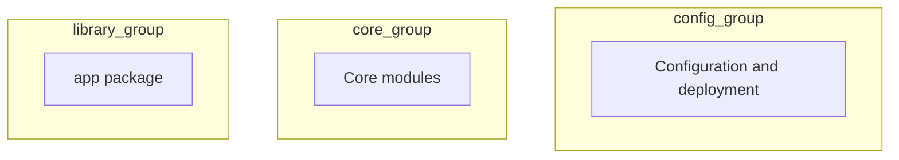

# Architecture report: xitanggg/open-resume

> Automated static analysis. **Observed** = directly seen in files/imports/AST; **Inferred** = interpretation from that evidence. Repository code was not executed.

## 1. Repository at a glance

| Item | Value |
| --- | --- |
| Repository | xitanggg/open-resume |
| Description | OpenResume is a powerful open-source resume builder and resume parser. https://open-resume.com/ |
| Language | TypeScript |
| Stars | 8983 |
| Licence | AGPL-3.0 |
| Analysed commit / branch | 4f8255a2c763479837f69f1dccf2a3338730cd79 / main |
| Framework(s) | Next.js, React |
| Files analysed | 130 |
| Components | 3 |

## 2. Architecture in one minute

xitanggg/open-resume - OpenResume is a powerful open-source resume builder and resume parser. https://open-resume.com/. This repository was analysed statically from 130 file(s) (0 Python). Detected technologies (observed from imports/manifests): Next.js, React, Redux Toolkit, Tailwind CSS, Docker, Jest. Files are grouped into 3 component(s): app package, Configuration and deployment, Core modules. Findings below distinguish observed facts from inferred interpretation.

## 3. High-level block diagram

## 4. Main components

### app package (`app`)

- **Kind:** library
- **Status:** Observed
- **Confidence:** 0.85
- **Responsibility:** Groups 97 file(s) under app package (observed from repository paths and static analysis).
- **Paths:** `src/app/components/Button.tsx`, `src/app/components/ExpanderWithHeightTransition.tsx`, `src/app/components/FlexboxSpacer.tsx`, `src/app/components/Resume/ResumeControlBar.tsx`, `src/app/components/Resume/ResumeIFrame.tsx`, `src/app/components/Resume/ResumePDF/ResumePDFCustom.tsx`, `src/app/components/Resume/ResumePDF/ResumePDFEducation.tsx`, `src/app/components/Resume/ResumePDF/ResumePDFProfile.tsx`, `src/app/components/Resume/ResumePDF/ResumePDFProject.tsx`, `src/app/components/Resume/ResumePDF/ResumePDFSkills.tsx`, `src/app/components/Resume/ResumePDF/ResumePDFWorkExperience.tsx`, `src/app/components/Resume/ResumePDF/common/ResumePDFIcon.tsx`, `src/app/components/Resume/ResumePDF/common/SuppressResumePDFErrorMessage.tsx`, `src/app/components/Resume/ResumePDF/common/index.tsx`, `src/app/components/Resume/ResumePDF/index.tsx`, `src/app/components/Resume/ResumePDF/styles.ts`, `src/app/components/Resume/hooks.tsx`, `src/app/components/Resume/index.tsx`, `src/app/components/ResumeDropzone.tsx`, `src/app/components/ResumeForm/CustomForm.tsx`, `src/app/components/ResumeForm/EducationsForm.tsx`, `src/app/components/ResumeForm/Form/FeaturedSkillInput.tsx`, `src/app/components/ResumeForm/Form/IconButton.tsx`, `src/app/components/ResumeForm/Form/InputGroup.tsx`, `src/app/components/ResumeForm/Form/index.tsx`, `src/app/components/ResumeForm/ProfileForm.tsx`, `src/app/components/ResumeForm/ProjectsForm.tsx`, `src/app/components/ResumeForm/SkillsForm.tsx`, `src/app/components/ResumeForm/ThemeForm/InlineInput.tsx`, `src/app/components/ResumeForm/ThemeForm/Selection.tsx`, `src/app/components/ResumeForm/ThemeForm/constants.ts`, `src/app/components/ResumeForm/ThemeForm/index.tsx`, `src/app/components/ResumeForm/WorkExperiencesForm.tsx`, `src/app/components/ResumeForm/index.tsx`, `src/app/components/ResumeForm/types.ts`, `src/app/components/Tooltip.tsx`, `src/app/components/TopNavBar.tsx`, `src/app/components/documentation/Badge.tsx`, `src/app/components/documentation/Heading.tsx`, `src/app/components/documentation/Link.tsx`, `src/app/components/documentation/Paragraph.tsx`, `src/app/components/documentation/Table.tsx`, `src/app/components/documentation/index.tsx`, `src/app/components/fonts/FontsZh.tsx`, `src/app/components/fonts/NonEnglishFontsCSSLoader.tsx`, `src/app/components/fonts/constants.ts`, `src/app/components/fonts/hooks.tsx`, `src/app/components/fonts/lib.ts`, `src/app/globals-css.ts`, `src/app/home/AutoTypingResume.tsx`, `src/app/home/Features.tsx`, `src/app/home/Hero.tsx`, `src/app/home/LogoCloud.tsx`, `src/app/home/QuestionsAndAnswers.tsx`, `src/app/home/Steps.tsx`, `src/app/home/Testimonials.tsx`, `src/app/home/constants.ts`, `src/app/layout.tsx`, `src/app/lib/__tests__/cx.test.ts`, `src/app/lib/__tests__/make-object-char-iterator.test.ts`, `src/app/lib/constants.ts`, `src/app/lib/cx.ts`, `src/app/lib/deep-clone.ts`, `src/app/lib/deep-merge.ts`, `src/app/lib/get-px-per-rem.ts`, `src/app/lib/hooks/useAutosizeTextareaHeight.tsx`, `src/app/lib/hooks/useTailwindBreakpoints.tsx`, `src/app/lib/make-object-char-iterator.ts`, `src/app/lib/parse-resume-from-pdf/extract-resume-from-sections/extract-education.ts`, `src/app/lib/parse-resume-from-pdf/extract-resume-from-sections/extract-profile.ts`, `src/app/lib/parse-resume-from-pdf/extract-resume-from-sections/extract-project.ts`, `src/app/lib/parse-resume-from-pdf/extract-resume-from-sections/extract-resume-from-sections.test.ts`, `src/app/lib/parse-resume-from-pdf/extract-resume-from-sections/extract-skills.ts`, `src/app/lib/parse-resume-from-pdf/extract-resume-from-sections/extract-work-experience.ts`, `src/app/lib/parse-resume-from-pdf/extract-resume-from-sections/index.ts`, `src/app/lib/parse-resume-from-pdf/extract-resume-from-sections/lib/bullet-points.ts`, `src/app/lib/parse-resume-from-pdf/extract-resume-from-sections/lib/common-features.ts`, `src/app/lib/parse-resume-from-pdf/extract-resume-from-sections/lib/feature-scoring-system.ts`, `src/app/lib/parse-resume-from-pdf/extract-resume-from-sections/lib/get-section-lines.ts`, `src/app/lib/parse-resume-from-pdf/extract-resume-from-sections/lib/subsections.ts`, `src/app/lib/parse-resume-from-pdf/group-lines-into-sections.ts`, `src/app/lib/parse-resume-from-pdf/group-text-items-into-lines.ts`, `src/app/lib/parse-resume-from-pdf/index.ts`, `src/app/lib/parse-resume-from-pdf/read-pdf.ts`, `src/app/lib/parse-resume-from-pdf/types.ts`, `src/app/lib/redux/hooks.tsx`, `src/app/lib/redux/local-storage.ts`, `src/app/lib/redux/resumeSlice.ts`, `src/app/lib/redux/settingsSlice.ts`, `src/app/lib/redux/store.ts`, `src/app/lib/redux/types.ts`, `src/app/page.tsx`, `src/app/resume-builder/page.tsx`, `src/app/resume-import/page.tsx`, `src/app/resume-parser/ResumeParserAlgorithmArticle.tsx`, `src/app/resume-parser/ResumeTable.tsx`, `src/app/resume-parser/page.tsx`
- **Evidence:** [src/app/components/Button.tsx](https://github.com/xitanggg/open-resume/blob/4f8255a2c763479837f69f1dccf2a3338730cd79/src/app/components/Button.tsx); [src/app/components/ExpanderWithHeightTransition.tsx](https://github.com/xitanggg/open-resume/blob/4f8255a2c763479837f69f1dccf2a3338730cd79/src/app/components/ExpanderWithHeightTransition.tsx); [src/app/components/FlexboxSpacer.tsx](https://github.com/xitanggg/open-resume/blob/4f8255a2c763479837f69f1dccf2a3338730cd79/src/app/components/FlexboxSpacer.tsx); [src/app/components/Resume/ResumeControlBar.tsx](https://github.com/xitanggg/open-resume/blob/4f8255a2c763479837f69f1dccf2a3338730cd79/src/app/components/Resume/ResumeControlBar.tsx); [src/app/components/Resume/ResumeIFrame.tsx](https://github.com/xitanggg/open-resume/blob/4f8255a2c763479837f69f1dccf2a3338730cd79/src/app/components/Resume/ResumeIFrame.tsx); [src/app/components/Resume/ResumePDF/ResumePDFCustom.tsx](https://github.com/xitanggg/open-resume/blob/4f8255a2c763479837f69f1dccf2a3338730cd79/src/app/components/Resume/ResumePDF/ResumePDFCustom.tsx); [src/app/components/Resume/ResumePDF/ResumePDFEducation.tsx](https://github.com/xitanggg/open-resume/blob/4f8255a2c763479837f69f1dccf2a3338730cd79/src/app/components/Resume/ResumePDF/ResumePDFEducation.tsx); [src/app/components/Resume/ResumePDF/ResumePDFProfile.tsx](https://github.com/xitanggg/open-resume/blob/4f8255a2c763479837f69f1dccf2a3338730cd79/src/app/components/Resume/ResumePDF/ResumePDFProfile.tsx)

### Configuration and deployment (`config`)

- **Kind:** config
- **Status:** Observed
- **Confidence:** 0.85
- **Responsibility:** Groups 3 file(s) under configuration and deployment (observed from repository paths and static analysis).
- **Paths:** `Dockerfile`, `package.json`, `tsconfig.json`
- **Evidence:** [Dockerfile](https://github.com/xitanggg/open-resume/blob/4f8255a2c763479837f69f1dccf2a3338730cd79/Dockerfile); [package.json](https://github.com/xitanggg/open-resume/blob/4f8255a2c763479837f69f1dccf2a3338730cd79/package.json); [tsconfig.json](https://github.com/xitanggg/open-resume/blob/4f8255a2c763479837f69f1dccf2a3338730cd79/tsconfig.json)

### Core modules (`core`)

- **Kind:** core
- **Status:** Observed
- **Confidence:** 0.85
- **Responsibility:** Groups 5 file(s) under core modules (observed from repository paths and static analysis).
- **Paths:** `jest.config.mjs`, `next.config.js`, `postcss.config.js`, `prettier.config.js`, `tailwind.config.js`
- **Evidence:** [jest.config.mjs](https://github.com/xitanggg/open-resume/blob/4f8255a2c763479837f69f1dccf2a3338730cd79/jest.config.mjs); [next.config.js](https://github.com/xitanggg/open-resume/blob/4f8255a2c763479837f69f1dccf2a3338730cd79/next.config.js); [postcss.config.js](https://github.com/xitanggg/open-resume/blob/4f8255a2c763479837f69f1dccf2a3338730cd79/postcss.config.js); [prettier.config.js](https://github.com/xitanggg/open-resume/blob/4f8255a2c763479837f69f1dccf2a3338730cd79/prettier.config.js); [tailwind.config.js](https://github.com/xitanggg/open-resume/blob/4f8255a2c763479837f69f1dccf2a3338730cd79/tailwind.config.js)

## 5. Execution flow

**Observed** entry point(s):

- [src/app/page.tsx](https://github.com/xitanggg/open-resume/blob/4f8255a2c763479837f69f1dccf2a3338730cd79/src/app/page.tsx)
- [src/app/resume-builder/page.tsx](https://github.com/xitanggg/open-resume/blob/4f8255a2c763479837f69f1dccf2a3338730cd79/src/app/resume-builder/page.tsx)
- [src/app/resume-import/page.tsx](https://github.com/xitanggg/open-resume/blob/4f8255a2c763479837f69f1dccf2a3338730cd79/src/app/resume-import/page.tsx)
- [src/app/resume-parser/page.tsx](https://github.com/xitanggg/open-resume/blob/4f8255a2c763479837f69f1dccf2a3338730cd79/src/app/resume-parser/page.tsx)

Representative flow (derived from observed entry points and the import graph; steps beyond the entry point are **Inferred**):

1. Execution starts at an observed entry point listed above, if present.
2. No internal import relationships between components were observed.

## 6. Project structure

### `(root)`

- `.dockerignore` - container (31 bytes)
- `.eslintrc.json` - config (99 bytes)
- `.gitignore` - other (368 bytes)
- `.prettierignore` - other (28 bytes)
- `Dockerfile` - container (321 bytes)
- `LICENSE` - docs (34522 bytes)
- `README.md` - docs (5472 bytes)
- `jest.config.mjs` - source, JavaScript (603 bytes)
- `next.config.js` - source, JavaScript (718 bytes)
- `package.json` - manifest (1208 bytes)
- `postcss.config.js` - source, JavaScript (82 bytes)
- `prettier.config.js` - source, JavaScript (146 bytes)
- `prettierignore` - other (18 bytes)
- `tailwind.config.js` - source, JavaScript (386 bytes)
- `tsconfig.json` - config (806 bytes)

### `public`

- `public/assets/add-pdf.svg` - other (3218 bytes)
- `public/assets/dots.svg` - other (15223 bytes)
- `public/assets/feature-free.svg` - other (6310 bytes)
- `public/assets/feature-open-source.svg` - other (2921 bytes)
- `public/assets/feature-privacy.svg` - other (1870 bytes)
- `public/assets/feature-us.svg` - other (35425 bytes)
- `public/assets/heart.svg` - other (1005 bytes)
- `public/assets/logo-amazon.svg` - other (5530 bytes)
- `public/assets/logo-columbia.svg` - other (40230 bytes)
- `public/assets/logo-cornell.svg` - other (28356 bytes)
- `public/assets/logo-dropbox.svg` - other (3871 bytes)
- `public/assets/logo-google.svg` - other (1906 bytes)
- `public/assets/logo-northeastern.svg` - other (20903 bytes)
- `public/fonts/OFL.txt` - docs (5889 bytes)
- `public/fonts/fonts-zh.css` - other (181 bytes)
- `public/fonts/fonts.css` - other (1879 bytes)
- `public/logo.svg` - other (9102 bytes)

### `src`

- `src/app/components/Button.tsx` - source, TypeScript (1135 bytes)
- `src/app/components/ExpanderWithHeightTransition.tsx` - source, TypeScript (843 bytes)
- `src/app/components/FlexboxSpacer.tsx` - source, TypeScript (495 bytes)
- `src/app/components/Resume/ResumeControlBar.tsx` - source, TypeScript (2465 bytes)
- `src/app/components/Resume/ResumeIFrame.tsx` - source, TypeScript (3575 bytes)
- `src/app/components/Resume/ResumePDF/ResumePDFCustom.tsx` - source, TypeScript (770 bytes)
- `src/app/components/Resume/ResumePDF/ResumePDFEducation.tsx` - source, TypeScript (1981 bytes)
- `src/app/components/Resume/ResumePDF/ResumePDFProfile.tsx` - source, TypeScript (2769 bytes)
- `src/app/components/Resume/ResumePDF/ResumePDFProject.tsx` - source, TypeScript (1088 bytes)
- `src/app/components/Resume/ResumePDF/ResumePDFSkills.tsx` - source, TypeScript (1973 bytes)
- `src/app/components/Resume/ResumePDF/ResumePDFWorkExperience.tsx` - source, TypeScript (1601 bytes)
- `src/app/components/Resume/ResumePDF/common/ResumePDFIcon.tsx` - source, TypeScript (4525 bytes)
- `src/app/components/Resume/ResumePDF/common/SuppressResumePDFErrorMessage.tsx` - source, TypeScript (545 bytes)
- `src/app/components/Resume/ResumePDF/common/index.tsx` - source, TypeScript (3814 bytes)
- `src/app/components/Resume/ResumePDF/index.tsx` - source, TypeScript (4679 bytes)
- `src/app/components/Resume/ResumePDF/styles.ts` - source, TypeScript (1154 bytes)
- `src/app/components/Resume/hooks.tsx` - source, TypeScript (2094 bytes)
- `src/app/components/Resume/index.tsx` - source, TypeScript (2240 bytes)
- `src/app/components/ResumeDropzone.tsx` - source, TypeScript (6383 bytes)
- `src/app/components/ResumeForm/CustomForm.tsx` - source, TypeScript (1673 bytes)
- `src/app/components/ResumeForm/EducationsForm.tsx` - source, TypeScript (3663 bytes)
- `src/app/components/ResumeForm/Form/FeaturedSkillInput.tsx` - source, TypeScript (1868 bytes)
- `src/app/components/ResumeForm/Form/IconButton.tsx` - source, TypeScript (2450 bytes)
- `src/app/components/ResumeForm/Form/InputGroup.tsx` - source, TypeScript (8317 bytes)
- `src/app/components/ResumeForm/Form/index.tsx` - source, TypeScript (5836 bytes)
- `src/app/components/ResumeForm/ProfileForm.tsx` - source, TypeScript (2119 bytes)
- `src/app/components/ResumeForm/ProjectsForm.tsx` - source, TypeScript (2214 bytes)
- `src/app/components/ResumeForm/SkillsForm.tsx` - source, TypeScript (2960 bytes)
- `src/app/components/ResumeForm/ThemeForm/InlineInput.tsx` - source, TypeScript (887 bytes)
- `src/app/components/ResumeForm/ThemeForm/Selection.tsx` - source, TypeScript (4460 bytes)
- `src/app/components/ResumeForm/ThemeForm/constants.ts` - source, TypeScript (341 bytes)
- `src/app/components/ResumeForm/ThemeForm/index.tsx` - source, TypeScript (3493 bytes)
- `src/app/components/ResumeForm/WorkExperiencesForm.tsx` - source, TypeScript (2801 bytes)
- `src/app/components/ResumeForm/index.tsx` - source, TypeScript (1974 bytes)
- `src/app/components/ResumeForm/types.ts` - source, TypeScript (163 bytes)
- `src/app/components/Tooltip.tsx` - source, TypeScript (1970 bytes)
- `src/app/components/TopNavBar.tsx` - source, TypeScript (1725 bytes)
- `src/app/components/documentation/Badge.tsx` - source, TypeScript (256 bytes)
- `src/app/components/documentation/Heading.tsx` - source, TypeScript (561 bytes)
- `src/app/components/documentation/Link.tsx` - source, TypeScript (376 bytes)
- `src/app/components/documentation/Paragraph.tsx` - source, TypeScript (399 bytes)
- `src/app/components/documentation/Table.tsx` - source, TypeScript (1508 bytes)
- `src/app/components/documentation/index.tsx` - source, TypeScript (342 bytes)
- `src/app/components/fonts/FontsZh.tsx` - source, TypeScript (155 bytes)
- `src/app/components/fonts/NonEnglishFontsCSSLoader.tsx` - source, TypeScript (728 bytes)
- `src/app/components/fonts/constants.ts` - source, TypeScript (3439 bytes)
- `src/app/components/fonts/hooks.tsx` - source, TypeScript (1547 bytes)
- `src/app/components/fonts/lib.ts` - source, TypeScript (871 bytes)
- `src/app/globals-css.ts` - source, TypeScript (152 bytes)
- `src/app/globals.css` - other (1440 bytes)
- `src/app/home/AutoTypingResume.tsx` - source, TypeScript (2895 bytes)
- `src/app/home/Features.tsx` - source, TypeScript (2112 bytes)
- `src/app/home/Hero.tsx` - source, TypeScript (1455 bytes)
- `src/app/home/LogoCloud.tsx` - source, TypeScript (1430 bytes)
- `src/app/home/QuestionsAndAnswers.tsx` - source, TypeScript (6246 bytes)
- `src/app/home/Steps.tsx` - source, TypeScript (1313 bytes)
- `src/app/home/Testimonials.tsx` - source, TypeScript (5175 bytes)
- `src/app/home/constants.ts` - source, TypeScript (3683 bytes)
- `src/app/layout.tsx` - source, TypeScript (741 bytes)
- `src/app/lib/__tests__/cx.test.ts` - source, TypeScript (218 bytes)
- `src/app/lib/__tests__/make-object-char-iterator.test.ts` - source, TypeScript (825 bytes)
- `src/app/lib/constants.ts` - source, TypeScript (744 bytes)
- `src/app/lib/cx.ts` - source, TypeScript (628 bytes)
- `src/app/lib/deep-clone.ts` - source, TypeScript (310 bytes)
- `src/app/lib/deep-merge.ts` - source, TypeScript (959 bytes)
- `src/app/lib/get-px-per-rem.ts` - source, TypeScript (191 bytes)
- `src/app/lib/hooks/useAutosizeTextareaHeight.tsx` - source, TypeScript (1060 bytes)
- `src/app/lib/hooks/useTailwindBreakpoints.tsx` - source, TypeScript (986 bytes)
- `src/app/lib/make-object-char-iterator.ts` - source, TypeScript (1762 bytes)
- `src/app/lib/parse-resume-from-pdf/extract-resume-from-sections/extract-education.ts` - source, TypeScript (3711 bytes)
- `src/app/lib/parse-resume-from-pdf/extract-resume-from-sections/extract-profile.ts` - source, TypeScript (5562 bytes)
- `src/app/lib/parse-resume-from-pdf/extract-resume-from-sections/extract-project.ts` - source, TypeScript (1992 bytes)
- `src/app/lib/parse-resume-from-pdf/extract-resume-from-sections/extract-resume-from-sections.test.ts` - source, TypeScript (993 bytes)
- `src/app/lib/parse-resume-from-pdf/extract-resume-from-sections/extract-skills.ts` - source, TypeScript (1369 bytes)
- `src/app/lib/parse-resume-from-pdf/extract-resume-from-sections/extract-work-experience.ts` - source, TypeScript (3643 bytes)
- `src/app/lib/parse-resume-from-pdf/extract-resume-from-sections/index.ts` - source, TypeScript (1968 bytes)
- `src/app/lib/parse-resume-from-pdf/extract-resume-from-sections/lib/bullet-points.ts` - source, TypeScript (3610 bytes)
- `src/app/lib/parse-resume-from-pdf/extract-resume-from-sections/lib/common-features.ts` - source, TypeScript (1518 bytes)
- `src/app/lib/parse-resume-from-pdf/extract-resume-from-sections/lib/feature-scoring-system.ts` - source, TypeScript (2333 bytes)
- `src/app/lib/parse-resume-from-pdf/extract-resume-from-sections/lib/get-section-lines.ts` - source, TypeScript (480 bytes)
- `src/app/lib/parse-resume-from-pdf/extract-resume-from-sections/lib/subsections.ts` - source, TypeScript (3289 bytes)
- `src/app/lib/parse-resume-from-pdf/group-lines-into-sections.ts` - source, TypeScript (2907 bytes)
- `src/app/lib/parse-resume-from-pdf/group-text-items-into-lines.ts` - source, TypeScript (4735 bytes)
- `src/app/lib/parse-resume-from-pdf/index.ts` - source, TypeScript (1004 bytes)
- `src/app/lib/parse-resume-from-pdf/read-pdf.ts` - source, TypeScript (3378 bytes)
- `src/app/lib/parse-resume-from-pdf/types.ts` - source, TypeScript (853 bytes)
- `src/app/lib/redux/hooks.tsx` - source, TypeScript (1719 bytes)
- `src/app/lib/redux/local-storage.ts` - source, TypeScript (756 bytes)
- `src/app/lib/redux/resumeSlice.ts` - source, TypeScript (6229 bytes)
- `src/app/lib/redux/settingsSlice.ts` - source, TypeScript (4773 bytes)
- `src/app/lib/redux/store.ts` - source, TypeScript (385 bytes)
- `src/app/lib/redux/types.ts` - source, TypeScript (966 bytes)
- `src/app/page.tsx` - source, TypeScript (482 bytes)
- `src/app/resume-builder/page.tsx` - source, TypeScript (614 bytes)
- `src/app/resume-import/page.tsx` - source, TypeScript (2739 bytes)
- `src/app/resume-parser/ResumeParserAlgorithmArticle.tsx` - source, TypeScript (19020 bytes)
- `src/app/resume-parser/ResumeTable.tsx` - source, TypeScript (4311 bytes)
- `src/app/resume-parser/page.tsx` - source, TypeScript (5432 bytes)

## 7. Key dependencies and integrations

| Name | Category | Status | Confidence | Evidence |
| --- | --- | --- | --- | --- |
| Next.js | framework | Observed | 0.85 | [package.json:6](https://github.com/xitanggg/open-resume/blob/4f8255a2c763479837f69f1dccf2a3338730cd79/package.json#L6) |
| React | framework | Observed | 0.90 | [package.json:14](https://github.com/xitanggg/open-resume/blob/4f8255a2c763479837f69f1dccf2a3338730cd79/package.json#L14); [package.json:19](https://github.com/xitanggg/open-resume/blob/4f8255a2c763479837f69f1dccf2a3338730cd79/package.json#L19) |
| Redux Toolkit | library | Observed | 0.85 | [package.json:16](https://github.com/xitanggg/open-resume/blob/4f8255a2c763479837f69f1dccf2a3338730cd79/package.json#L16) |
| Tailwind CSS | library | Observed | 0.85 | [package.json:34](https://github.com/xitanggg/open-resume/blob/4f8255a2c763479837f69f1dccf2a3338730cd79/package.json#L34) |
| Docker | tooling | Observed | 0.85 | [Dockerfile](https://github.com/xitanggg/open-resume/blob/4f8255a2c763479837f69f1dccf2a3338730cd79/Dockerfile) |
| Jest | tooling | Observed | 0.85 | [package.json:10](https://github.com/xitanggg/open-resume/blob/4f8255a2c763479837f69f1dccf2a3338730cd79/package.json#L10) |
| TypeScript | tooling | Observed | 0.85 | [package.json:35](https://github.com/xitanggg/open-resume/blob/4f8255a2c763479837f69f1dccf2a3338730cd79/package.json#L35) |

## 8. Data and state

No database, cache, queue, or persistent-state usage was observed in the analysed files. State handling, if any, may be in-memory or in files that were not analysed.

## 9. Configuration and deployment clues

- `.dockerignore` (container)
- `.eslintrc.json` (config)
- `Dockerfile` (container)
- `package.json` (manifest)
- `tsconfig.json` (config)

## 10. Design observations

- No strong design patterns could be established from the available evidence.

These observations are interpretations (**Inferred**) of the observed structure, not guarantees about runtime design.

## 11. Limitations and unknowns

- Static analysis only: repository code was not executed, installed, or imported at runtime.
- Components and relationships are inferred from file paths, imports, and AST structure; runtime behaviour, dynamic imports, and reflection may not be visible.
- No clear application entry point was observed in the analysed files.
- Repository text was treated as untrusted data; no instructions found in repository files were followed, and likely secret values were redacted/excluded.
- JavaScript and TypeScript files were inventoried from paths and package manifests. They were not parsed with a full language AST, and repository code was not executed.

## 12. Source references

- [Dockerfile](https://github.com/xitanggg/open-resume/blob/4f8255a2c763479837f69f1dccf2a3338730cd79/Dockerfile)
- [jest.config.mjs](https://github.com/xitanggg/open-resume/blob/4f8255a2c763479837f69f1dccf2a3338730cd79/jest.config.mjs)
- [next.config.js](https://github.com/xitanggg/open-resume/blob/4f8255a2c763479837f69f1dccf2a3338730cd79/next.config.js)
- [package.json](https://github.com/xitanggg/open-resume/blob/4f8255a2c763479837f69f1dccf2a3338730cd79/package.json)
- [package.json:6](https://github.com/xitanggg/open-resume/blob/4f8255a2c763479837f69f1dccf2a3338730cd79/package.json#L6)
- [package.json:10](https://github.com/xitanggg/open-resume/blob/4f8255a2c763479837f69f1dccf2a3338730cd79/package.json#L10)
- [package.json:14](https://github.com/xitanggg/open-resume/blob/4f8255a2c763479837f69f1dccf2a3338730cd79/package.json#L14)
- [package.json:16](https://github.com/xitanggg/open-resume/blob/4f8255a2c763479837f69f1dccf2a3338730cd79/package.json#L16)
- [package.json:19](https://github.com/xitanggg/open-resume/blob/4f8255a2c763479837f69f1dccf2a3338730cd79/package.json#L19)
- [package.json:34](https://github.com/xitanggg/open-resume/blob/4f8255a2c763479837f69f1dccf2a3338730cd79/package.json#L34)
- [package.json:35](https://github.com/xitanggg/open-resume/blob/4f8255a2c763479837f69f1dccf2a3338730cd79/package.json#L35)
- [postcss.config.js](https://github.com/xitanggg/open-resume/blob/4f8255a2c763479837f69f1dccf2a3338730cd79/postcss.config.js)
- [prettier.config.js](https://github.com/xitanggg/open-resume/blob/4f8255a2c763479837f69f1dccf2a3338730cd79/prettier.config.js)
- [src/app/components/Button.tsx](https://github.com/xitanggg/open-resume/blob/4f8255a2c763479837f69f1dccf2a3338730cd79/src/app/components/Button.tsx)
- [src/app/components/ExpanderWithHeightTransition.tsx](https://github.com/xitanggg/open-resume/blob/4f8255a2c763479837f69f1dccf2a3338730cd79/src/app/components/ExpanderWithHeightTransition.tsx)
- [src/app/components/FlexboxSpacer.tsx](https://github.com/xitanggg/open-resume/blob/4f8255a2c763479837f69f1dccf2a3338730cd79/src/app/components/FlexboxSpacer.tsx)
- [src/app/components/Resume/ResumeControlBar.tsx](https://github.com/xitanggg/open-resume/blob/4f8255a2c763479837f69f1dccf2a3338730cd79/src/app/components/Resume/ResumeControlBar.tsx)
- [src/app/components/Resume/ResumeIFrame.tsx](https://github.com/xitanggg/open-resume/blob/4f8255a2c763479837f69f1dccf2a3338730cd79/src/app/components/Resume/ResumeIFrame.tsx)
- [src/app/components/Resume/ResumePDF/ResumePDFCustom.tsx](https://github.com/xitanggg/open-resume/blob/4f8255a2c763479837f69f1dccf2a3338730cd79/src/app/components/Resume/ResumePDF/ResumePDFCustom.tsx)
- [src/app/components/Resume/ResumePDF/ResumePDFEducation.tsx](https://github.com/xitanggg/open-resume/blob/4f8255a2c763479837f69f1dccf2a3338730cd79/src/app/components/Resume/ResumePDF/ResumePDFEducation.tsx)
- [src/app/components/Resume/ResumePDF/ResumePDFProfile.tsx](https://github.com/xitanggg/open-resume/blob/4f8255a2c763479837f69f1dccf2a3338730cd79/src/app/components/Resume/ResumePDF/ResumePDFProfile.tsx)
- [src/app/page.tsx](https://github.com/xitanggg/open-resume/blob/4f8255a2c763479837f69f1dccf2a3338730cd79/src/app/page.tsx)
- [src/app/resume-builder/page.tsx](https://github.com/xitanggg/open-resume/blob/4f8255a2c763479837f69f1dccf2a3338730cd79/src/app/resume-builder/page.tsx)
- [src/app/resume-import/page.tsx](https://github.com/xitanggg/open-resume/blob/4f8255a2c763479837f69f1dccf2a3338730cd79/src/app/resume-import/page.tsx)
- [src/app/resume-parser/page.tsx](https://github.com/xitanggg/open-resume/blob/4f8255a2c763479837f69f1dccf2a3338730cd79/src/app/resume-parser/page.tsx)
- [tailwind.config.js](https://github.com/xitanggg/open-resume/blob/4f8255a2c763479837f69f1dccf2a3338730cd79/tailwind.config.js)
- [tsconfig.json](https://github.com/xitanggg/open-resume/blob/4f8255a2c763479837f69f1dccf2a3338730cd79/tsconfig.json)
