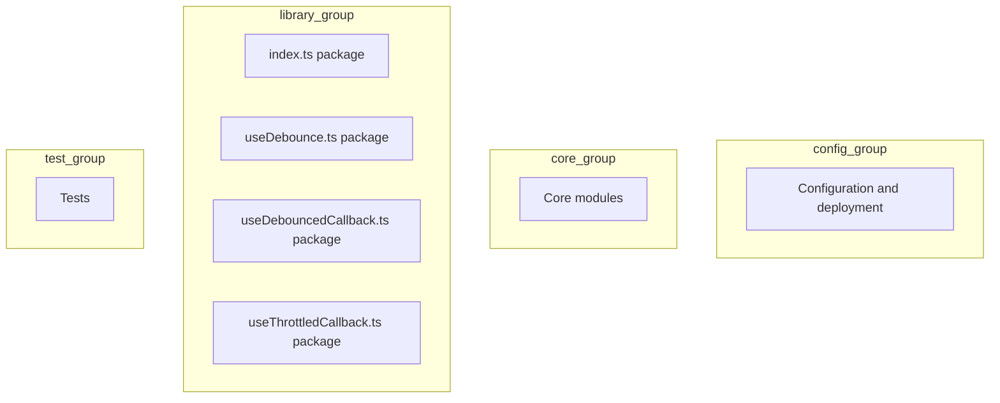

# Architecture report: xnimorz/use-debounce

> Automated static analysis. **Observed** = directly seen in files/imports/AST; **Inferred** = interpretation from that evidence. Repository code was not executed.

## 1. Repository at a glance

| Item | Value |
| --- | --- |
| Repository | xnimorz/use-debounce |
| Description | A debounce hook for react |
| Language | TypeScript |
| Stars | 3381 |
| Licence | MIT |
| Analysed commit / branch | 771f915e21bf5d8f4cab626b6cb7bebbec2681fb / master |
| Framework(s) | React |
| Files analysed | 20 |
| Components | 7 |

## 2. Architecture in one minute

xnimorz/use-debounce - A debounce hook for react. This repository was analysed statically from 20 file(s) (0 Python). Detected technologies (observed from imports/manifests): GitHub Actions, React, Jest, TypeScript. Files are grouped into 7 component(s): Configuration and deployment, Core modules, index.ts package, Tests, useDebounce.ts package, useDebouncedCallback.ts package, useThrottledCallback.ts package. Findings below distinguish observed facts from inferred interpretation.

## 3. High-level block diagram

## 4. Main components

### Configuration and deployment (`config`)

- **Kind:** config
- **Status:** Observed
- **Confidence:** 0.85
- **Responsibility:** Groups 2 file(s) under configuration and deployment (observed from repository paths and static analysis).
- **Paths:** `package.json`, `tsconfig.json`
- **Evidence:** [package.json](https://github.com/xnimorz/use-debounce/blob/771f915e21bf5d8f4cab626b6cb7bebbec2681fb/package.json); [tsconfig.json](https://github.com/xnimorz/use-debounce/blob/771f915e21bf5d8f4cab626b6cb7bebbec2681fb/tsconfig.json)

### Core modules (`core`)

- **Kind:** core
- **Status:** Observed
- **Confidence:** 0.85
- **Responsibility:** Groups 2 file(s) under core modules (observed from repository paths and static analysis).
- **Paths:** `jest.config.js`, `setupTests.ts`
- **Evidence:** [jest.config.js](https://github.com/xnimorz/use-debounce/blob/771f915e21bf5d8f4cab626b6cb7bebbec2681fb/jest.config.js); [setupTests.ts](https://github.com/xnimorz/use-debounce/blob/771f915e21bf5d8f4cab626b6cb7bebbec2681fb/setupTests.ts)

### index.ts package (`index_ts`)

- **Kind:** library
- **Status:** Observed
- **Confidence:** 0.85
- **Responsibility:** Groups 1 file(s) under index.ts package (observed from repository paths and static analysis).
- **Paths:** `src/index.ts`
- **Evidence:** [src/index.ts](https://github.com/xnimorz/use-debounce/blob/771f915e21bf5d8f4cab626b6cb7bebbec2681fb/src/index.ts)

### Tests (`tests`)

- **Kind:** test
- **Status:** Observed
- **Confidence:** 0.85
- **Responsibility:** Groups 3 file(s) under tests (observed from repository paths and static analysis).
- **Paths:** `test/useDebounce.test.tsx`, `test/useDebouncedCallback.test.tsx`, `test/useThrottledCallback.test.tsx`
- **Evidence:** [test/useDebounce.test.tsx](https://github.com/xnimorz/use-debounce/blob/771f915e21bf5d8f4cab626b6cb7bebbec2681fb/test/useDebounce.test.tsx); [test/useDebouncedCallback.test.tsx](https://github.com/xnimorz/use-debounce/blob/771f915e21bf5d8f4cab626b6cb7bebbec2681fb/test/useDebouncedCallback.test.tsx); [test/useThrottledCallback.test.tsx](https://github.com/xnimorz/use-debounce/blob/771f915e21bf5d8f4cab626b6cb7bebbec2681fb/test/useThrottledCallback.test.tsx)

### useDebounce.ts package (`usedebounce_ts`)

- **Kind:** library
- **Status:** Observed
- **Confidence:** 0.85
- **Responsibility:** Groups 1 file(s) under usedebounce.ts package (observed from repository paths and static analysis).
- **Paths:** `src/useDebounce.ts`
- **Evidence:** [src/useDebounce.ts](https://github.com/xnimorz/use-debounce/blob/771f915e21bf5d8f4cab626b6cb7bebbec2681fb/src/useDebounce.ts)

### useDebouncedCallback.ts package (`usedebouncedcallback_ts`)

- **Kind:** library
- **Status:** Observed
- **Confidence:** 0.85
- **Responsibility:** Groups 1 file(s) under usedebouncedcallback.ts package (observed from repository paths and static analysis).
- **Paths:** `src/useDebouncedCallback.ts`
- **Evidence:** [src/useDebouncedCallback.ts](https://github.com/xnimorz/use-debounce/blob/771f915e21bf5d8f4cab626b6cb7bebbec2681fb/src/useDebouncedCallback.ts)

### useThrottledCallback.ts package (`usethrottledcallback_ts`)

- **Kind:** library
- **Status:** Observed
- **Confidence:** 0.85
- **Responsibility:** Groups 1 file(s) under usethrottledcallback.ts package (observed from repository paths and static analysis).
- **Paths:** `src/useThrottledCallback.ts`
- **Evidence:** [src/useThrottledCallback.ts](https://github.com/xnimorz/use-debounce/blob/771f915e21bf5d8f4cab626b6cb7bebbec2681fb/src/useThrottledCallback.ts)

## 5. Execution flow

**Observed** entry point(s):

- [src/index.ts](https://github.com/xnimorz/use-debounce/blob/771f915e21bf5d8f4cab626b6cb7bebbec2681fb/src/index.ts)

Representative flow (derived from observed entry points and the import graph; steps beyond the entry point are **Inferred**):

1. Execution starts at an observed entry point listed above, if present.
2. No internal import relationships between components were observed.

## 6. Project structure

### `(root)`

- `.eslintrc` - other (546 bytes)
- `.gitignore` - other (114 bytes)
- `.prettierrc` - other (116 bytes)
- `CHANGELOG.md` - docs (18486 bytes)
- `LICENSE` - docs (1072 bytes)
- `README.md` - docs (12438 bytes)
- `jest.config.js` - source, JavaScript (208 bytes)
- `package.json` - manifest (2985 bytes)
- `setupTests.ts` - source, TypeScript (35 bytes)
- `tsconfig.json` - config (308 bytes)

### `.github`

- `.github/ISSUE_TEMPLATE/bug_report.md` - docs (482 bytes)
- `.github/ISSUE_TEMPLATE/feature_request.md` - docs (130 bytes)
- `.github/workflows/main.yml` - ci, YAML (442 bytes)

### `src`

- `src/index.ts` - source, TypeScript (407 bytes)
- `src/useDebounce.ts` - source, TypeScript (1029 bytes)
- `src/useDebouncedCallback.ts` - source, TypeScript (12220 bytes)
- `src/useThrottledCallback.ts` - source, TypeScript (2858 bytes)

### `test`

- `test/useDebounce.test.tsx` - test, TypeScript (17278 bytes)
- `test/useDebouncedCallback.test.tsx` - test, TypeScript (23213 bytes)
- `test/useThrottledCallback.test.tsx` - test, TypeScript (2305 bytes)

## 7. Key dependencies and integrations

| Name | Category | Status | Confidence | Evidence |
| --- | --- | --- | --- | --- |
| GitHub Actions | ci | Observed | 0.85 | [.github/workflows/main.yml](https://github.com/xnimorz/use-debounce/blob/771f915e21bf5d8f4cab626b6cb7bebbec2681fb/.github/workflows/main.yml) |
| React | framework | Observed | 0.90 | [package.json:4](https://github.com/xnimorz/use-debounce/blob/771f915e21bf5d8f4cab626b6cb7bebbec2681fb/package.json#L4); [package.json:60](https://github.com/xnimorz/use-debounce/blob/771f915e21bf5d8f4cab626b6cb7bebbec2681fb/package.json#L60) |
| Jest | tooling | Observed | 0.85 | [package.json:21](https://github.com/xnimorz/use-debounce/blob/771f915e21bf5d8f4cab626b6cb7bebbec2681fb/package.json#L21) |
| TypeScript | tooling | Observed | 0.85 | [package.json:61](https://github.com/xnimorz/use-debounce/blob/771f915e21bf5d8f4cab626b6cb7bebbec2681fb/package.json#L61) |

## 8. Data and state

No database, cache, queue, or persistent-state usage was observed in the analysed files. State handling, if any, may be in-memory or in files that were not analysed.

## 9. Configuration and deployment clues

- `.github/workflows/main.yml` (ci)
- `package.json` (manifest)
- `tsconfig.json` (config)

## 10. Design observations

- Tests are present alongside source code (Observed from test file paths).

These observations are interpretations (**Inferred**) of the observed structure, not guarantees about runtime design.

## 11. Limitations and unknowns

- Static analysis only: repository code was not executed, installed, or imported at runtime.
- Components and relationships are inferred from file paths, imports, and AST structure; runtime behaviour, dynamic imports, and reflection may not be visible.
- No clear application entry point was observed in the analysed files.
- Repository text was treated as untrusted data; no instructions found in repository files were followed, and likely secret values were redacted/excluded.
- JavaScript and TypeScript files were inventoried from paths and package manifests. They were not parsed with a full language AST, and repository code was not executed.

## 12. Source references

- [.github/workflows/main.yml](https://github.com/xnimorz/use-debounce/blob/771f915e21bf5d8f4cab626b6cb7bebbec2681fb/.github/workflows/main.yml)
- [jest.config.js](https://github.com/xnimorz/use-debounce/blob/771f915e21bf5d8f4cab626b6cb7bebbec2681fb/jest.config.js)
- [package.json](https://github.com/xnimorz/use-debounce/blob/771f915e21bf5d8f4cab626b6cb7bebbec2681fb/package.json)
- [package.json:4](https://github.com/xnimorz/use-debounce/blob/771f915e21bf5d8f4cab626b6cb7bebbec2681fb/package.json#L4)
- [package.json:21](https://github.com/xnimorz/use-debounce/blob/771f915e21bf5d8f4cab626b6cb7bebbec2681fb/package.json#L21)
- [package.json:60](https://github.com/xnimorz/use-debounce/blob/771f915e21bf5d8f4cab626b6cb7bebbec2681fb/package.json#L60)
- [package.json:61](https://github.com/xnimorz/use-debounce/blob/771f915e21bf5d8f4cab626b6cb7bebbec2681fb/package.json#L61)
- [setupTests.ts](https://github.com/xnimorz/use-debounce/blob/771f915e21bf5d8f4cab626b6cb7bebbec2681fb/setupTests.ts)
- [src/index.ts](https://github.com/xnimorz/use-debounce/blob/771f915e21bf5d8f4cab626b6cb7bebbec2681fb/src/index.ts)
- [src/useDebounce.ts](https://github.com/xnimorz/use-debounce/blob/771f915e21bf5d8f4cab626b6cb7bebbec2681fb/src/useDebounce.ts)
- [src/useDebouncedCallback.ts](https://github.com/xnimorz/use-debounce/blob/771f915e21bf5d8f4cab626b6cb7bebbec2681fb/src/useDebouncedCallback.ts)
- [src/useThrottledCallback.ts](https://github.com/xnimorz/use-debounce/blob/771f915e21bf5d8f4cab626b6cb7bebbec2681fb/src/useThrottledCallback.ts)
- [test/useDebounce.test.tsx](https://github.com/xnimorz/use-debounce/blob/771f915e21bf5d8f4cab626b6cb7bebbec2681fb/test/useDebounce.test.tsx)
- [test/useDebouncedCallback.test.tsx](https://github.com/xnimorz/use-debounce/blob/771f915e21bf5d8f4cab626b6cb7bebbec2681fb/test/useDebouncedCallback.test.tsx)
- [test/useThrottledCallback.test.tsx](https://github.com/xnimorz/use-debounce/blob/771f915e21bf5d8f4cab626b6cb7bebbec2681fb/test/useThrottledCallback.test.tsx)
- [tsconfig.json](https://github.com/xnimorz/use-debounce/blob/771f915e21bf5d8f4cab626b6cb7bebbec2681fb/tsconfig.json)
