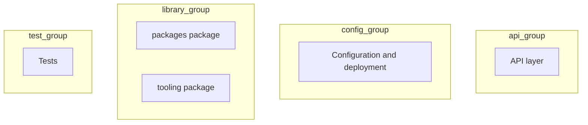

# Architecture report: xyflow/xyflow

> Automated static analysis. **Observed** = directly seen in files/imports/AST; **Inferred** = interpretation from that evidence. Repository code was not executed.

## 1. Repository at a glance

| Item | Value |
| --- | --- |
| Repository | xyflow/xyflow |
| Description | React Flow | Svelte Flow - Powerful open source libraries for building node-based UIs with React (https://reactflow.dev) or Svelte (https://svelteflow.dev). Ready out-of-the-box and infinitely customizable. |
| Language | TypeScript |
| Stars | 39015 |
| Licence | MIT |
| Analysed commit / branch | 1bc405cd113618c17fd181b931a9fe573bec9fee / main |
| Framework(s) | React, Svelte |
| Files analysed | 699 |
| Components | 5 |

## 2. Architecture in one minute

xyflow/xyflow - React Flow | Svelte Flow - Powerful open source libraries for building node-based UIs with React (https://reactflow.dev) or Svelte (https://svelteflow.dev). Ready out-of-the-box and infinitely custom…. This repository was analysed statically from 699 file(s) (0 Python). Detected technologies (observed from imports/manifests): GitHub Actions, React, Svelte, React Router, Redux, Redux Toolkit. Files are grouped into 5 component(s): API layer, Configuration and deployment, packages package, Tests, tooling package. Findings below distinguish observed facts from inferred interpretation.

## 3. High-level block diagram

## 4. Main components

### API layer (`api_layer`)

- **Kind:** api
- **Status:** Observed
- **Confidence:** 0.85
- **Responsibility:** Groups 2 file(s) under api layer (observed from repository paths and static analysis).
- **Paths:** `packages/svelte/src/routes/+page.svelte`, `packages/svelte/src/routes/+page.svelte.d.ts`
- **Evidence:** [packages/svelte/src/routes/+page.svelte](https://github.com/xyflow/xyflow/blob/1bc405cd113618c17fd181b931a9fe573bec9fee/packages/svelte/src/routes/%2Bpage.svelte); [packages/svelte/src/routes/+page.svelte.d.ts](https://github.com/xyflow/xyflow/blob/1bc405cd113618c17fd181b931a9fe573bec9fee/packages/svelte/src/routes/%2Bpage.svelte.d.ts)

### Configuration and deployment (`config`)

- **Kind:** config
- **Status:** Observed
- **Confidence:** 0.85
- **Responsibility:** Groups 15 file(s) under configuration and deployment (observed from repository paths and static analysis).
- **Paths:** `dependabot.yml`, `package.json`, `packages/react/package.json`, `packages/react/tsconfig.json`, `packages/svelte/package.json`, `packages/svelte/tsconfig.json`, `packages/system/package.json`, `packages/system/tsconfig.json`, `pnpm-workspace.yaml`, `tooling/eslint-config/package.json`, `tooling/rollup-config/package.json`, `tooling/tsconfig/base.json`, `tooling/tsconfig/package.json`, `tooling/tsconfig/react.json`, `turbo.json`
- **Evidence:** [dependabot.yml](https://github.com/xyflow/xyflow/blob/1bc405cd113618c17fd181b931a9fe573bec9fee/dependabot.yml); [package.json](https://github.com/xyflow/xyflow/blob/1bc405cd113618c17fd181b931a9fe573bec9fee/package.json); [packages/react/package.json](https://github.com/xyflow/xyflow/blob/1bc405cd113618c17fd181b931a9fe573bec9fee/packages/react/package.json); [packages/react/tsconfig.json](https://github.com/xyflow/xyflow/blob/1bc405cd113618c17fd181b931a9fe573bec9fee/packages/react/tsconfig.json); [packages/svelte/package.json](https://github.com/xyflow/xyflow/blob/1bc405cd113618c17fd181b931a9fe573bec9fee/packages/svelte/package.json); [packages/svelte/tsconfig.json](https://github.com/xyflow/xyflow/blob/1bc405cd113618c17fd181b931a9fe573bec9fee/packages/svelte/tsconfig.json); [packages/system/package.json](https://github.com/xyflow/xyflow/blob/1bc405cd113618c17fd181b931a9fe573bec9fee/packages/system/package.json); [packages/system/tsconfig.json](https://github.com/xyflow/xyflow/blob/1bc405cd113618c17fd181b931a9fe573bec9fee/packages/system/tsconfig.json)

### packages package (`packages`)

- **Kind:** library
- **Status:** Observed
- **Confidence:** 0.85
- **Responsibility:** Groups 306 file(s) under packages package (observed from repository paths and static analysis).
- **Paths:** `packages/react/.eslintrc.js`, `packages/react/src/additional-components/Background/Background.tsx`, `packages/react/src/additional-components/Background/Patterns.tsx`, `packages/react/src/additional-components/Background/index.tsx`, `packages/react/src/additional-components/Background/types.ts`, `packages/react/src/additional-components/Controls/ControlButton.tsx`, `packages/react/src/additional-components/Controls/Controls.tsx`, `packages/react/src/additional-components/Controls/Icons/FitView.tsx`, `packages/react/src/additional-components/Controls/Icons/Lock.tsx`, `packages/react/src/additional-components/Controls/Icons/Minus.tsx`, `packages/react/src/additional-components/Controls/Icons/Plus.tsx`, `packages/react/src/additional-components/Controls/Icons/Unlock.tsx`, `packages/react/src/additional-components/Controls/index.tsx`, `packages/react/src/additional-components/Controls/types.ts`, `packages/react/src/additional-components/EdgeToolbar/EdgeToolbar.tsx`, `packages/react/src/additional-components/EdgeToolbar/index.tsx`, `packages/react/src/additional-components/EdgeToolbar/types.ts`, `packages/react/src/additional-components/MiniMap/MiniMap.tsx`, `packages/react/src/additional-components/MiniMap/MiniMapNode.tsx`, `packages/react/src/additional-components/MiniMap/MiniMapNodes.tsx`, `packages/react/src/additional-components/MiniMap/index.tsx`, `packages/react/src/additional-components/MiniMap/types.ts`, `packages/react/src/additional-components/NodeResizer/NodeResizeControl.tsx`, `packages/react/src/additional-components/NodeResizer/NodeResizer.tsx`, `packages/react/src/additional-components/NodeResizer/index.tsx`, `packages/react/src/additional-components/NodeResizer/types.ts`, `packages/react/src/additional-components/NodeToolbar/NodeToolbar.tsx`, `packages/react/src/additional-components/NodeToolbar/NodeToolbarPortal.tsx`, `packages/react/src/additional-components/NodeToolbar/index.tsx`, `packages/react/src/additional-components/NodeToolbar/types.ts`, `packages/react/src/additional-components/index.ts`, `packages/react/src/components/A11yDescriptions/index.tsx`, `packages/react/src/components/Attribution/index.tsx`, `packages/react/src/components/BatchProvider/index.tsx`, `packages/react/src/components/BatchProvider/types.ts`, `packages/react/src/components/BatchProvider/useQueue.ts`, `packages/react/src/components/ConnectionLine/index.tsx`, `packages/react/src/components/EdgeLabelRenderer/index.tsx`, `packages/react/src/components/EdgeWrapper/EdgeUpdateAnchors.tsx`, `packages/react/src/components/EdgeWrapper/index.tsx`, `packages/react/src/components/EdgeWrapper/utils.ts`, `packages/react/src/components/Edges/BaseEdge.tsx`, `packages/react/src/components/Edges/BezierEdge.tsx`, `packages/react/src/components/Edges/EdgeAnchor.tsx`, `packages/react/src/components/Edges/EdgeText.tsx`, `packages/react/src/components/Edges/SimpleBezierEdge.tsx`, `packages/react/src/components/Edges/SmoothStepEdge.tsx`, `packages/react/src/components/Edges/StepEdge.tsx`, `packages/react/src/components/Edges/StraightEdge.tsx`, `packages/react/src/components/Edges/index.ts`, `packages/react/src/components/Handle/index.tsx`, `packages/react/src/components/NodeWrapper/index.tsx`, `packages/react/src/components/NodeWrapper/useNodeObserver.ts`, `packages/react/src/components/NodeWrapper/utils.tsx`, `packages/react/src/components/Nodes/DefaultNode.tsx`, `packages/react/src/components/Nodes/GroupNode.tsx`, `packages/react/src/components/Nodes/InputNode.tsx`, `packages/react/src/components/Nodes/OutputNode.tsx`, `packages/react/src/components/Nodes/utils.ts`, `packages/react/src/components/NodesSelection/index.tsx`, `packages/react/src/components/Panel/index.tsx`, `packages/react/src/components/ReactFlowProvider/index.tsx`, `packages/react/src/components/SelectionListener/index.tsx`, `packages/react/src/components/StoreUpdater/index.tsx`, `packages/react/src/components/UserSelection/index.tsx`, `packages/react/src/components/ViewportPortal/index.tsx`, `packages/react/src/container/EdgeRenderer/MarkerDefinitions.tsx`, `packages/react/src/container/EdgeRenderer/MarkerSymbols.tsx`, `packages/react/src/container/EdgeRenderer/index.tsx`, `packages/react/src/container/FlowRenderer/index.tsx`, `packages/react/src/container/GraphView/index.tsx`, `packages/react/src/container/GraphView/useNodeOrEdgeTypesWarning.ts`, `packages/react/src/container/GraphView/useStylesLoadedWarning.ts`, `packages/react/src/container/NodeRenderer/index.tsx`, `packages/react/src/container/NodeRenderer/useResizeObserver.ts`, `packages/react/src/container/Pane/index.tsx`, `packages/react/src/container/ReactFlow/Wrapper.tsx`, `packages/react/src/container/ReactFlow/index.tsx`, `packages/react/src/container/ReactFlow/init-values.ts`, `packages/react/src/container/Viewport/index.tsx`, `packages/react/src/container/ZoomPane/index.tsx`, `packages/react/src/contexts/HandleConfigContext.tsx`, `packages/react/src/contexts/NodeIdContext.ts`, `packages/react/src/contexts/StoreContext.ts`, `packages/react/src/custom.d.ts`, `packages/react/src/hooks/useColorModeClass.ts`, `packages/react/src/hooks/useConnection.ts`, `packages/react/src/hooks/useDrag.ts`, `packages/react/src/hooks/useEdges.ts`, `packages/react/src/hooks/useGlobalKeyHandler.ts`, `packages/react/src/hooks/useHandleConnections.ts`, `packages/react/src/hooks/useInternalNode.ts`, `packages/react/src/hooks/useIsomorphicLayoutEffect.ts`, `packages/react/src/hooks/useKeyPress.ts`, `packages/react/src/hooks/useMoveSelectedNodes.ts`, `packages/react/src/hooks/useNodeConnections.ts`, `packages/react/src/hooks/useNodes.ts`, `packages/react/src/hooks/useNodesData.ts`, `packages/react/src/hooks/useNodesEdgesState.ts`, `packages/react/src/hooks/useNodesInitialized.ts`, `packages/react/src/hooks/useOnEdgesChangeMiddleware.ts`, `packages/react/src/hooks/useOnInitHandler.ts`, `packages/react/src/hooks/useOnNodesChangeMiddleware.ts`, `packages/react/src/hooks/useOnSelectionChange.ts`, `packages/react/src/hooks/useOnViewportChange.ts`, `packages/react/src/hooks/useReactFlow.ts`, `packages/react/src/hooks/useResizeHandler.ts`, `packages/react/src/hooks/useStore.ts`, `packages/react/src/hooks/useUpdateNodeInternals.ts`, `packages/react/src/hooks/useViewport.ts`, `packages/react/src/hooks/useViewportHelper.ts`, `packages/react/src/hooks/useViewportSync.ts`, `packages/react/src/hooks/useVisibleEdgeIds.ts`, `packages/react/src/hooks/useVisibleNodeIds.ts`, `packages/react/src/index.ts`, `packages/react/src/store/index.ts`, `packages/react/src/store/initialState.ts`, `packages/react/src/styles/utils.ts`, `packages/react/src/types/component-props.ts`, `packages/react/src/types/edges.ts`, `packages/react/src/types/general.ts`, `packages/react/src/types/index.ts`, `packages/react/src/types/instance.ts`, `packages/react/src/types/nodes.ts`, `packages/react/src/types/store.ts`, `packages/react/src/utils/changes.ts`, `packages/react/src/utils/edges.ts`, `packages/react/src/utils/general.ts`, `packages/react/src/utils/index.ts`, `packages/svelte/eslint.config.js`, `packages/svelte/src/lib/actions/drag/index.ts`, `packages/svelte/src/lib/actions/portal/index.ts`, `packages/svelte/src/lib/actions/portal/portal.svelte.ts`, `packages/svelte/src/lib/actions/portal/utils.svelte.ts`, `packages/svelte/src/lib/actions/zoom/index.ts`, `packages/svelte/src/lib/components/A11yDescriptions/A11yDescriptions.svelte`, `packages/svelte/src/lib/components/A11yDescriptions/index.ts`, `packages/svelte/src/lib/components/Attribution/Attribution.svelte`, `packages/svelte/src/lib/components/Attribution/index.ts`, `packages/svelte/src/lib/components/Attribution/types.ts`, `packages/svelte/src/lib/components/ConnectionLine/ConnectionLine.svelte`, `packages/svelte/src/lib/components/ConnectionLine/index.ts`, `packages/svelte/src/lib/components/EdgeLabel/EdgeLabel.svelte`, `packages/svelte/src/lib/components/EdgeLabel/index.ts`, `packages/svelte/src/lib/components/EdgeLabel/types.ts`, `packages/svelte/src/lib/components/EdgeReconnectAnchor/EdgeReconnectAnchor.svelte`, `packages/svelte/src/lib/components/EdgeReconnectAnchor/index.ts`, `packages/svelte/src/lib/components/EdgeReconnectAnchor/types.ts`, `packages/svelte/src/lib/components/EdgeWrapper/EdgeWrapper.svelte`, `packages/svelte/src/lib/components/EdgeWrapper/index.ts`, `packages/svelte/src/lib/components/Handle/Handle.svelte`, `packages/svelte/src/lib/components/Handle/index.ts`, `packages/svelte/src/lib/components/Handle/types.ts`, `packages/svelte/src/lib/components/KeyHandler/KeyHandler.svelte`, `packages/svelte/src/lib/components/KeyHandler/index.ts`, `packages/svelte/src/lib/components/KeyHandler/types.ts`, `packages/svelte/src/lib/components/NodeSelection/NodeSelection.svelte`, `packages/svelte/src/lib/components/NodeSelection/index.ts`, `packages/svelte/src/lib/components/NodeSelection/types.ts`, `packages/svelte/src/lib/components/NodeWrapper/NodeWrapper.svelte`, `packages/svelte/src/lib/components/NodeWrapper/index.ts`, `packages/svelte/src/lib/components/NodeWrapper/types.ts`, `packages/svelte/src/lib/components/Selection/Selection.svelte`, `packages/svelte/src/lib/components/Selection/index.ts`, `packages/svelte/src/lib/components/SvelteFlowProvider/SvelteFlowProvider.svelte`, `packages/svelte/src/lib/components/SvelteFlowProvider/index.ts`, `packages/svelte/src/lib/components/SvelteFlowProvider/types.ts`, `packages/svelte/src/lib/components/ViewportPortal/ViewportPortal.svelte`, `packages/svelte/src/lib/components/ViewportPortal/index.ts`, `packages/svelte/src/lib/components/ViewportPortal/types.ts`, `packages/svelte/src/lib/components/edges/BaseEdge.svelte`, `packages/svelte/src/lib/components/edges/BezierEdge.svelte`, `packages/svelte/src/lib/components/edges/BezierEdgeInternal.svelte`, `packages/svelte/src/lib/components/edges/SmoothStepEdge.svelte`, `packages/svelte/src/lib/components/edges/SmoothStepEdgeInternal.svelte`, `packages/svelte/src/lib/components/edges/StepEdge.svelte`, `packages/svelte/src/lib/components/edges/StepEdgeInternal.svelte`, `packages/svelte/src/lib/components/edges/StraightEdge.svelte`, `packages/svelte/src/lib/components/edges/StraightEdgeInternal.svelte`, `packages/svelte/src/lib/components/edges/index.ts`, `packages/svelte/src/lib/components/nodes/DefaultNode.svelte`, `packages/svelte/src/lib/components/nodes/GroupNode.svelte`, `packages/svelte/src/lib/components/nodes/InputNode.svelte`, `packages/svelte/src/lib/components/nodes/OutputNode.svelte`, `packages/svelte/src/lib/container/EdgeRenderer/EdgeRenderer.svelte`, `packages/svelte/src/lib/container/EdgeRenderer/MarkerDefinition/Marker.svelte`, `packages/svelte/src/lib/container/EdgeRenderer/MarkerDefinition/MarkerDefinition.svelte`, `packages/svelte/src/lib/container/EdgeRenderer/MarkerDefinition/index.ts`, `packages/svelte/src/lib/container/EdgeRenderer/index.ts`, `packages/svelte/src/lib/container/NodeRenderer/NodeRenderer.svelte`, `packages/svelte/src/lib/container/NodeRenderer/index.ts`, `packages/svelte/src/lib/container/Pane/Pane.svelte`, `packages/svelte/src/lib/container/Pane/index.ts`, `packages/svelte/src/lib/container/Pane/types.ts`, `packages/svelte/src/lib/container/Panel/Panel.svelte`, `packages/svelte/src/lib/container/Panel/index.ts`, `packages/svelte/src/lib/container/Panel/types.ts`, `packages/svelte/src/lib/container/SvelteFlow/SvelteFlow.svelte`, `packages/svelte/src/lib/container/SvelteFlow/Wrapper.svelte`, `packages/svelte/src/lib/container/SvelteFlow/index.ts`, `packages/svelte/src/lib/container/SvelteFlow/types.ts`, `packages/svelte/src/lib/container/Viewport/Viewport.svelte`, `packages/svelte/src/lib/container/Viewport/index.ts`, `packages/svelte/src/lib/container/Zoom/Zoom.svelte`, `packages/svelte/src/lib/container/Zoom/index.ts`, `packages/svelte/src/lib/container/Zoom/types.ts`, `packages/svelte/src/lib/hooks/useColorMode.svelte.ts`, `packages/svelte/src/lib/hooks/useConnection.svelte.ts`, `packages/svelte/src/lib/hooks/useInitialized.svelte.ts`, `packages/svelte/src/lib/hooks/useInternalNode.svelte.ts`, `packages/svelte/src/lib/hooks/useNodeConnections.svelte.ts`, `packages/svelte/src/lib/hooks/useNodesData.svelte.ts`, `packages/svelte/src/lib/hooks/useNodesEdgesViewport.svelte.ts`, `packages/svelte/src/lib/hooks/useOnSelectionChange.svelte.ts`, `packages/svelte/src/lib/hooks/useStore.ts`, `packages/svelte/src/lib/hooks/useSvelteFlow.svelte.ts`, `packages/svelte/src/lib/hooks/useUpdateNodeInternals.svelte.ts`, `packages/svelte/src/lib/index.ts`, `packages/svelte/src/lib/plugins/Background/Background.svelte`, `packages/svelte/src/lib/plugins/Background/DotPattern.svelte`, `packages/svelte/src/lib/plugins/Background/LinePattern.svelte`, `packages/svelte/src/lib/plugins/Background/index.ts`, `packages/svelte/src/lib/plugins/Background/types.ts`, `packages/svelte/src/lib/plugins/Controls/ControlButton.svelte`, `packages/svelte/src/lib/plugins/Controls/Controls.svelte`, `packages/svelte/src/lib/plugins/Controls/Icons/Fit.svelte`, `packages/svelte/src/lib/plugins/Controls/Icons/Lock.svelte`, `packages/svelte/src/lib/plugins/Controls/Icons/Minus.svelte`, `packages/svelte/src/lib/plugins/Controls/Icons/Plus.svelte`, `packages/svelte/src/lib/plugins/Controls/Icons/Unlock.svelte`, `packages/svelte/src/lib/plugins/Controls/index.ts`, `packages/svelte/src/lib/plugins/Controls/types.ts`, `packages/svelte/src/lib/plugins/EdgeToolbar/EdgeToolbar.svelte`, `packages/svelte/src/lib/plugins/EdgeToolbar/index.ts`, `packages/svelte/src/lib/plugins/EdgeToolbar/types.ts`, `packages/svelte/src/lib/plugins/Minimap/Minimap.svelte`, `packages/svelte/src/lib/plugins/Minimap/MinimapNode.svelte`, `packages/svelte/src/lib/plugins/Minimap/index.ts`, `packages/svelte/src/lib/plugins/Minimap/interactive.ts`, `packages/svelte/src/lib/plugins/Minimap/types.ts`, `packages/svelte/src/lib/plugins/NodeResizer/NodeResizer.svelte`, `packages/svelte/src/lib/plugins/NodeResizer/ResizeControl.svelte`, `packages/svelte/src/lib/plugins/NodeResizer/index.ts`, `packages/svelte/src/lib/plugins/NodeResizer/types.ts`, `packages/svelte/src/lib/plugins/NodeToolbar/NodeToolbar.svelte`, `packages/svelte/src/lib/plugins/NodeToolbar/index.ts`, `packages/svelte/src/lib/plugins/NodeToolbar/types.ts`, `packages/svelte/src/lib/store/context.ts`, `packages/svelte/src/lib/store/index.ts`, `packages/svelte/src/lib/store/initial-store.svelte.ts`, `packages/svelte/src/lib/store/types.ts`, `packages/svelte/src/lib/store/visibleElements.ts`, `packages/svelte/src/lib/types/edges.ts`, `packages/svelte/src/lib/types/events.ts`, `packages/svelte/src/lib/types/general.ts`, `packages/svelte/src/lib/types/index.ts`, `packages/svelte/src/lib/types/nodes.ts`, `packages/svelte/src/lib/utils/edges.ts`, `packages/svelte/src/lib/utils/index.ts`, `packages/svelte/svelte.config.js`, `packages/system/.eslintrc.js`, `packages/system/src/constants.ts`, `packages/system/src/index.ts`, `packages/system/src/types/changes.ts`, `packages/system/src/types/edges.ts`, `packages/system/src/types/general.ts`, `packages/system/src/types/handles.ts`, `packages/system/src/types/index.ts`, `packages/system/src/types/nodes.ts`, `packages/system/src/types/panzoom.ts`, `packages/system/src/types/utils.ts`, `packages/system/src/utils/attribution.ts`, `packages/system/src/utils/connections.ts`, `packages/system/src/utils/dom.ts`, `packages/system/src/utils/edge-toolbar.ts`, `packages/system/src/utils/edges/bezier-edge.ts`, `packages/system/src/utils/edges/general.ts`, `packages/system/src/utils/edges/index.ts`, `packages/system/src/utils/edges/positions.ts`, `packages/system/src/utils/edges/smoothstep-edge.ts`, `packages/system/src/utils/edges/straight-edge.ts`, `packages/system/src/utils/general.ts`, `packages/system/src/utils/graph.ts`, `packages/system/src/utils/index.ts`, `packages/system/src/utils/marker.ts`, `packages/system/src/utils/node-toolbar.ts`, `packages/system/src/utils/shallow-node-data.ts`, `packages/system/src/utils/store.ts`, `packages/system/src/utils/types.ts`, `packages/system/src/xydrag/XYDrag.ts`, `packages/system/src/xydrag/index.ts`, `packages/system/src/xydrag/utils.ts`, `packages/system/src/xyhandle/XYHandle.ts`, `packages/system/src/xyhandle/index.ts`, `packages/system/src/xyhandle/types.ts`, `packages/system/src/xyhandle/utils.ts`, `packages/system/src/xyminimap/index.ts`, `packages/system/src/xypanzoom/XYPanZoom.ts`, `packages/system/src/xypanzoom/eventhandler.ts`, `packages/system/src/xypanzoom/filter.ts`, `packages/system/src/xypanzoom/index.ts`, `packages/system/src/xypanzoom/utils.ts`, `packages/system/src/xyresizer/XYResizer.ts`, `packages/system/src/xyresizer/index.ts`, `packages/system/src/xyresizer/types.ts`, `packages/system/src/xyresizer/utils.ts`
- **Evidence:** [packages/react/.eslintrc.js](https://github.com/xyflow/xyflow/blob/1bc405cd113618c17fd181b931a9fe573bec9fee/packages/react/.eslintrc.js); [packages/react/src/additional-components/Background/Background.tsx](https://github.com/xyflow/xyflow/blob/1bc405cd113618c17fd181b931a9fe573bec9fee/packages/react/src/additional-components/Background/Background.tsx); [packages/react/src/additional-components/Background/Patterns.tsx](https://github.com/xyflow/xyflow/blob/1bc405cd113618c17fd181b931a9fe573bec9fee/packages/react/src/additional-components/Background/Patterns.tsx); [packages/react/src/additional-components/Background/index.tsx](https://github.com/xyflow/xyflow/blob/1bc405cd113618c17fd181b931a9fe573bec9fee/packages/react/src/additional-components/Background/index.tsx); [packages/react/src/additional-components/Background/types.ts](https://github.com/xyflow/xyflow/blob/1bc405cd113618c17fd181b931a9fe573bec9fee/packages/react/src/additional-components/Background/types.ts); [packages/react/src/additional-components/Controls/ControlButton.tsx](https://github.com/xyflow/xyflow/blob/1bc405cd113618c17fd181b931a9fe573bec9fee/packages/react/src/additional-components/Controls/ControlButton.tsx); [packages/react/src/additional-components/Controls/Controls.tsx](https://github.com/xyflow/xyflow/blob/1bc405cd113618c17fd181b931a9fe573bec9fee/packages/react/src/additional-components/Controls/Controls.tsx); [packages/react/src/additional-components/Controls/Icons/FitView.tsx](https://github.com/xyflow/xyflow/blob/1bc405cd113618c17fd181b931a9fe573bec9fee/packages/react/src/additional-components/Controls/Icons/FitView.tsx)

### Tests (`tests`)

- **Kind:** test
- **Status:** Observed
- **Confidence:** 0.85
- **Responsibility:** Groups 20 file(s) under tests (observed from repository paths and static analysis).
- **Paths:** `examples/svelte/src/routes/tests/generic/[topic]/[example]/+page.svelte`, `examples/svelte/src/routes/tests/generic/[topic]/[example]/+page.ts`, `examples/svelte/src/routes/tests/generic/[topic]/[example]/Flow.svelte`, `tests/playwright/.gitignore`, `tests/playwright/README.md`, `tests/playwright/e2e/background.spec.ts`, `tests/playwright/e2e/click-connect.spec.ts`, `tests/playwright/e2e/constants.ts`, `tests/playwright/e2e/edges.spec.ts`, `tests/playwright/e2e/intersection-origin.spec.ts`, `tests/playwright/e2e/node-toolbar.spec.ts`, `tests/playwright/e2e/nodes.spec.ts`, `tests/playwright/e2e/pane.spec.ts`, `tests/playwright/e2e/props.spec.ts`, `tests/playwright/e2e/reconnect-edge.spec.ts`, `tests/playwright/e2e/utils.ts`, `tests/playwright/package.json`, `tests/playwright/playwright.react.config.ts`, `tests/playwright/playwright.shared.config.ts`, `tests/playwright/playwright.svelte.config.ts`
- **Evidence:** [examples/svelte/src/routes/tests/generic/[topic]/[example]/+page.svelte](https://github.com/xyflow/xyflow/blob/1bc405cd113618c17fd181b931a9fe573bec9fee/examples/svelte/src/routes/tests/generic/%5Btopic%5D/%5Bexample%5D/%2Bpage.svelte); [examples/svelte/src/routes/tests/generic/[topic]/[example]/+page.ts](https://github.com/xyflow/xyflow/blob/1bc405cd113618c17fd181b931a9fe573bec9fee/examples/svelte/src/routes/tests/generic/%5Btopic%5D/%5Bexample%5D/%2Bpage.ts); [examples/svelte/src/routes/tests/generic/[topic]/[example]/Flow.svelte](https://github.com/xyflow/xyflow/blob/1bc405cd113618c17fd181b931a9fe573bec9fee/examples/svelte/src/routes/tests/generic/%5Btopic%5D/%5Bexample%5D/Flow.svelte); [tests/playwright/.gitignore](https://github.com/xyflow/xyflow/blob/1bc405cd113618c17fd181b931a9fe573bec9fee/tests/playwright/.gitignore); [tests/playwright/README.md](https://github.com/xyflow/xyflow/blob/1bc405cd113618c17fd181b931a9fe573bec9fee/tests/playwright/README.md); [tests/playwright/e2e/background.spec.ts](https://github.com/xyflow/xyflow/blob/1bc405cd113618c17fd181b931a9fe573bec9fee/tests/playwright/e2e/background.spec.ts); [tests/playwright/e2e/click-connect.spec.ts](https://github.com/xyflow/xyflow/blob/1bc405cd113618c17fd181b931a9fe573bec9fee/tests/playwright/e2e/click-connect.spec.ts); [tests/playwright/e2e/constants.ts](https://github.com/xyflow/xyflow/blob/1bc405cd113618c17fd181b931a9fe573bec9fee/tests/playwright/e2e/constants.ts)

### tooling package (`tooling`)

- **Kind:** library
- **Status:** Observed
- **Confidence:** 0.85
- **Responsibility:** Groups 3 file(s) under tooling package (observed from repository paths and static analysis).
- **Paths:** `tooling/eslint-config/src/index.js`, `tooling/postcss-config/postcss.config.js`, `tooling/rollup-config/src/index.js`
- **Evidence:** [tooling/eslint-config/src/index.js](https://github.com/xyflow/xyflow/blob/1bc405cd113618c17fd181b931a9fe573bec9fee/tooling/eslint-config/src/index.js); [tooling/postcss-config/postcss.config.js](https://github.com/xyflow/xyflow/blob/1bc405cd113618c17fd181b931a9fe573bec9fee/tooling/postcss-config/postcss.config.js); [tooling/rollup-config/src/index.js](https://github.com/xyflow/xyflow/blob/1bc405cd113618c17fd181b931a9fe573bec9fee/tooling/rollup-config/src/index.js)

## 5. Execution flow

**Observed** entry point(s):

- [packages/react/src/index.ts](https://github.com/xyflow/xyflow/blob/1bc405cd113618c17fd181b931a9fe573bec9fee/packages/react/src/index.ts)
- [packages/system/src/index.ts](https://github.com/xyflow/xyflow/blob/1bc405cd113618c17fd181b931a9fe573bec9fee/packages/system/src/index.ts)
- [tooling/eslint-config/src/index.js](https://github.com/xyflow/xyflow/blob/1bc405cd113618c17fd181b931a9fe573bec9fee/tooling/eslint-config/src/index.js)
- [tooling/rollup-config/src/index.js](https://github.com/xyflow/xyflow/blob/1bc405cd113618c17fd181b931a9fe573bec9fee/tooling/rollup-config/src/index.js)

Representative flow (derived from observed entry points and the import graph; steps beyond the entry point are **Inferred**):

1. Execution starts at an observed entry point listed above, if present.
2. No internal import relationships between components were observed.

## 6. Project structure

### `(root)`

- `.codespellrc` - other (403 bytes)
- `.gitattributes` - other (66 bytes)
- `.gitignore` - other (145 bytes)
- `.prettierignore` - other (34 bytes)
- `.prettierrc.json` - config (73 bytes)
- `CHANGELOG.md` - docs (126 bytes)
- `CODE_OF_CONDUCT.md` - docs (2833 bytes)
- `CONTRIBUTING.md` - docs (4922 bytes)
- `LICENSE` - docs (1073 bytes)
- `README.md` - docs (5271 bytes)
- `SECURITY.md` - docs (1930 bytes)
- `dependabot.yml` - config (167 bytes)
- `package.json` - manifest (1487 bytes)
- `pnpm-workspace.yaml` - config (74 bytes)
- `turbo.json` - config (437 bytes)

### `.changeset`

- `.changeset/README.md` - docs (510 bytes)
- `.changeset/config.json` - config (420 bytes)

### `.github`

- `.github/FUNDING.yml` - config (88 bytes)
- `.github/ISSUE_TEMPLATE/bug_report.yml` - config (3458 bytes)
- `.github/ISSUE_TEMPLATE/config.yml` - config (214 bytes)
- `.github/ISSUE_TEMPLATE/feature_request.yml` - config (353 bytes)
- `.github/actions/ci-checks/action.yml` - config (235 bytes)
- `.github/actions/ci-setup/action.yml` - config (630 bytes)
- `.github/workflows/codespell.yml` - ci, YAML (400 bytes)
- `.github/workflows/dispatchWebsiteUpdate.yaml` - ci, YAML (1125 bytes)
- `.github/workflows/playwright.yml` - ci, YAML (511 bytes)
- `.github/workflows/release.yml` - ci, YAML (843 bytes)

### `examples`

- `examples/README.md` - docs (436 bytes)
- `examples/astro-xyflow/.gitignore` - other (229 bytes)
- `examples/astro-xyflow/README.md` - docs (127 bytes)
- `examples/astro-xyflow/astro.config.mjs` - source, JavaScript (221 bytes)
- `examples/astro-xyflow/package.json` - manifest (572 bytes)
- `examples/astro-xyflow/public/.gitkeep` - other (0 bytes)
- `examples/astro-xyflow/src/components/ReactFlowExample/CustomNode.tsx` - source, TypeScript (923 bytes)
- `examples/astro-xyflow/src/components/ReactFlowExample/index.tsx` - source, TypeScript (2495 bytes)
- `examples/astro-xyflow/src/components/ReactFlowInitialExample/CustomNode.tsx` - source, TypeScript (569 bytes)
- `examples/astro-xyflow/src/components/ReactFlowInitialExample/index.tsx` - source, TypeScript (1402 bytes)
- `examples/astro-xyflow/src/components/SvelteFlowExample/index.svelte` - source, Svelte (2437 bytes)
- `examples/astro-xyflow/src/components/SvelteFlowInitialExample/CustomNode.svelte` - source, Svelte (503 bytes)
- `examples/astro-xyflow/src/components/SvelteFlowInitialExample/index.svelte` - source, Svelte (932 bytes)
- `examples/astro-xyflow/src/env.d.ts` - source, TypeScript (85 bytes)
- `examples/astro-xyflow/src/pages/index.astro` - other (1226 bytes)
- `examples/astro-xyflow/tsconfig.json` - config (125 bytes)
- `examples/react/.gitignore` - other (253 bytes)
- `examples/react/README.md` - docs (761 bytes)
- `examples/react/cypress.config.ts` - source, TypeScript (385 bytes)
- `examples/react/cypress/components/hooks/useEdges.cy.tsx` - source, TypeScript (1146 bytes)
- `examples/react/cypress/components/hooks/useNodes.cy.tsx` - source, TypeScript (1311 bytes)
- `examples/react/cypress/components/hooks/useNodesInitialized.cy.tsx` - source, TypeScript (1823 bytes)
- `examples/react/cypress/components/hooks/useOnViewportChange.cy.tsx` - source, TypeScript (2958 bytes)
- `examples/react/cypress/components/hooks/useViewport.cy.tsx` - source, TypeScript (2145 bytes)
- `examples/react/cypress/components/reactflow/basic-props.cy.tsx` - source, TypeScript (6560 bytes)
- `examples/react/cypress/components/reactflow/event-handlers.cy.tsx` - source, TypeScript (7213 bytes)
- `examples/react/cypress/components/reactflow/multiple-instance.cy.tsx` - source, TypeScript (1985 bytes)
- `examples/react/cypress/components/reactflow/on-nodes-change.cy.tsx` - source, TypeScript (4021 bytes)
- `examples/react/cypress/components/reactflow/storeAvailabilityOnRemount.cy.tsx` - source, TypeScript (4178 bytes)
- `examples/react/cypress/components/reactflow/uncontrolled.cy.tsx` - source, TypeScript (1255 bytes)
- `examples/react/cypress/components/reactflow/view-props.cy.tsx` - source, TypeScript (9972 bytes)
- `examples/react/cypress/components/utils/adopt-user-nodes.cy.ts` - source, TypeScript (6874 bytes)
- `examples/react/cypress/components/utils/apply-changes.cy.ts` - source, TypeScript (6492 bytes)
- `examples/react/cypress/components/utils/calculate-node-position.cy.ts` - source, TypeScript (1409 bytes)
- `examples/react/cypress/components/utils/get-nodes-bounds.cy.ts` - source, TypeScript (4899 bytes)
- `examples/react/cypress/components/utils/graph-utils.cy.ts` - source, TypeScript (2313 bytes)
- `examples/react/cypress/components/utils/update-node-internals.cy.ts` - source, TypeScript (2134 bytes)
- `examples/react/cypress/e2e/basic.cy.ts` - source, TypeScript (5498 bytes)
- `examples/react/cypress/e2e/controls.cy.ts` - source, TypeScript (2698 bytes)
- `examples/react/cypress/e2e/draghandle.cy.ts` - source, TypeScript (1012 bytes)
- `examples/react/cypress/e2e/empty.cy.ts` - source, TypeScript (1246 bytes)
- `examples/react/cypress/e2e/figma.cy.ts` - source, TypeScript (1617 bytes)
- `examples/react/cypress/e2e/hidden.cy.ts` - source, TypeScript (999 bytes)
- `examples/react/cypress/e2e/interaction.cy.ts` - source, TypeScript (5129 bytes)
- `examples/react/cypress/e2e/minimap.cy.ts` - source, TypeScript (2817 bytes)
- `examples/react/cypress/fixtures/simpleflow.ts` - source, TypeScript (341 bytes)
- `examples/react/cypress/support/ControlledFlow.tsx` - source, TypeScript (1659 bytes)
- `examples/react/cypress/support/commands.ts` - source, TypeScript (1910 bytes)
- `examples/react/cypress/support/component-index.html` - other (419 bytes)
- `examples/react/cypress/support/component.ts` - source, TypeScript (945 bytes)
- `examples/react/cypress/support/e2e.ts` - source, TypeScript (836 bytes)
- `examples/react/index.html` - other (350 bytes)
- `examples/react/package.json` - manifest (1270 bytes)
- `examples/react/src/App/header.tsx` - source, TypeScript (1207 bytes)
- `examples/react/src/App/index.tsx` - source, TypeScript (692 bytes)
- `examples/react/src/App/routes.ts` - source, TypeScript (9686 bytes)
- `examples/react/src/app.d.ts` - source, TypeScript (393 bytes)
- `examples/react/src/examples/A11y/index.tsx` - source, TypeScript (2983 bytes)
- `examples/react/src/examples/AddNodeOnEdgeDrop/index.tsx` - source, TypeScript (2493 bytes)
- `examples/react/src/examples/Backgrounds/index.tsx` - source, TypeScript (1320 bytes)
- `examples/react/src/examples/Backgrounds/style.module.css` - other (177 bytes)
- `examples/react/src/examples/Basic/index.tsx` - source, TypeScript (5505 bytes)
- `examples/react/src/examples/BrokenNodes/index.tsx` - source, TypeScript (1888 bytes)
- `examples/react/src/examples/CancelConnection/Timer.module.css` - other (596 bytes)
- `examples/react/src/examples/CancelConnection/Timer.tsx` - source, TypeScript (549 bytes)
- `examples/react/src/examples/CancelConnection/data.ts` - source, TypeScript (693 bytes)
- `examples/react/src/examples/CancelConnection/hooks/useCountdown.ts` - source, TypeScript (686 bytes)
- `examples/react/src/examples/CancelConnection/index.tsx` - source, TypeScript (1528 bytes)
- `examples/react/src/examples/ClickDistance/index.tsx` - source, TypeScript (1857 bytes)
- `examples/react/src/examples/ColorMode/index.tsx` - source, TypeScript (2074 bytes)
- `examples/react/src/examples/ControlledUncontrolled/index.tsx` - source, TypeScript (2790 bytes)
- `examples/react/src/examples/ControlledViewport/index.tsx` - source, TypeScript (2326 bytes)
- `examples/react/src/examples/CustomConnectionLine/ConnectionLine.tsx` - source, TypeScript (540 bytes)
- `examples/react/src/examples/CustomConnectionLine/index.tsx` - source, TypeScript (1075 bytes)
- `examples/react/src/examples/CustomMiniMapNode/index.tsx` - source, TypeScript (2501 bytes)
- `examples/react/src/examples/CustomNode/ColorSelectorNode.tsx` - source, TypeScript (1744 bytes)
- `examples/react/src/examples/CustomNode/index.tsx` - source, TypeScript (4725 bytes)
- `examples/react/src/examples/DefaultEdgeOverwrite/index.tsx` - source, TypeScript (1270 bytes)
- `examples/react/src/examples/DefaultNodeOverwrite/index.tsx` - source, TypeScript (848 bytes)
- `examples/react/src/examples/DefaultNodes/index.tsx` - source, TypeScript (2108 bytes)
- `examples/react/src/examples/DetachedHandle/index.tsx` - source, TypeScript (1160 bytes)
- `examples/react/src/examples/DetachedHandle/style.css` - other (184 bytes)
- `examples/react/src/examples/DevTools/DevTools/ChangeLogger.tsx` - source, TypeScript (2181 bytes)
- `examples/react/src/examples/DevTools/DevTools/NodeInspector.tsx` - source, TypeScript (1534 bytes)
- `examples/react/src/examples/DevTools/DevTools/index.tsx` - source, TypeScript (1415 bytes)
- `examples/react/src/examples/DevTools/DevTools/style.css` - other (1264 bytes)
- `examples/react/src/examples/DevTools/index.tsx` - source, TypeScript (1237 bytes)
- `examples/react/src/examples/DragHandle/DragHandleNode.tsx` - source, TypeScript (823 bytes)
- `examples/react/src/examples/DragHandle/index.tsx` - source, TypeScript (957 bytes)
- `examples/react/src/examples/DragNDrop/Sidebar.tsx` - source, TypeScript (998 bytes)
- `examples/react/src/examples/DragNDrop/dnd.module.css` - other (460 bytes)
- `examples/react/src/examples/DragNDrop/index.tsx` - source, TypeScript (2211 bytes)
- `examples/react/src/examples/EasyConnect/CustomConnectionLine.tsx` - source, TypeScript (541 bytes)
- `examples/react/src/examples/EasyConnect/CustomNode.tsx` - source, TypeScript (1322 bytes)
- `examples/react/src/examples/EasyConnect/FloatingEdge.tsx` - source, TypeScript (676 bytes)
- `examples/react/src/examples/EasyConnect/index.tsx` - source, TypeScript (1841 bytes)
- `examples/react/src/examples/EasyConnect/style.css` - other (711 bytes)
- `examples/react/src/examples/EasyConnect/utils.tsx` - source, TypeScript (3297 bytes)
- `examples/react/src/examples/EdgeRenderer/CustomEdge.tsx` - source, TypeScript (1392 bytes)
- `examples/react/src/examples/EdgeRenderer/CustomEdge2.tsx` - source, TypeScript (1103 bytes)
- `examples/react/src/examples/EdgeRenderer/index.tsx` - source, TypeScript (4983 bytes)
- `examples/react/src/examples/EdgeRouting/index.tsx` - source, TypeScript (6333 bytes)
- `examples/react/src/examples/EdgeToolbar/CustomEdge.tsx` - source, TypeScript (1068 bytes)
- `examples/react/src/examples/EdgeToolbar/index.tsx` - source, TypeScript (1603 bytes)
- `examples/react/src/examples/EdgeTypes/index.tsx` - source, TypeScript (1332 bytes)
- `examples/react/src/examples/EdgeTypes/utils.ts` - source, TypeScript (3065 bytes)
- `examples/react/src/examples/Edges/CustomEdge.tsx` - source, TypeScript (648 bytes)
- `examples/react/src/examples/Edges/CustomEdge2.tsx` - source, TypeScript (796 bytes)
- `examples/react/src/examples/Edges/CustomEdge3.css` - other (250 bytes)
- `examples/react/src/examples/Edges/CustomEdge3.tsx` - source, TypeScript (738 bytes)
- `examples/react/src/examples/Edges/index.tsx` - source, TypeScript (7365 bytes)
- `examples/react/src/examples/Empty/index.tsx` - source, TypeScript (1801 bytes)
- `examples/react/src/examples/Figma/index.tsx` - source, TypeScript (2175 bytes)
- `examples/react/src/examples/FloatingEdges/FloatingConnectionLine.tsx` - source, TypeScript (910 bytes)
- `examples/react/src/examples/FloatingEdges/FloatingEdge.tsx` - source, TypeScript (932 bytes)
- `examples/react/src/examples/FloatingEdges/index.tsx` - source, TypeScript (1388 bytes)
- `examples/react/src/examples/FloatingEdges/style.module.css` - other (140 bytes)
- `examples/react/src/examples/FloatingEdges/utils.ts` - source, TypeScript (3358 bytes)
- `examples/react/src/examples/Hidden/index.tsx` - source, TypeScript (2307 bytes)
- `examples/react/src/examples/Interaction/index.tsx` - source, TypeScript (8528 bytes)
- `examples/react/src/examples/InteractiveMinimap/index.tsx` - source, TypeScript (3979 bytes)
- `examples/react/src/examples/Intersection/index.tsx` - source, TypeScript (2311 bytes)
- `examples/react/src/examples/Intersection/style.css` - other (77 bytes)
- `examples/react/src/examples/Layouting/index.tsx` - source, TypeScript (3086 bytes)
- `examples/react/src/examples/Layouting/initial-elements.ts` - source, TypeScript (2201 bytes)
- `examples/react/src/examples/Layouting/layouting.module.css` - other (54 bytes)
- `examples/react/src/examples/Middlewares/RestrictExtent.tsx` - source, TypeScript (1649 bytes)
- `examples/react/src/examples/Middlewares/index.tsx` - source, TypeScript (2833 bytes)
- `examples/react/src/examples/MovingHandles/MovingHandleNode.tsx` - source, TypeScript (1501 bytes)
- `examples/react/src/examples/MovingHandles/index.tsx` - source, TypeScript (2420 bytes)
- `examples/react/src/examples/MultiFlows/index.tsx` - source, TypeScript (1712 bytes)
- `examples/react/src/examples/MultiFlows/multiflows.module.css` - other (198 bytes)
- `examples/react/src/examples/MultiSetNodes/index.tsx` - source, TypeScript (2149 bytes)
- `examples/react/src/examples/MultiSetNodes/style.css` - other (47 bytes)
- `examples/react/src/examples/NodeResizer/BottomRightResizer.tsx` - source, TypeScript (656 bytes)
- `examples/react/src/examples/NodeResizer/CustomResizer.tsx` - source, TypeScript (1073 bytes)
- `examples/react/src/examples/NodeResizer/DefaultResizer.tsx` - source, TypeScript (1008 bytes)
- `examples/react/src/examples/NodeResizer/FixedExtentNode.tsx` - source, TypeScript (895 bytes)
- `examples/react/src/examples/NodeResizer/HorizontalResizer.tsx` - source, TypeScript (1509 bytes)
- `examples/react/src/examples/NodeResizer/ResizeIcon.tsx` - source, TypeScript (618 bytes)
- `examples/react/src/examples/NodeResizer/VerticalResizer.tsx` - source, TypeScript (1491 bytes)
- `examples/react/src/examples/NodeResizer/index.tsx` - source, TypeScript (5109 bytes)
- `examples/react/src/examples/NodeSelectionBug/index.tsx` - source, TypeScript (1203 bytes)
- `examples/react/src/examples/NodeToolbar/CustomNode.tsx` - source, TypeScript (599 bytes)
- `examples/react/src/examples/NodeToolbar/SelectedNodesToolbar.tsx` - source, TypeScript (499 bytes)
- `examples/react/src/examples/NodeToolbar/index.tsx` - source, TypeScript (1747 bytes)
- `examples/react/src/examples/NodeTypeChange/index.tsx` - source, TypeScript (1646 bytes)
- `examples/react/src/examples/NodeTypesObjectChange/index.tsx` - source, TypeScript (2070 bytes)
- `examples/react/src/examples/Overview/index.tsx` - source, TypeScript (7569 bytes)
- `examples/react/src/examples/Provider/Sidebar.tsx` - source, TypeScript (1194 bytes)
- `examples/react/src/examples/Provider/index.tsx` - source, TypeScript (1881 bytes)
- `examples/react/src/examples/Provider/provider.module.css` - other (544 bytes)
- `examples/react/src/examples/ReconnectEdge/index.tsx` - source, TypeScript (3082 bytes)
- `examples/react/src/examples/Redux/index.tsx` - source, TypeScript (804 bytes)
- `examples/react/src/examples/Redux/initial-elements.tsx` - source, TypeScript (1737 bytes)
- `examples/react/src/examples/Redux/state.ts` - source, TypeScript (1561 bytes)
- `examples/react/src/examples/Remount/index.tsx` - source, TypeScript (1362 bytes)
- `examples/react/src/examples/SaveRestore/Controls.tsx` - source, TypeScript (1891 bytes)
- `examples/react/src/examples/SaveRestore/index.tsx` - source, TypeScript (1111 bytes)
- `examples/react/src/examples/SaveRestore/save.module.css` - other (130 bytes)
- `examples/react/src/examples/SetNodesBatching/index.tsx` - source, TypeScript (2129 bytes)
- `examples/react/src/examples/Stress/index.tsx` - source, TypeScript (8265 bytes)
- `examples/react/src/examples/Stress/performanceUtils.ts` - source, TypeScript (4328 bytes)
- `examples/react/src/examples/Stress/utils.ts` - source, TypeScript (1008 bytes)
- `examples/react/src/examples/Subflow/DebugNode.tsx` - source, TypeScript (899 bytes)
- `examples/react/src/examples/Subflow/index.tsx` - source, TypeScript (6234 bytes)
- `examples/react/src/examples/Switch/index.tsx` - source, TypeScript (3272 bytes)
- `examples/react/src/examples/TouchDevice/index.tsx` - source, TypeScript (1589 bytes)
- `examples/react/src/examples/TouchDevice/touch-device.css` - other (530 bytes)
- `examples/react/src/examples/Undirectional/CustomNode.tsx` - source, TypeScript (639 bytes)
- `examples/react/src/examples/Undirectional/index.tsx` - source, TypeScript (4309 bytes)
- `examples/react/src/examples/UpdateNode/index.tsx` - source, TypeScript (2908 bytes)
- `examples/react/src/examples/UpdateNode/updatenode.module.css` - other (251 bytes)
- `examples/react/src/examples/UseConnection/index.tsx` - source, TypeScript (1525 bytes)
- `examples/react/src/examples/UseKeyPress/index.tsx` - source, TypeScript (299 bytes)
- `examples/react/src/examples/UseNodeConnections/MultiHandleNode.tsx` - source, TypeScript (1519 bytes)
- `examples/react/src/examples/UseNodeConnections/SingleHandleNode.tsx` - source, TypeScript (1287 bytes)
- `examples/react/src/examples/UseNodeConnections/index.tsx` - source, TypeScript (2026 bytes)
- `examples/react/src/examples/UseNodesData/ResultNode.tsx` - source, TypeScript (732 bytes)
- `examples/react/src/examples/UseNodesData/TextNode.tsx` - source, TypeScript (1195 bytes)
- `examples/react/src/examples/UseNodesData/UppercaseNode.tsx` - source, TypeScript (1003 bytes)
- `examples/react/src/examples/UseNodesData/index.tsx` - source, TypeScript (2372 bytes)
- `examples/react/src/examples/UseNodesInit/index.tsx` - source, TypeScript (2089 bytes)
- `examples/react/src/examples/UseOnSelectionChange/CustomNode.tsx` - source, TypeScript (1060 bytes)
- `examples/react/src/examples/UseOnSelectionChange/index.tsx` - source, TypeScript (1968 bytes)
- `examples/react/src/examples/UseReactFlow/index.tsx` - source, TypeScript (5663 bytes)
- `examples/react/src/examples/UseUpdateNodeInternals/CustomNode.tsx` - source, TypeScript (1062 bytes)
- `examples/react/src/examples/UseUpdateNodeInternals/index.tsx` - source, TypeScript (1642 bytes)
- `examples/react/src/examples/Validation/ConnectionStatus.tsx` - source, TypeScript (1475 bytes)
- `examples/react/src/examples/Validation/index.tsx` - source, TypeScript (2852 bytes)
- `examples/react/src/examples/Validation/validation.module.css` - other (1058 bytes)
- `examples/react/src/examples/ZIndexMode/index.tsx` - source, TypeScript (2547 bytes)
- `examples/react/src/generic-tests/Flow.tsx` - source, TypeScript (1386 bytes)
- `examples/react/src/generic-tests/edges/general.ts` - source, TypeScript (4096 bytes)
- `examples/react/src/generic-tests/index.tsx` - source, TypeScript (466 bytes)
- `examples/react/src/generic-tests/node-toolbar/components/ToolbarNode.tsx` - source, TypeScript (599 bytes)
- `examples/react/src/generic-tests/node-toolbar/general.ts` - source, TypeScript (1188 bytes)
- `examples/react/src/generic-tests/nodes/components/DragHandleNode.tsx` - source, TypeScript (505 bytes)
- `examples/react/src/generic-tests/nodes/components/IntersectionOriginNode.tsx` - source, TypeScript (1168 bytes)
- `examples/react/src/generic-tests/nodes/general.ts` - source, TypeScript (2136 bytes)
- `examples/react/src/generic-tests/nodes/intersection-origin.ts` - source, TypeScript (997 bytes)
- `examples/react/src/generic-tests/pane/activation-keys.ts` - source, TypeScript (699 bytes)
- `examples/react/src/generic-tests/pane/click-connect-selection.ts` - source, TypeScript (172 bytes)
- `examples/react/src/generic-tests/pane/click-connect.ts` - source, TypeScript (502 bytes)
- `examples/react/src/generic-tests/pane/general.ts` - source, TypeScript (652 bytes)
- `examples/react/src/generic-tests/pane/non-defaults.ts` - source, TypeScript (786 bytes)
- `examples/react/src/index.css` - other (1071 bytes)
- `examples/react/src/main.tsx` - source, TypeScript (291 bytes)
- `examples/react/src/vite-env.d.ts` - source, TypeScript (38 bytes)
- `examples/react/tsconfig.json` - config (632 bytes)
- `examples/react/tsconfig.node.json` - config (184 bytes)
- `examples/react/vite.config.ts` - source, TypeScript (291 bytes)
- `examples/svelte/.gitignore` - other (216 bytes)
- `examples/svelte/.prettierignore` - other (160 bytes)
- `examples/svelte/.prettierrc` - other (233 bytes)
- `examples/svelte/README.md` - docs (779 bytes)
- `examples/svelte/eslint.config.js` - source, JavaScript (1288 bytes)
- `examples/svelte/package.json` - manifest (1058 bytes)
- `examples/svelte/src/app.d.ts` - source, TypeScript (616 bytes)
- `examples/svelte/src/app.html` - other (411 bytes)
- `examples/svelte/src/components/Header/Header.svelte` - source, Svelte (1109 bytes)
- `examples/svelte/src/components/Header/index.ts` - source, TypeScript (53 bytes)
- `examples/svelte/src/generic-tests/edges/general.ts` - source, TypeScript (3372 bytes)
- `examples/svelte/src/generic-tests/node-toolbar/components/ToolbarNode.svelte` - source, Svelte (730 bytes)
- `examples/svelte/src/generic-tests/node-toolbar/general.ts` - source, TypeScript (1090 bytes)
- `examples/svelte/src/generic-tests/nodes/components/DragHandleNode.svelte` - source, Svelte (450 bytes)
- `examples/svelte/src/generic-tests/nodes/components/IntersectionOriginNode.svelte` - source, Svelte (1004 bytes)
- `examples/svelte/src/generic-tests/nodes/general.ts` - source, TypeScript (1832 bytes)
- `examples/svelte/src/generic-tests/nodes/intersection-origin.ts` - source, TypeScript (938 bytes)
- `examples/svelte/src/generic-tests/pane/activation-keys.ts` - source, TypeScript (632 bytes)
- `examples/svelte/src/generic-tests/pane/click-connect-selection.ts` - source, TypeScript (170 bytes)
- `examples/svelte/src/generic-tests/pane/click-connect.ts` - source, TypeScript (480 bytes)
- `examples/svelte/src/generic-tests/pane/general.ts` - source, TypeScript (533 bytes)
- `examples/svelte/src/generic-tests/pane/non-defaults.ts` - source, TypeScript (661 bytes)
- `examples/svelte/src/routes/+layout.server.ts` - source, TypeScript (203 bytes)
- `examples/svelte/src/routes/+layout.ts` - source, TypeScript (58 bytes)
- `examples/svelte/src/routes/+page.svelte` - source, Svelte (39 bytes)
- `examples/svelte/src/routes/examples/+layout.svelte` - source, Svelte (373 bytes)
- `examples/svelte/src/routes/examples/+page.svelte` - source, Svelte (39 bytes)
- `examples/svelte/src/routes/examples/a11y/+page.svelte` - source, Svelte (1865 bytes)
- `examples/svelte/src/routes/examples/add-node-on-drop/+page.svelte` - source, Svelte (242 bytes)
- `examples/svelte/src/routes/examples/add-node-on-drop/Flow.svelte` - source, Svelte (2860 bytes)
- `examples/svelte/src/routes/examples/color-mode/+page.svelte` - source, Svelte (1281 bytes)
- `examples/svelte/src/routes/examples/custom-connection-line/+page.svelte` - source, Svelte (807 bytes)
- `examples/svelte/src/routes/examples/custom-connection-line/ConnectionLine.svelte` - source, Svelte (704 bytes)
- `examples/svelte/src/routes/examples/custom-connection-line/CustomNode.svelte` - source, Svelte (712 bytes)
- `examples/svelte/src/routes/examples/custom-minimap/+page.svelte` - source, Svelte (1324 bytes)
- `examples/svelte/src/routes/examples/custom-minimap/CustomMiniMapNode.svelte` - source, Svelte (501 bytes)
- `examples/svelte/src/routes/examples/customnode/+page.svelte` - source, Svelte (1688 bytes)
- `examples/svelte/src/routes/examples/customnode/CustomNode.svelte` - source, Svelte (794 bytes)
- `examples/svelte/src/routes/examples/dagre/+page.svelte` - source, Svelte (2094 bytes)
- `examples/svelte/src/routes/examples/dagre/nodes-and-edges.ts` - source, TypeScript (1562 bytes)
- `examples/svelte/src/routes/examples/detached-handle/+page.svelte` - source, Svelte (717 bytes)
- `examples/svelte/src/routes/examples/detached-handle/CustomNode.svelte` - source, Svelte (671 bytes)
- `examples/svelte/src/routes/examples/drag-n-drop/+page.svelte` - source, Svelte (173 bytes)
- `examples/svelte/src/routes/examples/drag-n-drop/Flow.svelte` - source, Svelte (1770 bytes)
- `examples/svelte/src/routes/examples/drag-n-drop/Sidebar.svelte` - source, Svelte (1112 bytes)
- `examples/svelte/src/routes/examples/edge-toolbar/+page.svelte` - source, Svelte (1184 bytes)
- `examples/svelte/src/routes/examples/edge-toolbar/CustomEdge.svelte` - source, Svelte (617 bytes)
- `examples/svelte/src/routes/examples/edges/+page.svelte` - source, Svelte (5028 bytes)
- `examples/svelte/src/routes/examples/edges/ButtonEdge.svelte` - source, Svelte (1657 bytes)
- `examples/svelte/src/routes/examples/edges/CustomBezierEdge.svelte` - source, Svelte (191 bytes)
- `examples/svelte/src/routes/examples/figma/+page.svelte` - source, Svelte (1438 bytes)
- `examples/svelte/src/routes/examples/handle-connect/+page.svelte` - source, Svelte (1440 bytes)
- `examples/svelte/src/routes/examples/handle-connect/MultiHandleNode.svelte` - source, Svelte (1839 bytes)
- `examples/svelte/src/routes/examples/handle-connect/SingleHandleNode.svelte` - source, Svelte (983 bytes)
- `examples/svelte/src/routes/examples/interaction/+page.svelte` - source, Svelte (4994 bytes)
- `examples/svelte/src/routes/examples/intersections/+page.svelte` - source, Svelte (175 bytes)
- `examples/svelte/src/routes/examples/intersections/+server.ts` - source, TypeScript (854 bytes)
- `examples/svelte/src/routes/examples/intersections/Flow.svelte` - source, Svelte (1506 bytes)
- `examples/svelte/src/routes/examples/intersections/nodes-and-edges.ts` - source, TypeScript (531 bytes)
- `examples/svelte/src/routes/examples/node-resizer/+page.svelte` - source, Svelte (4183 bytes)
- `examples/svelte/src/routes/examples/node-resizer/BottomRightResizer.svelte` - source, Svelte (552 bytes)
- `examples/svelte/src/routes/examples/node-resizer/CustomResizer.svelte` - source, Svelte (1379 bytes)
- `examples/svelte/src/routes/examples/node-resizer/DefaultResizer.svelte` - source, Svelte (860 bytes)
- `examples/svelte/src/routes/examples/node-resizer/FixedExtentNode.svelte` - source, Svelte (740 bytes)
- `examples/svelte/src/routes/examples/node-resizer/HorizontalResizer.svelte` - source, Svelte (1336 bytes)
- `examples/svelte/src/routes/examples/node-resizer/VerticalResizer.svelte` - source, Svelte (1336 bytes)
- `examples/svelte/src/routes/examples/node-resizer/store.svelte.ts` - source, TypeScript (247 bytes)
- `examples/svelte/src/routes/examples/node-resizer/types.ts` - source, TypeScript (471 bytes)
- `examples/svelte/src/routes/examples/node-toolbar/+page.svelte` - source, Svelte (1497 bytes)
- `examples/svelte/src/routes/examples/node-toolbar/CustomNode.svelte` - source, Svelte (869 bytes)
- `examples/svelte/src/routes/examples/node-toolbar/SelectedNodesToolbar.svelte` - source, Svelte (378 bytes)
- `examples/svelte/src/routes/examples/overview/+page.svelte` - source, Svelte (172 bytes)
- `examples/svelte/src/routes/examples/overview/CustomEdge.svelte` - source, Svelte (1031 bytes)
- `examples/svelte/src/routes/examples/overview/CustomNode.svelte` - source, Svelte (843 bytes)
- `examples/svelte/src/routes/examples/overview/CustomNodeDragHandle.svelte` - source, Svelte (375 bytes)
- `examples/svelte/src/routes/examples/overview/Flow.svelte` - source, Svelte (6487 bytes)
- `examples/svelte/src/routes/examples/overview/InitTracker.svelte` - source, Svelte (414 bytes)
- `examples/svelte/src/routes/examples/reset/+page.svelte` - source, Svelte (726 bytes)
- `examples/svelte/src/routes/examples/stress/+page.svelte` - source, Svelte (1059 bytes)
- `examples/svelte/src/routes/examples/subflows/+page.svelte` - source, Svelte (2524 bytes)
- `examples/svelte/src/routes/examples/subflows/DebugNode.svelte` - source, Svelte (591 bytes)
- `examples/svelte/src/routes/examples/two-way-viewport/+page.svelte` - source, Svelte (173 bytes)
- `examples/svelte/src/routes/examples/two-way-viewport/Flow.svelte` - source, Svelte (889 bytes)
- `examples/svelte/src/routes/examples/unmount/+page.svelte` - source, Svelte (173 bytes)
- `examples/svelte/src/routes/examples/unmount/Flow.svelte` - source, Svelte (1720 bytes)
- `examples/svelte/src/routes/examples/usenodesdata/+page.svelte` - source, Svelte (1741 bytes)
- `examples/svelte/src/routes/examples/usenodesdata/ResultNode.svelte` - source, Svelte (996 bytes)
- `examples/svelte/src/routes/examples/usenodesdata/TextNode.svelte` - source, Svelte (527 bytes)
- `examples/svelte/src/routes/examples/usenodesdata/UppercaseNode.svelte` - source, Svelte (958 bytes)
- `examples/svelte/src/routes/examples/usesvelteflow/+page.svelte` - source, Svelte (173 bytes)
- `examples/svelte/src/routes/examples/usesvelteflow/Flow.svelte` - source, Svelte (995 bytes)
- `examples/svelte/src/routes/examples/usesvelteflow/Sidebar.svelte` - source, Svelte (2328 bytes)
- `examples/svelte/src/routes/examples/useupdatenodeinternals/+page.svelte` - source, Svelte (173 bytes)
- `examples/svelte/src/routes/examples/useupdatenodeinternals/CustomNode.svelte` - source, Svelte (575 bytes)
- `examples/svelte/src/routes/examples/useupdatenodeinternals/Flow.svelte` - source, Svelte (1294 bytes)
- `examples/svelte/src/routes/examples/validation/+page.svelte` - source, Svelte (1058 bytes)
- `examples/svelte/src/routes/examples/validation/style.css` - other (224 bytes)
- `examples/svelte/src/routes/tests/generic/[topic]/[example]/+page.svelte` - test, Svelte (274 bytes)
- `examples/svelte/src/routes/tests/generic/[topic]/[example]/+page.ts` - test, TypeScript (416 bytes)
- `examples/svelte/src/routes/tests/generic/[topic]/[example]/Flow.svelte` - test, Svelte (896 bytes)
- `examples/svelte/svelte.config.js` - source, JavaScript (763 bytes)
- `examples/svelte/tsconfig.json` - config (668 bytes)
- `examples/svelte/vite.config.ts` - source, TypeScript (304 bytes)

### `packages`

- `packages/react/.eslintrc.js` - source, JavaScript (74 bytes)
- `packages/react/CHANGELOG.md` - docs (94977 bytes)
- `packages/react/README.md` - docs (6610 bytes)
- `packages/react/package.json` - manifest (2868 bytes)
- `packages/react/src/additional-components/Background/Background.tsx` - source, TypeScript (4371 bytes)
- `packages/react/src/additional-components/Background/Patterns.tsx` - source, TypeScript (820 bytes)
- `packages/react/src/additional-components/Background/index.tsx` - source, TypeScript (110 bytes)
- `packages/react/src/additional-components/Background/types.ts` - source, TypeScript (1649 bytes)
- `packages/react/src/additional-components/Controls/ControlButton.tsx` - source, TypeScript (971 bytes)
- `packages/react/src/additional-components/Controls/Controls.tsx` - source, TypeScript (4377 bytes)
- `packages/react/src/additional-components/Controls/Icons/FitView.tsx` - source, TypeScript (525 bytes)
- `packages/react/src/additional-components/Controls/Icons/Lock.tsx` - source, TypeScript (589 bytes)
- `packages/react/src/additional-components/Controls/Icons/Minus.tsx` - source, TypeScript (157 bytes)
- `packages/react/src/additional-components/Controls/Icons/Plus.tsx` - source, TypeScript (212 bytes)
- `packages/react/src/additional-components/Controls/Icons/Unlock.tsx` - source, TypeScript (533 bytes)
- `packages/react/src/additional-components/Controls/index.tsx` - source, TypeScript (153 bytes)
- `packages/react/src/additional-components/Controls/types.ts` - source, TypeScript (2063 bytes)
- `packages/react/src/additional-components/EdgeToolbar/EdgeToolbar.tsx` - source, TypeScript (2214 bytes)
- `packages/react/src/additional-components/EdgeToolbar/index.tsx` - source, TypeScript (94 bytes)
- `packages/react/src/additional-components/EdgeToolbar/types.ts` - source, TypeScript (346 bytes)
- `packages/react/src/additional-components/MiniMap/MiniMap.tsx` - source, TypeScript (8105 bytes)
- `packages/react/src/additional-components/MiniMap/MiniMapNode.tsx` - source, TypeScript (914 bytes)
- `packages/react/src/additional-components/MiniMap/MiniMapNodes.tsx` - source, TypeScript (4077 bytes)
- `packages/react/src/additional-components/MiniMap/index.tsx` - source, TypeScript (107 bytes)
- `packages/react/src/additional-components/MiniMap/types.ts` - source, TypeScript (3789 bytes)
- `packages/react/src/additional-components/NodeResizer/NodeResizeControl.tsx` - source, TypeScript (6970 bytes)
- `packages/react/src/additional-components/NodeResizer/NodeResizer.tsx` - source, TypeScript (2603 bytes)
- `packages/react/src/additional-components/NodeResizer/index.tsx` - source, TypeScript (128 bytes)
- `packages/react/src/additional-components/NodeResizer/types.ts` - source, TypeScript (2687 bytes)
- `packages/react/src/additional-components/NodeToolbar/NodeToolbar.tsx` - source, TypeScript (4323 bytes)
- `packages/react/src/additional-components/NodeToolbar/NodeToolbarPortal.tsx` - source, TypeScript (486 bytes)
- `packages/react/src/additional-components/NodeToolbar/index.tsx` - source, TypeScript (94 bytes)
- `packages/react/src/additional-components/NodeToolbar/types.ts` - source, TypeScript (913 bytes)
- `packages/react/src/additional-components/index.ts` - source, TypeScript (178 bytes)
- `packages/react/src/components/A11yDescriptions/index.tsx` - source, TypeScript (1643 bytes)
- `packages/react/src/components/Attribution/index.tsx` - source, TypeScript (1265 bytes)
- `packages/react/src/components/BatchProvider/index.tsx` - source, TypeScript (3446 bytes)
- `packages/react/src/components/BatchProvider/types.ts` - source, TypeScript (173 bytes)
- `packages/react/src/components/BatchProvider/useQueue.ts` - source, TypeScript (1845 bytes)
- `packages/react/src/components/ConnectionLine/index.tsx` - source, TypeScript (3568 bytes)
- `packages/react/src/components/EdgeLabelRenderer/index.tsx` - source, TypeScript (1985 bytes)
- `packages/react/src/components/EdgeWrapper/EdgeUpdateAnchors.tsx` - source, TypeScript (4589 bytes)
- `packages/react/src/components/EdgeWrapper/index.tsx` - source, TypeScript (8545 bytes)
- `packages/react/src/components/EdgeWrapper/utils.ts` - source, TypeScript (585 bytes)
- `packages/react/src/components/Edges/BaseEdge.tsx` - source, TypeScript (2047 bytes)
- `packages/react/src/components/Edges/BezierEdge.tsx` - source, TypeScript (2411 bytes)
- `packages/react/src/components/Edges/EdgeAnchor.tsx` - source, TypeScript (1531 bytes)
- `packages/react/src/components/Edges/EdgeText.tsx` - source, TypeScript (2419 bytes)
- `packages/react/src/components/Edges/SimpleBezierEdge.tsx` - source, TypeScript (3909 bytes)
- `packages/react/src/components/Edges/SmoothStepEdge.tsx` - source, TypeScript (2478 bytes)
- `packages/react/src/components/Edges/StepEdge.tsx` - source, TypeScript (1390 bytes)
- `packages/react/src/components/Edges/StraightEdge.tsx` - source, TypeScript (1999 bytes)
- `packages/react/src/components/Edges/index.ts` - source, TypeScript (615 bytes)
- `packages/react/src/components/Handle/index.tsx` - source, TypeScript (9314 bytes)
- `packages/react/src/components/NodeWrapper/index.tsx` - source, TypeScript (8118 bytes)
- `packages/react/src/components/NodeWrapper/useNodeObserver.ts` - source, TypeScript (2367 bytes)
- `packages/react/src/components/NodeWrapper/utils.tsx` - source, TypeScript (1147 bytes)
- `packages/react/src/components/Nodes/DefaultNode.tsx` - source, TypeScript (540 bytes)
- `packages/react/src/components/Nodes/GroupNode.tsx` - source, TypeScript (47 bytes)
- `packages/react/src/components/Nodes/InputNode.tsx` - source, TypeScript (411 bytes)
- `packages/react/src/components/Nodes/OutputNode.tsx` - source, TypeScript (409 bytes)
- `packages/react/src/components/Nodes/utils.ts` - source, TypeScript (1204 bytes)
- `packages/react/src/components/NodesSelection/index.tsx` - source, TypeScript (3036 bytes)
- `packages/react/src/components/Panel/index.tsx` - source, TypeScript (1518 bytes)
- `packages/react/src/components/ReactFlowProvider/index.tsx` - source, TypeScript (4134 bytes)
- `packages/react/src/components/SelectionListener/index.tsx` - source, TypeScript (2496 bytes)
- `packages/react/src/components/StoreUpdater/index.tsx` - source, TypeScript (5338 bytes)
- `packages/react/src/components/UserSelection/index.tsx` - source, TypeScript (786 bytes)
- `packages/react/src/components/ViewportPortal/index.tsx` - source, TypeScript (1226 bytes)
- `packages/react/src/container/EdgeRenderer/MarkerDefinitions.tsx` - source, TypeScript (2350 bytes)
- `packages/react/src/container/EdgeRenderer/MarkerSymbols.tsx` - source, TypeScript (1440 bytes)
- `packages/react/src/container/EdgeRenderer/index.tsx` - source, TypeScript (2906 bytes)
- `packages/react/src/container/FlowRenderer/index.tsx` - source, TypeScript (4577 bytes)
- `packages/react/src/container/GraphView/index.tsx` - source, TypeScript (6442 bytes)
- `packages/react/src/container/GraphView/useNodeOrEdgeTypesWarning.ts` - source, TypeScript (1187 bytes)
- `packages/react/src/container/GraphView/useStylesLoadedWarning.ts` - source, TypeScript (641 bytes)
- `packages/react/src/container/NodeRenderer/index.tsx` - source, TypeScript (4274 bytes)
- `packages/react/src/container/NodeRenderer/useResizeObserver.ts` - source, TypeScript (1044 bytes)
- `packages/react/src/container/Pane/index.tsx` - source, TypeScript (12874 bytes)
- `packages/react/src/container/ReactFlow/Wrapper.tsx` - source, TypeScript (1630 bytes)
- `packages/react/src/container/ReactFlow/index.tsx` - source, TypeScript (11133 bytes)
- `packages/react/src/container/ReactFlow/init-values.ts` - source, TypeScript (180 bytes)
- `packages/react/src/container/Viewport/index.tsx` - source, TypeScript (1800 bytes)
- `packages/react/src/container/ZoomPane/index.tsx` - source, TypeScript (4458 bytes)
- `packages/react/src/contexts/HandleConfigContext.tsx` - source, TypeScript (1116 bytes)
- `packages/react/src/contexts/NodeIdContext.ts` - source, TypeScript (963 bytes)
- `packages/react/src/contexts/StoreContext.ts` - source, TypeScript (239 bytes)
- `packages/react/src/custom.d.ts` - source, TypeScript (342 bytes)
- `packages/react/src/hooks/useColorModeClass.ts` - source, TypeScript (1218 bytes)
- `packages/react/src/hooks/useConnection.ts` - source, TypeScript (2397 bytes)
- `packages/react/src/hooks/useDrag.ts` - source, TypeScript (1760 bytes)
- `packages/react/src/hooks/useEdges.ts` - source, TypeScript (783 bytes)
- `packages/react/src/hooks/useGlobalKeyHandler.ts` - source, TypeScript (1280 bytes)
- `packages/react/src/hooks/useHandleConnections.ts` - source, TypeScript (2282 bytes)
- `packages/react/src/hooks/useInternalNode.ts` - source, TypeScript (1192 bytes)
- `packages/react/src/hooks/useIsomorphicLayoutEffect.ts` - source, TypeScript (226 bytes)
- `packages/react/src/hooks/useKeyPress.ts` - source, TypeScript (6923 bytes)
- `packages/react/src/hooks/useMoveSelectedNodes.ts` - source, TypeScript (2028 bytes)
- `packages/react/src/hooks/useNodeConnections.ts` - source, TypeScript (2057 bytes)
- `packages/react/src/hooks/useNodes.ts` - source, TypeScript (829 bytes)
- `packages/react/src/hooks/useNodesData.ts` - source, TypeScript (1719 bytes)
- `packages/react/src/hooks/useNodesEdgesState.ts` - source, TypeScript (4794 bytes)
- `packages/react/src/hooks/useNodesInitialized.ts` - source, TypeScript (1824 bytes)
- `packages/react/src/hooks/useOnEdgesChangeMiddleware.ts` - source, TypeScript (925 bytes)
- `packages/react/src/hooks/useOnInitHandler.ts` - source, TypeScript (694 bytes)
- `packages/react/src/hooks/useOnNodesChangeMiddleware.ts` - source, TypeScript (925 bytes)
- `packages/react/src/hooks/useOnSelectionChange.ts` - source, TypeScript (2087 bytes)
- `packages/react/src/hooks/useOnViewportChange.ts` - source, TypeScript (1497 bytes)
- `packages/react/src/hooks/useReactFlow.ts` - source, TypeScript (10950 bytes)
- `packages/react/src/hooks/useResizeHandler.ts` - source, TypeScript (1179 bytes)
- `packages/react/src/hooks/useStore.ts` - source, TypeScript (2830 bytes)
- `packages/react/src/hooks/useUpdateNodeInternals.ts` - source, TypeScript (2388 bytes)
- `packages/react/src/hooks/useViewport.ts` - source, TypeScript (1159 bytes)
- `packages/react/src/hooks/useViewportHelper.ts` - source, TypeScript (3472 bytes)
- `packages/react/src/hooks/useViewportSync.ts` - source, TypeScript (698 bytes)
- `packages/react/src/hooks/useVisibleEdgeIds.ts` - source, TypeScript (1336 bytes)
- `packages/react/src/hooks/useVisibleNodeIds.ts` - source, TypeScript (847 bytes)
- `packages/react/src/index.ts` - source, TypeScript (4613 bytes)
- `packages/react/src/store/index.ts` - source, TypeScript (13629 bytes)
- `packages/react/src/store/initialState.ts` - source, TypeScript (4551 bytes)
- `packages/react/src/styles/base.css` - other (225 bytes)
- `packages/react/src/styles/style.css` - other (452 bytes)
- `packages/react/src/styles/utils.ts` - source, TypeScript (175 bytes)
- `packages/react/src/types/component-props.ts` - source, TypeScript (26564 bytes)
- `packages/react/src/types/edges.ts` - source, TypeScript (8941 bytes)
- `packages/react/src/types/general.ts` - source, TypeScript (7442 bytes)
- `packages/react/src/types/index.ts` - source, TypeScript (165 bytes)
- `packages/react/src/types/instance.ts` - source, TypeScript (9929 bytes)
- `packages/react/src/types/nodes.ts` - source, TypeScript (4009 bytes)
- `packages/react/src/types/store.ts` - source, TypeScript (5706 bytes)
- `packages/react/src/utils/changes.ts` - source, TypeScript (9101 bytes)
- `packages/react/src/utils/edges.ts` - source, TypeScript (900 bytes)
- `packages/react/src/utils/general.ts` - source, TypeScript (2256 bytes)
- `packages/react/src/utils/index.ts` - source, TypeScript (79 bytes)
- `packages/react/tsconfig.json` - config (203 bytes)
- `packages/svelte/.gitignore` - other (120 bytes)
- `packages/svelte/.prettierignore` - other (166 bytes)
- `packages/svelte/.prettierrc` - other (192 bytes)
- `packages/svelte/CHANGELOG.md` - docs (70377 bytes)
- `packages/svelte/README.md` - docs (5500 bytes)
- `packages/svelte/eslint.config.js` - source, JavaScript (1346 bytes)
- `packages/svelte/package.json` - manifest (2933 bytes)
- `packages/svelte/src/lib/actions/drag/index.ts` - source, TypeScript (2602 bytes)
- `packages/svelte/src/lib/actions/portal/index.ts` - source, TypeScript (92 bytes)
- `packages/svelte/src/lib/actions/portal/portal.svelte.ts` - source, TypeScript (1242 bytes)
- `packages/svelte/src/lib/actions/portal/utils.svelte.ts` - source, TypeScript (318 bytes)
- `packages/svelte/src/lib/actions/zoom/index.ts` - source, TypeScript (2213 bytes)
- `packages/svelte/src/lib/components/A11yDescriptions/A11yDescriptions.svelte` - source, Svelte (1244 bytes)
- `packages/svelte/src/lib/components/A11yDescriptions/index.ts` - source, TypeScript (253 bytes)
- `packages/svelte/src/lib/components/Attribution/Attribution.svelte` - source, Svelte (1103 bytes)
- `packages/svelte/src/lib/components/Attribution/index.ts` - source, TypeScript (63 bytes)
- `packages/svelte/src/lib/components/Attribution/types.ts` - source, TypeScript (203 bytes)
- `packages/svelte/src/lib/components/ConnectionLine/ConnectionLine.svelte` - source, Svelte (2064 bytes)
- `packages/svelte/src/lib/components/ConnectionLine/index.ts` - source, TypeScript (69 bytes)
- `packages/svelte/src/lib/components/EdgeLabel/EdgeLabel.svelte` - source, Svelte (1340 bytes)
- `packages/svelte/src/lib/components/EdgeLabel/index.ts` - source, TypeScript (87 bytes)
- `packages/svelte/src/lib/components/EdgeLabel/types.ts` - source, TypeScript (305 bytes)
- `packages/svelte/src/lib/components/EdgeReconnectAnchor/EdgeReconnectAnchor.svelte` - source, Svelte (3445 bytes)
- `packages/svelte/src/lib/components/EdgeReconnectAnchor/index.ts` - source, TypeScript (107 bytes)
- `packages/svelte/src/lib/components/EdgeReconnectAnchor/types.ts` - source, TypeScript (422 bytes)
- `packages/svelte/src/lib/components/EdgeWrapper/EdgeWrapper.svelte` - source, Svelte (4490 bytes)
- `packages/svelte/src/lib/components/EdgeWrapper/index.ts` - source, TypeScript (63 bytes)
- `packages/svelte/src/lib/components/Handle/Handle.svelte` - source, Svelte (7233 bytes)
- `packages/svelte/src/lib/components/Handle/index.ts` - source, TypeScript (81 bytes)
- `packages/svelte/src/lib/components/Handle/types.ts` - source, TypeScript (442 bytes)
- `packages/svelte/src/lib/components/KeyHandler/KeyHandler.svelte` - source, Svelte (4110 bytes)
- `packages/svelte/src/lib/components/KeyHandler/index.ts` - source, TypeScript (112 bytes)
- `packages/svelte/src/lib/components/KeyHandler/types.ts` - source, TypeScript (568 bytes)
- `packages/svelte/src/lib/components/NodeSelection/NodeSelection.svelte` - source, Svelte (3220 bytes)
- `packages/svelte/src/lib/components/NodeSelection/index.ts` - source, TypeScript (67 bytes)
- `packages/svelte/src/lib/components/NodeSelection/types.ts` - source, TypeScript (409 bytes)
- `packages/svelte/src/lib/components/NodeWrapper/NodeWrapper.svelte` - source, Svelte (9602 bytes)
- `packages/svelte/src/lib/components/NodeWrapper/index.ts` - source, TypeScript (63 bytes)
- `packages/svelte/src/lib/components/NodeWrapper/types.ts` - source, TypeScript (433 bytes)
- `packages/svelte/src/lib/components/Selection/Selection.svelte` - source, Svelte (675 bytes)
- `packages/svelte/src/lib/components/Selection/index.ts` - source, TypeScript (59 bytes)
- `packages/svelte/src/lib/components/SvelteFlowProvider/SvelteFlowProvider.svelte` - source, Svelte (893 bytes)
- `packages/svelte/src/lib/components/SvelteFlowProvider/index.ts` - source, TypeScript (77 bytes)
- `packages/svelte/src/lib/components/SvelteFlowProvider/types.ts` - source, TypeScript (105 bytes)
- `packages/svelte/src/lib/components/ViewportPortal/ViewportPortal.svelte` - source, Svelte (379 bytes)
- `packages/svelte/src/lib/components/ViewportPortal/index.ts` - source, TypeScript (97 bytes)
- `packages/svelte/src/lib/components/ViewportPortal/types.ts` - source, TypeScript (217 bytes)
- `packages/svelte/src/lib/components/edges/BaseEdge.svelte` - source, Svelte (824 bytes)
- `packages/svelte/src/lib/components/edges/BezierEdge.svelte` - source, Svelte (792 bytes)
- `packages/svelte/src/lib/components/edges/BezierEdgeInternal.svelte` - source, Svelte (707 bytes)
- `packages/svelte/src/lib/components/edges/SmoothStepEdge.svelte` - source, Svelte (896 bytes)
- `packages/svelte/src/lib/components/edges/SmoothStepEdgeInternal.svelte` - source, Svelte (715 bytes)
- `packages/svelte/src/lib/components/edges/StepEdge.svelte` - source, Svelte (813 bytes)
- `packages/svelte/src/lib/components/edges/StepEdgeInternal.svelte` - source, Svelte (738 bytes)
- `packages/svelte/src/lib/components/edges/StraightEdge.svelte` - source, Svelte (658 bytes)
- `packages/svelte/src/lib/components/edges/StraightEdgeInternal.svelte` - source, Svelte (627 bytes)
- `packages/svelte/src/lib/components/edges/index.ts` - source, TypeScript (1031 bytes)
- `packages/svelte/src/lib/components/nodes/DefaultNode.svelte` - source, Svelte (426 bytes)
- `packages/svelte/src/lib/components/nodes/GroupNode.svelte` - source, Svelte (165 bytes)
- `packages/svelte/src/lib/components/nodes/InputNode.svelte` - source, Svelte (350 bytes)
- `packages/svelte/src/lib/components/nodes/OutputNode.svelte` - source, Svelte (347 bytes)
- `packages/svelte/src/lib/container/EdgeRenderer/EdgeRenderer.svelte` - source, Svelte (933 bytes)
- `packages/svelte/src/lib/container/EdgeRenderer/MarkerDefinition/Marker.svelte` - source, Svelte (1005 bytes)
- `packages/svelte/src/lib/container/EdgeRenderer/MarkerDefinition/MarkerDefinition.svelte` - source, Svelte (289 bytes)
- `packages/svelte/src/lib/container/EdgeRenderer/MarkerDefinition/index.ts` - source, TypeScript (126 bytes)
- `packages/svelte/src/lib/container/EdgeRenderer/index.ts` - source, TypeScript (65 bytes)
- `packages/svelte/src/lib/container/NodeRenderer/NodeRenderer.svelte` - source, Svelte (1785 bytes)
- `packages/svelte/src/lib/container/NodeRenderer/index.ts` - source, TypeScript (65 bytes)
- `packages/svelte/src/lib/container/Pane/Pane.svelte` - source, Svelte (11404 bytes)
- `packages/svelte/src/lib/container/Pane/index.ts` - source, TypeScript (77 bytes)
- `packages/svelte/src/lib/container/Pane/types.ts` - source, TypeScript (562 bytes)
- `packages/svelte/src/lib/container/Panel/Panel.svelte` - source, Svelte (359 bytes)
- `packages/svelte/src/lib/container/Panel/index.ts` - source, TypeScript (79 bytes)
- `packages/svelte/src/lib/container/Panel/types.ts` - source, TypeScript (448 bytes)
- `packages/svelte/src/lib/container/SvelteFlow/SvelteFlow.svelte` - source, Svelte (6547 bytes)
- `packages/svelte/src/lib/container/SvelteFlow/Wrapper.svelte` - source, Svelte (3556 bytes)
- `packages/svelte/src/lib/container/SvelteFlow/index.ts` - source, TypeScript (89 bytes)
- `packages/svelte/src/lib/container/SvelteFlow/types.ts` - source, TypeScript (19513 bytes)
- `packages/svelte/src/lib/container/Viewport/Viewport.svelte` - source, Svelte (607 bytes)
- `packages/svelte/src/lib/container/Viewport/index.ts` - source, TypeScript (57 bytes)
- `packages/svelte/src/lib/container/Zoom/Zoom.svelte` - source, Svelte (2352 bytes)
- `packages/svelte/src/lib/container/Zoom/index.ts` - source, TypeScript (49 bytes)
- `packages/svelte/src/lib/container/Zoom/types.ts` - source, TypeScript (781 bytes)
- `packages/svelte/src/lib/hooks/useColorMode.svelte.ts` - source, TypeScript (328 bytes)
- `packages/svelte/src/lib/hooks/useConnection.svelte.ts` - source, TypeScript (397 bytes)
- `packages/svelte/src/lib/hooks/useInitialized.svelte.ts` - source, TypeScript (621 bytes)
- `packages/svelte/src/lib/hooks/useInternalNode.svelte.ts` - source, TypeScript (596 bytes)
- `packages/svelte/src/lib/hooks/useNodeConnections.svelte.ts` - source, TypeScript (2777 bytes)
- `packages/svelte/src/lib/hooks/useNodesData.svelte.ts` - source, TypeScript (1740 bytes)
- `packages/svelte/src/lib/hooks/useNodesEdgesViewport.svelte.ts` - source, TypeScript (1655 bytes)
- `packages/svelte/src/lib/hooks/useOnSelectionChange.svelte.ts` - source, TypeScript (428 bytes)
- `packages/svelte/src/lib/hooks/useStore.ts` - source, TypeScript (637 bytes)
- `packages/svelte/src/lib/hooks/useSvelteFlow.svelte.ts` - source, TypeScript (18376 bytes)
- `packages/svelte/src/lib/hooks/useUpdateNodeInternals.svelte.ts` - source, TypeScript (1536 bytes)
- `packages/svelte/src/lib/index.ts` - source, TypeScript (3700 bytes)
- `packages/svelte/src/lib/plugins/Background/Background.svelte` - source, Svelte (2187 bytes)
- `packages/svelte/src/lib/plugins/Background/DotPattern.svelte` - source, Svelte (288 bytes)
- `packages/svelte/src/lib/plugins/Background/LinePattern.svelte` - source, Svelte (542 bytes)
- `packages/svelte/src/lib/plugins/Background/index.ts` - source, TypeScript (131 bytes)
- `packages/svelte/src/lib/plugins/Background/types.ts` - source, TypeScript (1273 bytes)
- `packages/svelte/src/lib/plugins/Controls/ControlButton.svelte` - source, Svelte (722 bytes)
- `packages/svelte/src/lib/plugins/Controls/Controls.svelte` - source, Svelte (3620 bytes)
- `packages/svelte/src/lib/plugins/Controls/Icons/Fit.svelte` - source, Svelte (469 bytes)
- `packages/svelte/src/lib/plugins/Controls/Icons/Lock.svelte` - source, Svelte (536 bytes)
- `packages/svelte/src/lib/plugins/Controls/Icons/Minus.svelte` - source, Svelte (97 bytes)
- `packages/svelte/src/lib/plugins/Controls/Icons/Plus.svelte` - source, Svelte (153 bytes)
- `packages/svelte/src/lib/plugins/Controls/Icons/Unlock.svelte` - source, Svelte (478 bytes)
- `packages/svelte/src/lib/plugins/Controls/index.ts` - source, TypeScript (152 bytes)
- `packages/svelte/src/lib/plugins/Controls/types.ts` - source, TypeScript (1251 bytes)
- `packages/svelte/src/lib/plugins/EdgeToolbar/EdgeToolbar.svelte` - source, Svelte (1160 bytes)
- `packages/svelte/src/lib/plugins/EdgeToolbar/index.ts` - source, TypeScript (91 bytes)
- `packages/svelte/src/lib/plugins/EdgeToolbar/types.ts` - source, TypeScript (316 bytes)
- `packages/svelte/src/lib/plugins/Minimap/Minimap.svelte` - source, Svelte (4697 bytes)
- `packages/svelte/src/lib/plugins/Minimap/MinimapNode.svelte` - source, Svelte (1657 bytes)
- `packages/svelte/src/lib/plugins/Minimap/index.ts` - source, TypeScript (146 bytes)
- `packages/svelte/src/lib/plugins/Minimap/interactive.ts` - source, TypeScript (1272 bytes)
- `packages/svelte/src/lib/plugins/Minimap/types.ts` - source, TypeScript (2366 bytes)
- `packages/svelte/src/lib/plugins/NodeResizer/NodeResizer.svelte` - source, Svelte (928 bytes)
- `packages/svelte/src/lib/plugins/NodeResizer/ResizeControl.svelte` - source, Svelte (4053 bytes)
- `packages/svelte/src/lib/plugins/NodeResizer/index.ts` - source, TypeScript (134 bytes)
- `packages/svelte/src/lib/plugins/NodeResizer/types.ts` - source, TypeScript (2260 bytes)
- `packages/svelte/src/lib/plugins/NodeToolbar/NodeToolbar.svelte` - source, Svelte (2484 bytes)
- `packages/svelte/src/lib/plugins/NodeToolbar/index.ts` - source, TypeScript (91 bytes)
- `packages/svelte/src/lib/plugins/NodeToolbar/types.ts` - source, TypeScript (803 bytes)
- `packages/svelte/src/lib/store/context.ts` - source, TypeScript (1050 bytes)
- `packages/svelte/src/lib/store/index.ts` - source, TypeScript (11806 bytes)
- `packages/svelte/src/lib/store/initial-store.svelte.ts` - source, TypeScript (17653 bytes)
- `packages/svelte/src/lib/store/types.ts` - source, TypeScript (3847 bytes)
- `packages/svelte/src/lib/store/visibleElements.ts` - source, TypeScript (4224 bytes)
- `packages/svelte/src/lib/types/edges.ts` - source, TypeScript (4845 bytes)
- `packages/svelte/src/lib/types/events.ts` - source, TypeScript (3326 bytes)
- `packages/svelte/src/lib/types/general.ts` - source, TypeScript (2229 bytes)
- `packages/svelte/src/lib/types/index.ts` - source, TypeScript (115 bytes)
- `packages/svelte/src/lib/types/nodes.ts` - source, TypeScript (1990 bytes)
- `packages/svelte/src/lib/utils/edges.ts` - source, TypeScript (491 bytes)
- `packages/svelte/src/lib/utils/index.ts` - source, TypeScript (1319 bytes)
- `packages/svelte/src/routes/+page.svelte` - source, Svelte (15 bytes)
- `packages/svelte/src/routes/+page.svelte.d.ts` - source, TypeScript (681 bytes)
- `packages/svelte/src/styles/base.css` - other (351 bytes)
- `packages/svelte/src/styles/style.css` - other (560 bytes)
- `packages/svelte/svelte.config.js` - source, JavaScript (310 bytes)
- `packages/svelte/tsconfig.json` - config (663 bytes)
- `packages/system/.eslintrc.js` - source, JavaScript (74 bytes)
- `packages/system/CHANGELOG.md` - docs (35682 bytes)
- `packages/system/README.md` - docs (2469 bytes)
- `packages/system/package.json` - manifest (1995 bytes)
- `packages/system/src/constants.ts` - source, TypeScript (3633 bytes)
- `packages/system/src/index.ts` - source, TypeScript (220 bytes)
- `packages/system/src/styles/base.css` - other (1073 bytes)
- `packages/system/src/styles/init.css` - other (8954 bytes)
- `packages/system/src/styles/node-resizer.css` - other (2057 bytes)
- `packages/system/src/styles/style.css` - other (5228 bytes)
- `packages/system/src/types/changes.ts` - source, TypeScript (2368 bytes)
- `packages/system/src/types/edges.ts` - source, TypeScript (4147 bytes)
- `packages/system/src/types/general.ts` - source, TypeScript (12597 bytes)
- `packages/system/src/types/handles.ts` - source, TypeScript (1663 bytes)
- `packages/system/src/types/index.ts` - source, TypeScript (183 bytes)
- `packages/system/src/types/nodes.ts` - source, TypeScript (5114 bytes)
- `packages/system/src/types/panzoom.ts` - source, TypeScript (2191 bytes)
- `packages/system/src/types/utils.ts` - source, TypeScript (1813 bytes)
- `packages/system/src/utils/attribution.ts` - source, TypeScript (729 bytes)
- `packages/system/src/utils/connections.ts` - source, TypeScript (1027 bytes)
- `packages/system/src/utils/dom.ts` - source, TypeScript (3256 bytes)
- `packages/system/src/utils/edge-toolbar.ts` - source, TypeScript (575 bytes)
- `packages/system/src/utils/edges/bezier-edge.ts` - source, TypeScript (4647 bytes)
- `packages/system/src/utils/edges/general.ts` - source, TypeScript (7434 bytes)
- `packages/system/src/utils/edges/index.ts` - source, TypeScript (155 bytes)
- `packages/system/src/utils/edges/positions.ts` - source, TypeScript (3968 bytes)
- `packages/system/src/utils/edges/smoothstep-edge.ts` - source, TypeScript (11065 bytes)
- `packages/system/src/utils/edges/straight-edge.ts` - source, TypeScript (1946 bytes)
- `packages/system/src/utils/general.ts` - source, TypeScript (14622 bytes)
- `packages/system/src/utils/graph.ts` - source, TypeScript (16760 bytes)
- `packages/system/src/utils/index.ts` - source, TypeScript (339 bytes)
- `packages/system/src/utils/marker.ts` - source, TypeScript (1318 bytes)
- `packages/system/src/utils/node-toolbar.ts` - source, TypeScript (1535 bytes)
- `packages/system/src/utils/shallow-node-data.ts` - source, TypeScript (579 bytes)
- `packages/system/src/utils/store.ts` - source, TypeScript (19268 bytes)
- `packages/system/src/utils/types.ts` - source, TypeScript (192 bytes)
- `packages/system/src/xydrag/XYDrag.ts` - source, TypeScript (13477 bytes)
- `packages/system/src/xydrag/index.ts` - source, TypeScript (26 bytes)
- `packages/system/src/xydrag/utils.ts` - source, TypeScript (4354 bytes)
- `packages/system/src/xyhandle/XYHandle.ts` - source, TypeScript (9569 bytes)
- `packages/system/src/xyhandle/index.ts` - source, TypeScript (28 bytes)
- `packages/system/src/xyhandle/types.ts` - source, TypeScript (2107 bytes)
- `packages/system/src/xyhandle/utils.ts` - source, TypeScript (3935 bytes)
- `packages/system/src/xyminimap/index.ts` - source, TypeScript (3746 bytes)
- `packages/system/src/xypanzoom/XYPanZoom.ts` - source, TypeScript (9393 bytes)
- `packages/system/src/xypanzoom/eventhandler.ts` - source, TypeScript (7314 bytes)
- `packages/system/src/xypanzoom/filter.ts` - source, TypeScript (3600 bytes)
- `packages/system/src/xypanzoom/index.ts` - source, TypeScript (29 bytes)
- `packages/system/src/xypanzoom/utils.ts` - source, TypeScript (1580 bytes)
- `packages/system/src/xyresizer/XYResizer.ts` - source, TypeScript (10772 bytes)
- `packages/system/src/xyresizer/index.ts` - source, TypeScript (54 bytes)
- `packages/system/src/xyresizer/types.ts` - source, TypeScript (1674 bytes)
- `packages/system/src/xyresizer/utils.ts` - source, TypeScript (10777 bytes)
- `packages/system/tsconfig.json` - config (281 bytes)

### `tests`

- `tests/playwright/.gitignore` - test (124 bytes)
- `tests/playwright/README.md` - test (2410 bytes)
- `tests/playwright/e2e/background.spec.ts` - test, TypeScript (1116 bytes)
- `tests/playwright/e2e/click-connect.spec.ts` - test, TypeScript (6065 bytes)
- `tests/playwright/e2e/constants.ts` - test, TypeScript (48 bytes)
- `tests/playwright/e2e/edges.spec.ts` - test, TypeScript (5888 bytes)
- `tests/playwright/e2e/intersection-origin.spec.ts` - test, TypeScript (875 bytes)
- `tests/playwright/e2e/node-toolbar.spec.ts` - test, TypeScript (3281 bytes)
- `tests/playwright/e2e/nodes.spec.ts` - test, TypeScript (12612 bytes)
- `tests/playwright/e2e/pane.spec.ts` - test, TypeScript (10904 bytes)
- `tests/playwright/e2e/props.spec.ts` - test, TypeScript (862 bytes)
- `tests/playwright/e2e/reconnect-edge.spec.ts` - test, TypeScript (1415 bytes)
- `tests/playwright/e2e/utils.ts` - test, TypeScript (492 bytes)
- `tests/playwright/package.json` - test (788 bytes)
- `tests/playwright/playwright.react.config.ts` - test, TypeScript (204 bytes)
- `tests/playwright/playwright.shared.config.ts` - test, TypeScript (2138 bytes)
- `tests/playwright/playwright.svelte.config.ts` - test, TypeScript (205 bytes)

### `tooling`

- `tooling/eslint-config/CHANGELOG.md` - docs (280 bytes)
- `tooling/eslint-config/package.json` - manifest (451 bytes)
- `tooling/eslint-config/src/index.js` - source, JavaScript (838 bytes)
- `tooling/postcss-config/postcss.config.js` - source, JavaScript (634 bytes)
- `tooling/rollup-config/package.json` - manifest (513 bytes)
- `tooling/rollup-config/src/index.js` - source, JavaScript (2029 bytes)
- `tooling/tsconfig/base.json` - config (723 bytes)
- `tooling/tsconfig/package.json` - manifest (94 bytes)
- `tooling/tsconfig/react.json` - config (247 bytes)

## 7. Key dependencies and integrations

| Name | Category | Status | Confidence | Evidence |
| --- | --- | --- | --- | --- |
| GitHub Actions | ci | Observed | 0.90 | [.github/workflows/codespell.yml](https://github.com/xyflow/xyflow/blob/1bc405cd113618c17fd181b931a9fe573bec9fee/.github/workflows/codespell.yml); [.github/workflows/dispatchWebsiteUpdate.yaml](https://github.com/xyflow/xyflow/blob/1bc405cd113618c17fd181b931a9fe573bec9fee/.github/workflows/dispatchWebsiteUpdate.yaml); [.github/workflows/playwright.yml](https://github.com/xyflow/xyflow/blob/1bc405cd113618c17fd181b931a9fe573bec9fee/.github/workflows/playwright.yml); [.github/workflows/release.yml](https://github.com/xyflow/xyflow/blob/1bc405cd113618c17fd181b931a9fe573bec9fee/.github/workflows/release.yml) |
| React | framework | Observed | 0.90 | [examples/astro-xyflow/package.json:14](https://github.com/xyflow/xyflow/blob/1bc405cd113618c17fd181b931a9fe573bec9fee/examples/astro-xyflow/package.json#L14); [examples/astro-xyflow/package.json:17](https://github.com/xyflow/xyflow/blob/1bc405cd113618c17fd181b931a9fe573bec9fee/examples/astro-xyflow/package.json#L17); [examples/react/package.json:2](https://github.com/xyflow/xyflow/blob/1bc405cd113618c17fd181b931a9fe573bec9fee/examples/react/package.json#L2); [examples/react/package.json:25](https://github.com/xyflow/xyflow/blob/1bc405cd113618c17fd181b931a9fe573bec9fee/examples/react/package.json#L25) |
| Svelte | framework | Observed | 0.90 | [examples/astro-xyflow/package.json:15](https://github.com/xyflow/xyflow/blob/1bc405cd113618c17fd181b931a9fe573bec9fee/examples/astro-xyflow/package.json#L15); [examples/svelte/package.json:2](https://github.com/xyflow/xyflow/blob/1bc405cd113618c17fd181b931a9fe573bec9fee/examples/svelte/package.json#L2); [packages/svelte/package.json:2](https://github.com/xyflow/xyflow/blob/1bc405cd113618c17fd181b931a9fe573bec9fee/packages/svelte/package.json#L2) |
| React Router | library | Observed | 0.85 | [examples/react/package.json:27](https://github.com/xyflow/xyflow/blob/1bc405cd113618c17fd181b931a9fe573bec9fee/examples/react/package.json#L27) |
| Redux | library | Observed | 0.85 | [examples/react/package.json:18](https://github.com/xyflow/xyflow/blob/1bc405cd113618c17fd181b931a9fe573bec9fee/examples/react/package.json#L18) |
| Redux Toolkit | library | Observed | 0.85 | [examples/react/package.json:18](https://github.com/xyflow/xyflow/blob/1bc405cd113618c17fd181b931a9fe573bec9fee/examples/react/package.json#L18) |
| TypeScript | tooling | Observed | 0.90 | [examples/react/package.json:40](https://github.com/xyflow/xyflow/blob/1bc405cd113618c17fd181b931a9fe573bec9fee/examples/react/package.json#L40); [examples/svelte/package.json:17](https://github.com/xyflow/xyflow/blob/1bc405cd113618c17fd181b931a9fe573bec9fee/examples/svelte/package.json#L17); [package.json:36](https://github.com/xyflow/xyflow/blob/1bc405cd113618c17fd181b931a9fe573bec9fee/package.json#L36); [packages/react/package.json:98](https://github.com/xyflow/xyflow/blob/1bc405cd113618c17fd181b931a9fe573bec9fee/packages/react/package.json#L98) |
| Vite | tooling | Observed | 0.90 | [examples/react/package.json:7](https://github.com/xyflow/xyflow/blob/1bc405cd113618c17fd181b931a9fe573bec9fee/examples/react/package.json#L7); [examples/svelte/package.json:6](https://github.com/xyflow/xyflow/blob/1bc405cd113618c17fd181b931a9fe573bec9fee/examples/svelte/package.json#L6) |

## 8. Data and state

No database, cache, queue, or persistent-state usage was observed in the analysed files. State handling, if any, may be in-memory or in files that were not analysed.

## 9. Configuration and deployment clues

- `.changeset/config.json` (config)
- `.github/FUNDING.yml` (config)
- `.github/ISSUE_TEMPLATE/bug_report.yml` (config)
- `.github/ISSUE_TEMPLATE/config.yml` (config)
- `.github/ISSUE_TEMPLATE/feature_request.yml` (config)
- `.github/actions/ci-checks/action.yml` (config)
- `.github/actions/ci-setup/action.yml` (config)
- `.github/workflows/codespell.yml` (ci)
- `.github/workflows/dispatchWebsiteUpdate.yaml` (ci)
- `.github/workflows/playwright.yml` (ci)
- `.github/workflows/release.yml` (ci)
- `.prettierrc.json` (config)
- `dependabot.yml` (config)
- `examples/astro-xyflow/package.json` (manifest)
- `examples/astro-xyflow/tsconfig.json` (config)
- `examples/react/package.json` (manifest)
- `examples/react/tsconfig.json` (config)
- `examples/react/tsconfig.node.json` (config)
- `examples/svelte/package.json` (manifest)
- `examples/svelte/tsconfig.json` (config)
- `package.json` (manifest)
- `packages/react/package.json` (manifest)
- `packages/react/tsconfig.json` (config)
- `packages/svelte/package.json` (manifest)
- `packages/svelte/tsconfig.json` (config)
- `packages/system/package.json` (manifest)
- `packages/system/tsconfig.json` (config)
- `pnpm-workspace.yaml` (config)
- `tooling/eslint-config/package.json` (manifest)
- `tooling/rollup-config/package.json` (manifest)
- `tooling/tsconfig/base.json` (config)
- `tooling/tsconfig/package.json` (manifest)
- `tooling/tsconfig/react.json` (config)
- `turbo.json` (config)

## 10. Design observations

- An entry/API layer is separated from other code (Inferred from paths and decorators).
- Tests are present alongside source code (Observed from test file paths).

These observations are interpretations (**Inferred**) of the observed structure, not guarantees about runtime design.

## 11. Limitations and unknowns

- Static analysis only: repository code was not executed, installed, or imported at runtime.
- Components and relationships are inferred from file paths, imports, and AST structure; runtime behaviour, dynamic imports, and reflection may not be visible.
- 6 file(s) were skipped during inventory (5 x likely secret file excluded; 1 x lockfile excluded).
- No clear application entry point was observed in the analysed files.
- Repository text was treated as untrusted data; no instructions found in repository files were followed, and likely secret values were redacted/excluded.
- JavaScript and TypeScript files were inventoried from paths and package manifests. They were not parsed with a full language AST, and repository code was not executed.

## 12. Source references

- [.github/workflows/codespell.yml](https://github.com/xyflow/xyflow/blob/1bc405cd113618c17fd181b931a9fe573bec9fee/.github/workflows/codespell.yml)
- [.github/workflows/dispatchWebsiteUpdate.yaml](https://github.com/xyflow/xyflow/blob/1bc405cd113618c17fd181b931a9fe573bec9fee/.github/workflows/dispatchWebsiteUpdate.yaml)
- [.github/workflows/playwright.yml](https://github.com/xyflow/xyflow/blob/1bc405cd113618c17fd181b931a9fe573bec9fee/.github/workflows/playwright.yml)
- [.github/workflows/release.yml](https://github.com/xyflow/xyflow/blob/1bc405cd113618c17fd181b931a9fe573bec9fee/.github/workflows/release.yml)
- [dependabot.yml](https://github.com/xyflow/xyflow/blob/1bc405cd113618c17fd181b931a9fe573bec9fee/dependabot.yml)
- [examples/astro-xyflow/package.json:14](https://github.com/xyflow/xyflow/blob/1bc405cd113618c17fd181b931a9fe573bec9fee/examples/astro-xyflow/package.json#L14)
- [examples/astro-xyflow/package.json:15](https://github.com/xyflow/xyflow/blob/1bc405cd113618c17fd181b931a9fe573bec9fee/examples/astro-xyflow/package.json#L15)
- [examples/astro-xyflow/package.json:17](https://github.com/xyflow/xyflow/blob/1bc405cd113618c17fd181b931a9fe573bec9fee/examples/astro-xyflow/package.json#L17)
- [examples/react/package.json:2](https://github.com/xyflow/xyflow/blob/1bc405cd113618c17fd181b931a9fe573bec9fee/examples/react/package.json#L2)
- [examples/react/package.json:7](https://github.com/xyflow/xyflow/blob/1bc405cd113618c17fd181b931a9fe573bec9fee/examples/react/package.json#L7)
- [examples/react/package.json:18](https://github.com/xyflow/xyflow/blob/1bc405cd113618c17fd181b931a9fe573bec9fee/examples/react/package.json#L18)
- [examples/react/package.json:25](https://github.com/xyflow/xyflow/blob/1bc405cd113618c17fd181b931a9fe573bec9fee/examples/react/package.json#L25)
- [examples/react/package.json:27](https://github.com/xyflow/xyflow/blob/1bc405cd113618c17fd181b931a9fe573bec9fee/examples/react/package.json#L27)
- [examples/react/package.json:40](https://github.com/xyflow/xyflow/blob/1bc405cd113618c17fd181b931a9fe573bec9fee/examples/react/package.json#L40)
- [examples/svelte/package.json:2](https://github.com/xyflow/xyflow/blob/1bc405cd113618c17fd181b931a9fe573bec9fee/examples/svelte/package.json#L2)
- [examples/svelte/package.json:6](https://github.com/xyflow/xyflow/blob/1bc405cd113618c17fd181b931a9fe573bec9fee/examples/svelte/package.json#L6)
- [examples/svelte/package.json:17](https://github.com/xyflow/xyflow/blob/1bc405cd113618c17fd181b931a9fe573bec9fee/examples/svelte/package.json#L17)
- [examples/svelte/src/routes/tests/generic/[topic]/[example]/+page.svelte](https://github.com/xyflow/xyflow/blob/1bc405cd113618c17fd181b931a9fe573bec9fee/examples/svelte/src/routes/tests/generic/%5Btopic%5D/%5Bexample%5D/%2Bpage.svelte)
- [examples/svelte/src/routes/tests/generic/[topic]/[example]/+page.ts](https://github.com/xyflow/xyflow/blob/1bc405cd113618c17fd181b931a9fe573bec9fee/examples/svelte/src/routes/tests/generic/%5Btopic%5D/%5Bexample%5D/%2Bpage.ts)
- [examples/svelte/src/routes/tests/generic/[topic]/[example]/Flow.svelte](https://github.com/xyflow/xyflow/blob/1bc405cd113618c17fd181b931a9fe573bec9fee/examples/svelte/src/routes/tests/generic/%5Btopic%5D/%5Bexample%5D/Flow.svelte)
- [package.json](https://github.com/xyflow/xyflow/blob/1bc405cd113618c17fd181b931a9fe573bec9fee/package.json)
- [package.json:4](https://github.com/xyflow/xyflow/blob/1bc405cd113618c17fd181b931a9fe573bec9fee/package.json#L4)
- [package.json:32](https://github.com/xyflow/xyflow/blob/1bc405cd113618c17fd181b931a9fe573bec9fee/package.json#L32)
- [package.json:36](https://github.com/xyflow/xyflow/blob/1bc405cd113618c17fd181b931a9fe573bec9fee/package.json#L36)
- [packages/react/.eslintrc.js](https://github.com/xyflow/xyflow/blob/1bc405cd113618c17fd181b931a9fe573bec9fee/packages/react/.eslintrc.js)
- [packages/react/package.json](https://github.com/xyflow/xyflow/blob/1bc405cd113618c17fd181b931a9fe573bec9fee/packages/react/package.json)
- [packages/react/package.json:2](https://github.com/xyflow/xyflow/blob/1bc405cd113618c17fd181b931a9fe573bec9fee/packages/react/package.json#L2)
- [packages/react/package.json:70](https://github.com/xyflow/xyflow/blob/1bc405cd113618c17fd181b931a9fe573bec9fee/packages/react/package.json#L70)
- [packages/react/package.json:98](https://github.com/xyflow/xyflow/blob/1bc405cd113618c17fd181b931a9fe573bec9fee/packages/react/package.json#L98)
- [packages/react/src/additional-components/Background/Background.tsx](https://github.com/xyflow/xyflow/blob/1bc405cd113618c17fd181b931a9fe573bec9fee/packages/react/src/additional-components/Background/Background.tsx)
- [packages/react/src/additional-components/Background/Patterns.tsx](https://github.com/xyflow/xyflow/blob/1bc405cd113618c17fd181b931a9fe573bec9fee/packages/react/src/additional-components/Background/Patterns.tsx)
- [packages/react/src/additional-components/Background/index.tsx](https://github.com/xyflow/xyflow/blob/1bc405cd113618c17fd181b931a9fe573bec9fee/packages/react/src/additional-components/Background/index.tsx)
- [packages/react/src/additional-components/Background/types.ts](https://github.com/xyflow/xyflow/blob/1bc405cd113618c17fd181b931a9fe573bec9fee/packages/react/src/additional-components/Background/types.ts)
- [packages/react/src/additional-components/Controls/ControlButton.tsx](https://github.com/xyflow/xyflow/blob/1bc405cd113618c17fd181b931a9fe573bec9fee/packages/react/src/additional-components/Controls/ControlButton.tsx)
- [packages/react/src/additional-components/Controls/Controls.tsx](https://github.com/xyflow/xyflow/blob/1bc405cd113618c17fd181b931a9fe573bec9fee/packages/react/src/additional-components/Controls/Controls.tsx)
- [packages/react/src/additional-components/Controls/Icons/FitView.tsx](https://github.com/xyflow/xyflow/blob/1bc405cd113618c17fd181b931a9fe573bec9fee/packages/react/src/additional-components/Controls/Icons/FitView.tsx)
- [packages/react/src/index.ts](https://github.com/xyflow/xyflow/blob/1bc405cd113618c17fd181b931a9fe573bec9fee/packages/react/src/index.ts)
- [packages/react/tsconfig.json](https://github.com/xyflow/xyflow/blob/1bc405cd113618c17fd181b931a9fe573bec9fee/packages/react/tsconfig.json)
- [packages/svelte/package.json](https://github.com/xyflow/xyflow/blob/1bc405cd113618c17fd181b931a9fe573bec9fee/packages/svelte/package.json)
- [packages/svelte/package.json:2](https://github.com/xyflow/xyflow/blob/1bc405cd113618c17fd181b931a9fe573bec9fee/packages/svelte/package.json#L2)
- [packages/svelte/package.json:64](https://github.com/xyflow/xyflow/blob/1bc405cd113618c17fd181b931a9fe573bec9fee/packages/svelte/package.json#L64)
- [packages/svelte/src/routes/+page.svelte](https://github.com/xyflow/xyflow/blob/1bc405cd113618c17fd181b931a9fe573bec9fee/packages/svelte/src/routes/%2Bpage.svelte)
- [packages/svelte/src/routes/+page.svelte.d.ts](https://github.com/xyflow/xyflow/blob/1bc405cd113618c17fd181b931a9fe573bec9fee/packages/svelte/src/routes/%2Bpage.svelte.d.ts)
- [packages/svelte/tsconfig.json](https://github.com/xyflow/xyflow/blob/1bc405cd113618c17fd181b931a9fe573bec9fee/packages/svelte/tsconfig.json)
- [packages/system/package.json](https://github.com/xyflow/xyflow/blob/1bc405cd113618c17fd181b931a9fe573bec9fee/packages/system/package.json)
- [packages/system/package.json:68](https://github.com/xyflow/xyflow/blob/1bc405cd113618c17fd181b931a9fe573bec9fee/packages/system/package.json#L68)
- [packages/system/src/index.ts](https://github.com/xyflow/xyflow/blob/1bc405cd113618c17fd181b931a9fe573bec9fee/packages/system/src/index.ts)
- [packages/system/tsconfig.json](https://github.com/xyflow/xyflow/blob/1bc405cd113618c17fd181b931a9fe573bec9fee/packages/system/tsconfig.json)
- [tests/playwright/.gitignore](https://github.com/xyflow/xyflow/blob/1bc405cd113618c17fd181b931a9fe573bec9fee/tests/playwright/.gitignore)
- [tests/playwright/README.md](https://github.com/xyflow/xyflow/blob/1bc405cd113618c17fd181b931a9fe573bec9fee/tests/playwright/README.md)
- [tests/playwright/e2e/background.spec.ts](https://github.com/xyflow/xyflow/blob/1bc405cd113618c17fd181b931a9fe573bec9fee/tests/playwright/e2e/background.spec.ts)
- [tests/playwright/e2e/click-connect.spec.ts](https://github.com/xyflow/xyflow/blob/1bc405cd113618c17fd181b931a9fe573bec9fee/tests/playwright/e2e/click-connect.spec.ts)
- [tests/playwright/e2e/constants.ts](https://github.com/xyflow/xyflow/blob/1bc405cd113618c17fd181b931a9fe573bec9fee/tests/playwright/e2e/constants.ts)
- [tests/playwright/package.json:26](https://github.com/xyflow/xyflow/blob/1bc405cd113618c17fd181b931a9fe573bec9fee/tests/playwright/package.json#L26)
- [tooling/eslint-config/src/index.js](https://github.com/xyflow/xyflow/blob/1bc405cd113618c17fd181b931a9fe573bec9fee/tooling/eslint-config/src/index.js)
- [tooling/postcss-config/postcss.config.js](https://github.com/xyflow/xyflow/blob/1bc405cd113618c17fd181b931a9fe573bec9fee/tooling/postcss-config/postcss.config.js)
- [tooling/rollup-config/package.json:14](https://github.com/xyflow/xyflow/blob/1bc405cd113618c17fd181b931a9fe573bec9fee/tooling/rollup-config/package.json#L14)
- [tooling/rollup-config/src/index.js](https://github.com/xyflow/xyflow/blob/1bc405cd113618c17fd181b931a9fe573bec9fee/tooling/rollup-config/src/index.js)
