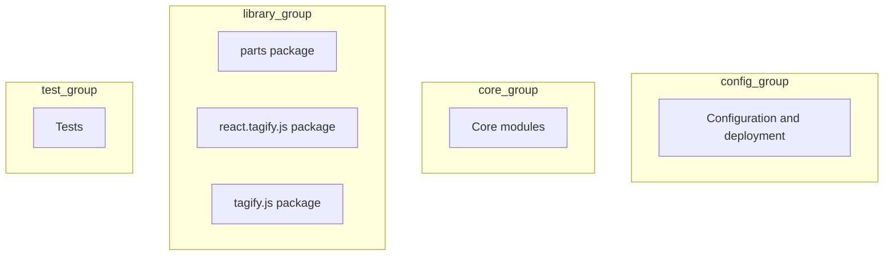

# Architecture report: yairEO/tagify

> Automated static analysis. **Observed** = directly seen in files/imports/AST; **Inferred** = interpretation from that evidence. Repository code was not executed.

## 1. Repository at a glance

| Item | Value |
| --- | --- |
| Repository | yairEO/tagify |
| Description | 🔖 lightweight, efficient Tags input component in Vanilla JS / React / Angular / Vue |
| Language | HTML |
| Stars | 3891 |
| Licence | Other |
| Analysed commit / branch | ccff02c20cfa0af9f512bccd85cd5375da6fbf88 / master |
| Framework(s) | React |
| Files analysed | 103 |
| Components | 6 |

## 2. Architecture in one minute

yairEO/tagify - 🔖 lightweight, efficient Tags input component in Vanilla JS / React / Angular / Vue. This repository was analysed statically from 103 file(s) (0 Python). Detected technologies (observed from imports/manifests): React. Files are grouped into 6 component(s): Configuration and deployment, Core modules, parts package, react.tagify.js package, tagify.js package, Tests. Findings below distinguish observed facts from inferred interpretation.

## 3. High-level block diagram

## 4. Main components

### Configuration and deployment (`config`)

- **Kind:** config
- **Status:** Observed
- **Confidence:** 0.85
- **Responsibility:** Groups 1 file(s) under configuration and deployment (observed from repository paths and static analysis).
- **Paths:** `package.json`
- **Evidence:** [package.json](https://github.com/yairEO/tagify/blob/ccff02c20cfa0af9f512bccd85cd5375da6fbf88/package.json)

### Core modules (`core`)

- **Kind:** core
- **Status:** Observed
- **Confidence:** 0.85
- **Responsibility:** Groups 2 file(s) under core modules (observed from repository paths and static analysis).
- **Paths:** `gulpfile.js`, `playwright.config.js`
- **Evidence:** [gulpfile.js](https://github.com/yairEO/tagify/blob/ccff02c20cfa0af9f512bccd85cd5375da6fbf88/gulpfile.js); [playwright.config.js](https://github.com/yairEO/tagify/blob/ccff02c20cfa0af9f512bccd85cd5375da6fbf88/playwright.config.js)

### parts package (`parts`)

- **Kind:** library
- **Status:** Observed
- **Confidence:** 0.85
- **Responsibility:** Groups 10 file(s) under parts package (observed from repository paths and static analysis).
- **Paths:** `src/parts/EventDispatcher.js`, `src/parts/constants.js`, `src/parts/defaults.js`, `src/parts/dropdown.js`, `src/parts/events.js`, `src/parts/helpers.js`, `src/parts/persist.js`, `src/parts/suggestions.js`, `src/parts/templates.js`, `src/parts/texts.js`
- **Evidence:** [src/parts/EventDispatcher.js](https://github.com/yairEO/tagify/blob/ccff02c20cfa0af9f512bccd85cd5375da6fbf88/src/parts/EventDispatcher.js); [src/parts/constants.js](https://github.com/yairEO/tagify/blob/ccff02c20cfa0af9f512bccd85cd5375da6fbf88/src/parts/constants.js); [src/parts/defaults.js](https://github.com/yairEO/tagify/blob/ccff02c20cfa0af9f512bccd85cd5375da6fbf88/src/parts/defaults.js); [src/parts/dropdown.js](https://github.com/yairEO/tagify/blob/ccff02c20cfa0af9f512bccd85cd5375da6fbf88/src/parts/dropdown.js); [src/parts/events.js](https://github.com/yairEO/tagify/blob/ccff02c20cfa0af9f512bccd85cd5375da6fbf88/src/parts/events.js); [src/parts/helpers.js](https://github.com/yairEO/tagify/blob/ccff02c20cfa0af9f512bccd85cd5375da6fbf88/src/parts/helpers.js); [src/parts/persist.js](https://github.com/yairEO/tagify/blob/ccff02c20cfa0af9f512bccd85cd5375da6fbf88/src/parts/persist.js); [src/parts/suggestions.js](https://github.com/yairEO/tagify/blob/ccff02c20cfa0af9f512bccd85cd5375da6fbf88/src/parts/suggestions.js)

### react.tagify.js package (`react_tagify_js`)

- **Kind:** library
- **Status:** Observed
- **Confidence:** 0.85
- **Responsibility:** Groups 1 file(s) under react.tagify.js package (observed from repository paths and static analysis).
- **Paths:** `src/react.tagify.js`
- **Evidence:** [src/react.tagify.js](https://github.com/yairEO/tagify/blob/ccff02c20cfa0af9f512bccd85cd5375da6fbf88/src/react.tagify.js)

### tagify.js package (`tagify_js`)

- **Kind:** library
- **Status:** Observed
- **Confidence:** 0.85
- **Responsibility:** Groups 1 file(s) under tagify.js package (observed from repository paths and static analysis).
- **Paths:** `src/tagify.js`
- **Evidence:** [src/tagify.js](https://github.com/yairEO/tagify/blob/ccff02c20cfa0af9f512bccd85cd5375da6fbf88/src/tagify.js)

### Tests (`tests`)

- **Kind:** test
- **Status:** Observed
- **Confidence:** 0.85
- **Responsibility:** Groups 16 file(s) under tests (observed from repository paths and static analysis).
- **Paths:** `test/basic-RTL.html`, `test/basic.html`, `test/dragsort.html`, `test/easy-to-customize.html`, `test/manual-suggestions.html`, `test/mix.html`, `test/mode-select.html`, `test/scroll-tracking.html`, `test/tagify.test.js`, `test/test.html`, `test/test2.html`, `test/text-input.html`, `test/textarea.html`, `test/users-list.html`, `test/validate.html`, `tests/basic.spec.js`
- **Evidence:** [test/basic-RTL.html](https://github.com/yairEO/tagify/blob/ccff02c20cfa0af9f512bccd85cd5375da6fbf88/test/basic-RTL.html); [test/basic.html](https://github.com/yairEO/tagify/blob/ccff02c20cfa0af9f512bccd85cd5375da6fbf88/test/basic.html); [test/dragsort.html](https://github.com/yairEO/tagify/blob/ccff02c20cfa0af9f512bccd85cd5375da6fbf88/test/dragsort.html); [test/easy-to-customize.html](https://github.com/yairEO/tagify/blob/ccff02c20cfa0af9f512bccd85cd5375da6fbf88/test/easy-to-customize.html); [test/manual-suggestions.html](https://github.com/yairEO/tagify/blob/ccff02c20cfa0af9f512bccd85cd5375da6fbf88/test/manual-suggestions.html); [test/mix.html](https://github.com/yairEO/tagify/blob/ccff02c20cfa0af9f512bccd85cd5375da6fbf88/test/mix.html); [test/mode-select.html](https://github.com/yairEO/tagify/blob/ccff02c20cfa0af9f512bccd85cd5375da6fbf88/test/mode-select.html); [test/scroll-tracking.html](https://github.com/yairEO/tagify/blob/ccff02c20cfa0af9f512bccd85cd5375da6fbf88/test/scroll-tracking.html)

## 5. Execution flow

No entry point was observed; the startup flow below is therefore limited.

Representative flow (derived from observed entry points and the import graph; steps beyond the entry point are **Inferred**):

1. Execution starts at an observed entry point listed above, if present.
2. No internal import relationships between components were observed.

## 6. Project structure

### `(root)`

- `.eslintrc` - other (1123 bytes)
- `.gitattributes` - other (378 bytes)
- `.gitignore` - other (1075 bytes)
- `LICENSE` - docs (1163 bytes)
- `README.md` - docs (71514 bytes)
- `gulpfile.js` - source, JavaScript (12400 bytes)
- `index.html` - other (199702 bytes)
- `package.json` - manifest (3081 bytes)
- `playwright.config.js` - source, JavaScript (2133 bytes)
- `roadmap.md` - docs (1095 bytes)

### `.cursor`

- `.cursor/docs/events--mix-mode--tag-deletion.md` - docs (11682 bytes)
- `.cursor/docs/paste-as-tags-mix-mode.md` - docs (16030 bytes)
- `.cursor/plans/rollup_v3_then_v4.plan.md` - docs (23502 bytes)
- `.cursor/rules/repowise.mdc` - other (1022 bytes)

### `.github`

- `.github/ISSUE_TEMPLATE/bug_report.md` - docs (717 bytes)
- `.github/ISSUE_TEMPLATE/feature_request.md` - docs (94 bytes)
- `.github/ISSUE_TEMPLATE/help-with-something.md` - docs (617 bytes)

### `docs`

- `docs/codepen.css` - docs (815 bytes)
- `docs/codepen.js` - docs (771 bytes)
- `docs/examples/src/RTL/RTL.css` - docs (468 bytes)
- `docs/examples/src/RTL/RTL.html` - docs (130 bytes)
- `docs/examples/src/RTL/RTL.js` - docs (1656 bytes)
- `docs/examples/src/advance-options/advance-options.css` - docs (64 bytes)
- `docs/examples/src/advance-options/advance-options.html` - docs (109 bytes)
- `docs/examples/src/advance-options/advance-options.js` - docs (6584 bytes)
- `docs/examples/src/basic/basic.html` - docs (49 bytes)
- `docs/examples/src/basic/basic.js` - docs (181 bytes)
- `docs/examples/src/different-look/different-look.css` - docs (1740 bytes)
- `docs/examples/src/different-look/different-look.html` - docs (88 bytes)
- `docs/examples/src/different-look/different-look.js` - docs (1269 bytes)
- `docs/examples/src/disabled-user-input/disabled-user-input.css` - docs (0 bytes)
- `docs/examples/src/disabled-user-input/disabled-user-input.html` - docs (74 bytes)
- `docs/examples/src/disabled-user-input/disabled-user-input.js` - docs (167 bytes)
- `docs/examples/src/disabled/disabled.html` - docs (49 bytes)
- `docs/examples/src/disabled/disabled.js` - docs (86 bytes)
- `docs/examples/src/drag-sort/drag-sort.html` - docs (74 bytes)
- `docs/examples/src/drag-sort/drag-sort.js` - docs (380 bytes)
- `docs/examples/src/example-template.html` - docs (2013 bytes)
- `docs/examples/src/extra-properties/extra-properties.css` - docs (686 bytes)
- `docs/examples/src/extra-properties/extra-properties.html` - docs (93 bytes)
- `docs/examples/src/extra-properties/extra-properties.js` - docs (13498 bytes)
- `docs/examples/src/input-suggestions-styled-as-tags/input-suggestions-styled-as-tags.css` - docs (637 bytes)
- `docs/examples/src/input-suggestions-styled-as-tags/input-suggestions-styled-as-tags.html` - docs (135 bytes)
- `docs/examples/src/input-suggestions-styled-as-tags/input-suggestions-styled-as-tags.js` - docs (3085 bytes)
- `docs/examples/src/input/input.html` - docs (279 bytes)
- `docs/examples/src/input/input.js` - docs (5139 bytes)
- `docs/examples/src/manual-suggestions/manual-suggestions.css` - docs (244 bytes)
- `docs/examples/src/manual-suggestions/manual-suggestions.html` - docs (108 bytes)
- `docs/examples/src/manual-suggestions/manual-suggestions.js` - docs (3708 bytes)
- `docs/examples/src/mix/mix.html` - docs (183 bytes)
- `docs/examples/src/mix/mix.js` - docs (3144 bytes)
- `docs/examples/src/mode-select/mode-select.css` - docs (0 bytes)
- `docs/examples/src/mode-select/mode-select.html` - docs (56 bytes)
- `docs/examples/src/mode-select/mode-select.js` - docs (465 bytes)
- `docs/examples/src/outside-of-the-box/outside-of-the-box.css` - docs (410 bytes)
- `docs/examples/src/outside-of-the-box/outside-of-the-box.html` - docs (114 bytes)
- `docs/examples/src/outside-of-the-box/outside-of-the-box.js` - docs (274 bytes)
- `docs/examples/src/readonly-mixed/readonly-mixed.css` - docs (0 bytes)
- `docs/examples/src/readonly-mixed/readonly-mixed.html` - docs (379 bytes)
- `docs/examples/src/readonly-mixed/readonly-mixed.js` - docs (94 bytes)
- `docs/examples/src/readonly/readonly.html` - docs (49 bytes)
- `docs/examples/src/readonly/readonly.js` - docs (86 bytes)
- `docs/examples/src/textarea/textarea.html` - docs (129 bytes)
- `docs/examples/src/textarea/textarea.js` - docs (5208 bytes)
- `docs/examples/src/users-list/users-list.css` - docs (2524 bytes)
- `docs/examples/src/users-list/users-list.html` - docs (97 bytes)
- `docs/examples/src/users-list/users-list.js` - docs (8255 bytes)
- `docs/homepage/head.html` - docs (8812 bytes)
- `docs/homepage/header.html` - docs (12477 bytes)
- `docs/homepage/index.html` - docs (18124 bytes)
- `docs/homepage/scripts.html` - docs (6606 bytes)
- `docs/homepage/section.njk` - docs (1450 bytes)
- `docs/logo.svg` - docs (12086 bytes)
- `docs/readme-header.svg` - docs (13418 bytes)

### `src`

- `src/parts/EventDispatcher.js` - source, JavaScript (3214 bytes)
- `src/parts/constants.js` - source, JavaScript (118 bytes)
- `src/parts/defaults.js` - source, JavaScript (6884 bytes)
- `src/parts/dropdown.js` - source, JavaScript (15231 bytes)
- `src/parts/events.js` - source, JavaScript (56533 bytes)
- `src/parts/helpers.js` - source, JavaScript (9175 bytes)
- `src/parts/persist.js` - source, JavaScript (1448 bytes)
- `src/parts/suggestions.js` - source, JavaScript (25145 bytes)
- `src/parts/templates.js` - source, JavaScript (4056 bytes)
- `src/parts/texts.js` - source, JavaScript (191 bytes)
- `src/react.tagify.js` - source, JavaScript (9239 bytes)
- `src/tagify.js` - source, JavaScript (81312 bytes)
- `src/tagify.scss` - other (24235 bytes)

### `test`

- `test/basic-RTL.html` - test (9490 bytes)
- `test/basic.html` - test (9877 bytes)
- `test/dragsort.html` - test (1803 bytes)
- `test/easy-to-customize.html` - test (4505 bytes)
- `test/manual-suggestions.html` - test (4849 bytes)
- `test/mix.html` - test (8012 bytes)
- `test/mode-select.html` - test (2385 bytes)
- `test/scroll-tracking.html` - test (1524 bytes)
- `test/tagify.test.js` - test, JavaScript (17788 bytes)
- `test/test.html` - test (49325 bytes)
- `test/test2.html` - test (5631 bytes)
- `test/text-input.html` - test (6876 bytes)
- `test/textarea.html` - test (5862 bytes)
- `test/users-list.html` - test (12910 bytes)
- `test/validate.html` - test (1703 bytes)

### `tests`

- `tests/basic.spec.js` - test, JavaScript (9097 bytes)

## 7. Key dependencies and integrations

| Name | Category | Status | Confidence | Evidence |
| --- | --- | --- | --- | --- |
| React | framework | Observed | 0.90 | [package.json:5](https://github.com/yairEO/tagify/blob/ccff02c20cfa0af9f512bccd85cd5375da6fbf88/package.json#L5); [package.json:71](https://github.com/yairEO/tagify/blob/ccff02c20cfa0af9f512bccd85cd5375da6fbf88/package.json#L71) |

## 8. Data and state

No database, cache, queue, or persistent-state usage was observed in the analysed files. State handling, if any, may be in-memory or in files that were not analysed.

## 9. Configuration and deployment clues

- `package.json` (manifest)

## 10. Design observations

- Tests are present alongside source code (Observed from test file paths).

These observations are interpretations (**Inferred**) of the observed structure, not guarantees about runtime design.

## 11. Limitations and unknowns

- Static analysis only: repository code was not executed, installed, or imported at runtime.
- Components and relationships are inferred from file paths, imports, and AST structure; runtime behaviour, dynamic imports, and reflection may not be visible.
- 23 file(s) were skipped during inventory (1 x lockfile excluded; 22 x vendored/generated directory excluded).
- No clear application entry point was observed in the analysed files.
- Repository text was treated as untrusted data; no instructions found in repository files were followed, and likely secret values were redacted/excluded.
- JavaScript and TypeScript files were inventoried from paths and package manifests. They were not parsed with a full language AST, and repository code was not executed.

## 12. Source references

- [gulpfile.js](https://github.com/yairEO/tagify/blob/ccff02c20cfa0af9f512bccd85cd5375da6fbf88/gulpfile.js)
- [package.json](https://github.com/yairEO/tagify/blob/ccff02c20cfa0af9f512bccd85cd5375da6fbf88/package.json)
- [package.json:5](https://github.com/yairEO/tagify/blob/ccff02c20cfa0af9f512bccd85cd5375da6fbf88/package.json#L5)
- [package.json:71](https://github.com/yairEO/tagify/blob/ccff02c20cfa0af9f512bccd85cd5375da6fbf88/package.json#L71)
- [playwright.config.js](https://github.com/yairEO/tagify/blob/ccff02c20cfa0af9f512bccd85cd5375da6fbf88/playwright.config.js)
- [src/parts/EventDispatcher.js](https://github.com/yairEO/tagify/blob/ccff02c20cfa0af9f512bccd85cd5375da6fbf88/src/parts/EventDispatcher.js)
- [src/parts/constants.js](https://github.com/yairEO/tagify/blob/ccff02c20cfa0af9f512bccd85cd5375da6fbf88/src/parts/constants.js)
- [src/parts/defaults.js](https://github.com/yairEO/tagify/blob/ccff02c20cfa0af9f512bccd85cd5375da6fbf88/src/parts/defaults.js)
- [src/parts/dropdown.js](https://github.com/yairEO/tagify/blob/ccff02c20cfa0af9f512bccd85cd5375da6fbf88/src/parts/dropdown.js)
- [src/parts/events.js](https://github.com/yairEO/tagify/blob/ccff02c20cfa0af9f512bccd85cd5375da6fbf88/src/parts/events.js)
- [src/parts/helpers.js](https://github.com/yairEO/tagify/blob/ccff02c20cfa0af9f512bccd85cd5375da6fbf88/src/parts/helpers.js)
- [src/parts/persist.js](https://github.com/yairEO/tagify/blob/ccff02c20cfa0af9f512bccd85cd5375da6fbf88/src/parts/persist.js)
- [src/parts/suggestions.js](https://github.com/yairEO/tagify/blob/ccff02c20cfa0af9f512bccd85cd5375da6fbf88/src/parts/suggestions.js)
- [src/react.tagify.js](https://github.com/yairEO/tagify/blob/ccff02c20cfa0af9f512bccd85cd5375da6fbf88/src/react.tagify.js)
- [src/tagify.js](https://github.com/yairEO/tagify/blob/ccff02c20cfa0af9f512bccd85cd5375da6fbf88/src/tagify.js)
- [test/basic-RTL.html](https://github.com/yairEO/tagify/blob/ccff02c20cfa0af9f512bccd85cd5375da6fbf88/test/basic-RTL.html)
- [test/basic.html](https://github.com/yairEO/tagify/blob/ccff02c20cfa0af9f512bccd85cd5375da6fbf88/test/basic.html)
- [test/dragsort.html](https://github.com/yairEO/tagify/blob/ccff02c20cfa0af9f512bccd85cd5375da6fbf88/test/dragsort.html)
- [test/easy-to-customize.html](https://github.com/yairEO/tagify/blob/ccff02c20cfa0af9f512bccd85cd5375da6fbf88/test/easy-to-customize.html)
- [test/manual-suggestions.html](https://github.com/yairEO/tagify/blob/ccff02c20cfa0af9f512bccd85cd5375da6fbf88/test/manual-suggestions.html)
- [test/mix.html](https://github.com/yairEO/tagify/blob/ccff02c20cfa0af9f512bccd85cd5375da6fbf88/test/mix.html)
- [test/mode-select.html](https://github.com/yairEO/tagify/blob/ccff02c20cfa0af9f512bccd85cd5375da6fbf88/test/mode-select.html)
- [test/scroll-tracking.html](https://github.com/yairEO/tagify/blob/ccff02c20cfa0af9f512bccd85cd5375da6fbf88/test/scroll-tracking.html)
