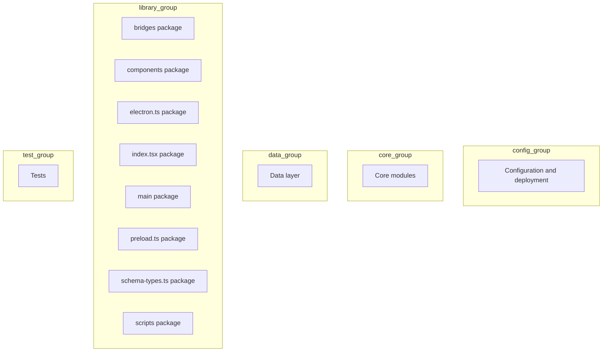

# Architecture report: yang991178/fluent-reader

> Automated static analysis. **Observed** = directly seen in files/imports/AST; **Inferred** = interpretation from that evidence. Repository code was not executed.

## 1. Repository at a glance

| Item | Value |
| --- | --- |
| Repository | yang991178/fluent-reader |
| Description | Modern desktop RSS reader built with Electron, React, and Fluent UI |
| Language | TypeScript |
| Stars | 9792 |
| Licence | BSD-3-Clause |
| Analysed commit / branch | 5912070309759eff37204a5046caba3c780fa4c0 / master |
| Framework(s) | Electron, React |
| Files analysed | 146 |
| Components | 12 |

## 2. Architecture in one minute

yang991178/fluent-reader - Modern desktop RSS reader built with Electron, React, and Fluent UI. This repository was analysed statically from 146 file(s) (0 Python). Detected technologies (observed from imports/manifests): GitHub Actions, Electron, React, Redux, TypeScript, webpack. Files are grouped into 12 component(s): bridges package, components package, Configuration and deployment, Core modules, Data layer, electron.ts package, index.tsx package, main package. Findings below distinguish observed facts from inferred interpretation.

## 3. High-level block diagram

## 4. Main components

### bridges package (`bridges`)

- **Kind:** library
- **Status:** Observed
- **Confidence:** 0.85
- **Responsibility:** Groups 3 file(s) under bridges package (observed from repository paths and static analysis).
- **Paths:** `src/bridges/db.ts`, `src/bridges/settings.ts`, `src/bridges/utils.ts`
- **Evidence:** [src/bridges/db.ts](https://github.com/yang991178/fluent-reader/blob/5912070309759eff37204a5046caba3c780fa4c0/src/bridges/db.ts); [src/bridges/settings.ts](https://github.com/yang991178/fluent-reader/blob/5912070309759eff37204a5046caba3c780fa4c0/src/bridges/settings.ts); [src/bridges/utils.ts](https://github.com/yang991178/fluent-reader/blob/5912070309759eff37204a5046caba3c780fa4c0/src/bridges/utils.ts)

### components package (`components`)

- **Kind:** library
- **Status:** Observed
- **Confidence:** 0.85
- **Responsibility:** Groups 36 file(s) under components package (observed from repository paths and static analysis).
- **Paths:** `src/components/article.tsx`, `src/components/cards/card.tsx`, `src/components/cards/compact-card.tsx`, `src/components/cards/default-card.tsx`, `src/components/cards/highlights.tsx`, `src/components/cards/info.tsx`, `src/components/cards/list-card.tsx`, `src/components/cards/magazine-card.tsx`, `src/components/context-menu.tsx`, `src/components/feeds/cards-feed.tsx`, `src/components/feeds/feed-end.tsx`, `src/components/feeds/feed.tsx`, `src/components/feeds/list-feed.tsx`, `src/components/list-view.tsx`, `src/components/log-menu.tsx`, `src/components/menu.tsx`, `src/components/nav.tsx`, `src/components/page.tsx`, `src/components/root.tsx`, `src/components/settings.tsx`, `src/components/utils/DangerButton.tsx`, `src/components/utils/FlatButton.tsx`, `src/components/utils/FlatButtonGroup.tsx`, `src/components/utils/FlatButtonSeparator.tsx`, `src/components/utils/ResizeHandle.tsx`, `src/components/utils/article-search.tsx`, `src/components/utils/danger-button.tsx`, `src/components/utils/hooks/useArticleOverlayOpen.ts`, `src/components/utils/hooks/useArticleOverlayWidth.ts`, `src/components/utils/hooks/useArticleView.ts`, `src/components/utils/hooks/useFeedTabStop.ts`, `src/components/utils/hooks/useIsBlurred.ts`, `src/components/utils/hooks/useIsWideScreen.ts`, `src/components/utils/hooks/useResizableWidth.ts`, `src/components/utils/theme.ts`, `src/components/utils/time.tsx`
- **Evidence:** [src/components/article.tsx](https://github.com/yang991178/fluent-reader/blob/5912070309759eff37204a5046caba3c780fa4c0/src/components/article.tsx); [src/components/cards/card.tsx](https://github.com/yang991178/fluent-reader/blob/5912070309759eff37204a5046caba3c780fa4c0/src/components/cards/card.tsx); [src/components/cards/compact-card.tsx](https://github.com/yang991178/fluent-reader/blob/5912070309759eff37204a5046caba3c780fa4c0/src/components/cards/compact-card.tsx); [src/components/cards/default-card.tsx](https://github.com/yang991178/fluent-reader/blob/5912070309759eff37204a5046caba3c780fa4c0/src/components/cards/default-card.tsx); [src/components/cards/highlights.tsx](https://github.com/yang991178/fluent-reader/blob/5912070309759eff37204a5046caba3c780fa4c0/src/components/cards/highlights.tsx); [src/components/cards/info.tsx](https://github.com/yang991178/fluent-reader/blob/5912070309759eff37204a5046caba3c780fa4c0/src/components/cards/info.tsx); [src/components/cards/list-card.tsx](https://github.com/yang991178/fluent-reader/blob/5912070309759eff37204a5046caba3c780fa4c0/src/components/cards/list-card.tsx); [src/components/cards/magazine-card.tsx](https://github.com/yang991178/fluent-reader/blob/5912070309759eff37204a5046caba3c780fa4c0/src/components/cards/magazine-card.tsx)

### Configuration and deployment (`config`)

- **Kind:** config
- **Status:** Observed
- **Confidence:** 0.85
- **Responsibility:** Groups 52 file(s) under configuration and deployment (observed from repository paths and static analysis).
- **Paths:** `electron-builder-mas.yml`, `electron-builder.yml`, `package.json`, `src/components/settings/about.tsx`, `src/components/settings/app.tsx`, `src/components/settings/groups.tsx`, `src/components/settings/groups/group-actions.tsx`, `src/components/settings/groups/group-create-form.tsx`, `src/components/settings/groups/group-editor.tsx`, `src/components/settings/groups/group-list.tsx`, `src/components/settings/groups/group-source-list.tsx`, `src/components/settings/groups/styles.ts`, `src/components/settings/rules.tsx`, `src/components/settings/rules/actions.ts`, `src/components/settings/rules/rule-editor.tsx`, `src/components/settings/rules/rule-list.tsx`, `src/components/settings/rules/rule-preview.tsx`, `src/components/settings/rules/styles.ts`, `src/components/settings/rules/target-picker.tsx`, `src/components/settings/service.tsx`, `src/components/settings/services/feedbin.tsx`, `src/components/settings/services/fever.tsx`, `src/components/settings/services/greader.tsx`, `src/components/settings/services/inoreader.tsx`, `src/components/settings/services/lite-exporter.tsx`, `src/components/settings/services/miniflux.tsx`, `src/components/settings/services/nextcloud.tsx`, `src/components/settings/sources.tsx`, `src/containers/settings/app-container.tsx`, `src/containers/settings/service-container.tsx`, `src/containers/settings/sources-container.tsx`, `src/scripts/i18n/cs.json`, `src/scripts/i18n/de.json`, `src/scripts/i18n/en-US.json`, `src/scripts/i18n/es.json`, `src/scripts/i18n/fi-FI.json`, `src/scripts/i18n/fr-FR.json`, `src/scripts/i18n/it.json`, `src/scripts/i18n/ja.json`, `src/scripts/i18n/ko.json`, `src/scripts/i18n/nl.json`, `src/scripts/i18n/pl.json`, `src/scripts/i18n/pt-BR.json`, `src/scripts/i18n/pt-PT.json`, `src/scripts/i18n/ru.json`, `src/scripts/i18n/sk.json`, `src/scripts/i18n/sv.json`, `src/scripts/i18n/tr.json`, `src/scripts/i18n/uk.json`, `src/scripts/i18n/zh-CN.json`, `src/scripts/i18n/zh-TW.json`, `tsconfig.json`
- **Evidence:** [electron-builder-mas.yml](https://github.com/yang991178/fluent-reader/blob/5912070309759eff37204a5046caba3c780fa4c0/electron-builder-mas.yml); [electron-builder.yml](https://github.com/yang991178/fluent-reader/blob/5912070309759eff37204a5046caba3c780fa4c0/electron-builder.yml); [package.json](https://github.com/yang991178/fluent-reader/blob/5912070309759eff37204a5046caba3c780fa4c0/package.json); [src/components/settings/about.tsx](https://github.com/yang991178/fluent-reader/blob/5912070309759eff37204a5046caba3c780fa4c0/src/components/settings/about.tsx); [src/components/settings/app.tsx](https://github.com/yang991178/fluent-reader/blob/5912070309759eff37204a5046caba3c780fa4c0/src/components/settings/app.tsx); [src/components/settings/groups.tsx](https://github.com/yang991178/fluent-reader/blob/5912070309759eff37204a5046caba3c780fa4c0/src/components/settings/groups.tsx); [src/components/settings/groups/group-actions.tsx](https://github.com/yang991178/fluent-reader/blob/5912070309759eff37204a5046caba3c780fa4c0/src/components/settings/groups/group-actions.tsx); [src/components/settings/groups/group-create-form.tsx](https://github.com/yang991178/fluent-reader/blob/5912070309759eff37204a5046caba3c780fa4c0/src/components/settings/groups/group-create-form.tsx)

### Core modules (`core`)

- **Kind:** core
- **Status:** Observed
- **Confidence:** 0.85
- **Responsibility:** Groups 2 file(s) under core modules (observed from repository paths and static analysis).
- **Paths:** `drizzle.config.ts`, `webpack.config.js`
- **Evidence:** [drizzle.config.ts](https://github.com/yang991178/fluent-reader/blob/5912070309759eff37204a5046caba3c780fa4c0/drizzle.config.ts); [webpack.config.js](https://github.com/yang991178/fluent-reader/blob/5912070309759eff37204a5046caba3c780fa4c0/webpack.config.js)

### Data layer (`data_layer`)

- **Kind:** data
- **Status:** Observed
- **Confidence:** 0.85
- **Responsibility:** Groups 14 file(s) under data layer (observed from repository paths and static analysis).
- **Paths:** `src/db/schema.ts`, `src/scripts/models/app.ts`, `src/scripts/models/feed.ts`, `src/scripts/models/group.ts`, `src/scripts/models/item.ts`, `src/scripts/models/page.ts`, `src/scripts/models/rule.ts`, `src/scripts/models/service.ts`, `src/scripts/models/services/feedbin.ts`, `src/scripts/models/services/fever.ts`, `src/scripts/models/services/greader.ts`, `src/scripts/models/services/miniflux.ts`, `src/scripts/models/services/nextcloud.ts`, `src/scripts/models/source.ts`
- **Evidence:** [src/db/schema.ts](https://github.com/yang991178/fluent-reader/blob/5912070309759eff37204a5046caba3c780fa4c0/src/db/schema.ts); [src/scripts/models/app.ts](https://github.com/yang991178/fluent-reader/blob/5912070309759eff37204a5046caba3c780fa4c0/src/scripts/models/app.ts); [src/scripts/models/feed.ts](https://github.com/yang991178/fluent-reader/blob/5912070309759eff37204a5046caba3c780fa4c0/src/scripts/models/feed.ts); [src/scripts/models/group.ts](https://github.com/yang991178/fluent-reader/blob/5912070309759eff37204a5046caba3c780fa4c0/src/scripts/models/group.ts); [src/scripts/models/item.ts](https://github.com/yang991178/fluent-reader/blob/5912070309759eff37204a5046caba3c780fa4c0/src/scripts/models/item.ts); [src/scripts/models/page.ts](https://github.com/yang991178/fluent-reader/blob/5912070309759eff37204a5046caba3c780fa4c0/src/scripts/models/page.ts); [src/scripts/models/rule.ts](https://github.com/yang991178/fluent-reader/blob/5912070309759eff37204a5046caba3c780fa4c0/src/scripts/models/rule.ts); [src/scripts/models/service.ts](https://github.com/yang991178/fluent-reader/blob/5912070309759eff37204a5046caba3c780fa4c0/src/scripts/models/service.ts)

### electron.ts package (`electron_ts`)

- **Kind:** library
- **Status:** Observed
- **Confidence:** 0.85
- **Responsibility:** Groups 1 file(s) under electron.ts package (observed from repository paths and static analysis).
- **Paths:** `src/electron.ts`
- **Evidence:** [src/electron.ts](https://github.com/yang991178/fluent-reader/blob/5912070309759eff37204a5046caba3c780fa4c0/src/electron.ts)

### index.tsx package (`index_tsx`)

- **Kind:** library
- **Status:** Observed
- **Confidence:** 0.85
- **Responsibility:** Groups 1 file(s) under index.tsx package (observed from repository paths and static analysis).
- **Paths:** `src/index.tsx`
- **Evidence:** [src/index.tsx](https://github.com/yang991178/fluent-reader/blob/5912070309759eff37204a5046caba3c780fa4c0/src/index.tsx)

### main package (`main`)

- **Kind:** library
- **Status:** Observed
- **Confidence:** 0.85
- **Responsibility:** Groups 6 file(s) under main package (observed from repository paths and static analysis).
- **Paths:** `src/main/db.ts`, `src/main/settings.ts`, `src/main/touchbar.ts`, `src/main/update-scripts.ts`, `src/main/utils.ts`, `src/main/window.ts`
- **Evidence:** [src/main/db.ts](https://github.com/yang991178/fluent-reader/blob/5912070309759eff37204a5046caba3c780fa4c0/src/main/db.ts); [src/main/settings.ts](https://github.com/yang991178/fluent-reader/blob/5912070309759eff37204a5046caba3c780fa4c0/src/main/settings.ts); [src/main/touchbar.ts](https://github.com/yang991178/fluent-reader/blob/5912070309759eff37204a5046caba3c780fa4c0/src/main/touchbar.ts); [src/main/update-scripts.ts](https://github.com/yang991178/fluent-reader/blob/5912070309759eff37204a5046caba3c780fa4c0/src/main/update-scripts.ts); [src/main/utils.ts](https://github.com/yang991178/fluent-reader/blob/5912070309759eff37204a5046caba3c780fa4c0/src/main/utils.ts); [src/main/window.ts](https://github.com/yang991178/fluent-reader/blob/5912070309759eff37204a5046caba3c780fa4c0/src/main/window.ts)

### preload.ts package (`preload_ts`)

- **Kind:** library
- **Status:** Observed
- **Confidence:** 0.85
- **Responsibility:** Groups 1 file(s) under preload.ts package (observed from repository paths and static analysis).
- **Paths:** `src/preload.ts`
- **Evidence:** [src/preload.ts](https://github.com/yang991178/fluent-reader/blob/5912070309759eff37204a5046caba3c780fa4c0/src/preload.ts)

### schema-types.ts package (`schema_types_ts`)

- **Kind:** library
- **Status:** Observed
- **Confidence:** 0.85
- **Responsibility:** Groups 1 file(s) under schema-types.ts package (observed from repository paths and static analysis).
- **Paths:** `src/schema-types.ts`
- **Evidence:** [src/schema-types.ts](https://github.com/yang991178/fluent-reader/blob/5912070309759eff37204a5046caba3c780fa4c0/src/schema-types.ts)

### scripts package (`scripts`)

- **Kind:** library
- **Status:** Observed
- **Confidence:** 0.85
- **Responsibility:** Groups 6 file(s) under scripts package (observed from repository paths and static analysis).
- **Paths:** `src/scripts/date.ts`, `src/scripts/db.ts`, `src/scripts/i18n/_locales.ts`, `src/scripts/reducer.ts`, `src/scripts/settings.ts`, `src/scripts/utils.ts`
- **Evidence:** [src/scripts/date.ts](https://github.com/yang991178/fluent-reader/blob/5912070309759eff37204a5046caba3c780fa4c0/src/scripts/date.ts); [src/scripts/db.ts](https://github.com/yang991178/fluent-reader/blob/5912070309759eff37204a5046caba3c780fa4c0/src/scripts/db.ts); [src/scripts/i18n/_locales.ts](https://github.com/yang991178/fluent-reader/blob/5912070309759eff37204a5046caba3c780fa4c0/src/scripts/i18n/_locales.ts); [src/scripts/reducer.ts](https://github.com/yang991178/fluent-reader/blob/5912070309759eff37204a5046caba3c780fa4c0/src/scripts/reducer.ts); [src/scripts/settings.ts](https://github.com/yang991178/fluent-reader/blob/5912070309759eff37204a5046caba3c780fa4c0/src/scripts/settings.ts); [src/scripts/utils.ts](https://github.com/yang991178/fluent-reader/blob/5912070309759eff37204a5046caba3c780fa4c0/src/scripts/utils.ts)

### Tests (`tests`)

- **Kind:** test
- **Status:** Observed
- **Confidence:** 0.85
- **Responsibility:** Groups 1 file(s) under tests (observed from repository paths and static analysis).
- **Paths:** `tests/README.md`
- **Evidence:** [tests/README.md](https://github.com/yang991178/fluent-reader/blob/5912070309759eff37204a5046caba3c780fa4c0/tests/README.md)

## 5. Execution flow

**Observed** entry point(s):

- [src/components/page.tsx](https://github.com/yang991178/fluent-reader/blob/5912070309759eff37204a5046caba3c780fa4c0/src/components/page.tsx)
- [src/components/settings/app.tsx](https://github.com/yang991178/fluent-reader/blob/5912070309759eff37204a5046caba3c780fa4c0/src/components/settings/app.tsx)
- [src/index.tsx](https://github.com/yang991178/fluent-reader/blob/5912070309759eff37204a5046caba3c780fa4c0/src/index.tsx)
- [src/scripts/models/app.ts](https://github.com/yang991178/fluent-reader/blob/5912070309759eff37204a5046caba3c780fa4c0/src/scripts/models/app.ts)
- [src/scripts/models/page.ts](https://github.com/yang991178/fluent-reader/blob/5912070309759eff37204a5046caba3c780fa4c0/src/scripts/models/page.ts)

Representative flow (derived from observed entry points and the import graph; steps beyond the entry point are **Inferred**):

1. Execution starts at an observed entry point listed above, if present.
2. No internal import relationships between components were observed.

## 6. Project structure

### `(root)`

- `.gitattributes` - other (75 bytes)
- `.gitignore` - other (126 bytes)
- `.gitmodules` - other (103 bytes)
- `.prettierignore` - other (208 bytes)
- `.prettierrc.yml` - config (111 bytes)
- `AGENTS.md` - docs (10315 bytes)
- `LICENSE` - docs (1519 bytes)
- `README.md` - docs (3608 bytes)
- `drizzle.config.ts` - source, TypeScript (161 bytes)
- `electron-builder-mas.yml` - config (1626 bytes)
- `electron-builder.yml` - config (2050 bytes)
- `package.json` - manifest (2336 bytes)
- `tsconfig.json` - config (278 bytes)
- `webpack.config.js` - source, JavaScript (3087 bytes)

### `.github`

- `.github/FUNDING.yml` - config (737 bytes)
- `.github/ISSUE_TEMPLATE/bug_report.md` - docs (648 bytes)
- `.github/ISSUE_TEMPLATE/feature_request.md` - docs (595 bytes)
- `.github/workflows/pages.yml` - ci, YAML (941 bytes)
- `.github/workflows/release-linux.yml` - ci, YAML (1575 bytes)
- `.github/workflows/release-main.yml` - ci, YAML (2281 bytes)

### `.vscode`

- `.vscode/launch.json` - config (529 bytes)
- `.vscode/settings.json` - config (79 bytes)

### `docs`

- `docs/imgs/logo.svg` - docs (3939 bytes)
- `docs/imgs/mac_store.svg` - docs (12064 bytes)
- `docs/index.html` - docs (4441 bytes)
- `docs/styles.css` - docs (4043 bytes)

### `src`

- `src/bridges/db.ts` - source, TypeScript (955 bytes)
- `src/bridges/settings.ts` - source, TypeScript (5185 bytes)
- `src/bridges/utils.ts` - source, TypeScript (6119 bytes)
- `src/components/article.tsx` - source, TypeScript (18364 bytes)
- `src/components/cards/card.tsx` - source, TypeScript (2098 bytes)
- `src/components/cards/compact-card.tsx` - source, TypeScript (1224 bytes)
- `src/components/cards/default-card.tsx` - source, TypeScript (1342 bytes)
- `src/components/cards/highlights.tsx` - source, TypeScript (2324 bytes)
- `src/components/cards/info.tsx` - source, TypeScript (966 bytes)
- `src/components/cards/list-card.tsx` - source, TypeScript (1676 bytes)
- `src/components/cards/magazine-card.tsx` - source, TypeScript (1489 bytes)
- `src/components/context-menu.tsx` - source, TypeScript (21753 bytes)
- `src/components/feeds/cards-feed.tsx` - source, TypeScript (3394 bytes)
- `src/components/feeds/feed-end.tsx` - source, TypeScript (1981 bytes)
- `src/components/feeds/feed.tsx` - source, TypeScript (2772 bytes)
- `src/components/feeds/list-feed.tsx` - source, TypeScript (2826 bytes)
- `src/components/list-view.tsx` - source, TypeScript (6099 bytes)
- `src/components/log-menu.tsx` - source, TypeScript (2783 bytes)
- `src/components/menu.tsx` - source, TypeScript (20816 bytes)
- `src/components/nav.tsx` - source, TypeScript (14042 bytes)
- `src/components/page.tsx` - source, TypeScript (9945 bytes)
- `src/components/root.tsx` - source, TypeScript (3662 bytes)
- `src/components/settings.tsx` - source, TypeScript (5072 bytes)
- `src/components/settings/about.tsx` - source, TypeScript (2399 bytes)
- `src/components/settings/app.tsx` - source, TypeScript (12946 bytes)
- `src/components/settings/groups.tsx` - source, TypeScript (6334 bytes)
- `src/components/settings/groups/group-actions.tsx` - source, TypeScript (3889 bytes)
- `src/components/settings/groups/group-create-form.tsx` - source, TypeScript (2225 bytes)
- `src/components/settings/groups/group-editor.tsx` - source, TypeScript (3034 bytes)
- `src/components/settings/groups/group-list.tsx` - source, TypeScript (6952 bytes)
- `src/components/settings/groups/group-source-list.tsx` - source, TypeScript (7927 bytes)
- `src/components/settings/groups/styles.ts` - source, TypeScript (755 bytes)
- `src/components/settings/rules.tsx` - source, TypeScript (6078 bytes)
- `src/components/settings/rules/actions.ts` - source, TypeScript (439 bytes)
- `src/components/settings/rules/rule-editor.tsx` - source, TypeScript (7739 bytes)
- `src/components/settings/rules/rule-list.tsx` - source, TypeScript (7875 bytes)
- `src/components/settings/rules/rule-preview.tsx` - source, TypeScript (3229 bytes)
- `src/components/settings/rules/styles.ts` - source, TypeScript (1816 bytes)
- `src/components/settings/rules/target-picker.tsx` - source, TypeScript (4277 bytes)
- `src/components/settings/service.tsx` - source, TypeScript (5205 bytes)
- `src/components/settings/services/feedbin.tsx` - source, TypeScript (10108 bytes)
- `src/components/settings/services/fever.tsx` - source, TypeScript (9732 bytes)
- `src/components/settings/services/greader.tsx` - source, TypeScript (9889 bytes)
- `src/components/settings/services/inoreader.tsx` - source, TypeScript (13708 bytes)
- `src/components/settings/services/lite-exporter.tsx` - source, TypeScript (3026 bytes)
- `src/components/settings/services/miniflux.tsx` - source, TypeScript (12720 bytes)
- `src/components/settings/services/nextcloud.tsx` - source, TypeScript (9505 bytes)
- `src/components/settings/sources.tsx` - source, TypeScript (19463 bytes)
- `src/components/utils/DangerButton.tsx` - source, TypeScript (2258 bytes)
- `src/components/utils/FlatButton.tsx` - source, TypeScript (3655 bytes)
- `src/components/utils/FlatButtonGroup.tsx` - source, TypeScript (736 bytes)
- `src/components/utils/FlatButtonSeparator.tsx` - source, TypeScript (768 bytes)
- `src/components/utils/ResizeHandle.tsx` - source, TypeScript (4132 bytes)
- `src/components/utils/article-search.tsx` - source, TypeScript (4503 bytes)
- `src/components/utils/danger-button.tsx` - source, TypeScript (1429 bytes)
- `src/components/utils/hooks/useArticleOverlayOpen.ts` - source, TypeScript (250 bytes)
- `src/components/utils/hooks/useArticleOverlayWidth.ts` - source, TypeScript (1110 bytes)
- `src/components/utils/hooks/useArticleView.ts` - source, TypeScript (5455 bytes)
- `src/components/utils/hooks/useFeedTabStop.ts` - source, TypeScript (1058 bytes)
- `src/components/utils/hooks/useIsBlurred.ts` - source, TypeScript (725 bytes)
- `src/components/utils/hooks/useIsWideScreen.ts` - source, TypeScript (596 bytes)
- `src/components/utils/hooks/useResizableWidth.ts` - source, TypeScript (1092 bytes)
- `src/components/utils/theme.ts` - source, TypeScript (4161 bytes)
- `src/components/utils/time.tsx` - source, TypeScript (1062 bytes)
- `src/containers/settings/app-container.tsx` - source, TypeScript (1479 bytes)
- `src/containers/settings/service-container.tsx` - source, TypeScript (1580 bytes)
- `src/containers/settings/sources-container.tsx` - source, TypeScript (2823 bytes)
- `src/db/schema.ts` - source, TypeScript (2672 bytes)
- `src/electron.ts` - source, TypeScript (3606 bytes)
- `src/index.html` - other (475 bytes)
- `src/index.tsx` - source, TypeScript (737 bytes)
- `src/main/db.ts` - source, TypeScript (10381 bytes)
- `src/main/settings.ts` - source, TypeScript (9104 bytes)
- `src/main/touchbar.ts` - source, TypeScript (948 bytes)
- `src/main/update-scripts.ts` - source, TypeScript (358 bytes)
- `src/main/utils.ts` - source, TypeScript (14017 bytes)
- `src/main/window.ts` - source, TypeScript (3908 bytes)
- `src/preload.ts` - source, TypeScript (330 bytes)
- `src/schema-types.ts` - source, TypeScript (2944 bytes)
- `src/scripts/date.ts` - source, TypeScript (521 bytes)
- `src/scripts/db.ts` - source, TypeScript (8064 bytes)
- `src/scripts/i18n/README.md` - docs (1514 bytes)
- `src/scripts/i18n/_locales.ts` - source, TypeScript (952 bytes)
- `src/scripts/i18n/cs.json` - config (10429 bytes)
- `src/scripts/i18n/de.json` - config (10103 bytes)
- `src/scripts/i18n/en-US.json` - config (9532 bytes)
- `src/scripts/i18n/es.json` - config (7572 bytes)
- `src/scripts/i18n/fi-FI.json` - config (10056 bytes)
- `src/scripts/i18n/fr-FR.json` - config (10414 bytes)
- `src/scripts/i18n/it.json` - config (10032 bytes)
- `src/scripts/i18n/ja.json` - config (11175 bytes)
- `src/scripts/i18n/ko.json` - config (10524 bytes)
- `src/scripts/i18n/nl.json` - config (10181 bytes)
- `src/scripts/i18n/pl.json` - config (10687 bytes)
- `src/scripts/i18n/pt-BR.json` - config (10111 bytes)
- `src/scripts/i18n/pt-PT.json` - config (10283 bytes)
- `src/scripts/i18n/ru.json` - config (14266 bytes)
- `src/scripts/i18n/sk.json` - config (9200 bytes)
- `src/scripts/i18n/sv.json` - config (9671 bytes)
- `src/scripts/i18n/tr.json` - config (9655 bytes)
- `src/scripts/i18n/uk.json` - config (13546 bytes)
- `src/scripts/i18n/zh-CN.json` - config (9084 bytes)
- `src/scripts/i18n/zh-TW.json` - config (9099 bytes)
- `src/scripts/models/app.ts` - source, TypeScript (20735 bytes)
- `src/scripts/models/feed.ts` - source, TypeScript (16298 bytes)
- `src/scripts/models/group.ts` - source, TypeScript (15753 bytes)
- `src/scripts/models/item.ts` - source, TypeScript (20363 bytes)
- `src/scripts/models/page.ts` - source, TypeScript (10683 bytes)
- `src/scripts/models/rule.ts` - source, TypeScript (4619 bytes)
- `src/scripts/models/service.ts` - source, TypeScript (12357 bytes)
- `src/scripts/models/services/feedbin.ts` - source, TypeScript (10380 bytes)
- `src/scripts/models/services/fever.ts` - source, TypeScript (9416 bytes)
- `src/scripts/models/services/greader.ts` - source, TypeScript (14119 bytes)
- `src/scripts/models/services/miniflux.ts` - source, TypeScript (12264 bytes)
- `src/scripts/models/services/nextcloud.ts` - source, TypeScript (10947 bytes)
- `src/scripts/models/source.ts` - source, TypeScript (19157 bytes)
- `src/scripts/reducer.ts` - source, TypeScript (1297 bytes)
- `src/scripts/settings.ts` - source, TypeScript (1521 bytes)
- `src/scripts/utils.ts` - source, TypeScript (8240 bytes)

### `tests`

- `tests/README.md` - test (665 bytes)

## 7. Key dependencies and integrations

| Name | Category | Status | Confidence | Evidence |
| --- | --- | --- | --- | --- |
| GitHub Actions | ci | Observed | 0.90 | [.github/workflows/pages.yml](https://github.com/yang991178/fluent-reader/blob/5912070309759eff37204a5046caba3c780fa4c0/.github/workflows/pages.yml); [.github/workflows/release-linux.yml](https://github.com/yang991178/fluent-reader/blob/5912070309759eff37204a5046caba3c780fa4c0/.github/workflows/release-linux.yml); [.github/workflows/release-main.yml](https://github.com/yang991178/fluent-reader/blob/5912070309759eff37204a5046caba3c780fa4c0/.github/workflows/release-main.yml) |
| Electron | framework | Observed | 0.85 | [package.json:5](https://github.com/yang991178/fluent-reader/blob/5912070309759eff37204a5046caba3c780fa4c0/package.json#L5) |
| React | framework | Observed | 0.90 | [package.json:28](https://github.com/yang991178/fluent-reader/blob/5912070309759eff37204a5046caba3c780fa4c0/package.json#L28); [package.json:38](https://github.com/yang991178/fluent-reader/blob/5912070309759eff37204a5046caba3c780fa4c0/package.json#L38) |
| Redux | library | Observed | 0.85 | [package.json:57](https://github.com/yang991178/fluent-reader/blob/5912070309759eff37204a5046caba3c780fa4c0/package.json#L57) |
| TypeScript | tooling | Observed | 0.85 | [package.json:63](https://github.com/yang991178/fluent-reader/blob/5912070309759eff37204a5046caba3c780fa4c0/package.json#L63) |
| webpack | tooling | Observed | 0.85 | [package.json:7](https://github.com/yang991178/fluent-reader/blob/5912070309759eff37204a5046caba3c780fa4c0/package.json#L7) |

## 8. Data and state

- Data component `data_layer` (Observed): Groups 14 file(s) under data layer (observed from repository paths and static analysis).

## 9. Configuration and deployment clues

- `.github/FUNDING.yml` (config)
- `.github/workflows/pages.yml` (ci)
- `.github/workflows/release-linux.yml` (ci)
- `.github/workflows/release-main.yml` (ci)
- `.prettierrc.yml` (config)
- `.vscode/launch.json` (config)
- `.vscode/settings.json` (config)
- `electron-builder-mas.yml` (config)
- `electron-builder.yml` (config)
- `package.json` (manifest)
- `src/scripts/i18n/cs.json` (config)
- `src/scripts/i18n/de.json` (config)
- `src/scripts/i18n/en-US.json` (config)
- `src/scripts/i18n/es.json` (config)
- `src/scripts/i18n/fi-FI.json` (config)
- `src/scripts/i18n/fr-FR.json` (config)
- `src/scripts/i18n/it.json` (config)
- `src/scripts/i18n/ja.json` (config)
- `src/scripts/i18n/ko.json` (config)
- `src/scripts/i18n/nl.json` (config)
- `src/scripts/i18n/pl.json` (config)
- `src/scripts/i18n/pt-BR.json` (config)
- `src/scripts/i18n/pt-PT.json` (config)
- `src/scripts/i18n/ru.json` (config)
- `src/scripts/i18n/sk.json` (config)
- `src/scripts/i18n/sv.json` (config)
- `src/scripts/i18n/tr.json` (config)
- `src/scripts/i18n/uk.json` (config)
- `src/scripts/i18n/zh-CN.json` (config)
- `src/scripts/i18n/zh-TW.json` (config)
- `tsconfig.json` (config)

## 10. Design observations

- Data-related code is grouped separately, suggesting a data-layer boundary (Inferred).
- Tests are present alongside source code (Observed from test file paths).

These observations are interpretations (**Inferred**) of the observed structure, not guarantees about runtime design.

## 11. Limitations and unknowns

- Static analysis only: repository code was not executed, installed, or imported at runtime.
- Components and relationships are inferred from file paths, imports, and AST structure; runtime behaviour, dynamic imports, and reflection may not be visible.
- 25 file(s) were skipped during inventory (25 x vendored/generated directory excluded).
- No clear application entry point was observed in the analysed files.
- Repository text was treated as untrusted data; no instructions found in repository files were followed, and likely secret values were redacted/excluded.
- JavaScript and TypeScript files were inventoried from paths and package manifests. They were not parsed with a full language AST, and repository code was not executed.

## 12. Source references

- [.github/workflows/pages.yml](https://github.com/yang991178/fluent-reader/blob/5912070309759eff37204a5046caba3c780fa4c0/.github/workflows/pages.yml)
- [.github/workflows/release-linux.yml](https://github.com/yang991178/fluent-reader/blob/5912070309759eff37204a5046caba3c780fa4c0/.github/workflows/release-linux.yml)
- [.github/workflows/release-main.yml](https://github.com/yang991178/fluent-reader/blob/5912070309759eff37204a5046caba3c780fa4c0/.github/workflows/release-main.yml)
- [drizzle.config.ts](https://github.com/yang991178/fluent-reader/blob/5912070309759eff37204a5046caba3c780fa4c0/drizzle.config.ts)
- [electron-builder-mas.yml](https://github.com/yang991178/fluent-reader/blob/5912070309759eff37204a5046caba3c780fa4c0/electron-builder-mas.yml)
- [electron-builder.yml](https://github.com/yang991178/fluent-reader/blob/5912070309759eff37204a5046caba3c780fa4c0/electron-builder.yml)
- [package.json](https://github.com/yang991178/fluent-reader/blob/5912070309759eff37204a5046caba3c780fa4c0/package.json)
- [package.json:5](https://github.com/yang991178/fluent-reader/blob/5912070309759eff37204a5046caba3c780fa4c0/package.json#L5)
- [package.json:7](https://github.com/yang991178/fluent-reader/blob/5912070309759eff37204a5046caba3c780fa4c0/package.json#L7)
- [package.json:28](https://github.com/yang991178/fluent-reader/blob/5912070309759eff37204a5046caba3c780fa4c0/package.json#L28)
- [package.json:38](https://github.com/yang991178/fluent-reader/blob/5912070309759eff37204a5046caba3c780fa4c0/package.json#L38)
- [package.json:57](https://github.com/yang991178/fluent-reader/blob/5912070309759eff37204a5046caba3c780fa4c0/package.json#L57)
- [package.json:63](https://github.com/yang991178/fluent-reader/blob/5912070309759eff37204a5046caba3c780fa4c0/package.json#L63)
- [src/bridges/db.ts](https://github.com/yang991178/fluent-reader/blob/5912070309759eff37204a5046caba3c780fa4c0/src/bridges/db.ts)
- [src/bridges/settings.ts](https://github.com/yang991178/fluent-reader/blob/5912070309759eff37204a5046caba3c780fa4c0/src/bridges/settings.ts)
- [src/bridges/utils.ts](https://github.com/yang991178/fluent-reader/blob/5912070309759eff37204a5046caba3c780fa4c0/src/bridges/utils.ts)
- [src/components/article.tsx](https://github.com/yang991178/fluent-reader/blob/5912070309759eff37204a5046caba3c780fa4c0/src/components/article.tsx)
- [src/components/cards/card.tsx](https://github.com/yang991178/fluent-reader/blob/5912070309759eff37204a5046caba3c780fa4c0/src/components/cards/card.tsx)
- [src/components/cards/compact-card.tsx](https://github.com/yang991178/fluent-reader/blob/5912070309759eff37204a5046caba3c780fa4c0/src/components/cards/compact-card.tsx)
- [src/components/cards/default-card.tsx](https://github.com/yang991178/fluent-reader/blob/5912070309759eff37204a5046caba3c780fa4c0/src/components/cards/default-card.tsx)
- [src/components/cards/highlights.tsx](https://github.com/yang991178/fluent-reader/blob/5912070309759eff37204a5046caba3c780fa4c0/src/components/cards/highlights.tsx)
- [src/components/cards/info.tsx](https://github.com/yang991178/fluent-reader/blob/5912070309759eff37204a5046caba3c780fa4c0/src/components/cards/info.tsx)
- [src/components/cards/list-card.tsx](https://github.com/yang991178/fluent-reader/blob/5912070309759eff37204a5046caba3c780fa4c0/src/components/cards/list-card.tsx)
- [src/components/cards/magazine-card.tsx](https://github.com/yang991178/fluent-reader/blob/5912070309759eff37204a5046caba3c780fa4c0/src/components/cards/magazine-card.tsx)
- [src/components/page.tsx](https://github.com/yang991178/fluent-reader/blob/5912070309759eff37204a5046caba3c780fa4c0/src/components/page.tsx)
- [src/components/settings/about.tsx](https://github.com/yang991178/fluent-reader/blob/5912070309759eff37204a5046caba3c780fa4c0/src/components/settings/about.tsx)
- [src/components/settings/app.tsx](https://github.com/yang991178/fluent-reader/blob/5912070309759eff37204a5046caba3c780fa4c0/src/components/settings/app.tsx)
- [src/components/settings/groups.tsx](https://github.com/yang991178/fluent-reader/blob/5912070309759eff37204a5046caba3c780fa4c0/src/components/settings/groups.tsx)
- [src/components/settings/groups/group-actions.tsx](https://github.com/yang991178/fluent-reader/blob/5912070309759eff37204a5046caba3c780fa4c0/src/components/settings/groups/group-actions.tsx)
- [src/components/settings/groups/group-create-form.tsx](https://github.com/yang991178/fluent-reader/blob/5912070309759eff37204a5046caba3c780fa4c0/src/components/settings/groups/group-create-form.tsx)
- [src/db/schema.ts](https://github.com/yang991178/fluent-reader/blob/5912070309759eff37204a5046caba3c780fa4c0/src/db/schema.ts)
- [src/electron.ts](https://github.com/yang991178/fluent-reader/blob/5912070309759eff37204a5046caba3c780fa4c0/src/electron.ts)
- [src/index.tsx](https://github.com/yang991178/fluent-reader/blob/5912070309759eff37204a5046caba3c780fa4c0/src/index.tsx)
- [src/main/db.ts](https://github.com/yang991178/fluent-reader/blob/5912070309759eff37204a5046caba3c780fa4c0/src/main/db.ts)
- [src/main/settings.ts](https://github.com/yang991178/fluent-reader/blob/5912070309759eff37204a5046caba3c780fa4c0/src/main/settings.ts)
- [src/main/touchbar.ts](https://github.com/yang991178/fluent-reader/blob/5912070309759eff37204a5046caba3c780fa4c0/src/main/touchbar.ts)
- [src/main/update-scripts.ts](https://github.com/yang991178/fluent-reader/blob/5912070309759eff37204a5046caba3c780fa4c0/src/main/update-scripts.ts)
- [src/main/utils.ts](https://github.com/yang991178/fluent-reader/blob/5912070309759eff37204a5046caba3c780fa4c0/src/main/utils.ts)
- [src/main/window.ts](https://github.com/yang991178/fluent-reader/blob/5912070309759eff37204a5046caba3c780fa4c0/src/main/window.ts)
- [src/preload.ts](https://github.com/yang991178/fluent-reader/blob/5912070309759eff37204a5046caba3c780fa4c0/src/preload.ts)
- [src/schema-types.ts](https://github.com/yang991178/fluent-reader/blob/5912070309759eff37204a5046caba3c780fa4c0/src/schema-types.ts)
- [src/scripts/date.ts](https://github.com/yang991178/fluent-reader/blob/5912070309759eff37204a5046caba3c780fa4c0/src/scripts/date.ts)
- [src/scripts/db.ts](https://github.com/yang991178/fluent-reader/blob/5912070309759eff37204a5046caba3c780fa4c0/src/scripts/db.ts)
- [src/scripts/i18n/_locales.ts](https://github.com/yang991178/fluent-reader/blob/5912070309759eff37204a5046caba3c780fa4c0/src/scripts/i18n/_locales.ts)
- [src/scripts/models/app.ts](https://github.com/yang991178/fluent-reader/blob/5912070309759eff37204a5046caba3c780fa4c0/src/scripts/models/app.ts)
- [src/scripts/models/feed.ts](https://github.com/yang991178/fluent-reader/blob/5912070309759eff37204a5046caba3c780fa4c0/src/scripts/models/feed.ts)
- [src/scripts/models/group.ts](https://github.com/yang991178/fluent-reader/blob/5912070309759eff37204a5046caba3c780fa4c0/src/scripts/models/group.ts)
- [src/scripts/models/item.ts](https://github.com/yang991178/fluent-reader/blob/5912070309759eff37204a5046caba3c780fa4c0/src/scripts/models/item.ts)
- [src/scripts/models/page.ts](https://github.com/yang991178/fluent-reader/blob/5912070309759eff37204a5046caba3c780fa4c0/src/scripts/models/page.ts)
- [src/scripts/models/rule.ts](https://github.com/yang991178/fluent-reader/blob/5912070309759eff37204a5046caba3c780fa4c0/src/scripts/models/rule.ts)
- [src/scripts/models/service.ts](https://github.com/yang991178/fluent-reader/blob/5912070309759eff37204a5046caba3c780fa4c0/src/scripts/models/service.ts)
- [src/scripts/reducer.ts](https://github.com/yang991178/fluent-reader/blob/5912070309759eff37204a5046caba3c780fa4c0/src/scripts/reducer.ts)
- [src/scripts/settings.ts](https://github.com/yang991178/fluent-reader/blob/5912070309759eff37204a5046caba3c780fa4c0/src/scripts/settings.ts)
- [src/scripts/utils.ts](https://github.com/yang991178/fluent-reader/blob/5912070309759eff37204a5046caba3c780fa4c0/src/scripts/utils.ts)
- [tests/README.md](https://github.com/yang991178/fluent-reader/blob/5912070309759eff37204a5046caba3c780fa4c0/tests/README.md)
- [webpack.config.js](https://github.com/yang991178/fluent-reader/blob/5912070309759eff37204a5046caba3c780fa4c0/webpack.config.js)
