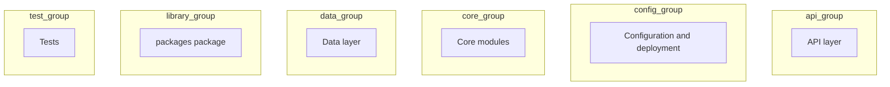

# Architecture report: yinxin630/fiora

> Automated static analysis. **Observed** = directly seen in files/imports/AST; **Inferred** = interpretation from that evidence. Repository code was not executed.

## 1. Repository at a glance

| Item | Value |
| --- | --- |
| Repository | yinxin630/fiora |
| Description | An interesting open source chat application. Developed with node.js, mongoDB, socket.io and react |
| Language | TypeScript |
| Stars | 7155 |
| Licence | MIT |
| Analysed commit / branch | d741c006c5a0a5b904dec742ac09dbc51bd7860d / master |
| Framework(s) | Koa, React |
| Files analysed | 320 |
| Components | 6 |

## 2. Architecture in one minute

yinxin630/fiora - An interesting open source chat application. Developed with node.js, mongoDB, socket.io and react. This repository was analysed statically from 320 file(s) (0 Python). Detected technologies (observed from imports/manifests): GitHub Actions, MongoDB, Redis, Koa, React, axios. Files are grouped into 6 component(s): API layer, Configuration and deployment, Core modules, Data layer, packages package, Tests. Findings below distinguish observed facts from inferred interpretation.

## 3. High-level block diagram

## 4. Main components

### API layer (`api_layer`)

- **Kind:** api
- **Status:** Observed
- **Confidence:** 0.85
- **Responsibility:** Groups 6 file(s) under api layer (observed from repository paths and static analysis).
- **Paths:** `packages/server/src/routes/group.ts`, `packages/server/src/routes/history.ts`, `packages/server/src/routes/message.ts`, `packages/server/src/routes/notification.ts`, `packages/server/src/routes/system.ts`, `packages/server/src/routes/user.ts`
- **Evidence:** [packages/server/src/routes/group.ts](https://github.com/yinxin630/fiora/blob/d741c006c5a0a5b904dec742ac09dbc51bd7860d/packages/server/src/routes/group.ts); [packages/server/src/routes/history.ts](https://github.com/yinxin630/fiora/blob/d741c006c5a0a5b904dec742ac09dbc51bd7860d/packages/server/src/routes/history.ts); [packages/server/src/routes/message.ts](https://github.com/yinxin630/fiora/blob/d741c006c5a0a5b904dec742ac09dbc51bd7860d/packages/server/src/routes/message.ts); [packages/server/src/routes/notification.ts](https://github.com/yinxin630/fiora/blob/d741c006c5a0a5b904dec742ac09dbc51bd7860d/packages/server/src/routes/notification.ts); [packages/server/src/routes/system.ts](https://github.com/yinxin630/fiora/blob/d741c006c5a0a5b904dec742ac09dbc51bd7860d/packages/server/src/routes/system.ts); [packages/server/src/routes/user.ts](https://github.com/yinxin630/fiora/blob/d741c006c5a0a5b904dec742ac09dbc51bd7860d/packages/server/src/routes/user.ts)

### Configuration and deployment (`config`)

- **Kind:** config
- **Status:** Observed
- **Confidence:** 0.85
- **Responsibility:** Groups 30 file(s) under configuration and deployment (observed from repository paths and static analysis).
- **Paths:** `Dockerfile`, `docker-compose.yaml`, `lerna.json`, `package.json`, `packages/app/app.json`, `packages/app/package.json`, `packages/app/tsconfig.json`, `packages/assets/package.json`, `packages/bin/package.json`, `packages/bin/tsconfig.json`, `packages/config/client.ts`, `packages/config/package.json`, `packages/config/server.ts`, `packages/database/package.json`, `packages/database/tsconfig.json`, `packages/docs/i18n/en/code.json`, `packages/docs/i18n/en/docusaurus-theme-classic/footer.json`, `packages/docs/i18n/en/docusaurus-theme-classic/navbar.json`, `packages/docs/i18n/zh-Hans/code.json`, `packages/docs/i18n/zh-Hans/docusaurus-theme-classic/footer.json`, `packages/docs/i18n/zh-Hans/docusaurus-theme-classic/navbar.json`, `packages/docs/package.json`, `packages/i18n/package.json`, `packages/server/package.json`, `packages/server/public/manifest.json`, `packages/server/tsconfig.json`, `packages/utils/package.json`, `packages/web/package.json`, `packages/web/tsconfig.json`, `tsconfig.json`
- **Evidence:** [Dockerfile](https://github.com/yinxin630/fiora/blob/d741c006c5a0a5b904dec742ac09dbc51bd7860d/Dockerfile); [docker-compose.yaml](https://github.com/yinxin630/fiora/blob/d741c006c5a0a5b904dec742ac09dbc51bd7860d/docker-compose.yaml); [lerna.json](https://github.com/yinxin630/fiora/blob/d741c006c5a0a5b904dec742ac09dbc51bd7860d/lerna.json); [package.json](https://github.com/yinxin630/fiora/blob/d741c006c5a0a5b904dec742ac09dbc51bd7860d/package.json); [packages/app/app.json](https://github.com/yinxin630/fiora/blob/d741c006c5a0a5b904dec742ac09dbc51bd7860d/packages/app/app.json); [packages/app/package.json](https://github.com/yinxin630/fiora/blob/d741c006c5a0a5b904dec742ac09dbc51bd7860d/packages/app/package.json); [packages/app/tsconfig.json](https://github.com/yinxin630/fiora/blob/d741c006c5a0a5b904dec742ac09dbc51bd7860d/packages/app/tsconfig.json); [packages/assets/package.json](https://github.com/yinxin630/fiora/blob/d741c006c5a0a5b904dec742ac09dbc51bd7860d/packages/assets/package.json)

### Core modules (`core`)

- **Kind:** core
- **Status:** Observed
- **Confidence:** 0.85
- **Responsibility:** Groups 4 file(s) under core modules (observed from repository paths and static analysis).
- **Paths:** `index.ts`, `jest.config.js`, `jest.setup.js`, `jest.transformer.js`
- **Evidence:** [index.ts](https://github.com/yinxin630/fiora/blob/d741c006c5a0a5b904dec742ac09dbc51bd7860d/index.ts); [jest.config.js](https://github.com/yinxin630/fiora/blob/d741c006c5a0a5b904dec742ac09dbc51bd7860d/jest.config.js); [jest.setup.js](https://github.com/yinxin630/fiora/blob/d741c006c5a0a5b904dec742ac09dbc51bd7860d/jest.setup.js); [jest.transformer.js](https://github.com/yinxin630/fiora/blob/d741c006c5a0a5b904dec742ac09dbc51bd7860d/jest.transformer.js)

### Data layer (`data_layer`)

- **Kind:** data
- **Status:** Observed
- **Confidence:** 0.85
- **Responsibility:** Groups 10 file(s) under data layer (observed from repository paths and static analysis).
- **Paths:** `packages/database/mongoose/index.ts`, `packages/database/mongoose/initMongoDB.ts`, `packages/database/mongoose/models/friend.ts`, `packages/database/mongoose/models/group.ts`, `packages/database/mongoose/models/history.ts`, `packages/database/mongoose/models/message.ts`, `packages/database/mongoose/models/notification.ts`, `packages/database/mongoose/models/socket.ts`, `packages/database/mongoose/models/user.ts`, `packages/database/redis/initRedis.ts`
- **Evidence:** [packages/database/mongoose/index.ts](https://github.com/yinxin630/fiora/blob/d741c006c5a0a5b904dec742ac09dbc51bd7860d/packages/database/mongoose/index.ts); [packages/database/mongoose/initMongoDB.ts](https://github.com/yinxin630/fiora/blob/d741c006c5a0a5b904dec742ac09dbc51bd7860d/packages/database/mongoose/initMongoDB.ts); [packages/database/mongoose/models/friend.ts](https://github.com/yinxin630/fiora/blob/d741c006c5a0a5b904dec742ac09dbc51bd7860d/packages/database/mongoose/models/friend.ts); [packages/database/mongoose/models/group.ts](https://github.com/yinxin630/fiora/blob/d741c006c5a0a5b904dec742ac09dbc51bd7860d/packages/database/mongoose/models/group.ts); [packages/database/mongoose/models/history.ts](https://github.com/yinxin630/fiora/blob/d741c006c5a0a5b904dec742ac09dbc51bd7860d/packages/database/mongoose/models/history.ts); [packages/database/mongoose/models/message.ts](https://github.com/yinxin630/fiora/blob/d741c006c5a0a5b904dec742ac09dbc51bd7860d/packages/database/mongoose/models/message.ts); [packages/database/mongoose/models/notification.ts](https://github.com/yinxin630/fiora/blob/d741c006c5a0a5b904dec742ac09dbc51bd7860d/packages/database/mongoose/models/notification.ts); [packages/database/mongoose/models/socket.ts](https://github.com/yinxin630/fiora/blob/d741c006c5a0a5b904dec742ac09dbc51bd7860d/packages/database/mongoose/models/socket.ts)

### packages package (`packages`)

- **Kind:** library
- **Status:** Observed
- **Confidence:** 0.85
- **Responsibility:** Groups 164 file(s) under packages package (observed from repository paths and static analysis).
- **Paths:** `packages/app/App.tsx`, `packages/app/src/App.tsx`, `packages/app/src/components/Avatar.tsx`, `packages/app/src/components/BackButton.tsx`, `packages/app/src/components/Expression.tsx`, `packages/app/src/components/Image.tsx`, `packages/app/src/components/Loading.tsx`, `packages/app/src/components/Nofitication.tsx`, `packages/app/src/components/PageContainer.tsx`, `packages/app/src/components/Toast.tsx`, `packages/app/src/hooks/useStore.tsx`, `packages/app/src/pages/Chat/Chat.tsx`, `packages/app/src/pages/Chat/ChatBackButton.tsx`, `packages/app/src/pages/Chat/ChatRightButton.tsx`, `packages/app/src/pages/Chat/ImageMessage.tsx`, `packages/app/src/pages/Chat/Input.tsx`, `packages/app/src/pages/Chat/InviteMessage.tsx`, `packages/app/src/pages/Chat/Message.tsx`, `packages/app/src/pages/Chat/MessageList.tsx`, `packages/app/src/pages/Chat/SystemMessage.tsx`, `packages/app/src/pages/Chat/TextMessage.tsx`, `packages/app/src/pages/ChatList/ChatList.tsx`, `packages/app/src/pages/ChatList/ChatListRightButton.tsx`, `packages/app/src/pages/ChatList/Linkman.tsx`, `packages/app/src/pages/ChatList/SelfInfo.tsx`, `packages/app/src/pages/GroupInfo/GroupInfo.tsx`, `packages/app/src/pages/GroupProfile/GroupProfile.tsx`, `packages/app/src/pages/LoginSignup/Base.tsx`, `packages/app/src/pages/LoginSignup/Login.tsx`, `packages/app/src/pages/LoginSignup/Signup.tsx`, `packages/app/src/pages/Other/Other.tsx`, `packages/app/src/pages/Other/PrivacyPolicy.tsx`, `packages/app/src/pages/Other/Sponsor.tsx`, `packages/app/src/pages/SearchResult/SearchResult.tsx`, `packages/app/src/pages/UserInfo/UserInfo.tsx`, `packages/app/src/service.ts`, `packages/app/src/socket.ts`, `packages/app/src/state/action.ts`, `packages/app/src/state/reducer.ts`, `packages/app/src/state/store.ts`, `packages/app/src/types/global.d.ts`, `packages/app/src/types/redux.ts`, `packages/app/src/types/socket.ts`, `packages/app/src/utils/constant.ts`, `packages/app/src/utils/convertMessage.ts`, `packages/app/src/utils/expressions.ts`, `packages/app/src/utils/fetch.ts`, `packages/app/src/utils/getFriendId.ts`, `packages/app/src/utils/getRandomColor.ts`, `packages/app/src/utils/linkman.ts`, `packages/app/src/utils/platform.ts`, `packages/app/src/utils/storage.ts`, `packages/app/src/utils/time.ts`, `packages/app/src/utils/uploadFile.ts`, `packages/bin/index.ts`, `packages/bin/scripts/deleteMessages.ts`, `packages/bin/scripts/deleteTodayRegisteredUsers.ts`, `packages/bin/scripts/deleteUser.ts`, `packages/bin/scripts/doctor.ts`, `packages/bin/scripts/fixUsersAvatar.ts`, `packages/bin/scripts/getUserId.ts`, `packages/bin/scripts/register.ts`, `packages/bin/scripts/updateDefaultGroupName.ts`, `packages/i18n/en-US/bin.ts`, `packages/i18n/en-US/index.ts`, `packages/i18n/node.index.ts`, `packages/i18n/zh-CN/bin.ts`, `packages/i18n/zh-CN/index.ts`, `packages/server/src/app.ts`, `packages/server/src/main.ts`, `packages/server/src/middlewares/frequency.ts`, `packages/server/src/middlewares/isAdmin.ts`, `packages/server/src/middlewares/isLogin.ts`, `packages/server/src/middlewares/registerRoutes.ts`, `packages/server/src/middlewares/seal.ts`, `packages/server/src/types/index.d.ts`, `packages/server/src/types/server.d.ts`, `packages/utils/compressImage.ts`, `packages/utils/const.ts`, `packages/utils/convertMessage.ts`, `packages/utils/expressions.ts`, `packages/utils/getFriendId.ts`, `packages/utils/getRandomAvatar.ts`, `packages/utils/getRandomColor.ts`, `packages/utils/logger.ts`, `packages/utils/sleep.ts`, `packages/utils/socket.ts`, `packages/utils/time.ts`, `packages/utils/ua.ts`, `packages/utils/url.ts`, `packages/utils/xss.ts`, `packages/web/src/App.tsx`, `packages/web/src/components/Avatar.tsx`, `packages/web/src/components/Button.tsx`, `packages/web/src/components/Dialog.tsx`, `packages/web/src/components/Dropdown.tsx`, `packages/web/src/components/IconButton.tsx`, `packages/web/src/components/Input.tsx`, `packages/web/src/components/Loading.tsx`, `packages/web/src/components/Menu.tsx`, `packages/web/src/components/Message.tsx`, `packages/web/src/components/Progress.tsx`, `packages/web/src/components/Select.tsx`, `packages/web/src/components/Tabs.tsx`, `packages/web/src/components/Tooltip.tsx`, `packages/web/src/context.ts`, `packages/web/src/globalStyles.ts`, `packages/web/src/hooks/useAction.ts`, `packages/web/src/hooks/useAero.ts`, `packages/web/src/hooks/useIsLogin.ts`, `packages/web/src/hooks/useStore.ts`, `packages/web/src/localStorage.ts`, `packages/web/src/main.tsx`, `packages/web/src/modules/Chat/Chat.tsx`, `packages/web/src/modules/Chat/ChatInput.tsx`, `packages/web/src/modules/Chat/CodeEditor.tsx`, `packages/web/src/modules/Chat/Expression.tsx`, `packages/web/src/modules/Chat/GroupManagePanel.tsx`, `packages/web/src/modules/Chat/HeaderBar.tsx`, `packages/web/src/modules/Chat/Message/CodeDialog.tsx`, `packages/web/src/modules/Chat/Message/CodeMessage.tsx`, `packages/web/src/modules/Chat/Message/FileMessage.tsx`, `packages/web/src/modules/Chat/Message/ImageMessage.tsx`, `packages/web/src/modules/Chat/Message/InviteMessageV2.tsx`, `packages/web/src/modules/Chat/Message/Message.tsx`, `packages/web/src/modules/Chat/Message/SystemMessage.tsx`, `packages/web/src/modules/Chat/Message/TextMessage.tsx`, `packages/web/src/modules/Chat/Message/UrlMessage.tsx`, `packages/web/src/modules/Chat/MessageList.tsx`, `packages/web/src/modules/FunctionBarAndLinkmanList/CreateGroup.tsx`, `packages/web/src/modules/FunctionBarAndLinkmanList/FunctionBar.tsx`, `packages/web/src/modules/FunctionBarAndLinkmanList/FunctionBarAndLinkmanList.tsx`, `packages/web/src/modules/FunctionBarAndLinkmanList/Linkman.tsx`, `packages/web/src/modules/FunctionBarAndLinkmanList/LinkmanList.tsx`, `packages/web/src/modules/GroupInfo.tsx`, `packages/web/src/modules/InviteInfo.tsx`, `packages/web/src/modules/LoginAndRegister/Login.tsx`, `packages/web/src/modules/LoginAndRegister/LoginAndRegister.tsx`, `packages/web/src/modules/LoginAndRegister/Register.tsx`, `packages/web/src/modules/Sidebar/About.tsx`, `packages/web/src/modules/Sidebar/Admin.tsx`, `packages/web/src/modules/Sidebar/Download.tsx`, `packages/web/src/modules/Sidebar/OnlineStatus.tsx`, `packages/web/src/modules/Sidebar/Reward.tsx`, `packages/web/src/modules/Sidebar/SelfInfo.tsx`, `packages/web/src/modules/Sidebar/Setting.tsx`, `packages/web/src/modules/Sidebar/Sidebar.tsx`, `packages/web/src/modules/UserInfo.tsx`, `packages/web/src/service.ts`, `packages/web/src/socket.ts`, `packages/web/src/state/action.ts`, `packages/web/src/state/reducer.ts`, `packages/web/src/state/store.ts`, `packages/web/src/themes.ts`, `packages/web/src/types/index.d.ts`, `packages/web/src/utils/fetch.ts`, `packages/web/src/utils/getRandomHuaji.ts`, `packages/web/src/utils/inobounce.ts`, `packages/web/src/utils/notification.ts`, `packages/web/src/utils/playSound.ts`, `packages/web/src/utils/readDiskFile.ts`, `packages/web/src/utils/setCssVariable.ts`, `packages/web/src/utils/uploadFile.ts`, `packages/web/src/utils/voice.ts`
- **Evidence:** [packages/app/App.tsx](https://github.com/yinxin630/fiora/blob/d741c006c5a0a5b904dec742ac09dbc51bd7860d/packages/app/App.tsx); [packages/app/src/App.tsx](https://github.com/yinxin630/fiora/blob/d741c006c5a0a5b904dec742ac09dbc51bd7860d/packages/app/src/App.tsx); [packages/app/src/components/Avatar.tsx](https://github.com/yinxin630/fiora/blob/d741c006c5a0a5b904dec742ac09dbc51bd7860d/packages/app/src/components/Avatar.tsx); [packages/app/src/components/BackButton.tsx](https://github.com/yinxin630/fiora/blob/d741c006c5a0a5b904dec742ac09dbc51bd7860d/packages/app/src/components/BackButton.tsx); [packages/app/src/components/Expression.tsx](https://github.com/yinxin630/fiora/blob/d741c006c5a0a5b904dec742ac09dbc51bd7860d/packages/app/src/components/Expression.tsx); [packages/app/src/components/Image.tsx](https://github.com/yinxin630/fiora/blob/d741c006c5a0a5b904dec742ac09dbc51bd7860d/packages/app/src/components/Image.tsx); [packages/app/src/components/Loading.tsx](https://github.com/yinxin630/fiora/blob/d741c006c5a0a5b904dec742ac09dbc51bd7860d/packages/app/src/components/Loading.tsx); [packages/app/src/components/Nofitication.tsx](https://github.com/yinxin630/fiora/blob/d741c006c5a0a5b904dec742ac09dbc51bd7860d/packages/app/src/components/Nofitication.tsx)

### Tests (`tests`)

- **Kind:** test
- **Status:** Observed
- **Confidence:** 0.85
- **Responsibility:** Groups 12 file(s) under tests (observed from repository paths and static analysis).
- **Paths:** `packages/app/tests/state/reducer.test.ts`, `packages/server/test/helpers/middleware.ts`, `packages/server/test/middlewares/frequency.spec.ts`, `packages/server/test/middlewares/isAdmin.spec.ts`, `packages/server/test/middlewares/isLogin.spec.ts`, `packages/server/test/middlewares/seal.spec.ts`, `packages/utils/test/getFriendId.spec.ts`, `packages/utils/test/url.spec.ts`, `packages/web/test/components/Avatar.spec.tsx`, `packages/web/test/components/Button.spec.tsx`, `packages/web/test/localStorage.spec.ts`, `packages/web/test/state/reducer.spec.ts`
- **Evidence:** [packages/app/tests/state/reducer.test.ts](https://github.com/yinxin630/fiora/blob/d741c006c5a0a5b904dec742ac09dbc51bd7860d/packages/app/tests/state/reducer.test.ts); [packages/server/test/helpers/middleware.ts](https://github.com/yinxin630/fiora/blob/d741c006c5a0a5b904dec742ac09dbc51bd7860d/packages/server/test/helpers/middleware.ts); [packages/server/test/middlewares/frequency.spec.ts](https://github.com/yinxin630/fiora/blob/d741c006c5a0a5b904dec742ac09dbc51bd7860d/packages/server/test/middlewares/frequency.spec.ts); [packages/server/test/middlewares/isAdmin.spec.ts](https://github.com/yinxin630/fiora/blob/d741c006c5a0a5b904dec742ac09dbc51bd7860d/packages/server/test/middlewares/isAdmin.spec.ts); [packages/server/test/middlewares/isLogin.spec.ts](https://github.com/yinxin630/fiora/blob/d741c006c5a0a5b904dec742ac09dbc51bd7860d/packages/server/test/middlewares/isLogin.spec.ts); [packages/server/test/middlewares/seal.spec.ts](https://github.com/yinxin630/fiora/blob/d741c006c5a0a5b904dec742ac09dbc51bd7860d/packages/server/test/middlewares/seal.spec.ts); [packages/utils/test/getFriendId.spec.ts](https://github.com/yinxin630/fiora/blob/d741c006c5a0a5b904dec742ac09dbc51bd7860d/packages/utils/test/getFriendId.spec.ts); [packages/utils/test/url.spec.ts](https://github.com/yinxin630/fiora/blob/d741c006c5a0a5b904dec742ac09dbc51bd7860d/packages/utils/test/url.spec.ts)

## 5. Execution flow

**Observed** entry point(s):

- [index.ts](https://github.com/yinxin630/fiora/blob/d741c006c5a0a5b904dec742ac09dbc51bd7860d/index.ts)
- [packages/app/App.tsx](https://github.com/yinxin630/fiora/blob/d741c006c5a0a5b904dec742ac09dbc51bd7860d/packages/app/App.tsx)
- [packages/app/src/App.tsx](https://github.com/yinxin630/fiora/blob/d741c006c5a0a5b904dec742ac09dbc51bd7860d/packages/app/src/App.tsx)
- [packages/bin/index.ts](https://github.com/yinxin630/fiora/blob/d741c006c5a0a5b904dec742ac09dbc51bd7860d/packages/bin/index.ts)
- [packages/config/server.ts](https://github.com/yinxin630/fiora/blob/d741c006c5a0a5b904dec742ac09dbc51bd7860d/packages/config/server.ts)
- [packages/database/mongoose/index.ts](https://github.com/yinxin630/fiora/blob/d741c006c5a0a5b904dec742ac09dbc51bd7860d/packages/database/mongoose/index.ts)
- [packages/i18n/en-US/index.ts](https://github.com/yinxin630/fiora/blob/d741c006c5a0a5b904dec742ac09dbc51bd7860d/packages/i18n/en-US/index.ts)
- [packages/i18n/zh-CN/index.ts](https://github.com/yinxin630/fiora/blob/d741c006c5a0a5b904dec742ac09dbc51bd7860d/packages/i18n/zh-CN/index.ts)
- [packages/server/src/app.ts](https://github.com/yinxin630/fiora/blob/d741c006c5a0a5b904dec742ac09dbc51bd7860d/packages/server/src/app.ts)
- [packages/server/src/main.ts](https://github.com/yinxin630/fiora/blob/d741c006c5a0a5b904dec742ac09dbc51bd7860d/packages/server/src/main.ts)
- [packages/web/src/App.tsx](https://github.com/yinxin630/fiora/blob/d741c006c5a0a5b904dec742ac09dbc51bd7860d/packages/web/src/App.tsx)
- [packages/web/src/main.tsx](https://github.com/yinxin630/fiora/blob/d741c006c5a0a5b904dec742ac09dbc51bd7860d/packages/web/src/main.tsx)

Representative flow (derived from observed entry points and the import graph; steps beyond the entry point are **Inferred**):

1. Execution starts at an observed entry point listed above, if present.
2. No internal import relationships between components were observed.

## 6. Project structure

### `(root)`

- `.dockerignore` - container (93 bytes)
- `.eslintignore` - other (48 bytes)
- `.eslintrc` - other (2138 bytes)
- `.gitignore` - other (456 bytes)
- `.prettierrc` - other (125 bytes)
- `Dockerfile` - container (188 bytes)
- `LICENSE` - docs (1071 bytes)
- `README.md` - docs (3576 bytes)
- `docker-compose.yaml` - container (275 bytes)
- `index.ts` - source, TypeScript (2429 bytes)
- `jest.config.js` - source, JavaScript (485 bytes)
- `jest.setup.js` - source, JavaScript (185 bytes)
- `jest.transformer.js` - source, JavaScript (168 bytes)
- `lerna.json` - config (92 bytes)
- `package.json` - manifest (1991 bytes)
- `tsconfig.json` - config (414 bytes)

### `.github`

- `.github/workflows/codeql-analysis.yml` - ci, YAML (2379 bytes)
- `.github/workflows/lint.yml` - ci, YAML (564 bytes)
- `.github/workflows/test.yml` - ci, YAML (301 bytes)
- `.github/workflows/ts.yml` - ci, YAML (572 bytes)

### `.vscode`

- `.vscode/settings.json` - config (56 bytes)

### `packages`

- `packages/app/.babelrc` - other (39 bytes)
- `packages/app/.eslintrc` - other (118 bytes)
- `packages/app/.gitignore` - other (262 bytes)
- `packages/app/.watchmanconfig` - other (3 bytes)
- `packages/app/App.tsx` - source, TypeScript (335 bytes)
- `packages/app/app.json` - config (659 bytes)
- `packages/app/package.json` - manifest (1691 bytes)
- `packages/app/src/App.tsx` - source, TypeScript (7163 bytes)
- `packages/app/src/components/Avatar.tsx` - source, TypeScript (525 bytes)
- `packages/app/src/components/BackButton.tsx` - source, TypeScript (903 bytes)
- `packages/app/src/components/Expression.tsx` - source, TypeScript (609 bytes)
- `packages/app/src/components/Image.tsx` - source, TypeScript (1105 bytes)
- `packages/app/src/components/Loading.tsx` - source, TypeScript (1115 bytes)
- `packages/app/src/components/Nofitication.tsx` - source, TypeScript (3987 bytes)
- `packages/app/src/components/PageContainer.tsx` - source, TypeScript (1098 bytes)
- `packages/app/src/components/Toast.tsx` - source, TypeScript (524 bytes)
- `packages/app/src/hooks/useStore.tsx` - source, TypeScript (1206 bytes)
- `packages/app/src/pages/Chat/Chat.tsx` - source, TypeScript (4795 bytes)
- `packages/app/src/pages/Chat/ChatBackButton.tsx` - source, TypeScript (408 bytes)
- `packages/app/src/pages/Chat/ChatRightButton.tsx` - source, TypeScript (1041 bytes)
- `packages/app/src/pages/Chat/ImageMessage.tsx` - source, TypeScript (1957 bytes)
- `packages/app/src/pages/Chat/Input.tsx` - source, TypeScript (11628 bytes)
- `packages/app/src/pages/Chat/InviteMessage.tsx` - source, TypeScript (2312 bytes)
- `packages/app/src/pages/Chat/Message.tsx` - source, TypeScript (9372 bytes)
- `packages/app/src/pages/Chat/MessageList.tsx` - source, TypeScript (6983 bytes)
- `packages/app/src/pages/Chat/SystemMessage.tsx` - source, TypeScript (947 bytes)
- `packages/app/src/pages/Chat/TextMessage.tsx` - source, TypeScript (3510 bytes)
- `packages/app/src/pages/ChatList/ChatList.tsx` - source, TypeScript (3219 bytes)
- `packages/app/src/pages/ChatList/ChatListRightButton.tsx` - source, TypeScript (2197 bytes)
- `packages/app/src/pages/ChatList/Linkman.tsx` - source, TypeScript (3438 bytes)
- `packages/app/src/pages/ChatList/SelfInfo.tsx` - source, TypeScript (1657 bytes)
- `packages/app/src/pages/GroupInfo/GroupInfo.tsx` - source, TypeScript (3839 bytes)
- `packages/app/src/pages/GroupProfile/GroupProfile.tsx` - source, TypeScript (3640 bytes)
- `packages/app/src/pages/LoginSignup/Base.tsx` - source, TypeScript (3243 bytes)
- `packages/app/src/pages/LoginSignup/Login.tsx` - source, TypeScript (1444 bytes)
- `packages/app/src/pages/LoginSignup/Signup.tsx` - source, TypeScript (1580 bytes)
- `packages/app/src/pages/Other/Other.tsx` - source, TypeScript (6430 bytes)
- `packages/app/src/pages/Other/PrivacyPolicy.tsx` - source, TypeScript (1884 bytes)
- `packages/app/src/pages/Other/Sponsor.tsx` - source, TypeScript (1259 bytes)
- `packages/app/src/pages/SearchResult/SearchResult.tsx` - source, TypeScript (4136 bytes)
- `packages/app/src/pages/UserInfo/UserInfo.tsx` - source, TypeScript (6520 bytes)
- `packages/app/src/service.ts` - source, TypeScript (8101 bytes)
- `packages/app/src/socket.ts` - source, TypeScript (5093 bytes)
- `packages/app/src/state/action.ts` - source, TypeScript (6144 bytes)
- `packages/app/src/state/reducer.ts` - source, TypeScript (9797 bytes)
- `packages/app/src/state/store.ts` - source, TypeScript (262 bytes)
- `packages/app/src/types/global.d.ts` - source, TypeScript (112 bytes)
- `packages/app/src/types/redux.ts` - source, TypeScript (5413 bytes)
- `packages/app/src/types/socket.ts` - source, TypeScript (95 bytes)
- `packages/app/src/utils/constant.ts` - source, TypeScript (57 bytes)
- `packages/app/src/utils/convertMessage.ts` - source, TypeScript (2473 bytes)
- `packages/app/src/utils/expressions.ts` - source, TypeScript (912 bytes)
- `packages/app/src/utils/fetch.ts` - source, TypeScript (569 bytes)
- `packages/app/src/utils/getFriendId.ts` - source, TypeScript (173 bytes)
- `packages/app/src/utils/getRandomColor.ts` - source, TypeScript (792 bytes)
- `packages/app/src/utils/linkman.ts` - source, TypeScript (564 bytes)
- `packages/app/src/utils/platform.ts` - source, TypeScript (661 bytes)
- `packages/app/src/utils/storage.ts` - source, TypeScript (380 bytes)
- `packages/app/src/utils/time.ts` - source, TypeScript (1161 bytes)
- `packages/app/src/utils/uploadFile.ts` - source, TypeScript (1034 bytes)
- `packages/app/tests/state/reducer.test.ts` - test, TypeScript (1436 bytes)
- `packages/app/tsconfig.json` - config (35 bytes)
- `packages/assets/package.json` - manifest (91 bytes)
- `packages/bin/index.ts` - source, TypeScript (425 bytes)
- `packages/bin/package.json` - manifest (479 bytes)
- `packages/bin/scripts/deleteMessages.ts` - source, TypeScript (1904 bytes)
- `packages/bin/scripts/deleteTodayRegisteredUsers.ts` - source, TypeScript (1331 bytes)
- `packages/bin/scripts/deleteUser.ts` - source, TypeScript (4075 bytes)
- `packages/bin/scripts/doctor.ts` - source, TypeScript (1708 bytes)
- `packages/bin/scripts/fixUsersAvatar.ts` - source, TypeScript (1542 bytes)
- `packages/bin/scripts/getUserId.ts` - source, TypeScript (763 bytes)
- `packages/bin/scripts/register.ts` - source, TypeScript (2176 bytes)
- `packages/bin/scripts/updateDefaultGroupName.ts` - source, TypeScript (983 bytes)
- `packages/bin/tsconfig.json` - config (34 bytes)
- `packages/config/client.ts` - source, TypeScript (1285 bytes)
- `packages/config/package.json` - manifest (189 bytes)
- `packages/config/server.ts` - source, TypeScript (1630 bytes)
- `packages/database/mongoose/index.ts` - source, TypeScript (26 bytes)
- `packages/database/mongoose/initMongoDB.ts` - source, TypeScript (701 bytes)
- `packages/database/mongoose/models/friend.ts` - source, TypeScript (654 bytes)
- `packages/database/mongoose/models/group.ts` - source, TypeScript (1155 bytes)
- `packages/database/mongoose/models/history.ts` - source, TypeScript (1029 bytes)
- `packages/database/mongoose/models/message.ts` - source, TypeScript (2384 bytes)
- `packages/database/mongoose/models/notification.ts` - source, TypeScript (512 bytes)
- `packages/database/mongoose/models/socket.ts` - source, TypeScript (1004 bytes)
- `packages/database/mongoose/models/user.ts` - source, TypeScript (1234 bytes)
- `packages/database/package.json` - manifest (321 bytes)
- `packages/database/redis/initRedis.ts` - source, TypeScript (1951 bytes)
- `packages/database/tsconfig.json` - config (34 bytes)
- `packages/docs/.gitignore` - docs (233 bytes)
- `packages/docs/babel.config.js` - docs (89 bytes)
- `packages/docs/docs/API.md` - docs (16 bytes)
- `packages/docs/docs/App.md` - docs (16 bytes)
- `packages/docs/docs/CHANGELOG.md` - docs (22 bytes)
- `packages/docs/docs/Config.md` - docs (19 bytes)
- `packages/docs/docs/FAQ.md` - docs (16 bytes)
- `packages/docs/docs/Getting-Start.md` - docs (26 bytes)
- `packages/docs/docs/INSTALL.md` - docs (20 bytes)
- `packages/docs/docs/Script.md` - docs (19 bytes)
- `packages/docs/docusaurus.config.js` - docs (3684 bytes)
- `packages/docs/i18n/en/code.json` - config (1981 bytes)
- `packages/docs/i18n/en/docusaurus-plugin-content-docs/current/API.md` - docs (7587 bytes)
- `packages/docs/i18n/en/docusaurus-plugin-content-docs/current/App.md` - docs (1001 bytes)
- `packages/docs/i18n/en/docusaurus-plugin-content-docs/current/CHANGELOG.md` - docs (2335 bytes)
- `packages/docs/i18n/en/docusaurus-plugin-content-docs/current/Config.md` - docs (5849 bytes)
- `packages/docs/i18n/en/docusaurus-plugin-content-docs/current/FAQ.md` - docs (3371 bytes)
- `packages/docs/i18n/en/docusaurus-plugin-content-docs/current/Getting-Start.md` - docs (3159 bytes)
- `packages/docs/i18n/en/docusaurus-plugin-content-docs/current/INSTALL.md` - docs (2560 bytes)
- `packages/docs/i18n/en/docusaurus-plugin-content-docs/current/Script.md` - docs (1433 bytes)
- `packages/docs/i18n/en/docusaurus-theme-classic/footer.json` - config (545 bytes)
- `packages/docs/i18n/en/docusaurus-theme-classic/navbar.json` - config (61 bytes)
- `packages/docs/i18n/zh-Hans/code.json` - config (1909 bytes)
- `packages/docs/i18n/zh-Hans/docusaurus-plugin-content-docs/current/API.md` - docs (7593 bytes)
- `packages/docs/i18n/zh-Hans/docusaurus-plugin-content-docs/current/App.md` - docs (934 bytes)
- `packages/docs/i18n/zh-Hans/docusaurus-plugin-content-docs/current/CHANGELOG.md` - docs (2041 bytes)
- `packages/docs/i18n/zh-Hans/docusaurus-plugin-content-docs/current/Config.md` - docs (5305 bytes)
- `packages/docs/i18n/zh-Hans/docusaurus-plugin-content-docs/current/FAQ.md` - docs (3010 bytes)
- `packages/docs/i18n/zh-Hans/docusaurus-plugin-content-docs/current/Getting-Start.md` - docs (2951 bytes)
- `packages/docs/i18n/zh-Hans/docusaurus-plugin-content-docs/current/INSTALL.md` - docs (2441 bytes)
- `packages/docs/i18n/zh-Hans/docusaurus-plugin-content-docs/current/Script.md` - docs (1248 bytes)
- `packages/docs/i18n/zh-Hans/docusaurus-theme-classic/footer.json` - config (705 bytes)
- `packages/docs/i18n/zh-Hans/docusaurus-theme-classic/navbar.json` - config (63 bytes)
- `packages/docs/package.json` - manifest (851 bytes)
- `packages/docs/sidebars.js` - docs (156 bytes)
- `packages/docs/src/css/custom.css` - docs (836 bytes)
- `packages/docs/src/pages/index.js` - docs (6783 bytes)
- `packages/docs/src/pages/styles.module.css` - docs (1510 bytes)
- `packages/docs/static/.nojekyll` - docs (0 bytes)
- `packages/docs/static/img/logo.svg` - docs (6438 bytes)
- `packages/docs/static/img/undraw_code_review.svg` - docs (17343 bytes)
- `packages/docs/static/img/undraw_note_list.svg` - docs (15536 bytes)
- `packages/docs/static/img/undraw_youtube_tutorial.svg` - docs (29040 bytes)
- `packages/i18n/en-US/bin.ts` - source, TypeScript (604 bytes)
- `packages/i18n/en-US/index.ts` - source, TypeScript (23 bytes)
- `packages/i18n/node.index.ts` - source, TypeScript (358 bytes)
- `packages/i18n/package.json` - manifest (140 bytes)
- `packages/i18n/zh-CN/bin.ts` - source, TypeScript (570 bytes)
- `packages/i18n/zh-CN/index.ts` - source, TypeScript (23 bytes)
- `packages/server/.nodemonrc` - other (89 bytes)
- `packages/server/package.json` - manifest (1258 bytes)
- `packages/server/public/PrivacyPolicy.html` - other (13740 bytes)
- `packages/server/public/index.html` - other (322 bytes)
- `packages/server/public/manifest.json` - config (643 bytes)
- `packages/server/src/app.ts` - source, TypeScript (2677 bytes)
- `packages/server/src/main.ts` - source, TypeScript (1252 bytes)
- `packages/server/src/middlewares/frequency.ts` - source, TypeScript (2325 bytes)
- `packages/server/src/middlewares/isAdmin.ts` - source, TypeScript (976 bytes)
- `packages/server/src/middlewares/isLogin.ts` - source, TypeScript (713 bytes)
- `packages/server/src/middlewares/registerRoutes.ts` - source, TypeScript (2164 bytes)
- `packages/server/src/middlewares/seal.ts` - source, TypeScript (742 bytes)
- `packages/server/src/routes/group.ts` - source, TypeScript (9638 bytes)
- `packages/server/src/routes/history.ts` - source, TypeScript (1252 bytes)
- `packages/server/src/routes/message.ts` - source, TypeScript (15179 bytes)
- `packages/server/src/routes/notification.ts` - source, TypeScript (960 bytes)
- `packages/server/src/routes/system.ts` - source, TypeScript (10379 bytes)
- `packages/server/src/routes/user.ts` - source, TypeScript (15860 bytes)
- `packages/server/src/types/index.d.ts` - source, TypeScript (31 bytes)
- `packages/server/src/types/server.d.ts` - source, TypeScript (696 bytes)
- `packages/server/test/helpers/middleware.ts` - test, TypeScript (202 bytes)
- `packages/server/test/middlewares/frequency.spec.ts` - test, TypeScript (2683 bytes)
- `packages/server/test/middlewares/isAdmin.spec.ts` - test, TypeScript (1260 bytes)
- `packages/server/test/middlewares/isLogin.spec.ts` - test, TypeScript (1391 bytes)
- `packages/server/test/middlewares/seal.spec.ts` - test, TypeScript (1506 bytes)
- `packages/server/tsconfig.json` - config (34 bytes)
- `packages/utils/compressImage.ts` - source, TypeScript (640 bytes)
- `packages/utils/const.ts` - source, TypeScript (650 bytes)
- `packages/utils/convertMessage.ts` - source, TypeScript (1911 bytes)
- `packages/utils/expressions.ts` - source, TypeScript (912 bytes)
- `packages/utils/getFriendId.ts` - source, TypeScript (334 bytes)
- `packages/utils/getRandomAvatar.ts` - source, TypeScript (369 bytes)
- `packages/utils/getRandomColor.ts` - source, TypeScript (792 bytes)
- `packages/utils/logger.ts` - source, TypeScript (163 bytes)
- `packages/utils/package.json` - manifest (359 bytes)
- `packages/utils/sleep.ts` - source, TypeScript (135 bytes)
- `packages/utils/socket.ts` - source, TypeScript (228 bytes)
- `packages/utils/test/getFriendId.spec.ts` - test, TypeScript (329 bytes)
- `packages/utils/test/url.spec.ts` - test, TypeScript (678 bytes)
- `packages/utils/time.ts` - source, TypeScript (928 bytes)
- `packages/utils/ua.ts` - source, TypeScript (173 bytes)
- `packages/utils/url.ts` - source, TypeScript (427 bytes)
- `packages/utils/xss.ts` - source, TypeScript (154 bytes)
- `packages/web/.babelrc` - other (1076 bytes)
- `packages/web/package.json` - manifest (3234 bytes)
- `packages/web/src/App.less` - other (338 bytes)
- `packages/web/src/App.tsx` - source, TypeScript (5451 bytes)
- `packages/web/src/components/Avatar.tsx` - source, TypeScript (1567 bytes)
- `packages/web/src/components/Button.tsx` - source, TypeScript (900 bytes)
- `packages/web/src/components/Dialog.less` - other (969 bytes)
- `packages/web/src/components/Dialog.tsx` - source, TypeScript (118 bytes)
- `packages/web/src/components/Dropdown.less` - other (132 bytes)
- `packages/web/src/components/Dropdown.tsx` - source, TypeScript (128 bytes)
- `packages/web/src/components/IconButton.less` - other (155 bytes)
- `packages/web/src/components/IconButton.tsx` - source, TypeScript (784 bytes)
- `packages/web/src/components/Input.less` - other (508 bytes)
- `packages/web/src/components/Input.tsx` - source, TypeScript (1988 bytes)
- `packages/web/src/components/Loading.tsx` - source, TypeScript (62 bytes)
- `packages/web/src/components/Menu.tsx` - source, TypeScript (123 bytes)
- `packages/web/src/components/Message.less` - other (647 bytes)
- `packages/web/src/components/Message.tsx` - source, TypeScript (1025 bytes)
- `packages/web/src/components/Progress.tsx` - source, TypeScript (159 bytes)
- `packages/web/src/components/Select.tsx` - source, TypeScript (129 bytes)
- `packages/web/src/components/Tabs.tsx` - source, TypeScript (252 bytes)
- `packages/web/src/components/Tooltip.less` - other (236 bytes)
- `packages/web/src/components/Tooltip.tsx` - source, TypeScript (127 bytes)
- `packages/web/src/context.ts` - source, TypeScript (160 bytes)
- `packages/web/src/globalStyles.ts` - source, TypeScript (296 bytes)
- `packages/web/src/hooks/useAction.ts` - source, TypeScript (3608 bytes)
- `packages/web/src/hooks/useAero.ts` - source, TypeScript (277 bytes)
- `packages/web/src/hooks/useIsLogin.ts` - source, TypeScript (277 bytes)
- `packages/web/src/hooks/useStore.ts` - source, TypeScript (466 bytes)
- `packages/web/src/localStorage.ts` - source, TypeScript (2773 bytes)
- `packages/web/src/main.tsx` - source, TypeScript (1991 bytes)
- `packages/web/src/modules/Chat/Chat.less` - other (857 bytes)
- `packages/web/src/modules/Chat/Chat.tsx` - source, TypeScript (5891 bytes)
- `packages/web/src/modules/Chat/ChatInput.less` - other (3013 bytes)
- `packages/web/src/modules/Chat/ChatInput.tsx` - source, TypeScript (24784 bytes)
- `packages/web/src/modules/Chat/CodeEditor.less` - other (729 bytes)
- `packages/web/src/modules/Chat/CodeEditor.tsx` - source, TypeScript (8274 bytes)
- `packages/web/src/modules/Chat/Expression.less` - other (1788 bytes)
- `packages/web/src/modules/Chat/Expression.tsx` - source, TypeScript (4630 bytes)
- `packages/web/src/modules/Chat/GroupManagePanel.less` - other (2398 bytes)
- `packages/web/src/modules/Chat/GroupManagePanel.tsx` - source, TypeScript (9810 bytes)
- `packages/web/src/modules/Chat/HeaderBar.less` - other (1312 bytes)
- `packages/web/src/modules/Chat/HeaderBar.tsx` - source, TypeScript (4662 bytes)
- `packages/web/src/modules/Chat/Message/CodeDialog.tsx` - source, TypeScript (1210 bytes)
- `packages/web/src/modules/Chat/Message/CodeMessage.less` - other (1765 bytes)
- `packages/web/src/modules/Chat/Message/CodeMessage.tsx` - source, TypeScript (2215 bytes)
- `packages/web/src/modules/Chat/Message/FileMessage.tsx` - source, TypeScript (1700 bytes)
- `packages/web/src/modules/Chat/Message/ImageMessage.tsx` - source, TypeScript (3720 bytes)
- `packages/web/src/modules/Chat/Message/InviteMessage.less` - other (374 bytes)
- `packages/web/src/modules/Chat/Message/InviteMessageV2.tsx` - source, TypeScript (1418 bytes)
- `packages/web/src/modules/Chat/Message/Message.less` - other (4223 bytes)
- `packages/web/src/modules/Chat/Message/Message.tsx` - source, TypeScript (9153 bytes)
- `packages/web/src/modules/Chat/Message/SystemMessage.tsx` - source, TypeScript (518 bytes)
- `packages/web/src/modules/Chat/Message/TextMessage.tsx` - source, TypeScript (1345 bytes)
- `packages/web/src/modules/Chat/Message/UrlMessage.tsx` - source, TypeScript (295 bytes)
- `packages/web/src/modules/Chat/MessageList.less` - other (289 bytes)
- `packages/web/src/modules/Chat/MessageList.tsx` - source, TypeScript (5065 bytes)
- `packages/web/src/modules/FunctionBarAndLinkmanList/CreateGroup.less` - other (528 bytes)
- `packages/web/src/modules/FunctionBarAndLinkmanList/CreateGroup.tsx` - source, TypeScript (1543 bytes)
- `packages/web/src/modules/FunctionBarAndLinkmanList/FunctionBar.less` - other (2838 bytes)
- `packages/web/src/modules/FunctionBarAndLinkmanList/FunctionBar.tsx` - source, TypeScript (10956 bytes)
- `packages/web/src/modules/FunctionBarAndLinkmanList/FunctionBarAndLinkmanList.less` - other (730 bytes)
- `packages/web/src/modules/FunctionBarAndLinkmanList/FunctionBarAndLinkmanList.tsx` - source, TypeScript (1278 bytes)
- `packages/web/src/modules/FunctionBarAndLinkmanList/Linkman.less` - other (1331 bytes)
- `packages/web/src/modules/FunctionBarAndLinkmanList/Linkman.tsx` - source, TypeScript (3050 bytes)
- `packages/web/src/modules/FunctionBarAndLinkmanList/LinkmanList.less` - other (90 bytes)
- `packages/web/src/modules/FunctionBarAndLinkmanList/LinkmanList.tsx` - source, TypeScript (1988 bytes)
- `packages/web/src/modules/GroupInfo.tsx` - source, TypeScript (3078 bytes)
- `packages/web/src/modules/InfoDialog.less` - other (1154 bytes)
- `packages/web/src/modules/InviteInfo.tsx` - source, TypeScript (4481 bytes)
- `packages/web/src/modules/LoginAndRegister/Login.tsx` - source, TypeScript (2633 bytes)
- `packages/web/src/modules/LoginAndRegister/LoginAndRegister.less` - other (228 bytes)
- `packages/web/src/modules/LoginAndRegister/LoginAndRegister.tsx` - source, TypeScript (1331 bytes)
- `packages/web/src/modules/LoginAndRegister/LoginRegister.less` - other (613 bytes)
- `packages/web/src/modules/LoginAndRegister/Register.tsx` - source, TypeScript (2656 bytes)
- `packages/web/src/modules/Sidebar/About.less` - other (274 bytes)
- `packages/web/src/modules/Sidebar/About.tsx` - source, TypeScript (3375 bytes)
- `packages/web/src/modules/Sidebar/Admin.less` - other (402 bytes)
- `packages/web/src/modules/Sidebar/Admin.tsx` - source, TypeScript (9672 bytes)
- `packages/web/src/modules/Sidebar/Common.less` - other (288 bytes)
- `packages/web/src/modules/Sidebar/Download.less` - other (272 bytes)
- `packages/web/src/modules/Sidebar/Download.tsx` - source, TypeScript (1711 bytes)
- `packages/web/src/modules/Sidebar/OnlineStatus.less` - other (237 bytes)
- `packages/web/src/modules/Sidebar/OnlineStatus.tsx` - source, TypeScript (465 bytes)
- `packages/web/src/modules/Sidebar/Reward.less` - other (574 bytes)
- `packages/web/src/modules/Sidebar/Reward.tsx` - source, TypeScript (1347 bytes)
- `packages/web/src/modules/Sidebar/SelfInfo.less` - other (666 bytes)
- `packages/web/src/modules/Sidebar/SelfInfo.tsx` - source, TypeScript (9261 bytes)
- `packages/web/src/modules/Sidebar/Setting.less` - other (2332 bytes)
- `packages/web/src/modules/Sidebar/Setting.tsx` - source, TypeScript (19490 bytes)
- `packages/web/src/modules/Sidebar/Sidebar.less` - other (1180 bytes)
- `packages/web/src/modules/Sidebar/Sidebar.tsx` - source, TypeScript (8077 bytes)
- `packages/web/src/modules/UserInfo.tsx` - source, TypeScript (7237 bytes)
- `packages/web/src/service.ts` - source, TypeScript (9550 bytes)
- `packages/web/src/socket.ts` - source, TypeScript (7843 bytes)
- `packages/web/src/state/action.ts` - source, TypeScript (3048 bytes)
- `packages/web/src/state/reducer.ts` - source, TypeScript (18123 bytes)
- `packages/web/src/state/store.ts` - source, TypeScript (226 bytes)
- `packages/web/src/styles/iconfont.less` - other (7983 bytes)
- `packages/web/src/styles/normalize.less` - other (1326 bytes)
- `packages/web/src/styles/variable.less` - other (47 bytes)
- `packages/web/src/template.html` - other (1551 bytes)
- `packages/web/src/themes.ts` - source, TypeScript (696 bytes)
- `packages/web/src/types/index.d.ts` - source, TypeScript (1730 bytes)
- `packages/web/src/utils/fetch.ts` - source, TypeScript (1273 bytes)
- `packages/web/src/utils/getRandomHuaji.ts` - source, TypeScript (4345 bytes)
- `packages/web/src/utils/inobounce.ts` - source, TypeScript (2659 bytes)
- `packages/web/src/utils/notification.ts` - source, TypeScript (495 bytes)
- `packages/web/src/utils/playSound.ts` - source, TypeScript (1382 bytes)
- `packages/web/src/utils/readDiskFile.ts` - source, TypeScript (3042 bytes)
- `packages/web/src/utils/setCssVariable.ts` - source, TypeScript (569 bytes)
- `packages/web/src/utils/uploadFile.ts` - source, TypeScript (2430 bytes)
- `packages/web/src/utils/voice.ts` - source, TypeScript (1885 bytes)
- `packages/web/test/components/Avatar.spec.tsx` - test, TypeScript (1968 bytes)
- `packages/web/test/components/Button.spec.tsx` - test, TypeScript (1143 bytes)
- `packages/web/test/localStorage.spec.ts` - test, TypeScript (979 bytes)
- `packages/web/test/state/reducer.spec.ts` - test, TypeScript (17138 bytes)
- `packages/web/tsconfig.json` - config (84 bytes)

## 7. Key dependencies and integrations

| Name | Category | Status | Confidence | Evidence |
| --- | --- | --- | --- | --- |
| GitHub Actions | ci | Observed | 0.90 | [.github/workflows/codeql-analysis.yml](https://github.com/yinxin630/fiora/blob/d741c006c5a0a5b904dec742ac09dbc51bd7860d/.github/workflows/codeql-analysis.yml); [.github/workflows/lint.yml](https://github.com/yinxin630/fiora/blob/d741c006c5a0a5b904dec742ac09dbc51bd7860d/.github/workflows/lint.yml); [.github/workflows/test.yml](https://github.com/yinxin630/fiora/blob/d741c006c5a0a5b904dec742ac09dbc51bd7860d/.github/workflows/test.yml); [.github/workflows/ts.yml](https://github.com/yinxin630/fiora/blob/d741c006c5a0a5b904dec742ac09dbc51bd7860d/.github/workflows/ts.yml) |
| MongoDB | database | Observed | 0.85 | [docker-compose.yaml:4](https://github.com/yinxin630/fiora/blob/d741c006c5a0a5b904dec742ac09dbc51bd7860d/docker-compose.yaml#L4); [packages/database/package.json:9](https://github.com/yinxin630/fiora/blob/d741c006c5a0a5b904dec742ac09dbc51bd7860d/packages/database/package.json#L9) |
| Redis | database | Observed | 0.85 | [docker-compose.yaml:7](https://github.com/yinxin630/fiora/blob/d741c006c5a0a5b904dec742ac09dbc51bd7860d/docker-compose.yaml#L7); [packages/database/package.json:10](https://github.com/yinxin630/fiora/blob/d741c006c5a0a5b904dec742ac09dbc51bd7860d/packages/database/package.json#L10) |
| Koa | framework | Observed | 0.85 | [packages/server/package.json:20](https://github.com/yinxin630/fiora/blob/d741c006c5a0a5b904dec742ac09dbc51bd7860d/packages/server/package.json#L20) |
| React | framework | Observed | 0.90 | [packages/app/package.json:15](https://github.com/yinxin630/fiora/blob/d741c006c5a0a5b904dec742ac09dbc51bd7860d/packages/app/package.json#L15); [packages/docs/package.json:18](https://github.com/yinxin630/fiora/blob/d741c006c5a0a5b904dec742ac09dbc51bd7860d/packages/docs/package.json#L18); [packages/docs/package.json:21](https://github.com/yinxin630/fiora/blob/d741c006c5a0a5b904dec742ac09dbc51bd7860d/packages/docs/package.json#L21); [packages/web/package.json:16](https://github.com/yinxin630/fiora/blob/d741c006c5a0a5b904dec742ac09dbc51bd7860d/packages/web/package.json#L16) |
| axios | library | Observed | 0.90 | [packages/server/package.json:16](https://github.com/yinxin630/fiora/blob/d741c006c5a0a5b904dec742ac09dbc51bd7860d/packages/server/package.json#L16); [packages/utils/package.json:9](https://github.com/yinxin630/fiora/blob/d741c006c5a0a5b904dec742ac09dbc51bd7860d/packages/utils/package.json#L9); [packages/web/package.json:18](https://github.com/yinxin630/fiora/blob/d741c006c5a0a5b904dec742ac09dbc51bd7860d/packages/web/package.json#L18) |
| Redux | library | Observed | 0.90 | [packages/app/package.json:38](https://github.com/yinxin630/fiora/blob/d741c006c5a0a5b904dec742ac09dbc51bd7860d/packages/app/package.json#L38); [packages/web/package.json:45](https://github.com/yinxin630/fiora/blob/d741c006c5a0a5b904dec742ac09dbc51bd7860d/packages/web/package.json#L45) |
| Docker | tooling | Observed | 0.85 | [Dockerfile](https://github.com/yinxin630/fiora/blob/d741c006c5a0a5b904dec742ac09dbc51bd7860d/Dockerfile) |
| Docker Compose | tooling | Observed | 0.85 | [docker-compose.yaml](https://github.com/yinxin630/fiora/blob/d741c006c5a0a5b904dec742ac09dbc51bd7860d/docker-compose.yaml) |
| Jest | tooling | Observed | 0.85 | [package.json:20](https://github.com/yinxin630/fiora/blob/d741c006c5a0a5b904dec742ac09dbc51bd7860d/package.json#L20) |
| TypeScript | tooling | Observed | 0.85 | [package.json:40](https://github.com/yinxin630/fiora/blob/d741c006c5a0a5b904dec742ac09dbc51bd7860d/package.json#L40) |
| webpack | tooling | Observed | 0.85 | [packages/web/package.json:7](https://github.com/yinxin630/fiora/blob/d741c006c5a0a5b904dec742ac09dbc51bd7860d/packages/web/package.json#L7) |

## 8. Data and state

- **MongoDB** (Observed, confidence 0.85) - evidence: [docker-compose.yaml:4](https://github.com/yinxin630/fiora/blob/d741c006c5a0a5b904dec742ac09dbc51bd7860d/docker-compose.yaml#L4); [packages/database/package.json:9](https://github.com/yinxin630/fiora/blob/d741c006c5a0a5b904dec742ac09dbc51bd7860d/packages/database/package.json#L9)
- **Redis** (Observed, confidence 0.85) - evidence: [docker-compose.yaml:7](https://github.com/yinxin630/fiora/blob/d741c006c5a0a5b904dec742ac09dbc51bd7860d/docker-compose.yaml#L7); [packages/database/package.json:10](https://github.com/yinxin630/fiora/blob/d741c006c5a0a5b904dec742ac09dbc51bd7860d/packages/database/package.json#L10)
- Data component `data_layer` (Observed): Groups 10 file(s) under data layer (observed from repository paths and static analysis).

## 9. Configuration and deployment clues

- `.dockerignore` (container)
- `.github/workflows/codeql-analysis.yml` (ci)
- `.github/workflows/lint.yml` (ci)
- `.github/workflows/test.yml` (ci)
- `.github/workflows/ts.yml` (ci)
- `.vscode/settings.json` (config)
- `Dockerfile` (container)
- `docker-compose.yaml` (container)
- `lerna.json` (config)
- `package.json` (manifest)
- `packages/app/app.json` (config)
- `packages/app/package.json` (manifest)
- `packages/app/tsconfig.json` (config)
- `packages/assets/package.json` (manifest)
- `packages/bin/package.json` (manifest)
- `packages/bin/tsconfig.json` (config)
- `packages/config/package.json` (manifest)
- `packages/database/package.json` (manifest)
- `packages/database/tsconfig.json` (config)
- `packages/docs/i18n/en/code.json` (config)
- `packages/docs/i18n/en/docusaurus-theme-classic/footer.json` (config)
- `packages/docs/i18n/en/docusaurus-theme-classic/navbar.json` (config)
- `packages/docs/i18n/zh-Hans/code.json` (config)
- `packages/docs/i18n/zh-Hans/docusaurus-theme-classic/footer.json` (config)
- `packages/docs/i18n/zh-Hans/docusaurus-theme-classic/navbar.json` (config)
- `packages/docs/package.json` (manifest)
- `packages/i18n/package.json` (manifest)
- `packages/server/package.json` (manifest)
- `packages/server/public/manifest.json` (config)
- `packages/server/tsconfig.json` (config)
- `packages/utils/package.json` (manifest)
- `packages/web/package.json` (manifest)
- `packages/web/tsconfig.json` (config)
- `tsconfig.json` (config)

## 10. Design observations

- An entry/API layer is separated from other code (Inferred from paths and decorators).
- Data-related code is grouped separately, suggesting a data-layer boundary (Inferred).
- Tests are present alongside source code (Observed from test file paths).

These observations are interpretations (**Inferred**) of the observed structure, not guarantees about runtime design.

## 11. Limitations and unknowns

- Static analysis only: repository code was not executed, installed, or imported at runtime.
- Components and relationships are inferred from file paths, imports, and AST structure; runtime behaviour, dynamic imports, and reflection may not be visible.
- 9 file(s) were skipped during inventory (6 x lockfile excluded; 3 x vendored/generated directory excluded).
- No clear application entry point was observed in the analysed files.
- Repository text was treated as untrusted data; no instructions found in repository files were followed, and likely secret values were redacted/excluded.
- JavaScript and TypeScript files were inventoried from paths and package manifests. They were not parsed with a full language AST, and repository code was not executed.

## 12. Source references

- [.github/workflows/codeql-analysis.yml](https://github.com/yinxin630/fiora/blob/d741c006c5a0a5b904dec742ac09dbc51bd7860d/.github/workflows/codeql-analysis.yml)
- [.github/workflows/lint.yml](https://github.com/yinxin630/fiora/blob/d741c006c5a0a5b904dec742ac09dbc51bd7860d/.github/workflows/lint.yml)
- [.github/workflows/test.yml](https://github.com/yinxin630/fiora/blob/d741c006c5a0a5b904dec742ac09dbc51bd7860d/.github/workflows/test.yml)
- [.github/workflows/ts.yml](https://github.com/yinxin630/fiora/blob/d741c006c5a0a5b904dec742ac09dbc51bd7860d/.github/workflows/ts.yml)
- [Dockerfile](https://github.com/yinxin630/fiora/blob/d741c006c5a0a5b904dec742ac09dbc51bd7860d/Dockerfile)
- [docker-compose.yaml](https://github.com/yinxin630/fiora/blob/d741c006c5a0a5b904dec742ac09dbc51bd7860d/docker-compose.yaml)
- [docker-compose.yaml:4](https://github.com/yinxin630/fiora/blob/d741c006c5a0a5b904dec742ac09dbc51bd7860d/docker-compose.yaml#L4)
- [docker-compose.yaml:7](https://github.com/yinxin630/fiora/blob/d741c006c5a0a5b904dec742ac09dbc51bd7860d/docker-compose.yaml#L7)
- [index.ts](https://github.com/yinxin630/fiora/blob/d741c006c5a0a5b904dec742ac09dbc51bd7860d/index.ts)
- [jest.config.js](https://github.com/yinxin630/fiora/blob/d741c006c5a0a5b904dec742ac09dbc51bd7860d/jest.config.js)
- [jest.setup.js](https://github.com/yinxin630/fiora/blob/d741c006c5a0a5b904dec742ac09dbc51bd7860d/jest.setup.js)
- [jest.transformer.js](https://github.com/yinxin630/fiora/blob/d741c006c5a0a5b904dec742ac09dbc51bd7860d/jest.transformer.js)
- [lerna.json](https://github.com/yinxin630/fiora/blob/d741c006c5a0a5b904dec742ac09dbc51bd7860d/lerna.json)
- [package.json](https://github.com/yinxin630/fiora/blob/d741c006c5a0a5b904dec742ac09dbc51bd7860d/package.json)
- [package.json:20](https://github.com/yinxin630/fiora/blob/d741c006c5a0a5b904dec742ac09dbc51bd7860d/package.json#L20)
- [package.json:40](https://github.com/yinxin630/fiora/blob/d741c006c5a0a5b904dec742ac09dbc51bd7860d/package.json#L40)
- [packages/app/App.tsx](https://github.com/yinxin630/fiora/blob/d741c006c5a0a5b904dec742ac09dbc51bd7860d/packages/app/App.tsx)
- [packages/app/app.json](https://github.com/yinxin630/fiora/blob/d741c006c5a0a5b904dec742ac09dbc51bd7860d/packages/app/app.json)
- [packages/app/package.json](https://github.com/yinxin630/fiora/blob/d741c006c5a0a5b904dec742ac09dbc51bd7860d/packages/app/package.json)
- [packages/app/package.json:15](https://github.com/yinxin630/fiora/blob/d741c006c5a0a5b904dec742ac09dbc51bd7860d/packages/app/package.json#L15)
- [packages/app/package.json:38](https://github.com/yinxin630/fiora/blob/d741c006c5a0a5b904dec742ac09dbc51bd7860d/packages/app/package.json#L38)
- [packages/app/src/App.tsx](https://github.com/yinxin630/fiora/blob/d741c006c5a0a5b904dec742ac09dbc51bd7860d/packages/app/src/App.tsx)
- [packages/app/src/components/Avatar.tsx](https://github.com/yinxin630/fiora/blob/d741c006c5a0a5b904dec742ac09dbc51bd7860d/packages/app/src/components/Avatar.tsx)
- [packages/app/src/components/BackButton.tsx](https://github.com/yinxin630/fiora/blob/d741c006c5a0a5b904dec742ac09dbc51bd7860d/packages/app/src/components/BackButton.tsx)
- [packages/app/src/components/Expression.tsx](https://github.com/yinxin630/fiora/blob/d741c006c5a0a5b904dec742ac09dbc51bd7860d/packages/app/src/components/Expression.tsx)
- [packages/app/src/components/Image.tsx](https://github.com/yinxin630/fiora/blob/d741c006c5a0a5b904dec742ac09dbc51bd7860d/packages/app/src/components/Image.tsx)
- [packages/app/src/components/Loading.tsx](https://github.com/yinxin630/fiora/blob/d741c006c5a0a5b904dec742ac09dbc51bd7860d/packages/app/src/components/Loading.tsx)
- [packages/app/src/components/Nofitication.tsx](https://github.com/yinxin630/fiora/blob/d741c006c5a0a5b904dec742ac09dbc51bd7860d/packages/app/src/components/Nofitication.tsx)
- [packages/app/tests/state/reducer.test.ts](https://github.com/yinxin630/fiora/blob/d741c006c5a0a5b904dec742ac09dbc51bd7860d/packages/app/tests/state/reducer.test.ts)
- [packages/app/tsconfig.json](https://github.com/yinxin630/fiora/blob/d741c006c5a0a5b904dec742ac09dbc51bd7860d/packages/app/tsconfig.json)
- [packages/assets/package.json](https://github.com/yinxin630/fiora/blob/d741c006c5a0a5b904dec742ac09dbc51bd7860d/packages/assets/package.json)
- [packages/bin/index.ts](https://github.com/yinxin630/fiora/blob/d741c006c5a0a5b904dec742ac09dbc51bd7860d/packages/bin/index.ts)
- [packages/config/server.ts](https://github.com/yinxin630/fiora/blob/d741c006c5a0a5b904dec742ac09dbc51bd7860d/packages/config/server.ts)
- [packages/database/mongoose/index.ts](https://github.com/yinxin630/fiora/blob/d741c006c5a0a5b904dec742ac09dbc51bd7860d/packages/database/mongoose/index.ts)
- [packages/database/mongoose/initMongoDB.ts](https://github.com/yinxin630/fiora/blob/d741c006c5a0a5b904dec742ac09dbc51bd7860d/packages/database/mongoose/initMongoDB.ts)
- [packages/database/mongoose/models/friend.ts](https://github.com/yinxin630/fiora/blob/d741c006c5a0a5b904dec742ac09dbc51bd7860d/packages/database/mongoose/models/friend.ts)
- [packages/database/mongoose/models/group.ts](https://github.com/yinxin630/fiora/blob/d741c006c5a0a5b904dec742ac09dbc51bd7860d/packages/database/mongoose/models/group.ts)
- [packages/database/mongoose/models/history.ts](https://github.com/yinxin630/fiora/blob/d741c006c5a0a5b904dec742ac09dbc51bd7860d/packages/database/mongoose/models/history.ts)
- [packages/database/mongoose/models/message.ts](https://github.com/yinxin630/fiora/blob/d741c006c5a0a5b904dec742ac09dbc51bd7860d/packages/database/mongoose/models/message.ts)
- [packages/database/mongoose/models/notification.ts](https://github.com/yinxin630/fiora/blob/d741c006c5a0a5b904dec742ac09dbc51bd7860d/packages/database/mongoose/models/notification.ts)
- [packages/database/mongoose/models/socket.ts](https://github.com/yinxin630/fiora/blob/d741c006c5a0a5b904dec742ac09dbc51bd7860d/packages/database/mongoose/models/socket.ts)
- [packages/database/package.json:9](https://github.com/yinxin630/fiora/blob/d741c006c5a0a5b904dec742ac09dbc51bd7860d/packages/database/package.json#L9)
- [packages/database/package.json:10](https://github.com/yinxin630/fiora/blob/d741c006c5a0a5b904dec742ac09dbc51bd7860d/packages/database/package.json#L10)
- [packages/docs/package.json:18](https://github.com/yinxin630/fiora/blob/d741c006c5a0a5b904dec742ac09dbc51bd7860d/packages/docs/package.json#L18)
- [packages/docs/package.json:21](https://github.com/yinxin630/fiora/blob/d741c006c5a0a5b904dec742ac09dbc51bd7860d/packages/docs/package.json#L21)
- [packages/i18n/en-US/index.ts](https://github.com/yinxin630/fiora/blob/d741c006c5a0a5b904dec742ac09dbc51bd7860d/packages/i18n/en-US/index.ts)
- [packages/i18n/zh-CN/index.ts](https://github.com/yinxin630/fiora/blob/d741c006c5a0a5b904dec742ac09dbc51bd7860d/packages/i18n/zh-CN/index.ts)
- [packages/server/package.json:16](https://github.com/yinxin630/fiora/blob/d741c006c5a0a5b904dec742ac09dbc51bd7860d/packages/server/package.json#L16)
- [packages/server/package.json:20](https://github.com/yinxin630/fiora/blob/d741c006c5a0a5b904dec742ac09dbc51bd7860d/packages/server/package.json#L20)
- [packages/server/src/app.ts](https://github.com/yinxin630/fiora/blob/d741c006c5a0a5b904dec742ac09dbc51bd7860d/packages/server/src/app.ts)
- [packages/server/src/main.ts](https://github.com/yinxin630/fiora/blob/d741c006c5a0a5b904dec742ac09dbc51bd7860d/packages/server/src/main.ts)
- [packages/server/src/routes/group.ts](https://github.com/yinxin630/fiora/blob/d741c006c5a0a5b904dec742ac09dbc51bd7860d/packages/server/src/routes/group.ts)
- [packages/server/src/routes/history.ts](https://github.com/yinxin630/fiora/blob/d741c006c5a0a5b904dec742ac09dbc51bd7860d/packages/server/src/routes/history.ts)
- [packages/server/src/routes/message.ts](https://github.com/yinxin630/fiora/blob/d741c006c5a0a5b904dec742ac09dbc51bd7860d/packages/server/src/routes/message.ts)
- [packages/server/src/routes/notification.ts](https://github.com/yinxin630/fiora/blob/d741c006c5a0a5b904dec742ac09dbc51bd7860d/packages/server/src/routes/notification.ts)
- [packages/server/src/routes/system.ts](https://github.com/yinxin630/fiora/blob/d741c006c5a0a5b904dec742ac09dbc51bd7860d/packages/server/src/routes/system.ts)
- [packages/server/src/routes/user.ts](https://github.com/yinxin630/fiora/blob/d741c006c5a0a5b904dec742ac09dbc51bd7860d/packages/server/src/routes/user.ts)
- [packages/server/test/helpers/middleware.ts](https://github.com/yinxin630/fiora/blob/d741c006c5a0a5b904dec742ac09dbc51bd7860d/packages/server/test/helpers/middleware.ts)
- [packages/server/test/middlewares/frequency.spec.ts](https://github.com/yinxin630/fiora/blob/d741c006c5a0a5b904dec742ac09dbc51bd7860d/packages/server/test/middlewares/frequency.spec.ts)
- [packages/server/test/middlewares/isAdmin.spec.ts](https://github.com/yinxin630/fiora/blob/d741c006c5a0a5b904dec742ac09dbc51bd7860d/packages/server/test/middlewares/isAdmin.spec.ts)
- [packages/server/test/middlewares/isLogin.spec.ts](https://github.com/yinxin630/fiora/blob/d741c006c5a0a5b904dec742ac09dbc51bd7860d/packages/server/test/middlewares/isLogin.spec.ts)
- [packages/server/test/middlewares/seal.spec.ts](https://github.com/yinxin630/fiora/blob/d741c006c5a0a5b904dec742ac09dbc51bd7860d/packages/server/test/middlewares/seal.spec.ts)
- [packages/utils/package.json:9](https://github.com/yinxin630/fiora/blob/d741c006c5a0a5b904dec742ac09dbc51bd7860d/packages/utils/package.json#L9)
- [packages/utils/test/getFriendId.spec.ts](https://github.com/yinxin630/fiora/blob/d741c006c5a0a5b904dec742ac09dbc51bd7860d/packages/utils/test/getFriendId.spec.ts)
- [packages/utils/test/url.spec.ts](https://github.com/yinxin630/fiora/blob/d741c006c5a0a5b904dec742ac09dbc51bd7860d/packages/utils/test/url.spec.ts)
- [packages/web/package.json:7](https://github.com/yinxin630/fiora/blob/d741c006c5a0a5b904dec742ac09dbc51bd7860d/packages/web/package.json#L7)
- [packages/web/package.json:16](https://github.com/yinxin630/fiora/blob/d741c006c5a0a5b904dec742ac09dbc51bd7860d/packages/web/package.json#L16)
- [packages/web/package.json:18](https://github.com/yinxin630/fiora/blob/d741c006c5a0a5b904dec742ac09dbc51bd7860d/packages/web/package.json#L18)
- [packages/web/package.json:42](https://github.com/yinxin630/fiora/blob/d741c006c5a0a5b904dec742ac09dbc51bd7860d/packages/web/package.json#L42)
- [packages/web/package.json:45](https://github.com/yinxin630/fiora/blob/d741c006c5a0a5b904dec742ac09dbc51bd7860d/packages/web/package.json#L45)
- [packages/web/src/App.tsx](https://github.com/yinxin630/fiora/blob/d741c006c5a0a5b904dec742ac09dbc51bd7860d/packages/web/src/App.tsx)
- [packages/web/src/main.tsx](https://github.com/yinxin630/fiora/blob/d741c006c5a0a5b904dec742ac09dbc51bd7860d/packages/web/src/main.tsx)
