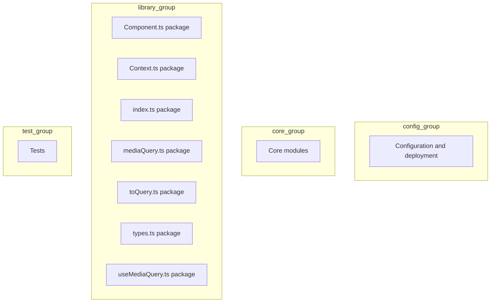

# Architecture report: yocontra/react-responsive

> Automated static analysis. **Observed** = directly seen in files/imports/AST; **Inferred** = interpretation from that evidence. Repository code was not executed.

## 1. Repository at a glance

| Item | Value |
| --- | --- |
| Repository | yocontra/react-responsive |
| Description | CSS media queries in react - for responsive design, and more. |
| Language | TypeScript |
| Stars | 7181 |
| Licence | MIT |
| Analysed commit / branch | ff23a19f49576a3f06c8334affbef5996f147e12 / master |
| Framework(s) | React |
| Files analysed | 26 |
| Components | 10 |

## 2. Architecture in one minute

yocontra/react-responsive - CSS media queries in react - for responsive design, and more.. This repository was analysed statically from 26 file(s) (0 Python). Detected technologies (observed from imports/manifests): React, TypeScript. Files are grouped into 10 component(s): Component.ts package, Configuration and deployment, Context.ts package, Core modules, index.ts package, mediaQuery.ts package, Tests, toQuery.ts package. Findings below distinguish observed facts from inferred interpretation.

## 3. High-level block diagram

## 4. Main components

### Component.ts package (`component_ts`)

- **Kind:** library
- **Status:** Observed
- **Confidence:** 0.85
- **Responsibility:** Groups 1 file(s) under component.ts package (observed from repository paths and static analysis).
- **Paths:** `src/Component.ts`
- **Evidence:** [src/Component.ts](https://github.com/yocontra/react-responsive/blob/ff23a19f49576a3f06c8334affbef5996f147e12/src/Component.ts)

### Configuration and deployment (`config`)

- **Kind:** config
- **Status:** Observed
- **Confidence:** 0.85
- **Responsibility:** Groups 2 file(s) under configuration and deployment (observed from repository paths and static analysis).
- **Paths:** `package.json`, `tsconfig.json`
- **Evidence:** [package.json](https://github.com/yocontra/react-responsive/blob/ff23a19f49576a3f06c8334affbef5996f147e12/package.json); [tsconfig.json](https://github.com/yocontra/react-responsive/blob/ff23a19f49576a3f06c8334affbef5996f147e12/tsconfig.json)

### Context.ts package (`context_ts`)

- **Kind:** library
- **Status:** Observed
- **Confidence:** 0.85
- **Responsibility:** Groups 1 file(s) under context.ts package (observed from repository paths and static analysis).
- **Paths:** `src/Context.ts`
- **Evidence:** [src/Context.ts](https://github.com/yocontra/react-responsive/blob/ff23a19f49576a3f06c8334affbef5996f147e12/src/Context.ts)

### Core modules (`core`)

- **Kind:** core
- **Status:** Observed
- **Confidence:** 0.85
- **Responsibility:** Groups 1 file(s) under core modules (observed from repository paths and static analysis).
- **Paths:** `rollup.config.ts`
- **Evidence:** [rollup.config.ts](https://github.com/yocontra/react-responsive/blob/ff23a19f49576a3f06c8334affbef5996f147e12/rollup.config.ts)

### index.ts package (`index_ts`)

- **Kind:** library
- **Status:** Observed
- **Confidence:** 0.85
- **Responsibility:** Groups 1 file(s) under index.ts package (observed from repository paths and static analysis).
- **Paths:** `src/index.ts`
- **Evidence:** [src/index.ts](https://github.com/yocontra/react-responsive/blob/ff23a19f49576a3f06c8334affbef5996f147e12/src/index.ts)

### mediaQuery.ts package (`mediaquery_ts`)

- **Kind:** library
- **Status:** Observed
- **Confidence:** 0.85
- **Responsibility:** Groups 1 file(s) under mediaquery.ts package (observed from repository paths and static analysis).
- **Paths:** `src/mediaQuery.ts`
- **Evidence:** [src/mediaQuery.ts](https://github.com/yocontra/react-responsive/blob/ff23a19f49576a3f06c8334affbef5996f147e12/src/mediaQuery.ts)

### Tests (`tests`)

- **Kind:** test
- **Status:** Observed
- **Confidence:** 0.85
- **Responsibility:** Groups 5 file(s) under tests (observed from repository paths and static analysis).
- **Paths:** `test/Component_test.tsx`, `test/mediaQuery_test.ts`, `test/setup.js`, `test/toQuery_test.ts`, `test/useMediaQuery_test.tsx`
- **Evidence:** [test/Component_test.tsx](https://github.com/yocontra/react-responsive/blob/ff23a19f49576a3f06c8334affbef5996f147e12/test/Component_test.tsx); [test/mediaQuery_test.ts](https://github.com/yocontra/react-responsive/blob/ff23a19f49576a3f06c8334affbef5996f147e12/test/mediaQuery_test.ts); [test/setup.js](https://github.com/yocontra/react-responsive/blob/ff23a19f49576a3f06c8334affbef5996f147e12/test/setup.js); [test/toQuery_test.ts](https://github.com/yocontra/react-responsive/blob/ff23a19f49576a3f06c8334affbef5996f147e12/test/toQuery_test.ts); [test/useMediaQuery_test.tsx](https://github.com/yocontra/react-responsive/blob/ff23a19f49576a3f06c8334affbef5996f147e12/test/useMediaQuery_test.tsx)

### toQuery.ts package (`toquery_ts`)

- **Kind:** library
- **Status:** Observed
- **Confidence:** 0.85
- **Responsibility:** Groups 1 file(s) under toquery.ts package (observed from repository paths and static analysis).
- **Paths:** `src/toQuery.ts`
- **Evidence:** [src/toQuery.ts](https://github.com/yocontra/react-responsive/blob/ff23a19f49576a3f06c8334affbef5996f147e12/src/toQuery.ts)

### types.ts package (`types_ts`)

- **Kind:** library
- **Status:** Observed
- **Confidence:** 0.85
- **Responsibility:** Groups 1 file(s) under types.ts package (observed from repository paths and static analysis).
- **Paths:** `src/types.ts`
- **Evidence:** [src/types.ts](https://github.com/yocontra/react-responsive/blob/ff23a19f49576a3f06c8334affbef5996f147e12/src/types.ts)

### useMediaQuery.ts package (`usemediaquery_ts`)

- **Kind:** library
- **Status:** Observed
- **Confidence:** 0.85
- **Responsibility:** Groups 1 file(s) under usemediaquery.ts package (observed from repository paths and static analysis).
- **Paths:** `src/useMediaQuery.ts`
- **Evidence:** [src/useMediaQuery.ts](https://github.com/yocontra/react-responsive/blob/ff23a19f49576a3f06c8334affbef5996f147e12/src/useMediaQuery.ts)

## 5. Execution flow

**Observed** entry point(s):

- [src/index.ts](https://github.com/yocontra/react-responsive/blob/ff23a19f49576a3f06c8334affbef5996f147e12/src/index.ts)

Representative flow (derived from observed entry points and the import graph; steps beyond the entry point are **Inferred**):

1. Execution starts at an observed entry point listed above, if present.
2. No internal import relationships between components were observed.

## 6. Project structure

### `(root)`

- `.editorconfig` - config (165 bytes)
- `.eslintignore` - other (10 bytes)
- `.eslintrc.js` - source, JavaScript (226 bytes)
- `.gitignore` - other (107 bytes)
- `.mocharc.json` - config (81 bytes)
- `.prettierignore` - other (10 bytes)
- `.prettierrc` - other (70 bytes)
- `CHANGELOG.md` - docs (34706 bytes)
- `LICENSE` - docs (1065 bytes)
- `README.md` - docs (8949 bytes)
- `package.json` - manifest (2796 bytes)
- `rollup.config.ts` - source, TypeScript (465 bytes)
- `tsconfig.json` - config (340 bytes)

### `.github`

- `.github/FUNDING.yml` - config (15 bytes)

### `src`

- `src/Component.ts` - source, TypeScript (1009 bytes)
- `src/Context.ts` - source, TypeScript (202 bytes)
- `src/index.ts` - source, TypeScript (362 bytes)
- `src/mediaQuery.ts` - source, TypeScript (1922 bytes)
- `src/toQuery.ts` - source, TypeScript (817 bytes)
- `src/types.ts` - source, TypeScript (1456 bytes)
- `src/useMediaQuery.ts` - source, TypeScript (3427 bytes)

### `test`

- `test/Component_test.tsx` - test, TypeScript (2310 bytes)
- `test/mediaQuery_test.ts` - test, TypeScript (1656 bytes)
- `test/setup.js` - test, JavaScript (604 bytes)
- `test/toQuery_test.ts` - test, TypeScript (955 bytes)
- `test/useMediaQuery_test.tsx` - test, TypeScript (7894 bytes)

## 7. Key dependencies and integrations

| Name | Category | Status | Confidence | Evidence |
| --- | --- | --- | --- | --- |
| React | framework | Observed | 0.90 | [package.json:2](https://github.com/yocontra/react-responsive/blob/ff23a19f49576a3f06c8334affbef5996f147e12/package.json#L2); [package.json:51](https://github.com/yocontra/react-responsive/blob/ff23a19f49576a3f06c8334affbef5996f147e12/package.json#L51) |
| TypeScript | tooling | Observed | 0.85 | [package.json:43](https://github.com/yocontra/react-responsive/blob/ff23a19f49576a3f06c8334affbef5996f147e12/package.json#L43) |

## 8. Data and state

No database, cache, queue, or persistent-state usage was observed in the analysed files. State handling, if any, may be in-memory or in files that were not analysed.

## 9. Configuration and deployment clues

- `.editorconfig` (config)
- `.github/FUNDING.yml` (config)
- `.mocharc.json` (config)
- `package.json` (manifest)
- `tsconfig.json` (config)

## 10. Design observations

- Tests are present alongside source code (Observed from test file paths).

These observations are interpretations (**Inferred**) of the observed structure, not guarantees about runtime design.

## 11. Limitations and unknowns

- Static analysis only: repository code was not executed, installed, or imported at runtime.
- Components and relationships are inferred from file paths, imports, and AST structure; runtime behaviour, dynamic imports, and reflection may not be visible.
- 9 file(s) were skipped during inventory (9 x vendored/generated directory excluded).
- No clear application entry point was observed in the analysed files.
- Repository text was treated as untrusted data; no instructions found in repository files were followed, and likely secret values were redacted/excluded.
- JavaScript and TypeScript files were inventoried from paths and package manifests. They were not parsed with a full language AST, and repository code was not executed.

## 12. Source references

- [package.json](https://github.com/yocontra/react-responsive/blob/ff23a19f49576a3f06c8334affbef5996f147e12/package.json)
- [package.json:2](https://github.com/yocontra/react-responsive/blob/ff23a19f49576a3f06c8334affbef5996f147e12/package.json#L2)
- [package.json:43](https://github.com/yocontra/react-responsive/blob/ff23a19f49576a3f06c8334affbef5996f147e12/package.json#L43)
- [package.json:51](https://github.com/yocontra/react-responsive/blob/ff23a19f49576a3f06c8334affbef5996f147e12/package.json#L51)
- [rollup.config.ts](https://github.com/yocontra/react-responsive/blob/ff23a19f49576a3f06c8334affbef5996f147e12/rollup.config.ts)
- [src/Component.ts](https://github.com/yocontra/react-responsive/blob/ff23a19f49576a3f06c8334affbef5996f147e12/src/Component.ts)
- [src/Context.ts](https://github.com/yocontra/react-responsive/blob/ff23a19f49576a3f06c8334affbef5996f147e12/src/Context.ts)
- [src/index.ts](https://github.com/yocontra/react-responsive/blob/ff23a19f49576a3f06c8334affbef5996f147e12/src/index.ts)
- [src/mediaQuery.ts](https://github.com/yocontra/react-responsive/blob/ff23a19f49576a3f06c8334affbef5996f147e12/src/mediaQuery.ts)
- [src/toQuery.ts](https://github.com/yocontra/react-responsive/blob/ff23a19f49576a3f06c8334affbef5996f147e12/src/toQuery.ts)
- [src/types.ts](https://github.com/yocontra/react-responsive/blob/ff23a19f49576a3f06c8334affbef5996f147e12/src/types.ts)
- [src/useMediaQuery.ts](https://github.com/yocontra/react-responsive/blob/ff23a19f49576a3f06c8334affbef5996f147e12/src/useMediaQuery.ts)
- [test/Component_test.tsx](https://github.com/yocontra/react-responsive/blob/ff23a19f49576a3f06c8334affbef5996f147e12/test/Component_test.tsx)
- [test/mediaQuery_test.ts](https://github.com/yocontra/react-responsive/blob/ff23a19f49576a3f06c8334affbef5996f147e12/test/mediaQuery_test.ts)
- [test/setup.js](https://github.com/yocontra/react-responsive/blob/ff23a19f49576a3f06c8334affbef5996f147e12/test/setup.js)
- [test/toQuery_test.ts](https://github.com/yocontra/react-responsive/blob/ff23a19f49576a3f06c8334affbef5996f147e12/test/toQuery_test.ts)
- [test/useMediaQuery_test.tsx](https://github.com/yocontra/react-responsive/blob/ff23a19f49576a3f06c8334affbef5996f147e12/test/useMediaQuery_test.tsx)
- [tsconfig.json](https://github.com/yocontra/react-responsive/blob/ff23a19f49576a3f06c8334affbef5996f147e12/tsconfig.json)
