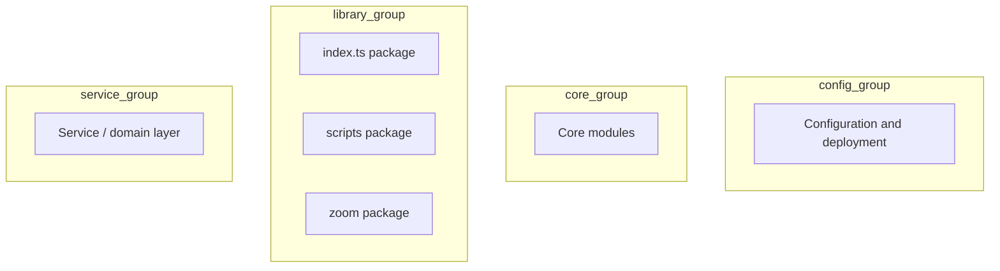

# Architecture report: zcreativelabs/react-simple-maps

> Automated static analysis. **Observed** = directly seen in files/imports/AST; **Inferred** = interpretation from that evidence. Repository code was not executed.

## 1. Repository at a glance

| Item | Value |
| --- | --- |
| Repository | zcreativelabs/react-simple-maps |
| Description | Composable SVG map charts for data visualization in React |
| Language | TypeScript |
| Stars | 3393 |
| Licence | MIT |
| Analysed commit / branch | 80d87555f3226ab0267119ef7bf4c36658a52be5 / main |
| Framework(s) | React |
| Files analysed | 45 |
| Components | 6 |

## 2. Architecture in one minute

zcreativelabs/react-simple-maps - Composable SVG map charts for data visualization in React. This repository was analysed statically from 45 file(s) (0 Python). Detected technologies (observed from imports/manifests): React, TypeScript, Vitest. Files are grouped into 6 component(s): Configuration and deployment, Core modules, index.ts package, scripts package, Service / domain layer, zoom package. Findings below distinguish observed facts from inferred interpretation.

## 3. High-level block diagram

## 4. Main components

### Configuration and deployment (`config`)

- **Kind:** config
- **Status:** Observed
- **Confidence:** 0.85
- **Responsibility:** Groups 3 file(s) under configuration and deployment (observed from repository paths and static analysis).
- **Paths:** `package.json`, `tsconfig.build.json`, `tsconfig.json`
- **Evidence:** [package.json](https://github.com/zcreativelabs/react-simple-maps/blob/80d87555f3226ab0267119ef7bf4c36658a52be5/package.json); [tsconfig.build.json](https://github.com/zcreativelabs/react-simple-maps/blob/80d87555f3226ab0267119ef7bf4c36658a52be5/tsconfig.build.json); [tsconfig.json](https://github.com/zcreativelabs/react-simple-maps/blob/80d87555f3226ab0267119ef7bf4c36658a52be5/tsconfig.json)

### Core modules (`core`)

- **Kind:** core
- **Status:** Observed
- **Confidence:** 0.85
- **Responsibility:** Groups 2 file(s) under core modules (observed from repository paths and static analysis).
- **Paths:** `rollup.config.js`, `vitest.config.ts`
- **Evidence:** [rollup.config.js](https://github.com/zcreativelabs/react-simple-maps/blob/80d87555f3226ab0267119ef7bf4c36658a52be5/rollup.config.js); [vitest.config.ts](https://github.com/zcreativelabs/react-simple-maps/blob/80d87555f3226ab0267119ef7bf4c36658a52be5/vitest.config.ts)

### index.ts package (`index_ts`)

- **Kind:** library
- **Status:** Observed
- **Confidence:** 0.85
- **Responsibility:** Groups 1 file(s) under index.ts package (observed from repository paths and static analysis).
- **Paths:** `src/index.ts`
- **Evidence:** [src/index.ts](https://github.com/zcreativelabs/react-simple-maps/blob/80d87555f3226ab0267119ef7bf4c36658a52be5/src/index.ts)

### scripts package (`scripts`)

- **Kind:** library
- **Status:** Observed
- **Confidence:** 0.85
- **Responsibility:** Groups 1 file(s) under scripts package (observed from repository paths and static analysis).
- **Paths:** `scripts/smoke-types.sh`
- **Evidence:** [scripts/smoke-types.sh](https://github.com/zcreativelabs/react-simple-maps/blob/80d87555f3226ab0267119ef7bf4c36658a52be5/scripts/smoke-types.sh)

### Service / domain layer (`service_layer`)

- **Kind:** service
- **Status:** Observed
- **Confidence:** 0.85
- **Responsibility:** Groups 24 file(s) under service / domain layer (observed from repository paths and static analysis).
- **Paths:** `src/core/components/Annotation.test.tsx`, `src/core/components/Annotation.ts`, `src/core/components/ComposableMap.test.tsx`, `src/core/components/ComposableMap.ts`, `src/core/components/Geographies.test.tsx`, `src/core/components/Geographies.ts`, `src/core/components/Geography.test.tsx`, `src/core/components/Geography.ts`, `src/core/components/Graticule.test.tsx`, `src/core/components/Graticule.ts`, `src/core/components/Line.test.tsx`, `src/core/components/Line.ts`, `src/core/components/MapProvider.test.tsx`, `src/core/components/MapProvider.ts`, `src/core/components/Marker.test.tsx`, `src/core/components/Marker.ts`, `src/core/components/Sphere.test.tsx`, `src/core/components/Sphere.ts`, `src/core/hooks/useGeographies.test.tsx`, `src/core/hooks/useGeographies.ts`, `src/core/index.ts`, `src/core/types/index.ts`, `src/core/utils.test.ts`, `src/core/utils.ts`
- **Evidence:** [src/core/components/Annotation.test.tsx](https://github.com/zcreativelabs/react-simple-maps/blob/80d87555f3226ab0267119ef7bf4c36658a52be5/src/core/components/Annotation.test.tsx); [src/core/components/Annotation.ts](https://github.com/zcreativelabs/react-simple-maps/blob/80d87555f3226ab0267119ef7bf4c36658a52be5/src/core/components/Annotation.ts); [src/core/components/ComposableMap.test.tsx](https://github.com/zcreativelabs/react-simple-maps/blob/80d87555f3226ab0267119ef7bf4c36658a52be5/src/core/components/ComposableMap.test.tsx); [src/core/components/ComposableMap.ts](https://github.com/zcreativelabs/react-simple-maps/blob/80d87555f3226ab0267119ef7bf4c36658a52be5/src/core/components/ComposableMap.ts); [src/core/components/Geographies.test.tsx](https://github.com/zcreativelabs/react-simple-maps/blob/80d87555f3226ab0267119ef7bf4c36658a52be5/src/core/components/Geographies.test.tsx); [src/core/components/Geographies.ts](https://github.com/zcreativelabs/react-simple-maps/blob/80d87555f3226ab0267119ef7bf4c36658a52be5/src/core/components/Geographies.ts); [src/core/components/Geography.test.tsx](https://github.com/zcreativelabs/react-simple-maps/blob/80d87555f3226ab0267119ef7bf4c36658a52be5/src/core/components/Geography.test.tsx); [src/core/components/Geography.ts](https://github.com/zcreativelabs/react-simple-maps/blob/80d87555f3226ab0267119ef7bf4c36658a52be5/src/core/components/Geography.ts)

### zoom package (`zoom`)

- **Kind:** library
- **Status:** Observed
- **Confidence:** 0.85
- **Responsibility:** Groups 8 file(s) under zoom package (observed from repository paths and static analysis).
- **Paths:** `src/zoom/components/ZoomPanProvider.test.tsx`, `src/zoom/components/ZoomPanProvider.ts`, `src/zoom/components/ZoomableGroup.test.tsx`, `src/zoom/components/ZoomableGroup.ts`, `src/zoom/hooks/useZoomPan.test.tsx`, `src/zoom/hooks/useZoomPan.ts`, `src/zoom/index.ts`, `src/zoom/types/index.ts`
- **Evidence:** [src/zoom/components/ZoomPanProvider.test.tsx](https://github.com/zcreativelabs/react-simple-maps/blob/80d87555f3226ab0267119ef7bf4c36658a52be5/src/zoom/components/ZoomPanProvider.test.tsx); [src/zoom/components/ZoomPanProvider.ts](https://github.com/zcreativelabs/react-simple-maps/blob/80d87555f3226ab0267119ef7bf4c36658a52be5/src/zoom/components/ZoomPanProvider.ts); [src/zoom/components/ZoomableGroup.test.tsx](https://github.com/zcreativelabs/react-simple-maps/blob/80d87555f3226ab0267119ef7bf4c36658a52be5/src/zoom/components/ZoomableGroup.test.tsx); [src/zoom/components/ZoomableGroup.ts](https://github.com/zcreativelabs/react-simple-maps/blob/80d87555f3226ab0267119ef7bf4c36658a52be5/src/zoom/components/ZoomableGroup.ts); [src/zoom/hooks/useZoomPan.test.tsx](https://github.com/zcreativelabs/react-simple-maps/blob/80d87555f3226ab0267119ef7bf4c36658a52be5/src/zoom/hooks/useZoomPan.test.tsx); [src/zoom/hooks/useZoomPan.ts](https://github.com/zcreativelabs/react-simple-maps/blob/80d87555f3226ab0267119ef7bf4c36658a52be5/src/zoom/hooks/useZoomPan.ts); [src/zoom/index.ts](https://github.com/zcreativelabs/react-simple-maps/blob/80d87555f3226ab0267119ef7bf4c36658a52be5/src/zoom/index.ts); [src/zoom/types/index.ts](https://github.com/zcreativelabs/react-simple-maps/blob/80d87555f3226ab0267119ef7bf4c36658a52be5/src/zoom/types/index.ts)

## 5. Execution flow

**Observed** entry point(s):

- [src/core/index.ts](https://github.com/zcreativelabs/react-simple-maps/blob/80d87555f3226ab0267119ef7bf4c36658a52be5/src/core/index.ts)
- [src/core/types/index.ts](https://github.com/zcreativelabs/react-simple-maps/blob/80d87555f3226ab0267119ef7bf4c36658a52be5/src/core/types/index.ts)
- [src/index.ts](https://github.com/zcreativelabs/react-simple-maps/blob/80d87555f3226ab0267119ef7bf4c36658a52be5/src/index.ts)
- [src/zoom/index.ts](https://github.com/zcreativelabs/react-simple-maps/blob/80d87555f3226ab0267119ef7bf4c36658a52be5/src/zoom/index.ts)
- [src/zoom/types/index.ts](https://github.com/zcreativelabs/react-simple-maps/blob/80d87555f3226ab0267119ef7bf4c36658a52be5/src/zoom/types/index.ts)

Representative flow (derived from observed entry points and the import graph; steps beyond the entry point are **Inferred**):

1. Execution starts at an observed entry point listed above, if present.
2. No internal import relationships between components were observed.

## 6. Project structure

### `(root)`

- `.gitignore` - other (222 bytes)
- `.prettierrc.json` - config (457 bytes)
- `CHANGELOG.md` - docs (1370 bytes)
- `CODE_OF_CONDUCT.md` - docs (3222 bytes)
- `LICENSE` - docs (1073 bytes)
- `README.md` - docs (3470 bytes)
- `package.json` - manifest (2717 bytes)
- `rollup.config.js` - source, JavaScript (1913 bytes)
- `tsconfig.build.json` - config (148 bytes)
- `tsconfig.json` - config (614 bytes)
- `vitest.config.ts` - source, TypeScript (375 bytes)

### `scripts`

- `scripts/smoke-types.sh` - source, Shell (2936 bytes)

### `src`

- `src/core/components/Annotation.test.tsx` - source, TypeScript (4701 bytes)
- `src/core/components/Annotation.ts` - source, TypeScript (1074 bytes)
- `src/core/components/ComposableMap.test.tsx` - source, TypeScript (3626 bytes)
- `src/core/components/ComposableMap.ts` - source, TypeScript (817 bytes)
- `src/core/components/Geographies.test.tsx` - source, TypeScript (5498 bytes)
- `src/core/components/Geographies.ts` - source, TypeScript (865 bytes)
- `src/core/components/Geography.test.tsx` - source, TypeScript (2601 bytes)
- `src/core/components/Geography.ts` - source, TypeScript (464 bytes)
- `src/core/components/Graticule.test.tsx` - source, TypeScript (2723 bytes)
- `src/core/components/Graticule.ts` - source, TypeScript (707 bytes)
- `src/core/components/Line.test.tsx` - source, TypeScript (3210 bytes)
- `src/core/components/Line.ts` - source, TypeScript (793 bytes)
- `src/core/components/MapProvider.test.tsx` - source, TypeScript (6831 bytes)
- `src/core/components/MapProvider.ts` - source, TypeScript (3268 bytes)
- `src/core/components/Marker.test.tsx` - source, TypeScript (4264 bytes)
- `src/core/components/Marker.ts` - source, TypeScript (675 bytes)
- `src/core/components/Sphere.test.tsx` - source, TypeScript (3372 bytes)
- `src/core/components/Sphere.ts` - source, TypeScript (1037 bytes)
- `src/core/hooks/useGeographies.test.tsx` - source, TypeScript (7264 bytes)
- `src/core/hooks/useGeographies.ts` - source, TypeScript (2099 bytes)
- `src/core/index.ts` - source, TypeScript (674 bytes)
- `src/core/types/index.ts` - source, TypeScript (3769 bytes)
- `src/core/utils.test.ts` - source, TypeScript (4877 bytes)
- `src/core/utils.ts` - source, TypeScript (3530 bytes)
- `src/index.ts` - source, TypeScript (58 bytes)
- `src/zoom/components/ZoomPanProvider.test.tsx` - source, TypeScript (1647 bytes)
- `src/zoom/components/ZoomPanProvider.ts` - source, TypeScript (785 bytes)
- `src/zoom/components/ZoomableGroup.test.tsx` - source, TypeScript (4236 bytes)
- `src/zoom/components/ZoomableGroup.ts` - source, TypeScript (1479 bytes)
- `src/zoom/hooks/useZoomPan.test.tsx` - source, TypeScript (13169 bytes)
- `src/zoom/hooks/useZoomPan.ts` - source, TypeScript (6222 bytes)
- `src/zoom/index.ts` - source, TypeScript (264 bytes)
- `src/zoom/types/index.ts` - source, TypeScript (1781 bytes)

## 7. Key dependencies and integrations

| Name | Category | Status | Confidence | Evidence |
| --- | --- | --- | --- | --- |
| React | framework | Observed | 0.90 | [package.json:2](https://github.com/zcreativelabs/react-simple-maps/blob/80d87555f3226ab0267119ef7bf4c36658a52be5/package.json#L2); [package.json:57](https://github.com/zcreativelabs/react-simple-maps/blob/80d87555f3226ab0267119ef7bf4c36658a52be5/package.json#L57) |
| TypeScript | tooling | Observed | 0.85 | [package.json:75](https://github.com/zcreativelabs/react-simple-maps/blob/80d87555f3226ab0267119ef7bf4c36658a52be5/package.json#L75) |
| Vitest | tooling | Observed | 0.85 | [package.json:33](https://github.com/zcreativelabs/react-simple-maps/blob/80d87555f3226ab0267119ef7bf4c36658a52be5/package.json#L33) |

## 8. Data and state

No database, cache, queue, or persistent-state usage was observed in the analysed files. State handling, if any, may be in-memory or in files that were not analysed.

## 9. Configuration and deployment clues

- `.prettierrc.json` (config)
- `package.json` (manifest)
- `tsconfig.build.json` (config)
- `tsconfig.json` (config)

## 10. Design observations

- Service/domain code is distinct from entry and data code, suggesting layered separation (Inferred).

These observations are interpretations (**Inferred**) of the observed structure, not guarantees about runtime design.

## 11. Limitations and unknowns

- Static analysis only: repository code was not executed, installed, or imported at runtime.
- Components and relationships are inferred from file paths, imports, and AST structure; runtime behaviour, dynamic imports, and reflection may not be visible.
- 1 file(s) were skipped during inventory (1 x lockfile excluded).
- No clear application entry point was observed in the analysed files.
- Repository text was treated as untrusted data; no instructions found in repository files were followed, and likely secret values were redacted/excluded.
- JavaScript and TypeScript files were inventoried from paths and package manifests. They were not parsed with a full language AST, and repository code was not executed.

## 12. Source references

- [package.json](https://github.com/zcreativelabs/react-simple-maps/blob/80d87555f3226ab0267119ef7bf4c36658a52be5/package.json)
- [package.json:2](https://github.com/zcreativelabs/react-simple-maps/blob/80d87555f3226ab0267119ef7bf4c36658a52be5/package.json#L2)
- [package.json:33](https://github.com/zcreativelabs/react-simple-maps/blob/80d87555f3226ab0267119ef7bf4c36658a52be5/package.json#L33)
- [package.json:57](https://github.com/zcreativelabs/react-simple-maps/blob/80d87555f3226ab0267119ef7bf4c36658a52be5/package.json#L57)
- [package.json:75](https://github.com/zcreativelabs/react-simple-maps/blob/80d87555f3226ab0267119ef7bf4c36658a52be5/package.json#L75)
- [rollup.config.js](https://github.com/zcreativelabs/react-simple-maps/blob/80d87555f3226ab0267119ef7bf4c36658a52be5/rollup.config.js)
- [scripts/smoke-types.sh](https://github.com/zcreativelabs/react-simple-maps/blob/80d87555f3226ab0267119ef7bf4c36658a52be5/scripts/smoke-types.sh)
- [src/core/components/Annotation.test.tsx](https://github.com/zcreativelabs/react-simple-maps/blob/80d87555f3226ab0267119ef7bf4c36658a52be5/src/core/components/Annotation.test.tsx)
- [src/core/components/Annotation.ts](https://github.com/zcreativelabs/react-simple-maps/blob/80d87555f3226ab0267119ef7bf4c36658a52be5/src/core/components/Annotation.ts)
- [src/core/components/ComposableMap.test.tsx](https://github.com/zcreativelabs/react-simple-maps/blob/80d87555f3226ab0267119ef7bf4c36658a52be5/src/core/components/ComposableMap.test.tsx)
- [src/core/components/ComposableMap.ts](https://github.com/zcreativelabs/react-simple-maps/blob/80d87555f3226ab0267119ef7bf4c36658a52be5/src/core/components/ComposableMap.ts)
- [src/core/components/Geographies.test.tsx](https://github.com/zcreativelabs/react-simple-maps/blob/80d87555f3226ab0267119ef7bf4c36658a52be5/src/core/components/Geographies.test.tsx)
- [src/core/components/Geographies.ts](https://github.com/zcreativelabs/react-simple-maps/blob/80d87555f3226ab0267119ef7bf4c36658a52be5/src/core/components/Geographies.ts)
- [src/core/components/Geography.test.tsx](https://github.com/zcreativelabs/react-simple-maps/blob/80d87555f3226ab0267119ef7bf4c36658a52be5/src/core/components/Geography.test.tsx)
- [src/core/components/Geography.ts](https://github.com/zcreativelabs/react-simple-maps/blob/80d87555f3226ab0267119ef7bf4c36658a52be5/src/core/components/Geography.ts)
- [src/core/index.ts](https://github.com/zcreativelabs/react-simple-maps/blob/80d87555f3226ab0267119ef7bf4c36658a52be5/src/core/index.ts)
- [src/core/types/index.ts](https://github.com/zcreativelabs/react-simple-maps/blob/80d87555f3226ab0267119ef7bf4c36658a52be5/src/core/types/index.ts)
- [src/index.ts](https://github.com/zcreativelabs/react-simple-maps/blob/80d87555f3226ab0267119ef7bf4c36658a52be5/src/index.ts)
- [src/zoom/components/ZoomPanProvider.test.tsx](https://github.com/zcreativelabs/react-simple-maps/blob/80d87555f3226ab0267119ef7bf4c36658a52be5/src/zoom/components/ZoomPanProvider.test.tsx)
- [src/zoom/components/ZoomPanProvider.ts](https://github.com/zcreativelabs/react-simple-maps/blob/80d87555f3226ab0267119ef7bf4c36658a52be5/src/zoom/components/ZoomPanProvider.ts)
- [src/zoom/components/ZoomableGroup.test.tsx](https://github.com/zcreativelabs/react-simple-maps/blob/80d87555f3226ab0267119ef7bf4c36658a52be5/src/zoom/components/ZoomableGroup.test.tsx)
- [src/zoom/components/ZoomableGroup.ts](https://github.com/zcreativelabs/react-simple-maps/blob/80d87555f3226ab0267119ef7bf4c36658a52be5/src/zoom/components/ZoomableGroup.ts)
- [src/zoom/hooks/useZoomPan.test.tsx](https://github.com/zcreativelabs/react-simple-maps/blob/80d87555f3226ab0267119ef7bf4c36658a52be5/src/zoom/hooks/useZoomPan.test.tsx)
- [src/zoom/hooks/useZoomPan.ts](https://github.com/zcreativelabs/react-simple-maps/blob/80d87555f3226ab0267119ef7bf4c36658a52be5/src/zoom/hooks/useZoomPan.ts)
- [src/zoom/index.ts](https://github.com/zcreativelabs/react-simple-maps/blob/80d87555f3226ab0267119ef7bf4c36658a52be5/src/zoom/index.ts)
- [src/zoom/types/index.ts](https://github.com/zcreativelabs/react-simple-maps/blob/80d87555f3226ab0267119ef7bf4c36658a52be5/src/zoom/types/index.ts)
- [tsconfig.build.json](https://github.com/zcreativelabs/react-simple-maps/blob/80d87555f3226ab0267119ef7bf4c36658a52be5/tsconfig.build.json)
- [tsconfig.json](https://github.com/zcreativelabs/react-simple-maps/blob/80d87555f3226ab0267119ef7bf4c36658a52be5/tsconfig.json)
- [vitest.config.ts](https://github.com/zcreativelabs/react-simple-maps/blob/80d87555f3226ab0267119ef7bf4c36658a52be5/vitest.config.ts)
