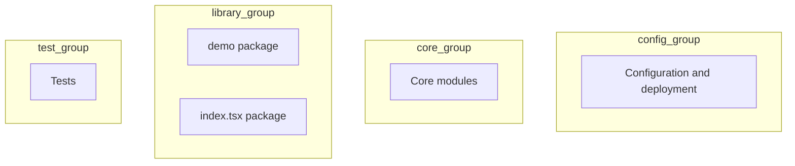

# Architecture report: zenoamaro/react-quill

> Automated static analysis. **Observed** = directly seen in files/imports/AST; **Inferred** = interpretation from that evidence. Repository code was not executed.

## 1. Repository at a glance

| Item | Value |
| --- | --- |
| Repository | zenoamaro/react-quill |
| Description | A Quill component for React. |
| Language | JavaScript |
| Stars | 6996 |
| Licence | MIT |
| Analysed commit / branch | 615b4bf730e7a34c1dda1707447123c1d727f9d1 / master |
| Framework(s) | React |
| Files analysed | 21 |
| Components | 5 |

## 2. Architecture in one minute

zenoamaro/react-quill - A Quill component for React.. This repository was analysed statically from 21 file(s) (0 Python). Detected technologies (observed from imports/manifests): React, TypeScript, webpack. Files are grouped into 5 component(s): Configuration and deployment, Core modules, demo package, index.tsx package, Tests. Findings below distinguish observed facts from inferred interpretation.

## 3. High-level block diagram

## 4. Main components

### Configuration and deployment (`config`)

- **Kind:** config
- **Status:** Observed
- **Confidence:** 0.85
- **Responsibility:** Groups 3 file(s) under configuration and deployment (observed from repository paths and static analysis).
- **Paths:** `cypress.json`, `package.json`, `tsconfig.json`
- **Evidence:** [cypress.json](https://github.com/zenoamaro/react-quill/blob/615b4bf730e7a34c1dda1707447123c1d727f9d1/cypress.json); [package.json](https://github.com/zenoamaro/react-quill/blob/615b4bf730e7a34c1dda1707447123c1d727f9d1/package.json); [tsconfig.json](https://github.com/zenoamaro/react-quill/blob/615b4bf730e7a34c1dda1707447123c1d727f9d1/tsconfig.json)

### Core modules (`core`)

- **Kind:** core
- **Status:** Observed
- **Confidence:** 0.85
- **Responsibility:** Groups 1 file(s) under core modules (observed from repository paths and static analysis).
- **Paths:** `webpack.config.js`
- **Evidence:** [webpack.config.js](https://github.com/zenoamaro/react-quill/blob/615b4bf730e7a34c1dda1707447123c1d727f9d1/webpack.config.js)

### demo package (`demo`)

- **Kind:** library
- **Status:** Observed
- **Confidence:** 0.85
- **Responsibility:** Groups 1 file(s) under demo package (observed from repository paths and static analysis).
- **Paths:** `demo/index.js`
- **Evidence:** [demo/index.js](https://github.com/zenoamaro/react-quill/blob/615b4bf730e7a34c1dda1707447123c1d727f9d1/demo/index.js)

### index.tsx package (`index_tsx`)

- **Kind:** library
- **Status:** Observed
- **Confidence:** 0.85
- **Responsibility:** Groups 1 file(s) under index.tsx package (observed from repository paths and static analysis).
- **Paths:** `src/index.tsx`
- **Evidence:** [src/index.tsx](https://github.com/zenoamaro/react-quill/blob/615b4bf730e7a34c1dda1707447123c1d727f9d1/src/index.tsx)

### Tests (`tests`)

- **Kind:** test
- **Status:** Observed
- **Confidence:** 0.85
- **Responsibility:** Groups 6 file(s) under tests (observed from repository paths and static analysis).
- **Paths:** `test/index.js`, `test/index.spec.js`, `test/polyfills/MutationObserver.js`, `test/polyfills/getSelection.js`, `test/setup.js`, `test/utils.js`
- **Evidence:** [test/index.js](https://github.com/zenoamaro/react-quill/blob/615b4bf730e7a34c1dda1707447123c1d727f9d1/test/index.js); [test/index.spec.js](https://github.com/zenoamaro/react-quill/blob/615b4bf730e7a34c1dda1707447123c1d727f9d1/test/index.spec.js); [test/polyfills/MutationObserver.js](https://github.com/zenoamaro/react-quill/blob/615b4bf730e7a34c1dda1707447123c1d727f9d1/test/polyfills/MutationObserver.js); [test/polyfills/getSelection.js](https://github.com/zenoamaro/react-quill/blob/615b4bf730e7a34c1dda1707447123c1d727f9d1/test/polyfills/getSelection.js); [test/setup.js](https://github.com/zenoamaro/react-quill/blob/615b4bf730e7a34c1dda1707447123c1d727f9d1/test/setup.js); [test/utils.js](https://github.com/zenoamaro/react-quill/blob/615b4bf730e7a34c1dda1707447123c1d727f9d1/test/utils.js)

## 5. Execution flow

**Observed** entry point(s):

- [demo/index.js](https://github.com/zenoamaro/react-quill/blob/615b4bf730e7a34c1dda1707447123c1d727f9d1/demo/index.js)
- [src/index.tsx](https://github.com/zenoamaro/react-quill/blob/615b4bf730e7a34c1dda1707447123c1d727f9d1/src/index.tsx)

Representative flow (derived from observed entry points and the import graph; steps beyond the entry point are **Inferred**):

1. Execution starts at an observed entry point listed above, if present.
2. No internal import relationships between components were observed.

## 6. Project structure

### `(root)`

- `.gitignore` - other (219 bytes)
- `.prettierrc` - other (52 bytes)
- `.travis.yml` - ci, YAML (440 bytes)
- `CHANGELOG.md` - docs (6671 bytes)
- `LICENSE` - docs (1099 bytes)
- `README.md` - docs (24977 bytes)
- `cypress.json` - config (251 bytes)
- `package.json` - manifest (2475 bytes)
- `tsconfig.json` - config (390 bytes)
- `webpack.config.js` - source, JavaScript (989 bytes)

### `.github`

- `.github/ISSUE_TEMPLATE.md` - docs (1367 bytes)

### `demo`

- `demo/index.html` - other (606 bytes)
- `demo/index.js` - source, JavaScript (3439 bytes)
- `demo/test.html` - other (175 bytes)

### `src`

- `src/index.tsx` - source, TypeScript (16094 bytes)

### `test`

- `test/index.js` - test, JavaScript (7719 bytes)
- `test/index.spec.js` - test, JavaScript (5697 bytes)
- `test/polyfills/MutationObserver.js` - test, JavaScript (12668 bytes)
- `test/polyfills/getSelection.js` - test, JavaScript (509 bytes)
- `test/setup.js` - test, JavaScript (666 bytes)
- `test/utils.js` - test, JavaScript (1020 bytes)

## 7. Key dependencies and integrations

| Name | Category | Status | Confidence | Evidence |
| --- | --- | --- | --- | --- |
| React | framework | Observed | 0.90 | [package.json:2](https://github.com/zenoamaro/react-quill/blob/615b4bf730e7a34c1dda1707447123c1d727f9d1/package.json#L2); [package.json:52](https://github.com/zenoamaro/react-quill/blob/615b4bf730e7a34c1dda1707447123c1d727f9d1/package.json#L52) |
| TypeScript | tooling | Observed | 0.85 | [package.json:82](https://github.com/zenoamaro/react-quill/blob/615b4bf730e7a34c1dda1707447123c1d727f9d1/package.json#L82) |
| webpack | tooling | Observed | 0.85 | [package.json:15](https://github.com/zenoamaro/react-quill/blob/615b4bf730e7a34c1dda1707447123c1d727f9d1/package.json#L15) |

## 8. Data and state

No database, cache, queue, or persistent-state usage was observed in the analysed files. State handling, if any, may be in-memory or in files that were not analysed.

## 9. Configuration and deployment clues

- `.travis.yml` (ci)
- `cypress.json` (config)
- `package.json` (manifest)
- `tsconfig.json` (config)

## 10. Design observations

- Tests are present alongside source code (Observed from test file paths).

These observations are interpretations (**Inferred**) of the observed structure, not guarantees about runtime design.

## 11. Limitations and unknowns

- Static analysis only: repository code was not executed, installed, or imported at runtime.
- Components and relationships are inferred from file paths, imports, and AST structure; runtime behaviour, dynamic imports, and reflection may not be visible.
- No clear application entry point was observed in the analysed files.
- Repository text was treated as untrusted data; no instructions found in repository files were followed, and likely secret values were redacted/excluded.
- JavaScript and TypeScript files were inventoried from paths and package manifests. They were not parsed with a full language AST, and repository code was not executed.

## 12. Source references

- [cypress.json](https://github.com/zenoamaro/react-quill/blob/615b4bf730e7a34c1dda1707447123c1d727f9d1/cypress.json)
- [demo/index.js](https://github.com/zenoamaro/react-quill/blob/615b4bf730e7a34c1dda1707447123c1d727f9d1/demo/index.js)
- [package.json](https://github.com/zenoamaro/react-quill/blob/615b4bf730e7a34c1dda1707447123c1d727f9d1/package.json)
- [package.json:2](https://github.com/zenoamaro/react-quill/blob/615b4bf730e7a34c1dda1707447123c1d727f9d1/package.json#L2)
- [package.json:15](https://github.com/zenoamaro/react-quill/blob/615b4bf730e7a34c1dda1707447123c1d727f9d1/package.json#L15)
- [package.json:52](https://github.com/zenoamaro/react-quill/blob/615b4bf730e7a34c1dda1707447123c1d727f9d1/package.json#L52)
- [package.json:82](https://github.com/zenoamaro/react-quill/blob/615b4bf730e7a34c1dda1707447123c1d727f9d1/package.json#L82)
- [src/index.tsx](https://github.com/zenoamaro/react-quill/blob/615b4bf730e7a34c1dda1707447123c1d727f9d1/src/index.tsx)
- [test/index.js](https://github.com/zenoamaro/react-quill/blob/615b4bf730e7a34c1dda1707447123c1d727f9d1/test/index.js)
- [test/index.spec.js](https://github.com/zenoamaro/react-quill/blob/615b4bf730e7a34c1dda1707447123c1d727f9d1/test/index.spec.js)
- [test/polyfills/MutationObserver.js](https://github.com/zenoamaro/react-quill/blob/615b4bf730e7a34c1dda1707447123c1d727f9d1/test/polyfills/MutationObserver.js)
- [test/polyfills/getSelection.js](https://github.com/zenoamaro/react-quill/blob/615b4bf730e7a34c1dda1707447123c1d727f9d1/test/polyfills/getSelection.js)
- [test/setup.js](https://github.com/zenoamaro/react-quill/blob/615b4bf730e7a34c1dda1707447123c1d727f9d1/test/setup.js)
- [test/utils.js](https://github.com/zenoamaro/react-quill/blob/615b4bf730e7a34c1dda1707447123c1d727f9d1/test/utils.js)
- [tsconfig.json](https://github.com/zenoamaro/react-quill/blob/615b4bf730e7a34c1dda1707447123c1d727f9d1/tsconfig.json)
- [webpack.config.js](https://github.com/zenoamaro/react-quill/blob/615b4bf730e7a34c1dda1707447123c1d727f9d1/webpack.config.js)
