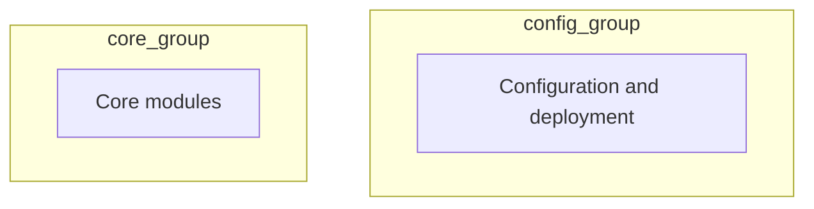

# Architecture report: zhongsp/TypeScript

> Automated static analysis. **Observed** = directly seen in files/imports/AST; **Inferred** = interpretation from that evidence. Repository code was not executed.

## 1. Repository at a glance

| Item | Value |
| --- | --- |
| Repository | zhongsp/TypeScript |
| Description | TypeScript 使用手册（中文版）翻译。http://www.typescriptlang.org |
| Language | TypeScript |
| Stars | 7413 |
| Licence | MIT |
| Analysed commit / branch | 63d9d9c821b726946d60be40bb09b4a1154f95f0 / dev |
| Framework(s) | None detected |
| Files analysed | 321 |
| Components | 2 |

## 2. Architecture in one minute

zhongsp/TypeScript - TypeScript 使用手册（中文版）翻译。http://www.typescriptlang.org. This repository was analysed statically from 321 file(s) (0 Python). Detected technologies (observed from imports/manifests): GitHub Actions. Files are grouped into 2 component(s): Configuration and deployment, Core modules. Findings below distinguish observed facts from inferred interpretation.

## 3. High-level block diagram

## 4. Main components

### Configuration and deployment (`config`)

- **Kind:** config
- **Status:** Observed
- **Confidence:** 0.85
- **Responsibility:** Groups 2 file(s) under configuration and deployment (observed from repository paths and static analysis).
- **Paths:** `book.toml`, `package.json`
- **Evidence:** [book.toml](https://github.com/zhongsp/TypeScript/blob/63d9d9c821b726946d60be40bb09b4a1154f95f0/book.toml); [package.json](https://github.com/zhongsp/TypeScript/blob/63d9d9c821b726946d60be40bb09b4a1154f95f0/package.json)

### Core modules (`core`)

- **Kind:** core
- **Status:** Observed
- **Confidence:** 0.85
- **Responsibility:** Groups 2 file(s) under core modules (observed from repository paths and static analysis).
- **Paths:** `gulpfile.js`, `lint.js`
- **Evidence:** [gulpfile.js](https://github.com/zhongsp/TypeScript/blob/63d9d9c821b726946d60be40bb09b4a1154f95f0/gulpfile.js); [lint.js](https://github.com/zhongsp/TypeScript/blob/63d9d9c821b726946d60be40bb09b4a1154f95f0/lint.js)

## 5. Execution flow

No entry point was observed; the startup flow below is therefore limited.

Representative flow (derived from observed entry points and the import graph; steps beyond the entry point are **Inferred**):

1. Execution starts at an observed entry point listed above, if present.
2. No internal import relationships between components were observed.

## 6. Project structure

### `(root)`

- `.gitattributes` - other (107 bytes)
- `.gitignore` - other (42 bytes)
- `.travis.yml` - ci, YAML (36 bytes)
- `.yarnrc.yml` - config (25 bytes)
- `CONTRIBUTING.md` - docs (353 bytes)
- `LICENSE` - docs (1083 bytes)
- `PREFACE.md` - docs (3508 bytes)
- `README.md` - docs (10129 bytes)
- `SUMMARY.md` - docs (7465 bytes)
- `book.toml` - config (414 bytes)
- `gulpfile.js` - source, JavaScript (516 bytes)
- `lint.js` - source, JavaScript (4192 bytes)
- `package.json` - manifest (759 bytes)

### `.github`

- `.github/CONTRIBUTING.md` - docs (1334 bytes)
- `.github/workflows/nodejs.yml` - ci, YAML (437 bytes)

### `docs`

- `docs/.nojekyll` - docs (72 bytes)
- `docs/.travis.yml` - ci, YAML (36 bytes)
- `docs/404.html` - docs (28370 bytes)
- `docs/FontAwesome/css/font-awesome.css` - docs (31000 bytes)
- `docs/LICENSE` - docs (1083 bytes)
- `docs/PREFACE.html` - docs (32695 bytes)
- `docs/ayu-highlight.css` - docs (929 bytes)
- `docs/book.js` - docs (25437 bytes)
- `docs/book.toml` - config (414 bytes)
- `docs/css/chrome.css` - docs (13209 bytes)
- `docs/css/general.css` - docs (5247 bytes)
- `docs/css/print.css` - docs (661 bytes)
- `docs/css/variables.css` - docs (6563 bytes)
- `docs/favicon.svg` - docs (1835 bytes)
- `docs/fonts/OPEN-SANS-LICENSE.txt` - docs (11358 bytes)
- `docs/fonts/SOURCE-CODE-PRO-LICENSE.txt` - docs (4528 bytes)
- `docs/fonts/fonts.css` - docs (3620 bytes)
- `docs/gulpfile.js` - docs (495 bytes)
- `docs/highlight.css` - docs (1197 bytes)
- `docs/highlight.js` - docs (136887 bytes)
- `docs/index.html` - docs (32695 bytes)
- `docs/lint.js` - docs (4183 bytes)
- `docs/package.json` - manifest (725 bytes)
- `docs/searcher.js` - docs (18547 bytes)
- `docs/tomorrow-night.css` - docs (1667 bytes)
- `docs/zh/breaking-changes/index.html` - docs (31504 bytes)
- `docs/zh/breaking-changes/typescript-1.4.html` - docs (34517 bytes)
- `docs/zh/breaking-changes/typescript-1.5.html` - docs (37921 bytes)
- `docs/zh/breaking-changes/typescript-1.6.html` - docs (38036 bytes)
- `docs/zh/breaking-changes/typescript-1.7.html` - docs (32622 bytes)
- `docs/zh/breaking-changes/typescript-1.8.html` - docs (37171 bytes)
- `docs/zh/breaking-changes/typescript-2.0.html` - docs (34555 bytes)
- `docs/zh/breaking-changes/typescript-2.1.html` - docs (39802 bytes)
- `docs/zh/breaking-changes/typescript-2.2.html` - docs (30969 bytes)
- `docs/zh/breaking-changes/typescript-2.3.html` - docs (30973 bytes)
- `docs/zh/breaking-changes/typescript-2.4.html` - docs (36501 bytes)
- `docs/zh/breaking-changes/typescript-2.6.html` - docs (32427 bytes)
- `docs/zh/breaking-changes/typescript-2.7.html` - docs (35559 bytes)
- `docs/zh/breaking-changes/typescript-2.8.html` - docs (32295 bytes)
- `docs/zh/breaking-changes/typescript-2.9.html` - docs (33331 bytes)
- `docs/zh/breaking-changes/typescript-3.0.html` - docs (32337 bytes)
- `docs/zh/breaking-changes/typescript-3.1.html` - docs (37137 bytes)
- `docs/zh/breaking-changes/typescript-3.2.html` - docs (31276 bytes)
- `docs/zh/breaking-changes/typescript-3.4.html` - docs (35509 bytes)
- `docs/zh/breaking-changes/typescript-3.5.html` - docs (30989 bytes)
- `docs/zh/breaking-changes/typescript-3.6.html` - docs (33069 bytes)
- `docs/zh/declaration-files/by-example.html` - docs (37491 bytes)
- `docs/zh/declaration-files/consumption.html` - docs (31922 bytes)
- `docs/zh/declaration-files/deep-dive.html` - docs (38898 bytes)
- `docs/zh/declaration-files/do-s-and-don-ts.html` - docs (39142 bytes)
- `docs/zh/declaration-files/index.html` - docs (30726 bytes)
- `docs/zh/declaration-files/introduction.html` - docs (33852 bytes)
- `docs/zh/declaration-files/library-structures.html` - docs (46961 bytes)
- `docs/zh/declaration-files/publishing.html` - docs (38148 bytes)
- `docs/zh/declaration-files/templates.html` - docs (30792 bytes)
- `docs/zh/handbook-v2/index.html` - docs (31425 bytes)
- `docs/zh/handbook-v2/type-manipulation/template-literal-types.html` - docs (39819 bytes)
- `docs/zh/handbook/basic-types.html` - docs (45302 bytes)
- `docs/zh/handbook/classes.html` - docs (51232 bytes)
- `docs/zh/handbook/enums.html` - docs (42244 bytes)
- `docs/zh/handbook/functions.html` - docs (50911 bytes)
- `docs/zh/handbook/generics.html` - docs (43596 bytes)
- `docs/zh/handbook/index.html` - docs (30646 bytes)
- `docs/zh/handbook/interfaces.html` - docs (52906 bytes)
- `docs/zh/handbook/literal-types.html` - docs (34451 bytes)
- `docs/zh/handbook/unions-and-intersections.html` - docs (42316 bytes)
- `docs/zh/javascript/type-checking-javascript-files.html` - docs (56866 bytes)
- `docs/zh/project-config/compiler-options-in-msbuild.html` - docs (46364 bytes)
- `docs/zh/project-config/compiler-options.html` - docs (59023 bytes)
- `docs/zh/project-config/configuring-watch.html` - docs (35155 bytes)
- `docs/zh/project-config/index.html` - docs (30966 bytes)
- `docs/zh/project-config/integrating-with-build-tools.html` - docs (39865 bytes)
- `docs/zh/project-config/nightly-builds.html` - docs (33849 bytes)
- `docs/zh/project-config/project-references.html` - docs (42389 bytes)
- `docs/zh/project-config/tsconfig.json.html` - docs (39417 bytes)
- `docs/zh/project-config/typings-for-npm-packages.html` - docs (30285 bytes)
- `docs/zh/reference/advanced-types.html` - docs (82297 bytes)
- `docs/zh/reference/declaration-merging.html` - docs (42395 bytes)
- `docs/zh/reference/decorators.html` - docs (49989 bytes)
- `docs/zh/reference/index.html` - docs (31151 bytes)
- `docs/zh/reference/iterators-and-generators.html` - docs (33557 bytes)
- `docs/zh/reference/jsx.html` - docs (48352 bytes)
- `docs/zh/reference/mixins.html` - docs (34923 bytes)
- `docs/zh/reference/module-resolution.html` - docs (55821 bytes)
- `docs/zh/reference/modules.html` - docs (62841 bytes)
- `docs/zh/reference/namespaces-and-modules.html` - docs (36603 bytes)
- `docs/zh/reference/namespaces.html` - docs (41495 bytes)
- `docs/zh/reference/symbols.html` - docs (34075 bytes)
- `docs/zh/reference/triple-slash-directives.html` - docs (36570 bytes)
- `docs/zh/reference/type-compatibility.html` - docs (41941 bytes)
- `docs/zh/reference/type-inference.html` - docs (35163 bytes)
- `docs/zh/reference/utility-types.html` - docs (44648 bytes)
- `docs/zh/reference/variable-declarations.html` - docs (53848 bytes)
- `docs/zh/release-notes/index.html` - docs (32702 bytes)
- `docs/zh/release-notes/typescript-1.1.html` - docs (31201 bytes)
- `docs/zh/release-notes/typescript-1.3.html` - docs (31914 bytes)
- `docs/zh/release-notes/typescript-1.4.html` - docs (39569 bytes)
- `docs/zh/release-notes/typescript-1.5.html` - docs (46032 bytes)
- `docs/zh/release-notes/typescript-1.6.html` - docs (47369 bytes)
- `docs/zh/release-notes/typescript-1.7.html` - docs (37804 bytes)
- `docs/zh/release-notes/typescript-1.8.html` - docs (55458 bytes)
- `docs/zh/release-notes/typescript-2.0.html` - docs (69726 bytes)
- `docs/zh/release-notes/typescript-2.1.html` - docs (50421 bytes)
- `docs/zh/release-notes/typescript-2.2.html` - docs (40136 bytes)
- `docs/zh/release-notes/typescript-2.3.html` - docs (42403 bytes)
- `docs/zh/release-notes/typescript-2.4.html` - docs (36809 bytes)
- `docs/zh/release-notes/typescript-2.5.html` - docs (33594 bytes)
- `docs/zh/release-notes/typescript-2.6.html` - docs (42880 bytes)
- `docs/zh/release-notes/typescript-2.7.html` - docs (46716 bytes)
- `docs/zh/release-notes/typescript-2.8.html` - docs (51298 bytes)
- `docs/zh/release-notes/typescript-2.9.html` - docs (43247 bytes)
- `docs/zh/release-notes/typescript-3.0.html` - docs (44950 bytes)
- `docs/zh/release-notes/typescript-3.1.html` - docs (36000 bytes)
- `docs/zh/release-notes/typescript-3.2.html` - docs (42000 bytes)
- `docs/zh/release-notes/typescript-3.3.html` - docs (35483 bytes)
- `docs/zh/release-notes/typescript-3.4.html` - docs (47071 bytes)
- `docs/zh/release-notes/typescript-3.5.html` - docs (39341 bytes)
- `docs/zh/release-notes/typescript-3.6.html` - docs (48173 bytes)
- `docs/zh/release-notes/typescript-3.7.html` - docs (65855 bytes)
- `docs/zh/release-notes/typescript-3.8.html` - docs (53448 bytes)
- `docs/zh/release-notes/typescript-3.9.html` - docs (45531 bytes)
- `docs/zh/release-notes/typescript-4.0.html` - docs (59907 bytes)
- `docs/zh/release-notes/typescript-4.1.html` - docs (57156 bytes)
- `docs/zh/release-notes/typescript-4.2.html` - docs (58693 bytes)
- `docs/zh/release-notes/typescript-4.3.html` - docs (58956 bytes)
- `docs/zh/release-notes/typescript-4.4.html` - docs (59561 bytes)
- `docs/zh/release-notes/typescript-4.5.html` - docs (52258 bytes)
- `docs/zh/release-notes/typescript-4.6.html` - docs (46189 bytes)
- `docs/zh/release-notes/typescript-4.7.html` - docs (65536 bytes)
- `docs/zh/release-notes/typescript-4.8.html` - docs (43971 bytes)
- `docs/zh/release-notes/typescript-4.9.html` - docs (49749 bytes)
- `docs/zh/release-notes/typescript-5.0.html` - docs (79963 bytes)
- `docs/zh/release-notes/typescript-5.1.html` - docs (45833 bytes)
- `docs/zh/release-notes/typescript-5.2.html` - docs (62349 bytes)
- `docs/zh/release-notes/typescript-5.3.html` - docs (48120 bytes)
- `docs/zh/release-notes/typescript-5.4.html` - docs (55895 bytes)
- `docs/zh/tutorials/angular-2.html` - docs (30777 bytes)
- `docs/zh/tutorials/asp.net-4.html` - docs (41497 bytes)
- `docs/zh/tutorials/asp.net-core.html` - docs (45502 bytes)
- `docs/zh/tutorials/gulp.html` - docs (46089 bytes)
- `docs/zh/tutorials/index.html` - docs (30735 bytes)
- `docs/zh/tutorials/knockout.html` - docs (37705 bytes)
- `docs/zh/tutorials/migrating-from-javascript.html` - docs (49148 bytes)
- `docs/zh/tutorials/react-and-webpack.html` - docs (40643 bytes)
- `docs/zh/tutorials/react.html` - docs (59272 bytes)
- `docs/zh/tutorials/typescript-in-5-minutes.html` - docs (36708 bytes)

### `zh`

- `zh/breaking-changes/README.md` - docs (818 bytes)
- `zh/breaking-changes/typescript-1.1.md` - docs (797 bytes)
- `zh/breaking-changes/typescript-1.4.md` - docs (3682 bytes)
- `zh/breaking-changes/typescript-1.5.md` - docs (5503 bytes)
- `zh/breaking-changes/typescript-1.6.md` - docs (5421 bytes)
- `zh/breaking-changes/typescript-1.7.md` - docs (1712 bytes)
- `zh/breaking-changes/typescript-1.8.md` - docs (5143 bytes)
- `zh/breaking-changes/typescript-2.0.md` - docs (2827 bytes)
- `zh/breaking-changes/typescript-2.1.md` - docs (6640 bytes)
- `zh/breaking-changes/typescript-2.2.md` - docs (534 bytes)
- `zh/breaking-changes/typescript-2.3.md` - docs (502 bytes)
- `zh/breaking-changes/typescript-2.4.md` - docs (4718 bytes)
- `zh/breaking-changes/typescript-2.6.md` - docs (1650 bytes)
- `zh/breaking-changes/typescript-2.7.md` - docs (3744 bytes)
- `zh/breaking-changes/typescript-2.8.md` - docs (1200 bytes)
- `zh/breaking-changes/typescript-2.9.md` - docs (2009 bytes)
- `zh/breaking-changes/typescript-3.0.md` - docs (1294 bytes)
- `zh/breaking-changes/typescript-3.1.md` - docs (6071 bytes)
- `zh/breaking-changes/typescript-3.2.md` - docs (525 bytes)
- `zh/breaking-changes/typescript-3.4.md` - docs (4052 bytes)
- `zh/breaking-changes/typescript-3.5.md` - docs (474 bytes)
- `zh/breaking-changes/typescript-3.6.md` - docs (1940 bytes)
- `zh/declaration-files/README.md` - docs (305 bytes)
- `zh/declaration-files/by-example.md` - docs (4767 bytes)
- `zh/declaration-files/consumption.md` - docs (1247 bytes)
- `zh/declaration-files/deep-dive.md` - docs (6234 bytes)
- `zh/declaration-files/do-s-and-don-ts.md` - docs (6618 bytes)
- `zh/declaration-files/introduction.md` - docs (2828 bytes)
- `zh/declaration-files/library-structures.md` - docs (11843 bytes)
- `zh/declaration-files/publishing.md` - docs (5986 bytes)
- `zh/declaration-files/templates.md` - docs (396 bytes)
- `zh/declaration-files/templates/global-modifying-module.d.ts.md` - docs (2251 bytes)
- `zh/declaration-files/templates/global-plugin.d.ts.md` - docs (8844 bytes)
- `zh/declaration-files/templates/global.d.ts.md` - docs (3633 bytes)
- `zh/declaration-files/templates/module-class.d.ts.md` - docs (2363 bytes)
- `zh/declaration-files/templates/module-function.d.ts.md` - docs (2584 bytes)
- `zh/declaration-files/templates/module-plugin.d.ts.md` - docs (1307 bytes)
- `zh/declaration-files/templates/module.d.ts.md` - docs (1513 bytes)
- `zh/handbook-v2/README.md` - docs (804 bytes)
- `zh/handbook-v2/basics.md` - docs (19774 bytes)
- `zh/handbook-v2/classes.md` - docs (35604 bytes)
- `zh/handbook-v2/everyday-types.md` - docs (27225 bytes)
- `zh/handbook-v2/modules.md` - docs (12880 bytes)
- `zh/handbook-v2/more-on-functions.md` - docs (26476 bytes)
- `zh/handbook-v2/narrowing.md` - docs (24978 bytes)
- `zh/handbook-v2/object-types.md` - docs (31539 bytes)
- `zh/handbook-v2/the-handbook.md` - docs (4402 bytes)
- `zh/handbook-v2/type-manipulation/_creating-types-from-types.md` - docs (1125 bytes)
- `zh/handbook-v2/type-manipulation/conditional-types.md` - docs (7929 bytes)
- `zh/handbook-v2/type-manipulation/generics.md` - docs (14312 bytes)
- `zh/handbook-v2/type-manipulation/indexed-access-types.md` - docs (1730 bytes)
- `zh/handbook-v2/type-manipulation/keyof-type-operator.md` - docs (838 bytes)
- `zh/handbook-v2/type-manipulation/mapped-types.md` - docs (3892 bytes)
- `zh/handbook-v2/type-manipulation/template-literal-types.md` - docs (7363 bytes)
- `zh/handbook-v2/type-manipulation/typeof-type-operator.md` - docs (1723 bytes)
- `zh/handbook/README.md` - docs (258 bytes)
- `zh/handbook/basic-types.md` - docs (11897 bytes)
- `zh/handbook/classes.md` - docs (17456 bytes)
- `zh/handbook/enums.md` - docs (9486 bytes)
- `zh/handbook/functions.md` - docs (17546 bytes)
- `zh/handbook/generics.md` - docs (10966 bytes)
- `zh/handbook/interfaces.md` - docs (19109 bytes)
- `zh/handbook/literal-types.md` - docs (3433 bytes)
- `zh/handbook/unions-and-intersections.md` - docs (10527 bytes)
- `zh/javascript/README.md` - docs (108 bytes)
- `zh/javascript/type-checking-javascript-files.md` - docs (20607 bytes)
- `zh/project-config/README.md` - docs (537 bytes)
- `zh/project-config/compiler-options-in-msbuild.md` - docs (6599 bytes)
- `zh/project-config/compiler-options.md` - docs (13317 bytes)
- `zh/project-config/configuring-watch.md` - docs (3249 bytes)
- `zh/project-config/integrating-with-build-tools.md` - docs (6428 bytes)
- `zh/project-config/nightly-builds.md` - docs (2429 bytes)
- `zh/project-config/project-references.md` - docs (9327 bytes)
- `zh/project-config/tsconfig.json.md` - docs (6890 bytes)
- `zh/project-config/typings-for-npm-packages.md` - docs (19 bytes)
- `zh/reference/README.md` - docs (607 bytes)
- `zh/reference/advanced-types.md` - docs (41551 bytes)
- `zh/reference/declaration-merging.md` - docs (9421 bytes)
- `zh/reference/decorators.md` - docs (16262 bytes)
- `zh/reference/iterators-and-generators.md` - docs (2317 bytes)
- `zh/reference/jsx.md` - docs (14146 bytes)
- `zh/reference/mixins.md` - docs (3969 bytes)
- `zh/reference/module-resolution.md` - docs (20244 bytes)
- `zh/reference/modules.md` - docs (25500 bytes)
- `zh/reference/namespaces-and-modules.md` - docs (4990 bytes)
- `zh/reference/namespaces.md` - docs (9010 bytes)
- `zh/reference/symbols.md` - docs (2386 bytes)
- `zh/reference/triple-slash-directives.md` - docs (4709 bytes)
- `zh/reference/type-compatibility.md` - docs (9640 bytes)
- `zh/reference/type-inference.md` - docs (3916 bytes)
- `zh/reference/utility-types.md` - docs (9394 bytes)
- `zh/reference/variable-declarations.md` - docs (18612 bytes)
- `zh/release-notes/README.md` - docs (1884 bytes)
- `zh/release-notes/typescript-1.1.md` - docs (740 bytes)
- `zh/release-notes/typescript-1.3.md` - docs (1348 bytes)
- `zh/release-notes/typescript-1.4.md` - docs (7182 bytes)
- `zh/release-notes/typescript-1.5.md` - docs (11276 bytes)
- `zh/release-notes/typescript-1.6.md` - docs (13079 bytes)
- `zh/release-notes/typescript-1.7.md` - docs (5629 bytes)
- `zh/release-notes/typescript-1.8.md` - docs (18271 bytes)
- `zh/release-notes/typescript-2.0.md` - docs (29079 bytes)
- `zh/release-notes/typescript-2.1.md` - docs (15178 bytes)
- `zh/release-notes/typescript-2.2.md` - docs (7252 bytes)
- `zh/release-notes/typescript-2.3.md` - docs (9403 bytes)
- `zh/release-notes/typescript-2.4.md` - docs (4938 bytes)
- `zh/release-notes/typescript-2.5.md` - docs (2461 bytes)
- `zh/release-notes/typescript-2.6.md` - docs (10500 bytes)
- `zh/release-notes/typescript-2.7.md` - docs (12767 bytes)
- `zh/release-notes/typescript-2.8.md` - docs (15661 bytes)
- `zh/release-notes/typescript-2.9.md` - docs (9614 bytes)
- `zh/release-notes/typescript-3.0.md` - docs (11498 bytes)
- `zh/release-notes/typescript-3.1.md` - docs (4508 bytes)
- `zh/release-notes/typescript-3.2.md` - docs (9253 bytes)
- `zh/release-notes/typescript-3.3.md` - docs (4291 bytes)
- `zh/release-notes/typescript-3.4.md` - docs (12846 bytes)
- `zh/release-notes/typescript-3.5.md` - docs (6978 bytes)
- `zh/release-notes/typescript-3.6.md` - docs (14510 bytes)
- `zh/release-notes/typescript-3.7.md` - docs (29036 bytes)
- `zh/release-notes/typescript-3.8.md` - docs (19123 bytes)
- `zh/release-notes/typescript-3.9.md` - docs (12980 bytes)
- `zh/release-notes/typescript-4.0.md` - docs (25239 bytes)
- `zh/release-notes/typescript-4.1.md` - docs (21433 bytes)
- `zh/release-notes/typescript-4.2.md` - docs (24819 bytes)
- `zh/release-notes/typescript-4.3.md` - docs (23562 bytes)
- `zh/release-notes/typescript-4.4.md` - docs (20532 bytes)
- `zh/release-notes/typescript-4.5.md` - docs (17974 bytes)
- `zh/release-notes/typescript-4.6.md` - docs (12685 bytes)
- `zh/release-notes/typescript-4.7.md` - docs (28083 bytes)
- `zh/release-notes/typescript-4.8.md` - docs (10855 bytes)
- `zh/release-notes/typescript-4.9.md` - docs (16233 bytes)
- `zh/release-notes/typescript-5.0.md` - docs (41901 bytes)
- `zh/release-notes/typescript-5.1.md` - docs (12446 bytes)
- `zh/release-notes/typescript-5.2.md` - docs (27390 bytes)
- `zh/release-notes/typescript-5.3.md` - docs (14304 bytes)
- `zh/release-notes/typescript-5.4.md` - docs (20377 bytes)
- `zh/release-notes/typescript-5.5.md` - docs (28052 bytes)
- `zh/release-notes/typescript-5.6.md` - docs (25706 bytes)
- `zh/release-notes/typescript-5.7.md` - docs (19215 bytes)
- `zh/release-notes/typescript-5.8.md` - docs (12596 bytes)
- `zh/release-notes/typescript-5.9.md` - docs (12631 bytes)
- `zh/release-notes/typescript-6.0.md` - docs (37030 bytes)
- `zh/release-notes/typescript-7.0-rc.md` - docs (18016 bytes)
- `zh/tutorials/README.md` - docs (345 bytes)
- `zh/tutorials/angular-2.md` - docs (534 bytes)
- `zh/tutorials/asp.net-4.md` - docs (8455 bytes)
- `zh/tutorials/asp.net-core.md` - docs (11431 bytes)
- `zh/tutorials/gulp.md` - docs (12863 bytes)
- `zh/tutorials/knockout.md` - docs (5772 bytes)
- `zh/tutorials/migrating-from-javascript.md` - docs (14940 bytes)
- `zh/tutorials/react-and-webpack.md` - docs (8367 bytes)
- `zh/tutorials/react.md` - docs (24103 bytes)
- `zh/tutorials/typescript-in-5-minutes.md` - docs (5271 bytes)
- `zh/wiki/README.md` - docs (355 bytes)
- `zh/wiki/architectural-overview.md` - docs (10549 bytes)
- `zh/wiki/coding_guidelines.md` - docs (3569 bytes)
- `zh/wiki/common-errors.md` - docs (573 bytes)
- `zh/wiki/roadmap.md` - docs (8746 bytes)
- `zh/wiki/this-in-typescript.md` - docs (5242 bytes)
- `zh/wiki/typescript-editor-support.md` - docs (3091 bytes)
- `zh/wiki/using-typescript-with-asp.net-5.md` - docs (3273 bytes)

## 7. Key dependencies and integrations

| Name | Category | Status | Confidence | Evidence |
| --- | --- | --- | --- | --- |
| GitHub Actions | ci | Observed | 0.85 | [.github/workflows/nodejs.yml](https://github.com/zhongsp/TypeScript/blob/63d9d9c821b726946d60be40bb09b4a1154f95f0/.github/workflows/nodejs.yml) |

## 8. Data and state

No database, cache, queue, or persistent-state usage was observed in the analysed files. State handling, if any, may be in-memory or in files that were not analysed.

## 9. Configuration and deployment clues

- `.github/workflows/nodejs.yml` (ci)
- `.travis.yml` (ci)
- `.yarnrc.yml` (config)
- `book.toml` (config)
- `docs/.travis.yml` (ci)
- `docs/book.toml` (config)
- `docs/package.json` (manifest)
- `package.json` (manifest)

## 10. Design observations

- No strong design patterns could be established from the available evidence.

These observations are interpretations (**Inferred**) of the observed structure, not guarantees about runtime design.

## 11. Limitations and unknowns

- Static analysis only: repository code was not executed, installed, or imported at runtime.
- Components and relationships are inferred from file paths, imports, and AST structure; runtime behaviour, dynamic imports, and reflection may not be visible.
- 2 file(s) were skipped during inventory (2 x lockfile excluded).
- No clear application entry point was observed in the analysed files.
- Repository text was treated as untrusted data; no instructions found in repository files were followed, and likely secret values were redacted/excluded.
- JavaScript and TypeScript files were inventoried from paths and package manifests. They were not parsed with a full language AST, and repository code was not executed.

## 12. Source references

- [.github/workflows/nodejs.yml](https://github.com/zhongsp/TypeScript/blob/63d9d9c821b726946d60be40bb09b4a1154f95f0/.github/workflows/nodejs.yml)
- [book.toml](https://github.com/zhongsp/TypeScript/blob/63d9d9c821b726946d60be40bb09b4a1154f95f0/book.toml)
- [gulpfile.js](https://github.com/zhongsp/TypeScript/blob/63d9d9c821b726946d60be40bb09b4a1154f95f0/gulpfile.js)
- [lint.js](https://github.com/zhongsp/TypeScript/blob/63d9d9c821b726946d60be40bb09b4a1154f95f0/lint.js)
- [package.json](https://github.com/zhongsp/TypeScript/blob/63d9d9c821b726946d60be40bb09b4a1154f95f0/package.json)
