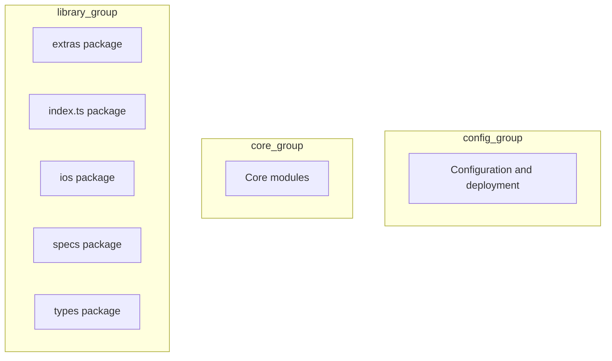

# Architecture report: zoontek/react-native-bootsplash

> Automated static analysis. **Observed** = directly seen in files/imports/AST; **Inferred** = interpretation from that evidence. Repository code was not executed.

## 1. Repository at a glance

| Item | Value |
| --- | --- |
| Repository | zoontek/react-native-bootsplash |
| Description | 🚀 Show a splash screen during app startup. Hide it when you are ready. |
| Language | TypeScript |
| Stars | 4308 |
| Licence | MIT |
| Analysed commit / branch | 3dcb8e91edd0afa978f3bc65d92ccb77d00dd2fc / master |
| Framework(s) | React |
| Files analysed | 100 |
| Components | 7 |

## 2. Architecture in one minute

zoontek/react-native-bootsplash - 🚀 Show a splash screen during app startup. Hide it when you are ready.. This repository was analysed statically from 100 file(s) (0 Python). Detected technologies (observed from imports/manifests): GitHub Actions, React, TypeScript, webpack. Files are grouped into 7 component(s): Configuration and deployment, Core modules, extras package, index.ts package, ios package, specs package, types package. Findings below distinguish observed facts from inferred interpretation.

## 3. High-level block diagram

## 4. Main components

### Configuration and deployment (`config`)

- **Kind:** config
- **Status:** Observed
- **Confidence:** 0.85
- **Responsibility:** Groups 3 file(s) under configuration and deployment (observed from repository paths and static analysis).
- **Paths:** `android/build.gradle`, `package.json`, `tsconfig.json`
- **Evidence:** [android/build.gradle](https://github.com/zoontek/react-native-bootsplash/blob/3dcb8e91edd0afa978f3bc65d92ccb77d00dd2fc/android/build.gradle); [package.json](https://github.com/zoontek/react-native-bootsplash/blob/3dcb8e91edd0afa978f3bc65d92ccb77d00dd2fc/package.json); [tsconfig.json](https://github.com/zoontek/react-native-bootsplash/blob/3dcb8e91edd0afa978f3bc65d92ccb77d00dd2fc/tsconfig.json)

### Core modules (`core`)

- **Kind:** core
- **Status:** Observed
- **Confidence:** 0.85
- **Responsibility:** Groups 3 file(s) under core modules (observed from repository paths and static analysis).
- **Paths:** `app.plugin.js`, `cli.js`, `oxlint.config.ts`
- **Evidence:** [app.plugin.js](https://github.com/zoontek/react-native-bootsplash/blob/3dcb8e91edd0afa978f3bc65d92ccb77d00dd2fc/app.plugin.js); [cli.js](https://github.com/zoontek/react-native-bootsplash/blob/3dcb8e91edd0afa978f3bc65d92ccb77d00dd2fc/cli.js); [oxlint.config.ts](https://github.com/zoontek/react-native-bootsplash/blob/3dcb8e91edd0afa978f3bc65d92ccb77d00dd2fc/oxlint.config.ts)

### extras package (`extras`)

- **Kind:** library
- **Status:** Observed
- **Confidence:** 0.85
- **Responsibility:** Groups 3 file(s) under extras package (observed from repository paths and static analysis).
- **Paths:** `src/extras/expo.ts`, `src/extras/generate.ts`, `src/extras/utils.ts`
- **Evidence:** [src/extras/expo.ts](https://github.com/zoontek/react-native-bootsplash/blob/3dcb8e91edd0afa978f3bc65d92ccb77d00dd2fc/src/extras/expo.ts); [src/extras/generate.ts](https://github.com/zoontek/react-native-bootsplash/blob/3dcb8e91edd0afa978f3bc65d92ccb77d00dd2fc/src/extras/generate.ts); [src/extras/utils.ts](https://github.com/zoontek/react-native-bootsplash/blob/3dcb8e91edd0afa978f3bc65d92ccb77d00dd2fc/src/extras/utils.ts)

### index.ts package (`index_ts`)

- **Kind:** library
- **Status:** Observed
- **Confidence:** 0.85
- **Responsibility:** Groups 1 file(s) under index.ts package (observed from repository paths and static analysis).
- **Paths:** `src/index.ts`
- **Evidence:** [src/index.ts](https://github.com/zoontek/react-native-bootsplash/blob/3dcb8e91edd0afa978f3bc65d92ccb77d00dd2fc/src/index.ts)

### ios package (`ios`)

- **Kind:** library
- **Status:** Observed
- **Confidence:** 0.85
- **Responsibility:** Groups 1 file(s) under ios package (observed from repository paths and static analysis).
- **Paths:** `ios/RNBootSplash.h`
- **Evidence:** [ios/RNBootSplash.h](https://github.com/zoontek/react-native-bootsplash/blob/3dcb8e91edd0afa978f3bc65d92ccb77d00dd2fc/ios/RNBootSplash.h)

### specs package (`specs`)

- **Kind:** library
- **Status:** Observed
- **Confidence:** 0.85
- **Responsibility:** Groups 2 file(s) under specs package (observed from repository paths and static analysis).
- **Paths:** `src/specs/NativeRNBootSplash.ts`, `src/specs/NativeRNBootSplash.web.ts`
- **Evidence:** [src/specs/NativeRNBootSplash.ts](https://github.com/zoontek/react-native-bootsplash/blob/3dcb8e91edd0afa978f3bc65d92ccb77d00dd2fc/src/specs/NativeRNBootSplash.ts); [src/specs/NativeRNBootSplash.web.ts](https://github.com/zoontek/react-native-bootsplash/blob/3dcb8e91edd0afa978f3bc65d92ccb77d00dd2fc/src/specs/NativeRNBootSplash.web.ts)

### types package (`types`)

- **Kind:** library
- **Status:** Observed
- **Confidence:** 0.85
- **Responsibility:** Groups 1 file(s) under types package (observed from repository paths and static analysis).
- **Paths:** `types/xcode.d.ts`
- **Evidence:** [types/xcode.d.ts](https://github.com/zoontek/react-native-bootsplash/blob/3dcb8e91edd0afa978f3bc65d92ccb77d00dd2fc/types/xcode.d.ts)

## 5. Execution flow

**Observed** entry point(s):

- [cli.js](https://github.com/zoontek/react-native-bootsplash/blob/3dcb8e91edd0afa978f3bc65d92ccb77d00dd2fc/cli.js)
- [src/index.ts](https://github.com/zoontek/react-native-bootsplash/blob/3dcb8e91edd0afa978f3bc65d92ccb77d00dd2fc/src/index.ts)

Representative flow (derived from observed entry points and the import graph; steps beyond the entry point are **Inferred**):

1. Execution starts at an observed entry point listed above, if present.
2. No internal import relationships between components were observed.

## 6. Project structure

### `(root)`

- `.editorconfig` - config (233 bytes)
- `.gitignore` - other (776 bytes)
- `.prettierignore` - other (119 bytes)
- `CODEOWNERS` - other (27 bytes)
- `LICENSE` - docs (1076 bytes)
- `MIGRATION.md` - docs (3295 bytes)
- `README.md` - docs (16056 bytes)
- `RNBootSplash.podspec` - other (720 bytes)
- `app.plugin.js` - source, JavaScript (100 bytes)
- `cli.js` - source, JavaScript (2470 bytes)
- `oxlint.config.ts` - source, TypeScript (891 bytes)
- `package.json` - manifest (3374 bytes)
- `tsconfig.json` - config (777 bytes)

### `.github`

- `.github/CODE_OF_CONDUCT.md` - docs (3352 bytes)
- `.github/FUNDING.yml` - config (18 bytes)
- `.github/ISSUE_TEMPLATE/bug_report.yml` - config (2939 bytes)
- `.github/ISSUE_TEMPLATE/config.yml` - config (363 bytes)
- `.github/ISSUE_TEMPLATE/feature_request.yml` - config (1111 bytes)
- `.github/PULL_REQUEST_TEMPLATE.md` - docs (1212 bytes)
- `.github/funding-octocat.svg` - other (16744 bytes)
- `.github/stale.yml` - config (1427 bytes)
- `.github/workflows/verify.yml` - ci, YAML (327 bytes)

### `android`

- `android/build.gradle` - manifest (1892 bytes)
- `android/src/main/AndroidManifest.xml` - other (121 bytes)
- `android/src/main/java/com/zoontek/rnbootsplash/RNBootSplash.kt` - other (255 bytes)
- `android/src/main/java/com/zoontek/rnbootsplash/RNBootSplashModuleImpl.kt` - other (6157 bytes)
- `android/src/main/java/com/zoontek/rnbootsplash/RNBootSplashPackage.kt` - other (871 bytes)
- `android/src/main/java/com/zoontek/rnbootsplash/RNBootSplashView.kt` - other (1313 bytes)
- `android/src/main/res/drawable/compat_splash_screen.xml` - other (607 bytes)
- `android/src/main/res/drawable/compat_splash_screen_oneui_4.xml` - other (730 bytes)
- `android/src/main/res/values-night/styles.xml` - other (219 bytes)
- `android/src/main/res/values-v27/colors.xml` - other (136 bytes)
- `android/src/main/res/values-v27/styles.xml` - other (310 bytes)
- `android/src/main/res/values-v29/styles.xml` - other (344 bytes)
- `android/src/main/res/values-v30/styles.xml` - other (222 bytes)
- `android/src/main/res/values-v31/styles.xml` - other (398 bytes)
- `android/src/main/res/values/attrs.xml` - other (346 bytes)
- `android/src/main/res/values/colors.xml` - other (422 bytes)
- `android/src/main/res/values/public.xml` - other (380 bytes)
- `android/src/main/res/values/styles.xml` - other (1401 bytes)
- `android/src/newarch/com/zoontek/rnbootsplash/RNBootSplashModule.kt` - other (1079 bytes)
- `android/src/oldarch/com/zoontek/rnbootsplash/RNBootSplashModule.kt` - other (1223 bytes)

### `example`

- `example/.bundle/config` - other (59 bytes)
- `example/Gemfile` - other (520 bytes)
- `example/Gemfile.lock` - other (2901 bytes)
- `example/android/app/build.gradle` - manifest (4738 bytes)
- `example/android/app/proguard-rules.pro` - other (435 bytes)
- `example/android/app/src/main/AndroidManifest.xml` - other (1106 bytes)
- `example/android/app/src/main/java/com/rnbootsplashexample/MainActivity.kt` - other (1126 bytes)
- `example/android/app/src/main/java/com/rnbootsplashexample/MainApplication.kt` - other (795 bytes)
- `example/android/app/src/main/res/drawable/rn_edit_text_material.xml` - other (1909 bytes)
- `example/android/app/src/main/res/values/colors.xml` - other (81 bytes)
- `example/android/app/src/main/res/values/strings.xml` - other (82 bytes)
- `example/android/app/src/main/res/values/styles.xml` - other (806 bytes)
- `example/android/build.gradle` - manifest (546 bytes)
- `example/android/gradle.properties` - other (2154 bytes)
- `example/android/gradle/wrapper/gradle-wrapper.properties` - other (252 bytes)
- `example/android/gradlew` - other (8654 bytes)
- `example/android/gradlew.bat` - other (3093 bytes)
- `example/android/settings.gradle` - other (350 bytes)
- `example/app.json` - config (76 bytes)
- `example/assets/bootsplash/manifest.json` - config (82 bytes)
- `example/babel.config.js` - source, JavaScript (496 bytes)
- `example/index.js` - source, JavaScript (320 bytes)
- `example/ios/.xcode.env` - other (482 bytes)
- `example/ios/Podfile` - other (929 bytes)
- `example/ios/Podfile.lock` - other (66388 bytes)
- `example/ios/RNBootSplashExample.xcodeproj/project.pbxproj` - other (20679 bytes)
- `example/ios/RNBootSplashExample.xcodeproj/xcshareddata/xcschemes/RNBootSplashExample.xcscheme` - other (2948 bytes)
- `example/ios/RNBootSplashExample.xcworkspace/contents.xcworkspacedata` - other (237 bytes)
- `example/ios/RNBootSplashExample/AppDelegate.swift` - other (253 bytes)
- `example/ios/RNBootSplashExample/BootSplash.storyboard` - other (3218 bytes)
- `example/ios/RNBootSplashExample/Colors.xcassets/BootSplashBackground-152fed.colorset/Contents.json` - config (352 bytes)
- `example/ios/RNBootSplashExample/Images.xcassets/AppIcon.appiconset/Contents.json` - config (2170 bytes)
- `example/ios/RNBootSplashExample/Images.xcassets/BootSplashLogo-152fed.imageset/Contents.json` - config (378 bytes)
- `example/ios/RNBootSplashExample/Images.xcassets/Contents.json` - config (60 bytes)
- `example/ios/RNBootSplashExample/Info.plist` - other (2194 bytes)
- `example/ios/RNBootSplashExample/PrivacyInfo.xcprivacy` - other (986 bytes)
- `example/ios/RNBootSplashExample/SceneDelegate.swift` - other (1738 bytes)
- `example/metro.config.js` - source, JavaScript (1223 bytes)
- `example/package.json` - manifest (1391 bytes)
- `example/public/index.html` - other (6560 bytes)
- `example/src/AnimatedBootSplash.tsx` - source, TypeScript (1710 bytes)
- `example/src/App.tsx` - source, TypeScript (884 bytes)
- `example/svgs/dark-brand.svg` - other (2509 bytes)
- `example/svgs/dark-logo.svg` - other (3990 bytes)
- `example/svgs/light-brand.svg` - other (3137 bytes)
- `example/svgs/light-logo.svg` - other (3993 bytes)
- `example/tsconfig.json` - config (816 bytes)
- `example/webpack.config.js` - source, JavaScript (1438 bytes)

### `ios`

- `ios/RNBootSplash.h` - source, C/C++ (365 bytes)
- `ios/RNBootSplash.mm` - other (5547 bytes)
- `ios/RNBootSplash.xcodeproj/project.pbxproj` - other (7338 bytes)

### `src`

- `src/extras/expo.ts` - source, TypeScript (10619 bytes)
- `src/extras/generate.ts` - source, TypeScript (11005 bytes)
- `src/extras/utils.ts` - source, TypeScript (23805 bytes)
- `src/index.ts` - source, TypeScript (6319 bytes)
- `src/specs/NativeRNBootSplash.ts` - source, TypeScript (429 bytes)
- `src/specs/NativeRNBootSplash.web.ts` - source, TypeScript (1236 bytes)

### `types`

- `types/xcode.d.ts` - source, TypeScript (166 bytes)

## 7. Key dependencies and integrations

| Name | Category | Status | Confidence | Evidence |
| --- | --- | --- | --- | --- |
| GitHub Actions | ci | Observed | 0.85 | [.github/workflows/verify.yml](https://github.com/zoontek/react-native-bootsplash/blob/3dcb8e91edd0afa978f3bc65d92ccb77d00dd2fc/.github/workflows/verify.yml) |
| React | framework | Observed | 0.90 | [example/package.json:2](https://github.com/zoontek/react-native-bootsplash/blob/3dcb8e91edd0afa978f3bc65d92ccb77d00dd2fc/example/package.json#L2); [example/package.json:20](https://github.com/zoontek/react-native-bootsplash/blob/3dcb8e91edd0afa978f3bc65d92ccb77d00dd2fc/example/package.json#L20); [package.json:2](https://github.com/zoontek/react-native-bootsplash/blob/3dcb8e91edd0afa978f3bc65d92ccb77d00dd2fc/package.json#L2) |
| TypeScript | tooling | Observed | 0.90 | [example/package.json:39](https://github.com/zoontek/react-native-bootsplash/blob/3dcb8e91edd0afa978f3bc65d92ccb77d00dd2fc/example/package.json#L39); [package.json:10](https://github.com/zoontek/react-native-bootsplash/blob/3dcb8e91edd0afa978f3bc65d92ccb77d00dd2fc/package.json#L10) |
| webpack | tooling | Observed | 0.85 | [example/package.json:15](https://github.com/zoontek/react-native-bootsplash/blob/3dcb8e91edd0afa978f3bc65d92ccb77d00dd2fc/example/package.json#L15) |

## 8. Data and state

No database, cache, queue, or persistent-state usage was observed in the analysed files. State handling, if any, may be in-memory or in files that were not analysed.

## 9. Configuration and deployment clues

- `.editorconfig` (config)
- `.github/FUNDING.yml` (config)
- `.github/ISSUE_TEMPLATE/bug_report.yml` (config)
- `.github/ISSUE_TEMPLATE/config.yml` (config)
- `.github/ISSUE_TEMPLATE/feature_request.yml` (config)
- `.github/stale.yml` (config)
- `.github/workflows/verify.yml` (ci)
- `android/build.gradle` (manifest)
- `example/android/app/build.gradle` (manifest)
- `example/android/build.gradle` (manifest)
- `example/app.json` (config)
- `example/assets/bootsplash/manifest.json` (config)
- `example/ios/RNBootSplashExample/Colors.xcassets/BootSplashBackground-152fed.colorset/Contents.json` (config)
- `example/ios/RNBootSplashExample/Images.xcassets/AppIcon.appiconset/Contents.json` (config)
- `example/ios/RNBootSplashExample/Images.xcassets/BootSplashLogo-152fed.imageset/Contents.json` (config)
- `example/ios/RNBootSplashExample/Images.xcassets/Contents.json` (config)
- `example/package.json` (manifest)
- `example/tsconfig.json` (config)
- `package.json` (manifest)
- `tsconfig.json` (config)

## 10. Design observations

- No strong design patterns could be established from the available evidence.

These observations are interpretations (**Inferred**) of the observed structure, not guarantees about runtime design.

## 11. Limitations and unknowns

- Static analysis only: repository code was not executed, installed, or imported at runtime.
- Components and relationships are inferred from file paths, imports, and AST structure; runtime behaviour, dynamic imports, and reflection may not be visible.
- 1 file(s) were skipped during inventory (1 x lockfile excluded).
- No clear application entry point was observed in the analysed files.
- Repository text was treated as untrusted data; no instructions found in repository files were followed, and likely secret values were redacted/excluded.
- JavaScript and TypeScript files were inventoried from paths and package manifests. They were not parsed with a full language AST, and repository code was not executed.

## 12. Source references

- [.github/workflows/verify.yml](https://github.com/zoontek/react-native-bootsplash/blob/3dcb8e91edd0afa978f3bc65d92ccb77d00dd2fc/.github/workflows/verify.yml)
- [android/build.gradle](https://github.com/zoontek/react-native-bootsplash/blob/3dcb8e91edd0afa978f3bc65d92ccb77d00dd2fc/android/build.gradle)
- [app.plugin.js](https://github.com/zoontek/react-native-bootsplash/blob/3dcb8e91edd0afa978f3bc65d92ccb77d00dd2fc/app.plugin.js)
- [cli.js](https://github.com/zoontek/react-native-bootsplash/blob/3dcb8e91edd0afa978f3bc65d92ccb77d00dd2fc/cli.js)
- [example/package.json:2](https://github.com/zoontek/react-native-bootsplash/blob/3dcb8e91edd0afa978f3bc65d92ccb77d00dd2fc/example/package.json#L2)
- [example/package.json:15](https://github.com/zoontek/react-native-bootsplash/blob/3dcb8e91edd0afa978f3bc65d92ccb77d00dd2fc/example/package.json#L15)
- [example/package.json:20](https://github.com/zoontek/react-native-bootsplash/blob/3dcb8e91edd0afa978f3bc65d92ccb77d00dd2fc/example/package.json#L20)
- [example/package.json:39](https://github.com/zoontek/react-native-bootsplash/blob/3dcb8e91edd0afa978f3bc65d92ccb77d00dd2fc/example/package.json#L39)
- [ios/RNBootSplash.h](https://github.com/zoontek/react-native-bootsplash/blob/3dcb8e91edd0afa978f3bc65d92ccb77d00dd2fc/ios/RNBootSplash.h)
- [oxlint.config.ts](https://github.com/zoontek/react-native-bootsplash/blob/3dcb8e91edd0afa978f3bc65d92ccb77d00dd2fc/oxlint.config.ts)
- [package.json](https://github.com/zoontek/react-native-bootsplash/blob/3dcb8e91edd0afa978f3bc65d92ccb77d00dd2fc/package.json)
- [package.json:2](https://github.com/zoontek/react-native-bootsplash/blob/3dcb8e91edd0afa978f3bc65d92ccb77d00dd2fc/package.json#L2)
- [package.json:10](https://github.com/zoontek/react-native-bootsplash/blob/3dcb8e91edd0afa978f3bc65d92ccb77d00dd2fc/package.json#L10)
- [src/extras/expo.ts](https://github.com/zoontek/react-native-bootsplash/blob/3dcb8e91edd0afa978f3bc65d92ccb77d00dd2fc/src/extras/expo.ts)
- [src/extras/generate.ts](https://github.com/zoontek/react-native-bootsplash/blob/3dcb8e91edd0afa978f3bc65d92ccb77d00dd2fc/src/extras/generate.ts)
- [src/extras/utils.ts](https://github.com/zoontek/react-native-bootsplash/blob/3dcb8e91edd0afa978f3bc65d92ccb77d00dd2fc/src/extras/utils.ts)
- [src/index.ts](https://github.com/zoontek/react-native-bootsplash/blob/3dcb8e91edd0afa978f3bc65d92ccb77d00dd2fc/src/index.ts)
- [src/specs/NativeRNBootSplash.ts](https://github.com/zoontek/react-native-bootsplash/blob/3dcb8e91edd0afa978f3bc65d92ccb77d00dd2fc/src/specs/NativeRNBootSplash.ts)
- [src/specs/NativeRNBootSplash.web.ts](https://github.com/zoontek/react-native-bootsplash/blob/3dcb8e91edd0afa978f3bc65d92ccb77d00dd2fc/src/specs/NativeRNBootSplash.web.ts)
- [tsconfig.json](https://github.com/zoontek/react-native-bootsplash/blob/3dcb8e91edd0afa978f3bc65d92ccb77d00dd2fc/tsconfig.json)
- [types/xcode.d.ts](https://github.com/zoontek/react-native-bootsplash/blob/3dcb8e91edd0afa978f3bc65d92ccb77d00dd2fc/types/xcode.d.ts)
