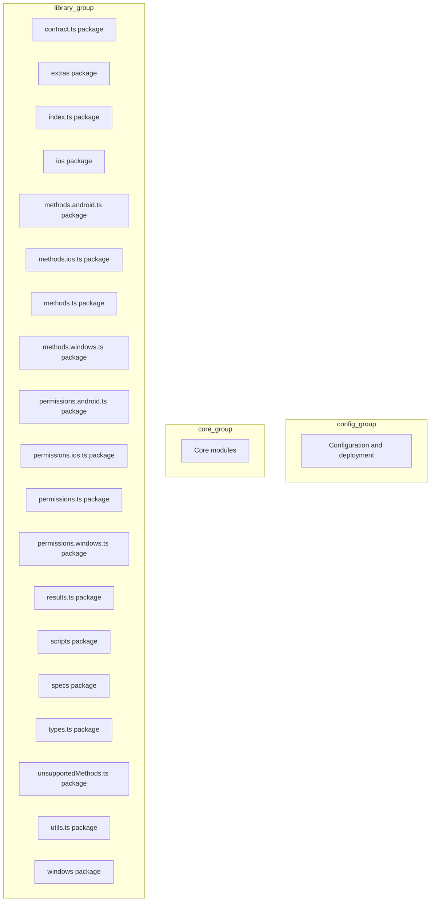

# Architecture report: zoontek/react-native-permissions

> Automated static analysis. **Observed** = directly seen in files/imports/AST; **Inferred** = interpretation from that evidence. Repository code was not executed.

## 1. Repository at a glance

| Item | Value |
| --- | --- |
| Repository | zoontek/react-native-permissions |
| Description | An unified permissions API for React Native on iOS, Android and Windows. |
| Language | Objective-C++ |
| Stars | 4373 |
| Licence | MIT |
| Analysed commit / branch | 4f9f820e821abe1a3780f82ae30de62462b1f0eb / master |
| Framework(s) | React |
| Files analysed | 173 |
| Components | 21 |

## 2. Architecture in one minute

zoontek/react-native-permissions - An unified permissions API for React Native on iOS, Android and Windows.. This repository was analysed statically from 173 file(s) (0 Python). Detected technologies (observed from imports/manifests): GitHub Actions, React, TypeScript. Files are grouped into 21 component(s): Configuration and deployment, contract.ts package, Core modules, extras package, index.ts package, ios package, methods.android.ts package, methods.ios.ts package. Findings below distinguish observed facts from inferred interpretation.

## 3. High-level block diagram

## 4. Main components

### Configuration and deployment (`config`)

- **Kind:** config
- **Status:** Observed
- **Confidence:** 0.85
- **Responsibility:** Groups 4 file(s) under configuration and deployment (observed from repository paths and static analysis).
- **Paths:** `android/build.gradle`, `package.json`, `tsconfig.json`, `windows/RNPermissions/packages.lock.json`
- **Evidence:** [android/build.gradle](https://github.com/zoontek/react-native-permissions/blob/4f9f820e821abe1a3780f82ae30de62462b1f0eb/android/build.gradle); [package.json](https://github.com/zoontek/react-native-permissions/blob/4f9f820e821abe1a3780f82ae30de62462b1f0eb/package.json); [tsconfig.json](https://github.com/zoontek/react-native-permissions/blob/4f9f820e821abe1a3780f82ae30de62462b1f0eb/tsconfig.json); [windows/RNPermissions/packages.lock.json](https://github.com/zoontek/react-native-permissions/blob/4f9f820e821abe1a3780f82ae30de62462b1f0eb/windows/RNPermissions/packages.lock.json)

### contract.ts package (`contract_ts`)

- **Kind:** library
- **Status:** Observed
- **Confidence:** 0.85
- **Responsibility:** Groups 1 file(s) under contract.ts package (observed from repository paths and static analysis).
- **Paths:** `src/contract.ts`
- **Evidence:** [src/contract.ts](https://github.com/zoontek/react-native-permissions/blob/4f9f820e821abe1a3780f82ae30de62462b1f0eb/src/contract.ts)

### Core modules (`core`)

- **Kind:** core
- **Status:** Observed
- **Confidence:** 0.85
- **Responsibility:** Groups 3 file(s) under core modules (observed from repository paths and static analysis).
- **Paths:** `app.plugin.js`, `fetchWindowsCapabilites.js`, `oxlint.config.ts`
- **Evidence:** [app.plugin.js](https://github.com/zoontek/react-native-permissions/blob/4f9f820e821abe1a3780f82ae30de62462b1f0eb/app.plugin.js); [fetchWindowsCapabilites.js](https://github.com/zoontek/react-native-permissions/blob/4f9f820e821abe1a3780f82ae30de62462b1f0eb/fetchWindowsCapabilites.js); [oxlint.config.ts](https://github.com/zoontek/react-native-permissions/blob/4f9f820e821abe1a3780f82ae30de62462b1f0eb/oxlint.config.ts)

### extras package (`extras`)

- **Kind:** library
- **Status:** Observed
- **Confidence:** 0.85
- **Responsibility:** Groups 2 file(s) under extras package (observed from repository paths and static analysis).
- **Paths:** `src/extras/expo.ts`, `src/extras/mock.ts`
- **Evidence:** [src/extras/expo.ts](https://github.com/zoontek/react-native-permissions/blob/4f9f820e821abe1a3780f82ae30de62462b1f0eb/src/extras/expo.ts); [src/extras/mock.ts](https://github.com/zoontek/react-native-permissions/blob/4f9f820e821abe1a3780f82ae30de62462b1f0eb/src/extras/mock.ts)

### index.ts package (`index_ts`)

- **Kind:** library
- **Status:** Observed
- **Confidence:** 0.85
- **Responsibility:** Groups 1 file(s) under index.ts package (observed from repository paths and static analysis).
- **Paths:** `src/index.ts`
- **Evidence:** [src/index.ts](https://github.com/zoontek/react-native-permissions/blob/4f9f820e821abe1a3780f82ae30de62462b1f0eb/src/index.ts)

### ios package (`ios`)

- **Kind:** library
- **Status:** Observed
- **Confidence:** 0.85
- **Responsibility:** Groups 21 file(s) under ios package (observed from repository paths and static analysis).
- **Paths:** `ios/AppTrackingTransparency/RNPermissionHandlerAppTrackingTransparency.h`, `ios/Bluetooth/RNPermissionHandlerBluetooth.h`, `ios/Calendars/RNPermissionHandlerCalendars.h`, `ios/CalendarsWriteOnly/RNPermissionHandlerCalendarsWriteOnly.h`, `ios/Camera/RNPermissionHandlerCamera.h`, `ios/Contacts/RNPermissionHandlerContacts.h`, `ios/FaceID/RNPermissionHandlerFaceID.h`, `ios/LocationAccuracy/RNPermissionHandlerLocationAccuracy.h`, `ios/LocationAlways/RNPermissionHandlerLocationAlways.h`, `ios/LocationWhenInUse/RNPermissionHandlerLocationWhenInUse.h`, `ios/MediaLibrary/RNPermissionHandlerMediaLibrary.h`, `ios/Microphone/RNPermissionHandlerMicrophone.h`, `ios/Motion/RNPermissionHandlerMotion.h`, `ios/Notifications/RNPermissionHandlerNotifications.h`, `ios/PhotoLibrary/RNPermissionHandlerPhotoLibrary.h`, `ios/PhotoLibraryAddOnly/RNPermissionHandlerPhotoLibraryAddOnly.h`, `ios/RNPermissions.h`, `ios/Reminders/RNPermissionHandlerReminders.h`, `ios/Siri/RNPermissionHandlerSiri.h`, `ios/SpeechRecognition/RNPermissionHandlerSpeechRecognition.h`, `ios/StoreKit/RNPermissionHandlerStoreKit.h`
- **Evidence:** [ios/AppTrackingTransparency/RNPermissionHandlerAppTrackingTransparency.h](https://github.com/zoontek/react-native-permissions/blob/4f9f820e821abe1a3780f82ae30de62462b1f0eb/ios/AppTrackingTransparency/RNPermissionHandlerAppTrackingTransparency.h); [ios/Bluetooth/RNPermissionHandlerBluetooth.h](https://github.com/zoontek/react-native-permissions/blob/4f9f820e821abe1a3780f82ae30de62462b1f0eb/ios/Bluetooth/RNPermissionHandlerBluetooth.h); [ios/Calendars/RNPermissionHandlerCalendars.h](https://github.com/zoontek/react-native-permissions/blob/4f9f820e821abe1a3780f82ae30de62462b1f0eb/ios/Calendars/RNPermissionHandlerCalendars.h); [ios/CalendarsWriteOnly/RNPermissionHandlerCalendarsWriteOnly.h](https://github.com/zoontek/react-native-permissions/blob/4f9f820e821abe1a3780f82ae30de62462b1f0eb/ios/CalendarsWriteOnly/RNPermissionHandlerCalendarsWriteOnly.h); [ios/Camera/RNPermissionHandlerCamera.h](https://github.com/zoontek/react-native-permissions/blob/4f9f820e821abe1a3780f82ae30de62462b1f0eb/ios/Camera/RNPermissionHandlerCamera.h); [ios/Contacts/RNPermissionHandlerContacts.h](https://github.com/zoontek/react-native-permissions/blob/4f9f820e821abe1a3780f82ae30de62462b1f0eb/ios/Contacts/RNPermissionHandlerContacts.h); [ios/FaceID/RNPermissionHandlerFaceID.h](https://github.com/zoontek/react-native-permissions/blob/4f9f820e821abe1a3780f82ae30de62462b1f0eb/ios/FaceID/RNPermissionHandlerFaceID.h); [ios/LocationAccuracy/RNPermissionHandlerLocationAccuracy.h](https://github.com/zoontek/react-native-permissions/blob/4f9f820e821abe1a3780f82ae30de62462b1f0eb/ios/LocationAccuracy/RNPermissionHandlerLocationAccuracy.h)

### methods.android.ts package (`methods_android_ts`)

- **Kind:** library
- **Status:** Observed
- **Confidence:** 0.85
- **Responsibility:** Groups 1 file(s) under methods.android.ts package (observed from repository paths and static analysis).
- **Paths:** `src/methods.android.ts`
- **Evidence:** [src/methods.android.ts](https://github.com/zoontek/react-native-permissions/blob/4f9f820e821abe1a3780f82ae30de62462b1f0eb/src/methods.android.ts)

### methods.ios.ts package (`methods_ios_ts`)

- **Kind:** library
- **Status:** Observed
- **Confidence:** 0.85
- **Responsibility:** Groups 1 file(s) under methods.ios.ts package (observed from repository paths and static analysis).
- **Paths:** `src/methods.ios.ts`
- **Evidence:** [src/methods.ios.ts](https://github.com/zoontek/react-native-permissions/blob/4f9f820e821abe1a3780f82ae30de62462b1f0eb/src/methods.ios.ts)

### methods.ts package (`methods_ts`)

- **Kind:** library
- **Status:** Observed
- **Confidence:** 0.85
- **Responsibility:** Groups 1 file(s) under methods.ts package (observed from repository paths and static analysis).
- **Paths:** `src/methods.ts`
- **Evidence:** [src/methods.ts](https://github.com/zoontek/react-native-permissions/blob/4f9f820e821abe1a3780f82ae30de62462b1f0eb/src/methods.ts)

### methods.windows.ts package (`methods_windows_ts`)

- **Kind:** library
- **Status:** Observed
- **Confidence:** 0.85
- **Responsibility:** Groups 1 file(s) under methods.windows.ts package (observed from repository paths and static analysis).
- **Paths:** `src/methods.windows.ts`
- **Evidence:** [src/methods.windows.ts](https://github.com/zoontek/react-native-permissions/blob/4f9f820e821abe1a3780f82ae30de62462b1f0eb/src/methods.windows.ts)

### permissions.android.ts package (`permissions_android_ts`)

- **Kind:** library
- **Status:** Observed
- **Confidence:** 0.85
- **Responsibility:** Groups 1 file(s) under permissions.android.ts package (observed from repository paths and static analysis).
- **Paths:** `src/permissions.android.ts`
- **Evidence:** [src/permissions.android.ts](https://github.com/zoontek/react-native-permissions/blob/4f9f820e821abe1a3780f82ae30de62462b1f0eb/src/permissions.android.ts)

### permissions.ios.ts package (`permissions_ios_ts`)

- **Kind:** library
- **Status:** Observed
- **Confidence:** 0.85
- **Responsibility:** Groups 1 file(s) under permissions.ios.ts package (observed from repository paths and static analysis).
- **Paths:** `src/permissions.ios.ts`
- **Evidence:** [src/permissions.ios.ts](https://github.com/zoontek/react-native-permissions/blob/4f9f820e821abe1a3780f82ae30de62462b1f0eb/src/permissions.ios.ts)

### permissions.ts package (`permissions_ts`)

- **Kind:** library
- **Status:** Observed
- **Confidence:** 0.85
- **Responsibility:** Groups 1 file(s) under permissions.ts package (observed from repository paths and static analysis).
- **Paths:** `src/permissions.ts`
- **Evidence:** [src/permissions.ts](https://github.com/zoontek/react-native-permissions/blob/4f9f820e821abe1a3780f82ae30de62462b1f0eb/src/permissions.ts)

### permissions.windows.ts package (`permissions_windows_ts`)

- **Kind:** library
- **Status:** Observed
- **Confidence:** 0.85
- **Responsibility:** Groups 1 file(s) under permissions.windows.ts package (observed from repository paths and static analysis).
- **Paths:** `src/permissions.windows.ts`
- **Evidence:** [src/permissions.windows.ts](https://github.com/zoontek/react-native-permissions/blob/4f9f820e821abe1a3780f82ae30de62462b1f0eb/src/permissions.windows.ts)

### results.ts package (`results_ts`)

- **Kind:** library
- **Status:** Observed
- **Confidence:** 0.85
- **Responsibility:** Groups 1 file(s) under results.ts package (observed from repository paths and static analysis).
- **Paths:** `src/results.ts`
- **Evidence:** [src/results.ts](https://github.com/zoontek/react-native-permissions/blob/4f9f820e821abe1a3780f82ae30de62462b1f0eb/src/results.ts)

### scripts package (`scripts`)

- **Kind:** library
- **Status:** Observed
- **Confidence:** 0.85
- **Responsibility:** Groups 1 file(s) under scripts package (observed from repository paths and static analysis).
- **Paths:** `scripts/setup.rb`
- **Evidence:** [scripts/setup.rb](https://github.com/zoontek/react-native-permissions/blob/4f9f820e821abe1a3780f82ae30de62462b1f0eb/scripts/setup.rb)

### specs package (`specs`)

- **Kind:** library
- **Status:** Observed
- **Confidence:** 0.85
- **Responsibility:** Groups 1 file(s) under specs package (observed from repository paths and static analysis).
- **Paths:** `src/specs/NativeRNPermissions.ts`
- **Evidence:** [src/specs/NativeRNPermissions.ts](https://github.com/zoontek/react-native-permissions/blob/4f9f820e821abe1a3780f82ae30de62462b1f0eb/src/specs/NativeRNPermissions.ts)

### types.ts package (`types_ts`)

- **Kind:** library
- **Status:** Observed
- **Confidence:** 0.85
- **Responsibility:** Groups 1 file(s) under types.ts package (observed from repository paths and static analysis).
- **Paths:** `src/types.ts`
- **Evidence:** [src/types.ts](https://github.com/zoontek/react-native-permissions/blob/4f9f820e821abe1a3780f82ae30de62462b1f0eb/src/types.ts)

### unsupportedMethods.ts package (`unsupportedmethods_ts`)

- **Kind:** library
- **Status:** Observed
- **Confidence:** 0.85
- **Responsibility:** Groups 1 file(s) under unsupportedmethods.ts package (observed from repository paths and static analysis).
- **Paths:** `src/unsupportedMethods.ts`
- **Evidence:** [src/unsupportedMethods.ts](https://github.com/zoontek/react-native-permissions/blob/4f9f820e821abe1a3780f82ae30de62462b1f0eb/src/unsupportedMethods.ts)

### utils.ts package (`utils_ts`)

- **Kind:** library
- **Status:** Observed
- **Confidence:** 0.85
- **Responsibility:** Groups 1 file(s) under utils.ts package (observed from repository paths and static analysis).
- **Paths:** `src/utils.ts`
- **Evidence:** [src/utils.ts](https://github.com/zoontek/react-native-permissions/blob/4f9f820e821abe1a3780f82ae30de62462b1f0eb/src/utils.ts)

### windows package (`windows`)

- **Kind:** library
- **Status:** Observed
- **Confidence:** 0.85
- **Responsibility:** Groups 10 file(s) under windows package (observed from repository paths and static analysis).
- **Paths:** `windows/RNPermissions/RNPermissions.cpp`, `windows/RNPermissions/RNPermissions.h`, `windows/RNPermissions/ReactPackageProvider.cpp`, `windows/RNPermissions/ReactPackageProvider.h`, `windows/RNPermissions/codegen/NativeRNPermissionsDataTypes.g.h`, `windows/RNPermissions/codegen/NativeRNPermissionsSpec.g.h`, `windows/RNPermissions/pch.cpp`, `windows/RNPermissions/pch.h`, `windows/RNPermissions/resource.h`, `windows/RNPermissions/targetver.h`
- **Evidence:** [windows/RNPermissions/RNPermissions.cpp](https://github.com/zoontek/react-native-permissions/blob/4f9f820e821abe1a3780f82ae30de62462b1f0eb/windows/RNPermissions/RNPermissions.cpp); [windows/RNPermissions/RNPermissions.h](https://github.com/zoontek/react-native-permissions/blob/4f9f820e821abe1a3780f82ae30de62462b1f0eb/windows/RNPermissions/RNPermissions.h); [windows/RNPermissions/ReactPackageProvider.cpp](https://github.com/zoontek/react-native-permissions/blob/4f9f820e821abe1a3780f82ae30de62462b1f0eb/windows/RNPermissions/ReactPackageProvider.cpp); [windows/RNPermissions/ReactPackageProvider.h](https://github.com/zoontek/react-native-permissions/blob/4f9f820e821abe1a3780f82ae30de62462b1f0eb/windows/RNPermissions/ReactPackageProvider.h); [windows/RNPermissions/codegen/NativeRNPermissionsDataTypes.g.h](https://github.com/zoontek/react-native-permissions/blob/4f9f820e821abe1a3780f82ae30de62462b1f0eb/windows/RNPermissions/codegen/NativeRNPermissionsDataTypes.g.h); [windows/RNPermissions/codegen/NativeRNPermissionsSpec.g.h](https://github.com/zoontek/react-native-permissions/blob/4f9f820e821abe1a3780f82ae30de62462b1f0eb/windows/RNPermissions/codegen/NativeRNPermissionsSpec.g.h); [windows/RNPermissions/pch.cpp](https://github.com/zoontek/react-native-permissions/blob/4f9f820e821abe1a3780f82ae30de62462b1f0eb/windows/RNPermissions/pch.cpp); [windows/RNPermissions/pch.h](https://github.com/zoontek/react-native-permissions/blob/4f9f820e821abe1a3780f82ae30de62462b1f0eb/windows/RNPermissions/pch.h)

## 5. Execution flow

**Observed** entry point(s):

- [src/index.ts](https://github.com/zoontek/react-native-permissions/blob/4f9f820e821abe1a3780f82ae30de62462b1f0eb/src/index.ts)

Representative flow (derived from observed entry points and the import graph; steps beyond the entry point are **Inferred**):

1. Execution starts at an observed entry point listed above, if present.
2. No internal import relationships between components were observed.

## 6. Project structure

### `(root)`

- `.editorconfig` - config (233 bytes)
- `.gitignore` - other (612 bytes)
- `.prettierignore` - other (73 bytes)
- `.prettierrc` - other (151 bytes)
- `CODEOWNERS` - other (27 bytes)
- `LICENSE` - docs (1076 bytes)
- `NuGet.config` - other (401 bytes)
- `README.md` - docs (37526 bytes)
- `RNPermissions.podspec` - other (844 bytes)
- `app.plugin.js` - source, JavaScript (100 bytes)
- `fetchWindowsCapabilites.js` - source, JavaScript (1330 bytes)
- `oxlint.config.ts` - source, TypeScript (1088 bytes)
- `package.json` - manifest (3645 bytes)
- `tsconfig.json` - config (727 bytes)

### `.github`

- `.github/CODE_OF_CONDUCT.md` - docs (3352 bytes)
- `.github/FUNDING.yml` - config (18 bytes)
- `.github/ISSUE_TEMPLATE/bug_report.yml` - config (2939 bytes)
- `.github/ISSUE_TEMPLATE/config.yml` - config (363 bytes)
- `.github/ISSUE_TEMPLATE/feature_request.yml` - config (1111 bytes)
- `.github/PULL_REQUEST_TEMPLATE.md` - docs (1212 bytes)
- `.github/funding-octocat.svg` - other (16744 bytes)
- `.github/stale.yml` - config (1427 bytes)
- `.github/workflows/verify.yml` - ci, YAML (327 bytes)

### `.vscode`

- `.vscode/c_cpp_properties.json` - config (357 bytes)
- `.vscode/settings.json` - config (2090 bytes)

### `android`

- `android/build.gradle` - manifest (1893 bytes)
- `android/src/main/AndroidManifest.xml` - other (121 bytes)
- `android/src/main/java/com/zoontek/rnpermissions/RNPermissionsModuleImpl.kt` - other (11829 bytes)
- `android/src/main/java/com/zoontek/rnpermissions/RNPermissionsPackage.kt` - other (1102 bytes)
- `android/src/newarch/com/zoontek/rnpermissions/RNPermissionsModule.kt` - other (3042 bytes)
- `android/src/oldarch/com/zoontek/rnpermissions/RNPermissionsModule.kt` - other (3234 bytes)

### `example`

- `example/.bundle/config` - other (59 bytes)
- `example/.yarnrc` - other (16 bytes)
- `example/Gemfile` - other (520 bytes)
- `example/Gemfile.lock` - other (2941 bytes)
- `example/android/app/build.gradle` - manifest (4740 bytes)
- `example/android/app/proguard-rules.pro` - other (435 bytes)
- `example/android/app/src/main/AndroidManifest.xml` - other (4308 bytes)
- `example/android/app/src/main/java/com/rnpermissionsexample/MainActivity.kt` - other (871 bytes)
- `example/android/app/src/main/java/com/rnpermissionsexample/MainApplication.kt` - other (796 bytes)
- `example/android/app/src/main/res/drawable/rn_edit_text_material.xml` - other (1917 bytes)
- `example/android/app/src/main/res/values/strings.xml` - other (83 bytes)
- `example/android/app/src/main/res/values/styles.xml` - other (282 bytes)
- `example/android/build.gradle` - manifest (546 bytes)
- `example/android/gradle.properties` - other (2154 bytes)
- `example/android/gradle/wrapper/gradle-wrapper.properties` - other (252 bytes)
- `example/android/gradlew` - other (8654 bytes)
- `example/android/gradlew.bat` - other (3093 bytes)
- `example/android/settings.gradle` - other (351 bytes)
- `example/app.json` - config (78 bytes)
- `example/babel.config.js` - source, JavaScript (335 bytes)
- `example/index.js` - source, JavaScript (304 bytes)
- `example/ios/.xcode.env` - other (481 bytes)
- `example/ios/Podfile` - other (1424 bytes)
- `example/ios/Podfile.lock` - other (69132 bytes)
- `example/ios/RNPermissionsExample.xcodeproj/project.pbxproj` - other (20246 bytes)
- `example/ios/RNPermissionsExample.xcodeproj/xcshareddata/xcschemes/RNPermissionsExample.xcscheme` - other (2957 bytes)
- `example/ios/RNPermissionsExample.xcworkspace/contents.xcworkspacedata` - other (238 bytes)
- `example/ios/RNPermissionsExample.xcworkspace/xcshareddata/IDEWorkspaceChecks.plist` - other (238 bytes)
- `example/ios/RNPermissionsExample/AppDelegate.swift` - other (253 bytes)
- `example/ios/RNPermissionsExample/Images.xcassets/AppIcon.appiconset/Contents.json` - config (818 bytes)
- `example/ios/RNPermissionsExample/Images.xcassets/Contents.json` - config (60 bytes)
- `example/ios/RNPermissionsExample/Info.plist` - other (4113 bytes)
- `example/ios/RNPermissionsExample/LaunchScreen.storyboard` - other (3163 bytes)
- `example/ios/RNPermissionsExample/PrivacyInfo.xcprivacy` - other (986 bytes)
- `example/ios/RNPermissionsExample/SceneDelegate.swift` - other (1561 bytes)
- `example/metro.config.js` - source, JavaScript (1215 bytes)
- `example/package.json` - manifest (1599 bytes)
- `example/src/App.tsx` - source, TypeScript (5822 bytes)
- `example/tsconfig.json` - config (800 bytes)
- `example/windows/.gitignore` - other (863 bytes)
- `example/windows/Example.sln` - other (17292 bytes)
- `example/windows/Example/.gitignore` - other (8 bytes)
- `example/windows/Example/App.cpp` - source, C++ (1188 bytes)
- `example/windows/Example/App.h` - source, C/C++ (194 bytes)
- `example/windows/Example/App.idl` - other (22 bytes)
- `example/windows/Example/App.xaml` - other (419 bytes)
- `example/windows/Example/AutolinkedNativeModules.g.cpp` - source, C++ (367 bytes)
- `example/windows/Example/AutolinkedNativeModules.g.h` - source, C/C++ (319 bytes)
- `example/windows/Example/Example.vcxproj` - other (9060 bytes)
- `example/windows/Example/Example.vcxproj.filters` - other (1912 bytes)
- `example/windows/Example/Package.appxmanifest` - other (3512 bytes)
- `example/windows/Example/PropertySheet.props` - other (602 bytes)
- `example/windows/Example/ReactPackageProvider.cpp` - source, C++ (361 bytes)
- `example/windows/Example/ReactPackageProvider.h` - source, C/C++ (438 bytes)
- `example/windows/Example/packages.config` - other (242 bytes)
- `example/windows/Example/pch.cpp` - source, C++ (20 bytes)
- `example/windows/Example/pch.h` - source, C/C++ (902 bytes)

### `ios`

- `ios/AppTrackingTransparency/RNPermissionHandlerAppTrackingTransparency.h` - source, C/C++ (119 bytes)
- `ios/AppTrackingTransparency/RNPermissionHandlerAppTrackingTransparency.mm` - other (2552 bytes)
- `ios/Bluetooth/RNPermissionHandlerBluetooth.h` - source, C/C++ (105 bytes)
- `ios/Bluetooth/RNPermissionHandlerBluetooth.mm` - other (2079 bytes)
- `ios/Calendars/RNPermissionHandlerCalendars.h` - source, C/C++ (105 bytes)
- `ios/Calendars/RNPermissionHandlerCalendars.mm` - other (2485 bytes)
- `ios/CalendarsWriteOnly/RNPermissionHandlerCalendarsWriteOnly.h` - source, C/C++ (114 bytes)
- `ios/CalendarsWriteOnly/RNPermissionHandlerCalendarsWriteOnly.mm` - other (1762 bytes)
- `ios/Camera/RNPermissionHandlerCamera.h` - source, C/C++ (102 bytes)
- `ios/Camera/RNPermissionHandlerCamera.mm` - other (1352 bytes)
- `ios/Contacts/RNPermissionHandlerContacts.h` - source, C/C++ (263 bytes)
- `ios/Contacts/RNPermissionHandlerContacts.mm` - other (3181 bytes)
- `ios/Contacts/RNPermissionsContactPicker.swift` - other (1299 bytes)
- `ios/FaceID/RNPermissionHandlerFaceID.h` - source, C/C++ (102 bytes)
- `ios/FaceID/RNPermissionHandlerFaceID.mm` - other (3284 bytes)
- `ios/LocationAccuracy/RNPermissionHandlerLocationAccuracy.h` - source, C/C++ (527 bytes)
- `ios/LocationAccuracy/RNPermissionHandlerLocationAccuracy.mm` - other (2853 bytes)
- `ios/LocationAlways/RNPermissionHandlerLocationAlways.h` - source, C/C++ (110 bytes)
- `ios/LocationAlways/RNPermissionHandlerLocationAlways.mm` - other (4717 bytes)
- `ios/LocationWhenInUse/RNPermissionHandlerLocationWhenInUse.h` - source, C/C++ (113 bytes)
- `ios/LocationWhenInUse/RNPermissionHandlerLocationWhenInUse.mm` - other (2325 bytes)
- `ios/MediaLibrary/RNPermissionHandlerMediaLibrary.h` - source, C/C++ (108 bytes)
- `ios/MediaLibrary/RNPermissionHandlerMediaLibrary.mm` - other (1241 bytes)
- `ios/Microphone/RNPermissionHandlerMicrophone.h` - source, C/C++ (106 bytes)
- `ios/Microphone/RNPermissionHandlerMicrophone.mm` - other (1794 bytes)
- `ios/Motion/RNPermissionHandlerMotion.h` - source, C/C++ (102 bytes)
- `ios/Motion/RNPermissionHandlerMotion.mm` - other (2345 bytes)
- `ios/Notifications/RNPermissionHandlerNotifications.h` - source, C/C++ (508 bytes)
- `ios/Notifications/RNPermissionHandlerNotifications.mm` - other (5214 bytes)
- `ios/PhotoLibrary/RNPermissionHandlerPhotoLibrary.h` - source, C/C++ (262 bytes)
- `ios/PhotoLibrary/RNPermissionHandlerPhotoLibrary.mm` - other (2081 bytes)
- `ios/PhotoLibraryAddOnly/RNPermissionHandlerPhotoLibraryAddOnly.h` - source, C/C++ (115 bytes)
- `ios/PhotoLibraryAddOnly/RNPermissionHandlerPhotoLibraryAddOnly.mm` - other (1212 bytes)
- `ios/PrivacyInfo.xcprivacy` - other (598 bytes)
- `ios/RNPermissions.h` - source, C/C++ (1009 bytes)
- `ios/RNPermissions.mm` - other (17876 bytes)
- `ios/RNPermissions.xcodeproj/project.pbxproj` - other (9176 bytes)
- `ios/Reminders/RNPermissionHandlerReminders.h` - source, C/C++ (105 bytes)
- `ios/Reminders/RNPermissionHandlerReminders.mm` - other (1732 bytes)
- `ios/Siri/RNPermissionHandlerSiri.h` - source, C/C++ (100 bytes)
- `ios/Siri/RNPermissionHandlerSiri.mm` - other (1024 bytes)
- `ios/SpeechRecognition/RNPermissionHandlerSpeechRecognition.h` - source, C/C++ (113 bytes)
- `ios/SpeechRecognition/RNPermissionHandlerSpeechRecognition.mm` - other (1306 bytes)
- `ios/StoreKit/RNPermissionHandlerStoreKit.h` - source, C/C++ (104 bytes)
- `ios/StoreKit/RNPermissionHandlerStoreKit.mm` - other (1176 bytes)

### `scripts`

- `scripts/podspec-check.mts` - other (423 bytes)
- `scripts/setup.rb` - source, Ruby (2303 bytes)

### `src`

- `src/contract.ts` - source, TypeScript (1158 bytes)
- `src/extras/expo.ts` - source, TypeScript (2423 bytes)
- `src/extras/mock.ts` - source, TypeScript (2885 bytes)
- `src/index.ts` - source, TypeScript (1287 bytes)
- `src/methods.android.ts` - source, TypeScript (3402 bytes)
- `src/methods.ios.ts` - source, TypeScript (2711 bytes)
- `src/methods.ts` - source, TypeScript (1153 bytes)
- `src/methods.windows.ts` - source, TypeScript (1933 bytes)
- `src/permissions.android.ts` - source, TypeScript (2804 bytes)
- `src/permissions.ios.ts` - source, TypeScript (1310 bytes)
- `src/permissions.ts` - source, TypeScript (468 bytes)
- `src/permissions.windows.ts` - source, TypeScript (9325 bytes)
- `src/results.ts` - source, TypeScript (209 bytes)
- `src/specs/NativeRNPermissions.ts` - source, TypeScript (1024 bytes)
- `src/types.ts` - source, TypeScript (1378 bytes)
- `src/unsupportedMethods.ts` - source, TypeScript (959 bytes)
- `src/utils.ts` - source, TypeScript (400 bytes)

### `windows`

- `windows/.gitignore` - other (405 bytes)
- `windows/ExperimentalFeatures.props` - other (1178 bytes)
- `windows/RNPermissions.sln` - other (2257 bytes)
- `windows/RNPermissions/PropertySheet.props` - other (602 bytes)
- `windows/RNPermissions/RNPermissions.cpp` - source, C++ (8894 bytes)
- `windows/RNPermissions/RNPermissions.def` - other (139 bytes)
- `windows/RNPermissions/RNPermissions.h` - source, C/C++ (2771 bytes)
- `windows/RNPermissions/RNPermissions.vcxproj` - other (7247 bytes)
- `windows/RNPermissions/RNPermissions.vcxproj.filters` - other (1564 bytes)
- `windows/RNPermissions/ReactPackageProvider.cpp` - source, C++ (566 bytes)
- `windows/RNPermissions/ReactPackageProvider.h` - source, C/C++ (629 bytes)
- `windows/RNPermissions/ReactPackageProvider.idl` - other (201 bytes)
- `windows/RNPermissions/codegen/.clang-format` - other (40 bytes)
- `windows/RNPermissions/codegen/NativeRNPermissionsDataTypes.g.h` - source, C/C++ (611 bytes)
- `windows/RNPermissions/codegen/NativeRNPermissionsSpec.g.h` - source, C/C++ (8466 bytes)
- `windows/RNPermissions/packages.config` - other (156 bytes)
- `windows/RNPermissions/packages.lock.json` - config (2316 bytes)
- `windows/RNPermissions/pch.cpp` - source, C++ (17 bytes)
- `windows/RNPermissions/pch.h` - source, C/C++ (960 bytes)
- `windows/RNPermissions/resource.h` - source, C/C++ (93 bytes)
- `windows/RNPermissions/targetver.h` - source, C/C++ (306 bytes)

## 7. Key dependencies and integrations

| Name | Category | Status | Confidence | Evidence |
| --- | --- | --- | --- | --- |
| GitHub Actions | ci | Observed | 0.85 | [.github/workflows/verify.yml](https://github.com/zoontek/react-native-permissions/blob/4f9f820e821abe1a3780f82ae30de62462b1f0eb/.github/workflows/verify.yml) |
| React | framework | Observed | 0.90 | [example/package.json:2](https://github.com/zoontek/react-native-permissions/blob/4f9f820e821abe1a3780f82ae30de62462b1f0eb/example/package.json#L2); [package.json:2](https://github.com/zoontek/react-native-permissions/blob/4f9f820e821abe1a3780f82ae30de62462b1f0eb/package.json#L2) |
| TypeScript | tooling | Observed | 0.90 | [example/package.json:40](https://github.com/zoontek/react-native-permissions/blob/4f9f820e821abe1a3780f82ae30de62462b1f0eb/example/package.json#L40); [package.json:21](https://github.com/zoontek/react-native-permissions/blob/4f9f820e821abe1a3780f82ae30de62462b1f0eb/package.json#L21) |

## 8. Data and state

No database, cache, queue, or persistent-state usage was observed in the analysed files. State handling, if any, may be in-memory or in files that were not analysed.

## 9. Configuration and deployment clues

- `.editorconfig` (config)
- `.github/FUNDING.yml` (config)
- `.github/ISSUE_TEMPLATE/bug_report.yml` (config)
- `.github/ISSUE_TEMPLATE/config.yml` (config)
- `.github/ISSUE_TEMPLATE/feature_request.yml` (config)
- `.github/stale.yml` (config)
- `.github/workflows/verify.yml` (ci)
- `.vscode/c_cpp_properties.json` (config)
- `.vscode/settings.json` (config)
- `android/build.gradle` (manifest)
- `example/android/app/build.gradle` (manifest)
- `example/android/build.gradle` (manifest)
- `example/app.json` (config)
- `example/ios/RNPermissionsExample/Images.xcassets/AppIcon.appiconset/Contents.json` (config)
- `example/ios/RNPermissionsExample/Images.xcassets/Contents.json` (config)
- `example/package.json` (manifest)
- `example/tsconfig.json` (config)
- `package.json` (manifest)
- `tsconfig.json` (config)
- `windows/RNPermissions/packages.lock.json` (config)

## 10. Design observations

- No strong design patterns could be established from the available evidence.

These observations are interpretations (**Inferred**) of the observed structure, not guarantees about runtime design.

## 11. Limitations and unknowns

- Static analysis only: repository code was not executed, installed, or imported at runtime.
- Components and relationships are inferred from file paths, imports, and AST structure; runtime behaviour, dynamic imports, and reflection may not be visible.
- 2 file(s) were skipped during inventory (2 x lockfile excluded).
- No clear application entry point was observed in the analysed files.
- Repository text was treated as untrusted data; no instructions found in repository files were followed, and likely secret values were redacted/excluded.
- JavaScript and TypeScript files were inventoried from paths and package manifests. They were not parsed with a full language AST, and repository code was not executed.

## 12. Source references

- [.github/workflows/verify.yml](https://github.com/zoontek/react-native-permissions/blob/4f9f820e821abe1a3780f82ae30de62462b1f0eb/.github/workflows/verify.yml)
- [android/build.gradle](https://github.com/zoontek/react-native-permissions/blob/4f9f820e821abe1a3780f82ae30de62462b1f0eb/android/build.gradle)
- [app.plugin.js](https://github.com/zoontek/react-native-permissions/blob/4f9f820e821abe1a3780f82ae30de62462b1f0eb/app.plugin.js)
- [example/package.json:2](https://github.com/zoontek/react-native-permissions/blob/4f9f820e821abe1a3780f82ae30de62462b1f0eb/example/package.json#L2)
- [example/package.json:40](https://github.com/zoontek/react-native-permissions/blob/4f9f820e821abe1a3780f82ae30de62462b1f0eb/example/package.json#L40)
- [fetchWindowsCapabilites.js](https://github.com/zoontek/react-native-permissions/blob/4f9f820e821abe1a3780f82ae30de62462b1f0eb/fetchWindowsCapabilites.js)
- [ios/AppTrackingTransparency/RNPermissionHandlerAppTrackingTransparency.h](https://github.com/zoontek/react-native-permissions/blob/4f9f820e821abe1a3780f82ae30de62462b1f0eb/ios/AppTrackingTransparency/RNPermissionHandlerAppTrackingTransparency.h)
- [ios/Bluetooth/RNPermissionHandlerBluetooth.h](https://github.com/zoontek/react-native-permissions/blob/4f9f820e821abe1a3780f82ae30de62462b1f0eb/ios/Bluetooth/RNPermissionHandlerBluetooth.h)
- [ios/Calendars/RNPermissionHandlerCalendars.h](https://github.com/zoontek/react-native-permissions/blob/4f9f820e821abe1a3780f82ae30de62462b1f0eb/ios/Calendars/RNPermissionHandlerCalendars.h)
- [ios/CalendarsWriteOnly/RNPermissionHandlerCalendarsWriteOnly.h](https://github.com/zoontek/react-native-permissions/blob/4f9f820e821abe1a3780f82ae30de62462b1f0eb/ios/CalendarsWriteOnly/RNPermissionHandlerCalendarsWriteOnly.h)
- [ios/Camera/RNPermissionHandlerCamera.h](https://github.com/zoontek/react-native-permissions/blob/4f9f820e821abe1a3780f82ae30de62462b1f0eb/ios/Camera/RNPermissionHandlerCamera.h)
- [ios/Contacts/RNPermissionHandlerContacts.h](https://github.com/zoontek/react-native-permissions/blob/4f9f820e821abe1a3780f82ae30de62462b1f0eb/ios/Contacts/RNPermissionHandlerContacts.h)
- [ios/FaceID/RNPermissionHandlerFaceID.h](https://github.com/zoontek/react-native-permissions/blob/4f9f820e821abe1a3780f82ae30de62462b1f0eb/ios/FaceID/RNPermissionHandlerFaceID.h)
- [ios/LocationAccuracy/RNPermissionHandlerLocationAccuracy.h](https://github.com/zoontek/react-native-permissions/blob/4f9f820e821abe1a3780f82ae30de62462b1f0eb/ios/LocationAccuracy/RNPermissionHandlerLocationAccuracy.h)
- [oxlint.config.ts](https://github.com/zoontek/react-native-permissions/blob/4f9f820e821abe1a3780f82ae30de62462b1f0eb/oxlint.config.ts)
- [package.json](https://github.com/zoontek/react-native-permissions/blob/4f9f820e821abe1a3780f82ae30de62462b1f0eb/package.json)
- [package.json:2](https://github.com/zoontek/react-native-permissions/blob/4f9f820e821abe1a3780f82ae30de62462b1f0eb/package.json#L2)
- [package.json:21](https://github.com/zoontek/react-native-permissions/blob/4f9f820e821abe1a3780f82ae30de62462b1f0eb/package.json#L21)
- [scripts/setup.rb](https://github.com/zoontek/react-native-permissions/blob/4f9f820e821abe1a3780f82ae30de62462b1f0eb/scripts/setup.rb)
- [src/contract.ts](https://github.com/zoontek/react-native-permissions/blob/4f9f820e821abe1a3780f82ae30de62462b1f0eb/src/contract.ts)
- [src/extras/expo.ts](https://github.com/zoontek/react-native-permissions/blob/4f9f820e821abe1a3780f82ae30de62462b1f0eb/src/extras/expo.ts)
- [src/extras/mock.ts](https://github.com/zoontek/react-native-permissions/blob/4f9f820e821abe1a3780f82ae30de62462b1f0eb/src/extras/mock.ts)
- [src/index.ts](https://github.com/zoontek/react-native-permissions/blob/4f9f820e821abe1a3780f82ae30de62462b1f0eb/src/index.ts)
- [src/methods.android.ts](https://github.com/zoontek/react-native-permissions/blob/4f9f820e821abe1a3780f82ae30de62462b1f0eb/src/methods.android.ts)
- [src/methods.ios.ts](https://github.com/zoontek/react-native-permissions/blob/4f9f820e821abe1a3780f82ae30de62462b1f0eb/src/methods.ios.ts)
- [src/methods.ts](https://github.com/zoontek/react-native-permissions/blob/4f9f820e821abe1a3780f82ae30de62462b1f0eb/src/methods.ts)
- [src/methods.windows.ts](https://github.com/zoontek/react-native-permissions/blob/4f9f820e821abe1a3780f82ae30de62462b1f0eb/src/methods.windows.ts)
- [src/permissions.android.ts](https://github.com/zoontek/react-native-permissions/blob/4f9f820e821abe1a3780f82ae30de62462b1f0eb/src/permissions.android.ts)
- [src/permissions.ios.ts](https://github.com/zoontek/react-native-permissions/blob/4f9f820e821abe1a3780f82ae30de62462b1f0eb/src/permissions.ios.ts)
- [src/permissions.ts](https://github.com/zoontek/react-native-permissions/blob/4f9f820e821abe1a3780f82ae30de62462b1f0eb/src/permissions.ts)
- [src/permissions.windows.ts](https://github.com/zoontek/react-native-permissions/blob/4f9f820e821abe1a3780f82ae30de62462b1f0eb/src/permissions.windows.ts)
- [src/results.ts](https://github.com/zoontek/react-native-permissions/blob/4f9f820e821abe1a3780f82ae30de62462b1f0eb/src/results.ts)
- [src/specs/NativeRNPermissions.ts](https://github.com/zoontek/react-native-permissions/blob/4f9f820e821abe1a3780f82ae30de62462b1f0eb/src/specs/NativeRNPermissions.ts)
- [src/types.ts](https://github.com/zoontek/react-native-permissions/blob/4f9f820e821abe1a3780f82ae30de62462b1f0eb/src/types.ts)
- [src/unsupportedMethods.ts](https://github.com/zoontek/react-native-permissions/blob/4f9f820e821abe1a3780f82ae30de62462b1f0eb/src/unsupportedMethods.ts)
- [src/utils.ts](https://github.com/zoontek/react-native-permissions/blob/4f9f820e821abe1a3780f82ae30de62462b1f0eb/src/utils.ts)
- [tsconfig.json](https://github.com/zoontek/react-native-permissions/blob/4f9f820e821abe1a3780f82ae30de62462b1f0eb/tsconfig.json)
- [windows/RNPermissions/RNPermissions.cpp](https://github.com/zoontek/react-native-permissions/blob/4f9f820e821abe1a3780f82ae30de62462b1f0eb/windows/RNPermissions/RNPermissions.cpp)
- [windows/RNPermissions/RNPermissions.h](https://github.com/zoontek/react-native-permissions/blob/4f9f820e821abe1a3780f82ae30de62462b1f0eb/windows/RNPermissions/RNPermissions.h)
- [windows/RNPermissions/ReactPackageProvider.cpp](https://github.com/zoontek/react-native-permissions/blob/4f9f820e821abe1a3780f82ae30de62462b1f0eb/windows/RNPermissions/ReactPackageProvider.cpp)
- [windows/RNPermissions/ReactPackageProvider.h](https://github.com/zoontek/react-native-permissions/blob/4f9f820e821abe1a3780f82ae30de62462b1f0eb/windows/RNPermissions/ReactPackageProvider.h)
- [windows/RNPermissions/codegen/NativeRNPermissionsDataTypes.g.h](https://github.com/zoontek/react-native-permissions/blob/4f9f820e821abe1a3780f82ae30de62462b1f0eb/windows/RNPermissions/codegen/NativeRNPermissionsDataTypes.g.h)
- [windows/RNPermissions/codegen/NativeRNPermissionsSpec.g.h](https://github.com/zoontek/react-native-permissions/blob/4f9f820e821abe1a3780f82ae30de62462b1f0eb/windows/RNPermissions/codegen/NativeRNPermissionsSpec.g.h)
- [windows/RNPermissions/packages.lock.json](https://github.com/zoontek/react-native-permissions/blob/4f9f820e821abe1a3780f82ae30de62462b1f0eb/windows/RNPermissions/packages.lock.json)
- [windows/RNPermissions/pch.cpp](https://github.com/zoontek/react-native-permissions/blob/4f9f820e821abe1a3780f82ae30de62462b1f0eb/windows/RNPermissions/pch.cpp)
- [windows/RNPermissions/pch.h](https://github.com/zoontek/react-native-permissions/blob/4f9f820e821abe1a3780f82ae30de62462b1f0eb/windows/RNPermissions/pch.h)
