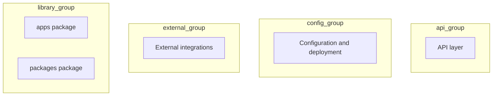

# Architecture report: zuiidea/antd-admin

> Automated static analysis. **Observed** = directly seen in files/imports/AST; **Inferred** = interpretation from that evidence. Repository code was not executed.

## 1. Repository at a glance

| Item | Value |
| --- | --- |
| Repository | zuiidea/antd-admin |
| Description | AI-friendly enterprise front-end best practices |
| Language | TypeScript |
| Stars | 9769 |
| Licence | MIT |
| Analysed commit / branch | 4dc473ba55635e73b642f7de71a3ac0aa58a7bd6 / master |
| Framework(s) | Next.js, React |
| Files analysed | 317 |
| Components | 5 |

## 2. Architecture in one minute

zuiidea/antd-admin - AI-friendly enterprise front-end best practices. This repository was analysed statically from 317 file(s) (0 Python). Detected technologies (observed from imports/manifests): GitHub Actions, Next.js, React, axios, TypeScript, Vite. Files are grouped into 5 component(s): API layer, apps package, Configuration and deployment, External integrations, packages package. Findings below distinguish observed facts from inferred interpretation.

## 3. High-level block diagram

## 4. Main components

### API layer (`api_layer`)

- **Kind:** api
- **Status:** Observed
- **Confidence:** 0.85
- **Responsibility:** Groups 54 file(s) under api layer (observed from repository paths and static analysis).
- **Paths:** `apps/basic/src/api/auth/index.ts`, `apps/basic/src/api/auth/paths.ts`, `apps/basic/src/api/auth/schemas.ts`, `apps/basic/src/api/request.ts`, `apps/basic/src/api/schemas.ts`, `apps/basic/src/api/shared/envelope.ts`, `apps/basic/src/api/shared/index.ts`, `apps/basic/src/api/shared/menu.ts`, `apps/basic/src/api/shared/pagination.ts`, `apps/basic/src/api/shared/params.ts`, `apps/basic/src/api/shared/prefix.ts`, `apps/basic/src/api/users/index.ts`, `apps/basic/src/api/users/schemas.ts`, `apps/basic/src/mocks/handlers/auth.ts`, `apps/basic/src/mocks/handlers/index.ts`, `apps/basic/src/mocks/handlers/user.ts`, `apps/basic/src/routes/404/index.tsx`, `apps/basic/src/routes/__root.tsx`, `apps/basic/src/routes/_auth.tsx`, `apps/basic/src/routes/_auth/403/index.tsx`, `apps/basic/src/routes/_auth/dashboard/index.tsx`, `apps/basic/src/routes/_auth/users/-FormModal.tsx`, `apps/basic/src/routes/_auth/users/-Toolbar.tsx`, `apps/basic/src/routes/_auth/users/index.tsx`, `apps/basic/src/routes/index.tsx`, `apps/basic/src/routes/login/index.tsx`, `apps/basic/src/routes/register/index.tsx`, `apps/with-lingui/src/api/auth/index.ts`, `apps/with-lingui/src/api/auth/paths.ts`, `apps/with-lingui/src/api/auth/schemas.ts`, `apps/with-lingui/src/api/request.ts`, `apps/with-lingui/src/api/schemas.ts`, `apps/with-lingui/src/api/shared/envelope.ts`, `apps/with-lingui/src/api/shared/index.ts`, `apps/with-lingui/src/api/shared/menu.ts`, `apps/with-lingui/src/api/shared/pagination.ts`, `apps/with-lingui/src/api/shared/params.ts`, `apps/with-lingui/src/api/shared/prefix.ts`, `apps/with-lingui/src/api/users/index.ts`, `apps/with-lingui/src/api/users/schemas.ts`, `apps/with-lingui/src/mocks/handlers/auth.ts`, `apps/with-lingui/src/mocks/handlers/index.ts`, `apps/with-lingui/src/mocks/handlers/user.ts`, `apps/with-lingui/src/routes/404/index.tsx`, `apps/with-lingui/src/routes/__root.tsx`, `apps/with-lingui/src/routes/_auth.tsx`, `apps/with-lingui/src/routes/_auth/403/index.tsx`, `apps/with-lingui/src/routes/_auth/dashboard/index.tsx`, `apps/with-lingui/src/routes/_auth/users/-FormModal.tsx`, `apps/with-lingui/src/routes/_auth/users/-Toolbar.tsx`, `apps/with-lingui/src/routes/_auth/users/index.tsx`, `apps/with-lingui/src/routes/index.tsx`, `apps/with-lingui/src/routes/login/index.tsx`, `apps/with-lingui/src/routes/register/index.tsx`
- **Evidence:** [apps/basic/src/api/auth/index.ts](https://github.com/zuiidea/antd-admin/blob/4dc473ba55635e73b642f7de71a3ac0aa58a7bd6/apps/basic/src/api/auth/index.ts); [apps/basic/src/api/auth/paths.ts](https://github.com/zuiidea/antd-admin/blob/4dc473ba55635e73b642f7de71a3ac0aa58a7bd6/apps/basic/src/api/auth/paths.ts); [apps/basic/src/api/auth/schemas.ts](https://github.com/zuiidea/antd-admin/blob/4dc473ba55635e73b642f7de71a3ac0aa58a7bd6/apps/basic/src/api/auth/schemas.ts); [apps/basic/src/api/request.ts](https://github.com/zuiidea/antd-admin/blob/4dc473ba55635e73b642f7de71a3ac0aa58a7bd6/apps/basic/src/api/request.ts); [apps/basic/src/api/schemas.ts](https://github.com/zuiidea/antd-admin/blob/4dc473ba55635e73b642f7de71a3ac0aa58a7bd6/apps/basic/src/api/schemas.ts); [apps/basic/src/api/shared/envelope.ts](https://github.com/zuiidea/antd-admin/blob/4dc473ba55635e73b642f7de71a3ac0aa58a7bd6/apps/basic/src/api/shared/envelope.ts); [apps/basic/src/api/shared/index.ts](https://github.com/zuiidea/antd-admin/blob/4dc473ba55635e73b642f7de71a3ac0aa58a7bd6/apps/basic/src/api/shared/index.ts); [apps/basic/src/api/shared/menu.ts](https://github.com/zuiidea/antd-admin/blob/4dc473ba55635e73b642f7de71a3ac0aa58a7bd6/apps/basic/src/api/shared/menu.ts)

### apps package (`apps`)

- **Kind:** library
- **Status:** Observed
- **Confidence:** 0.85
- **Responsibility:** Groups 99 file(s) under apps package (observed from repository paths and static analysis).
- **Paths:** `apps/basic/e2e/auth-refresh.spec.ts`, `apps/basic/e2e/helpers.ts`, `apps/basic/e2e/login.spec.ts`, `apps/basic/e2e/rbac.spec.ts`, `apps/basic/e2e/url-state.spec.ts`, `apps/basic/e2e/users.spec.ts`, `apps/basic/playwright.config.ts`, `apps/basic/public/mockServiceWorker.js`, `apps/basic/src/components/Aurora/index.tsx`, `apps/basic/src/components/Auth/index.tsx`, `apps/basic/src/components/DataTable/DataTableEmpty.tsx`, `apps/basic/src/components/DataTable/DataTableSkeleton.tsx`, `apps/basic/src/components/DataTable/index.tsx`, `apps/basic/src/components/FilterToolbar/index.tsx`, `apps/basic/src/components/FormModal/index.tsx`, `apps/basic/src/components/Icon/GitHub.tsx`, `apps/basic/src/components/Icon/Theme.tsx`, `apps/basic/src/components/Icon/index.tsx`, `apps/basic/src/components/Layout/AppFooter/index.tsx`, `apps/basic/src/components/Layout/Header/index.tsx`, `apps/basic/src/components/Layout/MainLayout/index.tsx`, `apps/basic/src/components/Layout/Sidebar/index.tsx`, `apps/basic/src/components/Layout/UserMenu/index.tsx`, `apps/basic/src/components/NotFound/index.tsx`, `apps/basic/src/components/RouteError.tsx`, `apps/basic/src/hooks/tokenBuilders.ts`, `apps/basic/src/hooks/useAppTheme.ts`, `apps/basic/src/hooks/useCrudToasts.ts`, `apps/basic/src/hooks/usePermission.ts`, `apps/basic/src/hooks/useResourceCRUD.test.ts`, `apps/basic/src/hooks/useResourceCRUD.ts`, `apps/basic/src/hooks/useTableFitHeight.ts`, `apps/basic/src/hooks/useUrlSearchState.ts`, `apps/basic/src/main.tsx`, `apps/basic/src/mocks/browser.ts`, `apps/basic/src/mocks/createHandler.test.ts`, `apps/basic/src/mocks/createHandler.ts`, `apps/basic/src/mocks/data.ts`, `apps/basic/src/mocks/utils.ts`, `apps/basic/src/routeTree.gen.ts`, `apps/basic/src/stores/auth.ts`, `apps/basic/src/stores/createPersistentStore.ts`, `apps/basic/src/stores/settings.ts`, `apps/basic/src/utils/appMenu.ts`, `apps/basic/src/utils/constants.ts`, `apps/basic/src/vite-env.d.ts`, `apps/basic/vite.config.ts`, `apps/basic/vitest.config.ts`, `apps/with-lingui/e2e/auth-refresh.spec.ts`, `apps/with-lingui/e2e/helpers.ts`, `apps/with-lingui/e2e/login.spec.ts`, `apps/with-lingui/e2e/rbac.spec.ts`, `apps/with-lingui/e2e/url-state.spec.ts`, `apps/with-lingui/e2e/users.spec.ts`, `apps/with-lingui/lingui.config.ts`, `apps/with-lingui/playwright.config.ts`, `apps/with-lingui/public/mockServiceWorker.js`, `apps/with-lingui/src/components/Aurora/index.tsx`, `apps/with-lingui/src/components/Auth/index.tsx`, `apps/with-lingui/src/components/DataTable/DataTableEmpty.tsx`, `apps/with-lingui/src/components/DataTable/DataTableSkeleton.tsx`, `apps/with-lingui/src/components/DataTable/index.tsx`, `apps/with-lingui/src/components/FilterToolbar/index.tsx`, `apps/with-lingui/src/components/FormModal/index.tsx`, `apps/with-lingui/src/components/Icon/GitHub.tsx`, `apps/with-lingui/src/components/Icon/Theme.tsx`, `apps/with-lingui/src/components/Icon/index.tsx`, `apps/with-lingui/src/components/Layout/AppFooter/index.tsx`, `apps/with-lingui/src/components/Layout/Header/index.tsx`, `apps/with-lingui/src/components/Layout/MainLayout/index.tsx`, `apps/with-lingui/src/components/Layout/Sidebar/index.tsx`, `apps/with-lingui/src/components/Layout/UserMenu/index.tsx`, `apps/with-lingui/src/components/NotFound/index.tsx`, `apps/with-lingui/src/components/RouteError.tsx`, `apps/with-lingui/src/hooks/tokenBuilders.ts`, `apps/with-lingui/src/hooks/useAppTheme.ts`, `apps/with-lingui/src/hooks/useCrudToasts.ts`, `apps/with-lingui/src/hooks/usePermission.ts`, `apps/with-lingui/src/hooks/useResourceCRUD.test.ts`, `apps/with-lingui/src/hooks/useResourceCRUD.ts`, `apps/with-lingui/src/hooks/useTableFitHeight.ts`, `apps/with-lingui/src/hooks/useUrlSearchState.ts`, `apps/with-lingui/src/lingui.d.ts`, `apps/with-lingui/src/locales/loadLocaleCatalog.ts`, `apps/with-lingui/src/main.tsx`, `apps/with-lingui/src/mocks/browser.ts`, `apps/with-lingui/src/mocks/createHandler.test.ts`, `apps/with-lingui/src/mocks/createHandler.ts`, `apps/with-lingui/src/mocks/data.ts`, `apps/with-lingui/src/mocks/utils.ts`, `apps/with-lingui/src/routeTree.gen.ts`, `apps/with-lingui/src/stores/auth.ts`, `apps/with-lingui/src/stores/createPersistentStore.ts`, `apps/with-lingui/src/stores/settings.ts`, `apps/with-lingui/src/utils/appMenu.ts`, `apps/with-lingui/src/utils/constants.ts`, `apps/with-lingui/src/vite-env.d.ts`, `apps/with-lingui/vite.config.ts`, `apps/with-lingui/vitest.config.ts`
- **Evidence:** [apps/basic/e2e/auth-refresh.spec.ts](https://github.com/zuiidea/antd-admin/blob/4dc473ba55635e73b642f7de71a3ac0aa58a7bd6/apps/basic/e2e/auth-refresh.spec.ts); [apps/basic/e2e/helpers.ts](https://github.com/zuiidea/antd-admin/blob/4dc473ba55635e73b642f7de71a3ac0aa58a7bd6/apps/basic/e2e/helpers.ts); [apps/basic/e2e/login.spec.ts](https://github.com/zuiidea/antd-admin/blob/4dc473ba55635e73b642f7de71a3ac0aa58a7bd6/apps/basic/e2e/login.spec.ts); [apps/basic/e2e/rbac.spec.ts](https://github.com/zuiidea/antd-admin/blob/4dc473ba55635e73b642f7de71a3ac0aa58a7bd6/apps/basic/e2e/rbac.spec.ts); [apps/basic/e2e/url-state.spec.ts](https://github.com/zuiidea/antd-admin/blob/4dc473ba55635e73b642f7de71a3ac0aa58a7bd6/apps/basic/e2e/url-state.spec.ts); [apps/basic/e2e/users.spec.ts](https://github.com/zuiidea/antd-admin/blob/4dc473ba55635e73b642f7de71a3ac0aa58a7bd6/apps/basic/e2e/users.spec.ts); [apps/basic/playwright.config.ts](https://github.com/zuiidea/antd-admin/blob/4dc473ba55635e73b642f7de71a3ac0aa58a7bd6/apps/basic/playwright.config.ts); [apps/basic/public/mockServiceWorker.js](https://github.com/zuiidea/antd-admin/blob/4dc473ba55635e73b642f7de71a3ac0aa58a7bd6/apps/basic/public/mockServiceWorker.js)

### Configuration and deployment (`config`)

- **Kind:** config
- **Status:** Observed
- **Confidence:** 0.85
- **Responsibility:** Groups 14 file(s) under configuration and deployment (observed from repository paths and static analysis).
- **Paths:** `apps/basic/package.json`, `apps/basic/tsconfig.json`, `apps/basic/vercel.json`, `apps/docs/package.json`, `apps/docs/tsconfig.json`, `apps/with-lingui/package.json`, `apps/with-lingui/tsconfig.json`, `apps/with-lingui/vercel.json`, `package.json`, `packages/create/fixtures/minimal-app/package.json`, `packages/create/package.json`, `packages/create/tsconfig.json`, `pnpm-workspace.yaml`, `turbo.json`
- **Evidence:** [apps/basic/package.json](https://github.com/zuiidea/antd-admin/blob/4dc473ba55635e73b642f7de71a3ac0aa58a7bd6/apps/basic/package.json); [apps/basic/tsconfig.json](https://github.com/zuiidea/antd-admin/blob/4dc473ba55635e73b642f7de71a3ac0aa58a7bd6/apps/basic/tsconfig.json); [apps/basic/vercel.json](https://github.com/zuiidea/antd-admin/blob/4dc473ba55635e73b642f7de71a3ac0aa58a7bd6/apps/basic/vercel.json); [apps/docs/package.json](https://github.com/zuiidea/antd-admin/blob/4dc473ba55635e73b642f7de71a3ac0aa58a7bd6/apps/docs/package.json); [apps/docs/tsconfig.json](https://github.com/zuiidea/antd-admin/blob/4dc473ba55635e73b642f7de71a3ac0aa58a7bd6/apps/docs/tsconfig.json); [apps/with-lingui/package.json](https://github.com/zuiidea/antd-admin/blob/4dc473ba55635e73b642f7de71a3ac0aa58a7bd6/apps/with-lingui/package.json); [apps/with-lingui/tsconfig.json](https://github.com/zuiidea/antd-admin/blob/4dc473ba55635e73b642f7de71a3ac0aa58a7bd6/apps/with-lingui/tsconfig.json); [apps/with-lingui/vercel.json](https://github.com/zuiidea/antd-admin/blob/4dc473ba55635e73b642f7de71a3ac0aa58a7bd6/apps/with-lingui/vercel.json)

### External integrations (`external_integrations`)

- **Kind:** external
- **Status:** Observed
- **Confidence:** 0.85
- **Responsibility:** Groups 1 file(s) under external integrations (observed from repository paths and static analysis).
- **Paths:** `packages/create/src/integration/create-pipeline.test.ts`
- **Evidence:** [packages/create/src/integration/create-pipeline.test.ts](https://github.com/zuiidea/antd-admin/blob/4dc473ba55635e73b642f7de71a3ac0aa58a7bd6/packages/create/src/integration/create-pipeline.test.ts)

### packages package (`packages`)

- **Kind:** library
- **Status:** Observed
- **Confidence:** 0.85
- **Responsibility:** Groups 22 file(s) under packages package (observed from repository paths and static analysis).
- **Paths:** `packages/create/scripts/write-examples-json.mjs`, `packages/create/src/cli.ts`, `packages/create/src/commands/create.ts`, `packages/create/src/constants.ts`, `packages/create/src/download.ts`, `packages/create/src/errors.ts`, `packages/create/src/examples.ts`, `packages/create/src/git.ts`, `packages/create/src/install.ts`, `packages/create/src/package-manager.ts`, `packages/create/src/paths.ts`, `packages/create/src/prompts.ts`, `packages/create/src/resolve-example-source.test.ts`, `packages/create/src/resolve-example-source.ts`, `packages/create/src/resolve-ref.ts`, `packages/create/src/transforms/package-json-name.ts`, `packages/create/src/transforms/run-transforms.ts`, `packages/create/src/types.ts`, `packages/create/src/utils/normalize-package-name.test.ts`, `packages/create/src/utils/normalize-package-name.ts`, `packages/create/tsup.config.ts`, `packages/create/vitest.config.ts`
- **Evidence:** [packages/create/scripts/write-examples-json.mjs](https://github.com/zuiidea/antd-admin/blob/4dc473ba55635e73b642f7de71a3ac0aa58a7bd6/packages/create/scripts/write-examples-json.mjs); [packages/create/src/cli.ts](https://github.com/zuiidea/antd-admin/blob/4dc473ba55635e73b642f7de71a3ac0aa58a7bd6/packages/create/src/cli.ts); [packages/create/src/commands/create.ts](https://github.com/zuiidea/antd-admin/blob/4dc473ba55635e73b642f7de71a3ac0aa58a7bd6/packages/create/src/commands/create.ts); [packages/create/src/constants.ts](https://github.com/zuiidea/antd-admin/blob/4dc473ba55635e73b642f7de71a3ac0aa58a7bd6/packages/create/src/constants.ts); [packages/create/src/download.ts](https://github.com/zuiidea/antd-admin/blob/4dc473ba55635e73b642f7de71a3ac0aa58a7bd6/packages/create/src/download.ts); [packages/create/src/errors.ts](https://github.com/zuiidea/antd-admin/blob/4dc473ba55635e73b642f7de71a3ac0aa58a7bd6/packages/create/src/errors.ts); [packages/create/src/examples.ts](https://github.com/zuiidea/antd-admin/blob/4dc473ba55635e73b642f7de71a3ac0aa58a7bd6/packages/create/src/examples.ts); [packages/create/src/git.ts](https://github.com/zuiidea/antd-admin/blob/4dc473ba55635e73b642f7de71a3ac0aa58a7bd6/packages/create/src/git.ts)

## 5. Execution flow

**Observed** entry point(s):

- [apps/basic/src/main.tsx](https://github.com/zuiidea/antd-admin/blob/4dc473ba55635e73b642f7de71a3ac0aa58a7bd6/apps/basic/src/main.tsx)
- [apps/with-lingui/src/main.tsx](https://github.com/zuiidea/antd-admin/blob/4dc473ba55635e73b642f7de71a3ac0aa58a7bd6/apps/with-lingui/src/main.tsx)

Representative flow (derived from observed entry points and the import graph; steps beyond the entry point are **Inferred**):

1. Execution starts at an observed entry point listed above, if present.
2. No internal import relationships between components were observed.

## 6. Project structure

### `(root)`

- `.gitignore` - other (611 bytes)
- `AGENTS.md` - docs (943 bytes)
- `LICENSE` - docs (1085 bytes)
- `README.md` - docs (2835 bytes)
- `package.json` - manifest (720 bytes)
- `pnpm-workspace.yaml` - config (40 bytes)
- `turbo.json` - config (524 bytes)

### `.cursor`

- `.cursor/rules/english-only-comments.md` - docs (712 bytes)

### `.githooks`

- `.githooks/README.md` - docs (1158 bytes)
- `.githooks/pre-commit` - other (844 bytes)

### `.github`

- `.github/workflows/publish-init-antd-admin.yml` - ci, YAML (1862 bytes)
- `.github/workflows/with-lingui-ci.yml` - ci, YAML (1178 bytes)

### `apps`

- `apps/basic/.agents/skills/add-resource/SKILL.md` - docs (3681 bytes)
- `apps/basic/.gitignore` - other (391 bytes)
- `apps/basic/.vite-hooks/pre-commit` - other (9 bytes)
- `apps/basic/AGENTS.md` - docs (3928 bytes)
- `apps/basic/README.md` - docs (10051 bytes)
- `apps/basic/e2e/auth-refresh.spec.ts` - source, TypeScript (1159 bytes)
- `apps/basic/e2e/helpers.ts` - source, TypeScript (866 bytes)
- `apps/basic/e2e/login.spec.ts` - source, TypeScript (1031 bytes)
- `apps/basic/e2e/rbac.spec.ts` - source, TypeScript (309 bytes)
- `apps/basic/e2e/url-state.spec.ts` - source, TypeScript (740 bytes)
- `apps/basic/e2e/users.spec.ts` - source, TypeScript (1619 bytes)
- `apps/basic/index.html` - other (568 bytes)
- `apps/basic/package.json` - manifest (1137 bytes)
- `apps/basic/playwright.config.ts` - source, TypeScript (604 bytes)
- `apps/basic/public/favicon.svg` - other (1672 bytes)
- `apps/basic/public/mockServiceWorker.js` - source, JavaScript (9655 bytes)
- `apps/basic/src/api/auth/index.ts` - source, TypeScript (1796 bytes)
- `apps/basic/src/api/auth/paths.ts` - source, TypeScript (344 bytes)
- `apps/basic/src/api/auth/schemas.ts` - source, TypeScript (1528 bytes)
- `apps/basic/src/api/request.ts` - source, TypeScript (8217 bytes)
- `apps/basic/src/api/schemas.ts` - source, TypeScript (208 bytes)
- `apps/basic/src/api/shared/envelope.ts` - source, TypeScript (517 bytes)
- `apps/basic/src/api/shared/index.ts` - source, TypeScript (134 bytes)
- `apps/basic/src/api/shared/menu.ts` - source, TypeScript (885 bytes)
- `apps/basic/src/api/shared/pagination.ts` - source, TypeScript (330 bytes)
- `apps/basic/src/api/shared/params.ts` - source, TypeScript (481 bytes)
- `apps/basic/src/api/shared/prefix.ts` - source, TypeScript (92 bytes)
- `apps/basic/src/api/users/index.ts` - source, TypeScript (1383 bytes)
- `apps/basic/src/api/users/schemas.ts` - source, TypeScript (1383 bytes)
- `apps/basic/src/components/Aurora/index.css` - other (1804 bytes)
- `apps/basic/src/components/Aurora/index.tsx` - source, TypeScript (320 bytes)
- `apps/basic/src/components/Auth/index.tsx` - source, TypeScript (368 bytes)
- `apps/basic/src/components/DataTable/DataTableEmpty.tsx` - source, TypeScript (1622 bytes)
- `apps/basic/src/components/DataTable/DataTableSkeleton.tsx` - source, TypeScript (8661 bytes)
- `apps/basic/src/components/DataTable/index.css` - other (720 bytes)
- `apps/basic/src/components/DataTable/index.tsx` - source, TypeScript (3818 bytes)
- `apps/basic/src/components/FilterToolbar/index.tsx` - source, TypeScript (5196 bytes)
- `apps/basic/src/components/FormModal/index.tsx` - source, TypeScript (1081 bytes)
- `apps/basic/src/components/Icon/GitHub.tsx` - source, TypeScript (979 bytes)
- `apps/basic/src/components/Icon/Theme.tsx` - source, TypeScript (510 bytes)
- `apps/basic/src/components/Icon/index.tsx` - source, TypeScript (68 bytes)
- `apps/basic/src/components/Layout/AppFooter/index.tsx` - source, TypeScript (934 bytes)
- `apps/basic/src/components/Layout/Header/index.tsx` - source, TypeScript (4272 bytes)
- `apps/basic/src/components/Layout/MainLayout/index.tsx` - source, TypeScript (850 bytes)
- `apps/basic/src/components/Layout/Sidebar/index.css` - other (1355 bytes)
- `apps/basic/src/components/Layout/Sidebar/index.tsx` - source, TypeScript (12010 bytes)
- `apps/basic/src/components/Layout/UserMenu/index.css` - other (142 bytes)
- `apps/basic/src/components/Layout/UserMenu/index.tsx` - source, TypeScript (2713 bytes)
- `apps/basic/src/components/NotFound/index.tsx` - source, TypeScript (1971 bytes)
- `apps/basic/src/components/RouteError.tsx` - source, TypeScript (739 bytes)
- `apps/basic/src/hooks/tokenBuilders.ts` - source, TypeScript (3057 bytes)
- `apps/basic/src/hooks/useAppTheme.ts` - source, TypeScript (575 bytes)
- `apps/basic/src/hooks/useCrudToasts.ts` - source, TypeScript (2009 bytes)
- `apps/basic/src/hooks/usePermission.ts` - source, TypeScript (316 bytes)
- `apps/basic/src/hooks/useResourceCRUD.test.ts` - source, TypeScript (2112 bytes)
- `apps/basic/src/hooks/useResourceCRUD.ts` - source, TypeScript (5782 bytes)
- `apps/basic/src/hooks/useTableFitHeight.ts` - source, TypeScript (3930 bytes)
- `apps/basic/src/hooks/useUrlSearchState.ts` - source, TypeScript (888 bytes)
- `apps/basic/src/index.css` - other (1034 bytes)
- `apps/basic/src/main.tsx` - source, TypeScript (1436 bytes)
- `apps/basic/src/mocks/browser.ts` - source, TypeScript (131 bytes)
- `apps/basic/src/mocks/createHandler.test.ts` - source, TypeScript (2048 bytes)
- `apps/basic/src/mocks/createHandler.ts` - source, TypeScript (1602 bytes)
- `apps/basic/src/mocks/data.ts` - source, TypeScript (1551 bytes)
- `apps/basic/src/mocks/handlers/auth.ts` - source, TypeScript (5414 bytes)
- `apps/basic/src/mocks/handlers/index.ts` - source, TypeScript (139 bytes)
- `apps/basic/src/mocks/handlers/user.ts` - source, TypeScript (2316 bytes)
- `apps/basic/src/mocks/utils.ts` - source, TypeScript (1437 bytes)
- `apps/basic/src/routeTree.gen.ts` - source, TypeScript (6151 bytes)
- `apps/basic/src/routes/404/index.tsx` - source, TypeScript (184 bytes)
- `apps/basic/src/routes/__root.tsx` - source, TypeScript (1707 bytes)
- `apps/basic/src/routes/_auth.tsx` - source, TypeScript (999 bytes)
- `apps/basic/src/routes/_auth/403/index.tsx` - source, TypeScript (1131 bytes)
- `apps/basic/src/routes/_auth/dashboard/index.css` - other (858 bytes)
- `apps/basic/src/routes/_auth/dashboard/index.tsx` - source, TypeScript (11163 bytes)
- `apps/basic/src/routes/_auth/users/-FormModal.tsx` - source, TypeScript (1467 bytes)
- `apps/basic/src/routes/_auth/users/-Toolbar.tsx` - source, TypeScript (2325 bytes)
- `apps/basic/src/routes/_auth/users/index.tsx` - source, TypeScript (10687 bytes)
- `apps/basic/src/routes/index.tsx` - source, TypeScript (182 bytes)
- `apps/basic/src/routes/login/index.css` - other (975 bytes)
- `apps/basic/src/routes/login/index.tsx` - source, TypeScript (7166 bytes)
- `apps/basic/src/routes/register/index.tsx` - source, TypeScript (7066 bytes)
- `apps/basic/src/stores/auth.ts` - source, TypeScript (1739 bytes)
- `apps/basic/src/stores/createPersistentStore.ts` - source, TypeScript (983 bytes)
- `apps/basic/src/stores/settings.ts` - source, TypeScript (969 bytes)
- `apps/basic/src/utils/appMenu.ts` - source, TypeScript (3267 bytes)
- `apps/basic/src/utils/constants.ts` - source, TypeScript (295 bytes)
- `apps/basic/src/vite-env.d.ts` - source, TypeScript (38 bytes)
- `apps/basic/tsconfig.json` - config (725 bytes)
- `apps/basic/vercel.json` - config (96 bytes)
- `apps/basic/vite.config.ts` - source, TypeScript (980 bytes)
- `apps/basic/vitest.config.ts` - source, TypeScript (291 bytes)
- `apps/docs/.gitignore` - docs (26 bytes)
- `apps/docs/README.md` - docs (2210 bytes)
- `apps/docs/app/[lang]/[[...mdxPath]]/page.tsx` - docs (1178 bytes)
- `apps/docs/app/[lang]/layout.tsx` - docs (2608 bytes)
- `apps/docs/app/[lang]/not-found.tsx` - docs (117 bytes)
- `apps/docs/content/en/_meta.js` - docs (352 bytes)
- `apps/docs/content/en/backend/_meta.js` - docs (115 bytes)
- `apps/docs/content/en/backend/proxying-api-requests.mdx` - docs (1846 bytes)
- `apps/docs/content/en/building/_meta.js` - docs (207 bytes)
- `apps/docs/content/en/building/environment-variables.mdx` - docs (340 bytes)
- `apps/docs/content/en/building/performance.mdx` - docs (271 bytes)
- `apps/docs/content/en/building/production-build.mdx` - docs (324 bytes)
- `apps/docs/content/en/building/router.mdx` - docs (297 bytes)
- `apps/docs/content/en/deployment/index.mdx` - docs (320 bytes)
- `apps/docs/content/en/development/_meta.js` - docs (153 bytes)
- `apps/docs/content/en/development/bundle-analysis.mdx` - docs (334 bytes)
- `apps/docs/content/en/development/https-in-development.mdx` - docs (353 bytes)
- `apps/docs/content/en/getting-started/_meta.js` - docs (313 bytes)
- `apps/docs/content/en/getting-started/available-scripts.mdx` - docs (770 bytes)
- `apps/docs/content/en/getting-started/folder-structure.mdx` - docs (1492 bytes)
- `apps/docs/content/en/getting-started/index.mdx` - docs (735 bytes)
- `apps/docs/content/en/getting-started/supported-browsers.mdx` - docs (332 bytes)
- `apps/docs/content/en/getting-started/supported-features.mdx` - docs (464 bytes)
- `apps/docs/content/en/getting-started/updating-releases.mdx` - docs (430 bytes)
- `apps/docs/content/en/index.mdx` - docs (826 bytes)
- `apps/docs/content/en/styles-and-assets/_meta.js` - docs (249 bytes)
- `apps/docs/content/en/styles-and-assets/code-splitting.mdx` - docs (316 bytes)
- `apps/docs/content/en/styles-and-assets/css-modules.mdx` - docs (247 bytes)
- `apps/docs/content/en/styles-and-assets/images-fonts-files.mdx` - docs (295 bytes)
- `apps/docs/content/en/styles-and-assets/public-folder.mdx` - docs (238 bytes)
- `apps/docs/content/en/styles-and-assets/stylesheet.mdx` - docs (261 bytes)
- `apps/docs/content/en/templates/_meta.js` - docs (135 bytes)
- `apps/docs/content/en/templates/basic.mdx` - docs (861 bytes)
- `apps/docs/content/en/templates/index.mdx` - docs (557 bytes)
- `apps/docs/content/en/templates/with-lingui.mdx` - docs (854 bytes)
- `apps/docs/content/en/testing/_meta.js` - docs (139 bytes)
- `apps/docs/content/en/testing/debugging-tests.mdx` - docs (357 bytes)
- `apps/docs/content/en/testing/running-tests.mdx` - docs (541 bytes)
- `apps/docs/content/en/welcome/_meta.js` - docs (114 bytes)
- `apps/docs/content/en/welcome/documentation-intro.mdx` - docs (850 bytes)
- `apps/docs/content/zh/_meta.js` - docs (324 bytes)
- `apps/docs/content/zh/backend/_meta.js` - docs (114 bytes)
- `apps/docs/content/zh/backend/proxying-api-requests.mdx` - docs (2034 bytes)
- `apps/docs/content/zh/building/_meta.js` - docs (195 bytes)
- `apps/docs/content/zh/building/environment-variables.mdx` - docs (529 bytes)
- `apps/docs/content/zh/building/performance.mdx` - docs (470 bytes)
- `apps/docs/content/zh/building/production-build.mdx` - docs (434 bytes)
- `apps/docs/content/zh/building/router.mdx` - docs (635 bytes)
- `apps/docs/content/zh/deployment/index.mdx` - docs (690 bytes)
- `apps/docs/content/zh/development/_meta.js` - docs (154 bytes)
- `apps/docs/content/zh/development/bundle-analysis.mdx` - docs (587 bytes)
- `apps/docs/content/zh/development/https-in-development.mdx` - docs (550 bytes)
- `apps/docs/content/zh/getting-started/_meta.js` - docs (280 bytes)
- `apps/docs/content/zh/getting-started/available-scripts.mdx` - docs (1213 bytes)
- `apps/docs/content/zh/getting-started/folder-structure.mdx` - docs (1438 bytes)
- `apps/docs/content/zh/getting-started/index.mdx` - docs (1098 bytes)
- `apps/docs/content/zh/getting-started/supported-browsers.mdx` - docs (605 bytes)
- `apps/docs/content/zh/getting-started/supported-features.mdx` - docs (1082 bytes)
- `apps/docs/content/zh/getting-started/updating-releases.mdx` - docs (877 bytes)
- `apps/docs/content/zh/index.mdx` - docs (777 bytes)
- `apps/docs/content/zh/styles-and-assets/_meta.js` - docs (255 bytes)
- `apps/docs/content/zh/styles-and-assets/code-splitting.mdx` - docs (414 bytes)
- `apps/docs/content/zh/styles-and-assets/css-modules.mdx` - docs (424 bytes)
- `apps/docs/content/zh/styles-and-assets/images-fonts-files.mdx` - docs (456 bytes)
- `apps/docs/content/zh/styles-and-assets/public-folder.mdx` - docs (432 bytes)
- `apps/docs/content/zh/styles-and-assets/stylesheet.mdx` - docs (540 bytes)
- `apps/docs/content/zh/templates/_meta.js` - docs (113 bytes)
- `apps/docs/content/zh/templates/basic.mdx` - docs (1149 bytes)
- `apps/docs/content/zh/templates/index.mdx` - docs (1129 bytes)
- `apps/docs/content/zh/templates/with-lingui.mdx` - docs (1321 bytes)
- `apps/docs/content/zh/testing/_meta.js` - docs (135 bytes)
- `apps/docs/content/zh/testing/debugging-tests.mdx` - docs (477 bytes)
- `apps/docs/content/zh/testing/running-tests.mdx` - docs (676 bytes)
- `apps/docs/content/zh/welcome/_meta.js` - docs (104 bytes)
- `apps/docs/content/zh/welcome/documentation-intro.mdx` - docs (1166 bytes)
- `apps/docs/eslint.config.mjs` - docs (474 bytes)
- `apps/docs/mdx-components.tsx` - docs (327 bytes)
- `apps/docs/next-env.d.ts` - docs (247 bytes)
- `apps/docs/next.config.mjs` - docs (216 bytes)
- `apps/docs/package.json` - manifest (618 bytes)
- `apps/docs/proxy.ts` - docs (958 bytes)
- `apps/docs/tsconfig.json` - config (698 bytes)
- `apps/with-lingui/.agents/skills/add-resource/SKILL.md` - docs (3858 bytes)
- `apps/with-lingui/.gitignore` - other (383 bytes)
- `apps/with-lingui/.vite-hooks/pre-commit` - other (9 bytes)
- `apps/with-lingui/AGENTS.md` - docs (4404 bytes)
- `apps/with-lingui/README.md` - docs (8854 bytes)
- `apps/with-lingui/e2e/auth-refresh.spec.ts` - source, TypeScript (1159 bytes)
- `apps/with-lingui/e2e/helpers.ts` - source, TypeScript (866 bytes)
- `apps/with-lingui/e2e/login.spec.ts` - source, TypeScript (1031 bytes)
- `apps/with-lingui/e2e/rbac.spec.ts` - source, TypeScript (309 bytes)
- `apps/with-lingui/e2e/url-state.spec.ts` - source, TypeScript (740 bytes)
- `apps/with-lingui/e2e/users.spec.ts` - source, TypeScript (1619 bytes)
- `apps/with-lingui/index.html` - other (568 bytes)
- `apps/with-lingui/lingui.config.ts` - source, TypeScript (285 bytes)
- `apps/with-lingui/package.json` - manifest (1519 bytes)
- `apps/with-lingui/playwright.config.ts` - source, TypeScript (604 bytes)
- `apps/with-lingui/public/favicon.svg` - other (1672 bytes)
- `apps/with-lingui/public/mockServiceWorker.js` - source, JavaScript (9655 bytes)
- `apps/with-lingui/src/api/auth/index.ts` - source, TypeScript (1796 bytes)
- `apps/with-lingui/src/api/auth/paths.ts` - source, TypeScript (344 bytes)
- `apps/with-lingui/src/api/auth/schemas.ts` - source, TypeScript (1528 bytes)
- `apps/with-lingui/src/api/request.ts` - source, TypeScript (8217 bytes)
- `apps/with-lingui/src/api/schemas.ts` - source, TypeScript (208 bytes)
- `apps/with-lingui/src/api/shared/envelope.ts` - source, TypeScript (517 bytes)
- `apps/with-lingui/src/api/shared/index.ts` - source, TypeScript (134 bytes)
- `apps/with-lingui/src/api/shared/menu.ts` - source, TypeScript (885 bytes)
- `apps/with-lingui/src/api/shared/pagination.ts` - source, TypeScript (330 bytes)
- `apps/with-lingui/src/api/shared/params.ts` - source, TypeScript (481 bytes)
- `apps/with-lingui/src/api/shared/prefix.ts` - source, TypeScript (92 bytes)
- `apps/with-lingui/src/api/users/index.ts` - source, TypeScript (1383 bytes)
- `apps/with-lingui/src/api/users/schemas.ts` - source, TypeScript (1383 bytes)
- `apps/with-lingui/src/components/Aurora/index.css` - other (1804 bytes)
- `apps/with-lingui/src/components/Aurora/index.tsx` - source, TypeScript (320 bytes)
- `apps/with-lingui/src/components/Auth/index.tsx` - source, TypeScript (368 bytes)
- `apps/with-lingui/src/components/DataTable/DataTableEmpty.tsx` - source, TypeScript (1606 bytes)
- `apps/with-lingui/src/components/DataTable/DataTableSkeleton.tsx` - source, TypeScript (8438 bytes)
- `apps/with-lingui/src/components/DataTable/index.css` - other (720 bytes)
- `apps/with-lingui/src/components/DataTable/index.tsx` - source, TypeScript (3249 bytes)
- `apps/with-lingui/src/components/FilterToolbar/index.tsx` - source, TypeScript (4907 bytes)
- `apps/with-lingui/src/components/FormModal/index.tsx` - source, TypeScript (1081 bytes)
- `apps/with-lingui/src/components/Icon/GitHub.tsx` - source, TypeScript (979 bytes)
- `apps/with-lingui/src/components/Icon/Theme.tsx` - source, TypeScript (510 bytes)
- `apps/with-lingui/src/components/Icon/index.tsx` - source, TypeScript (68 bytes)
- `apps/with-lingui/src/components/Layout/AppFooter/index.tsx` - source, TypeScript (2098 bytes)
- `apps/with-lingui/src/components/Layout/Header/index.tsx` - source, TypeScript (4729 bytes)
- `apps/with-lingui/src/components/Layout/MainLayout/index.tsx` - source, TypeScript (850 bytes)
- `apps/with-lingui/src/components/Layout/Sidebar/index.css` - other (1355 bytes)
- `apps/with-lingui/src/components/Layout/Sidebar/index.tsx` - source, TypeScript (11830 bytes)
- `apps/with-lingui/src/components/Layout/UserMenu/index.css` - other (142 bytes)
- `apps/with-lingui/src/components/Layout/UserMenu/index.tsx` - source, TypeScript (2859 bytes)
- `apps/with-lingui/src/components/NotFound/index.tsx` - source, TypeScript (1895 bytes)
- `apps/with-lingui/src/components/RouteError.tsx` - source, TypeScript (826 bytes)
- `apps/with-lingui/src/hooks/tokenBuilders.ts` - source, TypeScript (3171 bytes)
- `apps/with-lingui/src/hooks/useAppTheme.ts` - source, TypeScript (427 bytes)
- `apps/with-lingui/src/hooks/useCrudToasts.ts` - source, TypeScript (2098 bytes)
- `apps/with-lingui/src/hooks/usePermission.ts` - source, TypeScript (316 bytes)
- `apps/with-lingui/src/hooks/useResourceCRUD.test.ts` - source, TypeScript (2112 bytes)
- `apps/with-lingui/src/hooks/useResourceCRUD.ts` - source, TypeScript (5782 bytes)
- `apps/with-lingui/src/hooks/useTableFitHeight.ts` - source, TypeScript (3930 bytes)
- `apps/with-lingui/src/hooks/useUrlSearchState.ts` - source, TypeScript (888 bytes)
- `apps/with-lingui/src/index.css` - other (1034 bytes)
- `apps/with-lingui/src/lingui.d.ts` - source, TypeScript (109 bytes)
- `apps/with-lingui/src/locales/en/messages.po` - other (9650 bytes)
- `apps/with-lingui/src/locales/loadLocaleCatalog.ts` - source, TypeScript (796 bytes)
- `apps/with-lingui/src/locales/zh/messages.po` - other (9495 bytes)
- `apps/with-lingui/src/main.tsx` - source, TypeScript (1589 bytes)
- `apps/with-lingui/src/mocks/browser.ts` - source, TypeScript (131 bytes)
- `apps/with-lingui/src/mocks/createHandler.test.ts` - source, TypeScript (2048 bytes)
- `apps/with-lingui/src/mocks/createHandler.ts` - source, TypeScript (1602 bytes)
- `apps/with-lingui/src/mocks/data.ts` - source, TypeScript (1551 bytes)
- `apps/with-lingui/src/mocks/handlers/auth.ts` - source, TypeScript (5414 bytes)
- `apps/with-lingui/src/mocks/handlers/index.ts` - source, TypeScript (139 bytes)
- `apps/with-lingui/src/mocks/handlers/user.ts` - source, TypeScript (2316 bytes)
- `apps/with-lingui/src/mocks/utils.ts` - source, TypeScript (1290 bytes)
- `apps/with-lingui/src/routeTree.gen.ts` - source, TypeScript (6151 bytes)
- `apps/with-lingui/src/routes/404/index.tsx` - source, TypeScript (184 bytes)
- `apps/with-lingui/src/routes/__root.tsx` - source, TypeScript (3345 bytes)
- `apps/with-lingui/src/routes/_auth.tsx` - source, TypeScript (999 bytes)
- `apps/with-lingui/src/routes/_auth/403/index.tsx` - source, TypeScript (1217 bytes)
- `apps/with-lingui/src/routes/_auth/dashboard/index.css` - other (858 bytes)
- `apps/with-lingui/src/routes/_auth/dashboard/index.tsx` - source, TypeScript (11000 bytes)
- `apps/with-lingui/src/routes/_auth/users/-FormModal.tsx` - source, TypeScript (1567 bytes)
- `apps/with-lingui/src/routes/_auth/users/-Toolbar.tsx` - source, TypeScript (2362 bytes)
- `apps/with-lingui/src/routes/_auth/users/index.tsx` - source, TypeScript (10781 bytes)
- `apps/with-lingui/src/routes/index.tsx` - source, TypeScript (182 bytes)
- `apps/with-lingui/src/routes/login/index.css` - other (975 bytes)
- `apps/with-lingui/src/routes/login/index.tsx` - source, TypeScript (6834 bytes)
- `apps/with-lingui/src/routes/register/index.tsx` - source, TypeScript (7081 bytes)
- `apps/with-lingui/src/stores/auth.ts` - source, TypeScript (1739 bytes)
- `apps/with-lingui/src/stores/createPersistentStore.ts` - source, TypeScript (830 bytes)
- `apps/with-lingui/src/stores/settings.ts` - source, TypeScript (1145 bytes)
- `apps/with-lingui/src/utils/appMenu.ts` - source, TypeScript (3267 bytes)
- `apps/with-lingui/src/utils/constants.ts` - source, TypeScript (162 bytes)
- `apps/with-lingui/src/vite-env.d.ts` - source, TypeScript (107 bytes)
- `apps/with-lingui/tsconfig.json` - config (725 bytes)
- `apps/with-lingui/vercel.json` - config (96 bytes)
- `apps/with-lingui/vite.config.ts` - source, TypeScript (1455 bytes)
- `apps/with-lingui/vitest.config.ts` - source, TypeScript (291 bytes)

### `docs`

- `docs/specs/2026-04-14-create-antd-admin-design.md` - docs (8316 bytes)
- `docs/specs/2026-04-14-create-antd-admin-plan.md` - docs (34133 bytes)
- `docs/specs/2026-04-15-apps-docs-nextra-design.md` - docs (5435 bytes)
- `docs/specs/2026-04-15-apps-docs-nextra-plan.md` - docs (14539 bytes)
- `docs/specs/2026-04-24-with-lingui-optimization-plan.md` - docs (15162 bytes)
- `docs/superpowers/plans/2026-04-14-apps-basic-template.md` - docs (29325 bytes)
- `docs/superpowers/specs/2026-04-14-apps-basic-template-design.md` - docs (6052 bytes)

### `packages`

- `packages/create/README.md` - docs (3907 bytes)
- `packages/create/fixtures/minimal-app/package.json` - manifest (78 bytes)
- `packages/create/package.json` - manifest (871 bytes)
- `packages/create/scripts/write-examples-json.mjs` - source, JavaScript (730 bytes)
- `packages/create/src/cli.ts` - source, TypeScript (2281 bytes)
- `packages/create/src/commands/create.ts` - source, TypeScript (2812 bytes)
- `packages/create/src/constants.ts` - source, TypeScript (347 bytes)
- `packages/create/src/download.ts` - source, TypeScript (685 bytes)
- `packages/create/src/errors.ts` - source, TypeScript (296 bytes)
- `packages/create/src/examples.ts` - source, TypeScript (1007 bytes)
- `packages/create/src/git.ts` - source, TypeScript (687 bytes)
- `packages/create/src/install.ts` - source, TypeScript (607 bytes)
- `packages/create/src/integration/create-pipeline.test.ts` - source, TypeScript (826 bytes)
- `packages/create/src/package-manager.ts` - source, TypeScript (1030 bytes)
- `packages/create/src/paths.ts` - source, TypeScript (438 bytes)
- `packages/create/src/prompts.ts` - source, TypeScript (1805 bytes)
- `packages/create/src/resolve-example-source.test.ts` - source, TypeScript (717 bytes)
- `packages/create/src/resolve-example-source.ts` - source, TypeScript (1215 bytes)
- `packages/create/src/resolve-ref.ts` - source, TypeScript (765 bytes)
- `packages/create/src/transforms/package-json-name.ts` - source, TypeScript (550 bytes)
- `packages/create/src/transforms/run-transforms.ts` - source, TypeScript (286 bytes)
- `packages/create/src/types.ts` - source, TypeScript (386 bytes)
- `packages/create/src/utils/normalize-package-name.test.ts` - source, TypeScript (388 bytes)
- `packages/create/src/utils/normalize-package-name.ts` - source, TypeScript (787 bytes)
- `packages/create/tsconfig.json` - config (355 bytes)
- `packages/create/tsup.config.ts` - source, TypeScript (253 bytes)
- `packages/create/vitest.config.ts` - source, TypeScript (156 bytes)

## 7. Key dependencies and integrations

| Name | Category | Status | Confidence | Evidence |
| --- | --- | --- | --- | --- |
| GitHub Actions | ci | Observed | 0.90 | [.github/workflows/publish-init-antd-admin.yml](https://github.com/zuiidea/antd-admin/blob/4dc473ba55635e73b642f7de71a3ac0aa58a7bd6/.github/workflows/publish-init-antd-admin.yml); [.github/workflows/with-lingui-ci.yml](https://github.com/zuiidea/antd-admin/blob/4dc473ba55635e73b642f7de71a3ac0aa58a7bd6/.github/workflows/with-lingui-ci.yml) |
| Next.js | framework | Observed | 0.85 | [apps/docs/package.json:6](https://github.com/zuiidea/antd-admin/blob/4dc473ba55635e73b642f7de71a3ac0aa58a7bd6/apps/docs/package.json#L6) |
| React | framework | Observed | 0.90 | [apps/basic/package.json:19](https://github.com/zuiidea/antd-admin/blob/4dc473ba55635e73b642f7de71a3ac0aa58a7bd6/apps/basic/package.json#L19); [apps/basic/package.json:25](https://github.com/zuiidea/antd-admin/blob/4dc473ba55635e73b642f7de71a3ac0aa58a7bd6/apps/basic/package.json#L25); [apps/docs/package.json:13](https://github.com/zuiidea/antd-admin/blob/4dc473ba55635e73b642f7de71a3ac0aa58a7bd6/apps/docs/package.json#L13); [apps/docs/package.json:14](https://github.com/zuiidea/antd-admin/blob/4dc473ba55635e73b642f7de71a3ac0aa58a7bd6/apps/docs/package.json#L14) |
| axios | library | Observed | 0.90 | [apps/basic/package.json:22](https://github.com/zuiidea/antd-admin/blob/4dc473ba55635e73b642f7de71a3ac0aa58a7bd6/apps/basic/package.json#L22); [apps/with-lingui/package.json:27](https://github.com/zuiidea/antd-admin/blob/4dc473ba55635e73b642f7de71a3ac0aa58a7bd6/apps/with-lingui/package.json#L27) |
| TypeScript | tooling | Observed | 0.90 | [apps/basic/package.json:36](https://github.com/zuiidea/antd-admin/blob/4dc473ba55635e73b642f7de71a3ac0aa58a7bd6/apps/basic/package.json#L36); [apps/docs/package.json:23](https://github.com/zuiidea/antd-admin/blob/4dc473ba55635e73b642f7de71a3ac0aa58a7bd6/apps/docs/package.json#L23); [apps/with-lingui/package.json:45](https://github.com/zuiidea/antd-admin/blob/4dc473ba55635e73b642f7de71a3ac0aa58a7bd6/apps/with-lingui/package.json#L45); [packages/create/package.json:37](https://github.com/zuiidea/antd-admin/blob/4dc473ba55635e73b642f7de71a3ac0aa58a7bd6/packages/create/package.json#L37) |
| Vite | tooling | Observed | 0.90 | [apps/basic/package.json:34](https://github.com/zuiidea/antd-admin/blob/4dc473ba55635e73b642f7de71a3ac0aa58a7bd6/apps/basic/package.json#L34); [apps/with-lingui/package.json:38](https://github.com/zuiidea/antd-admin/blob/4dc473ba55635e73b642f7de71a3ac0aa58a7bd6/apps/with-lingui/package.json#L38) |
| Vitest | tooling | Observed | 0.85 | [packages/create/package.json:19](https://github.com/zuiidea/antd-admin/blob/4dc473ba55635e73b642f7de71a3ac0aa58a7bd6/packages/create/package.json#L19) |

## 8. Data and state

No database, cache, queue, or persistent-state usage was observed in the analysed files. State handling, if any, may be in-memory or in files that were not analysed.

## 9. Configuration and deployment clues

- `.github/workflows/publish-init-antd-admin.yml` (ci)
- `.github/workflows/with-lingui-ci.yml` (ci)
- `apps/basic/package.json` (manifest)
- `apps/basic/tsconfig.json` (config)
- `apps/basic/vercel.json` (config)
- `apps/docs/package.json` (manifest)
- `apps/docs/tsconfig.json` (config)
- `apps/with-lingui/package.json` (manifest)
- `apps/with-lingui/tsconfig.json` (config)
- `apps/with-lingui/vercel.json` (config)
- `package.json` (manifest)
- `packages/create/fixtures/minimal-app/package.json` (manifest)
- `packages/create/package.json` (manifest)
- `packages/create/tsconfig.json` (config)
- `pnpm-workspace.yaml` (config)
- `turbo.json` (config)

## 10. Design observations

- An entry/API layer is separated from other code (Inferred from paths and decorators).
- External integrations appear isolated behind a boundary component (Inferred from imports/paths).

These observations are interpretations (**Inferred**) of the observed structure, not guarantees about runtime design.

## 11. Limitations and unknowns

- Static analysis only: repository code was not executed, installed, or imported at runtime.
- Components and relationships are inferred from file paths, imports, and AST structure; runtime behaviour, dynamic imports, and reflection may not be visible.
- 2 file(s) were skipped during inventory (2 x lockfile excluded).
- No clear application entry point was observed in the analysed files.
- Repository text was treated as untrusted data; no instructions found in repository files were followed, and likely secret values were redacted/excluded.
- JavaScript and TypeScript files were inventoried from paths and package manifests. They were not parsed with a full language AST, and repository code was not executed.

## 12. Source references

- [.github/workflows/publish-init-antd-admin.yml](https://github.com/zuiidea/antd-admin/blob/4dc473ba55635e73b642f7de71a3ac0aa58a7bd6/.github/workflows/publish-init-antd-admin.yml)
- [.github/workflows/with-lingui-ci.yml](https://github.com/zuiidea/antd-admin/blob/4dc473ba55635e73b642f7de71a3ac0aa58a7bd6/.github/workflows/with-lingui-ci.yml)
- [apps/basic/e2e/auth-refresh.spec.ts](https://github.com/zuiidea/antd-admin/blob/4dc473ba55635e73b642f7de71a3ac0aa58a7bd6/apps/basic/e2e/auth-refresh.spec.ts)
- [apps/basic/e2e/helpers.ts](https://github.com/zuiidea/antd-admin/blob/4dc473ba55635e73b642f7de71a3ac0aa58a7bd6/apps/basic/e2e/helpers.ts)
- [apps/basic/e2e/login.spec.ts](https://github.com/zuiidea/antd-admin/blob/4dc473ba55635e73b642f7de71a3ac0aa58a7bd6/apps/basic/e2e/login.spec.ts)
- [apps/basic/e2e/rbac.spec.ts](https://github.com/zuiidea/antd-admin/blob/4dc473ba55635e73b642f7de71a3ac0aa58a7bd6/apps/basic/e2e/rbac.spec.ts)
- [apps/basic/e2e/url-state.spec.ts](https://github.com/zuiidea/antd-admin/blob/4dc473ba55635e73b642f7de71a3ac0aa58a7bd6/apps/basic/e2e/url-state.spec.ts)
- [apps/basic/e2e/users.spec.ts](https://github.com/zuiidea/antd-admin/blob/4dc473ba55635e73b642f7de71a3ac0aa58a7bd6/apps/basic/e2e/users.spec.ts)
- [apps/basic/package.json](https://github.com/zuiidea/antd-admin/blob/4dc473ba55635e73b642f7de71a3ac0aa58a7bd6/apps/basic/package.json)
- [apps/basic/package.json:19](https://github.com/zuiidea/antd-admin/blob/4dc473ba55635e73b642f7de71a3ac0aa58a7bd6/apps/basic/package.json#L19)
- [apps/basic/package.json:22](https://github.com/zuiidea/antd-admin/blob/4dc473ba55635e73b642f7de71a3ac0aa58a7bd6/apps/basic/package.json#L22)
- [apps/basic/package.json:25](https://github.com/zuiidea/antd-admin/blob/4dc473ba55635e73b642f7de71a3ac0aa58a7bd6/apps/basic/package.json#L25)
- [apps/basic/package.json:34](https://github.com/zuiidea/antd-admin/blob/4dc473ba55635e73b642f7de71a3ac0aa58a7bd6/apps/basic/package.json#L34)
- [apps/basic/package.json:36](https://github.com/zuiidea/antd-admin/blob/4dc473ba55635e73b642f7de71a3ac0aa58a7bd6/apps/basic/package.json#L36)
- [apps/basic/playwright.config.ts](https://github.com/zuiidea/antd-admin/blob/4dc473ba55635e73b642f7de71a3ac0aa58a7bd6/apps/basic/playwright.config.ts)
- [apps/basic/public/mockServiceWorker.js](https://github.com/zuiidea/antd-admin/blob/4dc473ba55635e73b642f7de71a3ac0aa58a7bd6/apps/basic/public/mockServiceWorker.js)
- [apps/basic/src/api/auth/index.ts](https://github.com/zuiidea/antd-admin/blob/4dc473ba55635e73b642f7de71a3ac0aa58a7bd6/apps/basic/src/api/auth/index.ts)
- [apps/basic/src/api/auth/paths.ts](https://github.com/zuiidea/antd-admin/blob/4dc473ba55635e73b642f7de71a3ac0aa58a7bd6/apps/basic/src/api/auth/paths.ts)
- [apps/basic/src/api/auth/schemas.ts](https://github.com/zuiidea/antd-admin/blob/4dc473ba55635e73b642f7de71a3ac0aa58a7bd6/apps/basic/src/api/auth/schemas.ts)
- [apps/basic/src/api/request.ts](https://github.com/zuiidea/antd-admin/blob/4dc473ba55635e73b642f7de71a3ac0aa58a7bd6/apps/basic/src/api/request.ts)
- [apps/basic/src/api/schemas.ts](https://github.com/zuiidea/antd-admin/blob/4dc473ba55635e73b642f7de71a3ac0aa58a7bd6/apps/basic/src/api/schemas.ts)
- [apps/basic/src/api/shared/envelope.ts](https://github.com/zuiidea/antd-admin/blob/4dc473ba55635e73b642f7de71a3ac0aa58a7bd6/apps/basic/src/api/shared/envelope.ts)
- [apps/basic/src/api/shared/index.ts](https://github.com/zuiidea/antd-admin/blob/4dc473ba55635e73b642f7de71a3ac0aa58a7bd6/apps/basic/src/api/shared/index.ts)
- [apps/basic/src/api/shared/menu.ts](https://github.com/zuiidea/antd-admin/blob/4dc473ba55635e73b642f7de71a3ac0aa58a7bd6/apps/basic/src/api/shared/menu.ts)
- [apps/basic/src/main.tsx](https://github.com/zuiidea/antd-admin/blob/4dc473ba55635e73b642f7de71a3ac0aa58a7bd6/apps/basic/src/main.tsx)
- [apps/basic/tsconfig.json](https://github.com/zuiidea/antd-admin/blob/4dc473ba55635e73b642f7de71a3ac0aa58a7bd6/apps/basic/tsconfig.json)
- [apps/basic/vercel.json](https://github.com/zuiidea/antd-admin/blob/4dc473ba55635e73b642f7de71a3ac0aa58a7bd6/apps/basic/vercel.json)
- [apps/docs/package.json](https://github.com/zuiidea/antd-admin/blob/4dc473ba55635e73b642f7de71a3ac0aa58a7bd6/apps/docs/package.json)
- [apps/docs/package.json:6](https://github.com/zuiidea/antd-admin/blob/4dc473ba55635e73b642f7de71a3ac0aa58a7bd6/apps/docs/package.json#L6)
- [apps/docs/package.json:13](https://github.com/zuiidea/antd-admin/blob/4dc473ba55635e73b642f7de71a3ac0aa58a7bd6/apps/docs/package.json#L13)
- [apps/docs/package.json:14](https://github.com/zuiidea/antd-admin/blob/4dc473ba55635e73b642f7de71a3ac0aa58a7bd6/apps/docs/package.json#L14)
- [apps/docs/package.json:23](https://github.com/zuiidea/antd-admin/blob/4dc473ba55635e73b642f7de71a3ac0aa58a7bd6/apps/docs/package.json#L23)
- [apps/docs/tsconfig.json](https://github.com/zuiidea/antd-admin/blob/4dc473ba55635e73b642f7de71a3ac0aa58a7bd6/apps/docs/tsconfig.json)
- [apps/with-lingui/package.json](https://github.com/zuiidea/antd-admin/blob/4dc473ba55635e73b642f7de71a3ac0aa58a7bd6/apps/with-lingui/package.json)
- [apps/with-lingui/package.json:23](https://github.com/zuiidea/antd-admin/blob/4dc473ba55635e73b642f7de71a3ac0aa58a7bd6/apps/with-lingui/package.json#L23)
- [apps/with-lingui/package.json:27](https://github.com/zuiidea/antd-admin/blob/4dc473ba55635e73b642f7de71a3ac0aa58a7bd6/apps/with-lingui/package.json#L27)
- [apps/with-lingui/package.json:30](https://github.com/zuiidea/antd-admin/blob/4dc473ba55635e73b642f7de71a3ac0aa58a7bd6/apps/with-lingui/package.json#L30)
- [apps/with-lingui/package.json:38](https://github.com/zuiidea/antd-admin/blob/4dc473ba55635e73b642f7de71a3ac0aa58a7bd6/apps/with-lingui/package.json#L38)
- [apps/with-lingui/package.json:45](https://github.com/zuiidea/antd-admin/blob/4dc473ba55635e73b642f7de71a3ac0aa58a7bd6/apps/with-lingui/package.json#L45)
- [apps/with-lingui/src/main.tsx](https://github.com/zuiidea/antd-admin/blob/4dc473ba55635e73b642f7de71a3ac0aa58a7bd6/apps/with-lingui/src/main.tsx)
- [apps/with-lingui/tsconfig.json](https://github.com/zuiidea/antd-admin/blob/4dc473ba55635e73b642f7de71a3ac0aa58a7bd6/apps/with-lingui/tsconfig.json)
- [apps/with-lingui/vercel.json](https://github.com/zuiidea/antd-admin/blob/4dc473ba55635e73b642f7de71a3ac0aa58a7bd6/apps/with-lingui/vercel.json)
- [packages/create/package.json:19](https://github.com/zuiidea/antd-admin/blob/4dc473ba55635e73b642f7de71a3ac0aa58a7bd6/packages/create/package.json#L19)
- [packages/create/package.json:37](https://github.com/zuiidea/antd-admin/blob/4dc473ba55635e73b642f7de71a3ac0aa58a7bd6/packages/create/package.json#L37)
- [packages/create/scripts/write-examples-json.mjs](https://github.com/zuiidea/antd-admin/blob/4dc473ba55635e73b642f7de71a3ac0aa58a7bd6/packages/create/scripts/write-examples-json.mjs)
- [packages/create/src/cli.ts](https://github.com/zuiidea/antd-admin/blob/4dc473ba55635e73b642f7de71a3ac0aa58a7bd6/packages/create/src/cli.ts)
- [packages/create/src/commands/create.ts](https://github.com/zuiidea/antd-admin/blob/4dc473ba55635e73b642f7de71a3ac0aa58a7bd6/packages/create/src/commands/create.ts)
- [packages/create/src/constants.ts](https://github.com/zuiidea/antd-admin/blob/4dc473ba55635e73b642f7de71a3ac0aa58a7bd6/packages/create/src/constants.ts)
- [packages/create/src/download.ts](https://github.com/zuiidea/antd-admin/blob/4dc473ba55635e73b642f7de71a3ac0aa58a7bd6/packages/create/src/download.ts)
- [packages/create/src/errors.ts](https://github.com/zuiidea/antd-admin/blob/4dc473ba55635e73b642f7de71a3ac0aa58a7bd6/packages/create/src/errors.ts)
- [packages/create/src/examples.ts](https://github.com/zuiidea/antd-admin/blob/4dc473ba55635e73b642f7de71a3ac0aa58a7bd6/packages/create/src/examples.ts)
- [packages/create/src/git.ts](https://github.com/zuiidea/antd-admin/blob/4dc473ba55635e73b642f7de71a3ac0aa58a7bd6/packages/create/src/git.ts)
- [packages/create/src/integration/create-pipeline.test.ts](https://github.com/zuiidea/antd-admin/blob/4dc473ba55635e73b642f7de71a3ac0aa58a7bd6/packages/create/src/integration/create-pipeline.test.ts)
