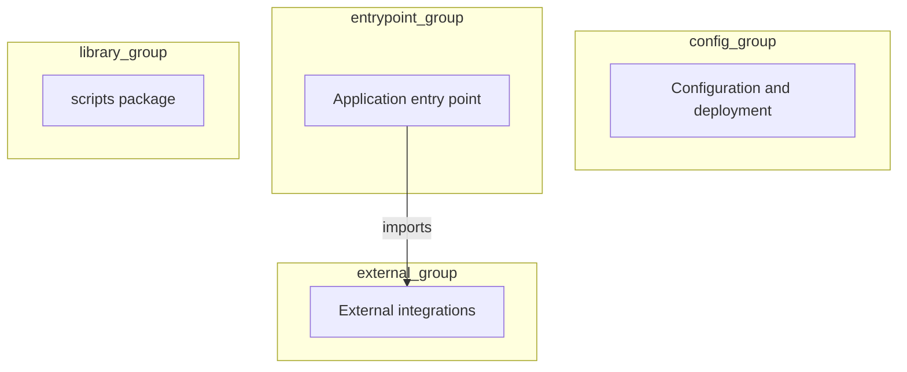

# Architecture report: 0xAX/linux-insides

> Automated static analysis. **Observed** = directly seen in files/imports/AST; **Inferred** = interpretation from that evidence. Repository code was not executed.

## 1. Repository at a glance

| Item | Value |
| --- | --- |
| Repository | 0xAX/linux-insides |
| Description | A book-in-progress about the Linux kernel and its insides. |
| Language | Python |
| Stars | 33756 |
| Licence | Other |
| Analysed commit / branch | 4fa356494fa6de2143dbfbd729e66bf469439ca3 / master |
| Framework(s) | None detected |
| Files analysed | 141 |
| Components | 4 |

## 2. Architecture in one minute

0xAX/linux-insides - A book-in-progress about the Linux kernel and its insides.. This repository was analysed statically from 141 file(s) (2 Python). Detected technologies (observed from imports/manifests): GitHub Actions, requests, Poetry, Docker. Files are grouped into 4 component(s): Configuration and deployment, Application entry point, External integrations, scripts package. Observed entry point(s): scripts/check_code_snippets.py. Findings below distinguish observed facts from inferred interpretation.

## 3. High-level block diagram

## 4. Main components

### Configuration and deployment (`config`)

- **Kind:** config
- **Status:** Observed
- **Confidence:** 0.85
- **Responsibility:** Groups 5 file(s) under configuration and deployment (observed from repository paths and static analysis).
- **Paths:** `Dockerfile`, `book-A5.json`, `book.json`, `lychee.toml`, `scripts/pyproject.toml`
- **Evidence:** [Dockerfile](https://github.com/0xAX/linux-insides/blob/4fa356494fa6de2143dbfbd729e66bf469439ca3/Dockerfile); [book-A5.json](https://github.com/0xAX/linux-insides/blob/4fa356494fa6de2143dbfbd729e66bf469439ca3/book-A5.json); [book.json](https://github.com/0xAX/linux-insides/blob/4fa356494fa6de2143dbfbd729e66bf469439ca3/book.json); [lychee.toml](https://github.com/0xAX/linux-insides/blob/4fa356494fa6de2143dbfbd729e66bf469439ca3/lychee.toml); [scripts/pyproject.toml](https://github.com/0xAX/linux-insides/blob/4fa356494fa6de2143dbfbd729e66bf469439ca3/scripts/pyproject.toml)

### Application entry point (`entrypoint`)

- **Kind:** entrypoint
- **Status:** Observed
- **Confidence:** 0.85
- **Responsibility:** Groups 1 file(s) under application entry point (observed from repository paths and static analysis). Observed top-level functions: __api_url__, __compare__, __excluded__, __fetch_raw__, __get__, __handle_md__.
- **Paths:** `scripts/check_code_snippets.py`
- **Evidence:** [scripts/check_code_snippets.py:37](https://github.com/0xAX/linux-insides/blob/4fa356494fa6de2143dbfbd729e66bf469439ca3/scripts/check_code_snippets.py#L37)

### External integrations (`external_integrations`)

- **Kind:** external
- **Status:** Inferred
- **Confidence:** 0.70
- **Responsibility:** Groups 0 file(s) under external integrations (observed from repository paths and static analysis).
- **Evidence:** [scripts/check_code_snippets.py:12](https://github.com/0xAX/linux-insides/blob/4fa356494fa6de2143dbfbd729e66bf469439ca3/scripts/check_code_snippets.py#L12)

### scripts package (`scripts`)

- **Kind:** library
- **Status:** Observed
- **Confidence:** 0.85
- **Responsibility:** Groups 1 file(s) under scripts package (observed from repository paths and static analysis). Observed top-level functions: pandoc.
- **Paths:** `scripts/latex.py`
- **Evidence:** [scripts/latex.py:16](https://github.com/0xAX/linux-insides/blob/4fa356494fa6de2143dbfbd729e66bf469439ca3/scripts/latex.py#L16)

## 5. Execution flow

**Observed** entry point(s):

- [scripts/check_code_snippets.py:200](https://github.com/0xAX/linux-insides/blob/4fa356494fa6de2143dbfbd729e66bf469439ca3/scripts/check_code_snippets.py#L200)

Representative flow (derived from observed entry points and the import graph; steps beyond the entry point are **Inferred**):

1. Execution starts at an observed entry point listed above, if present.
2. `entrypoint` imports `external_integrations` (Application entry point -> External integrations).

## 6. Project structure

### `(root)`

- `.editorconfig` - config (838 bytes)
- `.gitattributes` - other (617 bytes)
- `.gitignore` - other (79 bytes)
- `CODEOWNERS` - other (81 bytes)
- `CODE_OF_CONDUCT.md` - docs (5224 bytes)
- `CONTRIBUTING.md` - docs (3221 bytes)
- `Dockerfile` - container (187 bytes)
- `LICENSE` - docs (20844 bytes)
- `LINKS.md` - docs (1730 bytes)
- `Makefile` - other (3424 bytes)
- `README.md` - docs (5384 bytes)
- `SUMMARY.md` - docs (4964 bytes)
- `book-A5.json` - config (238 bytes)
- `book.json` - config (56 bytes)
- `contributors.md` - docs (6788 bytes)
- `lychee.toml` - config (733 bytes)

### `.github`

- `.github/FUNDING.yml` - config (83 bytes)
- `.github/ISSUE_TEMPLATE/content-issue.yml` - config (1117 bytes)
- `.github/ISSUE_TEMPLATE/question.yml` - config (1169 bytes)
- `.github/dependabot.yaml` - config (210 bytes)
- `.github/labeler.yml` - config (1593 bytes)
- `.github/labels.yml` - config (3774 bytes)
- `.github/pull-request-template.md` - docs (578 bytes)
- `.github/workflows/check-code-snippets.yaml` - ci, YAML (1139 bytes)
- `.github/workflows/check-links.yaml` - ci, YAML (957 bytes)
- `.github/workflows/generate-e-books.yaml` - ci, YAML (1955 bytes)
- `.github/workflows/labeler.yaml` - ci, YAML (831 bytes)
- `.github/workflows/release-e-books.yaml` - ci, YAML (1965 bytes)

### `Assets`

- `Assets/banner.svg` - other (2489 bytes)

### `Booting`

- `Booting/README.md` - docs (2791 bytes)
- `Booting/images/early-4g-page-tables.svg` - other (4915 bytes)
- `Booting/images/early-bss.svg` - other (17612 bytes)
- `Booting/images/early-heap.svg` - other (20360 bytes)
- `Booting/images/early-page-table.svg` - other (12797 bytes)
- `Booting/images/early-stack.svg` - other (13065 bytes)
- `Booting/images/kernel-relocation-2.svg` - other (9526 bytes)
- `Booting/images/kernel-relocation.svg` - other (4628 bytes)
- `Booting/images/segment-descriptor.svg` - other (36682 bytes)
- `Booting/images/segment-selector.svg` - other (10239 bytes)
- `Booting/images/startup_32.svg` - other (12443 bytes)
- `Booting/linux-bootstrap-1.md` - docs (42485 bytes)
- `Booting/linux-bootstrap-2.md` - docs (32743 bytes)
- `Booting/linux-bootstrap-3.md` - docs (33451 bytes)
- `Booting/linux-bootstrap-4.md` - docs (40806 bytes)
- `Booting/linux-bootstrap-5.md` - docs (28277 bytes)
- `Booting/linux-bootstrap-6.md` - docs (23194 bytes)

### `Cgroups`

- `Cgroups/README.md` - docs (120 bytes)
- `Cgroups/linux-cgroups-1.md` - docs (22069 bytes)

### `Concepts`

- `Concepts/README.md` - docs (2646 bytes)
- `Concepts/linux-cpu-1.md` - docs (10677 bytes)
- `Concepts/linux-cpu-2.md` - docs (10568 bytes)
- `Concepts/linux-cpu-3.md` - docs (20652 bytes)
- `Concepts/linux-cpu-4.md` - docs (18645 bytes)

### `Contributing`

- `Contributing/linux-contributing-1.md` - docs (29880 bytes)

### `DataStructures`

- `DataStructures/README.md` - docs (391 bytes)
- `DataStructures/images/bit-array.svg` - other (4369 bytes)
- `DataStructures/images/bitmap-words.svg` - other (4554 bytes)
- `DataStructures/images/const-mask.svg` - other (5734 bytes)
- `DataStructures/images/container-of.svg` - other (5501 bytes)
- `DataStructures/images/doubly-linked-list.svg` - other (4790 bytes)
- `DataStructures/images/find-first-bit.svg` - other (3486 bytes)
- `DataStructures/images/find-next-bit-words.svg` - other (40211 bytes)
- `DataStructures/images/find-next-bit.svg` - other (23266 bytes)
- `DataStructures/images/intrusive-list.svg` - other (5262 bytes)
- `DataStructures/images/list-add.svg` - other (8678 bytes)
- `DataStructures/images/singly-linked-list.svg` - other (4177 bytes)
- `DataStructures/images/task-struct-list.svg` - other (6040 bytes)
- `DataStructures/linux-datastructures-1.md` - docs (18191 bytes)
- `DataStructures/linux-datastructures-2.md` - docs (31012 bytes)
- `DataStructures/linux-datastructures-3.md` - docs (9785 bytes)

### `Initialization`

- `Initialization/README.md` - docs (1824 bytes)
- `Initialization/images/direct-mapping.svg` - other (4274 bytes)
- `Initialization/images/early-page-table-identity-mapping.svg` - other (5741 bytes)
- `Initialization/images/early-page-tables-after-init.svg` - other (6452 bytes)
- `Initialization/images/early-top-pgt-entries.svg` - other (2357 bytes)
- `Initialization/images/idt-descriptor.svg` - other (1397 bytes)
- `Initialization/images/idt-gate-descriptor.svg` - other (3550 bytes)
- `Initialization/images/interrupt-stack-frame-full.svg` - other (6392 bytes)
- `Initialization/images/interrupt-stack-frame.svg` - other (3739 bytes)
- `Initialization/linux-initialization-1.md` - docs (43139 bytes)
- `Initialization/linux-initialization-10.md` - docs (30746 bytes)
- `Initialization/linux-initialization-2.md` - docs (44613 bytes)
- `Initialization/linux-initialization-3.md` - docs (19066 bytes)
- `Initialization/linux-initialization-4.md` - docs (28074 bytes)
- `Initialization/linux-initialization-5.md` - docs (32334 bytes)
- `Initialization/linux-initialization-6.md` - docs (29757 bytes)
- `Initialization/linux-initialization-7.md` - docs (31245 bytes)
- `Initialization/linux-initialization-8.md` - docs (34646 bytes)
- `Initialization/linux-initialization-9.md` - docs (29720 bytes)

### `Interrupts`

- `Interrupts/README.md` - docs (1555 bytes)
- `Interrupts/linux-interrupts-1.md` - docs (31609 bytes)
- `Interrupts/linux-interrupts-10.md` - docs (26826 bytes)
- `Interrupts/linux-interrupts-2.md` - docs (32977 bytes)
- `Interrupts/linux-interrupts-3.md` - docs (24785 bytes)
- `Interrupts/linux-interrupts-4.md` - docs (27056 bytes)
- `Interrupts/linux-interrupts-5.md` - docs (25690 bytes)
- `Interrupts/linux-interrupts-6.md` - docs (25175 bytes)
- `Interrupts/linux-interrupts-7.md` - docs (26659 bytes)
- `Interrupts/linux-interrupts-8.md` - docs (27849 bytes)
- `Interrupts/linux-interrupts-9.md` - docs (30210 bytes)

### `KernelStructures`

- `KernelStructures/.gitkeep` - other (0 bytes)

### `MM`

- `MM/README.md` - docs (452 bytes)
- `MM/linux-mm-1.md` - docs (21436 bytes)
- `MM/linux-mm-2.md` - docs (28939 bytes)
- `MM/linux-mm-3.md` - docs (22668 bytes)

### `SyncPrim`

- `SyncPrim/README.md` - docs (828 bytes)
- `SyncPrim/linux-sync-1.md` - docs (18705 bytes)
- `SyncPrim/linux-sync-2.md` - docs (22737 bytes)
- `SyncPrim/linux-sync-3.md` - docs (22499 bytes)
- `SyncPrim/linux-sync-4.md` - docs (30158 bytes)
- `SyncPrim/linux-sync-5.md` - docs (32835 bytes)
- `SyncPrim/linux-sync-6.md` - docs (20505 bytes)

### `SysCall`

- `SysCall/README.md` - docs (937 bytes)
- `SysCall/linux-syscall-1.md` - docs (26644 bytes)
- `SysCall/linux-syscall-2.md` - docs (26756 bytes)
- `SysCall/linux-syscall-3.md` - docs (22204 bytes)
- `SysCall/linux-syscall-4.md` - docs (25175 bytes)
- `SysCall/linux-syscall-5.md` - docs (25326 bytes)
- `SysCall/linux-syscall-6.md` - docs (9931 bytes)

### `Timers`

- `Timers/README.md` - docs (885 bytes)
- `Timers/linux-timers-1.md` - docs (25906 bytes)
- `Timers/linux-timers-2.md` - docs (30685 bytes)
- `Timers/linux-timers-3.md` - docs (32588 bytes)
- `Timers/linux-timers-4.md` - docs (20354 bytes)
- `Timers/linux-timers-5.md` - docs (25859 bytes)
- `Timers/linux-timers-6.md` - docs (22491 bytes)
- `Timers/linux-timers-7.md` - docs (21137 bytes)

### `Toolchain`

- `Toolchain/README.md` - docs (3145 bytes)
- `Toolchain/linux-toolchain-1.md` - docs (33462 bytes)
- `Toolchain/linux-toolchain-2.md` - docs (29639 bytes)
- `Toolchain/linux-toolchain-3.md` - docs (8580 bytes)
- `Toolchain/linux-toolchain-4.md` - docs (22925 bytes)
- `Toolchain/linux-toolchain-5.md` - docs (24946 bytes)

### `X86`

- `X86/README.md` - docs (2501 bytes)
- `X86/linux-x86-1.md` - docs (17029 bytes)
- `X86/linux-x86-2.md` - docs (10366 bytes)

### `scripts`

- `scripts/.python-version` - other (5 bytes)
- `scripts/README.md` - docs (3641 bytes)
- `scripts/check_code_snippets.py` - source, Python (5659 bytes)
- `scripts/latex.py` - source, Python (1248 bytes)
- `scripts/pyproject.toml` - manifest (315 bytes)

## 7. Key dependencies and integrations

| Name | Category | Status | Confidence | Evidence |
| --- | --- | --- | --- | --- |
| GitHub Actions | ci | Observed | 0.90 | [.github/workflows/check-code-snippets.yaml](https://github.com/0xAX/linux-insides/blob/4fa356494fa6de2143dbfbd729e66bf469439ca3/.github/workflows/check-code-snippets.yaml); [.github/workflows/check-links.yaml](https://github.com/0xAX/linux-insides/blob/4fa356494fa6de2143dbfbd729e66bf469439ca3/.github/workflows/check-links.yaml); [.github/workflows/generate-e-books.yaml](https://github.com/0xAX/linux-insides/blob/4fa356494fa6de2143dbfbd729e66bf469439ca3/.github/workflows/generate-e-books.yaml); [.github/workflows/labeler.yaml](https://github.com/0xAX/linux-insides/blob/4fa356494fa6de2143dbfbd729e66bf469439ca3/.github/workflows/labeler.yaml) |
| requests | library | Observed | 0.90 | [scripts/check_code_snippets.py:12](https://github.com/0xAX/linux-insides/blob/4fa356494fa6de2143dbfbd729e66bf469439ca3/scripts/check_code_snippets.py#L12); [scripts/pyproject.toml:7](https://github.com/0xAX/linux-insides/blob/4fa356494fa6de2143dbfbd729e66bf469439ca3/scripts/pyproject.toml#L7) |
| Poetry | packaging | Observed | 0.85 | [scripts/pyproject.toml](https://github.com/0xAX/linux-insides/blob/4fa356494fa6de2143dbfbd729e66bf469439ca3/scripts/pyproject.toml) |
| Docker | tooling | Observed | 0.90 | [.github/workflows/generate-e-books.yaml:24](https://github.com/0xAX/linux-insides/blob/4fa356494fa6de2143dbfbd729e66bf469439ca3/.github/workflows/generate-e-books.yaml#L24); [.github/workflows/release-e-books.yaml:24](https://github.com/0xAX/linux-insides/blob/4fa356494fa6de2143dbfbd729e66bf469439ca3/.github/workflows/release-e-books.yaml#L24); [Dockerfile](https://github.com/0xAX/linux-insides/blob/4fa356494fa6de2143dbfbd729e66bf469439ca3/Dockerfile) |

## 8. Data and state

No database, cache, queue, or persistent-state usage was observed in the analysed files. State handling, if any, may be in-memory or in files that were not analysed.

## 9. Configuration and deployment clues

- `.editorconfig` (config)
- `.github/FUNDING.yml` (config)
- `.github/ISSUE_TEMPLATE/content-issue.yml` (config)
- `.github/ISSUE_TEMPLATE/question.yml` (config)
- `.github/dependabot.yaml` (config)
- `.github/labeler.yml` (config)
- `.github/labels.yml` (config)
- `.github/workflows/check-code-snippets.yaml` (ci)
- `.github/workflows/check-links.yaml` (ci)
- `.github/workflows/generate-e-books.yaml` (ci)
- `.github/workflows/labeler.yaml` (ci)
- `.github/workflows/release-e-books.yaml` (ci)
- `Dockerfile` (container)
- `book-A5.json` (config)
- `book.json` (config)
- `lychee.toml` (config)
- `scripts/pyproject.toml` (manifest)

## 10. Design observations

- An entry/API layer is separated from other code (Inferred from paths and decorators).
- External integrations appear isolated behind a boundary component (Inferred from imports/paths).

These observations are interpretations (**Inferred**) of the observed structure, not guarantees about runtime design.

## 11. Limitations and unknowns

- Static analysis only: repository code was not executed, installed, or imported at runtime.
- Components and relationships are inferred from file paths, imports, and AST structure; runtime behaviour, dynamic imports, and reflection may not be visible.
- 1 file(s) were skipped during inventory (1 x lockfile excluded).
- Repository text was treated as untrusted data; no instructions found in repository files were followed, and likely secret values were redacted/excluded.

## 12. Source references

- [.github/workflows/check-code-snippets.yaml](https://github.com/0xAX/linux-insides/blob/4fa356494fa6de2143dbfbd729e66bf469439ca3/.github/workflows/check-code-snippets.yaml)
- [.github/workflows/check-links.yaml](https://github.com/0xAX/linux-insides/blob/4fa356494fa6de2143dbfbd729e66bf469439ca3/.github/workflows/check-links.yaml)
- [.github/workflows/generate-e-books.yaml](https://github.com/0xAX/linux-insides/blob/4fa356494fa6de2143dbfbd729e66bf469439ca3/.github/workflows/generate-e-books.yaml)
- [.github/workflows/generate-e-books.yaml:24](https://github.com/0xAX/linux-insides/blob/4fa356494fa6de2143dbfbd729e66bf469439ca3/.github/workflows/generate-e-books.yaml#L24)
- [.github/workflows/labeler.yaml](https://github.com/0xAX/linux-insides/blob/4fa356494fa6de2143dbfbd729e66bf469439ca3/.github/workflows/labeler.yaml)
- [.github/workflows/release-e-books.yaml](https://github.com/0xAX/linux-insides/blob/4fa356494fa6de2143dbfbd729e66bf469439ca3/.github/workflows/release-e-books.yaml)
- [.github/workflows/release-e-books.yaml:24](https://github.com/0xAX/linux-insides/blob/4fa356494fa6de2143dbfbd729e66bf469439ca3/.github/workflows/release-e-books.yaml#L24)
- [Dockerfile](https://github.com/0xAX/linux-insides/blob/4fa356494fa6de2143dbfbd729e66bf469439ca3/Dockerfile)
- [book-A5.json](https://github.com/0xAX/linux-insides/blob/4fa356494fa6de2143dbfbd729e66bf469439ca3/book-A5.json)
- [book.json](https://github.com/0xAX/linux-insides/blob/4fa356494fa6de2143dbfbd729e66bf469439ca3/book.json)
- [lychee.toml](https://github.com/0xAX/linux-insides/blob/4fa356494fa6de2143dbfbd729e66bf469439ca3/lychee.toml)
- [scripts/check_code_snippets.py:12](https://github.com/0xAX/linux-insides/blob/4fa356494fa6de2143dbfbd729e66bf469439ca3/scripts/check_code_snippets.py#L12)
- [scripts/check_code_snippets.py:37](https://github.com/0xAX/linux-insides/blob/4fa356494fa6de2143dbfbd729e66bf469439ca3/scripts/check_code_snippets.py#L37)
- [scripts/check_code_snippets.py:200](https://github.com/0xAX/linux-insides/blob/4fa356494fa6de2143dbfbd729e66bf469439ca3/scripts/check_code_snippets.py#L200)
- [scripts/latex.py:16](https://github.com/0xAX/linux-insides/blob/4fa356494fa6de2143dbfbd729e66bf469439ca3/scripts/latex.py#L16)
- [scripts/pyproject.toml](https://github.com/0xAX/linux-insides/blob/4fa356494fa6de2143dbfbd729e66bf469439ca3/scripts/pyproject.toml)
- [scripts/pyproject.toml:7](https://github.com/0xAX/linux-insides/blob/4fa356494fa6de2143dbfbd729e66bf469439ca3/scripts/pyproject.toml#L7)
