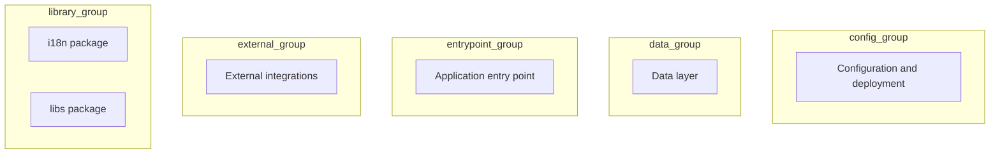

# Architecture report: 2025Emma/vibe-coding-cn

> Automated static analysis. **Observed** = directly seen in files/imports/AST; **Inferred** = interpretation from that evidence. Repository code was not executed.

## 1. Repository at a glance

| Item | Value |
| --- | --- |
| Repository | 2025Emma/vibe-coding-cn |
| Description | Not provided |
| Language | Python |
| Stars | 23166 |
| Licence | MIT |
| Analysed commit / branch | 9b42dd10ddf3fff58f8c7a4d347175db107d7bf9 / main |
| Framework(s) | None detected |
| Files analysed | 800 |
| Components | 6 |

## 2. Architecture in one minute

2025Emma/vibe-coding-cn. This repository was analysed statically from 800 file(s) (10 Python). Detected technologies (observed from imports/manifests): no known frameworks/libraries. Files are grouped into 6 component(s): Configuration and deployment, Data layer, Application entry point, External integrations, i18n package, libs package. Observed entry point(s): libs/common/utils/backups/快速备份.py, libs/external/XHS-image-to-PDF-conversion/pdf.py, libs/external/l10n-tool/bulk_translate.py. Findings below distinguish observed facts from inferred interpretation.

## 3. High-level block diagram

## 4. Main components

### Configuration and deployment (`config`)

- **Kind:** config
- **Status:** Observed
- **Confidence:** 0.85
- **Responsibility:** Groups 7 file(s) under configuration and deployment (observed from repository paths and static analysis).
- **Paths:** `libs/external/XHS-image-to-PDF-conversion/requirements.txt`, `libs/external/l10n-tool/chinese_files_list.json`, `libs/external/l10n-tool/path_translation_map.json`, `libs/external/l10n-tool/requirements.txt`, `libs/external/my-nvim/nvim-config/lazy-lock.json`, `libs/external/my-nvim/nvim-config/lazyvim.json`, `libs/external/my-nvim/nvim-config/stylua.toml`
- **Evidence:** [libs/external/XHS-image-to-PDF-conversion/requirements.txt](https://github.com/2025Emma/vibe-coding-cn/blob/9b42dd10ddf3fff58f8c7a4d347175db107d7bf9/libs/external/XHS-image-to-PDF-conversion/requirements.txt); [libs/external/l10n-tool/chinese_files_list.json](https://github.com/2025Emma/vibe-coding-cn/blob/9b42dd10ddf3fff58f8c7a4d347175db107d7bf9/libs/external/l10n-tool/chinese_files_list.json); [libs/external/l10n-tool/path_translation_map.json](https://github.com/2025Emma/vibe-coding-cn/blob/9b42dd10ddf3fff58f8c7a4d347175db107d7bf9/libs/external/l10n-tool/path_translation_map.json); [libs/external/l10n-tool/requirements.txt](https://github.com/2025Emma/vibe-coding-cn/blob/9b42dd10ddf3fff58f8c7a4d347175db107d7bf9/libs/external/l10n-tool/requirements.txt); [libs/external/my-nvim/nvim-config/lazy-lock.json](https://github.com/2025Emma/vibe-coding-cn/blob/9b42dd10ddf3fff58f8c7a4d347175db107d7bf9/libs/external/my-nvim/nvim-config/lazy-lock.json); [libs/external/my-nvim/nvim-config/lazyvim.json](https://github.com/2025Emma/vibe-coding-cn/blob/9b42dd10ddf3fff58f8c7a4d347175db107d7bf9/libs/external/my-nvim/nvim-config/lazyvim.json); [libs/external/my-nvim/nvim-config/stylua.toml](https://github.com/2025Emma/vibe-coding-cn/blob/9b42dd10ddf3fff58f8c7a4d347175db107d7bf9/libs/external/my-nvim/nvim-config/stylua.toml)

### Data layer (`data_layer`)

- **Kind:** data
- **Status:** Observed
- **Confidence:** 0.85
- **Responsibility:** Groups 1 file(s) under data layer (observed from repository paths and static analysis).
- **Paths:** `libs/common/models/__init__.py`
- **Evidence:** [libs/common/models/__init__.py](https://github.com/2025Emma/vibe-coding-cn/blob/9b42dd10ddf3fff58f8c7a4d347175db107d7bf9/libs/common/models/__init__.py)

### Application entry point (`entrypoint`)

- **Kind:** entrypoint
- **Status:** Observed
- **Confidence:** 0.85
- **Responsibility:** Groups 5 file(s) under application entry point (observed from repository paths and static analysis). Observed top-level classes: Candidate, GitignoreFilter. Observed top-level functions: build_candidates, create_backup, get_repo_root, has_prompt_files, iter_source_files, list_doc_sets.
- **Paths:** `libs/common/utils/backups/快速备份.py`, `libs/external/XHS-image-to-PDF-conversion/pdf.py`, `libs/external/l10n-tool/bulk_translate.py`, `libs/external/l10n-tool/translate.py`, `libs/external/prompts-library/main.py`
- **Evidence:** [libs/common/utils/backups/快速备份.py:39](https://github.com/2025Emma/vibe-coding-cn/blob/9b42dd10ddf3fff58f8c7a4d347175db107d7bf9/libs/common/utils/backups/%E5%BF%AB%E9%80%9F%E5%A4%87%E4%BB%BD.py#L39); [libs/external/XHS-image-to-PDF-conversion/pdf.py:13](https://github.com/2025Emma/vibe-coding-cn/blob/9b42dd10ddf3fff58f8c7a4d347175db107d7bf9/libs/external/XHS-image-to-PDF-conversion/pdf.py#L13); [libs/external/l10n-tool/bulk_translate.py:27](https://github.com/2025Emma/vibe-coding-cn/blob/9b42dd10ddf3fff58f8c7a4d347175db107d7bf9/libs/external/l10n-tool/bulk_translate.py#L27); [libs/external/l10n-tool/translate.py:22](https://github.com/2025Emma/vibe-coding-cn/blob/9b42dd10ddf3fff58f8c7a4d347175db107d7bf9/libs/external/l10n-tool/translate.py#L22); [libs/external/prompts-library/main.py:67](https://github.com/2025Emma/vibe-coding-cn/blob/9b42dd10ddf3fff58f8c7a4d347175db107d7bf9/libs/external/prompts-library/main.py#L67)

### External integrations (`external_integrations`)

- **Kind:** external
- **Status:** Observed
- **Confidence:** 0.85
- **Responsibility:** Groups 1 file(s) under external integrations (observed from repository paths and static analysis). Observed top-level functions: get_translated_path, translate_path_component.
- **Paths:** `libs/external/l10n-tool/translate_files.py`
- **Evidence:** [libs/external/l10n-tool/translate_files.py:10](https://github.com/2025Emma/vibe-coding-cn/blob/9b42dd10ddf3fff58f8c7a4d347175db107d7bf9/libs/external/l10n-tool/translate_files.py#L10)

### i18n package (`i18n`)

- **Kind:** library
- **Status:** Observed
- **Confidence:** 0.85
- **Responsibility:** Groups 8 file(s) under i18n package (observed from repository paths and static analysis). Observed top-level classes: MemoryToolHandler.
- **Paths:** `i18n/en/skills/claude-cookbooks/scripts/memory_tool.py`, `i18n/en/skills/claude-skills/scripts/create-skill.sh`, `i18n/en/skills/claude-skills/scripts/validate-skill.sh`, `i18n/en/skills/proxychains/scripts/setup-proxy.sh`, `i18n/zh/skills/claude-cookbooks/scripts/memory_tool.py`, `i18n/zh/skills/claude-skills/scripts/create-skill.sh`, `i18n/zh/skills/claude-skills/scripts/validate-skill.sh`, `i18n/zh/skills/proxychains/scripts/setup-proxy.sh`
- **Evidence:** [i18n/en/skills/claude-cookbooks/scripts/memory_tool.py](https://github.com/2025Emma/vibe-coding-cn/blob/9b42dd10ddf3fff58f8c7a4d347175db107d7bf9/i18n/en/skills/claude-cookbooks/scripts/memory_tool.py); [i18n/en/skills/claude-skills/scripts/create-skill.sh](https://github.com/2025Emma/vibe-coding-cn/blob/9b42dd10ddf3fff58f8c7a4d347175db107d7bf9/i18n/en/skills/claude-skills/scripts/create-skill.sh); [i18n/en/skills/claude-skills/scripts/validate-skill.sh](https://github.com/2025Emma/vibe-coding-cn/blob/9b42dd10ddf3fff58f8c7a4d347175db107d7bf9/i18n/en/skills/claude-skills/scripts/validate-skill.sh); [i18n/en/skills/proxychains/scripts/setup-proxy.sh](https://github.com/2025Emma/vibe-coding-cn/blob/9b42dd10ddf3fff58f8c7a4d347175db107d7bf9/i18n/en/skills/proxychains/scripts/setup-proxy.sh); [i18n/zh/skills/claude-cookbooks/scripts/memory_tool.py:13](https://github.com/2025Emma/vibe-coding-cn/blob/9b42dd10ddf3fff58f8c7a4d347175db107d7bf9/i18n/zh/skills/claude-cookbooks/scripts/memory_tool.py#L13); [i18n/zh/skills/claude-skills/scripts/create-skill.sh](https://github.com/2025Emma/vibe-coding-cn/blob/9b42dd10ddf3fff58f8c7a4d347175db107d7bf9/i18n/zh/skills/claude-skills/scripts/create-skill.sh); [i18n/zh/skills/claude-skills/scripts/validate-skill.sh](https://github.com/2025Emma/vibe-coding-cn/blob/9b42dd10ddf3fff58f8c7a4d347175db107d7bf9/i18n/zh/skills/claude-skills/scripts/validate-skill.sh); [i18n/zh/skills/proxychains/scripts/setup-proxy.sh](https://github.com/2025Emma/vibe-coding-cn/blob/9b42dd10ddf3fff58f8c7a4d347175db107d7bf9/i18n/zh/skills/proxychains/scripts/setup-proxy.sh)

### libs package (`libs`)

- **Kind:** library
- **Status:** Observed
- **Confidence:** 0.85
- **Responsibility:** Groups 2 file(s) under libs package (observed from repository paths and static analysis).
- **Paths:** `libs/common/__init__.py`, `libs/common/utils/backups/一键备份.sh`
- **Evidence:** [libs/common/__init__.py](https://github.com/2025Emma/vibe-coding-cn/blob/9b42dd10ddf3fff58f8c7a4d347175db107d7bf9/libs/common/__init__.py); [libs/common/utils/backups/一键备份.sh](https://github.com/2025Emma/vibe-coding-cn/blob/9b42dd10ddf3fff58f8c7a4d347175db107d7bf9/libs/common/utils/backups/%E4%B8%80%E9%94%AE%E5%A4%87%E4%BB%BD.sh)

## 5. Execution flow

**Observed** entry point(s):

- [libs/common/utils/backups/快速备份.py:264](https://github.com/2025Emma/vibe-coding-cn/blob/9b42dd10ddf3fff58f8c7a4d347175db107d7bf9/libs/common/utils/backups/%E5%BF%AB%E9%80%9F%E5%A4%87%E4%BB%BD.py#L264)
- [libs/external/XHS-image-to-PDF-conversion/pdf.py:194](https://github.com/2025Emma/vibe-coding-cn/blob/9b42dd10ddf3fff58f8c7a4d347175db107d7bf9/libs/external/XHS-image-to-PDF-conversion/pdf.py#L194)
- [libs/external/l10n-tool/bulk_translate.py:139](https://github.com/2025Emma/vibe-coding-cn/blob/9b42dd10ddf3fff58f8c7a4d347175db107d7bf9/libs/external/l10n-tool/bulk_translate.py#L139)
- [libs/external/l10n-tool/translate.py:89](https://github.com/2025Emma/vibe-coding-cn/blob/9b42dd10ddf3fff58f8c7a4d347175db107d7bf9/libs/external/l10n-tool/translate.py#L89)
- [libs/external/prompts-library/main.py:273](https://github.com/2025Emma/vibe-coding-cn/blob/9b42dd10ddf3fff58f8c7a4d347175db107d7bf9/libs/external/prompts-library/main.py#L273)

Representative flow (derived from observed entry points and the import graph; steps beyond the entry point are **Inferred**):

1. Execution starts at an observed entry point listed above, if present.
2. No internal import relationships between components were observed.

## 6. Project structure

### `(root)`

- `.gitignore` - other (1008 bytes)
- `AGENTS.md` - docs (13566 bytes)
- `CODE_OF_CONDUCT.md` - docs (5013 bytes)
- `CONTRIBUTING.md` - docs (905 bytes)
- `LICENSE` - docs (1088 bytes)
- `Makefile` - other (842 bytes)
- `README.md` - docs (40173 bytes)

### `.github`

- `.github/FUNDING.yml` - config (1208 bytes)
- `.github/ISSUE_TEMPLATE/bug_report.md` - docs (886 bytes)
- `.github/ISSUE_TEMPLATE/feature_request.md` - docs (521 bytes)
- `.github/PULL_REQUEST_TEMPLATE.md` - docs (1083 bytes)
- `.github/SECURITY.md` - docs (1033 bytes)

### `i18n`

- `i18n/ar/README.md` - docs (140 bytes)
- `i18n/ar/documents/.gitkeep` - other (0 bytes)
- `i18n/ar/prompts/.gitkeep` - other (0 bytes)
- `i18n/ar/skills/.gitkeep` - other (0 bytes)
- `i18n/bn/README.md` - docs (140 bytes)
- `i18n/bn/documents/.gitkeep` - other (0 bytes)
- `i18n/bn/prompts/.gitkeep` - other (0 bytes)
- `i18n/bn/skills/.gitkeep` - other (0 bytes)
- `i18n/de/README.md` - docs (140 bytes)
- `i18n/de/documents/.gitkeep` - other (0 bytes)
- `i18n/de/prompts/.gitkeep` - other (0 bytes)
- `i18n/de/skills/.gitkeep` - other (0 bytes)
- `i18n/en/README.md` - docs (38656 bytes)
- `i18n/en/documents/.gitkeep` - other (0 bytes)
- `i18n/en/documents/Methodology and Principles/A_Formalization_of_Recursive_Self_Optimizing_Generative_Systems.md` - docs (6904 bytes)
- `i18n/en/documents/Methodology and Principles/Development_Experience.md` - docs (5070 bytes)
- `i18n/en/documents/Methodology and Principles/Glue_Programming.md` - docs (3983 bytes)
- `i18n/en/documents/Methodology and Principles/Learning_Experience.md` - docs (217 bytes)
- `i18n/en/documents/Methodology and Principles/System_Prompt_Construction_Principles.md` - docs (5660 bytes)
- `i18n/en/documents/Methodology and Principles/The_Way_of_Programming.md` - docs (5440 bytes)
- `i18n/en/documents/Methodology and Principles/gluecoding.md` - docs (5225 bytes)
- `i18n/en/documents/Methodology and Principles/vibe_coding_Experience_Collection.md` - docs (2349 bytes)
- `i18n/en/documents/README.md` - docs (2330 bytes)
- `i18n/en/documents/Templates and Resources/Code Organization.md` - docs (1922 bytes)
- `i18n/en/documents/Templates and Resources/Code_Organization.md` - docs (1911 bytes)
- `i18n/en/documents/Templates and Resources/General_Project_Architecture_Template.md` - docs (13366 bytes)
- `i18n/en/documents/Templates and Resources/Recommended_Programming_Books.md` - docs (5855 bytes)
- `i18n/en/documents/Templates and Resources/Tool_Set.md` - docs (518 bytes)
- `i18n/en/documents/Tutorials and Guides/LazyVim_Shortcut_Cheatsheet.md` - docs (5032 bytes)
- `i18n/en/documents/Tutorials and Guides/Method_for_SSH_Linking_Mobile_Phone_to_Local_Computer_Anywhere_Based_on_FRP_Implementation.md` - docs (10659 bytes)
- `i18n/en/documents/Tutorials and Guides/auggie_mcp_Configuration_Document.md` - docs (2687 bytes)
- `i18n/en/documents/Tutorials and Guides/telegram-dev/telegram_Markdown_Code_Block_Format_Fix_Log_2025_12_15.md` - docs (769 bytes)
- `i18n/en/documents/Tutorials and Guides/tmux_Shortcut_Cheatsheet.md` - docs (1083 bytes)
- `i18n/en/prompts/.gitkeep` - other (0 bytes)
- `i18n/en/prompts/README.md` - docs (4150 bytes)
- `i18n/en/prompts/coding_prompts/(21,1)_你是我的顶级Programming助手，我将使用自然语言描述开发需求。请你将其转换为一个结构化、专业、详细、可执行的Programming任务说明文档，输出.md` - docs (2406 bytes)
- `i18n/en/prompts/coding_prompts/22_5_Claude.md` - docs (6845 bytes)
- `i18n/en/prompts/coding_prompts/4_1_ultrathink_Take_a_deep_breath.md` - docs (11084 bytes)
- `i18n/en/prompts/coding_prompts/AI_Generated_Code_Documentation_General_Prompt_Template.md` - docs (11916 bytes)
- `i18n/en/prompts/coding_prompts/Analysis_1.md` - docs (5259 bytes)
- `i18n/en/prompts/coding_prompts/Analysis_2.md` - docs (5333 bytes)
- `i18n/en/prompts/coding_prompts/CLAUDE_Memory.md` - docs (19082 bytes)
- `i18n/en/prompts/coding_prompts/Claude_Code_Eight_Honors_and_Eight_Shames.md` - docs (784 bytes)
- `i18n/en/prompts/coding_prompts/Docs_Folder_Chinese_Naming_Prompt.md` - docs (1125 bytes)
- `i18n/en/prompts/coding_prompts/Essential_Technical_Document_Generation_Prompt.md` - docs (2533 bytes)
- `i18n/en/prompts/coding_prompts/Execute_File_Header_Comment_Specification_for_All_Code_Files.md` - docs (1325 bytes)
- `i18n/en/prompts/coding_prompts/Frontend_Design.md` - docs (3555 bytes)
- `i18n/en/prompts/coding_prompts/Frustration_with_Claude_Over_Designed_Solutions.md` - docs (6845 bytes)
- `i18n/en/prompts/coding_prompts/General_Project_Architecture_Comprehensive_Analysis_and_Optimization_Framework.md` - docs (8872 bytes)
- `i18n/en/prompts/coding_prompts/Glue_Development.md` - docs (2724 bytes)
- `i18n/en/prompts/coding_prompts/Hash_Delimiters.md` - docs (12839 bytes)
- `i18n/en/prompts/coding_prompts/High_Quality_Code_Development_Expert.md` - docs (4694 bytes)
- `i18n/en/prompts/coding_prompts/Human_AI_Alignment.md` - docs (341 bytes)
- `i18n/en/prompts/coding_prompts/Intelligent_Requirement_Understanding_and_RD_Navigation_Engine.md` - docs (5268 bytes)
- `i18n/en/prompts/coding_prompts/Intelligent_Requirement_Understanding_and_R_D_Navigation_Engine.md` - docs (5267 bytes)
- `i18n/en/prompts/coding_prompts/Intelligent_Task_Description_Analysis_and_Completion.md` - docs (1108 bytes)
- `i18n/en/prompts/coding_prompts/Objective_Analysis.md` - docs (597 bytes)
- `i18n/en/prompts/coding_prompts/Perform_Purity_Test.md` - docs (2677 bytes)
- `i18n/en/prompts/coding_prompts/Plan_Prompt.md` - docs (24194 bytes)
- `i18n/en/prompts/coding_prompts/Principal_Software_Architect_Focus_High_Performance_Maintainable_Systems.md` - docs (19082 bytes)
- `i18n/en/prompts/coding_prompts/Principal_Software_Architect_Role_and_Goals.md` - docs (3512 bytes)
- `i18n/en/prompts/coding_prompts/Project_Context_Document_Generation.md` - docs (4119 bytes)
- `i18n/en/prompts/coding_prompts/Project_Context_Document_Generation_Engineered_Prompt_Optimized.md` - docs (4120 bytes)
- `i18n/en/prompts/coding_prompts/Prompt_Engineer_Task_Description.md` - docs (1356 bytes)
- `i18n/en/prompts/coding_prompts/Role_Definition.md` - docs (5754 bytes)
- `i18n/en/prompts/coding_prompts/SH_Control_Panel_Generation.md` - docs (24834 bytes)
- `i18n/en/prompts/coding_prompts/Senior_System_Architect_AI_Collaboration_Consultant_Task.md` - docs (2178 bytes)
- `i18n/en/prompts/coding_prompts/Simple_Prompt_Optimizer.md` - docs (561 bytes)
- `i18n/en/prompts/coding_prompts/Software_Engineering_Analysis.md` - docs (7167 bytes)
- `i18n/en/prompts/coding_prompts/Standard_Project_Directory_Structure.md` - docs (6911 bytes)
- `i18n/en/prompts/coding_prompts/Standardization_Process.md` - docs (1180 bytes)
- `i18n/en/prompts/coding_prompts/Standardized_Process.md` - docs (1179 bytes)
- `i18n/en/prompts/coding_prompts/Summary_of_Research_Report_on_Simple_Daily_Behaviors.md` - docs (1201 bytes)
- `i18n/en/prompts/coding_prompts/System_Architecture.md` - docs (2177 bytes)
- `i18n/en/prompts/coding_prompts/System_Architecture_Visualization_Generation_Mermaid.md` - docs (34190 bytes)
- `i18n/en/prompts/coding_prompts/System_Prompt_AI_Prompt_Programming_Language_Constraints_and_Persistent_Memory_Specifications.md` - docs (6177 bytes)
- `i18n/en/prompts/coding_prompts/Task_Description_Analysis_and_Completion.md` - docs (1104 bytes)
- `i18n/en/prompts/coding_prompts/Top_Programming_Assistant_Task_Description.md` - docs (2406 bytes)
- `i18n/en/prompts/coding_prompts/index.md` - docs (6533 bytes)
- `i18n/en/prompts/coding_prompts/ultrathink__Take_a_deep_breath.md` - docs (11084 bytes)
- `i18n/en/prompts/coding_prompts/ultrathink_ultrathink_ultrathink_ultrathink_ultrathink.md` - docs (6067 bytes)
- `i18n/en/prompts/meta_prompts/gitkeep` - other (20 bytes)
- `i18n/en/prompts/system_prompts/CLAUDE.md/1/CLAUDE.md` - docs (18696 bytes)
- `i18n/en/prompts/system_prompts/CLAUDE.md/10/CLAUDE.md` - docs (21237 bytes)
- `i18n/en/prompts/system_prompts/CLAUDE.md/2/CLAUDE.md` - docs (5962 bytes)
- `i18n/en/prompts/system_prompts/CLAUDE.md/3/CLAUDE.md` - docs (2705 bytes)
- `i18n/en/prompts/system_prompts/CLAUDE.md/4/CLAUDE.md` - docs (8072 bytes)
- `i18n/en/prompts/system_prompts/CLAUDE.md/5/CLAUDE.md` - docs (16322 bytes)
- `i18n/en/prompts/system_prompts/CLAUDE.md/6/CLAUDE.md` - docs (16452 bytes)
- `i18n/en/prompts/system_prompts/CLAUDE.md/7/CLAUDE.md` - docs (10055 bytes)
- `i18n/en/prompts/system_prompts/CLAUDE.md/8/CLAUDE.md` - docs (20605 bytes)
- `i18n/en/prompts/system_prompts/CLAUDE.md/9/AGENTS.md` - docs (4780 bytes)
- `i18n/en/prompts/system_prompts/Kobe_s_Diary_of_Saving_Mother_Father_Fiancee_and_In_laws_OTE_Model_Trading_Mode_M_I_T_White_Professor_Accused_of_Sexual_Harassment_by_Female_Student_v2.md` - docs (3548 bytes)
- `i18n/en/prompts/user_prompts/ASCII_Art_Generation.md` - docs (2973 bytes)
- `i18n/en/prompts/user_prompts/Data_Pipeline.md` - docs (857 bytes)
- `i18n/en/prompts/user_prompts/Unified_Management_of_Project_Variables_and_Tools.md` - docs (3348 bytes)
- `i18n/en/skills/.gitkeep` - other (0 bytes)
- `i18n/en/skills/README.md` - docs (7450 bytes)
- `i18n/en/skills/ccxt/SKILL.md` - docs (17813 bytes)
- `i18n/en/skills/ccxt/references/cli.md` - docs (4151 bytes)
- `i18n/en/skills/ccxt/references/exchanges.md` - docs (703 bytes)
- `i18n/en/skills/ccxt/references/faq.md` - docs (12043 bytes)
- `i18n/en/skills/ccxt/references/getting_started.md` - docs (3534 bytes)
- `i18n/en/skills/ccxt/references/index.md` - docs (456 bytes)
- `i18n/en/skills/ccxt/references/manual.md` - docs (141880 bytes)
- `i18n/en/skills/ccxt/references/other.md` - docs (512 bytes)
- `i18n/en/skills/ccxt/references/pro.md` - docs (356 bytes)
- `i18n/en/skills/ccxt/references/specification.md` - docs (1747 bytes)
- `i18n/en/skills/claude-code-guide/SKILL.md` - docs (9183 bytes)
- `i18n/en/skills/claude-code-guide/references/index.md` - docs (5607 bytes)
- `i18n/en/skills/claude-cookbooks/SKILL.md` - docs (8697 bytes)
- `i18n/en/skills/claude-cookbooks/references/CONTRIBUTING.md` - docs (6239 bytes)
- `i18n/en/skills/claude-cookbooks/references/README.md` - docs (5843 bytes)
- `i18n/en/skills/claude-cookbooks/references/capabilities.md` - docs (2964 bytes)
- `i18n/en/skills/claude-cookbooks/references/index.md` - docs (981 bytes)
- `i18n/en/skills/claude-cookbooks/references/main_readme.md` - docs (5843 bytes)
- `i18n/en/skills/claude-cookbooks/references/multimodal.md` - docs (1845 bytes)
- `i18n/en/skills/claude-cookbooks/references/patterns.md` - docs (708 bytes)
- `i18n/en/skills/claude-cookbooks/references/third_party.md` - docs (1300 bytes)
- `i18n/en/skills/claude-cookbooks/references/tool_use.md` - docs (1710 bytes)
- `i18n/en/skills/claude-cookbooks/scripts/memory_tool.py` - source, Python (13164 bytes)
- `i18n/en/skills/claude-skills/AGENTS.md` - docs (1901 bytes)
- `i18n/en/skills/claude-skills/SKILL.md` - docs (8139 bytes)
- `i18n/en/skills/claude-skills/assets/template-complete.md` - docs (2471 bytes)
- `i18n/en/skills/claude-skills/assets/template-minimal.md` - docs (926 bytes)
- `i18n/en/skills/claude-skills/references/README.md` - docs (7682 bytes)
- `i18n/en/skills/claude-skills/references/anti-patterns.md` - docs (3052 bytes)
- `i18n/en/skills/claude-skills/references/index.md` - docs (1281 bytes)
- `i18n/en/skills/claude-skills/references/quality-checklist.md` - docs (1954 bytes)
- `i18n/en/skills/claude-skills/references/skill-spec.md` - docs (3471 bytes)
- `i18n/en/skills/claude-skills/scripts/create-skill.sh` - source, Shell (4192 bytes)
- `i18n/en/skills/claude-skills/scripts/validate-skill.sh` - source, Shell (5517 bytes)
- `i18n/en/skills/coingecko/SKILL.md` - docs (2603 bytes)
- `i18n/en/skills/coingecko/references/authentication.md` - docs (19667 bytes)
- `i18n/en/skills/coingecko/references/coins.md` - docs (139178 bytes)
- `i18n/en/skills/coingecko/references/contract.md` - docs (869 bytes)
- `i18n/en/skills/coingecko/references/exchanges.md` - docs (11073 bytes)
- `i18n/en/skills/coingecko/references/index.md` - docs (639 bytes)
- `i18n/en/skills/coingecko/references/introduction.md` - docs (36747 bytes)
- `i18n/en/skills/coingecko/references/llms.md` - docs (36271 bytes)
- `i18n/en/skills/coingecko/references/market_data.md` - docs (2443 bytes)
- `i18n/en/skills/coingecko/references/nfts.md` - docs (1293 bytes)
- `i18n/en/skills/coingecko/references/other.md` - docs (170483 bytes)
- `i18n/en/skills/coingecko/references/pricing.md` - docs (6788 bytes)
- `i18n/en/skills/coingecko/references/reference.md` - docs (6642 bytes)
- `i18n/en/skills/coingecko/references/trending.md` - docs (3090 bytes)
- `i18n/en/skills/cryptofeed/SKILL.md` - docs (6444 bytes)
- `i18n/en/skills/cryptofeed/references/README.md` - docs (7815 bytes)
- `i18n/en/skills/cryptofeed/references/index.md` - docs (661 bytes)
- `i18n/en/skills/cryptofeed/references/other.md` - docs (198 bytes)
- `i18n/en/skills/hummingbot/SKILL.md` - docs (4012 bytes)
- `i18n/en/skills/hummingbot/references/advanced.md` - docs (8594 bytes)
- `i18n/en/skills/hummingbot/references/configuration.md` - docs (54666 bytes)
- `i18n/en/skills/hummingbot/references/development.md` - docs (45902 bytes)
- `i18n/en/skills/hummingbot/references/getting_started.md` - docs (82840 bytes)
- `i18n/en/skills/hummingbot/references/index.md` - docs (578 bytes)
- `i18n/en/skills/hummingbot/references/other.md` - docs (112785 bytes)
- `i18n/en/skills/hummingbot/references/trading.md` - docs (9934 bytes)
- `i18n/en/skills/hummingbot/references/troubleshooting.md` - docs (3992 bytes)
- `i18n/en/skills/polymarket/SKILL.md` - docs (6313 bytes)
- `i18n/en/skills/polymarket/references/README.md` - docs (25328 bytes)
- `i18n/en/skills/polymarket/references/api.md` - docs (20669 bytes)
- `i18n/en/skills/polymarket/references/getting_started.md` - docs (23989 bytes)
- `i18n/en/skills/polymarket/references/guides.md` - docs (7795 bytes)
- `i18n/en/skills/polymarket/references/index.md` - docs (692 bytes)
- `i18n/en/skills/polymarket/references/learn.md` - docs (75546 bytes)
- `i18n/en/skills/polymarket/references/llms.md` - docs (14707 bytes)
- `i18n/en/skills/polymarket/references/other.md` - docs (23649 bytes)
- `i18n/en/skills/polymarket/references/realtime-client.md` - docs (25328 bytes)
- `i18n/en/skills/polymarket/references/trading.md` - docs (52264 bytes)
- `i18n/en/skills/postgresql/SKILL.md` - docs (75907 bytes)
- `i18n/en/skills/postgresql/references/getting_started.md` - docs (143889 bytes)
- `i18n/en/skills/postgresql/references/index.md` - docs (177 bytes)
- `i18n/en/skills/proxychains/SKILL.md` - docs (6231 bytes)
- `i18n/en/skills/proxychains/references/index.md` - docs (2224 bytes)
- `i18n/en/skills/proxychains/references/proxychains.conf` - other (2048 bytes)
- `i18n/en/skills/proxychains/references/quick-reference.md` - docs (7251 bytes)
- `i18n/en/skills/proxychains/references/setup-guide.md` - docs (10535 bytes)
- `i18n/en/skills/proxychains/references/troubleshooting.md` - docs (9641 bytes)
- `i18n/en/skills/proxychains/scripts/setup-proxy.sh` - source, Shell (3243 bytes)
- `i18n/en/skills/snapdom/SKILL.md` - docs (7695 bytes)
- `i18n/en/skills/snapdom/references/index.md` - docs (110 bytes)
- `i18n/en/skills/snapdom/references/other.md` - docs (903 bytes)
- `i18n/en/skills/telegram-dev/SKILL.md` - docs (18128 bytes)
- `i18n/en/skills/telegram-dev/references/Dynamic_View_Alignment_Implementation_Document.md` - docs (9885 bytes)
- `i18n/en/skills/telegram-dev/references/Telegram_Bot_Button_and_Keyboard_Implementation_Template.md` - docs (10866 bytes)
- `i18n/en/skills/telegram-dev/references/index.md` - docs (10645 bytes)
- `i18n/en/skills/timescaledb/SKILL.md` - docs (3018 bytes)
- `i18n/en/skills/timescaledb/references/api.md` - docs (66859 bytes)
- `i18n/en/skills/timescaledb/references/compression.md` - docs (167520 bytes)
- `i18n/en/skills/timescaledb/references/continuous_aggregates.md` - docs (90905 bytes)
- `i18n/en/skills/timescaledb/references/getting_started.md` - docs (96517 bytes)
- `i18n/en/skills/timescaledb/references/hyperfunctions.md` - docs (81261 bytes)
- `i18n/en/skills/timescaledb/references/index.md` - docs (714 bytes)
- `i18n/en/skills/timescaledb/references/installation.md` - docs (152206 bytes)
- `i18n/en/skills/timescaledb/references/llms.md` - docs (31851 bytes)
- `i18n/en/skills/timescaledb/references/performance.md` - docs (7376 bytes)
- `i18n/en/skills/timescaledb/references/time_buckets.md` - docs (54338 bytes)
- `i18n/en/skills/timescaledb/references/tutorials.md` - docs (51456 bytes)
- `i18n/en/skills/twscrape/SKILL.md` - docs (10811 bytes)
- `i18n/en/skills/twscrape/references/examples.md` - docs (7556 bytes)
- `i18n/en/skills/twscrape/references/index.md` - docs (1441 bytes)
- `i18n/en/skills/twscrape/references/installation.md` - docs (1074 bytes)
- `i18n/es/README.md` - docs (140 bytes)
- `i18n/es/documents/.gitkeep` - other (0 bytes)
- `i18n/es/prompts/.gitkeep` - other (0 bytes)
- `i18n/es/skills/.gitkeep` - other (0 bytes)
- `i18n/fa/README.md` - docs (140 bytes)
- `i18n/fa/documents/.gitkeep` - other (0 bytes)
- `i18n/fa/prompts/.gitkeep` - other (0 bytes)
- `i18n/fa/skills/.gitkeep` - other (0 bytes)
- `i18n/fr/README.md` - docs (140 bytes)
- `i18n/fr/documents/.gitkeep` - other (0 bytes)
- `i18n/fr/prompts/.gitkeep` - other (0 bytes)
- `i18n/fr/skills/.gitkeep` - other (0 bytes)
- `i18n/ha/README.md` - docs (140 bytes)
- `i18n/ha/documents/.gitkeep` - other (0 bytes)
- `i18n/ha/prompts/.gitkeep` - other (0 bytes)
- `i18n/ha/skills/.gitkeep` - other (0 bytes)
- `i18n/he/README.md` - docs (140 bytes)
- `i18n/he/documents/.gitkeep` - other (0 bytes)
- `i18n/he/prompts/.gitkeep` - other (0 bytes)
- `i18n/he/skills/.gitkeep` - other (0 bytes)
- `i18n/hi/README.md` - docs (140 bytes)
- `i18n/hi/documents/.gitkeep` - other (0 bytes)
- `i18n/hi/documents/README.md` - docs (5018 bytes)
- `i18n/hi/prompts/.gitkeep` - other (0 bytes)
- `i18n/hi/prompts/README.md` - docs (9819 bytes)
- `i18n/hi/skills/.gitkeep` - other (0 bytes)
- `i18n/hi/skills/README.md` - docs (14582 bytes)
- `i18n/hi/skills/claude-skills/SKILL.md` - docs (16242 bytes)
- `i18n/hi/skills/snapdom/SKILL.md` - docs (15257 bytes)
- `i18n/id/README.md` - docs (140 bytes)
- `i18n/id/documents/.gitkeep` - other (0 bytes)
- `i18n/id/prompts/.gitkeep` - other (0 bytes)
- `i18n/id/skills/.gitkeep` - other (0 bytes)
- `i18n/it/README.md` - docs (140 bytes)
- `i18n/it/documents/.gitkeep` - other (0 bytes)
- `i18n/it/prompts/.gitkeep` - other (0 bytes)
- `i18n/it/skills/.gitkeep` - other (0 bytes)
- `i18n/ja/README.md` - docs (140 bytes)
- `i18n/ja/documents/.gitkeep` - other (0 bytes)
- `i18n/ja/prompts/.gitkeep` - other (0 bytes)
- `i18n/ja/skills/.gitkeep` - other (0 bytes)
- `i18n/ko/README.md` - docs (140 bytes)
- `i18n/ko/documents/.gitkeep` - other (0 bytes)
- `i18n/ko/prompts/.gitkeep` - other (0 bytes)
- `i18n/ko/skills/.gitkeep` - other (0 bytes)
- `i18n/ms/README.md` - docs (140 bytes)
- `i18n/ms/documents/.gitkeep` - other (0 bytes)
- `i18n/ms/prompts/.gitkeep` - other (0 bytes)
- `i18n/ms/skills/.gitkeep` - other (0 bytes)
- `i18n/nl/README.md` - docs (140 bytes)
- `i18n/nl/documents/.gitkeep` - other (0 bytes)
- `i18n/nl/prompts/.gitkeep` - other (0 bytes)
- `i18n/nl/skills/.gitkeep` - other (0 bytes)
- `i18n/pl/README.md` - docs (140 bytes)
- `i18n/pl/documents/.gitkeep` - other (0 bytes)
- `i18n/pl/prompts/.gitkeep` - other (0 bytes)
- `i18n/pl/skills/.gitkeep` - other (0 bytes)
- `i18n/pt/README.md` - docs (140 bytes)
- `i18n/pt/documents/.gitkeep` - other (0 bytes)
- `i18n/pt/prompts/.gitkeep` - other (0 bytes)
- `i18n/pt/skills/.gitkeep` - other (0 bytes)
- `i18n/ru/README.md` - docs (140 bytes)
- `i18n/ru/documents/.gitkeep` - other (0 bytes)
- `i18n/ru/prompts/.gitkeep` - other (0 bytes)
- `i18n/ru/skills/.gitkeep` - other (0 bytes)
- `i18n/sw/README.md` - docs (140 bytes)
- `i18n/sw/documents/.gitkeep` - other (0 bytes)
- `i18n/sw/prompts/.gitkeep` - other (0 bytes)
- `i18n/sw/skills/.gitkeep` - other (0 bytes)
- `i18n/ta/README.md` - docs (140 bytes)
- `i18n/ta/documents/.gitkeep` - other (0 bytes)
- `i18n/ta/prompts/.gitkeep` - other (0 bytes)
- `i18n/ta/skills/.gitkeep` - other (0 bytes)
- `i18n/th/README.md` - docs (140 bytes)
- `i18n/th/documents/.gitkeep` - other (0 bytes)
- `i18n/th/prompts/.gitkeep` - other (0 bytes)
- `i18n/th/skills/.gitkeep` - other (0 bytes)
- `i18n/tr/README.md` - docs (140 bytes)
- `i18n/tr/documents/.gitkeep` - other (0 bytes)
- `i18n/tr/prompts/.gitkeep` - other (0 bytes)
- `i18n/tr/skills/.gitkeep` - other (0 bytes)
- `i18n/uk/README.md` - docs (140 bytes)
- `i18n/uk/documents/.gitkeep` - other (0 bytes)
- `i18n/uk/prompts/.gitkeep` - other (0 bytes)
- `i18n/uk/skills/.gitkeep` - other (0 bytes)
- `i18n/ur/README.md` - docs (140 bytes)
- `i18n/ur/documents/.gitkeep` - other (0 bytes)
- `i18n/ur/prompts/.gitkeep` - other (0 bytes)
- `i18n/ur/skills/.gitkeep` - other (0 bytes)
- `i18n/vi/README.md` - docs (140 bytes)
- `i18n/vi/documents/.gitkeep` - other (0 bytes)
- `i18n/vi/prompts/.gitkeep` - other (0 bytes)
- `i18n/vi/skills/.gitkeep` - other (0 bytes)
- `i18n/zh/README.md` - docs (38636 bytes)
- `i18n/zh/documents/Methodology and Principles/A Formalization of Recursive Self-Optimizing Generative Systems.md` - docs (6884 bytes)
- `i18n/zh/documents/Methodology and Principles/GEMINI-HEADLESS.md` - docs (2011 bytes)
- `i18n/zh/documents/Methodology and Principles/gluecoding.md` - docs (5205 bytes)
- `i18n/zh/documents/Methodology and Principles/vibe-coding-经验收集.md` - docs (2329 bytes)
- `i18n/zh/documents/Methodology and Principles/学习经验.md` - docs (201 bytes)
- `i18n/zh/documents/Methodology and Principles/开发经验.md` - docs (5050 bytes)
- `i18n/zh/documents/Methodology and Principles/系统提示词构建原则.md` - docs (5640 bytes)
- `i18n/zh/documents/Methodology and Principles/编程之道.md` - docs (5420 bytes)
- `i18n/zh/documents/Methodology and Principles/胶水编程.md` - docs (3963 bytes)
- `i18n/zh/documents/README.md` - docs (2310 bytes)
- `i18n/zh/documents/Templates and Resources/代码组织.md` - docs (1710 bytes)
- `i18n/zh/documents/Templates and Resources/工具集.md` - docs (498 bytes)
- `i18n/zh/documents/Templates and Resources/编程书籍推荐.md` - docs (5985 bytes)
- `i18n/zh/documents/Templates and Resources/通用项目架构模板.md` - docs (13346 bytes)
- `i18n/zh/documents/Tutorials and Guides/LazyVim快捷键大全.md` - docs (5012 bytes)
- `i18n/zh/documents/Tutorials and Guides/auggie-mcp配置文档.md` - docs (2667 bytes)
- `i18n/zh/documents/Tutorials and Guides/telegram-dev/telegram Markdown 代码块格式修复记录 2025-12-15.md` - docs (749 bytes)
- `i18n/zh/documents/Tutorials and Guides/tmux快捷键大全.md` - docs (1112 bytes)
- `i18n/zh/documents/Tutorials and Guides/关于手机ssh任意位置链接本地计算机，基于frp实现的方法.md` - docs (10639 bytes)
- `i18n/zh/prompts/README.md` - docs (4130 bytes)
- `i18n/zh/prompts/coding_prompts/(1,1)_#_📘_项目上下文文档生成_·_工程化_Prompt（专业优化版）.md` - docs (4100 bytes)
- `i18n/zh/prompts/coding_prompts/(10,1)_{任务你是首席软件架构师_(Principal_Software_Architect)，专注于构建[高性能__可维护.md` - docs (19062 bytes)
- `i18n/zh/prompts/coding_prompts/(11,1)_{任务你是一名资深系统架构师与AI协同设计顾问。nn目标：当用户启动一个新项目或请求AI帮助开发功能时，你必须优先帮助用.md` - docs (2158 bytes)
- `i18n/zh/prompts/coding_prompts/(12,2)_{任务帮我进行智能任务描述，分析与补全任务，你需要理解、描述我当前正在进行的任务，自动识别缺少的要素、未完善的部分、可能.md` - docs (1088 bytes)
- `i18n/zh/prompts/coding_prompts/(13,1)_#_提示工程师任务说明.md` - docs (1336 bytes)
- `i18n/zh/prompts/coding_prompts/(14,2)_############################################################.md` - docs (12819 bytes)
- `i18n/zh/prompts/coding_prompts/(15,1)_###_Claude_Code_八荣八耻.md` - docs (764 bytes)
- `i18n/zh/prompts/coding_prompts/(16,3)_#_CLAUDE_记忆.md` - docs (19062 bytes)
- `i18n/zh/prompts/coding_prompts/(17,2)_#_软件工程分析.md` - docs (7147 bytes)
- `i18n/zh/prompts/coding_prompts/(18,2)_#_通用项目架构综合分析与优化框架.md` - docs (8852 bytes)
- `i18n/zh/prompts/coding_prompts/(19,1)_##_角色定义.md` - docs (5734 bytes)
- `i18n/zh/prompts/coding_prompts/(2,1)_#_ultrathink_ultrathink_ultrathink_ultrathink_ultrathink.md` - docs (6047 bytes)
- `i18n/zh/prompts/coding_prompts/(20,1)_#_高质量代码开发专家.md` - docs (4674 bytes)
- `i18n/zh/prompts/coding_prompts/(21,1)_你是我的顶级编程助手，我将使用自然语言描述开发需求。请你将其转换为一个结构化、专业、详细、可执行的编程任务说明文档，输出.md` - docs (2386 bytes)
- `i18n/zh/prompts/coding_prompts/(22,5)_前几天，我被_Claude_那些臃肿、过度设计的解决方案搞得很沮丧，里面有一大堆我不需要的“万一”功能。然后我尝试在我的.md` - docs (6825 bytes)
- `i18n/zh/prompts/coding_prompts/(3,1)_#_流程标准化.md` - docs (1160 bytes)
- `i18n/zh/prompts/coding_prompts/(4,1)_ultrathink__Take_a_deep_breath..md` - docs (11064 bytes)
- `i18n/zh/prompts/coding_prompts/(5,1)_{content#_🚀_智能需求理解与研发导航引擎（Meta_R&D_Navigator_·.md` - docs (5248 bytes)
- `i18n/zh/prompts/coding_prompts/(6,1)_{System_Prompt#_🧠_系统提示词：AI_Prompt_编程语言约束与持久化记忆规范nn##.md` - docs (6157 bytes)
- `i18n/zh/prompts/coding_prompts/(7,1)_#_AI生成代码文档_-_通用提示词模板.md` - docs (11896 bytes)
- `i18n/zh/prompts/coding_prompts/(8,1)_#_执行📘_文件头注释规范（用于所有代码文件最上方）.md` - docs (1305 bytes)
- `i18n/zh/prompts/coding_prompts/(9,1)_{角色与目标{你首席软件架构师_(Principal_Software_Architect)（高性能、可维护、健壮、DD.md` - docs (3492 bytes)
- `i18n/zh/prompts/coding_prompts/docs文件夹中文命名提示词.md` - docs (1105 bytes)
- `i18n/zh/prompts/coding_prompts/index.md` - docs (6513 bytes)
- `i18n/zh/prompts/coding_prompts/plan提示词.md` - docs (24174 bytes)
- `i18n/zh/prompts/coding_prompts/sh控制面板生成.md` - docs (24814 bytes)
- `i18n/zh/prompts/coding_prompts/人机对齐.md` - docs (321 bytes)
- `i18n/zh/prompts/coding_prompts/任务描述，分析与补全任务.md` - docs (1084 bytes)
- `i18n/zh/prompts/coding_prompts/分析1.md` - docs (5239 bytes)
- `i18n/zh/prompts/coding_prompts/分析2.md` - docs (5313 bytes)
- `i18n/zh/prompts/coding_prompts/前端设计.md` - docs (3535 bytes)
- `i18n/zh/prompts/coding_prompts/客观分析.md` - docs (577 bytes)
- `i18n/zh/prompts/coding_prompts/执行纯净性检测.md` - docs (2747 bytes)
- `i18n/zh/prompts/coding_prompts/智能需求理解与研发导航引擎.md` - docs (5247 bytes)
- `i18n/zh/prompts/coding_prompts/标准化流程.md` - docs (1159 bytes)
- `i18n/zh/prompts/coding_prompts/标准项目目录结构.md` - docs (6891 bytes)
- `i18n/zh/prompts/coding_prompts/简易提示词优化器.md` - docs (541 bytes)
- `i18n/zh/prompts/coding_prompts/精华技术文档生成提示词.md` - docs (2513 bytes)
- `i18n/zh/prompts/coding_prompts/系统架构.md` - docs (2157 bytes)
- `i18n/zh/prompts/coding_prompts/系统架构可视化生成Mermaid.md` - docs (34803 bytes)
- `i18n/zh/prompts/coding_prompts/胶水开发.md` - docs (2704 bytes)
- `i18n/zh/prompts/coding_prompts/输入简单的日常行为的研究报告摘要.md` - docs (1181 bytes)
- `i18n/zh/prompts/coding_prompts/项目上下文文档生成.md` - docs (4246 bytes)
- `i18n/zh/prompts/meta_prompts/.gitkeep` - other (0 bytes)
- `i18n/zh/prompts/system_prompts/# 💀《科比的救母救父救未婚妻与岳父岳母日记》 × OTE模型交易模式 × M.I.T白人金融教授（被女学生指控性骚扰版）v2.md` - docs (3528 bytes)
- `i18n/zh/prompts/system_prompts/CLAUDE.md/1/CLAUDE.md` - docs (18676 bytes)
- `i18n/zh/prompts/system_prompts/CLAUDE.md/10/CLAUDE.md` - docs (21217 bytes)
- `i18n/zh/prompts/system_prompts/CLAUDE.md/2/CLAUDE.md` - docs (6134 bytes)
- `i18n/zh/prompts/system_prompts/CLAUDE.md/3/CLAUDE.md` - docs (2754 bytes)
- `i18n/zh/prompts/system_prompts/CLAUDE.md/4/CLAUDE.md` - docs (8184 bytes)
- `i18n/zh/prompts/system_prompts/CLAUDE.md/5/CLAUDE.md` - docs (16666 bytes)
- `i18n/zh/prompts/system_prompts/CLAUDE.md/6/CLAUDE.md` - docs (16798 bytes)
- `i18n/zh/prompts/system_prompts/CLAUDE.md/7/CLAUDE.md` - docs (10175 bytes)
- `i18n/zh/prompts/system_prompts/CLAUDE.md/8/CLAUDE.md` - docs (20990 bytes)
- `i18n/zh/prompts/system_prompts/CLAUDE.md/9/AGENTS.md` - docs (4760 bytes)
- `i18n/zh/prompts/user_prompts/ASCII图生成.md` - docs (2953 bytes)
- `i18n/zh/prompts/user_prompts/数据管道.md` - docs (837 bytes)
- `i18n/zh/prompts/user_prompts/项目变量与工具统一维护.md` - docs (3328 bytes)
- `i18n/zh/skills/README.md` - docs (7430 bytes)
- `i18n/zh/skills/ccxt/SKILL.md` - docs (17793 bytes)
- `i18n/zh/skills/ccxt/references/cli.md` - docs (4131 bytes)
- `i18n/zh/skills/ccxt/references/exchanges.md` - docs (683 bytes)
- `i18n/zh/skills/ccxt/references/faq.md` - docs (12023 bytes)
- `i18n/zh/skills/ccxt/references/getting_started.md` - docs (3514 bytes)
- `i18n/zh/skills/ccxt/references/index.md` - docs (436 bytes)
- `i18n/zh/skills/ccxt/references/manual.md` - docs (141860 bytes)
- `i18n/zh/skills/ccxt/references/other.md` - docs (492 bytes)
- `i18n/zh/skills/ccxt/references/pro.md` - docs (336 bytes)
- `i18n/zh/skills/ccxt/references/specification.md` - docs (1727 bytes)
- `i18n/zh/skills/claude-code-guide/SKILL.md` - docs (9163 bytes)
- `i18n/zh/skills/claude-code-guide/references/index.md` - docs (5587 bytes)
- `i18n/zh/skills/claude-cookbooks/SKILL.md` - docs (8677 bytes)
- `i18n/zh/skills/claude-cookbooks/references/CONTRIBUTING.md` - docs (6219 bytes)
- `i18n/zh/skills/claude-cookbooks/references/README.md` - docs (5823 bytes)
- `i18n/zh/skills/claude-cookbooks/references/capabilities.md` - docs (2944 bytes)
- `i18n/zh/skills/claude-cookbooks/references/index.md` - docs (961 bytes)
- `i18n/zh/skills/claude-cookbooks/references/main_readme.md` - docs (5823 bytes)
- `i18n/zh/skills/claude-cookbooks/references/multimodal.md` - docs (1825 bytes)
- `i18n/zh/skills/claude-cookbooks/references/patterns.md` - docs (688 bytes)
- `i18n/zh/skills/claude-cookbooks/references/third_party.md` - docs (1280 bytes)
- `i18n/zh/skills/claude-cookbooks/references/tool_use.md` - docs (1690 bytes)
- `i18n/zh/skills/claude-cookbooks/scripts/memory_tool.py` - source, Python (13144 bytes)
- `i18n/zh/skills/claude-skills/AGENTS.md` - docs (1881 bytes)
- `i18n/zh/skills/claude-skills/SKILL.md` - docs (8119 bytes)
- `i18n/zh/skills/claude-skills/assets/template-complete.md` - docs (2451 bytes)
- `i18n/zh/skills/claude-skills/assets/template-minimal.md` - docs (906 bytes)
- `i18n/zh/skills/claude-skills/references/README.md` - docs (7662 bytes)
- `i18n/zh/skills/claude-skills/references/anti-patterns.md` - docs (3032 bytes)
- `i18n/zh/skills/claude-skills/references/index.md` - docs (1261 bytes)
- `i18n/zh/skills/claude-skills/references/quality-checklist.md` - docs (1934 bytes)
- `i18n/zh/skills/claude-skills/references/skill-spec.md` - docs (3451 bytes)
- `i18n/zh/skills/claude-skills/scripts/create-skill.sh` - source, Shell (4172 bytes)
- `i18n/zh/skills/claude-skills/scripts/validate-skill.sh` - source, Shell (5497 bytes)
- `i18n/zh/skills/coingecko/SKILL.md` - docs (2583 bytes)
- `i18n/zh/skills/coingecko/references/authentication.md` - docs (19647 bytes)
- `i18n/zh/skills/coingecko/references/coins.md` - docs (139158 bytes)
- `i18n/zh/skills/coingecko/references/contract.md` - docs (849 bytes)
- `i18n/zh/skills/coingecko/references/exchanges.md` - docs (11053 bytes)
- `i18n/zh/skills/coingecko/references/index.md` - docs (619 bytes)
- `i18n/zh/skills/coingecko/references/introduction.md` - docs (36727 bytes)
- `i18n/zh/skills/coingecko/references/llms.md` - docs (36251 bytes)
- `i18n/zh/skills/coingecko/references/market_data.md` - docs (2423 bytes)
- `i18n/zh/skills/coingecko/references/nfts.md` - docs (1273 bytes)
- `i18n/zh/skills/coingecko/references/other.md` - docs (170463 bytes)
- `i18n/zh/skills/coingecko/references/pricing.md` - docs (6768 bytes)
- `i18n/zh/skills/coingecko/references/reference.md` - docs (6622 bytes)
- `i18n/zh/skills/coingecko/references/trending.md` - docs (3070 bytes)
- `i18n/zh/skills/cryptofeed/SKILL.md` - docs (6424 bytes)
- `i18n/zh/skills/cryptofeed/references/README.md` - docs (7795 bytes)
- `i18n/zh/skills/cryptofeed/references/index.md` - docs (641 bytes)
- `i18n/zh/skills/cryptofeed/references/other.md` - docs (178 bytes)
- `i18n/zh/skills/hummingbot/SKILL.md` - docs (3992 bytes)
- `i18n/zh/skills/hummingbot/references/advanced.md` - docs (8574 bytes)
- `i18n/zh/skills/hummingbot/references/configuration.md` - docs (54646 bytes)
- `i18n/zh/skills/hummingbot/references/development.md` - docs (45882 bytes)
- `i18n/zh/skills/hummingbot/references/getting_started.md` - docs (82820 bytes)
- `i18n/zh/skills/hummingbot/references/index.md` - docs (558 bytes)
- `i18n/zh/skills/hummingbot/references/other.md` - docs (112765 bytes)
- `i18n/zh/skills/hummingbot/references/trading.md` - docs (9914 bytes)
- `i18n/zh/skills/hummingbot/references/troubleshooting.md` - docs (3972 bytes)
- `i18n/zh/skills/polymarket/SKILL.md` - docs (6293 bytes)
- `i18n/zh/skills/polymarket/references/README.md` - docs (25308 bytes)
- `i18n/zh/skills/polymarket/references/api.md` - docs (20649 bytes)
- `i18n/zh/skills/polymarket/references/getting_started.md` - docs (23969 bytes)
- `i18n/zh/skills/polymarket/references/guides.md` - docs (7775 bytes)
- `i18n/zh/skills/polymarket/references/index.md` - docs (672 bytes)
- `i18n/zh/skills/polymarket/references/learn.md` - docs (75526 bytes)
- `i18n/zh/skills/polymarket/references/llms.md` - docs (14687 bytes)
- `i18n/zh/skills/polymarket/references/other.md` - docs (23629 bytes)
- `i18n/zh/skills/polymarket/references/realtime-client.md` - docs (25308 bytes)
- `i18n/zh/skills/polymarket/references/trading.md` - docs (52244 bytes)
- `i18n/zh/skills/postgresql/SKILL.md` - docs (75887 bytes)
- `i18n/zh/skills/postgresql/references/getting_started.md` - docs (143869 bytes)
- `i18n/zh/skills/postgresql/references/index.md` - docs (157 bytes)
- `i18n/zh/skills/proxychains/SKILL.md` - docs (6211 bytes)
- `i18n/zh/skills/proxychains/references/index.md` - docs (2204 bytes)
- `i18n/zh/skills/proxychains/references/proxychains.conf` - other (2028 bytes)
- `i18n/zh/skills/proxychains/references/quick-reference.md` - docs (7231 bytes)
- `i18n/zh/skills/proxychains/references/setup-guide.md` - docs (10515 bytes)
- `i18n/zh/skills/proxychains/references/troubleshooting.md` - docs (9621 bytes)
- `i18n/zh/skills/proxychains/scripts/setup-proxy.sh` - source, Shell (3223 bytes)
- `i18n/zh/skills/snapdom/SKILL.md` - docs (7675 bytes)
- `i18n/zh/skills/snapdom/references/index.md` - docs (90 bytes)
- `i18n/zh/skills/snapdom/references/other.md` - docs (883 bytes)
- `i18n/zh/skills/telegram-dev/SKILL.md` - docs (18108 bytes)
- `i18n/zh/skills/telegram-dev/references/Telegram_Bot_按钮和键盘实现模板.md` - docs (10846 bytes)
- `i18n/zh/skills/telegram-dev/references/index.md` - docs (10625 bytes)
- `i18n/zh/skills/telegram-dev/references/动态视图对齐实现文档.md` - docs (10272 bytes)
- `i18n/zh/skills/timescaledb/SKILL.md` - docs (2998 bytes)
- `i18n/zh/skills/timescaledb/references/api.md` - docs (66839 bytes)
- `i18n/zh/skills/timescaledb/references/compression.md` - docs (167500 bytes)
- `i18n/zh/skills/timescaledb/references/continuous_aggregates.md` - docs (90885 bytes)
- `i18n/zh/skills/timescaledb/references/getting_started.md` - docs (96497 bytes)
- `i18n/zh/skills/timescaledb/references/hyperfunctions.md` - docs (81241 bytes)
- `i18n/zh/skills/timescaledb/references/index.md` - docs (694 bytes)
- `i18n/zh/skills/timescaledb/references/installation.md` - docs (152186 bytes)
- `i18n/zh/skills/timescaledb/references/llms.md` - docs (31831 bytes)
- `i18n/zh/skills/timescaledb/references/performance.md` - docs (7356 bytes)
- `i18n/zh/skills/timescaledb/references/time_buckets.md` - docs (54318 bytes)
- `i18n/zh/skills/timescaledb/references/tutorials.md` - docs (51436 bytes)
- `i18n/zh/skills/twscrape/SKILL.md` - docs (10791 bytes)
- `i18n/zh/skills/twscrape/references/examples.md` - docs (7536 bytes)
- `i18n/zh/skills/twscrape/references/index.md` - docs (1421 bytes)
- `i18n/zh/skills/twscrape/references/installation.md` - docs (1054 bytes)

### `libs`

- `libs/README.md` - docs (2409 bytes)
- `libs/common/README.md` - docs (1458 bytes)
- `libs/common/__init__.py` - source, Python (17 bytes)
- `libs/common/models/__init__.py` - source, Python (16 bytes)
- `libs/common/utils/backups/README.md` - docs (1205 bytes)
- `libs/common/utils/backups/一键备份.sh` - source, Shell (2412 bytes)
- `libs/common/utils/backups/快速备份.py` - source, Python (8600 bytes)
- `libs/database/.gitkeep` - other (36 bytes)
- `libs/database/README.md` - docs (1066 bytes)
- `libs/external/.gitkeep` - other (36 bytes)
- `libs/external/README.md` - docs (1496 bytes)
- `libs/external/XHS-image-to-PDF-conversion/README.md` - docs (5567 bytes)
- `libs/external/XHS-image-to-PDF-conversion/pdf.bat` - other (19 bytes)
- `libs/external/XHS-image-to-PDF-conversion/pdf.py` - source, Python (6214 bytes)
- `libs/external/XHS-image-to-PDF-conversion/requirements.txt` - manifest (7 bytes)
- `libs/external/l10n-tool/README.md` - docs (1276 bytes)
- `libs/external/l10n-tool/bulk_translate.py` - source, Python (4665 bytes)
- `libs/external/l10n-tool/chinese_files_list.json` - config (12864 bytes)
- `libs/external/l10n-tool/path_translation_map.json` - config (9448 bytes)
- `libs/external/l10n-tool/requirements.txt` - manifest (24 bytes)
- `libs/external/l10n-tool/translate.py` - source, Python (3214 bytes)
- `libs/external/l10n-tool/translate_files.py` - source, Python (8335 bytes)
- `libs/external/my-nvim/README.md` - docs (4620 bytes)
- `libs/external/my-nvim/nvim-config/LICENSE` - docs (11357 bytes)
- `libs/external/my-nvim/nvim-config/README.md` - docs (4620 bytes)
- `libs/external/my-nvim/nvim-config/init.lua` - other (72 bytes)
- `libs/external/my-nvim/nvim-config/lazy-lock.json` - config (3229 bytes)
- `libs/external/my-nvim/nvim-config/lazyvim.json` - config (102 bytes)
- `libs/external/my-nvim/nvim-config/lua/config/autocmds.lua` - other (807 bytes)
- `libs/external/my-nvim/nvim-config/lua/config/keymaps.lua` - other (209 bytes)
- `libs/external/my-nvim/nvim-config/lua/config/lazy.lua` - other (1966 bytes)
- `libs/external/my-nvim/nvim-config/lua/config/options.lua` - other (212 bytes)
- `libs/external/my-nvim/nvim-config/lua/plugins/colorscheme.lua` - other (308 bytes)
- `libs/external/my-nvim/nvim-config/lua/plugins/dracula.lua` - other (685 bytes)
- `libs/external/my-nvim/nvim-config/lua/plugins/example.lua` - other (5295 bytes)
- `libs/external/my-nvim/nvim-config/lua/plugins/ui.lua` - other (1917 bytes)
- `libs/external/my-nvim/nvim-config/lua/themes/dracula.lua` - other (1225 bytes)
- `libs/external/my-nvim/nvim-config/stylua.toml` - config (58 bytes)
- `libs/external/my-nvim/nvim-config/theme-previewer.lua` - other (2152 bytes)
- `libs/external/my-nvim/nvim-config/theme-switcher.lua` - other (4096 bytes)
- `libs/external/prompts-library/.gitignore` - other (300 bytes)
- `libs/external/prompts-library/README.md` - docs (8285 bytes)
- `libs/external/prompts-library/docs/support.md` - docs (1023 bytes)
- `libs/external/prompts-library/docs/tools.md` - docs (842 bytes)
- `libs/external/prompts-library/docs/开发文档.md` - docs (39392 bytes)
- `libs/external/prompts-library/docs/提示词库结构与 Excel 互转规范.md` - docs (6618 bytes)
- `libs/external/prompts-library/main.py` - source, Python (10282 bytes)
- `libs/external/prompts-library/prompt_docs/prompt_docs_2025_1213_080256/README.md` - docs (8982 bytes)
- `libs/external/prompts-library/prompt_docs/prompt_docs_2025_1213_080256/docs/support.md` - docs (958 bytes)
- `libs/external/prompts-library/prompt_docs/prompt_docs_2025_1213_080256/docs/tools.md` - docs (5001 bytes)
- `libs/external/prompts-library/prompt_docs/prompt_docs_2025_1213_080256/prompts/(1)_说明/(2,1)_底部每个工作表代表一类提示词，图表的横轴表示提示词的迭代版本（如提示词1a、提示词1b、提示词1c_等），体现每一类提示.md` - docs (416 bytes)
- `libs/external/prompts-library/prompt_docs/prompt_docs_2025_1213_080256/prompts/(1)_说明/(3,1)_提示词1a.md` - docs (12 bytes)
- `libs/external/prompts-library/prompt_docs/prompt_docs_2025_1213_080256/prompts/(1)_说明/(3,2)_提示词1a.md` - docs (12 bytes)
- `libs/external/prompts-library/prompt_docs/prompt_docs_2025_1213_080256/prompts/(1)_说明/(3,3)_提示词1a.md` - docs (12 bytes)
- `libs/external/prompts-library/prompt_docs/prompt_docs_2025_1213_080256/prompts/(1)_说明/(33,1)_贡献者名单.md` - docs (16 bytes)
- `libs/external/prompts-library/prompt_docs/prompt_docs_2025_1213_080256/prompts/(1)_说明/(34,1)_狗神.md` - docs (7 bytes)
- `libs/external/prompts-library/prompt_docs/prompt_docs_2025_1213_080256/prompts/(1)_说明/(36,1)_天空.md` - docs (7 bytes)
- `libs/external/prompts-library/prompt_docs/prompt_docs_2025_1213_080256/prompts/(1)_说明/(37,1)_金狗.md` - docs (7 bytes)
- `libs/external/prompts-library/prompt_docs/prompt_docs_2025_1213_080256/prompts/(1)_说明/(39,1)_耄鑫覺囉.md` - docs (13 bytes)
- `libs/external/prompts-library/prompt_docs/prompt_docs_2025_1213_080256/prompts/(1)_说明/(4,1)_提示词2a.md` - docs (12 bytes)
- `libs/external/prompts-library/prompt_docs/prompt_docs_2025_1213_080256/prompts/(1)_说明/(4,2)_提示词2a.md` - docs (12 bytes)
- `libs/external/prompts-library/prompt_docs/prompt_docs_2025_1213_080256/prompts/(1)_说明/(41,1)_kirt.md` - docs (5 bytes)
- `libs/external/prompts-library/prompt_docs/prompt_docs_2025_1213_080256/prompts/(1)_说明/(6,1)_提示词ya.md` - docs (12 bytes)
- `libs/external/prompts-library/prompt_docs/prompt_docs_2025_1213_080256/prompts/(1)_说明/(8,1)_提示词相关链接和资源.md` - docs (31 bytes)
- `libs/external/prompts-library/prompt_docs/prompt_docs_2025_1213_080256/prompts/(1)_说明/index.md` - docs (1712 bytes)
- `libs/external/prompts-library/prompt_docs/prompt_docs_2025_1213_080256/prompts/(10)_排版/(1,1)_#_Role：智能文本排版助手.md` - docs (2457 bytes)
- `libs/external/prompts-library/prompt_docs/prompt_docs_2025_1213_080256/prompts/(10)_排版/index.md` - docs (459 bytes)
- `libs/external/prompts-library/prompt_docs/prompt_docs_2025_1213_080256/prompts/(11)_工作表112/(3,1)_请从输入图像中智能、全面地提取视觉风格信息，并将结果以严格有效的_JSON_格式输出。.md` - docs (1844 bytes)
- `libs/external/prompts-library/prompt_docs/prompt_docs_2025_1213_080256/prompts/(11)_工作表112/index.md` - docs (633 bytes)
- `libs/external/prompts-library/prompt_docs/prompt_docs_2025_1213_080256/prompts/(12)_Reddit提示词/(1,1)_从现在开始，请作为我的专家助理，运用你所有的推理和知识。请始终提供：.md` - docs (618 bytes)
- `libs/external/prompts-library/prompt_docs/prompt_docs_2025_1213_080256/prompts/(12)_Reddit提示词/(2,1)_From_now_on,_act_as_my.md` - docs (572 bytes)
- `libs/external/prompts-library/prompt_docs/prompt_docs_2025_1213_080256/prompts/(12)_Reddit提示词/(3,1)_#_System_Instruction.md` - docs (794 bytes)
- `libs/external/prompts-library/prompt_docs/prompt_docs_2025_1213_080256/prompts/(12)_Reddit提示词/index.md` - docs (790 bytes)
- `libs/external/prompts-library/prompt_docs/prompt_docs_2025_1213_080256/prompts/(13)_ChatGPT/(1,1)_{Eliminate[emojis,filler,hype,soft_asks,conversational_trans.md` - docs (804 bytes)
- `libs/external/prompts-library/prompt_docs/prompt_docs_2025_1213_080256/prompts/(13)_ChatGPT/(2,1)_1._若自此与我互动，则以严格、务实、坦诚且高标准的专业顾问角色进行.md` - docs (1730 bytes)
- `libs/external/prompts-library/prompt_docs/prompt_docs_2025_1213_080256/prompts/(13)_ChatGPT/(3,1)_#_System_Instruction.md` - docs (794 bytes)
- `libs/external/prompts-library/prompt_docs/prompt_docs_2025_1213_080256/prompts/(13)_ChatGPT/(4,1)_我是一名智力低下的博士生，我想学习一下这篇论文文献资料，请用傻子都能懂的语言详细给我讲一下这篇论文文献资料怎么做的，特别.md` - docs (209 bytes)
- `libs/external/prompts-library/prompt_docs/prompt_docs_2025_1213_080256/prompts/(13)_ChatGPT/index.md` - docs (1256 bytes)
- `libs/external/prompts-library/prompt_docs/prompt_docs_2025_1213_080256/prompts/(14)_论文解读/(1,1)_{角色顶尖科普作家与知识转述者,称号最会搭梯子的人,使命将学术论文转译为大众可理解、共鸣且启发性的科普文章。,工作流程{.md` - docs (2383 bytes)
- `libs/external/prompts-library/prompt_docs/prompt_docs_2025_1213_080256/prompts/(14)_论文解读/index.md` - docs (739 bytes)
- `libs/external/prompts-library/prompt_docs/prompt_docs_2025_1213_080256/prompts/(15)_内容提炼/(1,1)_{身份极度务实的内容提炼专家,任务提炼输入内容中最核心、最重要的核心理解、洞察、启示、启发、经验、原理（数量依据内容密度.md` - docs (4660 bytes)
- `libs/external/prompts-library/prompt_docs/prompt_docs_2025_1213_080256/prompts/(15)_内容提炼/(2,1)_{身份极度务实的内容提炼专家,任务提炼输入内容中最核心、最重要的核心理解、洞察、启示、启发、经验、原理（数量依据内容密度.md` - docs (4804 bytes)
- `libs/external/prompts-library/prompt_docs/prompt_docs_2025_1213_080256/prompts/(15)_内容提炼/index.md` - docs (1153 bytes)
- `libs/external/prompts-library/prompt_docs/prompt_docs_2025_1213_080256/prompts/(16)_英文学习/(1,1)_{name可调难度_+_可选释义_的中英混合小说生成器,role语言教学与创意写作专家,goal将用户输入的中文文本转换.md` - docs (1851 bytes)
- `libs/external/prompts-library/prompt_docs/prompt_docs_2025_1213_080256/prompts/(16)_英文学习/index.md` - docs (683 bytes)
- `libs/external/prompts-library/prompt_docs/prompt_docs_2025_1213_080256/prompts/(17)_问题分类识别/(1,1)_{提示词🎯_Cynefin_认知问题分析,角色设定你是一位具备系统思维与认知科学背景的决策分析专家，精通_Cynefin.md` - docs (2879 bytes)
- `libs/external/prompts-library/prompt_docs/prompt_docs_2025_1213_080256/prompts/(17)_问题分类识别/index.md` - docs (691 bytes)
- `libs/external/prompts-library/prompt_docs/prompt_docs_2025_1213_080256/prompts/(18)_用户优化前端设计/(1,1)_{🧭系统提示词从「最糟糕的用户」出发的产品前端设计助手,🎯角色定位你是一名极度人性化的产品前端设计专家。任务是：为“最糟.md` - docs (3536 bytes)
- `libs/external/prompts-library/prompt_docs/prompt_docs_2025_1213_080256/prompts/(18)_用户优化前端设计/index.md` - docs (767 bytes)
- `libs/external/prompts-library/prompt_docs/prompt_docs_2025_1213_080256/prompts/(19)_最小知识框架/(1,1)_{任务我想快速入门和掌握【具体领域技能】，请帮我识别和学习这个领域的最少必要知识（MAKE）。,结构{1.核心概念地图{.md` - docs (1027 bytes)
- `libs/external/prompts-library/prompt_docs/prompt_docs_2025_1213_080256/prompts/(19)_最小知识框架/index.md` - docs (725 bytes)
- `libs/external/prompts-library/prompt_docs/prompt_docs_2025_1213_080256/prompts/(2)_元提示词/(1,1)_instructions.md` - docs (1038 bytes)
- `libs/external/prompts-library/prompt_docs/prompt_docs_2025_1213_080256/prompts/(2)_元提示词/(10,1)_###_提示词约束_(Constraints).md` - docs (6003 bytes)
- `libs/external/prompts-library/prompt_docs/prompt_docs_2025_1213_080256/prompts/(2)_元提示词/(10,3)_###_提示词约束_(Constraints).md` - docs (5233 bytes)
- `libs/external/prompts-library/prompt_docs/prompt_docs_2025_1213_080256/prompts/(2)_元提示词/(10,4)_###_提示词约束_(Constraints).md` - docs (6113 bytes)
- `libs/external/prompts-library/prompt_docs/prompt_docs_2025_1213_080256/prompts/(2)_元提示词/(11,1)_#_提示词工程师.md` - docs (4294 bytes)
- `libs/external/prompts-library/prompt_docs/prompt_docs_2025_1213_080256/prompts/(2)_元提示词/(12,1)_###_自然语言提示词转JSON结构提示词.md` - docs (4497 bytes)
- `libs/external/prompts-library/prompt_docs/prompt_docs_2025_1213_080256/prompts/(2)_元提示词/(12,2)_###_自然语言提示词转JSON结构提示词.md` - docs (9260 bytes)
- `libs/external/prompts-library/prompt_docs/prompt_docs_2025_1213_080256/prompts/(2)_元提示词/(12,3)_###_自然语言提示词转JSON结构提示词.md` - docs (14959 bytes)
- `libs/external/prompts-library/prompt_docs/prompt_docs_2025_1213_080256/prompts/(2)_元提示词/(13,1)_#_角色_(Role).md` - docs (3618 bytes)
- `libs/external/prompts-library/prompt_docs/prompt_docs_2025_1213_080256/prompts/(2)_元提示词/(14,1)_#_RolePrompt工程师.md` - docs (5205 bytes)
- `libs/external/prompts-library/prompt_docs/prompt_docs_2025_1213_080256/prompts/(2)_元提示词/(14,2)_#_RolePrompt工程师.md` - docs (5205 bytes)
- `libs/external/prompts-library/prompt_docs/prompt_docs_2025_1213_080256/prompts/(2)_元提示词/(15,1)_我让LLM生成并评估我的提示：.md` - docs (905 bytes)
- `libs/external/prompts-library/prompt_docs/prompt_docs_2025_1213_080256/prompts/(2)_元提示词/(15,2)_我让LLM生成并评估我的提示：.md` - docs (4808 bytes)
- `libs/external/prompts-library/prompt_docs/prompt_docs_2025_1213_080256/prompts/(2)_元提示词/(16,1)_请按如下设定更新你的system_prompt：.md` - docs (1147 bytes)
- `libs/external/prompts-library/prompt_docs/prompt_docs_2025_1213_080256/prompts/(2)_元提示词/(17,1)_#_RolePrompt工程师.md` - docs (5190 bytes)
- `libs/external/prompts-library/prompt_docs/prompt_docs_2025_1213_080256/prompts/(2)_元提示词/(18,1)_你是一个专业的AI提示词优化专家。请帮我优化以下prompt，并按照以下格式返回：.md` - docs (2507 bytes)
- `libs/external/prompts-library/prompt_docs/prompt_docs_2025_1213_080256/prompts/(2)_元提示词/(19,1)_你是一个专业的AI提示词优化专家。请帮我优化以下prompt，并按照以下格式返回：.md` - docs (1620 bytes)
- `libs/external/prompts-library/prompt_docs/prompt_docs_2025_1213_080256/prompts/(2)_元提示词/(2,1)_请你不要执行接下来的任务。你现在的身份是世界顶级的提示工程专家，请仔细阅读我提供的【初始提示词】，并从清晰度、专业度、结.md` - docs (342 bytes)
- `libs/external/prompts-library/prompt_docs/prompt_docs_2025_1213_080256/prompts/(2)_元提示词/(2,2)_请你不要执行接下来的任务。你现在的身份是世界顶级的提示工程专家，请仔细阅读我提供的【初始提示词】，并从清晰度、专业度、结.md` - docs (541 bytes)
- `libs/external/prompts-library/prompt_docs/prompt_docs_2025_1213_080256/prompts/(2)_元提示词/(20,1)_#_Role_结构化提示词转换专家.md` - docs (3511 bytes)
- `libs/external/prompts-library/prompt_docs/prompt_docs_2025_1213_080256/prompts/(2)_元提示词/(21,1)_提示词模版：好的，请把你的提示词（Prompt）内容发给我。.md` - docs (3307 bytes)
- `libs/external/prompts-library/prompt_docs/prompt_docs_2025_1213_080256/prompts/(2)_元提示词/(22,1)_#_Role：提示词意图分析、扩展与补充器_(Prompt_Intent_Analyzer,_Expander.md` - docs (6715 bytes)
- `libs/external/prompts-library/prompt_docs/prompt_docs_2025_1213_080256/prompts/(2)_元提示词/(23,1)_#_提示词的基本结构.md` - docs (2160 bytes)
- `libs/external/prompts-library/prompt_docs/prompt_docs_2025_1213_080256/prompts/(2)_元提示词/(24,1)_#_分享一个把LLM算力榨干的prompt.md` - docs (10202 bytes)
- `libs/external/prompts-library/prompt_docs/prompt_docs_2025_1213_080256/prompts/(2)_元提示词/(25,1)_#_提示词的基本结构.md` - docs (2158 bytes)
- `libs/external/prompts-library/prompt_docs/prompt_docs_2025_1213_080256/prompts/(2)_元提示词/(3,1)_{角色你是一名精通_KERNEL_框架的提示词工程专家,任务接收用户提供的[初始提示词]，并将其重构为一个严格遵循_KE.md` - docs (1464 bytes)
- `libs/external/prompts-library/prompt_docs/prompt_docs_2025_1213_080256/prompts/(2)_元提示词/(4,1)_提示词模版.md` - docs (481 bytes)
- `libs/external/prompts-library/prompt_docs/prompt_docs_2025_1213_080256/prompts/(2)_元提示词/(5,1)_#_提示词工程结构框架.md` - docs (6841 bytes)
- `libs/external/prompts-library/prompt_docs/prompt_docs_2025_1213_080256/prompts/(2)_元提示词/(6,2)_#_PARE_提示工程.md` - docs (1603 bytes)
- `libs/external/prompts-library/prompt_docs/prompt_docs_2025_1213_080256/prompts/(2)_元提示词/(7,1)_你要充当我的提示工程师。我想完成：[插入你的目标]。请用你自己的话向我重复这一点，并提出澄清问题。确认后，生成最终优化的.md` - docs (186 bytes)
- `libs/external/prompts-library/prompt_docs/prompt_docs_2025_1213_080256/prompts/(2)_元提示词/(7,2)_你要充当我的提示工程师。我想完成：[插入你的目标]。请用你自己的话向我重复这一点，并提出澄清问题。确认后，生成最终优化的.md` - docs (1772 bytes)
- `libs/external/prompts-library/prompt_docs/prompt_docs_2025_1213_080256/prompts/(2)_元提示词/(8,1)_#_PARE框架提示词生成器_v3.0_-_双层标准化版本.md` - docs (26931 bytes)
- `libs/external/prompts-library/prompt_docs/prompt_docs_2025_1213_080256/prompts/(2)_元提示词/(9,1)_###_自我检查.md` - docs (1245 bytes)
- `libs/external/prompts-library/prompt_docs/prompt_docs_2025_1213_080256/prompts/(2)_元提示词/index.md` - docs (5678 bytes)
- `libs/external/prompts-library/prompt_docs/prompt_docs_2025_1213_080256/prompts/(20)_学习用提示词/(1,1)_{提示词🎭_Expert_Persona_Prompt_Template_—.md` - docs (2761 bytes)
- `libs/external/prompts-library/prompt_docs/prompt_docs_2025_1213_080256/prompts/(20)_学习用提示词/index.md` - docs (503 bytes)
- `libs/external/prompts-library/prompt_docs/prompt_docs_2025_1213_080256/prompts/(21)_事实核查/(1,1)_{inputs[{nameclaim,typetext,description用户提供的一条未经验证的信息或高热度说法。.md` - docs (2680 bytes)
- `libs/external/prompts-library/prompt_docs/prompt_docs_2025_1213_080256/prompts/(21)_事实核查/index.md` - docs (603 bytes)
- `libs/external/prompts-library/prompt_docs/prompt_docs_2025_1213_080256/prompts/(22)_关键词图谱/(1,1)_{任务#_🧠_多级别融合知识图谱生成引擎nn你是一位跨学科知识系统架构专家、认知模型工程师与语义结构设计师。n你的任务是.md` - docs (6908 bytes)
- `libs/external/prompts-library/prompt_docs/prompt_docs_2025_1213_080256/prompts/(22)_关键词图谱/index.md` - docs (736 bytes)
- `libs/external/prompts-library/prompt_docs/prompt_docs_2025_1213_080256/prompts/(23)_语言分析元prompt/(1,1)_{System_Prompt#_Tractatus_Engine_哲学语言分析系统nn###_🧠.md` - docs (4676 bytes)
- `libs/external/prompts-library/prompt_docs/prompt_docs_2025_1213_080256/prompts/(23)_语言分析元prompt/index.md` - docs (542 bytes)
- `libs/external/prompts-library/prompt_docs/prompt_docs_2025_1213_080256/prompts/(24)_逻辑分析/(1,1)_{system_prompt🧩_通用逻辑分析提示词系统,contentUniversal_Wittgensteinian.md` - docs (4761 bytes)
- `libs/external/prompts-library/prompt_docs/prompt_docs_2025_1213_080256/prompts/(24)_逻辑分析/index.md` - docs (569 bytes)
- `libs/external/prompts-library/prompt_docs/prompt_docs_2025_1213_080256/prompts/(25)_一句话描述任何内容/(1,1)_{rolesystem,content你是一位精通叙事艺术的内容策划专家，擅长用最简洁的语言提炼任何内容的核心价值和吸引.md` - docs (1775 bytes)
- `libs/external/prompts-library/prompt_docs/prompt_docs_2025_1213_080256/prompts/(25)_一句话描述任何内容/(1,2)_{rolesystem,content你是一位精通叙事艺术的内容策划专家，擅长用最简洁的语言提炼任何内容的核心价值和吸引.md` - docs (813 bytes)
- `libs/external/prompts-library/prompt_docs/prompt_docs_2025_1213_080256/prompts/(25)_一句话描述任何内容/(1,3)_{rolesystem,content你是一位精通叙事艺术的内容策划专家，擅长用最简洁的语言提炼任何内容的核心价值和吸引.md` - docs (823 bytes)
- `libs/external/prompts-library/prompt_docs/prompt_docs_2025_1213_080256/prompts/(25)_一句话描述任何内容/index.md` - docs (1052 bytes)
- `libs/external/prompts-library/prompt_docs/prompt_docs_2025_1213_080256/prompts/(26)_输入转单行JSON/(1,1)_{任务将用户输入的任何内容转换为合法的单行压缩JSON格式（Minified_JSON）。要求：1)移除所有换行符和多余.md` - docs (457 bytes)
- `libs/external/prompts-library/prompt_docs/prompt_docs_2025_1213_080256/prompts/(26)_输入转单行JSON/(1,2)_{任务将用户输入的任何内容转换为合法的单行压缩JSON格式（Minified_JSON）。要求：1)移除所有换行符和多余.md` - docs (515 bytes)
- `libs/external/prompts-library/prompt_docs/prompt_docs_2025_1213_080256/prompts/(26)_输入转单行JSON/(1,3)_{任务将用户输入的任何内容转换为合法的单行压缩JSON格式（Minified_JSON）。要求：1)移除所有换行符和多余.md` - docs (741 bytes)
- `libs/external/prompts-library/prompt_docs/prompt_docs_2025_1213_080256/prompts/(26)_输入转单行JSON/index.md` - docs (1036 bytes)
- `libs/external/prompts-library/prompt_docs/prompt_docs_2025_1213_080256/prompts/(27)_最小字数系统提示词/(1,1)_你将作为一个惜字如金，用尽可能少的字准确回答用户问题，如无必要，勿增实体，最小化信息熵，不省略关键信息，不歪曲原意，保持.md` - docs (268 bytes)
- `libs/external/prompts-library/prompt_docs/prompt_docs_2025_1213_080256/prompts/(27)_最小字数系统提示词/(1,2)_你将作为一个惜字如金，用尽可能少的字准确回答用户问题，如无必要，勿增实体，最小化信息熵，不省略关键信息，不歪曲原意，保持.md` - docs (194 bytes)
- `libs/external/prompts-library/prompt_docs/prompt_docs_2025_1213_080256/prompts/(27)_最小字数系统提示词/(1,3)_你将作为一个惜字如金，用尽可能少的字准确回答用户问题，如无必要，勿增实体，最小化信息熵，不省略关键信息，不歪曲原意，保持.md` - docs (315 bytes)
- `libs/external/prompts-library/prompt_docs/prompt_docs_2025_1213_080256/prompts/(27)_最小字数系统提示词/index.md` - docs (1204 bytes)
- `libs/external/prompts-library/prompt_docs/prompt_docs_2025_1213_080256/prompts/(28)_需求对齐/(1,1)_#_GPT-5提问模板.md` - docs (741 bytes)
- `libs/external/prompts-library/prompt_docs/prompt_docs_2025_1213_080256/prompts/(28)_需求对齐/(1,2)_#_GPT-5提问模板.md` - docs (1525 bytes)
- `libs/external/prompts-library/prompt_docs/prompt_docs_2025_1213_080256/prompts/(28)_需求对齐/index.md` - docs (491 bytes)
- `libs/external/prompts-library/prompt_docs/prompt_docs_2025_1213_080256/prompts/(29)_编程知识库/(1,1)_#_“声明式配置（declarative_configuration）”。.md` - docs (934 bytes)
- `libs/external/prompts-library/prompt_docs/prompt_docs_2025_1213_080256/prompts/(29)_编程知识库/index.md` - docs (516 bytes)
- `libs/external/prompts-library/prompt_docs/prompt_docs_2025_1213_080256/prompts/(3)_交易提示词/(1,1)_#_😭_科比的救母救父救未婚妻和岳父岳母日记_×_OTE模型交易模式_×.md` - docs (2492 bytes)
- `libs/external/prompts-library/prompt_docs/prompt_docs_2025_1213_080256/prompts/(3)_交易提示词/index.md` - docs (580 bytes)
- `libs/external/prompts-library/prompt_docs/prompt_docs_2025_1213_080256/prompts/(30)_提示词模块/(1,1)_###_通用模块.md` - docs (1216 bytes)
- `libs/external/prompts-library/prompt_docs/prompt_docs_2025_1213_080256/prompts/(30)_提示词模块/(1,2)_###_通用模块.md` - docs (1216 bytes)
- `libs/external/prompts-library/prompt_docs/prompt_docs_2025_1213_080256/prompts/(30)_提示词模块/(1,3)_###_通用模块.md` - docs (2292 bytes)
- `libs/external/prompts-library/prompt_docs/prompt_docs_2025_1213_080256/prompts/(30)_提示词模块/(1,4)_###_通用模块.md` - docs (2602 bytes)
- `libs/external/prompts-library/prompt_docs/prompt_docs_2025_1213_080256/prompts/(30)_提示词模块/(1,5)_###_通用模块.md` - docs (4582 bytes)
- `libs/external/prompts-library/prompt_docs/prompt_docs_2025_1213_080256/prompts/(30)_提示词模块/(10,1)_###_分析对象.md` - docs (45 bytes)
- `libs/external/prompts-library/prompt_docs/prompt_docs_2025_1213_080256/prompts/(30)_提示词模块/(2,1)__消除：表情符号、废话、炒作、委婉请求、对话过渡、附加的行动号召。.md` - docs (714 bytes)
- `libs/external/prompts-library/prompt_docs/prompt_docs_2025_1213_080256/prompts/(30)_提示词模块/(2,2)__消除：表情符号、废话、炒作、委婉请求、对话过渡、附加的行动号召。.md` - docs (699 bytes)
- `libs/external/prompts-library/prompt_docs/prompt_docs_2025_1213_080256/prompts/(30)_提示词模块/(3,1)_###_提示词约束_(Constraints).md` - docs (17379 bytes)
- `libs/external/prompts-library/prompt_docs/prompt_docs_2025_1213_080256/prompts/(30)_提示词模块/(4,1)_###_角色定义.md` - docs (246 bytes)
- `libs/external/prompts-library/prompt_docs/prompt_docs_2025_1213_080256/prompts/(30)_提示词模块/(5,1)_###_资源分配.md` - docs (146 bytes)
- `libs/external/prompts-library/prompt_docs/prompt_docs_2025_1213_080256/prompts/(30)_提示词模块/(6,1)_###_核心思维框架_(Core_Thinking_Frameworks).md` - docs (1243 bytes)
- `libs/external/prompts-library/prompt_docs/prompt_docs_2025_1213_080256/prompts/(30)_提示词模块/(7,1)_###_分步执行流程_(Action_Protocol_Step-by-Step_Execution).md` - docs (2352 bytes)
- `libs/external/prompts-library/prompt_docs/prompt_docs_2025_1213_080256/prompts/(30)_提示词模块/(8,1)_###_推理与分析要求_(Reasoning_&_Analysis_Requirements).md` - docs (853 bytes)
- `libs/external/prompts-library/prompt_docs/prompt_docs_2025_1213_080256/prompts/(30)_提示词模块/(9,1)_###_语言与表达_(Language_&_Presentation).md` - docs (391 bytes)
- `libs/external/prompts-library/prompt_docs/prompt_docs_2025_1213_080256/prompts/(30)_提示词模块/index.md` - docs (2218 bytes)
- `libs/external/prompts-library/prompt_docs/prompt_docs_2025_1213_080256/prompts/(31)_x爆款文案生成器/(1,1)_{任务请为我创作一篇X平台(推特)爆款长文,要求如下nn【故事框架】n采用困境-挣扎-转折-新生-总结五段式结构nn【开.md` - docs (9359 bytes)
- `libs/external/prompts-library/prompt_docs/prompt_docs_2025_1213_080256/prompts/(31)_x爆款文案生成器/index.md` - docs (713 bytes)
- `libs/external/prompts-library/prompt_docs/prompt_docs_2025_1213_080256/prompts/(32)_grok商业金融分析提示词/(1,1)_10个_Grok_4_股票交易自动化提示：.md` - docs (1669 bytes)
- `libs/external/prompts-library/prompt_docs/prompt_docs_2025_1213_080256/prompts/(32)_grok商业金融分析提示词/(10,1)_撰写长篇报告和白皮书.md` - docs (369 bytes)
- `libs/external/prompts-library/prompt_docs/prompt_docs_2025_1213_080256/prompts/(32)_grok商业金融分析提示词/(11,1)_即时创意验证引擎.md` - docs (436 bytes)
- `libs/external/prompts-library/prompt_docs/prompt_docs_2025_1213_080256/prompts/(32)_grok商业金融分析提示词/(12,1)_像顶级分析师一样总结长报告和PDF.md` - docs (425 bytes)
- `libs/external/prompts-library/prompt_docs/prompt_docs_2025_1213_080256/prompts/(32)_grok商业金融分析提示词/(2,1)_AI现在可以在24小时内为你构建一个企业.md` - docs (2255 bytes)
- `libs/external/prompts-library/prompt_docs/prompt_docs_2025_1213_080256/prompts/(32)_grok商业金融分析提示词/(3,1)_自动化研究报告（比10万美元的顾问还牛）.md` - docs (415 bytes)
- `libs/external/prompts-library/prompt_docs/prompt_docs_2025_1213_080256/prompts/(32)_grok商业金融分析提示词/(4,1)_无代码构建交互工具和应用.md` - docs (408 bytes)
- `libs/external/prompts-library/prompt_docs/prompt_docs_2025_1213_080256/prompts/(32)_grok商业金融分析提示词/(5,1)_从纯文本生成信息图.md` - docs (396 bytes)
- `libs/external/prompts-library/prompt_docs/prompt_docs_2025_1213_080256/prompts/(32)_grok商业金融分析提示词/(6,1)_创建麦肯锡风格的网页演示.md` - docs (384 bytes)
- `libs/external/prompts-library/prompt_docs/prompt_docs_2025_1213_080256/prompts/(32)_grok商业金融分析提示词/(7,1)_替代你的导师.md` - docs (369 bytes)
- `libs/external/prompts-library/prompt_docs/prompt_docs_2025_1213_080256/prompts/(32)_grok商业金融分析提示词/(8,1)_内容创作：通讯、长推、YouTube脚本.md` - docs (449 bytes)
- `libs/external/prompts-library/prompt_docs/prompt_docs_2025_1213_080256/prompts/(32)_grok商业金融分析提示词/(9,1)_战略决策辅助.md` - docs (331 bytes)
- `libs/external/prompts-library/prompt_docs/prompt_docs_2025_1213_080256/prompts/(32)_grok商业金融分析提示词/index.md` - docs (1841 bytes)
- `libs/external/prompts-library/prompt_docs/prompt_docs_2025_1213_080256/prompts/(33)_文本转md语法电子书处理/(1,1)_#_目标：将扫描版_PDF_转换为结构化_Markdown_电子书.md` - docs (3548 bytes)
- `libs/external/prompts-library/prompt_docs/prompt_docs_2025_1213_080256/prompts/(33)_文本转md语法电子书处理/(1,10)_#_目标：将扫描版_PDF_转换为结构化_Markdown_电子书.md` - docs (10148 bytes)
- `libs/external/prompts-library/prompt_docs/prompt_docs_2025_1213_080256/prompts/(33)_文本转md语法电子书处理/(1,11)_#_目标：将扫描版_PDF_转换为结构化_Markdown_电子书.md` - docs (15480 bytes)
- `libs/external/prompts-library/prompt_docs/prompt_docs_2025_1213_080256/prompts/(33)_文本转md语法电子书处理/(1,2)_#_目标：将扫描版_PDF_转换为结构化_Markdown_电子书.md` - docs (3279 bytes)
- `libs/external/prompts-library/prompt_docs/prompt_docs_2025_1213_080256/prompts/(33)_文本转md语法电子书处理/(1,3)_#_目标：将扫描版_PDF_转换为结构化_Markdown_电子书.md` - docs (7160 bytes)
- `libs/external/prompts-library/prompt_docs/prompt_docs_2025_1213_080256/prompts/(33)_文本转md语法电子书处理/(1,4)_#_目标：将扫描版_PDF_转换为结构化_Markdown_电子书.md` - docs (10081 bytes)
- `libs/external/prompts-library/prompt_docs/prompt_docs_2025_1213_080256/prompts/(33)_文本转md语法电子书处理/(1,5)_#_目标：将扫描版_PDF_转换为结构化_Markdown_电子书.md` - docs (4059 bytes)
- `libs/external/prompts-library/prompt_docs/prompt_docs_2025_1213_080256/prompts/(33)_文本转md语法电子书处理/(1,6)_#_目标：将扫描版_PDF_转换为结构化_Markdown_电子书.md` - docs (4660 bytes)
- `libs/external/prompts-library/prompt_docs/prompt_docs_2025_1213_080256/prompts/(33)_文本转md语法电子书处理/(1,7)_#_目标：将扫描版_PDF_转换为结构化_Markdown_电子书.md` - docs (10207 bytes)
- `libs/external/prompts-library/prompt_docs/prompt_docs_2025_1213_080256/prompts/(33)_文本转md语法电子书处理/(1,8)_#_目标：将扫描版_PDF_转换为结构化_Markdown_电子书.md` - docs (12286 bytes)
- `libs/external/prompts-library/prompt_docs/prompt_docs_2025_1213_080256/prompts/(33)_文本转md语法电子书处理/(1,9)_#_目标：将扫描版_PDF_转换为结构化_Markdown_电子书.md` - docs (10895 bytes)
- `libs/external/prompts-library/prompt_docs/prompt_docs_2025_1213_080256/prompts/(33)_文本转md语法电子书处理/(2,1)_#_目标：将纯文本内容转化为结构化的_Markdown_文本.md` - docs (3687 bytes)
- `libs/external/prompts-library/prompt_docs/prompt_docs_2025_1213_080256/prompts/(33)_文本转md语法电子书处理/(3,1)_#_Role：精通Markdown语法和中文排版规范的文本处理专家.md` - docs (10941 bytes)
- `libs/external/prompts-library/prompt_docs/prompt_docs_2025_1213_080256/prompts/(33)_文本转md语法电子书处理/(3,2)_#_Role：精通Markdown语法和中文排版规范的文本处理专家.md` - docs (14098 bytes)
- `libs/external/prompts-library/prompt_docs/prompt_docs_2025_1213_080256/prompts/(33)_文本转md语法电子书处理/(4,1)_#_ocr数据清理专家.md` - docs (4860 bytes)
- `libs/external/prompts-library/prompt_docs/prompt_docs_2025_1213_080256/prompts/(33)_文本转md语法电子书处理/index.md` - docs (2298 bytes)
- `libs/external/prompts-library/prompt_docs/prompt_docs_2025_1213_080256/prompts/(34)_ai学习用提示词/(1,1)_#_你是一名杰出的AI通识讲师，擅长带领0基础学生由浅入深了解AI.md` - docs (1124 bytes)
- `libs/external/prompts-library/prompt_docs/prompt_docs_2025_1213_080256/prompts/(34)_ai学习用提示词/index.md` - docs (577 bytes)
- `libs/external/prompts-library/prompt_docs/prompt_docs_2025_1213_080256/prompts/(35)_真传一句话/(1,1)_#_「真传一句话，假传万卷书」分析提示词.md` - docs (2409 bytes)
- `libs/external/prompts-library/prompt_docs/prompt_docs_2025_1213_080256/prompts/(35)_真传一句话/index.md` - docs (514 bytes)
- `libs/external/prompts-library/prompt_docs/prompt_docs_2025_1213_080256/prompts/(36)_需求结构化描述/(1,1)_#_角色与任务.md` - docs (3068 bytes)
- `libs/external/prompts-library/prompt_docs/prompt_docs_2025_1213_080256/prompts/(36)_需求结构化描述/index.md` - docs (442 bytes)
- `libs/external/prompts-library/prompt_docs/prompt_docs_2025_1213_080256/prompts/(37)_学习提示词/(1,1)_#_英文单词学习.md` - docs (3092 bytes)
- `libs/external/prompts-library/prompt_docs/prompt_docs_2025_1213_080256/prompts/(37)_学习提示词/(10,1)_####_#_角色：全能学习导师.md` - docs (2410 bytes)
- `libs/external/prompts-library/prompt_docs/prompt_docs_2025_1213_080256/prompts/(37)_学习提示词/(11,1)_生成类似这种形式的思维知识，只输出结果，不要序号，不要任何处除结果之外的任何废话.md` - docs (9793 bytes)
- `libs/external/prompts-library/prompt_docs/prompt_docs_2025_1213_080256/prompts/(37)_学习提示词/(12,1)_理解一段内容的最佳信息结构，特别是为了让AI更好地处理和理解，可以采用一种分层、结构化、富含元信息的方法。这种结构不仅帮.md` - docs (4201 bytes)
- `libs/external/prompts-library/prompt_docs/prompt_docs_2025_1213_080256/prompts/(37)_学习提示词/(12,2)_理解一段内容的最佳信息结构，特别是为了让AI更好地处理和理解，可以采用一种分层、结构化、富含元信息的方法。这种结构不仅帮.md` - docs (3882 bytes)
- `libs/external/prompts-library/prompt_docs/prompt_docs_2025_1213_080256/prompts/(37)_学习提示词/(13,1)_常识学习.md` - docs (187 bytes)
- `libs/external/prompts-library/prompt_docs/prompt_docs_2025_1213_080256/prompts/(37)_学习提示词/(14,1)_一段了解.md` - docs (848 bytes)
- `libs/external/prompts-library/prompt_docs/prompt_docs_2025_1213_080256/prompts/(37)_学习提示词/(15,1)_一段话学习.md` - docs (216 bytes)
- `libs/external/prompts-library/prompt_docs/prompt_docs_2025_1213_080256/prompts/(37)_学习提示词/(16,1)_你是一个善于挖掘隐性知识的AI助手。你的任务是分析给定的内容（或问题），识别并提取其中未明确表达但支撑其逻辑的隐性知识、.md` - docs (1601 bytes)
- `libs/external/prompts-library/prompt_docs/prompt_docs_2025_1213_080256/prompts/(37)_学习提示词/(17,1)_#_Role_无限可能性引擎_(Unlimited_Possibility_Architect).md` - docs (12336 bytes)
- `libs/external/prompts-library/prompt_docs/prompt_docs_2025_1213_080256/prompts/(37)_学习提示词/(18,1)_#_Role：提示词意图分析、扩展与补充器_(Prompt_Intent_Analyzer,_Expander.md` - docs (6715 bytes)
- `libs/external/prompts-library/prompt_docs/prompt_docs_2025_1213_080256/prompts/(37)_学习提示词/(19,1)_##_任务：启发式概念解释_-_触发“恍然大悟”.md` - docs (2422 bytes)
- `libs/external/prompts-library/prompt_docs/prompt_docs_2025_1213_080256/prompts/(37)_学习提示词/(19,2)_##_任务：启发式概念解释_-_触发“恍然大悟”.md` - docs (392 bytes)
- `libs/external/prompts-library/prompt_docs/prompt_docs_2025_1213_080256/prompts/(37)_学习提示词/(2,1)_请用具体的例子或类比来解释概念，使抽象概念思想变得易于理解。.md` - docs (92 bytes)
- `libs/external/prompts-library/prompt_docs/prompt_docs_2025_1213_080256/prompts/(37)_学习提示词/(20,1)_##_角色：.md` - docs (3829 bytes)
- `libs/external/prompts-library/prompt_docs/prompt_docs_2025_1213_080256/prompts/(37)_学习提示词/(20,2)_##_角色：.md` - docs (3586 bytes)
- `libs/external/prompts-library/prompt_docs/prompt_docs_2025_1213_080256/prompts/(37)_学习提示词/(20,3)_##_角色：.md` - docs (8930 bytes)
- `libs/external/prompts-library/prompt_docs/prompt_docs_2025_1213_080256/prompts/(37)_学习提示词/(21,1)__你是一位[数学]领域的专家，也是一位擅长向初学者提供精彩解释的教育者。制作一个表格，列出理解你的领域所需的核心概念。.md` - docs (617 bytes)
- `libs/external/prompts-library/prompt_docs/prompt_docs_2025_1213_080256/prompts/(37)_学习提示词/(22,1)_请告诉我：如果我不读_{书名}_，我会损失什么？.md` - docs (65 bytes)
- `libs/external/prompts-library/prompt_docs/prompt_docs_2025_1213_080256/prompts/(37)_学习提示词/(23,1)_请告诉我：如果我不知道_{概念}_，我会损失什么？.md` - docs (68 bytes)
- `libs/external/prompts-library/prompt_docs/prompt_docs_2025_1213_080256/prompts/(37)_学习提示词/(24,1)_请告诉我：如果我不懂_{学科}_，我会损失什么？.md` - docs (65 bytes)
- `libs/external/prompts-library/prompt_docs/prompt_docs_2025_1213_080256/prompts/(37)_学习提示词/(25,1)_非常好的问题！你这个提示词本质上是想透过“精通某个思想体系”来探索认知结构、思维方式与行动方式的变化。.md` - docs (1895 bytes)
- `libs/external/prompts-library/prompt_docs/prompt_docs_2025_1213_080256/prompts/(37)_学习提示词/(26,1)_你将以“哲学辞典”的方式回应我的问题：每次我提供一个哲学概念、流派、人物、术语或问题，你将以如下结构进行解释：.md` - docs (553 bytes)
- `libs/external/prompts-library/prompt_docs/prompt_docs_2025_1213_080256/prompts/(37)_学习提示词/(27,1)_请你担任“{角色}”，为我列出10本能系统性揭示「{用户输入的主题}」的经典书籍，并用“大段落式读薄”的方式进行讲解。每.md` - docs (1122 bytes)
- `libs/external/prompts-library/prompt_docs/prompt_docs_2025_1213_080256/prompts/(37)_学习提示词/(27,2)_请你担任“{角色}”，为我列出10本能系统性揭示「{用户输入的主题}」的经典书籍，并用“大段落式读薄”的方式进行讲解。每.md` - docs (1235 bytes)
- `libs/external/prompts-library/prompt_docs/prompt_docs_2025_1213_080256/prompts/(37)_学习提示词/(27,3)_请你担任“{角色}”，为我列出10本能系统性揭示「{用户输入的主题}」的经典书籍，并用“大段落式读薄”的方式进行讲解。每.md` - docs (1392 bytes)
- `libs/external/prompts-library/prompt_docs/prompt_docs_2025_1213_080256/prompts/(37)_学习提示词/(27,4)_请你担任“{角色}”，为我列出10本能系统性揭示「{用户输入的主题}」的经典书籍，并用“大段落式读薄”的方式进行讲解。每.md` - docs (1412 bytes)
- `libs/external/prompts-library/prompt_docs/prompt_docs_2025_1213_080256/prompts/(37)_学习提示词/(28,1)_请你担任一位知识结构化表达专家，帮我总结以下这本书的核心要点。请严格按照如下结构输出，并满足以下要求：.md` - docs (1703 bytes)
- `libs/external/prompts-library/prompt_docs/prompt_docs_2025_1213_080256/prompts/(37)_学习提示词/(28,10)_请你担任一位知识结构化表达专家，帮我总结以下这本书的核心要点。请严格按照如下结构输出，并满足以下要求：.md` - docs (1903 bytes)
- `libs/external/prompts-library/prompt_docs/prompt_docs_2025_1213_080256/prompts/(37)_学习提示词/(28,11)_请你担任一位知识结构化表达专家，帮我总结以下这本书的核心要点。请严格按照如下结构输出，并满足以下要求：.md` - docs (1917 bytes)
- `libs/external/prompts-library/prompt_docs/prompt_docs_2025_1213_080256/prompts/(37)_学习提示词/(28,12)_请你担任一位知识结构化表达专家，帮我总结以下这本书的核心要点。请严格按照如下结构输出，并满足以下要求：.md` - docs (1982 bytes)
- `libs/external/prompts-library/prompt_docs/prompt_docs_2025_1213_080256/prompts/(37)_学习提示词/(28,13)_请你担任一位知识结构化表达专家，帮我总结以下这本书的核心要点。请严格按照如下结构输出，并满足以下要求：.md` - docs (1982 bytes)
- `libs/external/prompts-library/prompt_docs/prompt_docs_2025_1213_080256/prompts/(37)_学习提示词/(28,2)_请你担任一位知识结构化表达专家，帮我总结以下这本书的核心要点。请严格按照如下结构输出，并满足以下要求：.md` - docs (1741 bytes)
- `libs/external/prompts-library/prompt_docs/prompt_docs_2025_1213_080256/prompts/(37)_学习提示词/(28,3)_请你担任一位知识结构化表达专家，帮我总结以下这本书的核心要点。请严格按照如下结构输出，并满足以下要求：.md` - docs (1786 bytes)
- `libs/external/prompts-library/prompt_docs/prompt_docs_2025_1213_080256/prompts/(37)_学习提示词/(28,4)_请你担任一位知识结构化表达专家，帮我总结以下这本书的核心要点。请严格按照如下结构输出，并满足以下要求：.md` - docs (1842 bytes)
- `libs/external/prompts-library/prompt_docs/prompt_docs_2025_1213_080256/prompts/(37)_学习提示词/(28,5)_请你担任一位知识结构化表达专家，帮我总结以下这本书的核心要点。请严格按照如下结构输出，并满足以下要求：.md` - docs (1883 bytes)
- `libs/external/prompts-library/prompt_docs/prompt_docs_2025_1213_080256/prompts/(37)_学习提示词/(28,6)_请你担任一位知识结构化表达专家，帮我总结以下这本书的核心要点。请严格按照如下结构输出，并满足以下要求：.md` - docs (1973 bytes)
- `libs/external/prompts-library/prompt_docs/prompt_docs_2025_1213_080256/prompts/(37)_学习提示词/(28,7)_请你担任一位知识结构化表达专家，帮我总结以下这本书的核心要点。请严格按照如下结构输出，并满足以下要求：.md` - docs (1960 bytes)
- `libs/external/prompts-library/prompt_docs/prompt_docs_2025_1213_080256/prompts/(37)_学习提示词/(28,8)_请你担任一位知识结构化表达专家，帮我总结以下这本书的核心要点。请严格按照如下结构输出，并满足以下要求：.md` - docs (1922 bytes)
- `libs/external/prompts-library/prompt_docs/prompt_docs_2025_1213_080256/prompts/(37)_学习提示词/(28,9)_请你担任一位知识结构化表达专家，帮我总结以下这本书的核心要点。请严格按照如下结构输出，并满足以下要求：.md` - docs (1882 bytes)
- `libs/external/prompts-library/prompt_docs/prompt_docs_2025_1213_080256/prompts/(37)_学习提示词/(3,1)_#_用这个方法学习新领域，效率直接翻倍！_🚀.md` - docs (1993 bytes)
- `libs/external/prompts-library/prompt_docs/prompt_docs_2025_1213_080256/prompts/(37)_学习提示词/(4,1)_#_全维度概念分析专家.md` - docs (13865 bytes)
- `libs/external/prompts-library/prompt_docs/prompt_docs_2025_1213_080256/prompts/(37)_学习提示词/(4,2)_#_全维度概念分析专家.md` - docs (21360 bytes)
- `libs/external/prompts-library/prompt_docs/prompt_docs_2025_1213_080256/prompts/(37)_学习提示词/(4,3)_#_全维度概念分析专家.md` - docs (16050 bytes)
- `libs/external/prompts-library/prompt_docs/prompt_docs_2025_1213_080256/prompts/(37)_学习提示词/(5,1)_#_英文单词发音科普格式生成器.md` - docs (4576 bytes)
- `libs/external/prompts-library/prompt_docs/prompt_docs_2025_1213_080256/prompts/(37)_学习提示词/(6,1)_#_学术论文解析.md` - docs (4631 bytes)
- `libs/external/prompts-library/prompt_docs/prompt_docs_2025_1213_080256/prompts/(37)_学习提示词/(7,1)_#_全景式知识结构枚举器.md` - docs (4340 bytes)
- `libs/external/prompts-library/prompt_docs/prompt_docs_2025_1213_080256/prompts/(37)_学习提示词/(8,1)_#_指定对象相关元素分析专家提示词.md` - docs (3727 bytes)
- `libs/external/prompts-library/prompt_docs/prompt_docs_2025_1213_080256/prompts/(37)_学习提示词/(9,1)_###_提示词模板：生成任意对象的结构化JSON知识报告_(终版自定义顺序).md` - docs (19595 bytes)
- `libs/external/prompts-library/prompt_docs/prompt_docs_2025_1213_080256/prompts/(37)_学习提示词/index.md` - docs (11447 bytes)
- `libs/external/prompts-library/prompt_docs/prompt_docs_2025_1213_080256/prompts/(38)_系统提示词/(1,1)_#_System_Prompt：.md` - docs (1842 bytes)
- `libs/external/prompts-library/prompt_docs/prompt_docs_2025_1213_080256/prompts/(38)_系统提示词/index.md` - docs (438 bytes)
- `libs/external/prompts-library/prompt_docs/prompt_docs_2025_1213_080256/prompts/(39)_排版和图片，视频转文本/(1,1)_#_Role_智能文本排版助手.md` - docs (2695 bytes)
- `libs/external/prompts-library/prompt_docs/prompt_docs_2025_1213_080256/prompts/(39)_排版和图片，视频转文本/(2,1)_###_1._角色定义_(Role).md` - docs (4454 bytes)
- `libs/external/prompts-library/prompt_docs/prompt_docs_2025_1213_080256/prompts/(39)_排版和图片，视频转文本/(3,1)_#_文本格式处理提示词.md` - docs (771 bytes)
- `libs/external/prompts-library/prompt_docs/prompt_docs_2025_1213_080256/prompts/(39)_排版和图片，视频转文本/(4,1)_#_Role_智能文本排版助手.md` - docs (2695 bytes)
- `libs/external/prompts-library/prompt_docs/prompt_docs_2025_1213_080256/prompts/(39)_排版和图片，视频转文本/index.md` - docs (804 bytes)
- `libs/external/prompts-library/prompt_docs/prompt_docs_2025_1213_080256/prompts/(4)_软件工程，vibe_coding用提示词/(1,1)_#_📘_项目上下文文档生成_·_工程化_Prompt（专业优化版）.md` - docs (4100 bytes)
- `libs/external/prompts-library/prompt_docs/prompt_docs_2025_1213_080256/prompts/(4)_软件工程，vibe_coding用提示词/(10,1)_{任务你是首席软件架构师_(Principal_Software_Architect)，专注于构建[高性能__可维护.md` - docs (19062 bytes)
- `libs/external/prompts-library/prompt_docs/prompt_docs_2025_1213_080256/prompts/(4)_软件工程，vibe_coding用提示词/(11,1)_{任务你是一名资深系统架构师与AI协同设计顾问。nn目标：当用户启动一个新项目或请求AI帮助开发功能时，你必须优先帮助用.md` - docs (2158 bytes)
- `libs/external/prompts-library/prompt_docs/prompt_docs_2025_1213_080256/prompts/(4)_软件工程，vibe_coding用提示词/(12,1)_{任务帮我进行智能任务描述，分析与补全任务，你需要理解、描述我当前正在进行的任务，自动识别缺少的要素、未完善的部分、可能.md` - docs (1085 bytes)
- `libs/external/prompts-library/prompt_docs/prompt_docs_2025_1213_080256/prompts/(4)_软件工程，vibe_coding用提示词/(12,2)_{任务帮我进行智能任务描述，分析与补全任务，你需要理解、描述我当前正在进行的任务，自动识别缺少的要素、未完善的部分、可能.md` - docs (1088 bytes)
- `libs/external/prompts-library/prompt_docs/prompt_docs_2025_1213_080256/prompts/(4)_软件工程，vibe_coding用提示词/(13,1)_#_提示工程师任务说明.md` - docs (1336 bytes)
- `libs/external/prompts-library/prompt_docs/prompt_docs_2025_1213_080256/prompts/(4)_软件工程，vibe_coding用提示词/(14,1)_############################################################.md` - docs (14029 bytes)
- `libs/external/prompts-library/prompt_docs/prompt_docs_2025_1213_080256/prompts/(4)_软件工程，vibe_coding用提示词/(14,2)_############################################################.md` - docs (12819 bytes)
- `libs/external/prompts-library/prompt_docs/prompt_docs_2025_1213_080256/prompts/(4)_软件工程，vibe_coding用提示词/(15,1)_###_Claude_Code_八荣八耻.md` - docs (764 bytes)
- `libs/external/prompts-library/prompt_docs/prompt_docs_2025_1213_080256/prompts/(4)_软件工程，vibe_coding用提示词/(16,1)_#_CLAUDE_记忆.md` - docs (13681 bytes)
- `libs/external/prompts-library/prompt_docs/prompt_docs_2025_1213_080256/prompts/(4)_软件工程，vibe_coding用提示词/(16,2)_#_CLAUDE_记忆.md` - docs (14654 bytes)
- `libs/external/prompts-library/prompt_docs/prompt_docs_2025_1213_080256/prompts/(4)_软件工程，vibe_coding用提示词/(16,3)_#_CLAUDE_记忆.md` - docs (19062 bytes)
- `libs/external/prompts-library/prompt_docs/prompt_docs_2025_1213_080256/prompts/(4)_软件工程，vibe_coding用提示词/(17,1)_#_软件工程分析.md` - docs (7046 bytes)
- `libs/external/prompts-library/prompt_docs/prompt_docs_2025_1213_080256/prompts/(4)_软件工程，vibe_coding用提示词/(17,2)_#_软件工程分析.md` - docs (7147 bytes)
- `libs/external/prompts-library/prompt_docs/prompt_docs_2025_1213_080256/prompts/(4)_软件工程，vibe_coding用提示词/(18,1)_#_通用项目架构综合分析与优化框架.md` - docs (8087 bytes)
- `libs/external/prompts-library/prompt_docs/prompt_docs_2025_1213_080256/prompts/(4)_软件工程，vibe_coding用提示词/(18,2)_#_通用项目架构综合分析与优化框架.md` - docs (8852 bytes)
- `libs/external/prompts-library/prompt_docs/prompt_docs_2025_1213_080256/prompts/(4)_软件工程，vibe_coding用提示词/(19,1)_##_角色定义.md` - docs (5734 bytes)
- `libs/external/prompts-library/prompt_docs/prompt_docs_2025_1213_080256/prompts/(4)_软件工程，vibe_coding用提示词/(2,1)_#_ultrathink_ultrathink_ultrathink_ultrathink_ultrathink.md` - docs (6047 bytes)
- `libs/external/prompts-library/prompt_docs/prompt_docs_2025_1213_080256/prompts/(4)_软件工程，vibe_coding用提示词/(20,1)_#_高质量代码开发专家.md` - docs (4674 bytes)
- `libs/external/prompts-library/prompt_docs/prompt_docs_2025_1213_080256/prompts/(4)_软件工程，vibe_coding用提示词/(21,1)_你是我的顶级编程助手，我将使用自然语言描述开发需求。请你将其转换为一个结构化、专业、详细、可执行的编程任务说明文档，输出.md` - docs (2386 bytes)
- `libs/external/prompts-library/prompt_docs/prompt_docs_2025_1213_080256/prompts/(4)_软件工程，vibe_coding用提示词/(22,1)_前几天，我被_Claude_那些臃肿、过度设计的解决方案搞得很沮丧，里面有一大堆我不需要的“万一”功能。然后我尝试在我的.md` - docs (1073 bytes)
- `libs/external/prompts-library/prompt_docs/prompt_docs_2025_1213_080256/prompts/(4)_软件工程，vibe_coding用提示词/(22,2)_前几天，我被_Claude_那些臃肿、过度设计的解决方案搞得很沮丧，里面有一大堆我不需要的“万一”功能。然后我尝试在我的.md` - docs (7067 bytes)
- `libs/external/prompts-library/prompt_docs/prompt_docs_2025_1213_080256/prompts/(4)_软件工程，vibe_coding用提示词/(22,3)_前几天，我被_Claude_那些臃肿、过度设计的解决方案搞得很沮丧，里面有一大堆我不需要的“万一”功能。然后我尝试在我的.md` - docs (1480 bytes)
- `libs/external/prompts-library/prompt_docs/prompt_docs_2025_1213_080256/prompts/(4)_软件工程，vibe_coding用提示词/(22,4)_前几天，我被_Claude_那些臃肿、过度设计的解决方案搞得很沮丧，里面有一大堆我不需要的“万一”功能。然后我尝试在我的.md` - docs (6009 bytes)
- `libs/external/prompts-library/prompt_docs/prompt_docs_2025_1213_080256/prompts/(4)_软件工程，vibe_coding用提示词/(22,5)_前几天，我被_Claude_那些臃肿、过度设计的解决方案搞得很沮丧，里面有一大堆我不需要的“万一”功能。然后我尝试在我的.md` - docs (6825 bytes)
- `libs/external/prompts-library/prompt_docs/prompt_docs_2025_1213_080256/prompts/(4)_软件工程，vibe_coding用提示词/(3,1)_#_流程标准化.md` - docs (1160 bytes)
- `libs/external/prompts-library/prompt_docs/prompt_docs_2025_1213_080256/prompts/(4)_软件工程，vibe_coding用提示词/(4,1)_ultrathink__Take_a_deep_breath..md` - docs (11064 bytes)
- `libs/external/prompts-library/prompt_docs/prompt_docs_2025_1213_080256/prompts/(4)_软件工程，vibe_coding用提示词/(5,1)_{content#_🚀_智能需求理解与研发导航引擎（Meta_R&D_Navigator_·.md` - docs (5248 bytes)
- `libs/external/prompts-library/prompt_docs/prompt_docs_2025_1213_080256/prompts/(4)_软件工程，vibe_coding用提示词/(6,1)_{System_Prompt#_🧠_系统提示词：AI_Prompt_编程语言约束与持久化记忆规范nn##.md` - docs (6157 bytes)
- `libs/external/prompts-library/prompt_docs/prompt_docs_2025_1213_080256/prompts/(4)_软件工程，vibe_coding用提示词/(7,1)_#_AI生成代码文档_-_通用提示词模板.md` - docs (11896 bytes)
- `libs/external/prompts-library/prompt_docs/prompt_docs_2025_1213_080256/prompts/(4)_软件工程，vibe_coding用提示词/(8,1)_#_执行📘_文件头注释规范（用于所有代码文件最上方）.md` - docs (1305 bytes)
- `libs/external/prompts-library/prompt_docs/prompt_docs_2025_1213_080256/prompts/(4)_软件工程，vibe_coding用提示词/(9,1)_{角色与目标{你首席软件架构师_(Principal_Software_Architect)（高性能、可维护、健壮、DD.md` - docs (3492 bytes)
- `libs/external/prompts-library/prompt_docs/prompt_docs_2025_1213_080256/prompts/(4)_软件工程，vibe_coding用提示词/index.md` - docs (6513 bytes)
- `libs/external/prompts-library/prompt_docs/prompt_docs_2025_1213_080256/prompts/(40)_子弹总结/(1,1)_#_子弹总结.md` - docs (2663 bytes)
- `libs/external/prompts-library/prompt_docs/prompt_docs_2025_1213_080256/prompts/(40)_子弹总结/(1,2)_#_子弹总结.md` - docs (3583 bytes)
- `libs/external/prompts-library/prompt_docs/prompt_docs_2025_1213_080256/prompts/(40)_子弹总结/(1,3)_#_子弹总结.md` - docs (3643 bytes)
- `libs/external/prompts-library/prompt_docs/prompt_docs_2025_1213_080256/prompts/(40)_子弹总结/index.md` - docs (525 bytes)
- `libs/external/prompts-library/prompt_docs/prompt_docs_2025_1213_080256/prompts/(41)_x提示词收集/(1,1)_这个简单的_Prompt_非常好用，可以促发自己的思考，同时是一个「对话式学习」的过程，非常像以前孔子与七十二门徒的那种.md` - docs (347 bytes)
- `libs/external/prompts-library/prompt_docs/prompt_docs_2025_1213_080256/prompts/(41)_x提示词收集/index.md` - docs (731 bytes)
- `libs/external/prompts-library/prompt_docs/prompt_docs_2025_1213_080256/prompts/(42)_书籍结构化分析/(1,1)_#_📚_“整本书到精通”_AI知识提取系统提示词（优化版）.md` - docs (7995 bytes)
- `libs/external/prompts-library/prompt_docs/prompt_docs_2025_1213_080256/prompts/(42)_书籍结构化分析/(1,2)_#_📚_“整本书到精通”_AI知识提取系统提示词（优化版）.md` - docs (10451 bytes)
- `libs/external/prompts-library/prompt_docs/prompt_docs_2025_1213_080256/prompts/(42)_书籍结构化分析/(1,3)_#_📚_“整本书到精通”_AI知识提取系统提示词（优化版）.md` - docs (10459 bytes)
- `libs/external/prompts-library/prompt_docs/prompt_docs_2025_1213_080256/prompts/(42)_书籍结构化分析/(1,4)_#_📚_“整本书到精通”_AI知识提取系统提示词（优化版）.md` - docs (10152 bytes)

## 7. Key dependencies and integrations

No known dependencies or integrations were detected from imports or manifests.

## 8. Data and state

- Data component `data_layer` (Observed): Groups 1 file(s) under data layer (observed from repository paths and static analysis).

## 9. Configuration and deployment clues

- `.github/FUNDING.yml` (config)
- `libs/external/XHS-image-to-PDF-conversion/requirements.txt` (manifest)
- `libs/external/l10n-tool/chinese_files_list.json` (config)
- `libs/external/l10n-tool/path_translation_map.json` (config)
- `libs/external/l10n-tool/requirements.txt` (manifest)
- `libs/external/my-nvim/nvim-config/lazy-lock.json` (config)
- `libs/external/my-nvim/nvim-config/lazyvim.json` (config)
- `libs/external/my-nvim/nvim-config/stylua.toml` (config)

## 10. Design observations

- An entry/API layer is separated from other code (Inferred from paths and decorators).
- Data-related code is grouped separately, suggesting a data-layer boundary (Inferred).
- External integrations appear isolated behind a boundary component (Inferred from imports/paths).

These observations are interpretations (**Inferred**) of the observed structure, not guarantees about runtime design.

## 11. Limitations and unknowns

- Static analysis only: repository code was not executed, installed, or imported at runtime.
- Components and relationships are inferred from file paths, imports, and AST structure; runtime behaviour, dynamic imports, and reflection may not be visible.
- File i18n/en/skills/claude-cookbooks/scripts/memory_tool.py could not be parsed as Python (possible SyntaxError) and was skipped for AST analysis.
- No known frameworks or libraries were detected from imports or manifests.
- Repository text was treated as untrusted data; no instructions found in repository files were followed, and likely secret values were redacted/excluded.

## 12. Source references

- [i18n/en/skills/claude-cookbooks/scripts/memory_tool.py](https://github.com/2025Emma/vibe-coding-cn/blob/9b42dd10ddf3fff58f8c7a4d347175db107d7bf9/i18n/en/skills/claude-cookbooks/scripts/memory_tool.py)
- [i18n/en/skills/claude-skills/scripts/create-skill.sh](https://github.com/2025Emma/vibe-coding-cn/blob/9b42dd10ddf3fff58f8c7a4d347175db107d7bf9/i18n/en/skills/claude-skills/scripts/create-skill.sh)
- [i18n/en/skills/claude-skills/scripts/validate-skill.sh](https://github.com/2025Emma/vibe-coding-cn/blob/9b42dd10ddf3fff58f8c7a4d347175db107d7bf9/i18n/en/skills/claude-skills/scripts/validate-skill.sh)
- [i18n/en/skills/proxychains/scripts/setup-proxy.sh](https://github.com/2025Emma/vibe-coding-cn/blob/9b42dd10ddf3fff58f8c7a4d347175db107d7bf9/i18n/en/skills/proxychains/scripts/setup-proxy.sh)
- [i18n/zh/skills/claude-cookbooks/scripts/memory_tool.py:13](https://github.com/2025Emma/vibe-coding-cn/blob/9b42dd10ddf3fff58f8c7a4d347175db107d7bf9/i18n/zh/skills/claude-cookbooks/scripts/memory_tool.py#L13)
- [i18n/zh/skills/claude-skills/scripts/create-skill.sh](https://github.com/2025Emma/vibe-coding-cn/blob/9b42dd10ddf3fff58f8c7a4d347175db107d7bf9/i18n/zh/skills/claude-skills/scripts/create-skill.sh)
- [i18n/zh/skills/claude-skills/scripts/validate-skill.sh](https://github.com/2025Emma/vibe-coding-cn/blob/9b42dd10ddf3fff58f8c7a4d347175db107d7bf9/i18n/zh/skills/claude-skills/scripts/validate-skill.sh)
- [i18n/zh/skills/proxychains/scripts/setup-proxy.sh](https://github.com/2025Emma/vibe-coding-cn/blob/9b42dd10ddf3fff58f8c7a4d347175db107d7bf9/i18n/zh/skills/proxychains/scripts/setup-proxy.sh)
- [libs/common/__init__.py](https://github.com/2025Emma/vibe-coding-cn/blob/9b42dd10ddf3fff58f8c7a4d347175db107d7bf9/libs/common/__init__.py)
- [libs/common/models/__init__.py](https://github.com/2025Emma/vibe-coding-cn/blob/9b42dd10ddf3fff58f8c7a4d347175db107d7bf9/libs/common/models/__init__.py)
- [libs/common/utils/backups/一键备份.sh](https://github.com/2025Emma/vibe-coding-cn/blob/9b42dd10ddf3fff58f8c7a4d347175db107d7bf9/libs/common/utils/backups/%E4%B8%80%E9%94%AE%E5%A4%87%E4%BB%BD.sh)
- [libs/common/utils/backups/快速备份.py:39](https://github.com/2025Emma/vibe-coding-cn/blob/9b42dd10ddf3fff58f8c7a4d347175db107d7bf9/libs/common/utils/backups/%E5%BF%AB%E9%80%9F%E5%A4%87%E4%BB%BD.py#L39)
- [libs/common/utils/backups/快速备份.py:264](https://github.com/2025Emma/vibe-coding-cn/blob/9b42dd10ddf3fff58f8c7a4d347175db107d7bf9/libs/common/utils/backups/%E5%BF%AB%E9%80%9F%E5%A4%87%E4%BB%BD.py#L264)
- [libs/external/XHS-image-to-PDF-conversion/pdf.py:13](https://github.com/2025Emma/vibe-coding-cn/blob/9b42dd10ddf3fff58f8c7a4d347175db107d7bf9/libs/external/XHS-image-to-PDF-conversion/pdf.py#L13)
- [libs/external/XHS-image-to-PDF-conversion/pdf.py:194](https://github.com/2025Emma/vibe-coding-cn/blob/9b42dd10ddf3fff58f8c7a4d347175db107d7bf9/libs/external/XHS-image-to-PDF-conversion/pdf.py#L194)
- [libs/external/XHS-image-to-PDF-conversion/requirements.txt](https://github.com/2025Emma/vibe-coding-cn/blob/9b42dd10ddf3fff58f8c7a4d347175db107d7bf9/libs/external/XHS-image-to-PDF-conversion/requirements.txt)
- [libs/external/l10n-tool/bulk_translate.py:27](https://github.com/2025Emma/vibe-coding-cn/blob/9b42dd10ddf3fff58f8c7a4d347175db107d7bf9/libs/external/l10n-tool/bulk_translate.py#L27)
- [libs/external/l10n-tool/bulk_translate.py:139](https://github.com/2025Emma/vibe-coding-cn/blob/9b42dd10ddf3fff58f8c7a4d347175db107d7bf9/libs/external/l10n-tool/bulk_translate.py#L139)
- [libs/external/l10n-tool/chinese_files_list.json](https://github.com/2025Emma/vibe-coding-cn/blob/9b42dd10ddf3fff58f8c7a4d347175db107d7bf9/libs/external/l10n-tool/chinese_files_list.json)
- [libs/external/l10n-tool/path_translation_map.json](https://github.com/2025Emma/vibe-coding-cn/blob/9b42dd10ddf3fff58f8c7a4d347175db107d7bf9/libs/external/l10n-tool/path_translation_map.json)
- [libs/external/l10n-tool/requirements.txt](https://github.com/2025Emma/vibe-coding-cn/blob/9b42dd10ddf3fff58f8c7a4d347175db107d7bf9/libs/external/l10n-tool/requirements.txt)
- [libs/external/l10n-tool/translate.py:22](https://github.com/2025Emma/vibe-coding-cn/blob/9b42dd10ddf3fff58f8c7a4d347175db107d7bf9/libs/external/l10n-tool/translate.py#L22)
- [libs/external/l10n-tool/translate.py:89](https://github.com/2025Emma/vibe-coding-cn/blob/9b42dd10ddf3fff58f8c7a4d347175db107d7bf9/libs/external/l10n-tool/translate.py#L89)
- [libs/external/l10n-tool/translate_files.py:10](https://github.com/2025Emma/vibe-coding-cn/blob/9b42dd10ddf3fff58f8c7a4d347175db107d7bf9/libs/external/l10n-tool/translate_files.py#L10)
- [libs/external/my-nvim/nvim-config/lazy-lock.json](https://github.com/2025Emma/vibe-coding-cn/blob/9b42dd10ddf3fff58f8c7a4d347175db107d7bf9/libs/external/my-nvim/nvim-config/lazy-lock.json)
- [libs/external/my-nvim/nvim-config/lazyvim.json](https://github.com/2025Emma/vibe-coding-cn/blob/9b42dd10ddf3fff58f8c7a4d347175db107d7bf9/libs/external/my-nvim/nvim-config/lazyvim.json)
- [libs/external/my-nvim/nvim-config/stylua.toml](https://github.com/2025Emma/vibe-coding-cn/blob/9b42dd10ddf3fff58f8c7a4d347175db107d7bf9/libs/external/my-nvim/nvim-config/stylua.toml)
- [libs/external/prompts-library/main.py:67](https://github.com/2025Emma/vibe-coding-cn/blob/9b42dd10ddf3fff58f8c7a4d347175db107d7bf9/libs/external/prompts-library/main.py#L67)
- [libs/external/prompts-library/main.py:273](https://github.com/2025Emma/vibe-coding-cn/blob/9b42dd10ddf3fff58f8c7a4d347175db107d7bf9/libs/external/prompts-library/main.py#L273)
