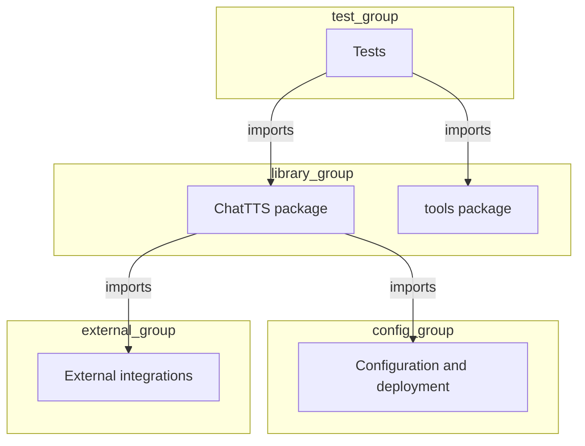

# Architecture report: 2noise/ChatTTS

> Automated static analysis. **Observed** = directly seen in files/imports/AST; **Inferred** = interpretation from that evidence. Repository code was not executed.

## 1. Repository at a glance

| Item | Value |
| --- | --- |
| Repository | 2noise/ChatTTS |
| Description | A generative speech model for daily dialogue. |
| Language | Python |
| Stars | 40006 |
| Licence | AGPL-3.0 |
| Analysed commit / branch | 77b89ee281cd479f5b1a787ada330dc975ca1f2a / main |
| Framework(s) | FastAPI |
| Files analysed | 94 |
| Components | 5 |

## 2. Architecture in one minute

2noise/ChatTTS - A generative speech model for daily dialogue.. This repository was analysed statically from 94 file(s) (68 Python). Detected technologies (observed from imports/manifests): GitHub Actions, FastAPI, NumPy, Pydantic, requests, setuptools. Files are grouped into 5 component(s): ChatTTS package, Configuration and deployment, External integrations, Tests, tools package. Findings below distinguish observed facts from inferred interpretation.

## 3. High-level block diagram

## 4. Main components

### ChatTTS package (`chattts`)

- **Kind:** library
- **Status:** Observed
- **Confidence:** 0.85
- **Responsibility:** Groups 33 file(s) under chattts package (observed from repository paths and static analysis). Observed top-level classes: AllocStatus, AsyncEngineArgs, BlockAllocator, BlockSpaceManager, CUDAGraphRunner, CacheConfig. Observed top-level functions: _async_h2d, _check_if_gpu_supports_dtype, _combine_tags, _fast_replace, _find_index, _get_and_verify_dtype.
- **Paths:** `ChatTTS/__init__.py`, `ChatTTS/core.py`, `ChatTTS/model/__init__.py`, `ChatTTS/model/cuda/__init__.py`, `ChatTTS/model/cuda/patch.py`, `ChatTTS/model/cuda/te_llama.py`, `ChatTTS/model/dvae.py`, `ChatTTS/model/embed.py`, `ChatTTS/model/gpt.py`, `ChatTTS/model/processors.py`, `ChatTTS/model/speaker.py`, `ChatTTS/model/tokenizer.py`, `ChatTTS/model/velocity/__init__.py`, `ChatTTS/model/velocity/block_manager.py`, `ChatTTS/model/velocity/configs.py`, `ChatTTS/model/velocity/llama.py`, `ChatTTS/model/velocity/llm.py`, `ChatTTS/model/velocity/llm_engine.py`, `ChatTTS/model/velocity/model_loader.py`, `ChatTTS/model/velocity/model_runner.py`, `ChatTTS/model/velocity/output.py`, `ChatTTS/model/velocity/sampler.py`, `ChatTTS/model/velocity/sampling_params.py`, `ChatTTS/model/velocity/scheduler.py`, `ChatTTS/model/velocity/sequence.py`, `ChatTTS/model/velocity/worker.py`, `ChatTTS/norm.py`, `ChatTTS/res/__init__.py`, `ChatTTS/utils/__init__.py`, `ChatTTS/utils/dl.py`, `ChatTTS/utils/gpu.py`, `ChatTTS/utils/io.py`, `ChatTTS/utils/log.py`
- **Evidence:** [ChatTTS/__init__.py](https://github.com/2noise/ChatTTS/blob/77b89ee281cd479f5b1a787ada330dc975ca1f2a/ChatTTS/__init__.py); [ChatTTS/core.py:32](https://github.com/2noise/ChatTTS/blob/77b89ee281cd479f5b1a787ada330dc975ca1f2a/ChatTTS/core.py#L32); [ChatTTS/model/__init__.py](https://github.com/2noise/ChatTTS/blob/77b89ee281cd479f5b1a787ada330dc975ca1f2a/ChatTTS/model/__init__.py); [ChatTTS/model/cuda/__init__.py](https://github.com/2noise/ChatTTS/blob/77b89ee281cd479f5b1a787ada330dc975ca1f2a/ChatTTS/model/cuda/__init__.py); [ChatTTS/model/cuda/patch.py:4](https://github.com/2noise/ChatTTS/blob/77b89ee281cd479f5b1a787ada330dc975ca1f2a/ChatTTS/model/cuda/patch.py#L4); [ChatTTS/model/cuda/te_llama.py:29](https://github.com/2noise/ChatTTS/blob/77b89ee281cd479f5b1a787ada330dc975ca1f2a/ChatTTS/model/cuda/te_llama.py#L29); [ChatTTS/model/dvae.py:14](https://github.com/2noise/ChatTTS/blob/77b89ee281cd479f5b1a787ada330dc975ca1f2a/ChatTTS/model/dvae.py#L14); [ChatTTS/model/embed.py:8](https://github.com/2noise/ChatTTS/blob/77b89ee281cd479f5b1a787ada330dc975ca1f2a/ChatTTS/model/embed.py#L8)

### Configuration and deployment (`config`)

- **Kind:** config
- **Status:** Observed
- **Confidence:** 0.85
- **Responsibility:** Groups 5 file(s) under configuration and deployment (observed from repository paths and static analysis). Observed top-level classes: Backbone, BackboneInitArgs, Config, DVAE, Decoder, Embed.
- **Paths:** `ChatTTS/config/__init__.py`, `ChatTTS/config/config.py`, `ChatTTS/res/sha256_map.json`, `requirements.txt`, `setup.py`
- **Evidence:** [ChatTTS/config/__init__.py](https://github.com/2noise/ChatTTS/blob/77b89ee281cd479f5b1a787ada330dc975ca1f2a/ChatTTS/config/__init__.py); [ChatTTS/config/config.py:5](https://github.com/2noise/ChatTTS/blob/77b89ee281cd479f5b1a787ada330dc975ca1f2a/ChatTTS/config/config.py#L5); [ChatTTS/res/sha256_map.json](https://github.com/2noise/ChatTTS/blob/77b89ee281cd479f5b1a787ada330dc975ca1f2a/ChatTTS/res/sha256_map.json); [requirements.txt](https://github.com/2noise/ChatTTS/blob/77b89ee281cd479f5b1a787ada330dc975ca1f2a/requirements.txt); [setup.py](https://github.com/2noise/ChatTTS/blob/77b89ee281cd479f5b1a787ada330dc975ca1f2a/setup.py)

### External integrations (`external_integrations`)

- **Kind:** external
- **Status:** Inferred
- **Confidence:** 0.70
- **Responsibility:** Groups 0 file(s) under external integrations (observed from repository paths and static analysis).
- **Evidence:** [ChatTTS/utils/dl.py:4](https://github.com/2noise/ChatTTS/blob/77b89ee281cd479f5b1a787ada330dc975ca1f2a/ChatTTS/utils/dl.py#L4); [examples/api/client.py:6](https://github.com/2noise/ChatTTS/blob/77b89ee281cd479f5b1a787ada330dc975ca1f2a/examples/api/client.py#L6); [examples/api/postScript.py:7](https://github.com/2noise/ChatTTS/blob/77b89ee281cd479f5b1a787ada330dc975ca1f2a/examples/api/postScript.py#L7)

### Tests (`tests`)

- **Kind:** test
- **Status:** Observed
- **Confidence:** 0.85
- **Responsibility:** Groups 4 file(s) under tests (observed from repository paths and static analysis). Observed top-level functions: trim_tags.
- **Paths:** `tests/#511.py`, `tests/#588.py`, `tests/#655.py`, `tests/testall.sh`
- **Evidence:** [tests/#511.py](https://github.com/2noise/ChatTTS/blob/77b89ee281cd479f5b1a787ada330dc975ca1f2a/tests/%23511.py); [tests/#588.py:39](https://github.com/2noise/ChatTTS/blob/77b89ee281cd479f5b1a787ada330dc975ca1f2a/tests/%23588.py#L39); [tests/#655.py](https://github.com/2noise/ChatTTS/blob/77b89ee281cd479f5b1a787ada330dc975ca1f2a/tests/%23655.py); [tests/testall.sh](https://github.com/2noise/ChatTTS/blob/77b89ee281cd479f5b1a787ada330dc975ca1f2a/tests/testall.sh)

### tools package (`tools`)

- **Kind:** library
- **Status:** Observed
- **Confidence:** 0.85
- **Responsibility:** Groups 17 file(s) under tools package (observed from repository paths and static analysis). Observed top-level classes: ChatOpenAI, Formatter, TorchSeedContext. Observed top-level functions: _pcm_to_wav_buffer, float_to_int16, get_logger, has_ffmpeg_installed, load_audio, normalizer_en_nemo_text.
- **Paths:** `tools/__init__.py`, `tools/audio/__init__.py`, `tools/audio/av.py`, `tools/audio/ffmpeg.py`, `tools/audio/np.py`, `tools/audio/pcm.py`, `tools/checksum/main.go`, `tools/checksum/tmpl.go`, `tools/llm/__init__.py`, `tools/llm/llm.py`, `tools/logger/__init__.py`, `tools/logger/log.py`, `tools/normalizer/__init__.py`, `tools/normalizer/en.py`, `tools/normalizer/zh.py`, `tools/seeder/__init__.py`, `tools/seeder/ctx.py`
- **Evidence:** [tools/__init__.py](https://github.com/2noise/ChatTTS/blob/77b89ee281cd479f5b1a787ada330dc975ca1f2a/tools/__init__.py); [tools/audio/__init__.py](https://github.com/2noise/ChatTTS/blob/77b89ee281cd479f5b1a787ada330dc975ca1f2a/tools/audio/__init__.py); [tools/audio/av.py:20](https://github.com/2noise/ChatTTS/blob/77b89ee281cd479f5b1a787ada330dc975ca1f2a/tools/audio/av.py#L20); [tools/audio/ffmpeg.py:4](https://github.com/2noise/ChatTTS/blob/77b89ee281cd479f5b1a787ada330dc975ca1f2a/tools/audio/ffmpeg.py#L4); [tools/audio/np.py:8](https://github.com/2noise/ChatTTS/blob/77b89ee281cd479f5b1a787ada330dc975ca1f2a/tools/audio/np.py#L8); [tools/audio/pcm.py:8](https://github.com/2noise/ChatTTS/blob/77b89ee281cd479f5b1a787ada330dc975ca1f2a/tools/audio/pcm.py#L8); [tools/checksum/main.go](https://github.com/2noise/ChatTTS/blob/77b89ee281cd479f5b1a787ada330dc975ca1f2a/tools/checksum/main.go); [tools/checksum/tmpl.go](https://github.com/2noise/ChatTTS/blob/77b89ee281cd479f5b1a787ada330dc975ca1f2a/tools/checksum/tmpl.go)

## 5. Execution flow

No entry point was observed; the startup flow below is therefore limited.

**Observed** routes (from decorators):

- `POST /generate_voice` -> `generate_voice` in `examples/api/main.py:71`
- `POST /v1/audio/speech` -> `generate_voice` in `examples/api/openai_api.py:150`
- `GET /health` -> `health_check` in `examples/api/openai_api.py:283`

Representative flow (derived from observed entry points and the import graph; steps beyond the entry point are **Inferred**):

1. Execution starts at an observed entry point listed above, if present.
2. `chattts` imports `config` (ChatTTS package -> Configuration and deployment).
3. `chattts` imports `external_integrations` (ChatTTS package -> External integrations).
4. `tests` imports `chattts` (Tests -> ChatTTS package).
5. `tests` imports `tools` (Tests -> tools package).

## 6. Project structure

### `(root)`

- `.gitattributes` - other (94 bytes)
- `.gitignore` - other (3210 bytes)
- `LICENSE` - docs (34523 bytes)
- `README.md` - docs (11473 bytes)
- `requirements.txt` - manifest (270 bytes)
- `setup.py` - manifest, Python (1130 bytes)

### `.github`

- `.github/workflows/checksum.yml` - ci, YAML (1446 bytes)
- `.github/workflows/close-issue.yml` - ci, YAML (741 bytes)
- `.github/workflows/pull-format.yml` - ci, YAML (2730 bytes)
- `.github/workflows/push-format.yml` - ci, YAML (1647 bytes)
- `.github/workflows/unitest.yml` - ci, YAML (1069 bytes)
- `.github/workflows/upload-pypi.yml` - ci, YAML (856 bytes)

### `ChatTTS`

- `ChatTTS/__init__.py` - source, Python (23 bytes)
- `ChatTTS/config/__init__.py` - source, Python (27 bytes)
- `ChatTTS/config/config.py` - source, Python (8256 bytes)
- `ChatTTS/core.py` - source, Python (25060 bytes)
- `ChatTTS/model/__init__.py` - source, Python (166 bytes)
- `ChatTTS/model/cuda/__init__.py` - source, Python (35 bytes)
- `ChatTTS/model/cuda/patch.py` - source, Python (686 bytes)
- `ChatTTS/model/cuda/te_llama.py` - source, Python (7445 bytes)
- `ChatTTS/model/dvae.py` - source, Python (9067 bytes)
- `ChatTTS/model/embed.py` - source, Python (2505 bytes)
- `ChatTTS/model/gpt.py` - source, Python (24741 bytes)
- `ChatTTS/model/processors.py` - source, Python (1939 bytes)
- `ChatTTS/model/speaker.py` - source, Python (4726 bytes)
- `ChatTTS/model/tokenizer.py` - source, Python (4791 bytes)
- `ChatTTS/model/velocity/__init__.py` - source, Python (65 bytes)
- `ChatTTS/model/velocity/block_manager.py` - source, Python (11886 bytes)
- `ChatTTS/model/velocity/configs.py` - source, Python (33104 bytes)
- `ChatTTS/model/velocity/llama.py` - source, Python (14388 bytes)
- `ChatTTS/model/velocity/llm.py` - source, Python (9477 bytes)
- `ChatTTS/model/velocity/llm_engine.py` - source, Python (34953 bytes)
- `ChatTTS/model/velocity/model_loader.py` - source, Python (2613 bytes)
- `ChatTTS/model/velocity/model_runner.py` - source, Python (32922 bytes)
- `ChatTTS/model/velocity/output.py` - source, Python (4938 bytes)
- `ChatTTS/model/velocity/sampler.py` - source, Python (4062 bytes)
- `ChatTTS/model/velocity/sampling_params.py` - source, Python (13211 bytes)
- `ChatTTS/model/velocity/scheduler.py` - source, Python (17746 bytes)
- `ChatTTS/model/velocity/sequence.py` - source, Python (15322 bytes)
- `ChatTTS/model/velocity/worker.py` - source, Python (9483 bytes)
- `ChatTTS/norm.py` - source, Python (8890 bytes)
- `ChatTTS/res/__init__.py` - source, Python (0 bytes)
- `ChatTTS/res/sha256_map.json` - config (1002 bytes)
- `ChatTTS/utils/__init__.py` - source, Python (187 bytes)
- `ChatTTS/utils/dl.py` - source, Python (5182 bytes)
- `ChatTTS/utils/gpu.py` - source, Python (2651 bytes)
- `ChatTTS/utils/io.py` - source, Python (1719 bytes)
- `ChatTTS/utils/log.py` - source, Python (335 bytes)

### `docs`

- `docs/cn/README.md` - docs (10023 bytes)
- `docs/es/README.md` - docs (10140 bytes)
- `docs/fr/README.md` - docs (11951 bytes)
- `docs/jp/README.md` - docs (8911 bytes)
- `docs/kr/README.md` - docs (12550 bytes)
- `docs/ru/README.md` - docs (12061 bytes)

### `examples`

- `examples/__init__.py` - source, Python (0 bytes)
- `examples/api/README.md` - docs (473 bytes)
- `examples/api/client.py` - source, Python (2024 bytes)
- `examples/api/main.py` - source, Python (3521 bytes)
- `examples/api/openai_api.py` - source, Python (10595 bytes)
- `examples/api/postScript.py` - source, Python (7267 bytes)
- `examples/api/requirements.txt` - manifest (17 bytes)
- `examples/cmd/run.py` - source, Python (4284 bytes)
- `examples/cmd/stream.py` - source, Python (8274 bytes)
- `examples/ipynb/colab.ipynb` - other (11923 bytes)
- `examples/ipynb/example.ipynb` - other (10534 bytes)
- `examples/onnx/README.md` - docs (293 bytes)
- `examples/onnx/exporter.py` - source, Python (13438 bytes)
- `examples/onnx/gpt.py` - source, Python (2464 bytes)
- `examples/onnx/modeling_llama.py` - source, Python (49104 bytes)
- `examples/web/__init__.py` - source, Python (0 bytes)
- `examples/web/ex.py` - source, Python (957 bytes)
- `examples/web/funcs.py` - source, Python (6529 bytes)
- `examples/web/webui.py` - source, Python (9727 bytes)

### `tests`

- `tests/#511.py` - test, Python (2252 bytes)
- `tests/#588.py` - test, Python (1063 bytes)
- `tests/#655.py` - test, Python (2422 bytes)
- `tests/testall.sh` - test, Shell (261 bytes)

### `tools`

- `tools/__init__.py` - source, Python (0 bytes)
- `tools/audio/__init__.py` - source, Python (178 bytes)
- `tools/audio/av.py` - source, Python (3898 bytes)
- `tools/audio/ffmpeg.py` - source, Python (116 bytes)
- `tools/audio/np.py` - source, Python (269 bytes)
- `tools/audio/pcm.py` - source, Python (2959 bytes)
- `tools/checksum/main.go` - source, Go (608 bytes)
- `tools/checksum/tmpl.go` - source, Go (800 bytes)
- `tools/llm/__init__.py` - source, Python (28 bytes)
- `tools/llm/llm.py` - source, Python (3441 bytes)
- `tools/logger/__init__.py` - source, Python (28 bytes)
- `tools/logger/log.py` - source, Python (2535 bytes)
- `tools/normalizer/__init__.py` - source, Python (73 bytes)
- `tools/normalizer/en.py` - source, Python (336 bytes)
- `tools/normalizer/zh.py` - source, Python (188 bytes)
- `tools/seeder/__init__.py` - source, Python (34 bytes)
- `tools/seeder/ctx.py` - source, Python (329 bytes)

## 7. Key dependencies and integrations

| Name | Category | Status | Confidence | Evidence |
| --- | --- | --- | --- | --- |
| GitHub Actions | ci | Observed | 0.90 | [.github/workflows/checksum.yml](https://github.com/2noise/ChatTTS/blob/77b89ee281cd479f5b1a787ada330dc975ca1f2a/.github/workflows/checksum.yml); [.github/workflows/close-issue.yml](https://github.com/2noise/ChatTTS/blob/77b89ee281cd479f5b1a787ada330dc975ca1f2a/.github/workflows/close-issue.yml); [.github/workflows/pull-format.yml](https://github.com/2noise/ChatTTS/blob/77b89ee281cd479f5b1a787ada330dc975ca1f2a/.github/workflows/pull-format.yml); [.github/workflows/push-format.yml](https://github.com/2noise/ChatTTS/blob/77b89ee281cd479f5b1a787ada330dc975ca1f2a/.github/workflows/push-format.yml) |
| FastAPI | framework | Observed | 0.95 | [examples/api/main.py:6](https://github.com/2noise/ChatTTS/blob/77b89ee281cd479f5b1a787ada330dc975ca1f2a/examples/api/main.py#L6); [examples/api/main.py:7](https://github.com/2noise/ChatTTS/blob/77b89ee281cd479f5b1a787ada330dc975ca1f2a/examples/api/main.py#L7); [examples/api/main.py:25](https://github.com/2noise/ChatTTS/blob/77b89ee281cd479f5b1a787ada330dc975ca1f2a/examples/api/main.py#L25); [examples/api/main.py:26](https://github.com/2noise/ChatTTS/blob/77b89ee281cd479f5b1a787ada330dc975ca1f2a/examples/api/main.py#L26) |
| NumPy | library | Observed | 0.95 | [ChatTTS/core.py:10](https://github.com/2noise/ChatTTS/blob/77b89ee281cd479f5b1a787ada330dc975ca1f2a/ChatTTS/core.py#L10); [ChatTTS/model/dvae.py:4](https://github.com/2noise/ChatTTS/blob/77b89ee281cd479f5b1a787ada330dc975ca1f2a/ChatTTS/model/dvae.py#L4); [ChatTTS/model/speaker.py:5](https://github.com/2noise/ChatTTS/blob/77b89ee281cd479f5b1a787ada330dc975ca1f2a/ChatTTS/model/speaker.py#L5); [ChatTTS/model/velocity/llm_engine.py:25](https://github.com/2noise/ChatTTS/blob/77b89ee281cd479f5b1a787ada330dc975ca1f2a/ChatTTS/model/velocity/llm_engine.py#L25) |
| Pydantic | library | Observed | 0.95 | [examples/api/main.py:24](https://github.com/2noise/ChatTTS/blob/77b89ee281cd479f5b1a787ada330dc975ca1f2a/examples/api/main.py#L24); [examples/api/openai_api.py:24](https://github.com/2noise/ChatTTS/blob/77b89ee281cd479f5b1a787ada330dc975ca1f2a/examples/api/openai_api.py#L24) |
| requests | library | Observed | 0.95 | [ChatTTS/utils/dl.py:4](https://github.com/2noise/ChatTTS/blob/77b89ee281cd479f5b1a787ada330dc975ca1f2a/ChatTTS/utils/dl.py#L4); [examples/api/client.py:6](https://github.com/2noise/ChatTTS/blob/77b89ee281cd479f5b1a787ada330dc975ca1f2a/examples/api/client.py#L6); [examples/api/postScript.py:7](https://github.com/2noise/ChatTTS/blob/77b89ee281cd479f5b1a787ada330dc975ca1f2a/examples/api/postScript.py#L7); [examples/api/requirements.txt:2](https://github.com/2noise/ChatTTS/blob/77b89ee281cd479f5b1a787ada330dc975ca1f2a/examples/api/requirements.txt#L2) |
| setuptools | packaging | Observed | 0.90 | [setup.py:2](https://github.com/2noise/ChatTTS/blob/77b89ee281cd479f5b1a787ada330dc975ca1f2a/setup.py#L2) |

## 8. Data and state

No database, cache, queue, or persistent-state usage was observed in the analysed files. State handling, if any, may be in-memory or in files that were not analysed.

## 9. Configuration and deployment clues

- `.github/workflows/checksum.yml` (ci)
- `.github/workflows/close-issue.yml` (ci)
- `.github/workflows/pull-format.yml` (ci)
- `.github/workflows/push-format.yml` (ci)
- `.github/workflows/unitest.yml` (ci)
- `.github/workflows/upload-pypi.yml` (ci)
- `ChatTTS/res/sha256_map.json` (config)
- `examples/api/requirements.txt` (manifest)
- `requirements.txt` (manifest)
- `setup.py` (manifest)

## 10. Design observations

- Tests are present alongside source code (Observed from test file paths).
- External integrations appear isolated behind a boundary component (Inferred from imports/paths).

These observations are interpretations (**Inferred**) of the observed structure, not guarantees about runtime design.

## 11. Limitations and unknowns

- Static analysis only: repository code was not executed, installed, or imported at runtime.
- Components and relationships are inferred from file paths, imports, and AST structure; runtime behaviour, dynamic imports, and reflection may not be visible.
- No clear application entry point was observed in the analysed files.
- Repository text was treated as untrusted data; no instructions found in repository files were followed, and likely secret values were redacted/excluded.

## 12. Source references

- [.github/workflows/checksum.yml](https://github.com/2noise/ChatTTS/blob/77b89ee281cd479f5b1a787ada330dc975ca1f2a/.github/workflows/checksum.yml)
- [.github/workflows/close-issue.yml](https://github.com/2noise/ChatTTS/blob/77b89ee281cd479f5b1a787ada330dc975ca1f2a/.github/workflows/close-issue.yml)
- [.github/workflows/pull-format.yml](https://github.com/2noise/ChatTTS/blob/77b89ee281cd479f5b1a787ada330dc975ca1f2a/.github/workflows/pull-format.yml)
- [.github/workflows/push-format.yml](https://github.com/2noise/ChatTTS/blob/77b89ee281cd479f5b1a787ada330dc975ca1f2a/.github/workflows/push-format.yml)
- [.github/workflows/unitest.yml](https://github.com/2noise/ChatTTS/blob/77b89ee281cd479f5b1a787ada330dc975ca1f2a/.github/workflows/unitest.yml)
- [.github/workflows/upload-pypi.yml](https://github.com/2noise/ChatTTS/blob/77b89ee281cd479f5b1a787ada330dc975ca1f2a/.github/workflows/upload-pypi.yml)
- [ChatTTS/__init__.py](https://github.com/2noise/ChatTTS/blob/77b89ee281cd479f5b1a787ada330dc975ca1f2a/ChatTTS/__init__.py)
- [ChatTTS/config/__init__.py](https://github.com/2noise/ChatTTS/blob/77b89ee281cd479f5b1a787ada330dc975ca1f2a/ChatTTS/config/__init__.py)
- [ChatTTS/config/config.py:5](https://github.com/2noise/ChatTTS/blob/77b89ee281cd479f5b1a787ada330dc975ca1f2a/ChatTTS/config/config.py#L5)
- [ChatTTS/core.py:10](https://github.com/2noise/ChatTTS/blob/77b89ee281cd479f5b1a787ada330dc975ca1f2a/ChatTTS/core.py#L10)
- [ChatTTS/core.py:32](https://github.com/2noise/ChatTTS/blob/77b89ee281cd479f5b1a787ada330dc975ca1f2a/ChatTTS/core.py#L32)
- [ChatTTS/model/__init__.py](https://github.com/2noise/ChatTTS/blob/77b89ee281cd479f5b1a787ada330dc975ca1f2a/ChatTTS/model/__init__.py)
- [ChatTTS/model/cuda/__init__.py](https://github.com/2noise/ChatTTS/blob/77b89ee281cd479f5b1a787ada330dc975ca1f2a/ChatTTS/model/cuda/__init__.py)
- [ChatTTS/model/cuda/patch.py:4](https://github.com/2noise/ChatTTS/blob/77b89ee281cd479f5b1a787ada330dc975ca1f2a/ChatTTS/model/cuda/patch.py#L4)
- [ChatTTS/model/cuda/te_llama.py:29](https://github.com/2noise/ChatTTS/blob/77b89ee281cd479f5b1a787ada330dc975ca1f2a/ChatTTS/model/cuda/te_llama.py#L29)
- [ChatTTS/model/dvae.py:4](https://github.com/2noise/ChatTTS/blob/77b89ee281cd479f5b1a787ada330dc975ca1f2a/ChatTTS/model/dvae.py#L4)
- [ChatTTS/model/dvae.py:14](https://github.com/2noise/ChatTTS/blob/77b89ee281cd479f5b1a787ada330dc975ca1f2a/ChatTTS/model/dvae.py#L14)
- [ChatTTS/model/embed.py:8](https://github.com/2noise/ChatTTS/blob/77b89ee281cd479f5b1a787ada330dc975ca1f2a/ChatTTS/model/embed.py#L8)
- [ChatTTS/model/speaker.py:5](https://github.com/2noise/ChatTTS/blob/77b89ee281cd479f5b1a787ada330dc975ca1f2a/ChatTTS/model/speaker.py#L5)
- [ChatTTS/model/velocity/llm_engine.py:25](https://github.com/2noise/ChatTTS/blob/77b89ee281cd479f5b1a787ada330dc975ca1f2a/ChatTTS/model/velocity/llm_engine.py#L25)
- [ChatTTS/model/velocity/model_runner.py:4](https://github.com/2noise/ChatTTS/blob/77b89ee281cd479f5b1a787ada330dc975ca1f2a/ChatTTS/model/velocity/model_runner.py#L4)
- [ChatTTS/norm.py:8](https://github.com/2noise/ChatTTS/blob/77b89ee281cd479f5b1a787ada330dc975ca1f2a/ChatTTS/norm.py#L8)
- [ChatTTS/res/sha256_map.json](https://github.com/2noise/ChatTTS/blob/77b89ee281cd479f5b1a787ada330dc975ca1f2a/ChatTTS/res/sha256_map.json)
- [ChatTTS/utils/dl.py:4](https://github.com/2noise/ChatTTS/blob/77b89ee281cd479f5b1a787ada330dc975ca1f2a/ChatTTS/utils/dl.py#L4)
- [examples/api/client.py:6](https://github.com/2noise/ChatTTS/blob/77b89ee281cd479f5b1a787ada330dc975ca1f2a/examples/api/client.py#L6)
- [examples/api/main.py:6](https://github.com/2noise/ChatTTS/blob/77b89ee281cd479f5b1a787ada330dc975ca1f2a/examples/api/main.py#L6)
- [examples/api/main.py:7](https://github.com/2noise/ChatTTS/blob/77b89ee281cd479f5b1a787ada330dc975ca1f2a/examples/api/main.py#L7)
- [examples/api/main.py:24](https://github.com/2noise/ChatTTS/blob/77b89ee281cd479f5b1a787ada330dc975ca1f2a/examples/api/main.py#L24)
- [examples/api/main.py:25](https://github.com/2noise/ChatTTS/blob/77b89ee281cd479f5b1a787ada330dc975ca1f2a/examples/api/main.py#L25)
- [examples/api/main.py:26](https://github.com/2noise/ChatTTS/blob/77b89ee281cd479f5b1a787ada330dc975ca1f2a/examples/api/main.py#L26)
- [examples/api/openai_api.py:22](https://github.com/2noise/ChatTTS/blob/77b89ee281cd479f5b1a787ada330dc975ca1f2a/examples/api/openai_api.py#L22)
- [examples/api/openai_api.py:23](https://github.com/2noise/ChatTTS/blob/77b89ee281cd479f5b1a787ada330dc975ca1f2a/examples/api/openai_api.py#L23)
- [examples/api/openai_api.py:24](https://github.com/2noise/ChatTTS/blob/77b89ee281cd479f5b1a787ada330dc975ca1f2a/examples/api/openai_api.py#L24)
- [examples/api/postScript.py:7](https://github.com/2noise/ChatTTS/blob/77b89ee281cd479f5b1a787ada330dc975ca1f2a/examples/api/postScript.py#L7)
- [examples/api/requirements.txt:1](https://github.com/2noise/ChatTTS/blob/77b89ee281cd479f5b1a787ada330dc975ca1f2a/examples/api/requirements.txt#L1)
- [examples/api/requirements.txt:2](https://github.com/2noise/ChatTTS/blob/77b89ee281cd479f5b1a787ada330dc975ca1f2a/examples/api/requirements.txt#L2)
- [examples/cmd/run.py:12](https://github.com/2noise/ChatTTS/blob/77b89ee281cd479f5b1a787ada330dc975ca1f2a/examples/cmd/run.py#L12)
- [examples/cmd/stream.py:3](https://github.com/2noise/ChatTTS/blob/77b89ee281cd479f5b1a787ada330dc975ca1f2a/examples/cmd/stream.py#L3)
- [requirements.txt](https://github.com/2noise/ChatTTS/blob/77b89ee281cd479f5b1a787ada330dc975ca1f2a/requirements.txt)
- [requirements.txt:17](https://github.com/2noise/ChatTTS/blob/77b89ee281cd479f5b1a787ada330dc975ca1f2a/requirements.txt#L17)
- [setup.py](https://github.com/2noise/ChatTTS/blob/77b89ee281cd479f5b1a787ada330dc975ca1f2a/setup.py)
- [setup.py:2](https://github.com/2noise/ChatTTS/blob/77b89ee281cd479f5b1a787ada330dc975ca1f2a/setup.py#L2)
- [tests/#511.py](https://github.com/2noise/ChatTTS/blob/77b89ee281cd479f5b1a787ada330dc975ca1f2a/tests/%23511.py)
- [tests/#588.py:39](https://github.com/2noise/ChatTTS/blob/77b89ee281cd479f5b1a787ada330dc975ca1f2a/tests/%23588.py#L39)
- [tests/#655.py](https://github.com/2noise/ChatTTS/blob/77b89ee281cd479f5b1a787ada330dc975ca1f2a/tests/%23655.py)
- [tests/testall.sh](https://github.com/2noise/ChatTTS/blob/77b89ee281cd479f5b1a787ada330dc975ca1f2a/tests/testall.sh)
- [tools/__init__.py](https://github.com/2noise/ChatTTS/blob/77b89ee281cd479f5b1a787ada330dc975ca1f2a/tools/__init__.py)
- [tools/audio/__init__.py](https://github.com/2noise/ChatTTS/blob/77b89ee281cd479f5b1a787ada330dc975ca1f2a/tools/audio/__init__.py)
- [tools/audio/av.py:20](https://github.com/2noise/ChatTTS/blob/77b89ee281cd479f5b1a787ada330dc975ca1f2a/tools/audio/av.py#L20)
- [tools/audio/ffmpeg.py:4](https://github.com/2noise/ChatTTS/blob/77b89ee281cd479f5b1a787ada330dc975ca1f2a/tools/audio/ffmpeg.py#L4)
- [tools/audio/np.py:8](https://github.com/2noise/ChatTTS/blob/77b89ee281cd479f5b1a787ada330dc975ca1f2a/tools/audio/np.py#L8)
- [tools/audio/pcm.py:8](https://github.com/2noise/ChatTTS/blob/77b89ee281cd479f5b1a787ada330dc975ca1f2a/tools/audio/pcm.py#L8)
- [tools/checksum/main.go](https://github.com/2noise/ChatTTS/blob/77b89ee281cd479f5b1a787ada330dc975ca1f2a/tools/checksum/main.go)
- [tools/checksum/tmpl.go](https://github.com/2noise/ChatTTS/blob/77b89ee281cd479f5b1a787ada330dc975ca1f2a/tools/checksum/tmpl.go)
