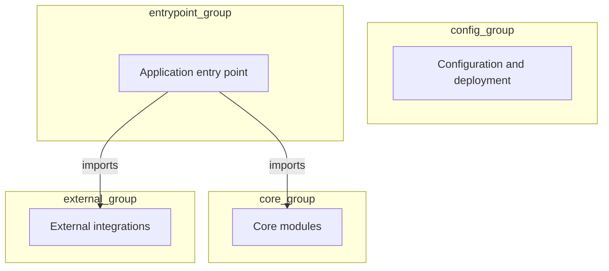

# Architecture report: 521xueweihan/GitHub520

> Automated static analysis. **Observed** = directly seen in files/imports/AST; **Inferred** = interpretation from that evidence. Repository code was not executed.

## 1. Repository at a glance

| Item | Value |
| --- | --- |
| Repository | 521xueweihan/GitHub520 |
| Description | :kissing_heart: 让你“爱”上 GitHub，解决访问时图裂、加载慢的问题。（无需安装） |
| Language | Python |
| Stars | 30309 |
| Licence | Not detected |
| Analysed commit / branch | 617d378e97c54362c44d27a502611a8df72d1a0c / main |
| Framework(s) | None detected |
| Files analysed | 12 |
| Components | 4 |

## 2. Architecture in one minute

521xueweihan/GitHub520 - :kissing_heart: 让你“爱”上 GitHub，解决访问时图裂、加载慢的问题。（无需安装）. This repository was analysed statically from 12 file(s) (3 Python). Detected technologies (observed from imports/manifests): GitHub Actions, requests. Files are grouped into 4 component(s): Configuration and deployment, Core modules, Application entry point, External integrations. Observed entry point(s): fetch_ips.py, update_ips.py. Findings below distinguish observed facts from inferred interpretation.

## 3. High-level block diagram

## 4. Main components

### Configuration and deployment (`config`)

- **Kind:** config
- **Status:** Observed
- **Confidence:** 0.85
- **Responsibility:** Groups 2 file(s) under configuration and deployment (observed from repository paths and static analysis).
- **Paths:** `hosts.json`, `requirements.txt`
- **Evidence:** [hosts.json](https://github.com/521xueweihan/GitHub520/blob/617d378e97c54362c44d27a502611a8df72d1a0c/hosts.json); [requirements.txt](https://github.com/521xueweihan/GitHub520/blob/617d378e97c54362c44d27a502611a8df72d1a0c/requirements.txt)

### Core modules (`core`)

- **Kind:** core
- **Status:** Observed
- **Confidence:** 0.85
- **Responsibility:** Groups 1 file(s) under core modules (observed from repository paths and static analysis). Observed top-level functions: get_json, write_file, write_host_file, write_hosts_content, write_json_file.
- **Paths:** `common.py`
- **Evidence:** [common.py:46](https://github.com/521xueweihan/GitHub520/blob/617d378e97c54362c44d27a502611a8df72d1a0c/common.py#L46)

### Application entry point (`entrypoint`)

- **Kind:** entrypoint
- **Status:** Observed
- **Confidence:** 0.85
- **Responsibility:** Groups 2 file(s) under application entry point (observed from repository paths and static analysis). Observed top-level functions: get_ip, get_ip_list_from_dns, get_ip_list_from_doh, get_json, main, ping_cached.
- **Paths:** `fetch_ips.py`, `update_ips.py`
- **Evidence:** [fetch_ips.py:30](https://github.com/521xueweihan/GitHub520/blob/617d378e97c54362c44d27a502611a8df72d1a0c/fetch_ips.py#L30); [update_ips.py:18](https://github.com/521xueweihan/GitHub520/blob/617d378e97c54362c44d27a502611a8df72d1a0c/update_ips.py#L18)

### External integrations (`external_integrations`)

- **Kind:** external
- **Status:** Inferred
- **Confidence:** 0.70
- **Responsibility:** Groups 0 file(s) under external integrations (observed from repository paths and static analysis).
- **Evidence:** [fetch_ips.py:10](https://github.com/521xueweihan/GitHub520/blob/617d378e97c54362c44d27a502611a8df72d1a0c/fetch_ips.py#L10); [fetch_ips.py:16](https://github.com/521xueweihan/GitHub520/blob/617d378e97c54362c44d27a502611a8df72d1a0c/fetch_ips.py#L16); [update_ips.py:11](https://github.com/521xueweihan/GitHub520/blob/617d378e97c54362c44d27a502611a8df72d1a0c/update_ips.py#L11)

## 5. Execution flow

**Observed** entry point(s):

- [fetch_ips.py:179](https://github.com/521xueweihan/GitHub520/blob/617d378e97c54362c44d27a502611a8df72d1a0c/fetch_ips.py#L179)
- [update_ips.py:41](https://github.com/521xueweihan/GitHub520/blob/617d378e97c54362c44d27a502611a8df72d1a0c/update_ips.py#L41)

Representative flow (derived from observed entry points and the import graph; steps beyond the entry point are **Inferred**):

1. Execution starts at an observed entry point listed above, if present.
2. `entrypoint` imports `core` (Application entry point -> Core modules).
3. `entrypoint` imports `external_integrations` (Application entry point -> External integrations).

## 6. Project structure

### `(root)`

- `.gitignore` - other (1816 bytes)
- `README.md` - docs (8117 bytes)
- `README_template.md` - docs (5640 bytes)
- `actions_requirements.txt` - docs (50 bytes)
- `common.py` - source, Python (4256 bytes)
- `fetch_ips.py` - source, Python (5773 bytes)
- `hosts` - other (2476 bytes)
- `hosts.json` - config (2008 bytes)
- `requirements.txt` - manifest (82 bytes)
- `update_ips.py` - source, Python (987 bytes)

### `.github`

- `.github/FUNDING.yml` - config (160 bytes)
- `.github/workflows/GitHub520.yml` - ci, YAML (1337 bytes)

## 7. Key dependencies and integrations

| Name | Category | Status | Confidence | Evidence |
| --- | --- | --- | --- | --- |
| GitHub Actions | ci | Observed | 0.85 | [.github/workflows/GitHub520.yml](https://github.com/521xueweihan/GitHub520/blob/617d378e97c54362c44d27a502611a8df72d1a0c/.github/workflows/GitHub520.yml) |
| requests | library | Observed | 0.95 | [fetch_ips.py:16](https://github.com/521xueweihan/GitHub520/blob/617d378e97c54362c44d27a502611a8df72d1a0c/fetch_ips.py#L16); [update_ips.py:11](https://github.com/521xueweihan/GitHub520/blob/617d378e97c54362c44d27a502611a8df72d1a0c/update_ips.py#L11) |

## 8. Data and state

No database, cache, queue, or persistent-state usage was observed in the analysed files. State handling, if any, may be in-memory or in files that were not analysed.

## 9. Configuration and deployment clues

- `.github/FUNDING.yml` (config)
- `.github/workflows/GitHub520.yml` (ci)
- `hosts.json` (config)
- `requirements.txt` (manifest)

## 10. Design observations

- An entry/API layer is separated from other code (Inferred from paths and decorators).
- External integrations appear isolated behind a boundary component (Inferred from imports/paths).

These observations are interpretations (**Inferred**) of the observed structure, not guarantees about runtime design.

## 11. Limitations and unknowns

- Static analysis only: repository code was not executed, installed, or imported at runtime.
- Components and relationships are inferred from file paths, imports, and AST structure; runtime behaviour, dynamic imports, and reflection may not be visible.
- Repository text was treated as untrusted data; no instructions found in repository files were followed, and likely secret values were redacted/excluded.

## 12. Source references

- [.github/workflows/GitHub520.yml](https://github.com/521xueweihan/GitHub520/blob/617d378e97c54362c44d27a502611a8df72d1a0c/.github/workflows/GitHub520.yml)
- [common.py:46](https://github.com/521xueweihan/GitHub520/blob/617d378e97c54362c44d27a502611a8df72d1a0c/common.py#L46)
- [fetch_ips.py:10](https://github.com/521xueweihan/GitHub520/blob/617d378e97c54362c44d27a502611a8df72d1a0c/fetch_ips.py#L10)
- [fetch_ips.py:16](https://github.com/521xueweihan/GitHub520/blob/617d378e97c54362c44d27a502611a8df72d1a0c/fetch_ips.py#L16)
- [fetch_ips.py:30](https://github.com/521xueweihan/GitHub520/blob/617d378e97c54362c44d27a502611a8df72d1a0c/fetch_ips.py#L30)
- [fetch_ips.py:179](https://github.com/521xueweihan/GitHub520/blob/617d378e97c54362c44d27a502611a8df72d1a0c/fetch_ips.py#L179)
- [hosts.json](https://github.com/521xueweihan/GitHub520/blob/617d378e97c54362c44d27a502611a8df72d1a0c/hosts.json)
- [requirements.txt](https://github.com/521xueweihan/GitHub520/blob/617d378e97c54362c44d27a502611a8df72d1a0c/requirements.txt)
- [update_ips.py:11](https://github.com/521xueweihan/GitHub520/blob/617d378e97c54362c44d27a502611a8df72d1a0c/update_ips.py#L11)
- [update_ips.py:18](https://github.com/521xueweihan/GitHub520/blob/617d378e97c54362c44d27a502611a8df72d1a0c/update_ips.py#L18)
- [update_ips.py:41](https://github.com/521xueweihan/GitHub520/blob/617d378e97c54362c44d27a502611a8df72d1a0c/update_ips.py#L41)
