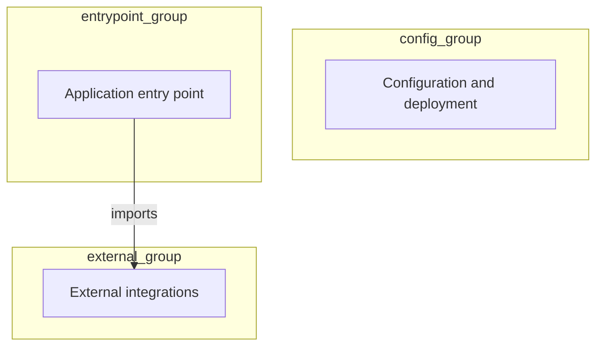

# Architecture report: 521xueweihan/HelloGitHub

> Automated static analysis. **Observed** = directly seen in files/imports/AST; **Inferred** = interpretation from that evidence. Repository code was not executed.

## 1. Repository at a glance

| Item | Value |
| --- | --- |
| Repository | 521xueweihan/HelloGitHub |
| Description | :octocat: 分享 GitHub 上有趣、入门级的开源项目。Share interesting, entry-level open source projects on GitHub. |
| Language | Python |
| Stars | 188845 |
| Licence | Not detected |
| Analysed commit / branch | d65699c2892f3ad7516398a3fbd3855913f9d17d / master |
| Framework(s) | None detected |
| Files analysed | 268 |
| Components | 3 |

## 2. Architecture in one minute

521xueweihan/HelloGitHub - :octocat: 分享 GitHub 上有趣、入门级的开源项目。Share interesting, entry-level open source projects on GitHub.. This repository was analysed statically from 268 file(s) (2 Python). Detected technologies (observed from imports/manifests): requests. Files are grouped into 3 component(s): Configuration and deployment, Application entry point, External integrations. Observed entry point(s): script/github_bot/github_bot.py, script/make_content/make_content.py. Findings below distinguish observed facts from inferred interpretation.

## 3. High-level block diagram

## 4. Main components

### Configuration and deployment (`config`)

- **Kind:** config
- **Status:** Observed
- **Confidence:** 0.85
- **Responsibility:** Groups 1 file(s) under configuration and deployment (observed from repository paths and static analysis).
- **Paths:** `script/github_bot/requirements.txt`
- **Evidence:** [script/github_bot/requirements.txt](https://github.com/521xueweihan/HelloGitHub/blob/d65699c2892f3ad7516398a3fbd3855913f9d17d/script/github_bot/requirements.txt)

### Application entry point (`entrypoint`)

- **Kind:** entrypoint
- **Status:** Observed
- **Confidence:** 0.85
- **Responsibility:** Groups 2 file(s) under application entry point (observed from repository paths and static analysis). Observed top-level classes: InputError. Observed top-level functions: analyze, check_condition, check_path, get_all_data, get_data, get_stars.
- **Paths:** `script/github_bot/github_bot.py`, `script/make_content/make_content.py`
- **Evidence:** [script/github_bot/github_bot.py:70](https://github.com/521xueweihan/HelloGitHub/blob/d65699c2892f3ad7516398a3fbd3855913f9d17d/script/github_bot/github_bot.py#L70); [script/make_content/make_content.py:25](https://github.com/521xueweihan/HelloGitHub/blob/d65699c2892f3ad7516398a3fbd3855913f9d17d/script/make_content/make_content.py#L25)

### External integrations (`external_integrations`)

- **Kind:** external
- **Status:** Inferred
- **Confidence:** 0.70
- **Responsibility:** Groups 0 file(s) under external integrations (observed from repository paths and static analysis).
- **Evidence:** [script/github_bot/github_bot.py:16](https://github.com/521xueweihan/HelloGitHub/blob/d65699c2892f3ad7516398a3fbd3855913f9d17d/script/github_bot/github_bot.py#L16)

## 5. Execution flow

**Observed** entry point(s):

- [script/github_bot/github_bot.py:211](https://github.com/521xueweihan/HelloGitHub/blob/d65699c2892f3ad7516398a3fbd3855913f9d17d/script/github_bot/github_bot.py#L211)
- [script/make_content/make_content.py:99](https://github.com/521xueweihan/HelloGitHub/blob/d65699c2892f3ad7516398a3fbd3855913f9d17d/script/make_content/make_content.py#L99)

Representative flow (derived from observed entry points and the import graph; steps beyond the entry point are **Inferred**):

1. Execution starts at an observed entry point listed above, if present.
2. `entrypoint` imports `external_integrations` (Application entry point -> External integrations).

## 6. Project structure

### `(root)`

- `.gitignore` - other (808 bytes)
- `README.md` - docs (6207 bytes)
- `README_en.md` - docs (6335 bytes)
- `README_ja.md` - docs (7141 bytes)

### `.github`

- `.github/FUNDING.yml` - config (147 bytes)
- `.github/ISSUE_TEMPLATE/config.yml` - config (164 bytes)
- `.github/ISSUE_TEMPLATE/submit-cn.yaml` - config (3534 bytes)
- `.github/ISSUE_TEMPLATE/submit-en.yaml` - config (3850 bytes)

### `content`

- `content/HelloGitHub01.md` - docs (9187 bytes)
- `content/HelloGitHub02.md` - docs (9307 bytes)
- `content/HelloGitHub03.md` - docs (7279 bytes)
- `content/HelloGitHub04.md` - docs (8663 bytes)
- `content/HelloGitHub05.md` - docs (9281 bytes)
- `content/HelloGitHub06.md` - docs (9182 bytes)
- `content/HelloGitHub07.md` - docs (11157 bytes)
- `content/HelloGitHub08.md` - docs (12245 bytes)
- `content/HelloGitHub09.md` - docs (10391 bytes)
- `content/HelloGitHub10.md` - docs (11590 bytes)
- `content/HelloGitHub100.md` - docs (28463 bytes)
- `content/HelloGitHub101.md` - docs (31324 bytes)
- `content/HelloGitHub102.md` - docs (28949 bytes)
- `content/HelloGitHub103.md` - docs (31836 bytes)
- `content/HelloGitHub104.md` - docs (28803 bytes)
- `content/HelloGitHub105.md` - docs (27945 bytes)
- `content/HelloGitHub106.md` - docs (31649 bytes)
- `content/HelloGitHub107.md` - docs (28367 bytes)
- `content/HelloGitHub108.md` - docs (25872 bytes)
- `content/HelloGitHub109.md` - docs (30744 bytes)
- `content/HelloGitHub11.md` - docs (9881 bytes)
- `content/HelloGitHub110.md` - docs (29514 bytes)
- `content/HelloGitHub111.md` - docs (28706 bytes)
- `content/HelloGitHub112.md` - docs (30930 bytes)
- `content/HelloGitHub113.md` - docs (28004 bytes)
- `content/HelloGitHub114.md` - docs (29029 bytes)
- `content/HelloGitHub115.md` - docs (31064 bytes)
- `content/HelloGitHub116.md` - docs (28565 bytes)
- `content/HelloGitHub117.md` - docs (26582 bytes)
- `content/HelloGitHub118.md` - docs (27540 bytes)
- `content/HelloGitHub119.md` - docs (31494 bytes)
- `content/HelloGitHub12.md` - docs (11261 bytes)
- `content/HelloGitHub120.md` - docs (26183 bytes)
- `content/HelloGitHub121.md` - docs (29407 bytes)
- `content/HelloGitHub122.md` - docs (27783 bytes)
- `content/HelloGitHub123.md` - docs (27078 bytes)
- `content/HelloGitHub124.md` - docs (26882 bytes)
- `content/HelloGitHub125.md` - docs (27165 bytes)
- `content/HelloGitHub126.md` - docs (27658 bytes)
- `content/HelloGitHub127.md` - docs (29917 bytes)
- `content/HelloGitHub13.md` - docs (14078 bytes)
- `content/HelloGitHub14.md` - docs (11154 bytes)
- `content/HelloGitHub15.md` - docs (12596 bytes)
- `content/HelloGitHub16.md` - docs (13711 bytes)
- `content/HelloGitHub17.md` - docs (13653 bytes)
- `content/HelloGitHub18.md` - docs (14441 bytes)
- `content/HelloGitHub19.md` - docs (12255 bytes)
- `content/HelloGitHub20.md` - docs (13877 bytes)
- `content/HelloGitHub21.md` - docs (15776 bytes)
- `content/HelloGitHub22.md` - docs (10831 bytes)
- `content/HelloGitHub23.md` - docs (11579 bytes)
- `content/HelloGitHub24.md` - docs (14609 bytes)
- `content/HelloGitHub25.md` - docs (13213 bytes)
- `content/HelloGitHub26.md` - docs (17494 bytes)
- `content/HelloGitHub27.md` - docs (15265 bytes)
- `content/HelloGitHub28.md` - docs (14141 bytes)
- `content/HelloGitHub29.md` - docs (17380 bytes)
- `content/HelloGitHub30.md` - docs (13743 bytes)
- `content/HelloGitHub31.md` - docs (17431 bytes)
- `content/HelloGitHub32.md` - docs (17104 bytes)
- `content/HelloGitHub33.md` - docs (18531 bytes)
- `content/HelloGitHub34.md` - docs (20752 bytes)
- `content/HelloGitHub35.md` - docs (17514 bytes)
- `content/HelloGitHub36.md` - docs (23357 bytes)
- `content/HelloGitHub37.md` - docs (19678 bytes)
- `content/HelloGitHub38.md` - docs (21512 bytes)
- `content/HelloGitHub39.md` - docs (22652 bytes)
- `content/HelloGitHub40.md` - docs (27729 bytes)
- `content/HelloGitHub41.md` - docs (23174 bytes)
- `content/HelloGitHub42.md` - docs (19869 bytes)
- `content/HelloGitHub43.md` - docs (21720 bytes)
- `content/HelloGitHub44.md` - docs (19894 bytes)
- `content/HelloGitHub45.md` - docs (24320 bytes)
- `content/HelloGitHub46.md` - docs (22733 bytes)
- `content/HelloGitHub47.md` - docs (15540 bytes)
- `content/HelloGitHub48.md` - docs (16353 bytes)
- `content/HelloGitHub49.md` - docs (17704 bytes)
- `content/HelloGitHub50.md` - docs (18318 bytes)
- `content/HelloGitHub51.md` - docs (19565 bytes)
- `content/HelloGitHub52.md` - docs (18280 bytes)
- `content/HelloGitHub53.md` - docs (17518 bytes)
- `content/HelloGitHub54.md` - docs (24615 bytes)
- `content/HelloGitHub55.md` - docs (20863 bytes)
- `content/HelloGitHub56.md` - docs (23543 bytes)
- `content/HelloGitHub57.md` - docs (19877 bytes)
- `content/HelloGitHub58.md` - docs (24476 bytes)
- `content/HelloGitHub59.md` - docs (24017 bytes)
- `content/HelloGitHub60.md` - docs (25609 bytes)
- `content/HelloGitHub61.md` - docs (20255 bytes)
- `content/HelloGitHub62.md` - docs (20265 bytes)
- `content/HelloGitHub63.md` - docs (22639 bytes)
- `content/HelloGitHub64.md` - docs (27580 bytes)
- `content/HelloGitHub65.md` - docs (23010 bytes)
- `content/HelloGitHub66.md` - docs (23937 bytes)
- `content/HelloGitHub67.md` - docs (22595 bytes)
- `content/HelloGitHub68.md` - docs (21964 bytes)
- `content/HelloGitHub69.md` - docs (25090 bytes)
- `content/HelloGitHub70.md` - docs (23466 bytes)
- `content/HelloGitHub71.md` - docs (25215 bytes)
- `content/HelloGitHub72.md` - docs (22263 bytes)
- `content/HelloGitHub73.md` - docs (25626 bytes)
- `content/HelloGitHub74.md` - docs (26988 bytes)
- `content/HelloGitHub75.md` - docs (27583 bytes)
- `content/HelloGitHub76.md` - docs (29419 bytes)
- `content/HelloGitHub77.md` - docs (27383 bytes)
- `content/HelloGitHub78.md` - docs (29472 bytes)
- `content/HelloGitHub79.md` - docs (28532 bytes)
- `content/HelloGitHub80.md` - docs (25031 bytes)
- `content/HelloGitHub81.md` - docs (26067 bytes)
- `content/HelloGitHub82.md` - docs (26985 bytes)
- `content/HelloGitHub83.md` - docs (31258 bytes)
- `content/HelloGitHub84.md` - docs (27513 bytes)
- `content/HelloGitHub85.md` - docs (28330 bytes)
- `content/HelloGitHub86.md` - docs (28443 bytes)
- `content/HelloGitHub87.md` - docs (24862 bytes)
- `content/HelloGitHub88.md` - docs (26100 bytes)
- `content/HelloGitHub89.md` - docs (26360 bytes)
- `content/HelloGitHub90.md` - docs (28704 bytes)
- `content/HelloGitHub91.md` - docs (27981 bytes)
- `content/HelloGitHub92.md` - docs (24675 bytes)
- `content/HelloGitHub93.md` - docs (24381 bytes)
- `content/HelloGitHub94.md` - docs (28126 bytes)
- `content/HelloGitHub95.md` - docs (30875 bytes)
- `content/HelloGitHub96.md` - docs (27822 bytes)
- `content/HelloGitHub97.md` - docs (29269 bytes)
- `content/HelloGitHub98.md` - docs (28287 bytes)
- `content/HelloGitHub99.md` - docs (28126 bytes)
- `content/contributors.md` - docs (21337 bytes)
- `content/en/HelloGitHub01.md` - docs (8750 bytes)
- `content/en/HelloGitHub02.md` - docs (8866 bytes)
- `content/en/HelloGitHub03.md` - docs (6815 bytes)
- `content/en/HelloGitHub04.md` - docs (8305 bytes)
- `content/en/HelloGitHub05.md` - docs (8826 bytes)
- `content/en/HelloGitHub06.md` - docs (8723 bytes)
- `content/en/HelloGitHub07.md` - docs (10688 bytes)
- `content/en/HelloGitHub08.md` - docs (11791 bytes)
- `content/en/HelloGitHub09.md` - docs (9925 bytes)
- `content/en/HelloGitHub10.md` - docs (11110 bytes)
- `content/en/HelloGitHub100.md` - docs (30597 bytes)
- `content/en/HelloGitHub101.md` - docs (33792 bytes)
- `content/en/HelloGitHub102.md` - docs (30814 bytes)
- `content/en/HelloGitHub103.md` - docs (34307 bytes)
- `content/en/HelloGitHub104.md` - docs (31246 bytes)
- `content/en/HelloGitHub105.md` - docs (29819 bytes)
- `content/en/HelloGitHub106.md` - docs (33833 bytes)
- `content/en/HelloGitHub107.md` - docs (30496 bytes)
- `content/en/HelloGitHub108.md` - docs (27950 bytes)
- `content/en/HelloGitHub109.md` - docs (33171 bytes)
- `content/en/HelloGitHub11.md` - docs (9438 bytes)
- `content/en/HelloGitHub110.md` - docs (32143 bytes)
- `content/en/HelloGitHub111.md` - docs (31064 bytes)
- `content/en/HelloGitHub112.md` - docs (33523 bytes)
- `content/en/HelloGitHub113.md` - docs (30642 bytes)
- `content/en/HelloGitHub114.md` - docs (31611 bytes)
- `content/en/HelloGitHub115.md` - docs (33363 bytes)
- `content/en/HelloGitHub116.md` - docs (30749 bytes)
- `content/en/HelloGitHub117.md` - docs (28287 bytes)
- `content/en/HelloGitHub118.md` - docs (30220 bytes)
- `content/en/HelloGitHub119.md` - docs (33592 bytes)
- `content/en/HelloGitHub12.md` - docs (10809 bytes)
- `content/en/HelloGitHub120.md` - docs (28084 bytes)
- `content/en/HelloGitHub121.md` - docs (31659 bytes)
- `content/en/HelloGitHub122.md` - docs (30494 bytes)
- `content/en/HelloGitHub123.md` - docs (29746 bytes)
- `content/en/HelloGitHub124.md` - docs (29252 bytes)
- `content/en/HelloGitHub125.md` - docs (29470 bytes)
- `content/en/HelloGitHub126.md` - docs (29981 bytes)
- `content/en/HelloGitHub127.md` - docs (32209 bytes)
- `content/en/HelloGitHub13.md` - docs (13649 bytes)
- `content/en/HelloGitHub14.md` - docs (10704 bytes)
- `content/en/HelloGitHub15.md` - docs (12152 bytes)
- `content/en/HelloGitHub16.md` - docs (13271 bytes)
- `content/en/HelloGitHub17.md` - docs (13214 bytes)
- `content/en/HelloGitHub18.md` - docs (13990 bytes)
- `content/en/HelloGitHub19.md` - docs (11809 bytes)
- `content/en/HelloGitHub20.md` - docs (13424 bytes)
- `content/en/HelloGitHub21.md` - docs (15335 bytes)
- `content/en/HelloGitHub22.md` - docs (10382 bytes)
- `content/en/HelloGitHub23.md` - docs (11116 bytes)
- `content/en/HelloGitHub24.md` - docs (14156 bytes)
- `content/en/HelloGitHub25.md` - docs (12754 bytes)
- `content/en/HelloGitHub26.md` - docs (17170 bytes)
- `content/en/HelloGitHub27.md` - docs (14805 bytes)
- `content/en/HelloGitHub28.md` - docs (13693 bytes)
- `content/en/HelloGitHub29.md` - docs (16937 bytes)
- `content/en/HelloGitHub30.md` - docs (13284 bytes)
- `content/en/HelloGitHub31.md` - docs (16988 bytes)
- `content/en/HelloGitHub32.md` - docs (16668 bytes)
- `content/en/HelloGitHub33.md` - docs (18160 bytes)
- `content/en/HelloGitHub34.md` - docs (20326 bytes)
- `content/en/HelloGitHub35.md` - docs (17081 bytes)
- `content/en/HelloGitHub36.md` - docs (22983 bytes)
- `content/en/HelloGitHub37.md` - docs (19250 bytes)
- `content/en/HelloGitHub38.md` - docs (21098 bytes)
- `content/en/HelloGitHub39.md` - docs (22298 bytes)
- `content/en/HelloGitHub40.md` - docs (27292 bytes)
- `content/en/HelloGitHub41.md` - docs (22728 bytes)
- `content/en/HelloGitHub42.md` - docs (19531 bytes)
- `content/en/HelloGitHub43.md` - docs (21273 bytes)
- `content/en/HelloGitHub44.md` - docs (19474 bytes)
- `content/en/HelloGitHub45.md` - docs (23882 bytes)
- `content/en/HelloGitHub46.md` - docs (22297 bytes)
- `content/en/HelloGitHub47.md` - docs (15094 bytes)
- `content/en/HelloGitHub48.md` - docs (15909 bytes)
- `content/en/HelloGitHub49.md` - docs (17253 bytes)
- `content/en/HelloGitHub50.md` - docs (17883 bytes)
- `content/en/HelloGitHub51.md` - docs (19124 bytes)
- `content/en/HelloGitHub52.md` - docs (17848 bytes)
- `content/en/HelloGitHub53.md` - docs (17081 bytes)
- `content/en/HelloGitHub54.md` - docs (24166 bytes)
- `content/en/HelloGitHub55.md` - docs (20416 bytes)
- `content/en/HelloGitHub56.md` - docs (23100 bytes)
- `content/en/HelloGitHub57.md` - docs (19422 bytes)
- `content/en/HelloGitHub58.md` - docs (24047 bytes)
- `content/en/HelloGitHub59.md` - docs (23590 bytes)
- `content/en/HelloGitHub60.md` - docs (25476 bytes)
- `content/en/HelloGitHub61.md` - docs (19823 bytes)
- `content/en/HelloGitHub62.md` - docs (20040 bytes)
- `content/en/HelloGitHub63.md` - docs (22206 bytes)
- `content/en/HelloGitHub64.md` - docs (27159 bytes)
- `content/en/HelloGitHub65.md` - docs (22570 bytes)
- `content/en/HelloGitHub66.md` - docs (23496 bytes)
- `content/en/HelloGitHub67.md` - docs (22152 bytes)
- `content/en/HelloGitHub68.md` - docs (21525 bytes)
- `content/en/HelloGitHub69.md` - docs (25275 bytes)
- `content/en/HelloGitHub70.md` - docs (23042 bytes)
- `content/en/HelloGitHub71.md` - docs (25206 bytes)
- `content/en/HelloGitHub72.md` - docs (21820 bytes)
- `content/en/HelloGitHub73.md` - docs (25193 bytes)
- `content/en/HelloGitHub74.md` - docs (26561 bytes)
- `content/en/HelloGitHub75.md` - docs (27322 bytes)
- `content/en/HelloGitHub76.md` - docs (28977 bytes)
- `content/en/HelloGitHub77.md` - docs (27379 bytes)
- `content/en/HelloGitHub78.md` - docs (29046 bytes)
- `content/en/HelloGitHub79.md` - docs (28096 bytes)
- `content/en/HelloGitHub80.md` - docs (24573 bytes)
- `content/en/HelloGitHub81.md` - docs (27101 bytes)
- `content/en/HelloGitHub82.md` - docs (28348 bytes)
- `content/en/HelloGitHub83.md` - docs (32786 bytes)
- `content/en/HelloGitHub84.md` - docs (30138 bytes)
- `content/en/HelloGitHub85.md` - docs (30404 bytes)
- `content/en/HelloGitHub86.md` - docs (30518 bytes)
- `content/en/HelloGitHub87.md` - docs (27052 bytes)
- `content/en/HelloGitHub88.md` - docs (27931 bytes)
- `content/en/HelloGitHub89.md` - docs (27941 bytes)
- `content/en/HelloGitHub90.md` - docs (30916 bytes)
- `content/en/HelloGitHub91.md` - docs (30104 bytes)
- `content/en/HelloGitHub92.md` - docs (26449 bytes)
- `content/en/HelloGitHub93.md` - docs (26662 bytes)
- `content/en/HelloGitHub94.md` - docs (30374 bytes)
- `content/en/HelloGitHub95.md` - docs (32829 bytes)
- `content/en/HelloGitHub96.md` - docs (29895 bytes)
- `content/en/HelloGitHub97.md` - docs (31740 bytes)
- `content/en/HelloGitHub98.md` - docs (30658 bytes)
- `content/en/HelloGitHub99.md` - docs (32457 bytes)

### `script`

- `script/github_bot/README.md` - docs (1595 bytes)
- `script/github_bot/github_bot.py` - source, Python (6630 bytes)
- `script/github_bot/requirements.txt` - manifest (9 bytes)
- `script/make_content/README.md` - docs (636 bytes)
- `script/make_content/make_content.py` - source, Python (2801 bytes)

## 7. Key dependencies and integrations

| Name | Category | Status | Confidence | Evidence |
| --- | --- | --- | --- | --- |
| requests | library | Observed | 0.90 | [script/github_bot/github_bot.py:16](https://github.com/521xueweihan/HelloGitHub/blob/d65699c2892f3ad7516398a3fbd3855913f9d17d/script/github_bot/github_bot.py#L16); [script/github_bot/requirements.txt:1](https://github.com/521xueweihan/HelloGitHub/blob/d65699c2892f3ad7516398a3fbd3855913f9d17d/script/github_bot/requirements.txt#L1) |

## 8. Data and state

No database, cache, queue, or persistent-state usage was observed in the analysed files. State handling, if any, may be in-memory or in files that were not analysed.

## 9. Configuration and deployment clues

- `.github/FUNDING.yml` (config)
- `.github/ISSUE_TEMPLATE/config.yml` (config)
- `.github/ISSUE_TEMPLATE/submit-cn.yaml` (config)
- `.github/ISSUE_TEMPLATE/submit-en.yaml` (config)
- `script/github_bot/requirements.txt` (manifest)

## 10. Design observations

- An entry/API layer is separated from other code (Inferred from paths and decorators).
- External integrations appear isolated behind a boundary component (Inferred from imports/paths).

These observations are interpretations (**Inferred**) of the observed structure, not guarantees about runtime design.

## 11. Limitations and unknowns

- Static analysis only: repository code was not executed, installed, or imported at runtime.
- Components and relationships are inferred from file paths, imports, and AST structure; runtime behaviour, dynamic imports, and reflection may not be visible.
- Repository text was treated as untrusted data; no instructions found in repository files were followed, and likely secret values were redacted/excluded.

## 12. Source references

- [script/github_bot/github_bot.py:16](https://github.com/521xueweihan/HelloGitHub/blob/d65699c2892f3ad7516398a3fbd3855913f9d17d/script/github_bot/github_bot.py#L16)
- [script/github_bot/github_bot.py:70](https://github.com/521xueweihan/HelloGitHub/blob/d65699c2892f3ad7516398a3fbd3855913f9d17d/script/github_bot/github_bot.py#L70)
- [script/github_bot/github_bot.py:211](https://github.com/521xueweihan/HelloGitHub/blob/d65699c2892f3ad7516398a3fbd3855913f9d17d/script/github_bot/github_bot.py#L211)
- [script/github_bot/requirements.txt](https://github.com/521xueweihan/HelloGitHub/blob/d65699c2892f3ad7516398a3fbd3855913f9d17d/script/github_bot/requirements.txt)
- [script/github_bot/requirements.txt:1](https://github.com/521xueweihan/HelloGitHub/blob/d65699c2892f3ad7516398a3fbd3855913f9d17d/script/github_bot/requirements.txt#L1)
- [script/make_content/make_content.py:25](https://github.com/521xueweihan/HelloGitHub/blob/d65699c2892f3ad7516398a3fbd3855913f9d17d/script/make_content/make_content.py#L25)
- [script/make_content/make_content.py:99](https://github.com/521xueweihan/HelloGitHub/blob/d65699c2892f3ad7516398a3fbd3855913f9d17d/script/make_content/make_content.py#L99)
