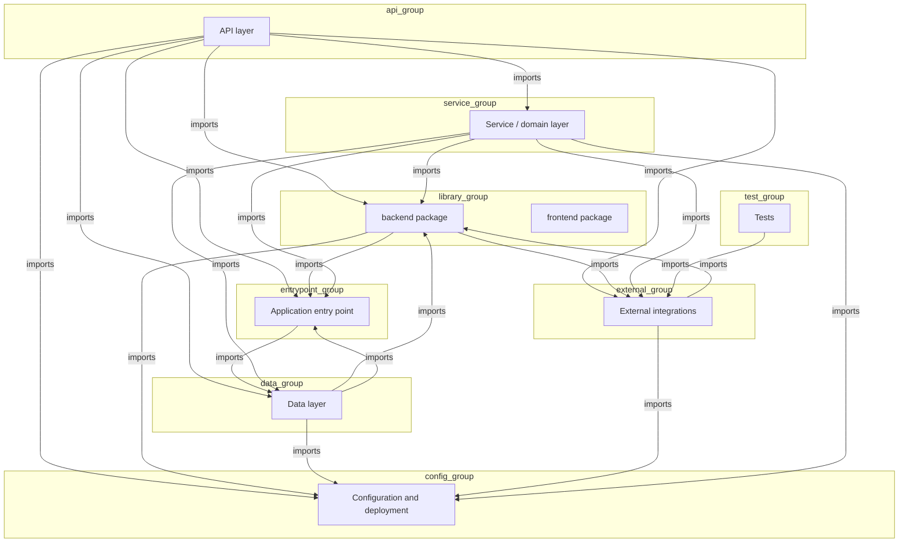

# Architecture report: 666ghj/MiroFish

> Automated static analysis. **Observed** = directly seen in files/imports/AST; **Inferred** = interpretation from that evidence. Repository code was not executed.

## 1. Repository at a glance

| Item | Value |
| --- | --- |
| Repository | 666ghj/MiroFish |
| Description | A Simple and Universal Swarm Intelligence Engine, Predicting Anything. 简洁通用的群体智能引擎，预测万物 |
| Language | Python |
| Stars | 85581 |
| Licence | AGPL-3.0 |
| Analysed commit / branch | 7657031ac01184afe2cb220f5ee3545573b5e843 / main |
| Framework(s) | Flask, Vue |
| Files analysed | 110 |
| Components | 9 |

## 2. Architecture in one minute

666ghj/MiroFish - A Simple and Universal Swarm Intelligence Engine, Predicting Anything. 简洁通用的群体智能引擎，预测万物. This repository was analysed statically from 110 file(s) (62 Python). Detected technologies (observed from imports/manifests): GitHub Actions, SQLite, Flask, Vue, axios, httpx. Files are grouped into 9 component(s): API layer, backend package, Configuration and deployment, Data layer, Application entry point, External integrations, frontend package, Service / domain layer. Observed entry point(s): backend/app/__init__.py, backend/run.py, backend/scripts/run_parallel_simulation.py. Findings below distinguish observed facts from inferred interpretation.

## 3. High-level block diagram

## 4. Main components

### API layer (`api_layer`)

- **Kind:** api
- **Status:** Observed
- **Confidence:** 0.85
- **Responsibility:** Groups 15 file(s) under api layer (observed from repository paths and static analysis). Observed routes: ROUTE /project/<project_id>, ROUTE /project/list, ROUTE /project/<project_id>, ROUTE /project/<project_id>/reset, ROUTE /ontology/generate. Observed top-level classes: GraphInUseError. Observed top-level functions: _active_graph_consumers, _build_graph_impl, _check_simulation_prepared, _clear_project_graph_reference, _delete_cloud_graph_if_present, _delete_project_impl.
- **Paths:** `backend/app/api/__init__.py`, `backend/app/api/graph.py`, `backend/app/api/report.py`, `backend/app/api/simulation.py`, `frontend/src/api/graph.js`, `frontend/src/api/index.js`, `frontend/src/api/report.js`, `frontend/src/api/simulation.js`, `frontend/src/views/Home.vue`, `frontend/src/views/InteractionView.vue`, `frontend/src/views/MainView.vue`, `frontend/src/views/Process.vue`, `frontend/src/views/ReportView.vue`, `frontend/src/views/SimulationRunView.vue`, `frontend/src/views/SimulationView.vue`
- **Evidence:** [backend/app/api/__init__.py](https://github.com/666ghj/MiroFish/blob/7657031ac01184afe2cb220f5ee3545573b5e843/backend/app/api/__init__.py); [backend/app/api/graph.py:36](https://github.com/666ghj/MiroFish/blob/7657031ac01184afe2cb220f5ee3545573b5e843/backend/app/api/graph.py#L36); [backend/app/api/report.py:33](https://github.com/666ghj/MiroFish/blob/7657031ac01184afe2cb220f5ee3545573b5e843/backend/app/api/report.py#L33); [backend/app/api/simulation.py:30](https://github.com/666ghj/MiroFish/blob/7657031ac01184afe2cb220f5ee3545573b5e843/backend/app/api/simulation.py#L30); [frontend/src/api/graph.js](https://github.com/666ghj/MiroFish/blob/7657031ac01184afe2cb220f5ee3545573b5e843/frontend/src/api/graph.js); [frontend/src/api/index.js](https://github.com/666ghj/MiroFish/blob/7657031ac01184afe2cb220f5ee3545573b5e843/frontend/src/api/index.js); [frontend/src/api/report.js](https://github.com/666ghj/MiroFish/blob/7657031ac01184afe2cb220f5ee3545573b5e843/frontend/src/api/report.js); [frontend/src/api/simulation.js](https://github.com/666ghj/MiroFish/blob/7657031ac01184afe2cb220f5ee3545573b5e843/frontend/src/api/simulation.js)

### backend package (`backend`)

- **Kind:** library
- **Status:** Observed
- **Confidence:** 0.85
- **Responsibility:** Groups 11 file(s) under backend package (observed from repository paths and static analysis). Observed top-level classes: ActionLogger, FileParser, PlatformActionLogger, RetryableAPIClient, SimulationLogManager. Observed top-level functions: _cached_zep_client, _ensure_utf8_stdout, _fetch_all, _fetch_page_with_retry, _header_value, _read_text_with_fallback.
- **Paths:** `backend/app/utils/__init__.py`, `backend/app/utils/file_parser.py`, `backend/app/utils/locale.py`, `backend/app/utils/logger.py`, `backend/app/utils/ontology.py`, `backend/app/utils/openai_chat_compat.py`, `backend/app/utils/retry.py`, `backend/app/utils/zep.py`, `backend/app/utils/zep_lifecycle.py`, `backend/app/utils/zep_paging.py`, `backend/scripts/action_logger.py`
- **Evidence:** [backend/app/utils/__init__.py](https://github.com/666ghj/MiroFish/blob/7657031ac01184afe2cb220f5ee3545573b5e843/backend/app/utils/__init__.py); [backend/app/utils/file_parser.py:11](https://github.com/666ghj/MiroFish/blob/7657031ac01184afe2cb220f5ee3545573b5e843/backend/app/utils/file_parser.py#L11); [backend/app/utils/locale.py:23](https://github.com/666ghj/MiroFish/blob/7657031ac01184afe2cb220f5ee3545573b5e843/backend/app/utils/locale.py#L23); [backend/app/utils/logger.py:13](https://github.com/666ghj/MiroFish/blob/7657031ac01184afe2cb220f5ee3545573b5e843/backend/app/utils/logger.py#L13); [backend/app/utils/ontology.py:26](https://github.com/666ghj/MiroFish/blob/7657031ac01184afe2cb220f5ee3545573b5e843/backend/app/utils/ontology.py#L26); [backend/app/utils/openai_chat_compat.py:13](https://github.com/666ghj/MiroFish/blob/7657031ac01184afe2cb220f5ee3545573b5e843/backend/app/utils/openai_chat_compat.py#L13); [backend/app/utils/retry.py:15](https://github.com/666ghj/MiroFish/blob/7657031ac01184afe2cb220f5ee3545573b5e843/backend/app/utils/retry.py#L15); [backend/app/utils/zep.py:33](https://github.com/666ghj/MiroFish/blob/7657031ac01184afe2cb220f5ee3545573b5e843/backend/app/utils/zep.py#L33)

### Configuration and deployment (`config`)

- **Kind:** config
- **Status:** Observed
- **Confidence:** 0.85
- **Responsibility:** Groups 10 file(s) under configuration and deployment (observed from repository paths and static analysis). Observed top-level classes: Config.
- **Paths:** `Dockerfile`, `backend/app/config.py`, `backend/pyproject.toml`, `backend/requirements.txt`, `docker-compose.yml`, `frontend/package.json`, `locales/en.json`, `locales/languages.json`, `locales/zh.json`, `package.json`
- **Evidence:** [Dockerfile](https://github.com/666ghj/MiroFish/blob/7657031ac01184afe2cb220f5ee3545573b5e843/Dockerfile); [backend/app/config.py:17](https://github.com/666ghj/MiroFish/blob/7657031ac01184afe2cb220f5ee3545573b5e843/backend/app/config.py#L17); [backend/pyproject.toml](https://github.com/666ghj/MiroFish/blob/7657031ac01184afe2cb220f5ee3545573b5e843/backend/pyproject.toml); [backend/requirements.txt](https://github.com/666ghj/MiroFish/blob/7657031ac01184afe2cb220f5ee3545573b5e843/backend/requirements.txt); [docker-compose.yml](https://github.com/666ghj/MiroFish/blob/7657031ac01184afe2cb220f5ee3545573b5e843/docker-compose.yml); [frontend/package.json](https://github.com/666ghj/MiroFish/blob/7657031ac01184afe2cb220f5ee3545573b5e843/frontend/package.json); [locales/en.json](https://github.com/666ghj/MiroFish/blob/7657031ac01184afe2cb220f5ee3545573b5e843/locales/en.json); [locales/languages.json](https://github.com/666ghj/MiroFish/blob/7657031ac01184afe2cb220f5ee3545573b5e843/locales/languages.json)

### Data layer (`data_layer`)

- **Kind:** data
- **Status:** Observed
- **Confidence:** 0.85
- **Responsibility:** Groups 3 file(s) under data layer (observed from repository paths and static analysis). Observed top-level classes: Project, ProjectManager, ProjectStatus, Task, TaskManager, TaskStatus.
- **Paths:** `backend/app/models/__init__.py`, `backend/app/models/project.py`, `backend/app/models/task.py`
- **Evidence:** [backend/app/models/__init__.py](https://github.com/666ghj/MiroFish/blob/7657031ac01184afe2cb220f5ee3545573b5e843/backend/app/models/__init__.py); [backend/app/models/project.py:17](https://github.com/666ghj/MiroFish/blob/7657031ac01184afe2cb220f5ee3545573b5e843/backend/app/models/project.py#L17); [backend/app/models/task.py:16](https://github.com/666ghj/MiroFish/blob/7657031ac01184afe2cb220f5ee3545573b5e843/backend/app/models/task.py#L16)

### Application entry point (`entrypoint`)

- **Kind:** entrypoint
- **Status:** Observed
- **Confidence:** 0.85
- **Responsibility:** Groups 8 file(s) under application entry point (observed from repository paths and static analysis). Observed application object created via Flask. Observed top-level classes: ChartPoint, Clock, CommandRunner, CommandType, FetchError, GhGraphQLGateway. Observed top-level functions: _activities, _add_and_wait, _build_backfill_state, _build_initial_state, _build_opener, _chart_points.
- **Paths:** `backend/app/__init__.py`, `backend/run.py`, `backend/scripts/run_parallel_simulation.py`, `backend/scripts/run_reddit_simulation.py`, `backend/scripts/run_twitter_simulation.py`, `backend/scripts/validate_zep_cloud_integration.py`, `scripts/fetch_star_count.py`, `scripts/star_history.py`
- **Evidence:** [backend/app/__init__.py:21](https://github.com/666ghj/MiroFish/blob/7657031ac01184afe2cb220f5ee3545573b5e843/backend/app/__init__.py#L21); [backend/run.py:25](https://github.com/666ghj/MiroFish/blob/7657031ac01184afe2cb220f5ee3545573b5e843/backend/run.py#L25); [backend/scripts/run_parallel_simulation.py:106](https://github.com/666ghj/MiroFish/blob/7657031ac01184afe2cb220f5ee3545573b5e843/backend/scripts/run_parallel_simulation.py#L106); [backend/scripts/run_reddit_simulation.py:53](https://github.com/666ghj/MiroFish/blob/7657031ac01184afe2cb220f5ee3545573b5e843/backend/scripts/run_reddit_simulation.py#L53); [backend/scripts/run_twitter_simulation.py:53](https://github.com/666ghj/MiroFish/blob/7657031ac01184afe2cb220f5ee3545573b5e843/backend/scripts/run_twitter_simulation.py#L53); [backend/scripts/validate_zep_cloud_integration.py:42](https://github.com/666ghj/MiroFish/blob/7657031ac01184afe2cb220f5ee3545573b5e843/backend/scripts/validate_zep_cloud_integration.py#L42); [scripts/fetch_star_count.py:25](https://github.com/666ghj/MiroFish/blob/7657031ac01184afe2cb220f5ee3545573b5e843/scripts/fetch_star_count.py#L25); [scripts/star_history.py:151](https://github.com/666ghj/MiroFish/blob/7657031ac01184afe2cb220f5ee3545573b5e843/scripts/star_history.py#L151)

### External integrations (`external_integrations`)

- **Kind:** external
- **Status:** Observed
- **Confidence:** 0.85
- **Responsibility:** Groups 1 file(s) under external integrations (observed from repository paths and static analysis). Observed top-level classes: LLMClient, LLMResponseError. Observed top-level functions: _clean_chat_text, _contains_additional_json_container, _is_response_format_unsupported.
- **Paths:** `backend/app/utils/llm_client.py`
- **Evidence:** [backend/app/utils/llm_client.py:19](https://github.com/666ghj/MiroFish/blob/7657031ac01184afe2cb220f5ee3545573b5e843/backend/app/utils/llm_client.py#L19)

### frontend package (`frontend`)

- **Kind:** library
- **Status:** Observed
- **Confidence:** 0.85
- **Responsibility:** Groups 14 file(s) under frontend package (observed from repository paths and static analysis).
- **Paths:** `frontend/src/App.vue`, `frontend/src/components/GraphPanel.vue`, `frontend/src/components/HistoryDatabase.vue`, `frontend/src/components/LanguageSwitcher.vue`, `frontend/src/components/Step1GraphBuild.vue`, `frontend/src/components/Step2EnvSetup.vue`, `frontend/src/components/Step3Simulation.vue`, `frontend/src/components/Step4Report.vue`, `frontend/src/components/Step5Interaction.vue`, `frontend/src/i18n/index.js`, `frontend/src/main.js`, `frontend/src/router/index.js`, `frontend/src/store/pendingUpload.js`, `frontend/vite.config.js`
- **Evidence:** [frontend/src/App.vue](https://github.com/666ghj/MiroFish/blob/7657031ac01184afe2cb220f5ee3545573b5e843/frontend/src/App.vue); [frontend/src/components/GraphPanel.vue](https://github.com/666ghj/MiroFish/blob/7657031ac01184afe2cb220f5ee3545573b5e843/frontend/src/components/GraphPanel.vue); [frontend/src/components/HistoryDatabase.vue](https://github.com/666ghj/MiroFish/blob/7657031ac01184afe2cb220f5ee3545573b5e843/frontend/src/components/HistoryDatabase.vue); [frontend/src/components/LanguageSwitcher.vue](https://github.com/666ghj/MiroFish/blob/7657031ac01184afe2cb220f5ee3545573b5e843/frontend/src/components/LanguageSwitcher.vue); [frontend/src/components/Step1GraphBuild.vue](https://github.com/666ghj/MiroFish/blob/7657031ac01184afe2cb220f5ee3545573b5e843/frontend/src/components/Step1GraphBuild.vue); [frontend/src/components/Step2EnvSetup.vue](https://github.com/666ghj/MiroFish/blob/7657031ac01184afe2cb220f5ee3545573b5e843/frontend/src/components/Step2EnvSetup.vue); [frontend/src/components/Step3Simulation.vue](https://github.com/666ghj/MiroFish/blob/7657031ac01184afe2cb220f5ee3545573b5e843/frontend/src/components/Step3Simulation.vue); [frontend/src/components/Step4Report.vue](https://github.com/666ghj/MiroFish/blob/7657031ac01184afe2cb220f5ee3545573b5e843/frontend/src/components/Step4Report.vue)

### Service / domain layer (`service_layer`)

- **Kind:** service
- **Status:** Observed
- **Confidence:** 0.85
- **Responsibility:** Groups 13 file(s) under service / domain layer (observed from repository paths and static analysis). Observed top-level classes: AgentAction, AgentActivity, AgentActivityConfig, AgentInterview, BatchSubmission, CommandStatus. Observed top-level functions: _coerce_to_str, _coerce_to_str_list, _to_pascal_case, _to_upper_snake_case.
- **Paths:** `backend/app/services/__init__.py`, `backend/app/services/graph_builder.py`, `backend/app/services/oasis_profile_generator.py`, `backend/app/services/ontology_generator.py`, `backend/app/services/report_agent.py`, `backend/app/services/simulation_config_generator.py`, `backend/app/services/simulation_ipc.py`, `backend/app/services/simulation_manager.py`, `backend/app/services/simulation_runner.py`, `backend/app/services/text_processor.py`, `backend/app/services/zep_entity_reader.py`, `backend/app/services/zep_graph_memory_updater.py`, `backend/app/services/zep_tools.py`
- **Evidence:** [backend/app/services/__init__.py](https://github.com/666ghj/MiroFish/blob/7657031ac01184afe2cb220f5ee3545573b5e843/backend/app/services/__init__.py); [backend/app/services/graph_builder.py:35](https://github.com/666ghj/MiroFish/blob/7657031ac01184afe2cb220f5ee3545573b5e843/backend/app/services/graph_builder.py#L35); [backend/app/services/oasis_profile_generator.py:34](https://github.com/666ghj/MiroFish/blob/7657031ac01184afe2cb220f5ee3545573b5e843/backend/app/services/oasis_profile_generator.py#L34); [backend/app/services/ontology_generator.py:22](https://github.com/666ghj/MiroFish/blob/7657031ac01184afe2cb220f5ee3545573b5e843/backend/app/services/ontology_generator.py#L22); [backend/app/services/report_agent.py:36](https://github.com/666ghj/MiroFish/blob/7657031ac01184afe2cb220f5ee3545573b5e843/backend/app/services/report_agent.py#L36); [backend/app/services/simulation_config_generator.py:53](https://github.com/666ghj/MiroFish/blob/7657031ac01184afe2cb220f5ee3545573b5e843/backend/app/services/simulation_config_generator.py#L53); [backend/app/services/simulation_ipc.py:25](https://github.com/666ghj/MiroFish/blob/7657031ac01184afe2cb220f5ee3545573b5e843/backend/app/services/simulation_ipc.py#L25); [backend/app/services/simulation_manager.py:25](https://github.com/666ghj/MiroFish/blob/7657031ac01184afe2cb220f5ee3545573b5e843/backend/app/services/simulation_manager.py#L25)

### Tests (`tests`)

- **Kind:** test
- **Status:** Observed
- **Confidence:** 0.85
- **Responsibility:** Groups 21 file(s) under tests (observed from repository paths and static analysis). Observed application object created via Flask. Observed top-level classes: CompletionRecorder, CompletionSequence, FakeGitHub, FakeRunner, FetchStarCountTests, FixedClock. Observed top-level functions: _activity, _client, _client_for, _generator_for_test, _json_result, _manager.
- **Paths:** `backend/scripts/test_profile_format.py`, `backend/tests/test_llm_json_responses.py`, `backend/tests/test_ontology_api_errors.py`, `backend/tests/test_ontology_attributes.py`, `backend/tests/test_ontology_generator.py`, `backend/tests/test_openai_chat_compat.py`, `backend/tests/test_platform_profiles.py`, `backend/tests/test_profile_field_normalization.py`, `backend/tests/test_report_tool_result_sanitizer.py`, `backend/tests/test_simulation_prepare_failure.py`, `backend/tests/test_zep_cloud_contracts.py`, `backend/tests/test_zep_cloud_validation_script.py`, `backend/tests/test_zep_edge_paging.py`, `backend/tests/test_zep_entity_reader_edges.py`, `backend/tests/test_zep_graph_lifecycle.py`, `backend/tests/test_zep_graph_memory_updater.py`, `backend/tests/test_zep_report_barrier.py`, `backend/tests/test_zep_retry_and_client.py`, `backend/tests/test_zep_simulation_barrier.py`, `tests/test_local_star_count_fetch.py`, `tests/test_local_star_history.py`
- **Evidence:** [backend/scripts/test_profile_format.py:20](https://github.com/666ghj/MiroFish/blob/7657031ac01184afe2cb220f5ee3545573b5e843/backend/scripts/test_profile_format.py#L20); [backend/tests/test_llm_json_responses.py:8](https://github.com/666ghj/MiroFish/blob/7657031ac01184afe2cb220f5ee3545573b5e843/backend/tests/test_llm_json_responses.py#L8); [backend/tests/test_ontology_api_errors.py:9](https://github.com/666ghj/MiroFish/blob/7657031ac01184afe2cb220f5ee3545573b5e843/backend/tests/test_ontology_api_errors.py#L9); [backend/tests/test_ontology_attributes.py:15](https://github.com/666ghj/MiroFish/blob/7657031ac01184afe2cb220f5ee3545573b5e843/backend/tests/test_ontology_attributes.py#L15); [backend/tests/test_ontology_generator.py:4](https://github.com/666ghj/MiroFish/blob/7657031ac01184afe2cb220f5ee3545573b5e843/backend/tests/test_ontology_generator.py#L4); [backend/tests/test_openai_chat_compat.py:12](https://github.com/666ghj/MiroFish/blob/7657031ac01184afe2cb220f5ee3545573b5e843/backend/tests/test_openai_chat_compat.py#L12); [backend/tests/test_platform_profiles.py:9](https://github.com/666ghj/MiroFish/blob/7657031ac01184afe2cb220f5ee3545573b5e843/backend/tests/test_platform_profiles.py#L9); [backend/tests/test_profile_field_normalization.py:12](https://github.com/666ghj/MiroFish/blob/7657031ac01184afe2cb220f5ee3545573b5e843/backend/tests/test_profile_field_normalization.py#L12)

## 5. Execution flow

**Observed** entry point(s):

- [backend/app/__init__.py:21](https://github.com/666ghj/MiroFish/blob/7657031ac01184afe2cb220f5ee3545573b5e843/backend/app/__init__.py#L21)
- [backend/run.py:48](https://github.com/666ghj/MiroFish/blob/7657031ac01184afe2cb220f5ee3545573b5e843/backend/run.py#L48)
- [backend/scripts/run_parallel_simulation.py:1684](https://github.com/666ghj/MiroFish/blob/7657031ac01184afe2cb220f5ee3545573b5e843/backend/scripts/run_parallel_simulation.py#L1684)
- [backend/scripts/run_reddit_simulation.py:759](https://github.com/666ghj/MiroFish/blob/7657031ac01184afe2cb220f5ee3545573b5e843/backend/scripts/run_reddit_simulation.py#L759)
- [backend/scripts/run_twitter_simulation.py:771](https://github.com/666ghj/MiroFish/blob/7657031ac01184afe2cb220f5ee3545573b5e843/backend/scripts/run_twitter_simulation.py#L771)
- [backend/scripts/validate_zep_cloud_integration.py:903](https://github.com/666ghj/MiroFish/blob/7657031ac01184afe2cb220f5ee3545573b5e843/backend/scripts/validate_zep_cloud_integration.py#L903)
- [frontend/src/api/index.js](https://github.com/666ghj/MiroFish/blob/7657031ac01184afe2cb220f5ee3545573b5e843/frontend/src/api/index.js)
- [frontend/src/i18n/index.js](https://github.com/666ghj/MiroFish/blob/7657031ac01184afe2cb220f5ee3545573b5e843/frontend/src/i18n/index.js)
- [frontend/src/main.js](https://github.com/666ghj/MiroFish/blob/7657031ac01184afe2cb220f5ee3545573b5e843/frontend/src/main.js)
- [frontend/src/router/index.js](https://github.com/666ghj/MiroFish/blob/7657031ac01184afe2cb220f5ee3545573b5e843/frontend/src/router/index.js)
- [scripts/fetch_star_count.py:145](https://github.com/666ghj/MiroFish/blob/7657031ac01184afe2cb220f5ee3545573b5e843/scripts/fetch_star_count.py#L145)
- [scripts/star_history.py:1488](https://github.com/666ghj/MiroFish/blob/7657031ac01184afe2cb220f5ee3545573b5e843/scripts/star_history.py#L1488)

**Observed** routes (from decorators):

- `ROUTE /project/<project_id>` -> `get_project` in `backend/app/api/graph.py:133`
- `ROUTE /project/list` -> `list_projects` in `backend/app/api/graph.py:152`
- `ROUTE /project/<project_id>` -> `delete_project` in `backend/app/api/graph.py:167`
- `ROUTE /project/<project_id>/reset` -> `reset_project` in `backend/app/api/graph.py:214`
- `ROUTE /ontology/generate` -> `generate_ontology` in `backend/app/api/graph.py:266`
- `ROUTE /build` -> `build_graph` in `backend/app/api/graph.py:449`
- `ROUTE /task/<task_id>` -> `get_task` in `backend/app/api/graph.py:845`
- `ROUTE /tasks` -> `list_tasks` in `backend/app/api/graph.py:864`
- `ROUTE /data/<graph_id>` -> `get_graph_data` in `backend/app/api/graph.py:880`
- `ROUTE /delete/<graph_id>` -> `delete_graph` in `backend/app/api/graph.py:908`
- `ROUTE /generate` -> `generate_report` in `backend/app/api/report.py:33`
- `ROUTE /generate/status` -> `get_generate_status` in `backend/app/api/report.py:323`
- `ROUTE /<report_id>` -> `get_report` in `backend/app/api/report.py:397`
- `ROUTE /by-simulation/<simulation_id>` -> `get_report_by_simulation` in `backend/app/api/report.py:439`
- `ROUTE /list` -> `list_reports` in `backend/app/api/report.py:478`
- `ROUTE /<report_id>/download` -> `download_report` in `backend/app/api/report.py:518`
- `ROUTE /<report_id>` -> `delete_report` in `backend/app/api/report.py:564`
- `ROUTE /chat` -> `chat_with_report_agent` in `backend/app/api/report.py:592`
- `ROUTE /<report_id>/progress` -> `get_report_progress` in `backend/app/api/report.py:689`
- `ROUTE /<report_id>/sections` -> `get_report_sections` in `backend/app/api/report.py:730`
- `ROUTE /<report_id>/section/<int:section_index>` -> `get_single_section` in `backend/app/api/report.py:781`
- `ROUTE /check/<simulation_id>` -> `check_report_status` in `backend/app/api/report.py:827`
- `ROUTE /<report_id>/agent-log` -> `get_agent_log` in `backend/app/api/report.py:878`
- `ROUTE /<report_id>/agent-log/stream` -> `stream_agent_log` in `backend/app/api/report.py:937`
- `ROUTE /<report_id>/console-log` -> `get_console_log` in `backend/app/api/report.py:973`
- `ROUTE /<report_id>/console-log/stream` -> `stream_console_log` in `backend/app/api/report.py:1019`
- `ROUTE /tools/search` -> `search_graph_tool` in `backend/app/api/report.py:1055`
- `ROUTE /tools/statistics` -> `get_graph_statistics_tool` in `backend/app/api/report.py:1103`
- `ROUTE /entities/<graph_id>` -> `get_graph_entities` in `backend/app/api/simulation.py:79`
- `ROUTE /entities/<graph_id>/<entity_uuid>` -> `get_entity_detail` in `backend/app/api/simulation.py:124`
- `ROUTE /entities/<graph_id>/by-type/<entity_type>` -> `get_entities_by_type` in `backend/app/api/simulation.py:157`
- `ROUTE /create` -> `create_simulation` in `backend/app/api/simulation.py:196`
- `ROUTE /prepare` -> `prepare_simulation` in `backend/app/api/simulation.py:390`
- `ROUTE /prepare/status` -> `get_prepare_status` in `backend/app/api/simulation.py:678`
- `ROUTE /<simulation_id>` -> `get_simulation` in `backend/app/api/simulation.py:791`
- `ROUTE /list` -> `list_simulations` in `backend/app/api/simulation.py:824`
- `ROUTE /history` -> `get_simulation_history` in `backend/app/api/simulation.py:912`
- `ROUTE /<simulation_id>/profiles` -> `get_simulation_profiles` in `backend/app/api/simulation.py:1026`
- `ROUTE /<simulation_id>/profiles/realtime` -> `get_simulation_profiles_realtime` in `backend/app/api/simulation.py:1064`
- `ROUTE /<simulation_id>/config/realtime` -> `get_simulation_config_realtime` in `backend/app/api/simulation.py:1179`
- `ROUTE /<simulation_id>/config` -> `get_simulation_config` in `backend/app/api/simulation.py:1309`
- `ROUTE /<simulation_id>/config/download` -> `download_simulation_config` in `backend/app/api/simulation.py:1345`
- `ROUTE /script/<script_name>/download` -> `download_simulation_script` in `backend/app/api/simulation.py:1374`
- `ROUTE /generate-profiles` -> `generate_profiles` in `backend/app/api/simulation.py:1428`
- `ROUTE /start` -> `start_simulation` in `backend/app/api/simulation.py:1502`
- `ROUTE /stop` -> `stop_simulation` in `backend/app/api/simulation.py:1789`
- `ROUTE /<simulation_id>/run-status` -> `get_run_status` in `backend/app/api/simulation.py:1866`
- `ROUTE /<simulation_id>/run-status/detail` -> `get_run_status_detail` in `backend/app/api/simulation.py:1924`
- `ROUTE /<simulation_id>/actions` -> `get_simulation_actions` in `backend/app/api/simulation.py:2025`
- `ROUTE /<simulation_id>/timeline` -> `get_simulation_timeline` in `backend/app/api/simulation.py:2079`
- `ROUTE /<simulation_id>/agent-stats` -> `get_agent_stats` in `backend/app/api/simulation.py:2119`
- `ROUTE /<simulation_id>/posts` -> `get_simulation_posts` in `backend/app/api/simulation.py:2148`
- `ROUTE /<simulation_id>/comments` -> `get_simulation_comments` in `backend/app/api/simulation.py:2226`
- `ROUTE /interview` -> `interview_agent` in `backend/app/api/simulation.py:2305`
- `ROUTE /interview/batch` -> `interview_agents_batch` in `backend/app/api/simulation.py:2434`
- `ROUTE /interview/all` -> `interview_all_agents` in `backend/app/api/simulation.py:2572`
- `ROUTE /interview/history` -> `get_interview_history` in `backend/app/api/simulation.py:2675`
- `ROUTE /env-status` -> `get_env_status` in `backend/app/api/simulation.py:2747`
- `ROUTE /close-env` -> `close_simulation_env` in `backend/app/api/simulation.py:2812`

Representative flow (derived from observed entry points and the import graph; steps beyond the entry point are **Inferred**):

1. Execution starts at an observed entry point listed above, if present.
2. `api_layer` imports `backend` (API layer -> backend package).
3. `api_layer` imports `config` (API layer -> Configuration and deployment).
4. `api_layer` imports `data_layer` (API layer -> Data layer).
5. `api_layer` imports `entrypoint` (API layer -> Application entry point).
6. `api_layer` imports `external_integrations` (API layer -> External integrations).
7. `api_layer` imports `service_layer` (API layer -> Service / domain layer).
8. `backend` imports `config` (backend package -> Configuration and deployment).
9. `backend` imports `entrypoint` (backend package -> Application entry point).

## 6. Project structure

### `(root)`

- `.dockerignore` - container (223 bytes)
- `.env.example` - config (715 bytes)
- `.gitignore` - other (554 bytes)
- `Dockerfile` - container (723 bytes)
- `LICENSE` - docs (34523 bytes)
- `README-ZH.md` - docs (7984 bytes)
- `README.md` - docs (8958 bytes)
- `docker-compose.yml` - container (371 bytes)
- `package.json` - manifest (702 bytes)

### `.github`

- `.github/star-history/THIRD_PARTY_NOTICES.md` - docs (1312 bytes)
- `.github/star-history/history.json` - config (15433 bytes)
- `.github/workflows/docker-image.yml` - ci, YAML (1557 bytes)
- `.github/workflows/update-star-history.yml` - ci, YAML (18211 bytes)

### `backend`

- `backend/app/__init__.py` - source, Python (2712 bytes)
- `backend/app/api/__init__.py` - source, Python (314 bytes)
- `backend/app/api/graph.py` - source, Python (34365 bytes)
- `backend/app/api/report.py` - source, Python (35302 bytes)
- `backend/app/api/simulation.py` - source, Python (100984 bytes)
- `backend/app/config.py` - source, Python (2962 bytes)
- `backend/app/models/__init__.py` - source, Python (218 bytes)
- `backend/app/models/project.py` - source, Python (10320 bytes)
- `backend/app/models/task.py` - source, Python (5671 bytes)
- `backend/app/services/__init__.py` - source, Python (1752 bytes)
- `backend/app/services/graph_builder.py` - source, Python (33478 bytes)
- `backend/app/services/oasis_profile_generator.py` - source, Python (51012 bytes)
- `backend/app/services/ontology_generator.py` - source, Python (28469 bytes)
- `backend/app/services/report_agent.py` - source, Python (101589 bytes)
- `backend/app/services/simulation_config_generator.py` - source, Python (40063 bytes)
- `backend/app/services/simulation_ipc.py` - source, Python (12297 bytes)
- `backend/app/services/simulation_manager.py` - source, Python (21579 bytes)
- `backend/app/services/simulation_runner.py` - source, Python (81506 bytes)
- `backend/app/services/text_processor.py` - source, Python (1743 bytes)
- `backend/app/services/zep_entity_reader.py` - source, Python (15867 bytes)
- `backend/app/services/zep_graph_memory_updater.py` - source, Python (31892 bytes)
- `backend/app/services/zep_tools.py` - source, Python (66001 bytes)
- `backend/app/utils/__init__.py` - source, Python (265 bytes)
- `backend/app/utils/file_parser.py` - source, Python (5616 bytes)
- `backend/app/utils/llm_client.py` - source, Python (9873 bytes)
- `backend/app/utils/locale.py` - source, Python (1983 bytes)
- `backend/app/utils/logger.py` - source, Python (3403 bytes)
- `backend/app/utils/ontology.py` - source, Python (3004 bytes)
- `backend/app/utils/openai_chat_compat.py` - source, Python (3109 bytes)
- `backend/app/utils/retry.py` - source, Python (7513 bytes)
- `backend/app/utils/zep.py` - source, Python (5255 bytes)
- `backend/app/utils/zep_lifecycle.py` - source, Python (1727 bytes)
- `backend/app/utils/zep_paging.py` - source, Python (4448 bytes)
- `backend/pyproject.toml` - manifest (1080 bytes)
- `backend/requirements.txt` - manifest (887 bytes)
- `backend/run.py` - source, Python (1294 bytes)
- `backend/scripts/action_logger.py` - source, Python (10256 bytes)
- `backend/scripts/run_parallel_simulation.py` - source, Python (62902 bytes)
- `backend/scripts/run_reddit_simulation.py` - source, Python (27220 bytes)
- `backend/scripts/run_twitter_simulation.py` - source, Python (27362 bytes)
- `backend/scripts/test_profile_format.py` - test, Python (5856 bytes)
- `backend/scripts/validate_zep_cloud_integration.py` - source, Python (34544 bytes)
- `backend/tests/test_llm_json_responses.py` - test, Python (7719 bytes)
- `backend/tests/test_ontology_api_errors.py` - test, Python (2364 bytes)
- `backend/tests/test_ontology_attributes.py` - test, Python (8203 bytes)
- `backend/tests/test_ontology_generator.py` - test, Python (2457 bytes)
- `backend/tests/test_openai_chat_compat.py` - test, Python (3299 bytes)
- `backend/tests/test_platform_profiles.py` - test, Python (2047 bytes)
- `backend/tests/test_profile_field_normalization.py` - test, Python (2711 bytes)
- `backend/tests/test_report_tool_result_sanitizer.py` - test, Python (963 bytes)
- `backend/tests/test_simulation_prepare_failure.py` - test, Python (3462 bytes)
- `backend/tests/test_zep_cloud_contracts.py` - test, Python (17117 bytes)
- `backend/tests/test_zep_cloud_validation_script.py` - test, Python (3221 bytes)
- `backend/tests/test_zep_edge_paging.py` - test, Python (3400 bytes)
- `backend/tests/test_zep_entity_reader_edges.py` - test, Python (1229 bytes)
- `backend/tests/test_zep_graph_lifecycle.py` - test, Python (12775 bytes)
- `backend/tests/test_zep_graph_memory_updater.py` - test, Python (7142 bytes)
- `backend/tests/test_zep_report_barrier.py` - test, Python (8868 bytes)
- `backend/tests/test_zep_retry_and_client.py` - test, Python (3141 bytes)
- `backend/tests/test_zep_simulation_barrier.py` - test, Python (15448 bytes)

### `frontend`

- `frontend/.gitignore` - other (253 bytes)
- `frontend/index.html` - other (919 bytes)
- `frontend/package.json` - manifest (419 bytes)
- `frontend/src/App.vue` - source, Vue (722 bytes)
- `frontend/src/api/graph.js` - source, JavaScript (1277 bytes)
- `frontend/src/api/index.js` - source, JavaScript (1729 bytes)
- `frontend/src/api/report.js` - source, JavaScript (1337 bytes)
- `frontend/src/api/simulation.js` - source, JavaScript (5499 bytes)
- `frontend/src/components/GraphPanel.vue` - source, Vue (39792 bytes)
- `frontend/src/components/HistoryDatabase.vue` - source, Vue (34970 bytes)
- `frontend/src/components/LanguageSwitcher.vue` - source, Vue (2595 bytes)
- `frontend/src/components/Step1GraphBuild.vue` - source, Vue (17715 bytes)
- `frontend/src/components/Step2EnvSetup.vue` - source, Vue (70357 bytes)
- `frontend/src/components/Step3Simulation.vue` - source, Vue (38963 bytes)
- `frontend/src/components/Step4Report.vue` - source, Vue (145867 bytes)
- `frontend/src/components/Step5Interaction.vue` - source, Vue (64172 bytes)
- `frontend/src/i18n/index.js` - source, JavaScript (673 bytes)
- `frontend/src/main.js` - source, JavaScript (194 bytes)
- `frontend/src/router/index.js` - source, JavaScript (1121 bytes)
- `frontend/src/store/pendingUpload.js` - source, JavaScript (717 bytes)
- `frontend/src/views/Home.vue` - source, Vue (21818 bytes)
- `frontend/src/views/InteractionView.vue` - source, Vue (8978 bytes)
- `frontend/src/views/MainView.vue` - source, Vue (15283 bytes)
- `frontend/src/views/Process.vue` - source, Vue (52729 bytes)
- `frontend/src/views/ReportView.vue` - source, Vue (8842 bytes)
- `frontend/src/views/SimulationRunView.vue` - source, Vue (12051 bytes)
- `frontend/src/views/SimulationView.vue` - source, Vue (11387 bytes)
- `frontend/vite.config.js` - source, JavaScript (497 bytes)

### `locales`

- `locales/en.json` - config (38267 bytes)
- `locales/languages.json` - config (715 bytes)
- `locales/zh.json` - config (36900 bytes)

### `scripts`

- `scripts/fetch_star_count.py` - source, Python (4936 bytes)
- `scripts/star_history.py` - source, Python (62295 bytes)

### `static`

- `static/image/star-history-dark.svg` - other (20253 bytes)
- `static/image/star-history-light.svg` - other (20253 bytes)

### `tests`

- `tests/test_local_star_count_fetch.py` - test, Python (13843 bytes)
- `tests/test_local_star_history.py` - test, Python (35557 bytes)

## 7. Key dependencies and integrations

| Name | Category | Status | Confidence | Evidence |
| --- | --- | --- | --- | --- |
| GitHub Actions | ci | Observed | 0.90 | [.github/workflows/docker-image.yml](https://github.com/666ghj/MiroFish/blob/7657031ac01184afe2cb220f5ee3545573b5e843/.github/workflows/docker-image.yml); [.github/workflows/update-star-history.yml](https://github.com/666ghj/MiroFish/blob/7657031ac01184afe2cb220f5ee3545573b5e843/.github/workflows/update-star-history.yml) |
| SQLite | database | Observed | 0.95 | [backend/app/api/simulation.py:2183](https://github.com/666ghj/MiroFish/blob/7657031ac01184afe2cb220f5ee3545573b5e843/backend/app/api/simulation.py#L2183); [backend/app/api/simulation.py:2258](https://github.com/666ghj/MiroFish/blob/7657031ac01184afe2cb220f5ee3545573b5e843/backend/app/api/simulation.py#L2258); [backend/app/services/simulation_runner.py:1933](https://github.com/666ghj/MiroFish/blob/7657031ac01184afe2cb220f5ee3545573b5e843/backend/app/services/simulation_runner.py#L1933); [backend/scripts/run_parallel_simulation.py:74](https://github.com/666ghj/MiroFish/blob/7657031ac01184afe2cb220f5ee3545573b5e843/backend/scripts/run_parallel_simulation.py#L74) |
| Flask | framework | Observed | 0.95 | [backend/app/__init__.py:12](https://github.com/666ghj/MiroFish/blob/7657031ac01184afe2cb220f5ee3545573b5e843/backend/app/__init__.py#L12); [backend/app/api/__init__.py:5](https://github.com/666ghj/MiroFish/blob/7657031ac01184afe2cb220f5ee3545573b5e843/backend/app/api/__init__.py#L5); [backend/app/api/graph.py:11](https://github.com/666ghj/MiroFish/blob/7657031ac01184afe2cb220f5ee3545573b5e843/backend/app/api/graph.py#L11); [backend/app/api/report.py:9](https://github.com/666ghj/MiroFish/blob/7657031ac01184afe2cb220f5ee3545573b5e843/backend/app/api/report.py#L9) |
| Vue | framework | Observed | 0.85 | [frontend/package.json:14](https://github.com/666ghj/MiroFish/blob/7657031ac01184afe2cb220f5ee3545573b5e843/frontend/package.json#L14) |
| axios | library | Observed | 0.85 | [frontend/package.json:12](https://github.com/666ghj/MiroFish/blob/7657031ac01184afe2cb220f5ee3545573b5e843/frontend/package.json#L12) |
| httpx | library | Observed | 0.95 | [backend/app/utils/zep.py:10](https://github.com/666ghj/MiroFish/blob/7657031ac01184afe2cb220f5ee3545573b5e843/backend/app/utils/zep.py#L10); [backend/pyproject.toml:21](https://github.com/666ghj/MiroFish/blob/7657031ac01184afe2cb220f5ee3545573b5e843/backend/pyproject.toml#L21); [backend/requirements.txt:18](https://github.com/666ghj/MiroFish/blob/7657031ac01184afe2cb220f5ee3545573b5e843/backend/requirements.txt#L18); [backend/tests/test_zep_cloud_contracts.py:4](https://github.com/666ghj/MiroFish/blob/7657031ac01184afe2cb220f5ee3545573b5e843/backend/tests/test_zep_cloud_contracts.py#L4) |
| Pydantic | library | Observed | 0.90 | [backend/app/services/graph_builder.py:317](https://github.com/666ghj/MiroFish/blob/7657031ac01184afe2cb220f5ee3545573b5e843/backend/app/services/graph_builder.py#L317); [backend/pyproject.toml:35](https://github.com/666ghj/MiroFish/blob/7657031ac01184afe2cb220f5ee3545573b5e843/backend/pyproject.toml#L35); [backend/requirements.txt:36](https://github.com/666ghj/MiroFish/blob/7657031ac01184afe2cb220f5ee3545573b5e843/backend/requirements.txt#L36) |
| Poetry | packaging | Observed | 0.85 | [backend/pyproject.toml](https://github.com/666ghj/MiroFish/blob/7657031ac01184afe2cb220f5ee3545573b5e843/backend/pyproject.toml) |
| Docker | tooling | Observed | 0.90 | [.github/workflows/docker-image.yml:1](https://github.com/666ghj/MiroFish/blob/7657031ac01184afe2cb220f5ee3545573b5e843/.github/workflows/docker-image.yml#L1); [Dockerfile](https://github.com/666ghj/MiroFish/blob/7657031ac01184afe2cb220f5ee3545573b5e843/Dockerfile) |
| Docker Compose | tooling | Observed | 0.85 | [docker-compose.yml](https://github.com/666ghj/MiroFish/blob/7657031ac01184afe2cb220f5ee3545573b5e843/docker-compose.yml) |
| pytest | tooling | Observed | 0.95 | [backend/pyproject.toml:40](https://github.com/666ghj/MiroFish/blob/7657031ac01184afe2cb220f5ee3545573b5e843/backend/pyproject.toml#L40); [backend/tests/test_llm_json_responses.py:3](https://github.com/666ghj/MiroFish/blob/7657031ac01184afe2cb220f5ee3545573b5e843/backend/tests/test_llm_json_responses.py#L3); [backend/tests/test_openai_chat_compat.py:3](https://github.com/666ghj/MiroFish/blob/7657031ac01184afe2cb220f5ee3545573b5e843/backend/tests/test_openai_chat_compat.py#L3); [backend/tests/test_platform_profiles.py:4](https://github.com/666ghj/MiroFish/blob/7657031ac01184afe2cb220f5ee3545573b5e843/backend/tests/test_platform_profiles.py#L4) |
| unittest | tooling | Observed | 0.95 | [tests/test_local_star_count_fetch.py:6](https://github.com/666ghj/MiroFish/blob/7657031ac01184afe2cb220f5ee3545573b5e843/tests/test_local_star_count_fetch.py#L6); [tests/test_local_star_count_fetch.py:10](https://github.com/666ghj/MiroFish/blob/7657031ac01184afe2cb220f5ee3545573b5e843/tests/test_local_star_count_fetch.py#L10); [tests/test_local_star_history.py:8](https://github.com/666ghj/MiroFish/blob/7657031ac01184afe2cb220f5ee3545573b5e843/tests/test_local_star_history.py#L8); [tests/test_local_star_history.py:14](https://github.com/666ghj/MiroFish/blob/7657031ac01184afe2cb220f5ee3545573b5e843/tests/test_local_star_history.py#L14) |
| Vite | tooling | Observed | 0.85 | [frontend/package.json:7](https://github.com/666ghj/MiroFish/blob/7657031ac01184afe2cb220f5ee3545573b5e843/frontend/package.json#L7) |

## 8. Data and state

- **SQLite** (Observed, confidence 0.95) - evidence: [backend/app/api/simulation.py:2183](https://github.com/666ghj/MiroFish/blob/7657031ac01184afe2cb220f5ee3545573b5e843/backend/app/api/simulation.py#L2183); [backend/app/api/simulation.py:2258](https://github.com/666ghj/MiroFish/blob/7657031ac01184afe2cb220f5ee3545573b5e843/backend/app/api/simulation.py#L2258); [backend/app/services/simulation_runner.py:1933](https://github.com/666ghj/MiroFish/blob/7657031ac01184afe2cb220f5ee3545573b5e843/backend/app/services/simulation_runner.py#L1933); [backend/scripts/run_parallel_simulation.py:74](https://github.com/666ghj/MiroFish/blob/7657031ac01184afe2cb220f5ee3545573b5e843/backend/scripts/run_parallel_simulation.py#L74)
- Data component `data_layer` (Observed): Groups 3 file(s) under data layer (observed from repository paths and static analysis). Observed top-level classes: Project, ProjectManager, ProjectStatus, Task, TaskManager, TaskStatus.

## 9. Configuration and deployment clues

- `.dockerignore` (container)
- `.env.example` (config)
- `.github/star-history/history.json` (config)
- `.github/workflows/docker-image.yml` (ci)
- `.github/workflows/update-star-history.yml` (ci)
- `Dockerfile` (container)
- `backend/pyproject.toml` (manifest)
- `backend/requirements.txt` (manifest)
- `docker-compose.yml` (container)
- `frontend/package.json` (manifest)
- `locales/en.json` (config)
- `locales/languages.json` (config)
- `locales/zh.json` (config)
- `package.json` (manifest)

Environment variable *names* seen in example env files (values never recorded):

- `.env.example`: `LLM_API_KEY`, `LLM_BASE_URL`, `LLM_BOOST_API_KEY`, `LLM_BOOST_BASE_URL`, `LLM_BOOST_MODEL_NAME`, `LLM_MODEL_NAME`, `ZEP_API_KEY`

## 10. Design observations

- An entry/API layer is separated from other code (Inferred from paths and decorators).
- Data-related code is grouped separately, suggesting a data-layer boundary (Inferred).
- Service/domain code is distinct from entry and data code, suggesting layered separation (Inferred).
- Tests are present alongside source code (Observed from test file paths).
- External integrations appear isolated behind a boundary component (Inferred from imports/paths).

These observations are interpretations (**Inferred**) of the observed structure, not guarantees about runtime design.

## 11. Limitations and unknowns

- Static analysis only: repository code was not executed, installed, or imported at runtime.
- Components and relationships are inferred from file paths, imports, and AST structure; runtime behaviour, dynamic imports, and reflection may not be visible.
- 2 file(s) were skipped during inventory (2 x lockfile excluded).
- Repository text was treated as untrusted data; no instructions found in repository files were followed, and likely secret values were redacted/excluded.

## 12. Source references

- [.github/workflows/docker-image.yml](https://github.com/666ghj/MiroFish/blob/7657031ac01184afe2cb220f5ee3545573b5e843/.github/workflows/docker-image.yml)
- [.github/workflows/docker-image.yml:1](https://github.com/666ghj/MiroFish/blob/7657031ac01184afe2cb220f5ee3545573b5e843/.github/workflows/docker-image.yml#L1)
- [.github/workflows/update-star-history.yml](https://github.com/666ghj/MiroFish/blob/7657031ac01184afe2cb220f5ee3545573b5e843/.github/workflows/update-star-history.yml)
- [Dockerfile](https://github.com/666ghj/MiroFish/blob/7657031ac01184afe2cb220f5ee3545573b5e843/Dockerfile)
- [backend/app/__init__.py:12](https://github.com/666ghj/MiroFish/blob/7657031ac01184afe2cb220f5ee3545573b5e843/backend/app/__init__.py#L12)
- [backend/app/__init__.py:21](https://github.com/666ghj/MiroFish/blob/7657031ac01184afe2cb220f5ee3545573b5e843/backend/app/__init__.py#L21)
- [backend/app/api/__init__.py](https://github.com/666ghj/MiroFish/blob/7657031ac01184afe2cb220f5ee3545573b5e843/backend/app/api/__init__.py)
- [backend/app/api/__init__.py:5](https://github.com/666ghj/MiroFish/blob/7657031ac01184afe2cb220f5ee3545573b5e843/backend/app/api/__init__.py#L5)
- [backend/app/api/graph.py:11](https://github.com/666ghj/MiroFish/blob/7657031ac01184afe2cb220f5ee3545573b5e843/backend/app/api/graph.py#L11)
- [backend/app/api/graph.py:36](https://github.com/666ghj/MiroFish/blob/7657031ac01184afe2cb220f5ee3545573b5e843/backend/app/api/graph.py#L36)
- [backend/app/api/report.py:9](https://github.com/666ghj/MiroFish/blob/7657031ac01184afe2cb220f5ee3545573b5e843/backend/app/api/report.py#L9)
- [backend/app/api/report.py:33](https://github.com/666ghj/MiroFish/blob/7657031ac01184afe2cb220f5ee3545573b5e843/backend/app/api/report.py#L33)
- [backend/app/api/simulation.py:9](https://github.com/666ghj/MiroFish/blob/7657031ac01184afe2cb220f5ee3545573b5e843/backend/app/api/simulation.py#L9)
- [backend/app/api/simulation.py:30](https://github.com/666ghj/MiroFish/blob/7657031ac01184afe2cb220f5ee3545573b5e843/backend/app/api/simulation.py#L30)
- [backend/app/api/simulation.py:2183](https://github.com/666ghj/MiroFish/blob/7657031ac01184afe2cb220f5ee3545573b5e843/backend/app/api/simulation.py#L2183)
- [backend/app/api/simulation.py:2258](https://github.com/666ghj/MiroFish/blob/7657031ac01184afe2cb220f5ee3545573b5e843/backend/app/api/simulation.py#L2258)
- [backend/app/config.py:17](https://github.com/666ghj/MiroFish/blob/7657031ac01184afe2cb220f5ee3545573b5e843/backend/app/config.py#L17)
- [backend/app/models/__init__.py](https://github.com/666ghj/MiroFish/blob/7657031ac01184afe2cb220f5ee3545573b5e843/backend/app/models/__init__.py)
- [backend/app/models/project.py:17](https://github.com/666ghj/MiroFish/blob/7657031ac01184afe2cb220f5ee3545573b5e843/backend/app/models/project.py#L17)
- [backend/app/models/task.py:16](https://github.com/666ghj/MiroFish/blob/7657031ac01184afe2cb220f5ee3545573b5e843/backend/app/models/task.py#L16)
- [backend/app/services/__init__.py](https://github.com/666ghj/MiroFish/blob/7657031ac01184afe2cb220f5ee3545573b5e843/backend/app/services/__init__.py)
- [backend/app/services/graph_builder.py:35](https://github.com/666ghj/MiroFish/blob/7657031ac01184afe2cb220f5ee3545573b5e843/backend/app/services/graph_builder.py#L35)
- [backend/app/services/graph_builder.py:317](https://github.com/666ghj/MiroFish/blob/7657031ac01184afe2cb220f5ee3545573b5e843/backend/app/services/graph_builder.py#L317)
- [backend/app/services/oasis_profile_generator.py:34](https://github.com/666ghj/MiroFish/blob/7657031ac01184afe2cb220f5ee3545573b5e843/backend/app/services/oasis_profile_generator.py#L34)
- [backend/app/services/ontology_generator.py:22](https://github.com/666ghj/MiroFish/blob/7657031ac01184afe2cb220f5ee3545573b5e843/backend/app/services/ontology_generator.py#L22)
- [backend/app/services/report_agent.py:36](https://github.com/666ghj/MiroFish/blob/7657031ac01184afe2cb220f5ee3545573b5e843/backend/app/services/report_agent.py#L36)
- [backend/app/services/simulation_config_generator.py:53](https://github.com/666ghj/MiroFish/blob/7657031ac01184afe2cb220f5ee3545573b5e843/backend/app/services/simulation_config_generator.py#L53)
- [backend/app/services/simulation_ipc.py:25](https://github.com/666ghj/MiroFish/blob/7657031ac01184afe2cb220f5ee3545573b5e843/backend/app/services/simulation_ipc.py#L25)
- [backend/app/services/simulation_manager.py:25](https://github.com/666ghj/MiroFish/blob/7657031ac01184afe2cb220f5ee3545573b5e843/backend/app/services/simulation_manager.py#L25)
- [backend/app/services/simulation_runner.py:1933](https://github.com/666ghj/MiroFish/blob/7657031ac01184afe2cb220f5ee3545573b5e843/backend/app/services/simulation_runner.py#L1933)
- [backend/app/utils/__init__.py](https://github.com/666ghj/MiroFish/blob/7657031ac01184afe2cb220f5ee3545573b5e843/backend/app/utils/__init__.py)
- [backend/app/utils/file_parser.py:11](https://github.com/666ghj/MiroFish/blob/7657031ac01184afe2cb220f5ee3545573b5e843/backend/app/utils/file_parser.py#L11)
- [backend/app/utils/llm_client.py:19](https://github.com/666ghj/MiroFish/blob/7657031ac01184afe2cb220f5ee3545573b5e843/backend/app/utils/llm_client.py#L19)
- [backend/app/utils/locale.py:4](https://github.com/666ghj/MiroFish/blob/7657031ac01184afe2cb220f5ee3545573b5e843/backend/app/utils/locale.py#L4)
- [backend/app/utils/locale.py:23](https://github.com/666ghj/MiroFish/blob/7657031ac01184afe2cb220f5ee3545573b5e843/backend/app/utils/locale.py#L23)
- [backend/app/utils/logger.py:13](https://github.com/666ghj/MiroFish/blob/7657031ac01184afe2cb220f5ee3545573b5e843/backend/app/utils/logger.py#L13)
- [backend/app/utils/ontology.py:26](https://github.com/666ghj/MiroFish/blob/7657031ac01184afe2cb220f5ee3545573b5e843/backend/app/utils/ontology.py#L26)
- [backend/app/utils/openai_chat_compat.py:13](https://github.com/666ghj/MiroFish/blob/7657031ac01184afe2cb220f5ee3545573b5e843/backend/app/utils/openai_chat_compat.py#L13)
- [backend/app/utils/retry.py:15](https://github.com/666ghj/MiroFish/blob/7657031ac01184afe2cb220f5ee3545573b5e843/backend/app/utils/retry.py#L15)
- [backend/app/utils/zep.py:10](https://github.com/666ghj/MiroFish/blob/7657031ac01184afe2cb220f5ee3545573b5e843/backend/app/utils/zep.py#L10)
- [backend/app/utils/zep.py:33](https://github.com/666ghj/MiroFish/blob/7657031ac01184afe2cb220f5ee3545573b5e843/backend/app/utils/zep.py#L33)
- [backend/pyproject.toml](https://github.com/666ghj/MiroFish/blob/7657031ac01184afe2cb220f5ee3545573b5e843/backend/pyproject.toml)
- [backend/pyproject.toml:13](https://github.com/666ghj/MiroFish/blob/7657031ac01184afe2cb220f5ee3545573b5e843/backend/pyproject.toml#L13)
- [backend/pyproject.toml:21](https://github.com/666ghj/MiroFish/blob/7657031ac01184afe2cb220f5ee3545573b5e843/backend/pyproject.toml#L21)
- [backend/pyproject.toml:35](https://github.com/666ghj/MiroFish/blob/7657031ac01184afe2cb220f5ee3545573b5e843/backend/pyproject.toml#L35)
- [backend/pyproject.toml:40](https://github.com/666ghj/MiroFish/blob/7657031ac01184afe2cb220f5ee3545573b5e843/backend/pyproject.toml#L40)
- [backend/requirements.txt](https://github.com/666ghj/MiroFish/blob/7657031ac01184afe2cb220f5ee3545573b5e843/backend/requirements.txt)
- [backend/requirements.txt:9](https://github.com/666ghj/MiroFish/blob/7657031ac01184afe2cb220f5ee3545573b5e843/backend/requirements.txt#L9)
- [backend/requirements.txt:18](https://github.com/666ghj/MiroFish/blob/7657031ac01184afe2cb220f5ee3545573b5e843/backend/requirements.txt#L18)
- [backend/requirements.txt:36](https://github.com/666ghj/MiroFish/blob/7657031ac01184afe2cb220f5ee3545573b5e843/backend/requirements.txt#L36)
- [backend/run.py:25](https://github.com/666ghj/MiroFish/blob/7657031ac01184afe2cb220f5ee3545573b5e843/backend/run.py#L25)
- [backend/run.py:48](https://github.com/666ghj/MiroFish/blob/7657031ac01184afe2cb220f5ee3545573b5e843/backend/run.py#L48)
- [backend/scripts/run_parallel_simulation.py:74](https://github.com/666ghj/MiroFish/blob/7657031ac01184afe2cb220f5ee3545573b5e843/backend/scripts/run_parallel_simulation.py#L74)
- [backend/scripts/run_parallel_simulation.py:106](https://github.com/666ghj/MiroFish/blob/7657031ac01184afe2cb220f5ee3545573b5e843/backend/scripts/run_parallel_simulation.py#L106)
- [backend/scripts/run_parallel_simulation.py:1684](https://github.com/666ghj/MiroFish/blob/7657031ac01184afe2cb220f5ee3545573b5e843/backend/scripts/run_parallel_simulation.py#L1684)
- [backend/scripts/run_reddit_simulation.py:24](https://github.com/666ghj/MiroFish/blob/7657031ac01184afe2cb220f5ee3545573b5e843/backend/scripts/run_reddit_simulation.py#L24)
- [backend/scripts/run_reddit_simulation.py:53](https://github.com/666ghj/MiroFish/blob/7657031ac01184afe2cb220f5ee3545573b5e843/backend/scripts/run_reddit_simulation.py#L53)
- [backend/scripts/run_reddit_simulation.py:759](https://github.com/666ghj/MiroFish/blob/7657031ac01184afe2cb220f5ee3545573b5e843/backend/scripts/run_reddit_simulation.py#L759)
- [backend/scripts/run_twitter_simulation.py:24](https://github.com/666ghj/MiroFish/blob/7657031ac01184afe2cb220f5ee3545573b5e843/backend/scripts/run_twitter_simulation.py#L24)
- [backend/scripts/run_twitter_simulation.py:53](https://github.com/666ghj/MiroFish/blob/7657031ac01184afe2cb220f5ee3545573b5e843/backend/scripts/run_twitter_simulation.py#L53)
- [backend/scripts/run_twitter_simulation.py:771](https://github.com/666ghj/MiroFish/blob/7657031ac01184afe2cb220f5ee3545573b5e843/backend/scripts/run_twitter_simulation.py#L771)
- [backend/scripts/test_profile_format.py:20](https://github.com/666ghj/MiroFish/blob/7657031ac01184afe2cb220f5ee3545573b5e843/backend/scripts/test_profile_format.py#L20)
- [backend/scripts/validate_zep_cloud_integration.py:42](https://github.com/666ghj/MiroFish/blob/7657031ac01184afe2cb220f5ee3545573b5e843/backend/scripts/validate_zep_cloud_integration.py#L42)
- [backend/scripts/validate_zep_cloud_integration.py:903](https://github.com/666ghj/MiroFish/blob/7657031ac01184afe2cb220f5ee3545573b5e843/backend/scripts/validate_zep_cloud_integration.py#L903)
- [backend/tests/test_llm_json_responses.py:3](https://github.com/666ghj/MiroFish/blob/7657031ac01184afe2cb220f5ee3545573b5e843/backend/tests/test_llm_json_responses.py#L3)
- [backend/tests/test_llm_json_responses.py:8](https://github.com/666ghj/MiroFish/blob/7657031ac01184afe2cb220f5ee3545573b5e843/backend/tests/test_llm_json_responses.py#L8)
- [backend/tests/test_ontology_api_errors.py:9](https://github.com/666ghj/MiroFish/blob/7657031ac01184afe2cb220f5ee3545573b5e843/backend/tests/test_ontology_api_errors.py#L9)
- [backend/tests/test_ontology_attributes.py:15](https://github.com/666ghj/MiroFish/blob/7657031ac01184afe2cb220f5ee3545573b5e843/backend/tests/test_ontology_attributes.py#L15)
- [backend/tests/test_ontology_generator.py:4](https://github.com/666ghj/MiroFish/blob/7657031ac01184afe2cb220f5ee3545573b5e843/backend/tests/test_ontology_generator.py#L4)
- [backend/tests/test_openai_chat_compat.py:3](https://github.com/666ghj/MiroFish/blob/7657031ac01184afe2cb220f5ee3545573b5e843/backend/tests/test_openai_chat_compat.py#L3)
- [backend/tests/test_openai_chat_compat.py:12](https://github.com/666ghj/MiroFish/blob/7657031ac01184afe2cb220f5ee3545573b5e843/backend/tests/test_openai_chat_compat.py#L12)
- [backend/tests/test_platform_profiles.py:4](https://github.com/666ghj/MiroFish/blob/7657031ac01184afe2cb220f5ee3545573b5e843/backend/tests/test_platform_profiles.py#L4)
- [backend/tests/test_platform_profiles.py:9](https://github.com/666ghj/MiroFish/blob/7657031ac01184afe2cb220f5ee3545573b5e843/backend/tests/test_platform_profiles.py#L9)
- [backend/tests/test_profile_field_normalization.py:12](https://github.com/666ghj/MiroFish/blob/7657031ac01184afe2cb220f5ee3545573b5e843/backend/tests/test_profile_field_normalization.py#L12)
- [backend/tests/test_report_tool_result_sanitizer.py:1](https://github.com/666ghj/MiroFish/blob/7657031ac01184afe2cb220f5ee3545573b5e843/backend/tests/test_report_tool_result_sanitizer.py#L1)
- [backend/tests/test_simulation_prepare_failure.py:3](https://github.com/666ghj/MiroFish/blob/7657031ac01184afe2cb220f5ee3545573b5e843/backend/tests/test_simulation_prepare_failure.py#L3)
- [backend/tests/test_zep_cloud_contracts.py:4](https://github.com/666ghj/MiroFish/blob/7657031ac01184afe2cb220f5ee3545573b5e843/backend/tests/test_zep_cloud_contracts.py#L4)
- [backend/tests/test_zep_cloud_contracts.py:5](https://github.com/666ghj/MiroFish/blob/7657031ac01184afe2cb220f5ee3545573b5e843/backend/tests/test_zep_cloud_contracts.py#L5)
- [backend/tests/test_zep_edge_paging.py:109](https://github.com/666ghj/MiroFish/blob/7657031ac01184afe2cb220f5ee3545573b5e843/backend/tests/test_zep_edge_paging.py#L109)
- [docker-compose.yml](https://github.com/666ghj/MiroFish/blob/7657031ac01184afe2cb220f5ee3545573b5e843/docker-compose.yml)
- [frontend/package.json](https://github.com/666ghj/MiroFish/blob/7657031ac01184afe2cb220f5ee3545573b5e843/frontend/package.json)
- [frontend/package.json:7](https://github.com/666ghj/MiroFish/blob/7657031ac01184afe2cb220f5ee3545573b5e843/frontend/package.json#L7)
- [frontend/package.json:12](https://github.com/666ghj/MiroFish/blob/7657031ac01184afe2cb220f5ee3545573b5e843/frontend/package.json#L12)
- [frontend/package.json:14](https://github.com/666ghj/MiroFish/blob/7657031ac01184afe2cb220f5ee3545573b5e843/frontend/package.json#L14)
- [frontend/src/App.vue](https://github.com/666ghj/MiroFish/blob/7657031ac01184afe2cb220f5ee3545573b5e843/frontend/src/App.vue)
- [frontend/src/api/graph.js](https://github.com/666ghj/MiroFish/blob/7657031ac01184afe2cb220f5ee3545573b5e843/frontend/src/api/graph.js)
- [frontend/src/api/index.js](https://github.com/666ghj/MiroFish/blob/7657031ac01184afe2cb220f5ee3545573b5e843/frontend/src/api/index.js)
- [frontend/src/api/report.js](https://github.com/666ghj/MiroFish/blob/7657031ac01184afe2cb220f5ee3545573b5e843/frontend/src/api/report.js)
- [frontend/src/api/simulation.js](https://github.com/666ghj/MiroFish/blob/7657031ac01184afe2cb220f5ee3545573b5e843/frontend/src/api/simulation.js)
- [frontend/src/components/GraphPanel.vue](https://github.com/666ghj/MiroFish/blob/7657031ac01184afe2cb220f5ee3545573b5e843/frontend/src/components/GraphPanel.vue)
- [frontend/src/components/HistoryDatabase.vue](https://github.com/666ghj/MiroFish/blob/7657031ac01184afe2cb220f5ee3545573b5e843/frontend/src/components/HistoryDatabase.vue)
- [frontend/src/components/LanguageSwitcher.vue](https://github.com/666ghj/MiroFish/blob/7657031ac01184afe2cb220f5ee3545573b5e843/frontend/src/components/LanguageSwitcher.vue)
- [frontend/src/components/Step1GraphBuild.vue](https://github.com/666ghj/MiroFish/blob/7657031ac01184afe2cb220f5ee3545573b5e843/frontend/src/components/Step1GraphBuild.vue)
- [frontend/src/components/Step2EnvSetup.vue](https://github.com/666ghj/MiroFish/blob/7657031ac01184afe2cb220f5ee3545573b5e843/frontend/src/components/Step2EnvSetup.vue)
- [frontend/src/components/Step3Simulation.vue](https://github.com/666ghj/MiroFish/blob/7657031ac01184afe2cb220f5ee3545573b5e843/frontend/src/components/Step3Simulation.vue)
- [frontend/src/components/Step4Report.vue](https://github.com/666ghj/MiroFish/blob/7657031ac01184afe2cb220f5ee3545573b5e843/frontend/src/components/Step4Report.vue)
- [frontend/src/i18n/index.js](https://github.com/666ghj/MiroFish/blob/7657031ac01184afe2cb220f5ee3545573b5e843/frontend/src/i18n/index.js)
- [frontend/src/main.js](https://github.com/666ghj/MiroFish/blob/7657031ac01184afe2cb220f5ee3545573b5e843/frontend/src/main.js)
- [frontend/src/router/index.js](https://github.com/666ghj/MiroFish/blob/7657031ac01184afe2cb220f5ee3545573b5e843/frontend/src/router/index.js)
- [locales/en.json](https://github.com/666ghj/MiroFish/blob/7657031ac01184afe2cb220f5ee3545573b5e843/locales/en.json)
- [locales/languages.json](https://github.com/666ghj/MiroFish/blob/7657031ac01184afe2cb220f5ee3545573b5e843/locales/languages.json)
- [scripts/fetch_star_count.py:25](https://github.com/666ghj/MiroFish/blob/7657031ac01184afe2cb220f5ee3545573b5e843/scripts/fetch_star_count.py#L25)
- [scripts/fetch_star_count.py:145](https://github.com/666ghj/MiroFish/blob/7657031ac01184afe2cb220f5ee3545573b5e843/scripts/fetch_star_count.py#L145)
- [scripts/star_history.py:151](https://github.com/666ghj/MiroFish/blob/7657031ac01184afe2cb220f5ee3545573b5e843/scripts/star_history.py#L151)
- [scripts/star_history.py:1488](https://github.com/666ghj/MiroFish/blob/7657031ac01184afe2cb220f5ee3545573b5e843/scripts/star_history.py#L1488)
- [tests/test_local_star_count_fetch.py:6](https://github.com/666ghj/MiroFish/blob/7657031ac01184afe2cb220f5ee3545573b5e843/tests/test_local_star_count_fetch.py#L6)
- [tests/test_local_star_count_fetch.py:10](https://github.com/666ghj/MiroFish/blob/7657031ac01184afe2cb220f5ee3545573b5e843/tests/test_local_star_count_fetch.py#L10)
- [tests/test_local_star_history.py:8](https://github.com/666ghj/MiroFish/blob/7657031ac01184afe2cb220f5ee3545573b5e843/tests/test_local_star_history.py#L8)
- [tests/test_local_star_history.py:14](https://github.com/666ghj/MiroFish/blob/7657031ac01184afe2cb220f5ee3545573b5e843/tests/test_local_star_history.py#L14)
