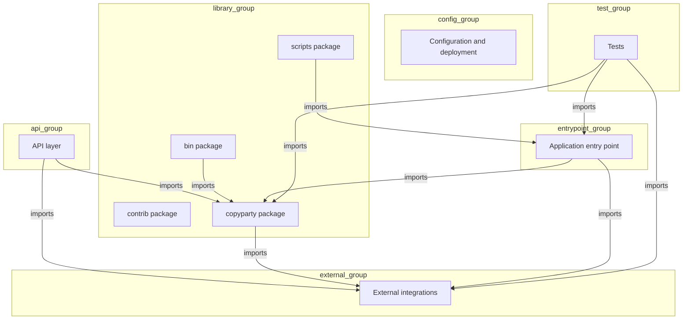

# Architecture report: 9001/copyparty

> Automated static analysis. **Observed** = directly seen in files/imports/AST; **Inferred** = interpretation from that evidence. Repository code was not executed.

## 1. Repository at a glance

| Item | Value |
| --- | --- |
| Repository | 9001/copyparty |
| Description | Portable file server with accelerated resumable uploads, dedup, WebDAV, SFTP, FTP, TFTP, zeroconf, media indexer, thumbnails++ all in one file |
| Language | Python |
| Stars | 47360 |
| Licence | MIT |
| Analysed commit / branch | 1af7efeca858dcfa29f797d7ae93f22eb2fdecf0 / hovudstraum |
| Framework(s) | None detected |
| Files analysed | 469 |
| Components | 9 |

## 2. Architecture in one minute

9001/copyparty - Portable file server with accelerated resumable uploads, dedup, WebDAV, SFTP, FTP, TFTP, zeroconf, media indexer, thumbnails++ all in one file. This repository was analysed statically from 469 file(s) (156 Python). Detected technologies (observed from imports/manifests): PostgreSQL, Redis, SQLite, NumPy, requests, Poetry. Files are grouped into 9 component(s): API layer, bin package, Configuration and deployment, contrib package, copyparty package, Application entry point, External integrations, scripts package. Observed entry point(s): bin/dbtool.py, bin/hooks/discord-announce.py, bin/hooks/image-noexif.py. Findings below distinguish observed facts from inferred interpretation.

## 3. High-level block diagram

## 4. Main components

### API layer (`api_layer`)

- **Kind:** api
- **Status:** Observed
- **Confidence:** 0.85
- **Responsibility:** Groups 8 file(s) under api layer (observed from repository paths and static analysis). Observed top-level functions: main, say_no, send_errorpage_with_redirect_link, send_http_301_permanent_redirect, send_http_302_temporary_redirect.
- **Paths:** `bin/handlers/404-to-fail2ban.py`, `bin/handlers/caching-proxy.py`, `bin/handlers/ip-ok.py`, `bin/handlers/never404.py`, `bin/handlers/nooo.py`, `bin/handlers/randpic.py`, `bin/handlers/redirect.py`, `bin/handlers/sorry.py`
- **Evidence:** [bin/handlers/404-to-fail2ban.py:17](https://github.com/9001/copyparty/blob/1af7efeca858dcfa29f797d7ae93f22eb2fdecf0/bin/handlers/404-to-fail2ban.py#L17); [bin/handlers/caching-proxy.py:14](https://github.com/9001/copyparty/blob/1af7efeca858dcfa29f797d7ae93f22eb2fdecf0/bin/handlers/caching-proxy.py#L14); [bin/handlers/ip-ok.py:4](https://github.com/9001/copyparty/blob/1af7efeca858dcfa29f797d7ae93f22eb2fdecf0/bin/handlers/ip-ok.py#L4); [bin/handlers/never404.py:4](https://github.com/9001/copyparty/blob/1af7efeca858dcfa29f797d7ae93f22eb2fdecf0/bin/handlers/never404.py#L4); [bin/handlers/nooo.py:4](https://github.com/9001/copyparty/blob/1af7efeca858dcfa29f797d7ae93f22eb2fdecf0/bin/handlers/nooo.py#L4); [bin/handlers/randpic.py:12](https://github.com/9001/copyparty/blob/1af7efeca858dcfa29f797d7ae93f22eb2fdecf0/bin/handlers/randpic.py#L12); [bin/handlers/redirect.py:4](https://github.com/9001/copyparty/blob/1af7efeca858dcfa29f797d7ae93f22eb2fdecf0/bin/handlers/redirect.py#L4); [bin/handlers/sorry.py:4](https://github.com/9001/copyparty/blob/1af7efeca858dcfa29f797d7ae93f22eb2fdecf0/bin/handlers/sorry.py#L4)

### bin package (`bin`)

- **Kind:** library
- **Status:** Observed
- **Confidence:** 0.85
- **Responsibility:** Groups 20 file(s) under bin package (observed from repository paths and static analysis). Observed top-level classes: PE2, Wrapper. Observed top-level functions: create_gif, do_stuff, iterate, main, make_headers, open_post.
- **Paths:** `bin/bubbleparty.sh`, `bin/hooks/import-me.py`, `bin/hooks/reject-ramdisk.py`, `bin/hooks/reloc-by-wark-xau.py`, `bin/hooks/reloc-by-wark-xbu.py`, `bin/hooks/usb-eject.js`, `bin/hooks/wget-i.py`, `bin/mtag/exe.py`, `bin/mtag/file-ext.py`, `bin/mtag/install-deps.sh`, `bin/mtag/mousepad.py`, `bin/mtag/res/twitter-unmute.user.js`, `bin/mtag/res/yt-ipr.user.js`, `bin/mtag/sleep.py`, `bin/mtag/very-bad-idea.py`, `bin/prisonparty.sh`, `bin/thumbs/collabora.py`, `bin/thumbs/randomcolor.py`, `bin/up2k.sh`, `bin/zmq-recv.py`
- **Evidence:** [bin/bubbleparty.sh](https://github.com/9001/copyparty/blob/1af7efeca858dcfa29f797d7ae93f22eb2fdecf0/bin/bubbleparty.sh); [bin/hooks/import-me.py:41](https://github.com/9001/copyparty/blob/1af7efeca858dcfa29f797d7ae93f22eb2fdecf0/bin/hooks/import-me.py#L41); [bin/hooks/reject-ramdisk.py:52](https://github.com/9001/copyparty/blob/1af7efeca858dcfa29f797d7ae93f22eb2fdecf0/bin/hooks/reject-ramdisk.py#L52); [bin/hooks/reloc-by-wark-xau.py:42](https://github.com/9001/copyparty/blob/1af7efeca858dcfa29f797d7ae93f22eb2fdecf0/bin/hooks/reloc-by-wark-xau.py#L42); [bin/hooks/reloc-by-wark-xbu.py:41](https://github.com/9001/copyparty/blob/1af7efeca858dcfa29f797d7ae93f22eb2fdecf0/bin/hooks/reloc-by-wark-xbu.py#L41); [bin/hooks/usb-eject.js](https://github.com/9001/copyparty/blob/1af7efeca858dcfa29f797d7ae93f22eb2fdecf0/bin/hooks/usb-eject.js); [bin/hooks/wget-i.py:54](https://github.com/9001/copyparty/blob/1af7efeca858dcfa29f797d7ae93f22eb2fdecf0/bin/hooks/wget-i.py#L54); [bin/mtag/exe.py:14](https://github.com/9001/copyparty/blob/1af7efeca858dcfa29f797d7ae93f22eb2fdecf0/bin/mtag/exe.py#L14)

### Configuration and deployment (`config`)

- **Kind:** config
- **Status:** Observed
- **Confidence:** 0.85
- **Responsibility:** Groups 20 file(s) under configuration and deployment (observed from repository paths and static analysis). Observed top-level classes: clean2.
- **Paths:** `contrib/package/nix/copyparty/pin.json`, `contrib/package/nix/partftpy/pin.json`, `contrib/send-to-cpp.contextlet.json`, `contrib/traefik/copyparty.yaml`, `contrib/traefik/traefik-docker/copyparty.compose.yml`, `contrib/traefik/traefik-docker/traefik.compose.yml`, `pyproject.toml`, `scripts/deps-docker/Dockerfile`, `scripts/docker/Dockerfile.ac`, `scripts/docker/Dockerfile.dj`, `scripts/docker/Dockerfile.djd`, `scripts/docker/Dockerfile.djf`, `scripts/docker/Dockerfile.djff`, `scripts/docker/Dockerfile.dju`, `scripts/docker/Dockerfile.im`, `scripts/docker/Dockerfile.iv`, `scripts/docker/Dockerfile.min`, `scripts/docker/Dockerfile.min.pip`, `scripts/docker/base/Dockerfile.zlibng`, `setup.py`
- **Evidence:** [contrib/package/nix/copyparty/pin.json](https://github.com/9001/copyparty/blob/1af7efeca858dcfa29f797d7ae93f22eb2fdecf0/contrib/package/nix/copyparty/pin.json); [contrib/package/nix/partftpy/pin.json](https://github.com/9001/copyparty/blob/1af7efeca858dcfa29f797d7ae93f22eb2fdecf0/contrib/package/nix/partftpy/pin.json); [contrib/send-to-cpp.contextlet.json](https://github.com/9001/copyparty/blob/1af7efeca858dcfa29f797d7ae93f22eb2fdecf0/contrib/send-to-cpp.contextlet.json); [contrib/traefik/copyparty.yaml](https://github.com/9001/copyparty/blob/1af7efeca858dcfa29f797d7ae93f22eb2fdecf0/contrib/traefik/copyparty.yaml); [contrib/traefik/traefik-docker/copyparty.compose.yml](https://github.com/9001/copyparty/blob/1af7efeca858dcfa29f797d7ae93f22eb2fdecf0/contrib/traefik/traefik-docker/copyparty.compose.yml); [contrib/traefik/traefik-docker/traefik.compose.yml](https://github.com/9001/copyparty/blob/1af7efeca858dcfa29f797d7ae93f22eb2fdecf0/contrib/traefik/traefik-docker/traefik.compose.yml); [pyproject.toml](https://github.com/9001/copyparty/blob/1af7efeca858dcfa29f797d7ae93f22eb2fdecf0/pyproject.toml); [scripts/deps-docker/Dockerfile](https://github.com/9001/copyparty/blob/1af7efeca858dcfa29f797d7ae93f22eb2fdecf0/scripts/deps-docker/Dockerfile)

### contrib package (`contrib`)

- **Kind:** library
- **Status:** Observed
- **Confidence:** 0.85
- **Responsibility:** Groups 11 file(s) under contrib package (observed from repository paths and static analysis).
- **Paths:** `contrib/cfssl.sh`, `contrib/flameshot.sh`, `contrib/plugins/banner.js`, `contrib/plugins/graft-thumbs.js`, `contrib/plugins/meadup.js`, `contrib/plugins/minimal-up2k.js`, `contrib/plugins/quickmove.js`, `contrib/plugins/rave.js`, `contrib/plugins/up2k-hook-ytid.js`, `contrib/plugins/up2k-hooks.js`, `contrib/setup-ashell.sh`
- **Evidence:** [contrib/cfssl.sh](https://github.com/9001/copyparty/blob/1af7efeca858dcfa29f797d7ae93f22eb2fdecf0/contrib/cfssl.sh); [contrib/flameshot.sh](https://github.com/9001/copyparty/blob/1af7efeca858dcfa29f797d7ae93f22eb2fdecf0/contrib/flameshot.sh); [contrib/plugins/banner.js](https://github.com/9001/copyparty/blob/1af7efeca858dcfa29f797d7ae93f22eb2fdecf0/contrib/plugins/banner.js); [contrib/plugins/graft-thumbs.js](https://github.com/9001/copyparty/blob/1af7efeca858dcfa29f797d7ae93f22eb2fdecf0/contrib/plugins/graft-thumbs.js); [contrib/plugins/meadup.js](https://github.com/9001/copyparty/blob/1af7efeca858dcfa29f797d7ae93f22eb2fdecf0/contrib/plugins/meadup.js); [contrib/plugins/minimal-up2k.js](https://github.com/9001/copyparty/blob/1af7efeca858dcfa29f797d7ae93f22eb2fdecf0/contrib/plugins/minimal-up2k.js); [contrib/plugins/quickmove.js](https://github.com/9001/copyparty/blob/1af7efeca858dcfa29f797d7ae93f22eb2fdecf0/contrib/plugins/quickmove.js); [contrib/plugins/rave.js](https://github.com/9001/copyparty/blob/1af7efeca858dcfa29f797d7ae93f22eb2fdecf0/contrib/plugins/rave.js)

### copyparty package (`copyparty`)

- **Kind:** library
- **Status:** Observed
- **Confidence:** 0.85
- **Responsibility:** Groups 89 file(s) under copyparty package (observed from repository paths and static analysis). Observed top-level classes: A, AAAA, AXS, Adapter, AuthSrv, BadXML. Observed top-level functions: B, H, I, IP4, IP6, _add_mimes.
- **Paths:** `copyparty/__init__.py`, `copyparty/__version__.py`, `copyparty/authsrv.py`, `copyparty/bos/__init__.py`, `copyparty/bos/bos.py`, `copyparty/bos/path.py`, `copyparty/broker_mp.py`, `copyparty/broker_mpw.py`, `copyparty/broker_thr.py`, `copyparty/broker_util.py`, `copyparty/cert.py`, `copyparty/cfg.py`, `copyparty/dxml.py`, `copyparty/fsutil.py`, `copyparty/ftpd.py`, `copyparty/httpconn.py`, `copyparty/httpsrv.py`, `copyparty/ico.py`, `copyparty/mdns.py`, `copyparty/metrics.py`, `copyparty/mtag.py`, `copyparty/multicast.py`, `copyparty/pwhash.py`, `copyparty/qrkode.py`, `copyparty/res/__init__.py`, `copyparty/sftpd.py`, `copyparty/smbd.py`, `copyparty/ssdp.py`, `copyparty/star.py`, `copyparty/stolen/__init__.py`, `copyparty/stolen/dnslib/__init__.py`, `copyparty/stolen/dnslib/bimap.py`, `copyparty/stolen/dnslib/bit.py`, `copyparty/stolen/dnslib/buffer.py`, `copyparty/stolen/dnslib/dns.py`, `copyparty/stolen/dnslib/label.py`, `copyparty/stolen/dnslib/lex.py`, `copyparty/stolen/dnslib/ranges.py`, `copyparty/stolen/ifaddr/__init__.py`, `copyparty/stolen/ifaddr/_posix.py`, `copyparty/stolen/ifaddr/_shared.py`, `copyparty/stolen/ifaddr/_win32.py`, `copyparty/stolen/qrcodegen.py`, `copyparty/stolen/surrogateescape.py`, `copyparty/sutil.py`, `copyparty/svchub.py`, `copyparty/szip.py`, `copyparty/tcpsrv.py`, `copyparty/tftpd.py`, `copyparty/th_cli.py`, `copyparty/th_srv.py`, `copyparty/u2idx.py`, `copyparty/util.py`, `copyparty/web/a/__init__.py`, `copyparty/web/baguettebox.js`, `copyparty/web/dbg-audio.js`, `copyparty/web/deps/__init__.py`, `copyparty/web/md.js`, `copyparty/web/md2.js`, `copyparty/web/mde.js`, `copyparty/web/rups.js`, `copyparty/web/shares.js`, `copyparty/web/splash.js`, `copyparty/web/svcs.js`, `copyparty/web/tl/chi.js`, `copyparty/web/tl/cze.js`, `copyparty/web/tl/deu.js`, `copyparty/web/tl/epo.js`, `copyparty/web/tl/fin.js`, `copyparty/web/tl/fra.js`, `copyparty/web/tl/grc.js`, `copyparty/web/tl/hun.js`, `copyparty/web/tl/ita.js`, `copyparty/web/tl/jpn.js`, `copyparty/web/tl/kor.js`, `copyparty/web/tl/nld.js`, `copyparty/web/tl/nno.js`, `copyparty/web/tl/nor.js`, `copyparty/web/tl/pol.js`, `copyparty/web/tl/por.js`, `copyparty/web/tl/rus.js`, `copyparty/web/tl/spa.js`, `copyparty/web/tl/swe.js`, `copyparty/web/tl/tur.js`, `copyparty/web/tl/ukr.js`, `copyparty/web/tl/vie.js`, `copyparty/web/up2k.js`, `copyparty/web/util.js`, `copyparty/web/w.hash.js`
- **Evidence:** [copyparty/__init__.py:151](https://github.com/9001/copyparty/blob/1af7efeca858dcfa29f797d7ae93f22eb2fdecf0/copyparty/__init__.py#L151); [copyparty/__version__.py](https://github.com/9001/copyparty/blob/1af7efeca858dcfa29f797d7ae93f22eb2fdecf0/copyparty/__version__.py); [copyparty/authsrv.py:120](https://github.com/9001/copyparty/blob/1af7efeca858dcfa29f797d7ae93f22eb2fdecf0/copyparty/authsrv.py#L120); [copyparty/bos/__init__.py](https://github.com/9001/copyparty/blob/1af7efeca858dcfa29f797d7ae93f22eb2fdecf0/copyparty/bos/__init__.py); [copyparty/bos/bos.py:26](https://github.com/9001/copyparty/blob/1af7efeca858dcfa29f797d7ae93f22eb2fdecf0/copyparty/bos/bos.py#L26); [copyparty/bos/path.py:9](https://github.com/9001/copyparty/blob/1af7efeca858dcfa29f797d7ae93f22eb2fdecf0/copyparty/bos/path.py#L9); [copyparty/broker_mp.py:22](https://github.com/9001/copyparty/blob/1af7efeca858dcfa29f797d7ae93f22eb2fdecf0/copyparty/broker_mp.py#L22); [copyparty/broker_mpw.py:25](https://github.com/9001/copyparty/blob/1af7efeca858dcfa29f797d7ae93f22eb2fdecf0/copyparty/broker_mpw.py#L25)

### Application entry point (`entrypoint`)

- **Kind:** entrypoint
- **Status:** Observed
- **Confidence:** 0.85
- **Responsibility:** Groups 51 file(s) under application entry point (observed from repository paths and static analysis). Observed top-level classes: APF, BasicDodge11874, CPPF, CTermsize, CacheNode, Ctl. Observed top-level functions: _lsd, _scd, add_admin, add_auth, add_cert, add_chpw.
- **Paths:** `bin/dbtool.py`, `bin/hooks/discord-announce.py`, `bin/hooks/image-noexif.py`, `bin/hooks/into-the-cache-it-goes.py`, `bin/hooks/msg-log.py`, `bin/hooks/notify.py`, `bin/hooks/notify2.py`, `bin/hooks/phonecam-sorter.py`, `bin/hooks/podcast-normalizer.py`, `bin/hooks/qbittorrent-magnet.py`, `bin/hooks/reject-and-explain.py`, `bin/hooks/reject-extension.py`, `bin/hooks/reject-mimetype.py`, `bin/hooks/reloc-by-ext.py`, `bin/hooks/usb-eject.py`, `bin/hooks/wget.py`, `bin/hooks/xiu-sha.py`, `bin/hooks/xiu.py`, `bin/mtag/audio-bpm.py`, `bin/mtag/audio-key-slicing.py`, `bin/mtag/audio-key.py`, `bin/mtag/cksum.py`, `bin/mtag/geotag.py`, `bin/mtag/guestbook-read.py`, `bin/mtag/guestbook.py`, `bin/mtag/image-noexif.py`, `bin/mtag/media-hash.py`, `bin/mtag/rclone-upload.py`, `bin/mtag/vidchk.py`, `bin/mtag/wget.py`, `bin/mtag/yt-ipr.py`, `bin/partyfuse-streaming.py`, `bin/partyfuse.py`, `bin/partyfuse2.py`, `bin/partyjournal.py`, `bin/u2c.py`, `bin/unforget.py`, `contrib/package/nix/copyparty/update.py`, `contrib/package/nix/partftpy/update.py`, `contrib/zfs-tune.py`, `copyparty/__main__.py`, `scripts/deps-docker/genprism.py`, `scripts/deps-docker/shiftbase.py`, `scripts/fusefuzz.py`, `scripts/help2html.py`, `scripts/sfx.py`, `scripts/speedtest-fs.py`, `scripts/strip_hints/a.py`, `scripts/tl.py`, `scripts/uncomment.py`, `scripts/ziploader.py`
- **Evidence:** [bin/dbtool.py:17](https://github.com/9001/copyparty/blob/1af7efeca858dcfa29f797d7ae93f22eb2fdecf0/bin/dbtool.py#L17); [bin/hooks/discord-announce.py:46](https://github.com/9001/copyparty/blob/1af7efeca858dcfa29f797d7ae93f22eb2fdecf0/bin/hooks/discord-announce.py#L46); [bin/hooks/image-noexif.py:45](https://github.com/9001/copyparty/blob/1af7efeca858dcfa29f797d7ae93f22eb2fdecf0/bin/hooks/image-noexif.py#L45); [bin/hooks/into-the-cache-it-goes.py:79](https://github.com/9001/copyparty/blob/1af7efeca858dcfa29f797d7ae93f22eb2fdecf0/bin/hooks/into-the-cache-it-goes.py#L79); [bin/hooks/msg-log.py:69](https://github.com/9001/copyparty/blob/1af7efeca858dcfa29f797d7ae93f22eb2fdecf0/bin/hooks/msg-log.py#L69); [bin/hooks/notify.py:41](https://github.com/9001/copyparty/blob/1af7efeca858dcfa29f797d7ae93f22eb2fdecf0/bin/hooks/notify.py#L41); [bin/hooks/notify2.py:41](https://github.com/9001/copyparty/blob/1af7efeca858dcfa29f797d7ae93f22eb2fdecf0/bin/hooks/notify2.py#L41); [bin/hooks/phonecam-sorter.py:58](https://github.com/9001/copyparty/blob/1af7efeca858dcfa29f797d7ae93f22eb2fdecf0/bin/hooks/phonecam-sorter.py#L58)

### External integrations (`external_integrations`)

- **Kind:** external
- **Status:** Inferred
- **Confidence:** 0.70
- **Responsibility:** Groups 0 file(s) under external integrations (observed from repository paths and static analysis).
- **Evidence:** [bin/dbtool.py:7](https://github.com/9001/copyparty/blob/1af7efeca858dcfa29f797d7ae93f22eb2fdecf0/bin/dbtool.py#L7); [bin/handlers/caching-proxy.py:6](https://github.com/9001/copyparty/blob/1af7efeca858dcfa29f797d7ae93f22eb2fdecf0/bin/handlers/caching-proxy.py#L6); [bin/hooks/discord-announce.py:5](https://github.com/9001/copyparty/blob/1af7efeca858dcfa29f797d7ae93f22eb2fdecf0/bin/hooks/discord-announce.py#L5); [bin/hooks/into-the-cache-it-goes.py:127](https://github.com/9001/copyparty/blob/1af7efeca858dcfa29f797d7ae93f22eb2fdecf0/bin/hooks/into-the-cache-it-goes.py#L127); [bin/mtag/guestbook-read.py:28](https://github.com/9001/copyparty/blob/1af7efeca858dcfa29f797d7ae93f22eb2fdecf0/bin/mtag/guestbook-read.py#L28); [bin/mtag/guestbook.py:32](https://github.com/9001/copyparty/blob/1af7efeca858dcfa29f797d7ae93f22eb2fdecf0/bin/mtag/guestbook.py#L32)

### scripts package (`scripts`)

- **Kind:** library
- **Status:** Observed
- **Confidence:** 0.85
- **Responsibility:** Groups 41 file(s) under scripts package (observed from repository paths and static analysis). Observed top-level functions: ckck, confirm, meichk, meicln.
- **Paths:** `scripts/bench/filehash.sh`, `scripts/copyparty-android.sh`, `scripts/deps-docker/busy-mp3.sh`, `scripts/deps-docker/genprism.sh`, `scripts/deps-docker/mini-fa.sh`, `scripts/docker/base/arbeidspakke.sh`, `scripts/docker/base/build-no265.sh`, `scripts/docker/base/patch/ffmpeg/libavcodec/aacps.c`, `scripts/docker/base/patch/ffmpeg/libavcodec/aacsbr.c`, `scripts/docker/base/patch/ffmpeg/libavcodec/aacsbr_fixed.c`, `scripts/docker/base/patch/ffmpeg/libavcodec/aacsbrdata.h`, `scripts/docker/base/verchk.sh`, `scripts/docker/innvikler.sh`, `scripts/docker/make.sh`, `scripts/genhelp.sh`, `scripts/genlic.py`, `scripts/help2txt.sh`, `scripts/install-githooks.sh`, `scripts/lics/rot.py`, `scripts/logpack.sh`, `scripts/make-pypi-release.sh`, `scripts/make-pyz.sh`, `scripts/make-rpm.sh`, `scripts/make-sfx.sh`, `scripts/make-tgz-release.sh`, `scripts/prep.sh`, `scripts/profile.py`, `scripts/py2/queue/__init__.py`, `scripts/pyinstaller/build.sh`, `scripts/pyinstaller/depchk.sh`, `scripts/pyinstaller/icon.sh`, `scripts/pyinstaller/loader.py`, `scripts/pyinstaller/up2k.sh`, `scripts/pyinstaller/up2k.spec.sh`, `scripts/rls.sh`, `scripts/run-tests.sh`, `scripts/sfx.sh`, `scripts/tl.js`, `scripts/tl/1.sh`, `scripts/tlcheck.sh`, `scripts/toc.sh`
- **Evidence:** [scripts/bench/filehash.sh](https://github.com/9001/copyparty/blob/1af7efeca858dcfa29f797d7ae93f22eb2fdecf0/scripts/bench/filehash.sh); [scripts/copyparty-android.sh](https://github.com/9001/copyparty/blob/1af7efeca858dcfa29f797d7ae93f22eb2fdecf0/scripts/copyparty-android.sh); [scripts/deps-docker/busy-mp3.sh](https://github.com/9001/copyparty/blob/1af7efeca858dcfa29f797d7ae93f22eb2fdecf0/scripts/deps-docker/busy-mp3.sh); [scripts/deps-docker/genprism.sh](https://github.com/9001/copyparty/blob/1af7efeca858dcfa29f797d7ae93f22eb2fdecf0/scripts/deps-docker/genprism.sh); [scripts/deps-docker/mini-fa.sh](https://github.com/9001/copyparty/blob/1af7efeca858dcfa29f797d7ae93f22eb2fdecf0/scripts/deps-docker/mini-fa.sh); [scripts/docker/base/arbeidspakke.sh](https://github.com/9001/copyparty/blob/1af7efeca858dcfa29f797d7ae93f22eb2fdecf0/scripts/docker/base/arbeidspakke.sh); [scripts/docker/base/build-no265.sh](https://github.com/9001/copyparty/blob/1af7efeca858dcfa29f797d7ae93f22eb2fdecf0/scripts/docker/base/build-no265.sh); [scripts/docker/base/patch/ffmpeg/libavcodec/aacps.c](https://github.com/9001/copyparty/blob/1af7efeca858dcfa29f797d7ae93f22eb2fdecf0/scripts/docker/base/patch/ffmpeg/libavcodec/aacps.c)

### Tests (`tests`)

- **Kind:** test
- **Status:** Observed
- **Confidence:** 0.85
- **Responsibility:** Groups 30 file(s) under tests (observed from repository paths and static analysis). Observed top-level classes: CState, Cfg, Conn, Cpp, NullBroker, TC. Observed top-level functions: _parse, allget, chkcmd, curl, eprint, genlen.
- **Paths:** `scripts/test/ptrav.py`, `scripts/test/race.py`, `scripts/test/redup.sh`, `scripts/test/smoketest.py`, `scripts/test/tftp.sh`, `tests/__init__.py`, `tests/ptrav.py`, `tests/res/idp/1.conf`, `tests/res/idp/2.conf`, `tests/res/idp/3.conf`, `tests/res/idp/4.conf`, `tests/res/idp/5.conf`, `tests/res/idp/6.conf`, `tests/res/idp/7.conf`, `tests/res/idp/8.conf`, `tests/run.py`, `tests/test_cp.py`, `tests/test_dedup.py`, `tests/test_dots.py`, `tests/test_dxml.py`, `tests/test_hooks.py`, `tests/test_httpcli.py`, `tests/test_idp.py`, `tests/test_metrics.py`, `tests/test_mv.py`, `tests/test_shr.py`, `tests/test_utils.py`, `tests/test_vfs.py`, `tests/test_webdav.py`, `tests/util.py`
- **Evidence:** [scripts/test/ptrav.py:12](https://github.com/9001/copyparty/blob/1af7efeca858dcfa29f797d7ae93f22eb2fdecf0/scripts/test/ptrav.py#L12); [scripts/test/race.py:11](https://github.com/9001/copyparty/blob/1af7efeca858dcfa29f797d7ae93f22eb2fdecf0/scripts/test/race.py#L11); [scripts/test/redup.sh](https://github.com/9001/copyparty/blob/1af7efeca858dcfa29f797d7ae93f22eb2fdecf0/scripts/test/redup.sh); [scripts/test/smoketest.py:16](https://github.com/9001/copyparty/blob/1af7efeca858dcfa29f797d7ae93f22eb2fdecf0/scripts/test/smoketest.py#L16); [scripts/test/tftp.sh](https://github.com/9001/copyparty/blob/1af7efeca858dcfa29f797d7ae93f22eb2fdecf0/scripts/test/tftp.sh); [tests/__init__.py](https://github.com/9001/copyparty/blob/1af7efeca858dcfa29f797d7ae93f22eb2fdecf0/tests/__init__.py); [tests/ptrav.py:17](https://github.com/9001/copyparty/blob/1af7efeca858dcfa29f797d7ae93f22eb2fdecf0/tests/ptrav.py#L17); [tests/res/idp/1.conf](https://github.com/9001/copyparty/blob/1af7efeca858dcfa29f797d7ae93f22eb2fdecf0/tests/res/idp/1.conf)

## 5. Execution flow

**Observed** entry point(s):

- [bin/dbtool.py:304](https://github.com/9001/copyparty/blob/1af7efeca858dcfa29f797d7ae93f22eb2fdecf0/bin/dbtool.py#L304)
- [bin/hooks/discord-announce.py:76](https://github.com/9001/copyparty/blob/1af7efeca858dcfa29f797d7ae93f22eb2fdecf0/bin/hooks/discord-announce.py#L76)
- [bin/hooks/image-noexif.py:68](https://github.com/9001/copyparty/blob/1af7efeca858dcfa29f797d7ae93f22eb2fdecf0/bin/hooks/image-noexif.py#L68)
- [bin/hooks/into-the-cache-it-goes.py:139](https://github.com/9001/copyparty/blob/1af7efeca858dcfa29f797d7ae93f22eb2fdecf0/bin/hooks/into-the-cache-it-goes.py#L139)
- [bin/hooks/msg-log.py:135](https://github.com/9001/copyparty/blob/1af7efeca858dcfa29f797d7ae93f22eb2fdecf0/bin/hooks/msg-log.py#L135)
- [bin/hooks/notify.py:65](https://github.com/9001/copyparty/blob/1af7efeca858dcfa29f797d7ae93f22eb2fdecf0/bin/hooks/notify.py#L65)
- [bin/hooks/notify2.py:72](https://github.com/9001/copyparty/blob/1af7efeca858dcfa29f797d7ae93f22eb2fdecf0/bin/hooks/notify2.py#L72)
- [bin/hooks/phonecam-sorter.py:84](https://github.com/9001/copyparty/blob/1af7efeca858dcfa29f797d7ae93f22eb2fdecf0/bin/hooks/phonecam-sorter.py#L84)
- [bin/hooks/podcast-normalizer.py:117](https://github.com/9001/copyparty/blob/1af7efeca858dcfa29f797d7ae93f22eb2fdecf0/bin/hooks/podcast-normalizer.py#L117)
- [bin/hooks/qbittorrent-magnet.py:126](https://github.com/9001/copyparty/blob/1af7efeca858dcfa29f797d7ae93f22eb2fdecf0/bin/hooks/qbittorrent-magnet.py#L126)
- [bin/hooks/reject-and-explain.py:59](https://github.com/9001/copyparty/blob/1af7efeca858dcfa29f797d7ae93f22eb2fdecf0/bin/hooks/reject-and-explain.py#L59)
- [bin/hooks/reject-extension.py:34](https://github.com/9001/copyparty/blob/1af7efeca858dcfa29f797d7ae93f22eb2fdecf0/bin/hooks/reject-extension.py#L34)

Representative flow (derived from observed entry points and the import graph; steps beyond the entry point are **Inferred**):

1. Execution starts at an observed entry point listed above, if present.
2. `api_layer` imports `copyparty` (API layer -> copyparty package).
3. `api_layer` imports `external_integrations` (API layer -> External integrations).
4. `bin` imports `copyparty` (bin package -> copyparty package).
5. `copyparty` imports `external_integrations` (copyparty package -> External integrations).
6. `entrypoint` imports `copyparty` (Application entry point -> copyparty package).
7. `entrypoint` imports `external_integrations` (Application entry point -> External integrations).
8. `scripts` imports `entrypoint` (scripts package -> Application entry point).
9. `tests` imports `copyparty` (Tests -> copyparty package).

## 6. Project structure

### `(root)`

- `.eslintrc.json` - config (186 bytes)
- `.gitattributes` - other (87 bytes)
- `.gitignore` - other (658 bytes)
- `CODE_OF_CONDUCT.md` - docs (942 bytes)
- `CONTRIBUTING.md` - docs (4613 bytes)
- `LICENSE` - docs (1072 bytes)
- `SECURITY.md` - docs (350 bytes)
- `flake.lock` - other (996 bytes)
- `flake.nix` - other (1185 bytes)
- `pyproject.toml` - manifest (4495 bytes)
- `setup.py` - manifest, Python (5025 bytes)

### `.github`

- `.github/ISSUE_TEMPLATE/bug_report.md` - docs (2167 bytes)
- `.github/ISSUE_TEMPLATE/feature_request.md` - docs (792 bytes)
- `.github/ISSUE_TEMPLATE/something-else.md` - docs (94 bytes)
- `.github/branch-rename.md` - docs (186 bytes)
- `.github/pull_request_template.md` - docs (204 bytes)

### `.vscode`

- `.vscode/launch.json` - config (2083 bytes)
- `.vscode/launch.py` - source, Python (1227 bytes)
- `.vscode/settings.json` - config (1811 bytes)
- `.vscode/tasks.json` - config (429 bytes)

### `bin`

- `bin/README.md` - docs (3772 bytes)
- `bin/bubbleparty.sh` - source, Shell (468 bytes)
- `bin/dbtool.py` - source, Python (8681 bytes)
- `bin/handlers/404-to-fail2ban.py` - source, Python (1127 bytes)
- `bin/handlers/README.md` - docs (1512 bytes)
- `bin/handlers/caching-proxy.py` - source, Python (1193 bytes)
- `bin/handlers/ip-ok.py` - source, Python (146 bytes)
- `bin/handlers/never404.py` - source, Python (233 bytes)
- `bin/handlers/nooo.py` - source, Python (282 bytes)
- `bin/handlers/randpic.py` - source, Python (986 bytes)
- `bin/handlers/redirect.py` - source, Python (1910 bytes)
- `bin/handlers/sorry.py` - source, Python (202 bytes)
- `bin/hooks/README.md` - docs (4339 bytes)
- `bin/hooks/discord-announce.py` - source, Python (2240 bytes)
- `bin/hooks/image-noexif.py` - source, Python (1697 bytes)
- `bin/hooks/import-me.py` - source, Python (1718 bytes)
- `bin/hooks/into-the-cache-it-goes.py` - source, Python (3561 bytes)
- `bin/hooks/msg-log.py` - source, Python (3896 bytes)
- `bin/hooks/notify.py` - source, Python (1561 bytes)
- `bin/hooks/notify2.py` - source, Python (1870 bytes)
- `bin/hooks/phonecam-sorter.py` - source, Python (2668 bytes)
- `bin/hooks/podcast-normalizer.py` - source, Python (3418 bytes)
- `bin/hooks/qbittorrent-magnet.py` - source, Python (3821 bytes)
- `bin/hooks/reject-and-explain.py` - source, Python (1794 bytes)
- `bin/hooks/reject-extension.py` - source, Python (801 bytes)
- `bin/hooks/reject-mimetype.py` - source, Python (977 bytes)
- `bin/hooks/reject-ramdisk.py` - source, Python (2141 bytes)
- `bin/hooks/reloc-by-ext.py` - source, Python (3974 bytes)
- `bin/hooks/reloc-by-wark-xau.py` - source, Python (2851 bytes)
- `bin/hooks/reloc-by-wark-xbu.py` - source, Python (1978 bytes)
- `bin/hooks/usb-eject.js` - source, JavaScript (1746 bytes)
- `bin/hooks/usb-eject.py` - source, Python (2017 bytes)
- `bin/hooks/wget-i.py` - source, Python (3046 bytes)
- `bin/hooks/wget.py` - source, Python (2066 bytes)
- `bin/hooks/xiu-sha.py` - source, Python (2943 bytes)
- `bin/hooks/xiu.py` - source, Python (1256 bytes)
- `bin/mtag/README.md` - docs (3784 bytes)
- `bin/mtag/audio-bpm.py` - source, Python (2033 bytes)
- `bin/mtag/audio-key-slicing.py` - source, Python (2411 bytes)
- `bin/mtag/audio-key.py` - source, Python (1240 bytes)
- `bin/mtag/cksum.py` - source, Python (1983 bytes)
- `bin/mtag/exe.py` - source, Python (2103 bytes)
- `bin/mtag/file-ext.py` - source, Python (122 bytes)
- `bin/mtag/geotag.py` - source, Python (1335 bytes)
- `bin/mtag/guestbook-read.py` - source, Python (1609 bytes)
- `bin/mtag/guestbook.py` - source, Python (3060 bytes)
- `bin/mtag/image-noexif.py` - source, Python (2602 bytes)
- `bin/mtag/install-deps.sh` - source, Shell (8797 bytes)
- `bin/mtag/media-hash.py` - source, Python (1306 bytes)
- `bin/mtag/mousepad.py` - source, Python (704 bytes)
- `bin/mtag/rclone-upload.py` - source, Python (1810 bytes)
- `bin/mtag/res/twitter-unmute.user.js` - source, JavaScript (688 bytes)
- `bin/mtag/res/yt-ipr.conf` - other (1350 bytes)
- `bin/mtag/res/yt-ipr.user.js` - source, JavaScript (1440 bytes)
- `bin/mtag/sleep.py` - source, Python (106 bytes)
- `bin/mtag/very-bad-idea.py` - source, Python (6270 bytes)
- `bin/mtag/vidchk.py` - source, Python (3456 bytes)
- `bin/mtag/wget.py` - source, Python (2421 bytes)
- `bin/mtag/yt-ipr.py` - source, Python (5515 bytes)
- `bin/partyfuse-streaming.py` - source, Python (33878 bytes)
- `bin/partyfuse.py` - source, Python (38063 bytes)
- `bin/partyfuse2.py` - source, Python (18528 bytes)
- `bin/partyjournal.py` - source, Python (4136 bytes)
- `bin/prisonparty.sh` - source, Shell (4311 bytes)
- `bin/thumbs/README.md` - docs (3131 bytes)
- `bin/thumbs/collabora.py` - source, Python (3750 bytes)
- `bin/thumbs/randomcolor.py` - source, Python (931 bytes)
- `bin/u2c.py` - source, Python (55860 bytes)
- `bin/unforget.py` - source, Python (3009 bytes)
- `bin/up2k.sh` - source, Shell (4393 bytes)
- `bin/zmq-recv.py` - source, Python (2354 bytes)

### `contrib`

- `contrib/README.md` - docs (4166 bytes)
- `contrib/apache/copyparty.conf` - other (873 bytes)
- `contrib/cfssl.sh` - source, Shell (2171 bytes)
- `contrib/copyparty.bat` - other (592 bytes)
- `contrib/explorer-nothumbs-nofoldertypes.reg` - other (1108 bytes)
- `contrib/flameshot.sh` - source, Shell (289 bytes)
- `contrib/haproxy/copyparty.conf` - other (814 bytes)
- `contrib/index.html` - other (862 bytes)
- `contrib/ishare.iscu` - other (220 bytes)
- `contrib/lighttpd/subdomain.conf` - other (924 bytes)
- `contrib/lighttpd/subpath.conf` - other (1111 bytes)
- `contrib/media-osd-bgone.ps1` - other (3102 bytes)
- `contrib/nginx/copyparty.conf` - other (3574 bytes)
- `contrib/nixos/modules/copyparty.nix` - other (13218 bytes)
- `contrib/openrc/copyparty` - other (752 bytes)
- `contrib/package/arch/PKGBUILD` - other (2402 bytes)
- `contrib/package/arch/copyparty.install` - other (1076 bytes)
- `contrib/package/makedeb-mpr/PKGBUILD` - other (1996 bytes)
- `contrib/package/makedeb-mpr/copyparty.conf` - other (304 bytes)
- `contrib/package/makedeb-mpr/copyparty.service` - other (999 bytes)
- `contrib/package/makedeb-mpr/index.md` - docs (727 bytes)
- `contrib/package/makedeb-mpr/prisonparty.service` - other (1128 bytes)
- `contrib/package/nix/copyparty/default.nix` - other (5352 bytes)
- `contrib/package/nix/copyparty/pin.json` - config (195 bytes)
- `contrib/package/nix/copyparty/update.py` - source, Python (2309 bytes)
- `contrib/package/nix/overlay.nix` - other (842 bytes)
- `contrib/package/nix/partftpy/default.nix` - other (590 bytes)
- `contrib/package/nix/partftpy/pin.json` - config (187 bytes)
- `contrib/package/nix/partftpy/update.py` - source, Python (1263 bytes)
- `contrib/package/rpm/copyparty.spec` - other (2450 bytes)
- `contrib/plugins/README.md` - docs (1553 bytes)
- `contrib/plugins/banner.js` - source, JavaScript (3680 bytes)
- `contrib/plugins/browser-icons.css` - other (1126 bytes)
- `contrib/plugins/graft-thumbs.js` - source, JavaScript (3415 bytes)
- `contrib/plugins/meadup.js` - source, JavaScript (14162 bytes)
- `contrib/plugins/minimal-up2k.html` - other (1425 bytes)
- `contrib/plugins/minimal-up2k.js` - source, JavaScript (1917 bytes)
- `contrib/plugins/quickmove.js` - source, JavaScript (4646 bytes)
- `contrib/plugins/rave.js` - source, JavaScript (5241 bytes)
- `contrib/plugins/up2k-hook-ytid.js` - source, JavaScript (11190 bytes)
- `contrib/plugins/up2k-hooks.js` - source, JavaScript (1397 bytes)
- `contrib/podman-systemd/README.md` - docs (6474 bytes)
- `contrib/podman-systemd/copyparty.conf` - other (2208 bytes)
- `contrib/podman-systemd/copyparty.container` - other (1500 bytes)
- `contrib/rc/copyparty` - other (751 bytes)
- `contrib/send-to-cpp.contextlet.json` - config (616 bytes)
- `contrib/setup-ashell.sh` - source, Shell (2015 bytes)
- `contrib/sharex.sxcu` - other (388 bytes)
- `contrib/sharex12.sxcu` - other (287 bytes)
- `contrib/systemd/cfssl.service` - other (820 bytes)
- `contrib/systemd/copyparty-user.service` - other (835 bytes)
- `contrib/systemd/copyparty.conf` - other (633 bytes)
- `contrib/systemd/copyparty.example.conf` - other (2267 bytes)
- `contrib/systemd/copyparty.service` - other (3660 bytes)
- `contrib/systemd/copyparty@.service` - other (823 bytes)
- `contrib/systemd/index.md` - docs (727 bytes)
- `contrib/systemd/prisonparty.service` - other (1424 bytes)
- `contrib/systemd/prisonparty@.service` - other (1161 bytes)
- `contrib/themes/bsod.css` - other (2090 bytes)
- `contrib/traefik/copyparty.yaml` - config (511 bytes)
- `contrib/traefik/traefik-docker/copyparty.compose.yml` - config (1217 bytes)
- `contrib/traefik/traefik-docker/copyparty.conf` - other (1864 bytes)
- `contrib/traefik/traefik-docker/traefik.compose.yml` - config (1565 bytes)
- `contrib/webdav-cfg.bat` - other (1449 bytes)
- `contrib/windows/copyparty-ctmp.bat` - other (110 bytes)
- `contrib/zfs-tune.py` - source, Python (3294 bytes)

### `copyparty`

- `copyparty/__init__.py` - source, Python (3516 bytes)
- `copyparty/__main__.py` - source, Python (187844 bytes)
- `copyparty/__version__.py` - source, Python (260 bytes)
- `copyparty/authsrv.py` - source, Python (159450 bytes)
- `copyparty/bos/__init__.py` - source, Python (0 bytes)
- `copyparty/bos/bos.py` - source, Python (3841 bytes)
- `copyparty/bos/path.py` - source, Python (880 bytes)
- `copyparty/broker_mp.py` - source, Python (5646 bytes)
- `copyparty/broker_mpw.py` - source, Python (3892 bytes)
- `copyparty/broker_thr.py` - source, Python (1915 bytes)
- `copyparty/broker_util.py` - source, Python (1984 bytes)
- `copyparty/cert.py` - source, Python (8929 bytes)
- `copyparty/cfg.py` - source, Python (21060 bytes)
- `copyparty/dxml.py` - source, Python (2836 bytes)
- `copyparty/fsutil.py` - source, Python (9219 bytes)
- `copyparty/ftpd.py` - source, Python (21747 bytes)
- `copyparty/httpconn.py` - source, Python (7799 bytes)
- `copyparty/httpsrv.py` - source, Python (23112 bytes)
- `copyparty/ico.py` - source, Python (3946 bytes)
- `copyparty/mdns.py` - source, Python (19862 bytes)
- `copyparty/metrics.py` - source, Python (9198 bytes)
- `copyparty/mtag.py` - source, Python (26914 bytes)
- `copyparty/multicast.py` - source, Python (12886 bytes)
- `copyparty/pwhash.py` - source, Python (4518 bytes)
- `copyparty/qrkode.py` - source, Python (3004 bytes)
- `copyparty/res/__init__.py` - source, Python (0 bytes)
- `copyparty/sftpd.py` - source, Python (31483 bytes)
- `copyparty/smbd.py` - source, Python (15455 bytes)
- `copyparty/ssdp.py` - source, Python (7317 bytes)
- `copyparty/star.py` - source, Python (4167 bytes)
- `copyparty/stolen/__init__.py` - source, Python (0 bytes)
- `copyparty/stolen/dnslib/README.md` - docs (133 bytes)
- `copyparty/stolen/dnslib/__init__.py` - source, Python (159 bytes)
- `copyparty/stolen/dnslib/bimap.py` - source, Python (1182 bytes)
- `copyparty/stolen/dnslib/bit.py` - source, Python (348 bytes)
- `copyparty/stolen/dnslib/buffer.py` - source, Python (1407 bytes)
- `copyparty/stolen/dnslib/dns.py` - source, Python (21181 bytes)
- `copyparty/stolen/dnslib/label.py` - source, Python (5536 bytes)
- `copyparty/stolen/dnslib/lex.py` - source, Python (2615 bytes)
- `copyparty/stolen/dnslib/ranges.py` - source, Python (1810 bytes)
- `copyparty/stolen/ifaddr/README.md` - docs (215 bytes)
- `copyparty/stolen/ifaddr/__init__.py` - source, Python (1101 bytes)
- `copyparty/stolen/ifaddr/_posix.py` - source, Python (2778 bytes)
- `copyparty/stolen/ifaddr/_shared.py` - source, Python (6793 bytes)
- `copyparty/stolen/ifaddr/_win32.py` - source, Python (4375 bytes)
- `copyparty/stolen/qrcodegen.py` - source, Python (21791 bytes)
- `copyparty/stolen/surrogateescape.py` - source, Python (5718 bytes)
- `copyparty/sutil.py` - source, Python (5845 bytes)
- `copyparty/svchub.py` - source, Python (71391 bytes)
- `copyparty/szip.py` - source, Python (9431 bytes)
- `copyparty/tcpsrv.py` - source, Python (22675 bytes)
- `copyparty/tftpd.py` - source, Python (15207 bytes)
- `copyparty/th_cli.py` - source, Python (6096 bytes)
- `copyparty/th_srv.py` - source, Python (52888 bytes)
- `copyparty/u2idx.py` - source, Python (16187 bytes)
- `copyparty/util.py` - source, Python (132146 bytes)
- `copyparty/web/Makefile` - other (480 bytes)
- `copyparty/web/Makefile.s1` - other (100 bytes)
- `copyparty/web/a/__init__.py` - source, Python (0 bytes)
- `copyparty/web/baguettebox.js` - source, JavaScript (43329 bytes)
- `copyparty/web/browser.css` - other (77616 bytes)
- `copyparty/web/browser.html` - other (5516 bytes)
- `copyparty/web/browser2.html` - other (1781 bytes)
- `copyparty/web/cf.html` - other (612 bytes)
- `copyparty/web/dbg-audio.js` - source, JavaScript (1491 bytes)
- `copyparty/web/deps/README.md` - docs (1476 bytes)
- `copyparty/web/deps/__init__.py` - source, Python (0 bytes)
- `copyparty/web/idp.html` - other (1832 bytes)
- `copyparty/web/md.css` - other (7170 bytes)
- `copyparty/web/md.html` - other (4663 bytes)
- `copyparty/web/md.js` - source, JavaScript (14164 bytes)
- `copyparty/web/md2.css` - other (1854 bytes)
- `copyparty/web/md2.js` - source, JavaScript (32390 bytes)
- `copyparty/web/mde.css` - other (2823 bytes)
- `copyparty/web/mde.html` - other (2124 bytes)
- `copyparty/web/mde.js` - source, JavaScript (6264 bytes)
- `copyparty/web/msg.html` - other (1359 bytes)
- `copyparty/web/opds.xml` - other (1255 bytes)
- `copyparty/web/opds_osd.xml` - other (351 bytes)
- `copyparty/web/rups.css` - other (1741 bytes)
- `copyparty/web/rups.html` - other (1708 bytes)
- `copyparty/web/rups.js` - source, JavaScript (2276 bytes)
- `copyparty/web/shares.css` - other (1490 bytes)
- `copyparty/web/shares.html` - other (3037 bytes)
- `copyparty/web/shares.js` - source, JavaScript (2640 bytes)
- `copyparty/web/splash.css` - other (3528 bytes)
- `copyparty/web/splash.html` - other (8204 bytes)
- `copyparty/web/splash.js` - source, JavaScript (3148 bytes)
- `copyparty/web/svcs.html` - other (18137 bytes)
- `copyparty/web/svcs.js` - source, JavaScript (2762 bytes)
- `copyparty/web/tl/chi.js` - source, JavaScript (41417 bytes)
- `copyparty/web/tl/cze.js` - source, JavaScript (46160 bytes)
- `copyparty/web/tl/deu.js` - source, JavaScript (45353 bytes)
- `copyparty/web/tl/epo.js` - source, JavaScript (43622 bytes)
- `copyparty/web/tl/fin.js` - source, JavaScript (45669 bytes)
- `copyparty/web/tl/fra.js` - source, JavaScript (49497 bytes)
- `copyparty/web/tl/grc.js` - source, JavaScript (71850 bytes)
- `copyparty/web/tl/hun.js` - source, JavaScript (37741 bytes)
- `copyparty/web/tl/ita.js` - source, JavaScript (44437 bytes)
- `copyparty/web/tl/jpn.js` - source, JavaScript (57213 bytes)
- `copyparty/web/tl/kor.js` - source, JavaScript (48951 bytes)
- `copyparty/web/tl/nld.js` - source, JavaScript (45003 bytes)
- `copyparty/web/tl/nno.js` - source, JavaScript (42490 bytes)
- `copyparty/web/tl/nor.js` - source, JavaScript (42500 bytes)
- `copyparty/web/tl/pol.js` - source, JavaScript (46109 bytes)
- `copyparty/web/tl/por.js` - source, JavaScript (46147 bytes)
- `copyparty/web/tl/rus.js` - source, JavaScript (67038 bytes)
- `copyparty/web/tl/spa.js` - source, JavaScript (46556 bytes)
- `copyparty/web/tl/swe.js` - source, JavaScript (43110 bytes)
- `copyparty/web/tl/tur.js` - source, JavaScript (45613 bytes)
- `copyparty/web/tl/ukr.js` - source, JavaScript (69412 bytes)
- `copyparty/web/tl/vie.js` - source, JavaScript (48431 bytes)
- `copyparty/web/ui.css` - other (10471 bytes)
- `copyparty/web/up2k.js` - source, JavaScript (110796 bytes)
- `copyparty/web/util.js` - source, JavaScript (60717 bytes)
- `copyparty/web/w.hash.js` - source, JavaScript (3317 bytes)
- `copyparty/web/wopi.html` - other (1167 bytes)

### `docs`

- `docs/README.md` - docs (2086 bytes)
- `docs/TODO.md` - docs (928 bytes)
- `docs/bad-codecs.md` - docs (4072 bytes)
- `docs/biquad.html` - docs (2948 bytes)
- `docs/bufsize.txt` - docs (3865 bytes)
- `docs/chungus.conf` - docs (81455 bytes)
- `docs/chunksizes.py` - docs (1071 bytes)
- `docs/copyparty.d/foo/another.conf` - docs (135 bytes)
- `docs/copyparty.d/foo/sibling.conf` - docs (144 bytes)
- `docs/copyparty.d/more-users/david.conf` - docs (153 bytes)
- `docs/copyparty.d/more-users/james.conf` - docs (157 bytes)
- `docs/copyparty.d/some.conf` - docs (1419 bytes)
- `docs/cursed-usecases/README.md` - docs (1306 bytes)
- `docs/design.txt` - docs (673 bytes)
- `docs/devnotes.md` - docs (32943 bytes)
- `docs/example.conf` - docs (2448 bytes)
- `docs/example2.conf` - docs (481 bytes)
- `docs/examples/README.md` - docs (105 bytes)
- `docs/examples/docker/basic-docker-compose/copyparty.conf` - docs (1776 bytes)
- `docs/examples/docker/basic-docker-compose/docker-compose.yml` - container (862 bytes)
- `docs/examples/docker/idp-authelia-traefik/README.md` - docs (2798 bytes)
- `docs/examples/docker/idp-authelia-traefik/authelia/configuration.yml` - config (1276 bytes)
- `docs/examples/docker/idp-authelia-traefik/authelia/users_database.yml` - config (557 bytes)
- `docs/examples/docker/idp-authelia-traefik/cpp/copyparty.conf` - docs (2941 bytes)
- `docs/examples/docker/idp-authelia-traefik/docker-compose.yml` - container (4194 bytes)
- `docs/examples/docker/idp-authentik-traefik/README.md` - docs (526 bytes)
- `docs/examples/docker/idp-authentik-traefik/based-on/docker-compose-authentik.yml` - config (2631 bytes)
- `docs/examples/docker/idp-authentik-traefik/based-on/docker-compose-traefik.yml` - config (1864 bytes)
- `docs/examples/docker/idp-authentik-traefik/cpp/copyparty.conf` - docs (2517 bytes)
- `docs/examples/docker/idp-authentik-traefik/docker-compose.yml` - container (4083 bytes)
- `docs/examples/docker/idp/copyparty.conf` - docs (4027 bytes)
- `docs/examples/docker/portainer.md` - docs (1756 bytes)
- `docs/examples/windows.md` - docs (4876 bytes)
- `docs/hls.html` - docs (2918 bytes)
- `docs/idp.md` - docs (3741 bytes)
- `docs/lics.txt` - docs (1611 bytes)
- `docs/logo-sq.svg` - docs (6824 bytes)
- `docs/logo.svg` - docs (8480 bytes)
- `docs/logo256.svg` - docs (8612 bytes)
- `docs/multisearch.html` - docs (3195 bytes)
- `docs/music-analysis.sh` - docs (14005 bytes)
- `docs/notes.bat` - docs (263 bytes)
- `docs/notes.md` - docs (1236 bytes)
- `docs/notes.sh` - docs (19903 bytes)
- `docs/nuitka.txt` - docs (2345 bytes)
- `docs/pretend-youre-alaskan.patch` - docs (1741 bytes)
- `docs/pretend-youre-qnap.patch` - docs (1179 bytes)
- `docs/protocol-reference.sh` - docs (114 bytes)
- `docs/rclone.md` - docs (3255 bytes)
- `docs/rice/README.md` - docs (5625 bytes)
- `docs/rice/rtl.patch` - docs (1782 bytes)
- `docs/synology-dsm.md` - docs (7805 bytes)
- `docs/tcp-debug.sh` - docs (1826 bytes)
- `docs/th-raw.txt` - docs (4000 bytes)
- `docs/unirange.py` - docs (402 bytes)
- `docs/up2k.txt` - docs (5467 bytes)
- `docs/versus.md` - docs (45768 bytes)
- `docs/xff.md` - docs (2216 bytes)

### `scripts`

- `scripts/bench/filehash.sh` - source, Shell (4149 bytes)
- `scripts/copyparty-android.sh` - source, Shell (1101 bytes)
- `scripts/deps-docker/Dockerfile` - container (7814 bytes)
- `scripts/deps-docker/Makefile` - other (758 bytes)
- `scripts/deps-docker/busy-mp3.sh` - source, Shell (1681 bytes)
- `scripts/deps-docker/codemirror.patch` - other (12178 bytes)
- `scripts/deps-docker/easymde-ln.patch` - other (4115 bytes)
- `scripts/deps-docker/easymde-marked6.patch` - other (481 bytes)
- `scripts/deps-docker/easymde.patch` - other (3566 bytes)
- `scripts/deps-docker/genprism.py` - source, Python (5724 bytes)
- `scripts/deps-docker/genprism.sh` - source, Shell (4256 bytes)
- `scripts/deps-docker/markdown-it.patch` - other (518 bytes)
- `scripts/deps-docker/marked-ln.patch` - other (11010 bytes)
- `scripts/deps-docker/marked.patch` - other (9445 bytes)
- `scripts/deps-docker/mini-fa.css` - other (633 bytes)
- `scripts/deps-docker/mini-fa.sh` - source, Shell (1486 bytes)
- `scripts/deps-docker/shiftbase.py` - source, Python (673 bytes)
- `scripts/deps-docker/showdown.patch` - other (7702 bytes)
- `scripts/deps-docker/zopfli.makefile` - other (120 bytes)
- `scripts/docker/Dockerfile.ac` - container (840 bytes)
- `scripts/docker/Dockerfile.dj` - container (1626 bytes)
- `scripts/docker/Dockerfile.djd` - container (3547 bytes)
- `scripts/docker/Dockerfile.djf` - container (3290 bytes)
- `scripts/docker/Dockerfile.djff` - container (2751 bytes)
- `scripts/docker/Dockerfile.dju` - container (3001 bytes)
- `scripts/docker/Dockerfile.im` - container (801 bytes)
- `scripts/docker/Dockerfile.iv` - container (1147 bytes)
- `scripts/docker/Dockerfile.min` - container (682 bytes)
- `scripts/docker/Dockerfile.min.pip` - container (926 bytes)
- `scripts/docker/Makefile` - other (1364 bytes)
- `scripts/docker/README.md` - docs (7853 bytes)
- `scripts/docker/base/Dockerfile.zlibng` - container (284 bytes)
- `scripts/docker/base/Makefile` - other (869 bytes)
- `scripts/docker/base/README.md` - docs (180 bytes)
- `scripts/docker/base/arbeidspakke.sh` - source, Shell (11817 bytes)
- `scripts/docker/base/build-no265.sh` - source, Shell (3406 bytes)
- `scripts/docker/base/ffmpeg-features.txt` - docs (38507 bytes)
- `scripts/docker/base/patch/ffmpeg/aac-lc-only.patch` - other (2959 bytes)
- `scripts/docker/base/patch/ffmpeg/libavcodec/aacps.c` - source, C (889 bytes)
- `scripts/docker/base/patch/ffmpeg/libavcodec/aacsbr.c` - source, C (1141 bytes)
- `scripts/docker/base/patch/ffmpeg/libavcodec/aacsbr_fixed.c` - source, C (1242 bytes)
- `scripts/docker/base/patch/ffmpeg/libavcodec/aacsbrdata.h` - source, C/C++ (441 bytes)
- `scripts/docker/base/verchk.sh` - source, Shell (667 bytes)
- `scripts/docker/devnotes.md` - docs (5330 bytes)
- `scripts/docker/innvikler.sh` - source, Shell (5277 bytes)
- `scripts/docker/make.sh` - source, Shell (7024 bytes)
- `scripts/fusefuzz.py` - source, Python (3066 bytes)
- `scripts/genhelp.sh` - source, Shell (1428 bytes)
- `scripts/genlic.py` - source, Python (1035 bytes)
- `scripts/help2html.py` - source, Python (4571 bytes)
- `scripts/help2txt.sh` - source, Shell (1383 bytes)
- `scripts/install-githooks.sh` - source, Shell (168 bytes)
- `scripts/lics/1.r13` - other (1022 bytes)
- `scripts/lics/2.r13` - other (1235 bytes)
- `scripts/lics/3.r13` - other (1427 bytes)
- `scripts/lics/4.r13` - other (682 bytes)
- `scripts/lics/5.r13` - other (9127 bytes)
- `scripts/lics/6.r13` - other (3956 bytes)
- `scripts/lics/README.md` - docs (120 bytes)
- `scripts/lics/rot.py` - source, Python (308 bytes)
- `scripts/logpack.sh` - source, Shell (2124 bytes)
- `scripts/make-pypi-release.sh` - source, Shell (3401 bytes)
- `scripts/make-pyz.sh` - source, Shell (1373 bytes)
- `scripts/make-rpm.sh` - source, Shell (1929 bytes)
- `scripts/make-sfx.sh` - source, Shell (19656 bytes)
- `scripts/make-tgz-release.sh` - source, Shell (2985 bytes)
- `scripts/patches/pyftpdlib-fe80.patch` - other (1473 bytes)
- `scripts/patches/pyftpdlib-win313.patch` - other (1578 bytes)
- `scripts/prep.sh` - source, Shell (1112 bytes)
- `scripts/profile.py` - source, Python (885 bytes)
- `scripts/py2/queue/__init__.py` - source, Python (136 bytes)
- `scripts/pyinstaller/README.md` - docs (594 bytes)
- `scripts/pyinstaller/build.sh` - source, Shell (4433 bytes)
- `scripts/pyinstaller/depchk.sh` - source, Shell (901 bytes)
- `scripts/pyinstaller/deps.sha512` - other (5468 bytes)
- `scripts/pyinstaller/deps.txt` - docs (1908 bytes)
- `scripts/pyinstaller/ffmpeg.patch` - other (11879 bytes)
- `scripts/pyinstaller/ffmpeg.txt` - docs (776 bytes)
- `scripts/pyinstaller/icon.sh` - source, Shell (688 bytes)
- `scripts/pyinstaller/loader.py` - source, Python (3243 bytes)
- `scripts/pyinstaller/loader.rc` - other (760 bytes)
- `scripts/pyinstaller/notes.txt` - docs (7224 bytes)
- `scripts/pyinstaller/up2k.rc` - other (778 bytes)
- `scripts/pyinstaller/up2k.sh` - source, Shell (1625 bytes)
- `scripts/pyinstaller/up2k.spec` - other (1638 bytes)
- `scripts/pyinstaller/up2k.spec.sh` - source, Shell (668 bytes)
- `scripts/rls.sh` - source, Shell (2107 bytes)
- `scripts/run-tests.sh` - source, Shell (1504 bytes)
- `scripts/sfx.ls` - other (3625 bytes)
- `scripts/sfx.py` - source, Python (12064 bytes)
- `scripts/sfx.sh` - source, Shell (2175 bytes)
- `scripts/speedtest-fs.py` - source, Python (3677 bytes)
- `scripts/strip_hints/a.py` - source, Python (2181 bytes)
- `scripts/test/ptrav.py` - test, Python (1979 bytes)
- `scripts/test/race.py` - test, Python (2285 bytes)
- `scripts/test/redup.sh` - test, Shell (2392 bytes)
- `scripts/test/smoketest.py` - test, Python (6263 bytes)
- `scripts/test/tftp.sh` - test, Shell (1887 bytes)
- `scripts/tl.js` - source, JavaScript (41383 bytes)
- `scripts/tl.py` - source, Python (6498 bytes)
- `scripts/tl/1.sh` - source, Shell (443 bytes)
- `scripts/tl/1.txt` - docs (239 bytes)
- `scripts/tlcheck.sh` - source, Shell (1221 bytes)
- `scripts/toc.sh` - source, Shell (1139 bytes)
- `scripts/uncomment.py` - source, Python (2899 bytes)
- `scripts/ziploader.py` - source, Python (1050 bytes)

### `srv`

- `srv/ceditable.html` - other (1877 bytes)
- `srv/chat.md` - docs (604 bytes)
- `srv/expand/README.md` - docs (1396 bytes)
- `srv/extend.md` - docs (4311 bytes)
- `srv/ping.html` - other (3780 bytes)
- `srv/test.md` - docs (5474 bytes)

### `tests`

- `tests/__init__.py` - test, Python (0 bytes)
- `tests/ptrav.py` - test, Python (2053 bytes)
- `tests/res/idp/1.conf` - test (188 bytes)
- `tests/res/idp/2.conf` - test (288 bytes)
- `tests/res/idp/3.conf` - test (179 bytes)
- `tests/res/idp/4.conf` - test (262 bytes)
- `tests/res/idp/5.conf` - test (195 bytes)
- `tests/res/idp/6.conf` - test (287 bytes)
- `tests/res/idp/7.conf` - test (477 bytes)
- `tests/res/idp/8.conf` - test (503 bytes)
- `tests/run.py` - test, Python (638 bytes)
- `tests/test_cp.py` - test, Python (3935 bytes)
- `tests/test_dedup.py` - test, Python (8161 bytes)
- `tests/test_dots.py` - test, Python (14341 bytes)
- `tests/test_dxml.py` - test, Python (5108 bytes)
- `tests/test_hooks.py` - test, Python (5842 bytes)
- `tests/test_httpcli.py` - test, Python (10175 bytes)
- `tests/test_idp.py` - test, Python (11076 bytes)
- `tests/test_metrics.py` - test, Python (3157 bytes)
- `tests/test_mv.py` - test, Python (6769 bytes)
- `tests/test_shr.py` - test, Python (9820 bytes)
- `tests/test_utils.py` - test, Python (1008 bytes)
- `tests/test_vfs.py` - test, Python (10519 bytes)
- `tests/test_webdav.py` - test, Python (8799 bytes)
- `tests/util.py` - test, Python (11992 bytes)

## 7. Key dependencies and integrations

| Name | Category | Status | Confidence | Evidence |
| --- | --- | --- | --- | --- |
| PostgreSQL | database | Observed | 0.80 | [docs/examples/docker/idp-authentik-traefik/docker-compose.yml:48](https://github.com/9001/copyparty/blob/1af7efeca858dcfa29f797d7ae93f22eb2fdecf0/docs/examples/docker/idp-authentik-traefik/docker-compose.yml#L48) |
| Redis | database | Observed | 0.80 | [docs/examples/docker/idp-authentik-traefik/docker-compose.yml:6](https://github.com/9001/copyparty/blob/1af7efeca858dcfa29f797d7ae93f22eb2fdecf0/docs/examples/docker/idp-authentik-traefik/docker-compose.yml#L6) |
| SQLite | database | Observed | 0.95 | [bin/dbtool.py:7](https://github.com/9001/copyparty/blob/1af7efeca858dcfa29f797d7ae93f22eb2fdecf0/bin/dbtool.py#L7); [bin/mtag/guestbook-read.py:28](https://github.com/9001/copyparty/blob/1af7efeca858dcfa29f797d7ae93f22eb2fdecf0/bin/mtag/guestbook-read.py#L28); [bin/mtag/guestbook.py:32](https://github.com/9001/copyparty/blob/1af7efeca858dcfa29f797d7ae93f22eb2fdecf0/bin/mtag/guestbook.py#L32); [bin/partyjournal.py:21](https://github.com/9001/copyparty/blob/1af7efeca858dcfa29f797d7ae93f22eb2fdecf0/bin/partyjournal.py#L21) |
| NumPy | library | Observed | 0.90 | [bin/mtag/audio-bpm.py:7](https://github.com/9001/copyparty/blob/1af7efeca858dcfa29f797d7ae93f22eb2fdecf0/bin/mtag/audio-bpm.py#L7) |
| requests | library | Observed | 0.95 | [bin/handlers/caching-proxy.py:6](https://github.com/9001/copyparty/blob/1af7efeca858dcfa29f797d7ae93f22eb2fdecf0/bin/handlers/caching-proxy.py#L6); [bin/hooks/discord-announce.py:5](https://github.com/9001/copyparty/blob/1af7efeca858dcfa29f797d7ae93f22eb2fdecf0/bin/hooks/discord-announce.py#L5); [bin/hooks/into-the-cache-it-goes.py:127](https://github.com/9001/copyparty/blob/1af7efeca858dcfa29f797d7ae93f22eb2fdecf0/bin/hooks/into-the-cache-it-goes.py#L127); [contrib/package/nix/copyparty/update.py:43](https://github.com/9001/copyparty/blob/1af7efeca858dcfa29f797d7ae93f22eb2fdecf0/contrib/package/nix/copyparty/update.py#L43) |
| Poetry | packaging | Observed | 0.85 | [pyproject.toml](https://github.com/9001/copyparty/blob/1af7efeca858dcfa29f797d7ae93f22eb2fdecf0/pyproject.toml) |
| setuptools | packaging | Observed | 0.90 | [pyproject.toml:76](https://github.com/9001/copyparty/blob/1af7efeca858dcfa29f797d7ae93f22eb2fdecf0/pyproject.toml#L76); [setup.py:8](https://github.com/9001/copyparty/blob/1af7efeca858dcfa29f797d7ae93f22eb2fdecf0/setup.py#L8) |
| Docker | tooling | Observed | 0.90 | [scripts/deps-docker/Dockerfile](https://github.com/9001/copyparty/blob/1af7efeca858dcfa29f797d7ae93f22eb2fdecf0/scripts/deps-docker/Dockerfile); [scripts/docker/Dockerfile.ac](https://github.com/9001/copyparty/blob/1af7efeca858dcfa29f797d7ae93f22eb2fdecf0/scripts/docker/Dockerfile.ac); [scripts/docker/Dockerfile.dj](https://github.com/9001/copyparty/blob/1af7efeca858dcfa29f797d7ae93f22eb2fdecf0/scripts/docker/Dockerfile.dj); [scripts/docker/Dockerfile.djd](https://github.com/9001/copyparty/blob/1af7efeca858dcfa29f797d7ae93f22eb2fdecf0/scripts/docker/Dockerfile.djd) |
| Docker Compose | tooling | Observed | 0.90 | [docs/examples/docker/basic-docker-compose/docker-compose.yml](https://github.com/9001/copyparty/blob/1af7efeca858dcfa29f797d7ae93f22eb2fdecf0/docs/examples/docker/basic-docker-compose/docker-compose.yml); [docs/examples/docker/idp-authelia-traefik/docker-compose.yml](https://github.com/9001/copyparty/blob/1af7efeca858dcfa29f797d7ae93f22eb2fdecf0/docs/examples/docker/idp-authelia-traefik/docker-compose.yml); [docs/examples/docker/idp-authentik-traefik/docker-compose.yml](https://github.com/9001/copyparty/blob/1af7efeca858dcfa29f797d7ae93f22eb2fdecf0/docs/examples/docker/idp-authentik-traefik/docker-compose.yml) |
| unittest | tooling | Observed | 0.95 | [scripts/profile.py:15](https://github.com/9001/copyparty/blob/1af7efeca858dcfa29f797d7ae93f22eb2fdecf0/scripts/profile.py#L15); [tests/test_cp.py:8](https://github.com/9001/copyparty/blob/1af7efeca858dcfa29f797d7ae93f22eb2fdecf0/tests/test_cp.py#L8); [tests/test_dedup.py:9](https://github.com/9001/copyparty/blob/1af7efeca858dcfa29f797d7ae93f22eb2fdecf0/tests/test_dedup.py#L9); [tests/test_dots.py:11](https://github.com/9001/copyparty/blob/1af7efeca858dcfa29f797d7ae93f22eb2fdecf0/tests/test_dots.py#L11) |

## 8. Data and state

- **PostgreSQL** (Observed, confidence 0.80) - evidence: [docs/examples/docker/idp-authentik-traefik/docker-compose.yml:48](https://github.com/9001/copyparty/blob/1af7efeca858dcfa29f797d7ae93f22eb2fdecf0/docs/examples/docker/idp-authentik-traefik/docker-compose.yml#L48)
- **Redis** (Observed, confidence 0.80) - evidence: [docs/examples/docker/idp-authentik-traefik/docker-compose.yml:6](https://github.com/9001/copyparty/blob/1af7efeca858dcfa29f797d7ae93f22eb2fdecf0/docs/examples/docker/idp-authentik-traefik/docker-compose.yml#L6)
- **SQLite** (Observed, confidence 0.95) - evidence: [bin/dbtool.py:7](https://github.com/9001/copyparty/blob/1af7efeca858dcfa29f797d7ae93f22eb2fdecf0/bin/dbtool.py#L7); [bin/mtag/guestbook-read.py:28](https://github.com/9001/copyparty/blob/1af7efeca858dcfa29f797d7ae93f22eb2fdecf0/bin/mtag/guestbook-read.py#L28); [bin/mtag/guestbook.py:32](https://github.com/9001/copyparty/blob/1af7efeca858dcfa29f797d7ae93f22eb2fdecf0/bin/mtag/guestbook.py#L32); [bin/partyjournal.py:21](https://github.com/9001/copyparty/blob/1af7efeca858dcfa29f797d7ae93f22eb2fdecf0/bin/partyjournal.py#L21)

## 9. Configuration and deployment clues

- `.eslintrc.json` (config)
- `.vscode/launch.json` (config)
- `.vscode/settings.json` (config)
- `.vscode/tasks.json` (config)
- `contrib/package/nix/copyparty/pin.json` (config)
- `contrib/package/nix/partftpy/pin.json` (config)
- `contrib/send-to-cpp.contextlet.json` (config)
- `contrib/traefik/copyparty.yaml` (config)
- `contrib/traefik/traefik-docker/copyparty.compose.yml` (config)
- `contrib/traefik/traefik-docker/traefik.compose.yml` (config)
- `docs/examples/docker/basic-docker-compose/docker-compose.yml` (container)
- `docs/examples/docker/idp-authelia-traefik/authelia/configuration.yml` (config)
- `docs/examples/docker/idp-authelia-traefik/authelia/users_database.yml` (config)
- `docs/examples/docker/idp-authelia-traefik/docker-compose.yml` (container)
- `docs/examples/docker/idp-authentik-traefik/based-on/docker-compose-authentik.yml` (config)
- `docs/examples/docker/idp-authentik-traefik/based-on/docker-compose-traefik.yml` (config)
- `docs/examples/docker/idp-authentik-traefik/docker-compose.yml` (container)
- `pyproject.toml` (manifest)
- `scripts/deps-docker/Dockerfile` (container)
- `scripts/docker/Dockerfile.ac` (container)
- `scripts/docker/Dockerfile.dj` (container)
- `scripts/docker/Dockerfile.djd` (container)
- `scripts/docker/Dockerfile.djf` (container)
- `scripts/docker/Dockerfile.djff` (container)
- `scripts/docker/Dockerfile.dju` (container)
- `scripts/docker/Dockerfile.im` (container)
- `scripts/docker/Dockerfile.iv` (container)
- `scripts/docker/Dockerfile.min` (container)
- `scripts/docker/Dockerfile.min.pip` (container)
- `scripts/docker/base/Dockerfile.zlibng` (container)
- `setup.py` (manifest)

Console scripts declared in packaging metadata (**Observed**):

- `copyparty` -> `copyparty.__main__:main`
- `partyfuse` -> `copyparty.web.a.partyfuse:main`
- `u2c` -> `copyparty.web.a.u2c:main`

## 10. Design observations

- An entry/API layer is separated from other code (Inferred from paths and decorators).
- Tests are present alongside source code (Observed from test file paths).
- External integrations appear isolated behind a boundary component (Inferred from imports/paths).

These observations are interpretations (**Inferred**) of the observed structure, not guarantees about runtime design.

## 11. Limitations and unknowns

- Static analysis only: repository code was not executed, installed, or imported at runtime.
- Components and relationships are inferred from file paths, imports, and AST structure; runtime behaviour, dynamic imports, and reflection may not be visible.
- 1 file(s) were skipped during inventory (1 x likely secret file excluded).
- Repository text was treated as untrusted data; no instructions found in repository files were followed, and likely secret values were redacted/excluded.

## 12. Source references

- [bin/bubbleparty.sh](https://github.com/9001/copyparty/blob/1af7efeca858dcfa29f797d7ae93f22eb2fdecf0/bin/bubbleparty.sh)
- [bin/dbtool.py:7](https://github.com/9001/copyparty/blob/1af7efeca858dcfa29f797d7ae93f22eb2fdecf0/bin/dbtool.py#L7)
- [bin/dbtool.py:17](https://github.com/9001/copyparty/blob/1af7efeca858dcfa29f797d7ae93f22eb2fdecf0/bin/dbtool.py#L17)
- [bin/dbtool.py:304](https://github.com/9001/copyparty/blob/1af7efeca858dcfa29f797d7ae93f22eb2fdecf0/bin/dbtool.py#L304)
- [bin/handlers/404-to-fail2ban.py:17](https://github.com/9001/copyparty/blob/1af7efeca858dcfa29f797d7ae93f22eb2fdecf0/bin/handlers/404-to-fail2ban.py#L17)
- [bin/handlers/caching-proxy.py:6](https://github.com/9001/copyparty/blob/1af7efeca858dcfa29f797d7ae93f22eb2fdecf0/bin/handlers/caching-proxy.py#L6)
- [bin/handlers/caching-proxy.py:14](https://github.com/9001/copyparty/blob/1af7efeca858dcfa29f797d7ae93f22eb2fdecf0/bin/handlers/caching-proxy.py#L14)
- [bin/handlers/ip-ok.py:4](https://github.com/9001/copyparty/blob/1af7efeca858dcfa29f797d7ae93f22eb2fdecf0/bin/handlers/ip-ok.py#L4)
- [bin/handlers/never404.py:4](https://github.com/9001/copyparty/blob/1af7efeca858dcfa29f797d7ae93f22eb2fdecf0/bin/handlers/never404.py#L4)
- [bin/handlers/nooo.py:4](https://github.com/9001/copyparty/blob/1af7efeca858dcfa29f797d7ae93f22eb2fdecf0/bin/handlers/nooo.py#L4)
- [bin/handlers/randpic.py:12](https://github.com/9001/copyparty/blob/1af7efeca858dcfa29f797d7ae93f22eb2fdecf0/bin/handlers/randpic.py#L12)
- [bin/handlers/redirect.py:4](https://github.com/9001/copyparty/blob/1af7efeca858dcfa29f797d7ae93f22eb2fdecf0/bin/handlers/redirect.py#L4)
- [bin/handlers/sorry.py:4](https://github.com/9001/copyparty/blob/1af7efeca858dcfa29f797d7ae93f22eb2fdecf0/bin/handlers/sorry.py#L4)
- [bin/hooks/discord-announce.py:5](https://github.com/9001/copyparty/blob/1af7efeca858dcfa29f797d7ae93f22eb2fdecf0/bin/hooks/discord-announce.py#L5)
- [bin/hooks/discord-announce.py:46](https://github.com/9001/copyparty/blob/1af7efeca858dcfa29f797d7ae93f22eb2fdecf0/bin/hooks/discord-announce.py#L46)
- [bin/hooks/discord-announce.py:76](https://github.com/9001/copyparty/blob/1af7efeca858dcfa29f797d7ae93f22eb2fdecf0/bin/hooks/discord-announce.py#L76)
- [bin/hooks/image-noexif.py:45](https://github.com/9001/copyparty/blob/1af7efeca858dcfa29f797d7ae93f22eb2fdecf0/bin/hooks/image-noexif.py#L45)
- [bin/hooks/image-noexif.py:68](https://github.com/9001/copyparty/blob/1af7efeca858dcfa29f797d7ae93f22eb2fdecf0/bin/hooks/image-noexif.py#L68)
- [bin/hooks/import-me.py:41](https://github.com/9001/copyparty/blob/1af7efeca858dcfa29f797d7ae93f22eb2fdecf0/bin/hooks/import-me.py#L41)
- [bin/hooks/into-the-cache-it-goes.py:79](https://github.com/9001/copyparty/blob/1af7efeca858dcfa29f797d7ae93f22eb2fdecf0/bin/hooks/into-the-cache-it-goes.py#L79)
- [bin/hooks/into-the-cache-it-goes.py:127](https://github.com/9001/copyparty/blob/1af7efeca858dcfa29f797d7ae93f22eb2fdecf0/bin/hooks/into-the-cache-it-goes.py#L127)
- [bin/hooks/into-the-cache-it-goes.py:139](https://github.com/9001/copyparty/blob/1af7efeca858dcfa29f797d7ae93f22eb2fdecf0/bin/hooks/into-the-cache-it-goes.py#L139)
- [bin/hooks/msg-log.py:69](https://github.com/9001/copyparty/blob/1af7efeca858dcfa29f797d7ae93f22eb2fdecf0/bin/hooks/msg-log.py#L69)
- [bin/hooks/msg-log.py:135](https://github.com/9001/copyparty/blob/1af7efeca858dcfa29f797d7ae93f22eb2fdecf0/bin/hooks/msg-log.py#L135)
- [bin/hooks/notify.py:41](https://github.com/9001/copyparty/blob/1af7efeca858dcfa29f797d7ae93f22eb2fdecf0/bin/hooks/notify.py#L41)
- [bin/hooks/notify.py:65](https://github.com/9001/copyparty/blob/1af7efeca858dcfa29f797d7ae93f22eb2fdecf0/bin/hooks/notify.py#L65)
- [bin/hooks/notify2.py:41](https://github.com/9001/copyparty/blob/1af7efeca858dcfa29f797d7ae93f22eb2fdecf0/bin/hooks/notify2.py#L41)
- [bin/hooks/notify2.py:72](https://github.com/9001/copyparty/blob/1af7efeca858dcfa29f797d7ae93f22eb2fdecf0/bin/hooks/notify2.py#L72)
- [bin/hooks/phonecam-sorter.py:58](https://github.com/9001/copyparty/blob/1af7efeca858dcfa29f797d7ae93f22eb2fdecf0/bin/hooks/phonecam-sorter.py#L58)
- [bin/hooks/phonecam-sorter.py:84](https://github.com/9001/copyparty/blob/1af7efeca858dcfa29f797d7ae93f22eb2fdecf0/bin/hooks/phonecam-sorter.py#L84)
- [bin/hooks/podcast-normalizer.py:117](https://github.com/9001/copyparty/blob/1af7efeca858dcfa29f797d7ae93f22eb2fdecf0/bin/hooks/podcast-normalizer.py#L117)
- [bin/hooks/qbittorrent-magnet.py:126](https://github.com/9001/copyparty/blob/1af7efeca858dcfa29f797d7ae93f22eb2fdecf0/bin/hooks/qbittorrent-magnet.py#L126)
- [bin/hooks/reject-and-explain.py:59](https://github.com/9001/copyparty/blob/1af7efeca858dcfa29f797d7ae93f22eb2fdecf0/bin/hooks/reject-and-explain.py#L59)
- [bin/hooks/reject-extension.py:34](https://github.com/9001/copyparty/blob/1af7efeca858dcfa29f797d7ae93f22eb2fdecf0/bin/hooks/reject-extension.py#L34)
- [bin/hooks/reject-ramdisk.py:52](https://github.com/9001/copyparty/blob/1af7efeca858dcfa29f797d7ae93f22eb2fdecf0/bin/hooks/reject-ramdisk.py#L52)
- [bin/hooks/reloc-by-wark-xau.py:42](https://github.com/9001/copyparty/blob/1af7efeca858dcfa29f797d7ae93f22eb2fdecf0/bin/hooks/reloc-by-wark-xau.py#L42)
- [bin/hooks/reloc-by-wark-xbu.py:41](https://github.com/9001/copyparty/blob/1af7efeca858dcfa29f797d7ae93f22eb2fdecf0/bin/hooks/reloc-by-wark-xbu.py#L41)
- [bin/hooks/usb-eject.js](https://github.com/9001/copyparty/blob/1af7efeca858dcfa29f797d7ae93f22eb2fdecf0/bin/hooks/usb-eject.js)
- [bin/hooks/wget-i.py:54](https://github.com/9001/copyparty/blob/1af7efeca858dcfa29f797d7ae93f22eb2fdecf0/bin/hooks/wget-i.py#L54)
- [bin/mtag/audio-bpm.py:7](https://github.com/9001/copyparty/blob/1af7efeca858dcfa29f797d7ae93f22eb2fdecf0/bin/mtag/audio-bpm.py#L7)
- [bin/mtag/exe.py:14](https://github.com/9001/copyparty/blob/1af7efeca858dcfa29f797d7ae93f22eb2fdecf0/bin/mtag/exe.py#L14)
- [bin/mtag/guestbook-read.py:28](https://github.com/9001/copyparty/blob/1af7efeca858dcfa29f797d7ae93f22eb2fdecf0/bin/mtag/guestbook-read.py#L28)
- [bin/mtag/guestbook.py:32](https://github.com/9001/copyparty/blob/1af7efeca858dcfa29f797d7ae93f22eb2fdecf0/bin/mtag/guestbook.py#L32)
- [bin/partyjournal.py:21](https://github.com/9001/copyparty/blob/1af7efeca858dcfa29f797d7ae93f22eb2fdecf0/bin/partyjournal.py#L21)
- [bin/unforget.py:20](https://github.com/9001/copyparty/blob/1af7efeca858dcfa29f797d7ae93f22eb2fdecf0/bin/unforget.py#L20)
- [contrib/cfssl.sh](https://github.com/9001/copyparty/blob/1af7efeca858dcfa29f797d7ae93f22eb2fdecf0/contrib/cfssl.sh)
- [contrib/flameshot.sh](https://github.com/9001/copyparty/blob/1af7efeca858dcfa29f797d7ae93f22eb2fdecf0/contrib/flameshot.sh)
- [contrib/package/nix/copyparty/pin.json](https://github.com/9001/copyparty/blob/1af7efeca858dcfa29f797d7ae93f22eb2fdecf0/contrib/package/nix/copyparty/pin.json)
- [contrib/package/nix/copyparty/update.py:43](https://github.com/9001/copyparty/blob/1af7efeca858dcfa29f797d7ae93f22eb2fdecf0/contrib/package/nix/copyparty/update.py#L43)
- [contrib/package/nix/partftpy/pin.json](https://github.com/9001/copyparty/blob/1af7efeca858dcfa29f797d7ae93f22eb2fdecf0/contrib/package/nix/partftpy/pin.json)
- [contrib/package/nix/partftpy/update.py:28](https://github.com/9001/copyparty/blob/1af7efeca858dcfa29f797d7ae93f22eb2fdecf0/contrib/package/nix/partftpy/update.py#L28)
- [contrib/plugins/banner.js](https://github.com/9001/copyparty/blob/1af7efeca858dcfa29f797d7ae93f22eb2fdecf0/contrib/plugins/banner.js)
- [contrib/plugins/graft-thumbs.js](https://github.com/9001/copyparty/blob/1af7efeca858dcfa29f797d7ae93f22eb2fdecf0/contrib/plugins/graft-thumbs.js)
- [contrib/plugins/meadup.js](https://github.com/9001/copyparty/blob/1af7efeca858dcfa29f797d7ae93f22eb2fdecf0/contrib/plugins/meadup.js)
- [contrib/plugins/minimal-up2k.js](https://github.com/9001/copyparty/blob/1af7efeca858dcfa29f797d7ae93f22eb2fdecf0/contrib/plugins/minimal-up2k.js)
- [contrib/plugins/quickmove.js](https://github.com/9001/copyparty/blob/1af7efeca858dcfa29f797d7ae93f22eb2fdecf0/contrib/plugins/quickmove.js)
- [contrib/plugins/rave.js](https://github.com/9001/copyparty/blob/1af7efeca858dcfa29f797d7ae93f22eb2fdecf0/contrib/plugins/rave.js)
- [contrib/send-to-cpp.contextlet.json](https://github.com/9001/copyparty/blob/1af7efeca858dcfa29f797d7ae93f22eb2fdecf0/contrib/send-to-cpp.contextlet.json)
- [contrib/traefik/copyparty.yaml](https://github.com/9001/copyparty/blob/1af7efeca858dcfa29f797d7ae93f22eb2fdecf0/contrib/traefik/copyparty.yaml)
- [contrib/traefik/traefik-docker/copyparty.compose.yml](https://github.com/9001/copyparty/blob/1af7efeca858dcfa29f797d7ae93f22eb2fdecf0/contrib/traefik/traefik-docker/copyparty.compose.yml)
- [contrib/traefik/traefik-docker/traefik.compose.yml](https://github.com/9001/copyparty/blob/1af7efeca858dcfa29f797d7ae93f22eb2fdecf0/contrib/traefik/traefik-docker/traefik.compose.yml)
- [contrib/zfs-tune.py:4](https://github.com/9001/copyparty/blob/1af7efeca858dcfa29f797d7ae93f22eb2fdecf0/contrib/zfs-tune.py#L4)
- [copyparty/__init__.py:151](https://github.com/9001/copyparty/blob/1af7efeca858dcfa29f797d7ae93f22eb2fdecf0/copyparty/__init__.py#L151)
- [copyparty/__version__.py](https://github.com/9001/copyparty/blob/1af7efeca858dcfa29f797d7ae93f22eb2fdecf0/copyparty/__version__.py)
- [copyparty/authsrv.py:56](https://github.com/9001/copyparty/blob/1af7efeca858dcfa29f797d7ae93f22eb2fdecf0/copyparty/authsrv.py#L56)
- [copyparty/authsrv.py:120](https://github.com/9001/copyparty/blob/1af7efeca858dcfa29f797d7ae93f22eb2fdecf0/copyparty/authsrv.py#L120)
- [copyparty/bos/__init__.py](https://github.com/9001/copyparty/blob/1af7efeca858dcfa29f797d7ae93f22eb2fdecf0/copyparty/bos/__init__.py)
- [copyparty/bos/bos.py:26](https://github.com/9001/copyparty/blob/1af7efeca858dcfa29f797d7ae93f22eb2fdecf0/copyparty/bos/bos.py#L26)
- [copyparty/bos/path.py:9](https://github.com/9001/copyparty/blob/1af7efeca858dcfa29f797d7ae93f22eb2fdecf0/copyparty/bos/path.py#L9)
- [copyparty/broker_mp.py:22](https://github.com/9001/copyparty/blob/1af7efeca858dcfa29f797d7ae93f22eb2fdecf0/copyparty/broker_mp.py#L22)
- [copyparty/broker_mpw.py:25](https://github.com/9001/copyparty/blob/1af7efeca858dcfa29f797d7ae93f22eb2fdecf0/copyparty/broker_mpw.py#L25)
- [copyparty/svchub.py:104](https://github.com/9001/copyparty/blob/1af7efeca858dcfa29f797d7ae93f22eb2fdecf0/copyparty/svchub.py#L104)
- [docs/examples/docker/basic-docker-compose/docker-compose.yml](https://github.com/9001/copyparty/blob/1af7efeca858dcfa29f797d7ae93f22eb2fdecf0/docs/examples/docker/basic-docker-compose/docker-compose.yml)
- [docs/examples/docker/idp-authelia-traefik/docker-compose.yml](https://github.com/9001/copyparty/blob/1af7efeca858dcfa29f797d7ae93f22eb2fdecf0/docs/examples/docker/idp-authelia-traefik/docker-compose.yml)
- [docs/examples/docker/idp-authentik-traefik/docker-compose.yml](https://github.com/9001/copyparty/blob/1af7efeca858dcfa29f797d7ae93f22eb2fdecf0/docs/examples/docker/idp-authentik-traefik/docker-compose.yml)
- [docs/examples/docker/idp-authentik-traefik/docker-compose.yml:6](https://github.com/9001/copyparty/blob/1af7efeca858dcfa29f797d7ae93f22eb2fdecf0/docs/examples/docker/idp-authentik-traefik/docker-compose.yml#L6)
- [docs/examples/docker/idp-authentik-traefik/docker-compose.yml:48](https://github.com/9001/copyparty/blob/1af7efeca858dcfa29f797d7ae93f22eb2fdecf0/docs/examples/docker/idp-authentik-traefik/docker-compose.yml#L48)
- [pyproject.toml](https://github.com/9001/copyparty/blob/1af7efeca858dcfa29f797d7ae93f22eb2fdecf0/pyproject.toml)
- [pyproject.toml:76](https://github.com/9001/copyparty/blob/1af7efeca858dcfa29f797d7ae93f22eb2fdecf0/pyproject.toml#L76)
- [scripts/bench/filehash.sh](https://github.com/9001/copyparty/blob/1af7efeca858dcfa29f797d7ae93f22eb2fdecf0/scripts/bench/filehash.sh)
- [scripts/copyparty-android.sh](https://github.com/9001/copyparty/blob/1af7efeca858dcfa29f797d7ae93f22eb2fdecf0/scripts/copyparty-android.sh)
- [scripts/deps-docker/Dockerfile](https://github.com/9001/copyparty/blob/1af7efeca858dcfa29f797d7ae93f22eb2fdecf0/scripts/deps-docker/Dockerfile)
- [scripts/deps-docker/busy-mp3.sh](https://github.com/9001/copyparty/blob/1af7efeca858dcfa29f797d7ae93f22eb2fdecf0/scripts/deps-docker/busy-mp3.sh)
- [scripts/deps-docker/genprism.sh](https://github.com/9001/copyparty/blob/1af7efeca858dcfa29f797d7ae93f22eb2fdecf0/scripts/deps-docker/genprism.sh)
- [scripts/deps-docker/mini-fa.sh](https://github.com/9001/copyparty/blob/1af7efeca858dcfa29f797d7ae93f22eb2fdecf0/scripts/deps-docker/mini-fa.sh)
- [scripts/docker/Dockerfile.ac](https://github.com/9001/copyparty/blob/1af7efeca858dcfa29f797d7ae93f22eb2fdecf0/scripts/docker/Dockerfile.ac)
- [scripts/docker/Dockerfile.dj](https://github.com/9001/copyparty/blob/1af7efeca858dcfa29f797d7ae93f22eb2fdecf0/scripts/docker/Dockerfile.dj)
- [scripts/docker/Dockerfile.djd](https://github.com/9001/copyparty/blob/1af7efeca858dcfa29f797d7ae93f22eb2fdecf0/scripts/docker/Dockerfile.djd)
- [scripts/docker/Dockerfile.djf](https://github.com/9001/copyparty/blob/1af7efeca858dcfa29f797d7ae93f22eb2fdecf0/scripts/docker/Dockerfile.djf)
- [scripts/docker/Dockerfile.djff](https://github.com/9001/copyparty/blob/1af7efeca858dcfa29f797d7ae93f22eb2fdecf0/scripts/docker/Dockerfile.djff)
- [scripts/docker/Dockerfile.dju](https://github.com/9001/copyparty/blob/1af7efeca858dcfa29f797d7ae93f22eb2fdecf0/scripts/docker/Dockerfile.dju)
- [scripts/docker/Dockerfile.im](https://github.com/9001/copyparty/blob/1af7efeca858dcfa29f797d7ae93f22eb2fdecf0/scripts/docker/Dockerfile.im)
- [scripts/docker/base/arbeidspakke.sh](https://github.com/9001/copyparty/blob/1af7efeca858dcfa29f797d7ae93f22eb2fdecf0/scripts/docker/base/arbeidspakke.sh)
- [scripts/docker/base/build-no265.sh](https://github.com/9001/copyparty/blob/1af7efeca858dcfa29f797d7ae93f22eb2fdecf0/scripts/docker/base/build-no265.sh)
- [scripts/docker/base/patch/ffmpeg/libavcodec/aacps.c](https://github.com/9001/copyparty/blob/1af7efeca858dcfa29f797d7ae93f22eb2fdecf0/scripts/docker/base/patch/ffmpeg/libavcodec/aacps.c)
- [scripts/profile.py:15](https://github.com/9001/copyparty/blob/1af7efeca858dcfa29f797d7ae93f22eb2fdecf0/scripts/profile.py#L15)
- [scripts/test/ptrav.py:7](https://github.com/9001/copyparty/blob/1af7efeca858dcfa29f797d7ae93f22eb2fdecf0/scripts/test/ptrav.py#L7)
- [scripts/test/ptrav.py:12](https://github.com/9001/copyparty/blob/1af7efeca858dcfa29f797d7ae93f22eb2fdecf0/scripts/test/ptrav.py#L12)
- [scripts/test/race.py:11](https://github.com/9001/copyparty/blob/1af7efeca858dcfa29f797d7ae93f22eb2fdecf0/scripts/test/race.py#L11)
- [scripts/test/redup.sh](https://github.com/9001/copyparty/blob/1af7efeca858dcfa29f797d7ae93f22eb2fdecf0/scripts/test/redup.sh)
- [scripts/test/smoketest.py:8](https://github.com/9001/copyparty/blob/1af7efeca858dcfa29f797d7ae93f22eb2fdecf0/scripts/test/smoketest.py#L8)
- [scripts/test/smoketest.py:16](https://github.com/9001/copyparty/blob/1af7efeca858dcfa29f797d7ae93f22eb2fdecf0/scripts/test/smoketest.py#L16)
- [scripts/test/tftp.sh](https://github.com/9001/copyparty/blob/1af7efeca858dcfa29f797d7ae93f22eb2fdecf0/scripts/test/tftp.sh)
- [setup.py:8](https://github.com/9001/copyparty/blob/1af7efeca858dcfa29f797d7ae93f22eb2fdecf0/setup.py#L8)
- [tests/__init__.py](https://github.com/9001/copyparty/blob/1af7efeca858dcfa29f797d7ae93f22eb2fdecf0/tests/__init__.py)
- [tests/ptrav.py:17](https://github.com/9001/copyparty/blob/1af7efeca858dcfa29f797d7ae93f22eb2fdecf0/tests/ptrav.py#L17)
- [tests/res/idp/1.conf](https://github.com/9001/copyparty/blob/1af7efeca858dcfa29f797d7ae93f22eb2fdecf0/tests/res/idp/1.conf)
- [tests/test_cp.py:8](https://github.com/9001/copyparty/blob/1af7efeca858dcfa29f797d7ae93f22eb2fdecf0/tests/test_cp.py#L8)
- [tests/test_dedup.py:9](https://github.com/9001/copyparty/blob/1af7efeca858dcfa29f797d7ae93f22eb2fdecf0/tests/test_dedup.py#L9)
- [tests/test_dots.py:11](https://github.com/9001/copyparty/blob/1af7efeca858dcfa29f797d7ae93f22eb2fdecf0/tests/test_dots.py#L11)
- [tests/test_dxml.py:6](https://github.com/9001/copyparty/blob/1af7efeca858dcfa29f797d7ae93f22eb2fdecf0/tests/test_dxml.py#L6)
- [tests/test_hooks.py:8](https://github.com/9001/copyparty/blob/1af7efeca858dcfa29f797d7ae93f22eb2fdecf0/tests/test_hooks.py#L8)
- [tests/test_httpcli.py:12](https://github.com/9001/copyparty/blob/1af7efeca858dcfa29f797d7ae93f22eb2fdecf0/tests/test_httpcli.py#L12)
- [tests/test_idp.py:7](https://github.com/9001/copyparty/blob/1af7efeca858dcfa29f797d7ae93f22eb2fdecf0/tests/test_idp.py#L7)
